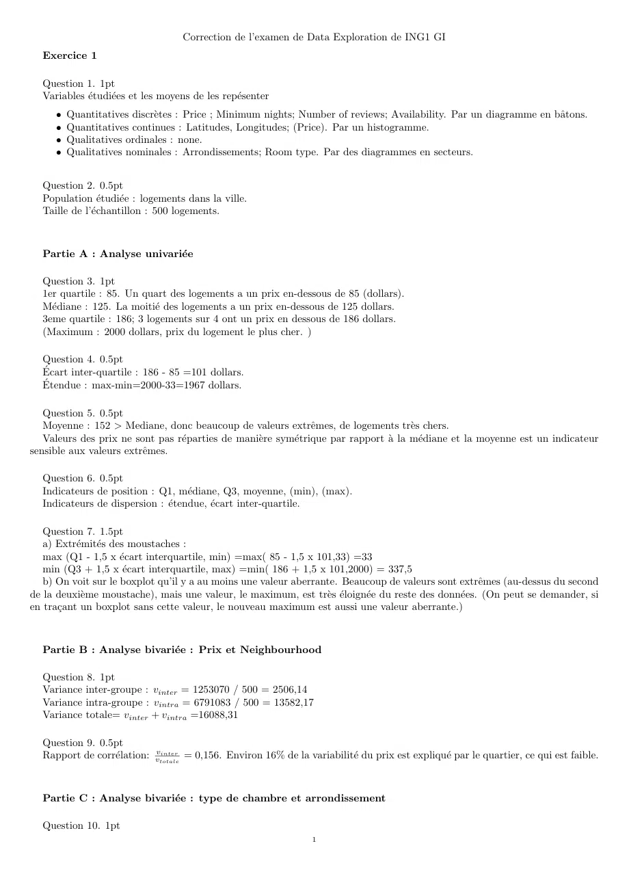
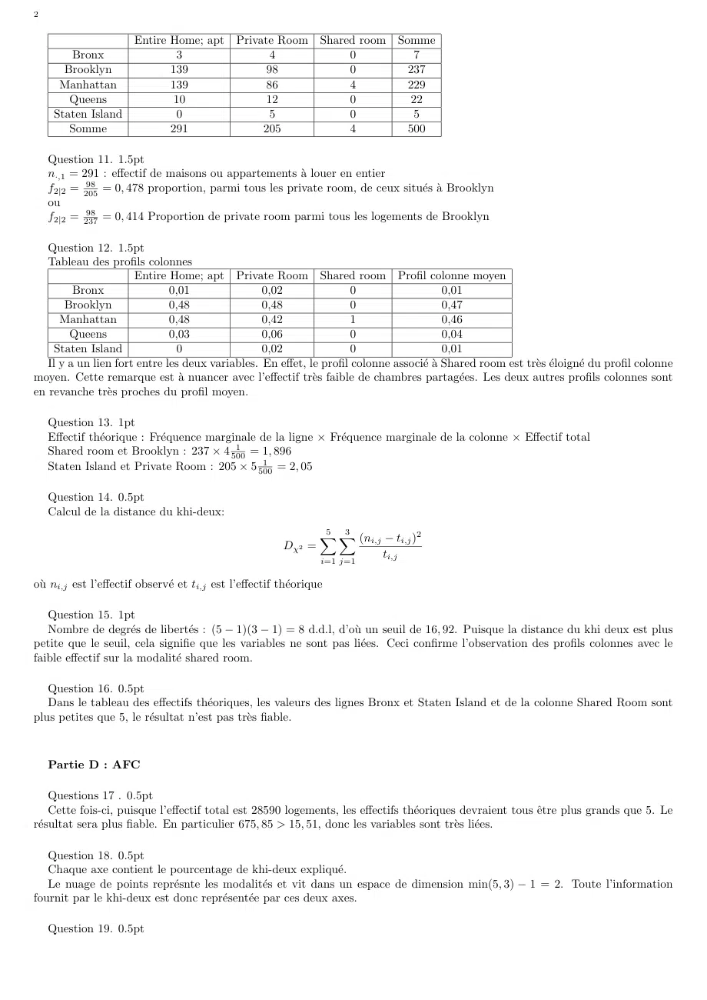
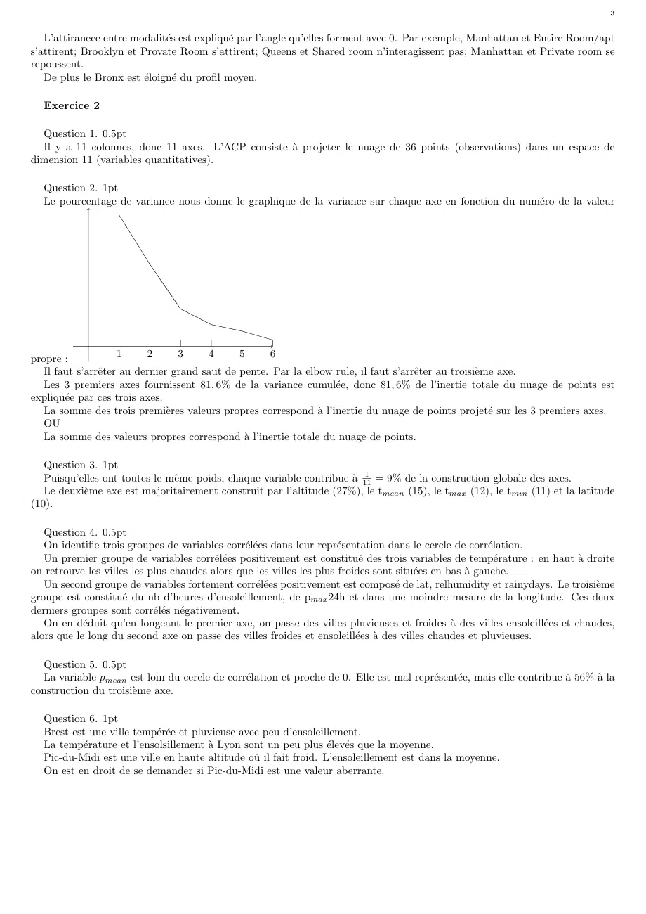

# DS-2023-2024-GM-Correction_Data-Exploration-DS.pdf

[Ouvrir l’original](https://drive.google.com/open?id=1xVUpd71rWLgC16kBqlyxBYUCeU5ID7Ml) · Les deux lectures automatiques du PDF divergent sur les pages indiquées. Leur fac-similé accompagne le texte.

**Pages présentant un écart entre les deux extractions** — 1–3.

## Page 1

~~~text
                                   Correction de l’examen de Data Exploration de ING1 GI
  Exercice 1

  Question 1. 1pt
  Variables étudiées et les moyens de les repésenter
     • Quantitatives discrètes : Price ; Minimum nights; Number of reviews; Availability. Par un diagramme en bâtons.
     • Quantitatives continues : Latitudes, Longitudes; (Price). Par un histogramme.
     • Qualitatives ordinales : none.
     • Qualitatives nominales : Arrondissements; Room type. Par des diagrammes en secteurs.

  Question 2. 0.5pt
  Population étudiée : logements dans la ville.
  Taille de l’échantillon : 500 logements.

  Partie A : Analyse univariée

  Question 3. 1pt
  1er quartile : 85. Un quart des logements a un prix en-dessous de 85 (dollars).
  Médiane : 125. La moitié des logements a un prix en-dessous de 125 dollars.
  3eme quartile : 186; 3 logements sur 4 ont un prix en dessous de 186 dollars.
  (Maximum : 2000 dollars, prix du logement le plus cher. )

  Question 4. 0.5pt
  Écart inter-quartile : 186 - 85 =101 dollars.
  Étendue : max-min=2000-33=1967 dollars.

   Question 5. 0.5pt
   Moyenne : 152 > Mediane, donc beaucoup de valeurs extrêmes, de logements très chers.
   Valeurs des prix ne sont pas réparties de manière symétrique par rapport à la médiane et la moyenne est un indicateur
sensible aux valeurs extrêmes.

  Question 6. 0.5pt
  Indicateurs de position : Q1, médiane, Q3, moyenne, (min), (max).
  Indicateurs de dispersion : étendue, écart inter-quartile.

   Question 7. 1.5pt
   a) Extrémités des moustaches :
   max (Q1 - 1,5 x écart interquartile, min) =max( 85 - 1,5 x 101,33) =33
   min (Q3 + 1,5 x écart interquartile, max) =min( 186 + 1,5 x 101,2000) = 337,5
   b) On voit sur le boxplot qu’il y a au moins une valeur aberrante. Beaucoup de valeurs sont extrêmes (au-dessus du second
de la deuxième moustache), mais une valeur, le maximum, est très éloignée du reste des données. (On peut se demander, si
en traçant un boxplot sans cette valeur, le nouveau maximum est aussi une valeur aberrante.)

  Partie B : Analyse bivariée : Prix et Neighbourhood

  Question 8. 1pt
  Variance inter-groupe : vinter = 1253070 / 500 = 2506,14
  Variance intra-groupe : vintra = 6791083 / 500 = 13582,17
  Variance totale= vinter + vintra =16088,31

  Question 9. 0.5pt
  Rapport de corrélation: vvtotale
                             inter
                                    = 0,156. Environ 16% de la variabilité du prix est expliqué par le quartier, ce qui est faible.

  Partie C : Analyse bivariée : type de chambre et arrondissement

  Question 10. 1pt
                                                                 1
~~~

## Page 2

~~~text
2

                       Entire Home; apt Private Room Shared room                   Somme
        Bronx                   3              4          0                           7
       Brooklyn               139             98          0                          237
      Manhattan               139             86          4                          229
        Queens                 10             12          0                           22
     Staten Island              0              5          0                           5
        Somme                 291            205          4                          500

    Question 11. 1.5pt
    n·,1 = 291 : effectif de maisons ou appartements à louer en entier
            98
    f2|2 = 205 = 0, 478 proportion, parmi tous les private room, de ceux situés à Brooklyn
    ou
            98
    f2|2 = 237 = 0, 414 Proportion de private room parmi tous les logements de Brooklyn

   Question 12. 1.5pt
   Tableau des profils colonnes
                      Entire Home; apt Private Room Shared room Profil colonne moyen
         Bronx                0,01               0,02                0                   0,01
       Brooklyn               0,48               0,48                0                   0,47
      Manhattan               0,48               0,42                1                   0,46
        Queens                0,03               0,06                0                   0,04
    Staten Island              0                 0,02                0                   0,01
   Il y a un lien fort entre les deux variables. En effet, le profil colonne associé à Shared room est très éloigné du profil colonne
moyen. Cette remarque est à nuancer avec l’effectif très faible de chambres partagées. Les deux autres profils colonnes sont
en revanche très proches du profil moyen.

    Question 13. 1pt
    Effectif théorique : Fréquence marginale de la ligne × Fréquence marginale de la colonne × Effectif total
                                          1
    Shared room et Brooklyn : 237 × 4 500    = 1, 896
                                               1
    Staten Island et Private Room : 205 × 5 500    = 2, 05

    Question 14. 0.5pt
    Calcul de la distance du khi-deux:
                                                                 5 X
                                                                   3
                                                                 X   (ni,j − ti,j )2
                                                         Dχ2 =
                                                                 i=1 j=1
                                                                            ti,j

où ni,j est l’effectif observé et ti,j est l’effectif théorique

   Question 15. 1pt
   Nombre de degrés de libertés : (5 − 1)(3 − 1) = 8 d.d.l, d’où un seuil de 16, 92. Puisque la distance du khi deux est plus
petite que le seuil, cela signifie que les variables ne sont pas liées. Ceci confirme l’observation des profils colonnes avec le
faible effectif sur la modalité shared room.

   Question 16. 0.5pt
   Dans le tableau des effectifs théoriques, les valeurs des lignes Bronx et Staten Island et de la colonne Shared Room sont
plus petites que 5, le résultat n’est pas très fiable.

    Partie D : AFC

    Questions 17 . 0.5pt
    Cette fois-ci, puisque l’effectif total est 28590 logements, les effectifs théoriques devraient tous être plus grands que 5. Le
résultat sera plus fiable. En particulier 675, 85 > 15, 51, donc les variables sont très liées.

   Question 18. 0.5pt
   Chaque axe contient le pourcentage de khi-deux expliqué.
   Le nuage de points représnte les modalités et vit dans un espace de dimension min(5, 3) − 1 = 2. Toute l’information
fournit par le khi-deux est donc représentée par ces deux axes.

    Question 19. 0.5pt
~~~

## Page 3

~~~text
                                                                                                                                  3

   L’attiranece entre modalités est expliqué par l’angle qu’elles forment avec 0. Par exemple, Manhattan et Entire Room/apt
s’attirent; Brooklyn et Provate Room s’attirent; Queens et Shared room n’interagissent pas; Manhattan et Private room se
repoussent.
   De plus le Bronx est éloigné du profil moyen.

  Exercice 2

  Question 1. 0.5pt
  Il y a 11 colonnes, donc 11 axes. L’ACP consiste à projeter le nuage de 36 points (observations) dans un espace de
dimension 11 (variables quantitatives).

  Question 2. 1pt
  Le pourcentage de variance nous donne le graphique de la variance sur chaque axe en fonction du numéro de la valeur

propre :             1     2      3     4      5     6
   Il faut s’arrêter au dernier grand saut de pente. Par la elbow rule, il faut s’arrêter au troisième axe.
   Les 3 premiers axes fournissent 81, 6% de la variance cumulée, donc 81, 6% de l’inertie totale du nuage de points est
expliquée par ces trois axes.
   La somme des trois premières valeurs propres correspond à l’inertie du nuage de points projeté sur les 3 premiers axes.
   OU
   La somme des valeurs propres correspond à l’inertie totale du nuage de points.

   Question 3. 1pt
                                                                         1
   Puisqu’elles ont toutes le même poids, chaque variable contribue à 11 = 9% de la construction globale des axes.
   Le deuxième axe est majoritairement construit par l’altitude (27%), le tmean (15), le tmax (12), le tmin (11) et la latitude
(10).

   Question 4. 0.5pt
   On identifie trois groupes de variables corrélées dans leur représentation dans le cercle de corrélation.
   Un premier groupe de variables corrélées positivement est constitué des trois variables de température : en haut à droite
on retrouve les villes les plus chaudes alors que les villes les plus froides sont situées en bas à gauche.
   Un second groupe de variables fortement corrélées positivement est composé de lat, relhumidity et rainydays. Le troisième
groupe est constitué du nb d’heures d’ensoleillement, de pmax 24h et dans une moindre mesure de la longitude. Ces deux
derniers groupes sont corrélés négativement.
   On en déduit qu’en longeant le premier axe, on passe des villes pluvieuses et froides à des villes ensoleillées et chaudes,
alors que le long du second axe on passe des villes froides et ensoleillées à des villes chaudes et pluvieuses.

  Question 5. 0.5pt
  La variable pmean est loin du cercle de corrélation et proche de 0. Elle est mal représentée, mais elle contribue à 56% à la
construction du troisième axe.

  Question 6. 1pt
  Brest est une ville tempérée et pluvieuse avec peu d’ensoleillement.
  La température et l’ensolsillement à Lyon sont un peu plus élevés que la moyenne.
  Pic-du-Midi est une ville en haute altitude où il fait froid. L’ensoleillement est dans la moyenne.
  On est en droit de se demander si Pic-du-Midi est une valeur aberrante.
~~~
