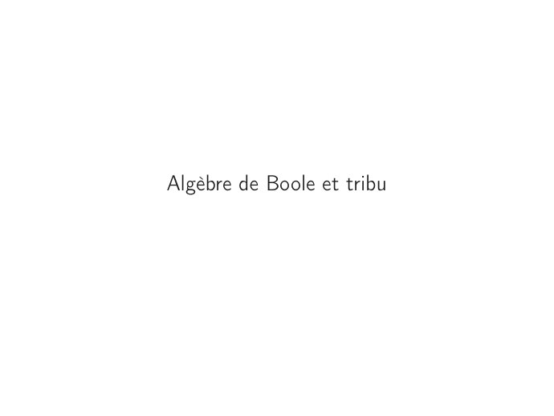

# CM1-Tribu-et-application-mesurable_Mesures-et-integration.pdf

[Ouvrir l’original](https://drive.google.com/open?id=1491tlo-f-27FV1jk7fxvk1dS5jzdR-Kj) · Les pages signalées comprennent du texte reconnu automatiquement ou des éléments graphiques. Le fac-similé permet de vérifier chaque lecture.

**Pages avec fac-similé ou lecture OCR** — 3, 6, 11.

## Page 1

~~~text
Ingénieurs 1ère année : Mathématiques appliquées

            Mesure et intégration

    CM1 – Tribu et application mesurable

          Nisrine FORTIN CAMDAVANT
~~~

## Page 2

~~~text
1   Introduction au module

2   Algèbre de Boole et tribu

3   Tribu engendrée, tribu borélienne
      Tribu engendrée
      Tribu borélienne

4   Application mesurable
~~~

## Page 3

~~~text
Introduction au module et organisation
~~~

## Page 4

~~~text
  Introduction au module     Algèbre de Boole et tribu    Tribu engendrée, tribu borélienne   Application mesurable

  Introduction au module

              La théorie de la mesure permet d’associer une grandeur numérique à un
                  ensemble. Plusieurs types de "mesures" ont déjà été rencontrés.

               Le cardinal d’un ensemble discret : le cardinal de {10, 19, 25, 75} est 4 et le cardinal de
               N est +∞.

               La longueur d’une courbe : la longueur de l’intervalle [a, b], a ≤ b est b − a et la
               longueur de la droite réelle est +∞.

               L’aire d’une figure plane : l’aire du disque D(0, R) centré en (0, 0) et de rayon R est
               πR2 .

               Le volume d’un solide en dimension 3 : le volume du cylindre de base le disque D(0, R)
               et de hauteur h est πR2 h.

               La probabilité d’un évènement : la probabilité d’avoir la face quatre lors d’un lancer de
               dé équilibré est 1/6.

4/25
~~~

## Page 5

~~~text
  Introduction au module   Algèbre de Boole et tribu   Tribu engendrée, tribu borélienne   Application mesurable

  Aperçu sur l’organisation du module

               Ces exemples forment des cas particuliers d’une notion plus générale de
               mesures (Chapitre 2), outil de base pour une nouvelle théorie de
               l’intégration, dite intégrale de Lebesgue (Chapitre 3).

               L’intégrale au sens de Lebesgue généralise la notion de l’intégrale de
               Riemann. Cette nouvelle théorie s’applique à une classe de fonctions
               beaucoup plus grande (les fonctions mesurables), cette dernière étend la
               notion de continuité de fonctions (Chapitre 1).

               Une mesure est associée à une famille d’ensembles à mesurer, appelée
               tribu de parties (Chapitre 1). Ainsi, une tribu va englober des ensembles
               mesurables par une mesure donnée.

               On définira les fonctions qui préservent la propriété de mesurabilité de
               l’image réciproque d’un ensemble mesurable.

               Cette théorie s’appliquera à des théorèmes de convergence beaucoup plus
               puissants : théorème de convergence monotone, théorème de convergence
               dominée (Chapitre 4).

5/25
~~~

## Page 6

~~~text
Algèbre de Boole et tribu
~~~

## Page 7

~~~text
  Introduction au module     Algèbre de Boole et tribu   Tribu engendrée, tribu borélienne   Application mesurable

        Intuitivement, si on se place dans un ensemble non vide Ω, une tribu définie sur
        Ω contiendra des sous-ensembles de Ω. Ces ensembles qu’on mesure seront
        "rassemblés" de la façon suivante :
               :::::::::::::::::::::::::::::::::::::::::::::::::::::
               La mesure choisie doit nous permettre de mesurer Ω donc

                                            Ω doit appartenir à la tribu ;

               Si A appartient à la tribu, on peut donc la mesurer et on souhaite que le
               complémentaire de A dans Ω soit aussi mesurable donc on impose dans la
               définition
                           la condition de stabilité par passage au complémentaire ;

               Si on sait mesurer deux parties A et B (appartiennent donc à la tribu), on
               souhaite que leur union soit aussi mesurable donc on impose dans la
               définition
                               la condition de stabilité par union dénombrable.
               :::::::::::::::::::::::::::::::::::::::::::::::::::::

7/25
~~~

## Page 8

~~~text
  Introduction au module   Algèbre de Boole et tribu   Tribu engendrée, tribu borélienne   Application mesurable

  Algèbre de Boole et tribu

        Algèbre de Boole
        Soit A ⊂ P(Ω). On dit que A est une algèbre de Boole (de parties de Ω) si elle
        vérifie les propriétés suivantes :
            1   Ω ∈ A,
            2   A ∈ A =⇒ Ω\A ∈ A,
            3   A ∈ A, B ∈ A =⇒ A ∪ B ∈ A.

        Tribu
        Soit T ⊂ P(Ω), on dit que T est une tribu de parties (ou σ-algèbre) si elle
        vérifie :
            1   Ω∈T,
            2   la stabilité par passage au complémentaire : A ∈ T =⇒ Ω\A ∈ T ,
            3   laSstabilité par réunion dénombrable : Si An ∈ T pout tout n ∈ N alors
                    An ∈ T .
                n∈N

8/25
~~~

## Page 9

~~~text
  Introduction au module    Algèbre de Boole et tribu    Tribu engendrée, tribu borélienne   Application mesurable

  Algèbre de Boole et tribu

        Conséquence
        :::::::::::
                    :
               Une tribu est une algèbre de Boole stable par réunion dénombrable.
               ∅∈T
                                                        T
               Si An ∈ T pour tout n ∈ N alors                An ∈ T .
                                                        n∈N
        Démonstration TD 1

               Exemples.
                   ♢ La plus petite tribu de Ω est T = {∅, Ω} , elle est appelée tribu
                     grossière.

                   ♢ La plus grande tribu de Ω est T = P (Ω) , elle est appelée tribu
                     discrète.

9/25
~~~

## Page 10

~~~text
  Introduction au module     Algèbre de Boole et tribu   Tribu engendrée, tribu borélienne   Application mesurable

  La tribu trace

               Tribu trace
                Soient T une tribu de parties sur Ω et U ⊂ Ω.

                                               TU = {A ∩ U, A ∈ T }

                est une tribu sur U. Cette tribu est appelée la tribu trace sur U.
        Démonstration TD 1.

10/25
~~~

## Page 11

~~~text
Tribu engendrée, tribu borélienne
~~~

## Page 12

~~~text
  Introduction au module    Algèbre de Boole et tribu   Tribu engendrée, tribu borélienne   Application mesurable

  Tribu engendrée, tribu borélienne

        En général, une tribu contient énormément d’éléments d’où le nom de tribu.

           ⇝ Souvent, on ne peut pas décrire tous les éléments d’une tribu mais cela
             n’a pas d’importance.

           ⇝ En effet, ce qu’il faut retenir, sont certaines parties de Ω de la tribu et on
             doit rester dans la tribu lorsqu’on itère sur les éléments de la tribu les
             opérations
                      de complémentarité,
                      de réunion dénombrable.

12/25
~~~

## Page 13

~~~text
  Introduction au module   Algèbre de Boole et tribu   Tribu engendrée, tribu borélienne   Application mesurable

  Tribu engendrée

        Soit Ω un ensemble et H ⊂ P(Ω).

        Définition
        On dit que T est la tribu engendrée par H si T est la plus petite tribu (au sens
        de l’inclusion) de parties de Ω contenant H.
        On note dans ce cas, T = σ(H).

        Proposition
        σ(H) existe toujours, c’est l’intersection de toutes les tribus sur Ω contenant H.

13/25
~~~

## Page 14

~~~text
  Introduction au module   Algèbre de Boole et tribu      Tribu engendrée, tribu borélienne   Application mesurable

  Tribu engendrée - Exemples

               Si H = {∅} ou bien si H = {Ω}, alors
                                                   σ(H) = {∅, Ω}.

               Si H = {A} ou bien si H = {Ac } où A ̸= ∅ et A ̸= Ω, alors
                                               σ(H) = {∅, Ω, A, Ac }.

               Soient Ω = {a, b, c}, H = {{a}; {b}} ; on peut décrire la tribu engendrée
               par H :
                                                                                  
                          
                                                                                  
                                                                                   
                   σ(H) =      Ω
                              |{z}  ;∅; {a} ; {b}  ;{b, c};{a, c} ; {a, b} ; {c}     .
                          
                          Ω∈tribu      | {z } | {z } | {z } | {z }          |{z} 
                                           les éléments de H   {a}c    {b}c    {a}∪{b} ({a}∪{b})c

14/25
~~~

## Page 15

~~~text
  Introduction au module     Algèbre de Boole et tribu         Tribu engendrée, tribu borélienne   Application mesurable

  Tribu engendrée

               Propriétés.
                Soient H1 ⊂ P(Ω) et H2 ⊂ P(Ω).

                   1   H1 ⊂ σ(H1 ).
                             ∥ ⇝ Par définition de σ(H1 ).
                   2   Si T est une tribu contenant H alors σ(H) ⊂ T .
                             ∥ ⇝ Par définition de σ(H).
                   3   Si H1 ⊂ H2 alors σ(H1 ) ⊂ σ(H2 ).
                                 ⇝ H1 ⊂ H2 ⊂ σ (H2 ) .
                                 ⇝ σ (H2 ) est une tribu.
                                 ⇝ Donc σ (H2 ) est une tribu qui contient H1 et comme σ (H1 )
                                   est la plus petite tribu contenantH1 alors

                                                         σ (H1 ) ⊂ σ (H2 ) .

15/25
~~~

## Page 16

~~~text
  Introduction au module     Algèbre de Boole et tribu     Tribu engendrée, tribu borélienne   Application mesurable

  Tribu borélienne

        Si l’ensemble Ω possède une structure topologique, la notion de tribu
        engendrée permet de définir la plus petite tribu adaptée à cette structure.

               Définition : Soit (Ω, d) un espace métrique. On appelle tribu borélienne
               de Ω, la tribu engendrée par les ouverts de (Ω, d). On la note B(Ω) et ses
               éléments sont appelés les boréliens de Ω.

               Définition : La tribu borélienne sur R (respectivement R) est la tribu
               engendrée par les intervalles ouverts de R.

               T définit une topologie sur Ω si Ω ∈ T , ∅ ∈ T , la stabilité par union finie ou infinie et
               par intersection finie est vérifiée.
               (Ω, d) est un espace métrique lorsque Ω est muni d’une distance d : Ω → R+ vérifiant
               les propriétés suivantes 1. d(x, y ) = 0 ⇔ x = y , 2. d(x, y ) = d(y , x) et 3.
               d(x, z) ≤ d(x, y ) + d(y , z).

16/25
~~~

## Page 17

~~~text
  Introduction au module     Algèbre de Boole et tribu    Tribu engendrée, tribu borélienne   Application mesurable

  Tribu borélienne

               Exemple.
                [1; 2[ ∈ B(R), en effet, [1; 2[ = ]1; 2[ ∪ {1} et

                   ♢ ]1; 2[ ∈ B(R),

                             +∞
                                                    
                             T              1      1
                   ♢ {1} =             1−     ;1 +    .
                             n=1            n      n
                                   |         {z      }
                                        An ∈B(R)

17/25
~~~

## Page 18

~~~text
                Application mesurable
La notion de fonctions mesurables étend la notion de fonctions continues. Elle
   prend son sens sur des ensembles munis d’une tribu et joueront un rôle
              important dans l’intégration au sens de Lebesgue.

On appelle espace mesurable tout couple (Ω, T ) formé par un ensemble Ω et
une tribu T sur Ω.

Les ensembles mesurables sont les parties de Ω qui appartiennent à T : A est
mesurable si A ∈ T .
~~~

## Page 19

~~~text
  Introduction au module    Algèbre de Boole et tribu   Tribu engendrée, tribu borélienne   Application mesurable

  Applications mesurables

        Soient (Ω1 , T1 ) et (Ω2 , T2 ) deux espaces mesurables. Soit f : Ω1 → Ω2 .

        Application mesurable
        On dit que f est (T1 , T2 )-mesurable si l’image réciproque de tout élément de T2
        par f appartient à T1 :
                                     ∀B ∈ T2 , f −1 (B) ∈ T1 .

        Quand il n’y a pas de confusion possible, on dit que f est mesurable.

        Application borélienne
        Soient (Ω1 , d) et (Ω2 , δ) deux espaces métriques et soit f : Ω1 → Ω2 . Si f est
        (B(Ω1 ), B(Ω2 ))-mesurable, on dit que f est borélienne.

        f −1 (B) = {x ∈ Ω1 , f (x) ∈ B} .

19/25
~~~

## Page 20

~~~text
  Introduction au module   Algèbre de Boole et tribu     Tribu engendrée, tribu borélienne       Application mesurable

               Exemple.
                Si f est une fonction constante alors f est mesurable, en effet :

                                  ∀x ∈ Ω1 , f (x) = y0 , où y0 ∈ Ω2 .
                                                                 
                                                                  ∅                         si y0 ∈
                                                                                                   /B
                Soit B ∈ TY alors f −1 (B) = {x ∈ Ω1 , y0 ∈ B} =
                                                                      Ω1                     si y0 ∈ B
                                                                 

                Puisque T1 est une tribu sur Ω1 alors Ω1 ∈ T1 et ∅ ∈ T1 , ainsi

                                                   f −1 (B) ∈ T1 .

                               La fonction constante est donc mesurable.

20/25
~~~

## Page 21

~~~text
  Introduction au module      Algèbre de Boole et tribu   Tribu engendrée, tribu borélienne   Application mesurable

               Propriétés.
                   1   Soit f : (Ω1 , T1 ) → (Ω2 , T2 ). Si T2 = σ (C2 ) alors f est mesurable si
                       et seulement si
                                               ∀B ∈ C2 , f −1 (B) ∈ T1 .
                       Démonstration – Voir Notes de cours.

                   2   Soient (Ω, T ) un espace mesurable et A une partie de Ω.
                       La fonction indicatrice 1A est mesurable si et seulement si A ∈ T .
                       Démonstration – Voir TD 1.

                   3   Soient (Ω1 , T1 ), (Ω2 , T2 ) et (Ω3 , T3 ) des espaces mesurables. Soient

                                    f : Ω1 → Ω2 une fonction (T1 , T2 )-mesurable

                                    g : Ω2 → Ω3 une fonction (T2 , T3 )-mesurable
                       alors g ◦ f est (T1 , T3 )-mesurable.
                       ⇝ Démonstration – Voir TD 1.

21/25
~~~

## Page 22

~~~text
  Introduction au module   Algèbre de Boole et tribu   Tribu engendrée, tribu borélienne   Application mesurable

  Application mesurable

        Corollaire
        Si f est continue alors f elle est borélienne.

               Mise en garde

                Attention : la réciproque est fausse. Voir exemple (*).

        Si f : Ω1 → Ω2 avec Ω1 et Ω2 munis respectivement d’une structure topologique T1 et T2 ,
        alors on dit que f est continue si f −1 O2 ∈ T1 .
                                                     
                                                |{z}
                                                 ∈T2

22/25
~~~

## Page 23

~~~text
  Introduction au module     Algèbre de Boole et tribu        Tribu engendrée, tribu borélienne   Application mesurable

               Opérations sur les fonctions mesurables numériques
                Soit (Ω, T ) un espace mesurable, f , g : (Ω, T ) → (R, B(R)) des fonc-
                tions mesurables et λ ∈ R, alors

                                f + g,      fg ,       λf ,   min(f , g ),        max(f , g ).

                sont mesurables.
        Démonstrations – Voir Notes de cours.

               Conséquences
                       Soient fn : Ω → R des fonctions mesurables, alors

                                      inf fn , sup fn , lim inf fn           et     lim sup fn
                                       n           n            n                      n

                       sont mesurables à valeurs dans R.
                       Soit f : Ω → R une fonction mesurable, alors |f | est une fonction
                       mesurable.
        Démonstrations – TD 1.

23/25
~~~

## Page 24

~~~text
  Introduction au module    Algèbre de Boole et tribu   Tribu engendrée, tribu borélienne   Application mesurable

        Proposition

                         S finie ou infinie d’éléments disjoints deux à deux dans T1
        Soit (Un )n une suite
        telle que Ω1 =      Un . Soit f : Ω1 → Ω2 , alors f est (T1 , T2 )-mesurable si et
                           n∈N
        seulement si f|Un (restriction de f à Un ) est (TUn , T2 )-mesurable pour tout n.

24/25
~~~

## Page 25

~~~text
  Introduction au module     Algèbre de Boole et tribu   Tribu engendrée, tribu borélienne   Application mesurable

               Exemple*.
                Ω1 = Ω2 = R, T1 = T2 = B(R).

                                     f :     Ω 1 → Ω2
                                                            1
                                                          
                                                          
                                                                    si x ̸= 0
                                             x 7→ f (x) =   x
                                                          
                                                            1        si x = 0
                                                          

                On note U0 =] − ∞; 0[, U1 = {0} et U2 =]0; +∞[.
                       ] − ∞; 0[ est ouvert ⇒ U0 ∈ B(R).
                       {0} est fermé ⇒ U1 ∈ B(R).
                       ]0; +∞[ est ouvert ⇒ U2 ∈ B(R).
                       U0 ∪ U1 ∪ U2 = R.
                       f|U0 est continue ⇒ f est (TU0 , B(R))-mesurable.
                       f|U1 est constante ⇒ f est (T{0} , B(R))-mesurable.
                       f|U2 est continue ⇒ f est (TU2 , B(R))-mesurable.

                f est donc (B(R), B(R))-mesurable.
25/25
~~~
