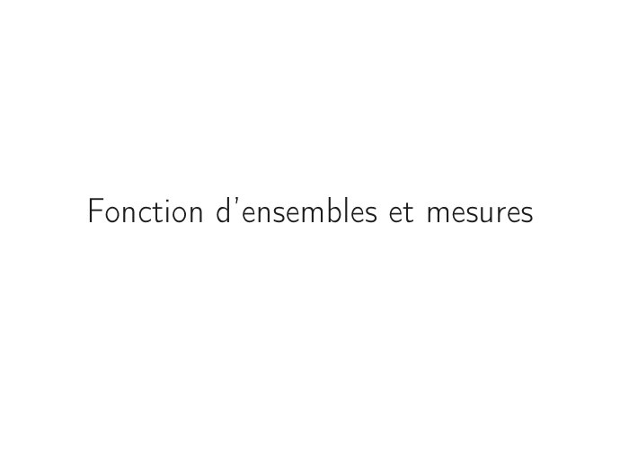
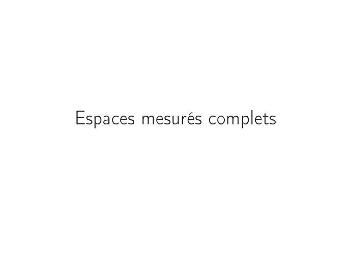

# CM2-Introduction-a-la-mesure_Mesures-et-integration.pdf

[Ouvrir l’original](https://drive.google.com/open?id=1dFPWMYdX-B86F5WNa1lK9FxuUTwygCAF) · Les pages signalées comprennent du texte reconnu automatiquement ou des éléments graphiques. Le fac-similé permet de vérifier chaque lecture.

**Pages avec fac-similé ou lecture OCR** — 3, 19.

## Page 1

~~~text
Ingénieurs 1ère année : Mathématiques appliquées

            Mesure et intégration

       CM2 – Introduction à la mesure

          Nisrine FORTIN CAMDAVANT
~~~

## Page 2

~~~text
1   Fonction d’ensembles et mesures

2   Exemples

3   Conséquences de la σ-additivité

4   Ensembles négligeables

5   Espaces mesurés complets
~~~

## Page 3

~~~text
Fonction d’ensembles et mesures
~~~

**Lecture OCR à contrôler**

~~~text
Fonction d'ensembles et mesures
~~~

## Page 4

~~~text
  Fonction d’ensembles et mesures Exemples Conséquences de la σ-additivité Ensembles négligeables Espaces mesurés complets

        Fonction d’ensembles
        Soit Ω un ensemble non vide et T ⊂ P(Ω). Une fonction

                                                 m : T −→ [0, +∞]

        est appelée une fonction d’ensembles positive.

        Une "mesure abstraite" est une fonction d’ensemble vérifiant certaines
        propriétés. Une propriété que l’on exigera d’une telle fonction sera l’additivité
        au sens suivant :
        La σ-additivité
        Une fonction m : T −→ [0, +∞]Sest σ-additive si et seulement si pour toute
        suite (An )n∈N dans T vérifiant An ∈ T et An ∩ Ap = ∅ pour n ̸= p,
                                                  n∈N
                                                            !
                                                 [                  X
                                           m           An       =         m (An ) .
                                                 n∈N                n∈N

4/26
~~~

## Page 5

~~~text
  Fonction d’ensembles et mesures Exemples Conséquences de la σ-additivité Ensembles négligeables Espaces mesurés complets

        On appelle mesure positive une fonction d’ensemble positive, σ-additive, définie
        sur une tribu T et vérifiant m(∅) = 0.

               Autrement dit,
                si T est une tribu de parties de Ω et si m : T −→ [0, +∞], m est une
                mesure positive sur T si et seulement si les conditions suivantes sont
                vérifiées :

                   1   m(∅) = 0

                   2   (An )n∈N ∈ T N avec An ∩ Ap = ∅ pour n ̸= p alors
                                             [  X
                                           m      An =      m(An ).
                                                       n∈N           n∈N

5/26
~~~

## Page 6

~~~text
  Fonction d’ensembles et mesures Exemples Conséquences de la σ-additivité Ensembles négligeables Espaces mesurés complets

  Exemples

               Mesure de Dirac
                Soit x0 ∈ Ω. On pose :
                                                         
                                                          1      si x0 ∈ A
                                             m(A) =
                                                             0    si x0 ∈
                                                                        /A
                                                         

                Si Ω est muni d’une tribu T , m est une mesure appelée mesure de Dirac
                de masse 1 et concentrée au point x0 et elle est notée δx0 .

               Mesure de comptage
                Soit m : P(Ω) −→ [0, +∞] définie par
                                      
                                       card (A) si A est fini
                               m(A) =
                                         +∞          si A est infini
                                      

                       m est une mesure.
                       m aura beaucoup d’intérêt pour Ω = N.
6/26
~~~

## Page 7

~~~text
  Fonction d’ensembles et mesures Exemples Conséquences de la σ-additivité Ensembles négligeables Espaces mesurés complets

  Exemples

               Mesure de Lebesgue sur R
                Soit Ω l’ensemble des unions finies d’intervalles semi-ouverts. Si

                                        A = [a1 , b1 [∪[a2 , b2 [∪ · · · ∪ [an , bn [

                avec a1 < b1 < a2 < b2 < · · · < an < bn . On pose
                                                            n
                                                            X
                                                 m(A) =            (bi − ai ) .
                                                             i=1

                En prolongeant m à la plus petite tribu contenant Ω, on obtient la mesure
                de Lebesgue sur R, notée λ.

                    
               λ {x} = 0, ∀x ∈ R.

                                                       
               λ [ai , bi [ = λ ]ai , bi [ = λ [ai , bi ] = bi − ai .

7/26
~~~

## Page 8

~~~text
  Fonction d’ensembles et mesures Exemples Conséquences de la σ-additivité Ensembles négligeables Espaces mesurés complets

  Propriétés : conséquences de la σ-additivité

                   Soit Ω un ensemble, T est une tribu de parties de Ω et m une
                    mesure positive sur T . On a alors les propriétés suivantes :

8/26
~~~

## Page 9

~~~text
  Fonction d’ensembles et mesures Exemples Conséquences de la σ-additivité Ensembles négligeables Espaces mesurés complets

               Propriétés.

                        A, B ∈ T 2 . A ⊂ B =⇒ m(A) ≤ m(B).
                            
                   1

                             ∥ ⇝ Démonstration – Voir TD 2.
                                                         S    X
                   2   An ∈ T pour tout n ∈ N, alors m      An ≤  m(An ).
                                                                     n∈N            n∈N

                               ∥   ⇝ Démonstration – Voir TD 2.

                   3   An ∈ T pour tout n ∈ N, avec An ⊂ An+1 ∀n alors
                                              [ 
                                           m     An = lim m(An ).
                                                                      n→+∞
                                                        n∈N

                               ∥ ⇝ Démonstration – Voir Notes de cours.
                   4   An ∈ T pour tout n ∈ N, avec An+1 ⊂ An ∀n et m(A0 ) < +∞ alors
                                              \ 
                                           m     An = lim m(An ).
                                                                      n→+∞
                                                        n∈N

                               ∥ ⇝ Démonstration – Voir Notes de cours.

9/26
~~~

## Page 10

~~~text
  Fonction d’ensembles et mesures Exemples Conséquences de la σ-additivité Ensembles négligeables Espaces mesurés complets

  Remarques

               Mise en garde.

                 ⇝ Dans la propriété 4. de la proposition précédente, on peut remplacer
                       l’hypothèse
                                                          ”m(A0 ) < +∞”
                       par "il existe k ∈ N tel que m(Ak ) < +∞".

                  ⇝ Si on ne met pas l’hypothèse m(A0 ) < +∞ (ou il existe k ∈ N tel que
                    m(Ak ) < +∞), la propriété 4. n’est plus valable.

                       Exemple
                       ::::::::
                                : Prenons Ω = N, T = P(N), m la mesure de comptage sur
                       N.                                                   
                                                     T                  T
                       Soit An = {n, n + 1, . . .},     An = ∅, donc m     An = 0. D’autre
                                                    n∈N       T      n∈N
                       part m(An ) = +∞ ∀n ∈ N, donc m            An ̸= lim m(An ).
                                                                        n∈N             n

10/26
~~~

## Page 11

~~~text
          Ensembles négligeables

Les ensembles négligeables jouent un rôle très important dans la théorie
de la mesure et de l’intégration.

Les ensembles négligeables vont permettre d’exprimer le fait que certaines
propriétés ponctuelles (continuité, convergence simple, majoration,...)
n’ont pas lieu en tout point mais seulement "presque partout", c’est à
dire sur le complémentaire d’un ensemble négligeable.

Il s’avère techniquement nécessaire de ne pas restreindre la notion
d’ensemble négligeable aux seuls sous-ensembles mesurables.
~~~

## Page 12

~~~text
  Fonction d’ensembles et mesures Exemples Conséquences de la σ-additivité Ensembles négligeables Espaces mesurés complets

  Ensembles négligeables

        Dans tout ce chapitre, Ω désigne un ensemble quelconque non vide, T une
        tribu de parties de Ω et m une mesure positive sur T . Le triplet (Ω, T , m) est
        appelé un espace mesuré.

        Définition
            1   On dit qu’un ensemble N ∈ T est m-négligeable si m(N) = 0.

            2   On dit qu’une partie N de Ω est m-négligeable s’il existe A ∈ T tel que
                N ⊂ A et m(A) = 0.

12/26
~~~

## Page 13

~~~text
  Fonction d’ensembles et mesures Exemples Conséquences de la σ-additivité Ensembles négligeables Espaces mesurés complets

  Ensembles négligeables – Exemples

        On considère l’espace mesuré (Ω, T , m) où Ω = {a; b; c}, a, b et c des réels et

                                               = {Ω, ∅, {a, b}, {c}} .

        Cas où m = δc est la mesure de Dirac concentrée en c.
          ⇝ Les parties mesurables de mesure nulle : δc (∅) = 0, δc ({a, b}) = 0 car
            c∈/ {a, b}.
          ⇝ Les parties non mesurables négligeables :
                  ♢ {a} ⊂ {a, b} et δc ({a, b}) = 0 donc {a} est δc -négligeable.

                  ♢ {b} ⊂ {a, b} et δc ({a, b}) = 0 donc {b} est δc -négligeable.

        Les ensembles δc -négligeables sont donc ∅, {a, b}, {a} et {b}.

13/26
~~~

## Page 14

~~~text
  Fonction d’ensembles et mesures Exemples Conséquences de la σ-additivité Ensembles négligeables Espaces mesurés complets

  Ensembles négligeables – Exemples

        Cas où m = µd est la mesure de comptage.
          ⇝ Les parties mesurables de mesure nulle : µd (∅) = 0.

          ⇝ Les parties non mesurables négligeables : La seule partie mesurable de
            mesure nulle est l’ensemble vide et ce dernier ne contient aucune partie de
            Ω.
        L’unique ensemble µd -négligeable est donc ∅.

14/26
~~~

## Page 15

~~~text
  Fonction d’ensembles et mesures Exemples Conséquences de la σ-additivité Ensembles négligeables Espaces mesurés complets

  Ensembles négligeables – Exemples

        Cas où m = λ est la mesure de Lebesgue.
          ⇝ Les parties mesurables de mesure nulle : λ (∅) = 0,
               λ (Ω) = λ ({a, b, c}) = 0 car {a, b, c} est dénombrable.
               {a, b} ⊂ Ω, {c} ⊂ Ω et λ (Ω) = 0 donc λ ({a, b}) = λ ({c}) = 0.

          ⇝ Les parties non mesurables négligeables : Toutes les parties de Ω sont par
            définition inclues dans Ω, λ (Ω) = 0 donc toutes les parties de Ω sont
            λ-négligeables.
        Les ensembles λ-négligeables sont donc toutes les parties de Ω.

15/26
~~~

## Page 16

~~~text
  Fonction d’ensembles et mesures Exemples Conséquences de la σ-additivité Ensembles négligeables Espaces mesurés complets

  Ensembles négligeables – Propriétés

           1    ∅ est m-négligeable.
            2   Si N est un ensemble m-négligeable, N ′ ∈ T avec N ′ ⊂ N, alors N ′ est
                m-négligeable.
            3   La réunion d’une famille dénombrable d’ensembles m-négligeables est
                m-négligeable.

        Démonstration.
        ::::::::::::
                       Voir Notes de cours.

16/26
~~~

## Page 17

~~~text
  Fonction d’ensembles et mesures Exemples Conséquences de la σ-additivité Ensembles négligeables Espaces mesurés complets

               Mise en garde.

                La réunion d’une famille infinie non dénombrable d’ensembles m-négligeables
                n’est pas m-négligeable.

                                                     
                       En effet, pour Ω = R, T = B R et m = λ où λ est la mesure de Lebesgue, on
                       considère                                [
                                                   A = [0, 1] =   {x}.
                                                                       x∈[0,1]

                                 ⇝     A ∈ T et λ(A) = 1       donc A n’est pas λ-négligeable.

                                 ⇝     λ ({x}) = 0, ∀x ∈ [0, 1].
                                         S
                                 ⇝            {x} n’est pas λ-négligeable même si {x} est λ-négligeable.
                                       x∈[0,1]

17/26
~~~

## Page 18

~~~text
  Fonction d’ensembles et mesures Exemples Conséquences de la σ-additivité Ensembles négligeables Espaces mesurés complets

  Presque partout

        Définition
        Une propriété P(x) dépendant de l’élément x ∈ Ω est dite vérifiée m-presque
        partout (ou simplement presque partout quand il n’y a pas d’ambiguité) si
        l’ensemble des x de Ω pour lesquels la propriété P(x) est fausse est
        m-négligeable.

        On écrira en abrégé P(x) est m-p.p. (ou simplement p.p. quand il n’ya pas
        d’ambiguité).

18/26
~~~

## Page 19

~~~text
Espaces mesurés complets
~~~

## Page 20

~~~text
  Fonction d’ensembles et mesures Exemples Conséquences de la σ-additivité Ensembles négligeables Espaces mesurés complets

  Espaces mesurés complets

        On a vu qu’une partie N de Ω m-négligeable n’est pas nécessairement un
        élément de la tribu T .

          ⇝ Pourtant pour respecter le principe de monotonie croissante de la mesure
            m, il est naturel d’attribuer à N la mesure 0.
          ⇝ On est alors en train d’élargir la tribu T .

        D’où la définition suivante :
        Définition
        Si toutes les parties de Ω m-négligeables sont mesurables, on dit que l’espace
        (Ω, T , m) est complet.

20/26
~~~

## Page 21

~~~text
  Fonction d’ensembles et mesures Exemples Conséquences de la σ-additivité Ensembles négligeables Espaces mesurés complets

  Espaces mesurés complets – Exemple

        On considère l’espace mesuré (Ω, T , m) où Ω = {a; b; c}, a, b et c des réels et
        T = {Ω, ∅, {a, b}, {c}}.
               Cas  où m = δ est la mesure de Dirac concentrée en c. L’ensemble des
               :::::::::::c::::::::::::::::::::::::::::::::
               parties δc -négligeables est

                                               N = {∅, {a, b} , {a} , {b}}

               {a} est δc -négligeable mais non mesurable donc (Ω, T , δc ) n’est pas un
               espace mesuré complet.
               Cas où m = µ est la mesure de comptage. L’ensemble des parties
               ::::::::::::   d ::::::::::::::::::::::
               µd -négligeables est
                                                          N = {∅} .
               ∅ est µd -négligeable et mesurable donc (Ω, T , µd ) est un espace mesuré
               complet.
               Cas où m = λ est la mesure de Lebesgue. L’ensemble des parties
               ::::::::::::::::::::::::::::::::
               λ-négligeables est
                                            N = P (Ω) .
               {a} est λ-négligeable mais non mesurable donc (Ω, T , λ) n’est pas un
               espace mesuré complet.
21/26
~~~

## Page 22

~~~text
  Fonction d’ensembles et mesures Exemples Conséquences de la σ-additivité Ensembles négligeables Espaces mesurés complets

  Complétion d’un espace mesurable

        Lorsqu’un espace mesuré (Ω, T , m) n’est pas complet, on peut le compléter
        canoniquement de la façon suivante :

        Propriété
        Soit (Ω, T , m) un espace mesuré et soit N l’ensemble des parties
        m-négligeables. On considère

                                        Te = {A ∪ N; A ∈ T et N ∈ N }.

        Pour tout A ∈ T et pour tout N ∈ N , on pose m(A
                                                     e ∪ N) = m(A). Alors
            1   Te est une tribu sur Ω contenant T ;
            2   me définit une mesure positive sur Te qui coïncide avec m sur T ;
            3   Si on note Ne la famille des sous-ensembles de Ω m-négligeables
                                                                 e              alors
                Ne =N;
            4   (Ω, Te , m)
                         e est un espace mesuré complet.

        Démonstration.
        ::::::::::::
                       Voir TD 2.

22/26
~~~

## Page 23

~~~text
  Fonction d’ensembles et mesures Exemples Conséquences de la σ-additivité Ensembles négligeables Espaces mesurés complets

  Complétion d’un espace mesurable

        Définition
        On dit que (Ω, Te , m)
                            e est le complété de l’espace mesuré (Ω, T , m).

        Remarques
               Un espace mesuré complet est égal à son complété.

               La tribu Te dépend et de la tribu T et de la mesure m par rapport à
               laquelle on effectue la complétion.

               Si P(x) est une propriété dépendant de x ∈ Ω alors, P(x) est vraie m-p.p.
               si et seulement si P(x) est vraie m-p.p.
                                                 e

23/26
~~~

## Page 24

~~~text
  Fonction d’ensembles et mesures Exemples Conséquences de la σ-additivité Ensembles négligeables Espaces mesurés complets

  Complétion d’un espace mesurable – Exemple

        On considère l’espace mesuré (Ω, T , m) où Ω = {a; b; c}, a, b et c des réels et
        T = {Ω, ∅, {a, b}, {c}}.
               Cas  où m = δ est la mesure de Dirac concentrée en c. L’ensemble des
               :::::::::::c::::::::::::::::::::::::::::::::
               parties δc -négligeables est

                                               N = {∅, {a, b} , {a} , {b}}

               (Ω, T , δc ) n’est pas un espace mesuré complet et son complété est obtenu
               par union des ensembles mesurables et les ensembles négligeables :

                          N ∈ NA ∈ T                Ω             ∅            {a, b}            {c}
                                  ∅                 Ω             ∅            {a, b}            {c}
                               {a, b}               Ω          {a, b}          {a, b}              Ω
                                 {a}                Ω            {a}           {a, b}           {a, c}
                                {b}                 Ω            {b}           {a, b}           {b, c}
               La tribu complétée dans ce cas est donc

                                 T̃ = {Ω, ∅, {a, b}, {c}, {a}, {b}, {a, c}, {b, c}} .

24/26
~~~

## Page 25

~~~text
  Fonction d’ensembles et mesures Exemples Conséquences de la σ-additivité Ensembles négligeables Espaces mesurés complets

  Complétion d’un espace mesurable – Exemple

        On considère l’espace mesuré (Ω, T , m) où Ω = {a; b; c}, a, b et c des réels et
        T = {Ω, ∅, {a, b}, {c}}.
               Cas où m = µd :::
               ::::::::::::
                             est ::
                                 la ::::::
                                    mesure :: comptage. (Ω, T , µd ) est un espace
                                           de:::::::::
               mesuré complet donc

                                                            T̃ = T .
               Cas où m = λ est la mesure de Lebesgue. L’ensemble des parties
               ::::::::::::::::::::::::::::::::
               λ-négligeables est
                                            N = P (Ω) .
               (Ω, T , λ) n’est pas un espace mesuré complet et dans ce cas

                                                         T̃ = P (Ω).

25/26
~~~

## Page 26

~~~text
  Fonction d’ensembles et mesures Exemples Conséquences de la σ-additivité Ensembles négligeables Espaces mesurés complets

               Exemple : La tribu de Lebesgue L(R)
                Si (Ω, T , m) = (R, B(R), λ). L’espace (R, B(R), λ) n’est pas complet.
                Alors

                       La tribu Te est la tribu de Lebesgue sur R et on la note L(R) ;

                       La mesure λ
                                 e s’appelle aussi la mesure de Lebesgue et sera aussi
                       notée λ au lieu de λ
                                          e;

                       Les éléments de L(R) sont appelés parties mesurables au sens de
                       Lebesgue ou parties Lebesgue-mesurables.

26/26
~~~
