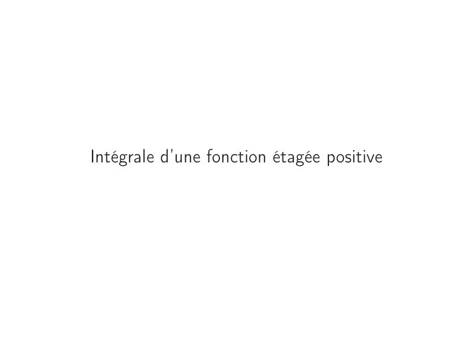

# CM3-Integration-de-fonctions-mesurables-et-positives_Mesures-et-integration.pdf

[Ouvrir l’original](https://drive.google.com/open?id=16JPjGNlP3mcskBIgNoz_61zZ6V3PMQs-) · Les pages signalées comprennent du texte reconnu automatiquement ou des éléments graphiques. Le fac-similé permet de vérifier chaque lecture.

**Pages avec fac-similé ou lecture OCR** — 8.

## Page 1

~~~text
  Ingénieurs 1ère année : Mathématiques appliquées

              Mesure et intégration

CM3 – Intégration de fonctions mesurables positives

            Nisrine FORTIN CAMDAVANT
~~~

## Page 2

~~~text
1   Fonctions étagées

2   Intégrale d’une fonction étagée positive

3   Intégration de fonctions mesurables positives
~~~

## Page 3

~~~text
                     Fonctions étagées
Les fonctions étagées jouent, dans la construction de l’intégrale de Lebesgue, le
rôle réservé aux fonctions en escalier dans la théorie de l’intégrale de Riemann.
~~~

## Page 4

~~~text
  Fonctions étagées         Intégrale d’une fonction étagée positive    Intégration de fonctions mesurables positives

  Fonctions étagées

         Dans la suite de ce cours, on considère l’espace mesuré (Ω, T , µ).

         Définition
         Soit f une fonction de Ω dans R. La fonction f est dite T -étagée si :
                f est (T , B(R))-mesurable.
                f (Ω) est un sous-ensemble fini de R.
                                                                       n
                 d’une fonction étagée : Soit n ∈ N∗ . φ =
                                                                       P
         Exemple
         ::::::::::::::::::::::::::
                                                                             ai 1Ai , ai ∈ R, Ai ∈ T .
                                                                       i=1

                φ est mesurable car combinaison linéaire de fonctions mesurables.
                φ prend un nombre fini de valeurs (ai )i=1,...,n
         Donc φ est une fonction T -étagée.

         Notations
                                                 n                            o
                           E(Ω, T )        =         f : Ω → R T - étagées
                                                 n                                   o
                           E+ (Ω, T )      =         f : Ω → [0, +∞[ T - étagées

4/24
~~~

## Page 5

~~~text
  Fonctions étagées           Intégrale d’une fonction étagée positive        Intégration de fonctions mesurables positives

  Représentation canonique d’une fonction étagée

         Soit f une fonction étagée. Désignons par a1 , . . . , am les éléments de f (Ω), la
         suite (ai )1≤i≤m étant strictement croissante, et posons pour tout i ∈ {1, . . . , m}
                                          Ai = f −1 {ai } .
                                                         

         Les sous-ensembles A1 , A2 , . . . , Am de Ω sont non vides, mesurables, deux à
         deux disjoints et de réunion Ω. Ainsi f s’écrit sous la forme
                                                            m
                                                            X
                                                      f =          ai 1Ai                                      (1)
                                                             i=1

                f mesurable, {ai } un borélien donc f −1 {ai } est mesurable.
                                                               

                Pour i ̸= j, x ∈ Ai ∩ Aj ⇒ f (x) = ai et f (x) = aj , impossible car ai ̸= aj donc
                Ai ∩ Aj = ∅.
         Inversement, étant données une suite strictement croissante (ai )1≤i≤m
         d’éléments de R et une suite (Ai )1≤i≤m de sous-ensembles de Ω, mesurables,
         non vides, deux à deux disjoints et dont la réunion est Ω, il existe une fonction
         étagée f de Ω dans R et une seule telle que
                                                            m
                                                            X
                                                     f =           ai 1Ai .
                                                            i=1
                                               
          (a1 , . . . , am ), (A1 , . . . , Am ) le couple canonique de f et (1) est la
5/24
~~~

## Page 6

~~~text
  Fonctions étagées             Intégrale d’une fonction étagée positive        Intégration de fonctions mesurables positives

               Exemples
                      1   Soit A ∈ T \ {∅}. La fonction u = 1A est étagée et a pour
                          représentation canonique

                                                       u = 0 × 1AC + 1 × 1A .
                      2   Ω = R, T = B(R). Soit φ = 1]0,+∞[ , son écriture canonique est :

                                                 φ = 0 × 1]−∞,0] + 1 × 1]0,+∞[ .

                          D’autres écritures non canoniques de φ :

                               φ        0 ×1]−∞,0] + |{z}
                                     = |{z}           1 ×1]0,1[ + |{z}
                                                                   1 ×1[1,+∞[
                                          a1                       a2            a3
                                          a2 = a3 =⇒ pas canonique

                                                       1            2
                               φ     = 0 × 1] − ∞, 0] + × 1]0, +∞[ + × 1]0, +∞[
                                            | {z }     3   | {z } 3     | {z }
                                                      A1                   A2                     A3
                                          A2 ∩ A3 ̸= ∅ =⇒ pas canonique

6/24
~~~

## Page 7

~~~text
  Fonctions étagées           Intégrale d’une fonction étagée positive   Intégration de fonctions mesurables positives

               Opérations sur les fonctions étagées
                Soient f et g deux fonctions étagées sur Ω, α et β deux réels alors les
                fonctions suivantes
                      αf + βg ,
                      fg ,
                      sup(f , g ) et
                      inf(f , g )
                sont des fonctions étagées sur Ω.

7/24
~~~

## Page 8

~~~text
Intégrale d’une fonction étagée positive
~~~

**Lecture OCR à contrôler**

~~~text
Intégrale d'une fonction étagée positive
~~~

## Page 9

~~~text
  Fonctions étagées       Intégrale d’une fonction étagée positive    Intégration de fonctions mesurables positives

         Définition
                                  m
                                  X
         Soit φ ∈ E+ (Ω, T ) et    ai 1Ai sa représentation canonique. On appelle
                                  i=1                                Z
         intégrale de φ sur Ω par rapport à la mesure µ et on note       φdµ ou
         Z                                                             Ω

            φ(x)dµ(x), la somme
          Ω
                                                  m
                                                  X
                                                         ai µ(Ai ).
                                                   i=1

                                                                                           m
                                                                                           X
         En vertu de la convention 0 × µ(A) = 0 si µ(A) = +∞, la somme                            ai µ(Ai )
                                                                                            i=1
         a toujours un sens dans [0, +∞] puisque chaque terme ai µ(Ai ) appartient à
         [0, +∞].
                                                                                   Z
         On dit qu’une fonction étagée et positive φ est µ-intégrable si                   φdµ < +∞.
                                                                                       Ω

9/24
~~~

## Page 10

~~~text
  Fonctions étagées         Intégrale d’une fonction étagée positive             Intégration de fonctions mesurables positives

               Exemples
                                          
                On prend (Ω, T ) = R, B(R) et φ = 1R . Il est clair que φ ∈ E+ (Ω, T ).

                                              Z
                      Pour µ = λ, on a                φdλ = λ(R) = +∞.
                                                  R
                                               Z
                      Pour µ = δ0 , on a               φdδ0 = δ0 (R) = 1
                                                   R

         Définition
                                    m
                                    X
         Soit φ ∈ E+ (Ω, T ) et             ai 1Ai sa représentation canonique. Soit A une partie
                                      i=1
         mesurable. On définit l’intégrale de φ sur A :
                                Z                 Z                  m
                                                                     X
                                      φdµ =               φ1A dµ =         ai µ(Ai ∩ A).
                                  A                   Ω              i=1

10/24
~~~

## Page 11

~~~text
  Fonctions étagées       Intégrale d’une fonction étagée positive         Intégration de fonctions mesurables positives

         Le calcul de l’intégrale d’une fonction étagée à partir de la définition nécessite
         la décomposition canonique. Le lemme suivant permet d’alléger le recours
         systématique à cette décomposition.

         Lemme
                                                                     p
                                                                     X
         Soit φ une fonction étagée positive telle que φ =                 ti 1Ci où Ci sont des
                                                                     i=1
         ensembles mesurables et disjoints deux à deux et ti sont des constantes pas
         forcément distinctes alors
                                     Z           p
                                                X
                                        φdµ =      ti µ(Ci ).
                                             Ω             i=1

11/24
~~~

## Page 12

~~~text
  Fonctions étagées             Intégrale d’une fonction étagée positive              Intégration de fonctions mesurables positives

               Propriétés.
                                                                                  Z                  Z
                      1   Si φ ∈ E+ (Ω, T ) et si r ∈ [0, +∞[, alors                   r φdµ = r         φdµ.

                      2   Si φ ∈ E+ (Ω, T ) et si ψ ∈ E+ (Ω, T ) alors
                                           Z                 Z         Z
                                              (φ + ψ)dµ = φdµ + ψdµ.

                      3   Si φ ∈ E+ (Ω, T ) et si ψ ∈ E+ (Ω, T ) alors
                                                         Z           Z
                                               φ ≤ ψ ⇒ φdµ ≤ ψdµ.

                      4   Si (φn )n∈N est une suite croissante de fonctions étagées positives
                          qui tend µ-p.p
                          Z          vers une fonction
                                                     Z       étagée φ, alors la suite
                              φn dµ           tend vers           φdµ :
                                        n∈N

                                               Z                    Z                        Z
                                        lim           φn dµ       =        lim φn dµ =             φdµ.
                                      n→+∞                                 n→+∞

         Démonstration. Voir Notes de cours.
         ::::::::::::
12/24
~~~

## Page 13

~~~text
       Intégration de fonctions mesurables positives

      On note L+ (Ω, T ) l’ensemble des fonctions mesurables et positives
                          n                        +                o
            L+ (Ω, T ) = f : Ω → [0, +∞], T , B R         -mesurables.

      Le théorème suivant nous permettra de faire le lien entre les fonctions
      étagées positives et les fonctions mesurables positives. Il sera d’une grande
      utilité dans la démonstration de beaucoup de propriétés dans les exercices.

Si f ∈ L+ (Ω, T ), il existe une suite croissante (φn )n dans E+ (Ω, T ) telle que
(φn )n converge simplement vers f sur Ω.
Si de plus, f est bornée, alors (φn )n converge uniformément vers f sur Ω.

Dans ce cours, Ω désigne un ensemble quelconque non vide, T une tribu de parties de Ω et µ
une mesure positive sur T . On considère l’espace mesuré (Ω, T , µ).
~~~

## Page 14

~~~text
  Fonctions étagées           Intégrale d’une fonction étagée positive       Intégration de fonctions mesurables positives

         Soit f ∈ L+ (Ω, T ). On appelle
                                  Z      intégrale
                                             Z     de Lebesgue de f sur Ω par rapport à
         la mesure µ, et on note               fdµ ou         f (x)dµ(x), l’élément de [0, +∞] suivant
                                           Ω              Ω

                                            Z                                        
                              (f ) = sup           φdµ, φ ∈ E+ (Ω, T ), φ ≤ f             .

         Autrement dit,
                                               Z                                       
                          R
                              Ω
                                fdµ = sup             φdµ, φ ∈ E+ (Ω, T ), φ ≤ f              .

         Plus généralement, si A ∈ T , on pose
                                       Z       Z
                                         fdµ =   f 1A dµ.
                                                  A              Ω

14/24
~~~

## Page 15

~~~text
  Fonctions étagées              Intégrale d’une fonction étagée positive   Intégration de fonctions mesurables positives

  Une fonction mesurable intégrable

               Mise en garde
                                             Z
                Bien distinguer le fait que      fdµ a toujours un sens dans [0, +∞] et le
                         Z                     Ω        Z
                fait que    fdµ est finie, c’est à dire   fdµ ∈ [0, +∞[. D’où la définition
                             Ω                                          Ω
                suivante :

         Définition
         Soit f ∈ L+ (Ω, T ). On dit que f est µ-intégrable sur X (ou simplement
                                                                           Z
         intégrable quand il n’y a pas de risque de confusion) si l’intégrale                      fdµ est
                 Z                                                                             Ω

         finie :   fdµ < +∞.
                      Ω

15/24
~~~

## Page 16

~~~text
  Fonctions étagées                  Intégrale d’une fonction étagée positive             Intégration de fonctions mesurables positives

         Soient f et g deux fonctions mesurables et positives sur Ω. Soient A et B deux
         ensembles mesurables. α ∈ [0, +∞].

               Règles opératoires des intégrales de fonctions mesurables et positives
                    Z               Z
                 1     (αf ) dµ = α fdµ (Homogénéité positive).
                              Ω                       Ω
                          La démonstration découle aisément de la définition de l’intégrale d’une fonction
                          mesurable positive et en distinguant les cas α = 0 et α > 0.
                          Z                           Z                 Z
                      2           (f + g ) dµ =               fdµ +          gdµ (Additivité).
                              Ω                           Ω              Ω
                          La démonstration découle du théorème 1 et du théorème de la convergence
                          monotone.
                                            Z                 Z
                      3   f ≤ g =⇒                  fdµ ≤             gdµ (Croissance de l’intégrale).
                                                Ω                 Ω
                                             Z                 Z
                      4   A ⊂ B =⇒                  fdµ ≤             fdµ.
                                                A                 B

16/24
~~~

## Page 17

~~~text
  Fonctions étagées             Intégrale d’une fonction étagée positive                    Intégration de fonctions mesurables positives

               Règles opératoires des intégrales de fonctions mesurables et positives
                      5   Soit (Ai )i une famille d’ensembles mesurables et disjoints deux à
                          deux, alors            Z            XZ
                                                   S
                                                       f dµ =        fdµ.
                                                               Ai                i≥1   Ai
                                                       i≥1
                                                                    Z                         Z                 Z
                      6   Si N est µ-négligeable alors                      fdµ = 0 et                fdµ =             fdµ.
                                                                        N                       Ω\N                 Ω
                                                                        Z
                      7   f = 0 µ-p.p si et seulement si                        fdµ = 0.
                                                                            Ω
                                                       Z
                      8   Si f ∈ L+ (Ω, T ) et si              fdµ < +∞, alors {x ∈ Ω, f (x) = +∞}
                                                           Ω
                          est µ-négligeable.

         Démonstration.
         ::::::::::::
                        Voir Notes de cours.

17/24
~~~

## Page 18

~~~text
Principaux théorèmes d’intégration de
    fonctions mesurables positives

  Le développement de la théorie de l’intégration sur L+ (Ω, T ) repose sur
  un important théorème de convergence des intégrales, propre aux suites
  croissantes de fonctions mesurables et positives, qui permet sous un
  minimum d’hypothèses de commuter "intégration" et "passage à la
  limite".

  En l’absence de l’hypothèse de croissance sur la suite de fonctions de
  L+ (Ω, T ), on a tout de même un résultat partiel.
~~~

## Page 19

~~~text
  Fonctions étagées        Intégrale d’une fonction étagée positive            Intégration de fonctions mesurables positives

  Théorème de la convergence monotone ou de Beppo-Levi

         Théorème ♣♣
         Soit (fn )n∈N une suite croissante de fonctions de L+ (Ω, T ) qui tend µ-p.p vers
         une fonction f , alors
            1   f ∈ L+ (Ω, T ).
                         Z                                                       Z
            2   La suite      fn dµ           converge en croissant vers               f dµ :
                                       n∈N
                                                  Z               Z
                                           lim          fn dµ =         lim fn dµ.
                                         n→+∞       Ω                 Ω n→+∞

19/24
~~~

## Page 20

~~~text
  Fonctions étagées            Intégrale d’une fonction étagée positive                            Intégration de fonctions mesurables positives

  Une application du théorème de la convergence monotone

         Conséquence
         :::::::::::
                      : Soit (An )n∈N une suite d’ensembles de T , telle que An ⊂ An+1
                                                    
                                               S
         pour n ∈ N alors lim µ (An ) = µ         An .
                                n→+∞                                   n∈N

                 La fonction indicatrice 1An est mesurable car An est mesurable.
                 La fonction indicatrice 1An est positive.
                 La fonction indicatrice 1An est croissante car An ⊂ An+1 .
                  lim 1An = 1S An .
                 n→+∞           n
                                                                   Z                  Z
         D’après le théorème de Beppo-Lévi                lim              1An dµ =           1S An dµ. Et comme
                                                  n→+∞                 Ω                  Ω    n

                                                          Z
                                                                  1An dµ = µ(An )
                                                              Ω
                                                  !
                                      [
         alors    lim µ(An ) = µ           An∈N       .
                 n→+∞
                                       n

20/24
~~~

## Page 21

~~~text
  Fonctions étagées         Intégrale d’une fonction étagée positive   Intégration de fonctions mesurables positives

  Lemme de Fatou

         En l’absence de l’hypothèse de croissance sur la suite de fonctions de
         L+ (Ω, T ), on a tout de même le résultat partiel suivant :

         Corollaire ♣♣
         Soit (fn )n une suite de fonctions de L+ (Ω, T ) alors
                                   Z                        Z
                                     lim inf fn dµ ≤ lim inf fn dµ.

         Démonstration.
         ::::::::::::
                        Voir Notes de cours.

         Remarques
                                                
                lim inf fn = sup       inf fn (x) .
                            p∈N        n≥p

                Si f est µ-intégrable sur Ω alors f est finie µ-p.p.

21/24
~~~

## Page 22

~~~text
  Fonctions étagées               Intégrale d’une fonction étagée positive   Intégration de fonctions mesurables positives

  Intégration d’une série de fonctions de L+ (Ω, T )

         Les séries de fonctions sont d’utilisation courante, il est utile de donner
         l’expression du théorème de la convergence monotone dans ce cas.

         Soit (fn )n≥0 une suite d’éléments de L+ (Ω, T ). Alors

                Z      +∞
                                  !           +∞ Z            
                       X                      X
            1                fn       dµ =                fn dµ ;
                 Ω     n=0                    n=0     Ω

                      +∞ Z
                      X                   
            2   Si                fn dµ       < +∞, il existe N ∈ T µ-négligeable tel que
                  n=0         Ω
                +∞
                X
                      fn < +∞ pour x ∈ Ω\N.
                n=0

         Démonstration.
         ::::::::::::
                        Voir TD 3.

22/24
~~~

## Page 23

~~~text
  Fonctions étagées        Intégrale d’une fonction étagée positive       Intégration de fonctions mesurables positives

  Intégration au sens de Riemann et au sens de Lebesgue

         En pratique, on utilisera souvent des intégrales par rapport à la mesure de
         Lebesgue, les théorèmes suivants expriment des cas où on peut se ramener à un
         calcul d’intégrale au sens de Riemann. Les propriétés suivantes seront valables
         pour des fonctions mesurables positives ou de signe quelconque.

         Soit f : [a, b] → R une fonction mesurable.
            1   Si f est Riemann intégrable, alors f est Lebesgue intégrable et les
                intégrales sont égales, autrement dit
                                          Z           Z b
                                              f dλ =      f (x) dx
                                                [a,b]                 a

            2   Si f est bornée alors f est Riemann intégrable ssi

                          λ ({x ∈]a, b[ tel que f n’est pas continue en x}) = 0,

                autrement dit, si et seulement si l’ensemble des points de discontinuités
                de f dans ]a, b[ est de mesure de Lebesgue nulle.

23/24
~~~

## Page 24

~~~text
  Fonctions étagées      Intégrale d’une fonction étagée positive                  Intégration de fonctions mesurables positives

  Intégration au sens de Riemann et au sens de Lebesgue

         Soit f : [0, +∞[→ R une fonction mesurable et Riemann intégrable sur tout
         intervalle [0, n], n ∈ N.                    Z                      n
         f est Lebesgue intégrable sur [0, +∞[ ssi lim                           |f (x)| dx < +∞.
                                                             n→∞         0
         Dans ce cas,

                                   Z +∞                     Z
                                            f (x) dx =                   f dλ.
                                     0                          [0,+∞[

24/24
~~~
