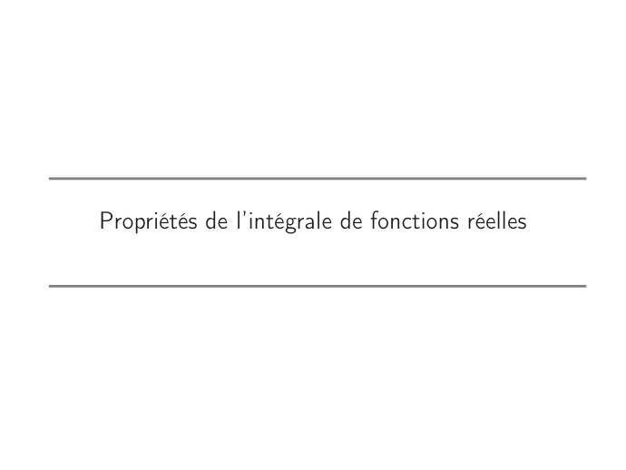
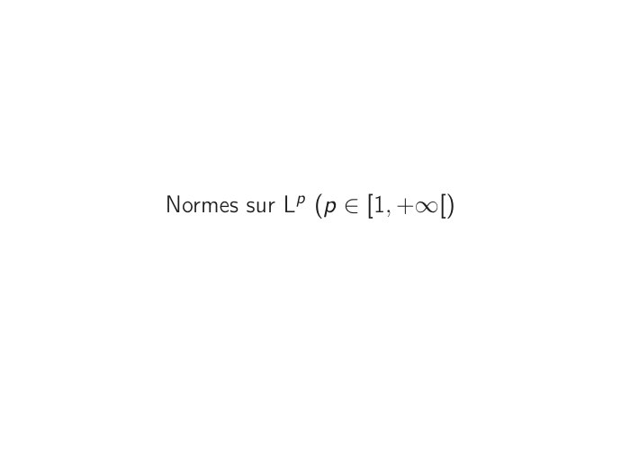

# CM4-Integration-de-fonctions-mesurables_Mesures-et-integration.pdf

[Ouvrir l’original](https://drive.google.com/open?id=1iQfAkvx5gmGj-Cimf7y5-k80T0JaKbQR) · Les pages signalées comprennent du texte reconnu automatiquement ou des éléments graphiques. Le fac-similé permet de vérifier chaque lecture.

**Pages avec fac-similé ou lecture OCR** — 5, 9, 13, 17.

## Page 1

~~~text
Ingénieurs 1ère année : Mathématiques appliquées

            Mesure et intégration

  CM4 – Intégration de fonctions mesurables

          Nisrine FORTIN CAMDAVANT
~~~

## Page 2

~~~text
1   Intégration de fonctions mesurables réelles

2   Espaces Lp et Lp

3   Normes sur Lp (p ∈ [1, +∞[)

4   Espaces L∞
~~~

## Page 3

~~~text
             Intégration de fonctions réelles
                       mesurables

On note L(Ω, T ) l’ensemble des fonctions réelles mesurables (C’est un espace
vectoriel)

              L(Ω, T ) = {f : Ω → R, f est − (T , B (R)) -mesurables.}
~~~

## Page 4

~~~text
  Intégration de fonctions mesurables réelles           Espaces Lp et Lp            Normes sur Lp (p ∈ [1, +∞[)           Espaces L∞

  Intégrale de Lebesgue d’une fonction réelle mesurable

         On note f + = sup(f , 0) et f − = sup(−f , 0).

         Une fonction µ-intégrable
         Une fonction f de Ω dans R est dite µ-intégrable si
           ⇝ f est (T , B(R))-mesurable et

                 Z                              Z
           ⇝         f + dµ < +∞ et                 f − dµ < +∞.

         Intégrale d’une fonction réelle mesurable
                                                                                           Z             Z
         Si f est µ-intégrable. On appelle intégrale de f , notée                              fdµ ou            fdµ ou
         Z                                                                                                   Ω

            f (x)dµ(x) le nombre
           Ω
                                                    Z                  Z
                                                            f + dµ −           f − dµ.
                                                        Ω                  Ω

         On note L1R (Ω, T , µ) (ou en abrégé L1 ) l’ensemble des fonctions µ-intégrables.
4/21
~~~

## Page 5

~~~text
Propriétés de l’intégrale de fonctions réelles
~~~

**Lecture OCR à contrôler**

~~~text
Propriétés de l'intégrale de fonctions réelles
~~~

## Page 6

~~~text
  Intégration de fonctions mesurables réelles   Espaces Lp et Lp        Normes sur Lp (p ∈ [1, +∞[)   Espaces L∞

                Propriétés.
                    1    Si f ∈ L(Ω, T ), on a l’équivalence suivante
                                                              Z
                                        f ∈ L1 (Ω, T , µ) ⇐⇒ |f | dµ < +∞.

                     2   Si f ∈ L1 (Ω, T , µ), alors
                                                    Z              Z
                                                         fdµ ≤         |f | dµ.

                     3   Soient f ∈ L(Ω, T ) et g ∈ L1 (Ω, T , µ). Si | f |≤| g | µ-p.p alors
                                                         Z               Z
                                   f ∈ L1 (Ω, T , µ) et     | f | dµ ≤      | g | dµ.

                     4   Soit f ∈ L(Ω, T ). Il existe une suite (φn )n∈N dans E(Ω, T ) qui
                         converge simplement vers f sur Ω. Si de plus, f est bornée, alors
                         (φn )n∈N converge uniformément vers f sur Ω.

         Démonstration.
         ::::::::::::
                        Voir Notes de cours.
6/21
~~~

## Page 7

~~~text
  Intégration de fonctions mesurables réelles              Espaces Lp et Lp         Normes sur Lp (p ∈ [1, +∞[)   Espaces L∞

         Soient f et g deux fonctions mesurables µ-intégrables. α ∈ R.

                Règles opératoires des intégrales de fonctions réelles mesurables
                     Z               Z
                  1     (αf ) dµ = α fdµ (Homogénéité ).
                             Ω                     Ω
                         Z                         Z                  Z
                     2           (f + g ) dµ =             fdµ +           gdµ (Additivité).
                             Ω                         Ω               Ω
                                         Z                  Z
                     3   f ≤ g =⇒                fdµ ≤              gdµ (Croissance de l’intégrale).
                                             Ω                  Ω

                     4   L1 (Ω, T , µ) est un espace vectoriel réel.

         Si f ∈ L1 et si N ∈ T est µ-négligeable alors
                              Z                Z           Z
                                 fdµ = 0 et          fdµ =   fdµ.
                                          N                                Ω\N         Ω

         Démonstration.
         ::::::::::::
                        Voir Notes de cours.
7/21
~~~

## Page 8

~~~text
  Intégration de fonctions mesurables réelles      Espaces Lp et Lp   Normes sur Lp (p ∈ [1, +∞[)   Espaces L∞

  Théorème de la convergence dominée

         Théorème ♣♣
         Soient (fn )n∈N une suite de fonctions de L(Ω, T ) et g ∈ L1 (Ω, T , µ). On
         suppose que
                 (fn )n∈N converge vers f µ-p.p
                 Pour tout n ∈ N, |fn | ≤ g .
         Alors                                  
                                                
                                                 f ∈ L1 (Ω, T , µ)
                                                
                                                        Z           Z
                                                 lim      fn dµ = fdµ
                                                
                                                
                                                  n→+∞

8/21
~~~

## Page 9

~~~text
Espaces Lp
~~~

**Lecture OCR à contrôler**

~~~text
Espaces LP
~~~

## Page 10

~~~text
  Intégration de fonctions mesurables réelles   Espaces Lp et Lp   Normes sur Lp (p ∈ [1, +∞[)   Espaces L∞

         Soit p ∈ [1, +∞[. On dit que f est est de puissance p ième -intégrable, et on note
         f ∈ Lp (Ω, T , µ), si f est mesurable et |f |p est µ-intégrable.
                                                                Z
                    f ∈ Lp (Ω, T , µ) ⇐⇒ f ∈ L (Ω, T ) et          |f |p dµ < +∞.
                                                                      Ω

            1    La fonction |f |p désigne la fonction x 7−→ (|f (x)|)p (ce n’est pas la
                 composée.)
             2   Pour p = 1, on obtient les fonctions µ-intégrables.
                 Pour p = 2, on obtient les fonctions de carré intégrables.
             3   Si f ∈ L (Ω, T ) alors |f |p ∈ L (Ω, T ).

         L’espace Lp (Ω, T , µ) est un espace vectoriel.

10/21
~~~

## Page 11

~~~text
                       Espace Lp
Notation
 ⇝ On note N = {f ∈ L(Ω, T ), f = 0 µ -p.p} .
 ⇝ Pour f ∈ L(Ω, T ) et g ∈ L(Ω, T ), f − g ∈ N ⇔ f = g µ p.p.

N est un espace vectoriel réel et pour tout p ∈ [1, +∞[, N ⊂ Lp .
~~~

## Page 12

~~~text
  Intégration de fonctions mesurables réelles   Espaces Lp et Lp   Normes sur Lp (p ∈ [1, +∞[)   Espaces L∞

         L’espace Lp (Ω, T , µ) (ou en abrégé Lp ) est l’espace vectoriel quotient de
         Lp (Ω, T , µ) par N . C’est l’ensemble des classes d’équivalence d’éléments de Lp
         par la relation f = g µ − p.p.

         Pour une fonction f ∈ Lp , on définit la classe d’équivalence de la fonction f par
         fe ∈ Lp (Ω, T , µ) telle que

                 fe ∈ Lp (Ω, T , µ) ⇐⇒ fe = {g ∈ Lp (Ω, T , µ) tel que            f − g ∈ N}.

                Remarque

                 Bien que ses éléments soient des classes d’équivalence des fonctions. On
                 a l’habitude de dire qu’un élément de Lp (Ω, T , µ) est une fonction, bien
                 que strictement il s’agisse d’une classe de fonctions.

                 Si N = {f0 } alors Lp = Lp .
                 S’il existe dans (Ω, T , µ) un plus gros (au sens de l’inclusion) ensemble
                 µ-négligeable N , le passage au quotient sera alors inutile.

12/21
~~~

## Page 13

~~~text
Normes sur Lp (p ∈ [1, +∞[)
~~~

**Lecture OCR à contrôler**

~~~text
Normes sur LP (p € [1, +o0f)
~~~

## Page 14

~~~text
  Intégration de fonctions mesurables réelles         Espaces Lp et Lp        Normes sur Lp (p ∈ [1, +∞[)   Espaces L∞

  Notations

            1    Pour f ∈ L(Ω, T ) et p ∈ [1, +∞[, on note
                                                               Z                     1
                                                                                       p
                                                 Np (f ) =          |f (x)|p µ (dx)        .

                                        Z
                                                  p
                     ⇝     Npp (f ) =       |f (x)| µ (dx) .

             2   Pour fe ∈ Lp et p ∈ [1, +∞[, on note

                                                               ∥fe∥p = Np (f ).

         Remarque
         Si f ∈ L(Ω, T ) alors

                                                  f ∈ Lp ⇔ Np (f ) < +∞.

14/21
~~~

## Page 15

~~~text
  Intégration de fonctions mesurables réelles   Espaces Lp et Lp        Normes sur Lp (p ∈ [1, +∞[)   Espaces L∞

         Définition
                                                                                           1  1
         Soient p et q dans [1, +∞[, on dit que p et q sont conjugués si                     + = 1. On
                                                                                           p q
         dit alors que q est l’exposant conjugué de p (il est unique).
         On convient que 1 et +∞ sont conjugués.

         Inégalité de Young
         Soient a et b deux réels strictement positifs, p et q conjugués dans [1, +∞[.
                     1      1
         Alors ab ≤ ap + b q .
                     p     q

         Démonstration.
         ::::::::::::
                        Voir Notes de cours.

         Inégalité de Hölder
         Soient p et q deux réels conjugués dans [1, +∞[. Soient f ∈ Lp et g ∈ Lq alors

                                 N1 (f × g ) ≤ Np (f ) × Nq (g )   et     f × g ∈ L1 .

         Démonstration.
         ::::::::::::
                        Voir Notes de cours.

15/21
~~~

## Page 16

~~~text
  Intégration de fonctions mesurables réelles        Espaces Lp et Lp     Normes sur Lp (p ∈ [1, +∞[)   Espaces L∞

         Inégalité de Minkowski
         Soient p dans [1, +∞[, f ∈ Lp et g ∈ Lp alors

                                                Np (f + g ) ≤ Np (f ) + Np (g ).

         Théorème
         Pour p ∈ [1, +∞[, ∥.∥p est une norme sur Lp .

         L’application N : E → R+ est une norme sur le R-espace vectoriel E si et seulement si
             1   N(x) = 0 ⇔ x = 0E .
             2   N(x + y ) ≤ N(x) + N(y ), ∀(x, y ) ∈ E 2 .
             3   N(αx) = |α|N(x), ∀α ∈ R, ∀x ∈ E .

16/21
~~~

## Page 17

~~~text
Espaces L∞
~~~

**Lecture OCR à contrôler**

~~~text
Espaces L°°
~~~

## Page 18

~~~text
  Intégration de fonctions mesurables réelles       Espaces Lp et Lp   Normes sur Lp (p ∈ [1, +∞[)   Espaces L∞

  Fonction essentiellement bornée

         Définition
         Une fonction f de L(Ω, T ) est dite essentiellement bornée s’il existe r ≥ 0 tel
         que |f | ≤ r µ-p.p.

                 L’ensemble {x ∈ Ω, f (x) > r } est µ-négligeable.

                 Exemple
                 ::::::::
                         : Soit f : R → R la fonction définie pour tout x ∈ R par
                                              
                                               x si x ∈ Q
                                      f (x) =
                                                 1 si x ∈ R \ Q
                                              

                 La fonction f n’est pas bornée sur R, en revanche, elle est essentiellement
                 bornée (par la mesure de Lebesgue λ) sur R car f ≤ 1 λ-p.p puisque

                                                λ ({x ∈ R, f (x) > 1}) ≤ λ (Q) .
                                                                         | {z }
                                                                            =0

                 Donc λ ({x ∈ R, f (x) > 1}) = 0.
18/21
~~~

## Page 19

~~~text
  Intégration de fonctions mesurables réelles    Espaces Lp et Lp   Normes sur Lp (p ∈ [1, +∞[)   Espaces L∞

         On note L∞ (Ω, T , µ) l’ensemble des fonctions essentiellement bornées de
         L(Ω, T ).

                   L∞ (Ω, T , µ) = {f ∈ L(Ω, T ), ∃r ≥ 0 tel que |f | ≤ r µ − p.p.}
         Lorsqu’il n y a pas d’ambiguité, on notera L∞ .

         Propriétés
             1   L∞ est un espace vectoriel réel.
             2   N ⊂ L∞ .

         Définitions
             1   L∞ (Ω, T , µ) est l’espace vectoriel quotient de L∞ (Ω, T , µ) par N .
             2   Si f ∈ L(Ω, T ),

                                          N∞ (f ) = inf {r ≥ 0 / |f | ≤ r µ-p.p}

             3   Si fe ∈ L∞ alors ∥fe∥∞ = N∞ (f ).

19/21
~~~

## Page 20

~~~text
  Intégration de fonctions mesurables réelles        Espaces Lp et Lp    Normes sur Lp (p ∈ [1, +∞[)   Espaces L∞

  Conséquences

         Si f ∈ L(Ω, T ),

                                          f ∈ L∞ (Ω, T ) ⇔ N∞ (f ) < +∞.

         Théorème
            1    Si f est essentiellement bornée sur Ω alors

                                       Pour presque tout x ∈ Ω, |f (x)| ≤ N∞ (f )
             2   Si f est continue et essentiellement bornée sur Ω alors

                                                Pour tout x ∈ Ω, |f (x)| ≤ N∞ (f )

         Théorème
            1    ∥.∥∞ est une norme sur L∞ .
             2   Inégalité de Hölder : si f ∈ L1 et g ∈ L∞ alors fg est µ-intégrable et
                                                  N1 (f × g ) ≤ N1 (f ) × N∞ (g ).
20/21
~~~

## Page 21

~~~text
  Intégration de fonctions mesurables réelles         Espaces Lp et Lp              Normes sur Lp (p ∈ [1, +∞[)            Espaces L∞

         Relations entre les Lp
         Si µ(Ω) < +∞ et 1 ≤ p1 ≤ p2 ≤ +∞ alors

                                                 L∞ ⊂ Lp2 ⊂ Lp1 ⊂ L1 .
         Démonstration. Voir TD

                Mise en garde.
                                                                                                      
                                                                                                       x         si   x ∈Q
                 Attention à la condition µ(Ω) < +∞. Si on reprend l’exemple f (x) =
                                                                                                       1         si   x ∈R\Q

                         λ(R) = +∞,
                         f ∈ L∞ ,
                         Z                 Z                              Z                           Z
                            |f (x)|dλ(x) =            |f (x)|dλ(x) +              |f (x)|dλ(x)    =             1dλ(x) =
                          R                     R\Q                           Q                           R\Q
                                                                          |          {z     }
                                                                       =0 car Qest négligeable.
                                               / L1 .
                         λ (R \ Q) = +∞ donc f ∈

21/21
~~~
