# CM4.pdf

[Ouvrir l’original](https://drive.google.com/open?id=1jwd0tUDo1lF7kIajcYHX0w4AOOBlIS2-) · Les pages signalées comprennent du texte reconnu automatiquement ou des éléments graphiques. Le fac-similé permet de vérifier chaque lecture.

**Pages avec fac-similé ou lecture OCR** — 1–22.

## Page 1

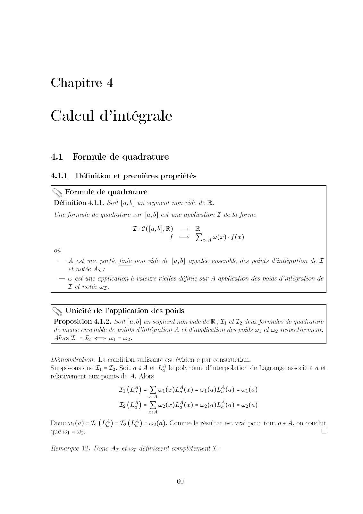

**Lecture OCR à contrôler**

~~~text
Chapitre 4

Calcul d’intégrale

4.1 Formule de quadrature

4.1.1 Définition et premières propriétés

$S Formule de quadrature

Définition 4.1.1. Soit [a,b] un segment non vide de R.
Une formule de quadrature sur [a,b] est une application Z de ta forme

T:C([a,b],R) — R
fr Ve

— A est une partie finie non vide de [a,b] appelée ensemble des points d'intégration de T
el nolée Az :

— w est une application à valeurs réelles définie sur A application des poids d'intégration de
Z et notée wy.

iN) Unicité de application des poids

Proposition 4.1.2. Soit [a,b] un segment non vide de R ; Ty et Zz deux formules de quadrature
de même ensemble de points d'intégration A et d'application des poids wi et w2 respectivement.
Alors Ti =T) <=> w =.

Démonstration. La condition suffisante est évidente par construction.

Supposons que Z; = 2. Soit a € A et LA le polynôme d'interpolation de Lagrange associé à a et
relativement aux points de A, Alors

Di (Li) = L wr (x) LA (x) = wy (a) LA (a) = wr (a)
2, (Li) = Ywrle)Le() = w2(a)L3(a) = w»(a)

Done wi (a) = Zi (LA) = T2 (LA) = wa(a). Comme le résultat est vrai pour tout a € A, on conclut
Que Wy = wo.

Oo
Remarque 12. Donc Az et wr définissent complètement L.

60
~~~

## Page 2

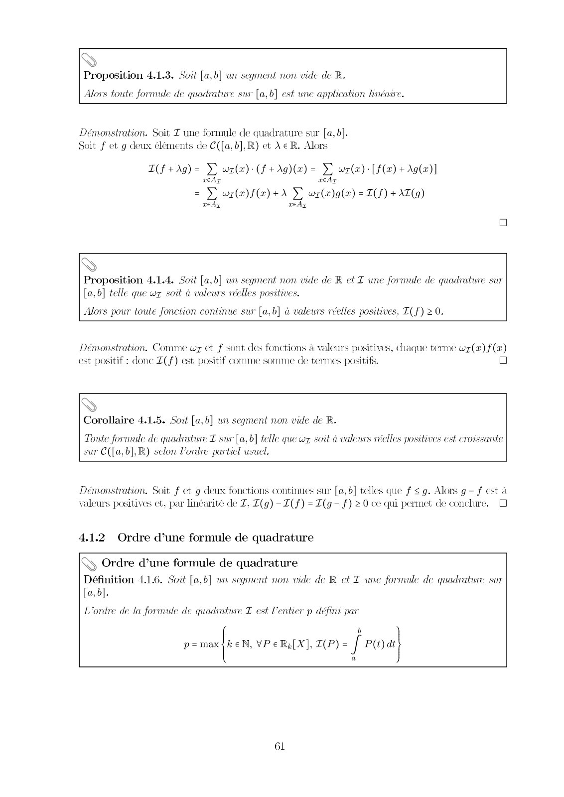

**Lecture OCR à contrôler**

~~~text
YS

Proposition 4.1.3. Soit [a,b] un segment non vide de R.

Alors toute formule de quadrature sur [a,b] est une application linéaire.

Démonstration. Soit I une formule de quadrature sur [ab].
Soit f et g deux éléments de C([a,b],R) et À € R. Alors

T(F +9) = Yo wr(x)-(f + Xg)(x) = À wr(x) -[f(x) + Ag(x)]

TEÂz zEÂz
= x wr(x) f(x) + À YY wr(x)g(x) = L(f) + AZ(g)

weAz

$

Proposition 4.1.4. Soit [a,b] un segment non vide de R et T une formule de quadrature sur
[a,b] telle que wz soit à valeurs réelles positives.

Alors pour toute fonction continue sur [a,b] à valeurs réelles positives, T(f) > 0.

Démons
est posi

tion. Comme wz et f sont des fonctions à valeurs positives, chaque terme wz(a) f(x)
: donc Z(f) est positif comme somme de termes posit

NN

Corollaire 4.1.5. Soit [a,b] un segment non vide de R.

Toute formule de quadrature Z sur [a,b] telle que wz soit à valeurs réelles positives est croissante
sur C([a,b],R) selon l'ordre partiel usuel.

Démonstration. Soit f et g deux fonctions continues sur [a,b] telles que f < g. Alors g- f est à

valeurs positives et, par linéarité de Z, Z(g) -Z(f) = Z(g- f) > 0 ce qui permet de conclure. D

4.1.2 Ordre d’une formule de quadrature

YS Ordre d’une formule de quadrature

Définition 4.1.6. Soit [a,b] un segment non vide de R et T une formule de quadrature sur
[a,b].

L'ordre de la formule de quadrature Z est Ventier p défini par

b
p=maxtkeN, WP eRu[X], Z(P) = [ Pt
Z

61
~~~

## Page 3

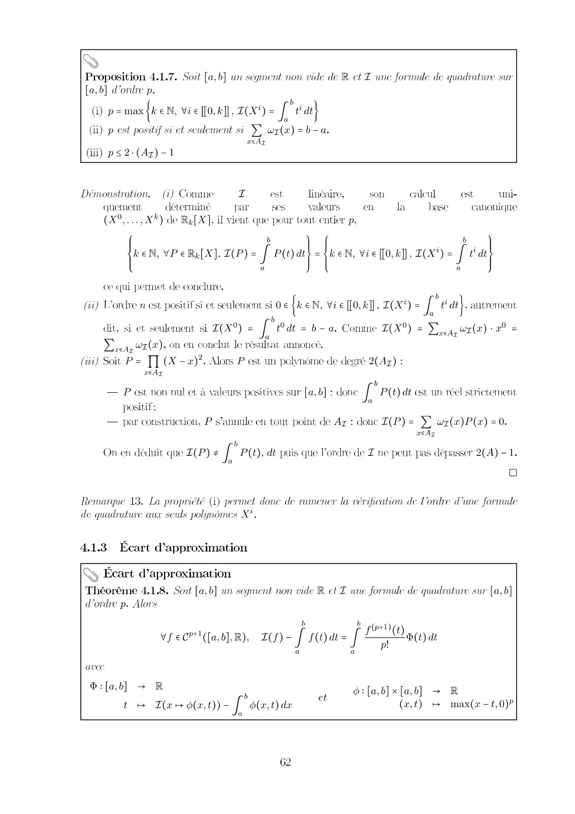

**Lecture OCR à contrôler**

~~~text
YS

Proposition 4.1.7. Soit [a,b] un segment non vide de R et T une formule de quadrature sur
[a,b] d'ordre p.

b
@ p= max {ke Ye ([0,4], 20 = f at}
(ii) p est positif si et seulement si Y w(x) = b-a.

weAz

(iii) p<2-(Az)-1

Démonstration. (i) Comme LT est linéaire, son. calcul est uni-
quement déterminé par ses valeurs en la base canonique

(X°,...,X*) de R,[X], il vient que pour tout entier p,

b b
keN, cena 2e f meal [re “eu, za). fa}

ce qui permet de conclure.

b
(ii) T'ordre n est positif si et seulement si 0 € {i eN, vie [[0,k]], Z(X*) = [ t! a, autrement:
a
b
dit, si et seulement si Z(X°) = f dt =

b- a. Comme Z(X°) = Da wr(æ) a =

a
sen w(x), on en conclut le résultat annoncé,

(iii) Soit P= T] (X —x)?. Alors P est un polynôme de degré 2(Az) :

réAT

b
— Pest non nul ct à valeurs positives sur [a,b] : donc f P(t) dt est un réel strictement
positif: “

— par construction, P samme en tout point de Az : donc Z(P) = D wr(x)P(x) = 0.

weAz
b
On en déduit que Z(P) # 7. P(t), dt puis que l'ordre de Z ne peut pas dépasser 2(A) - 1.
a
o

Remarque 13. La propriété (i) permet donc de ramener la vérification de Vordre d'une formule
de quadrature aux seuls polynomes X*.

4.1.3 Ecart d’approximation

XY Ecart d’approximation

Théorème 4.1.8. Soit [a,b] un segment non vide R et Z une formule de quadrature sur [a,b]
d'ordre p. Alors

b
vfec?"([a,b],R), LOS f sat - [27e Dace) dt
avec

®:[a,b] > R 5 ee @:[a,b]x[ab] + R
a La o(2,t))- f (x,t) de (at) + max(a -t,0)?

62
~~~

## Page 4

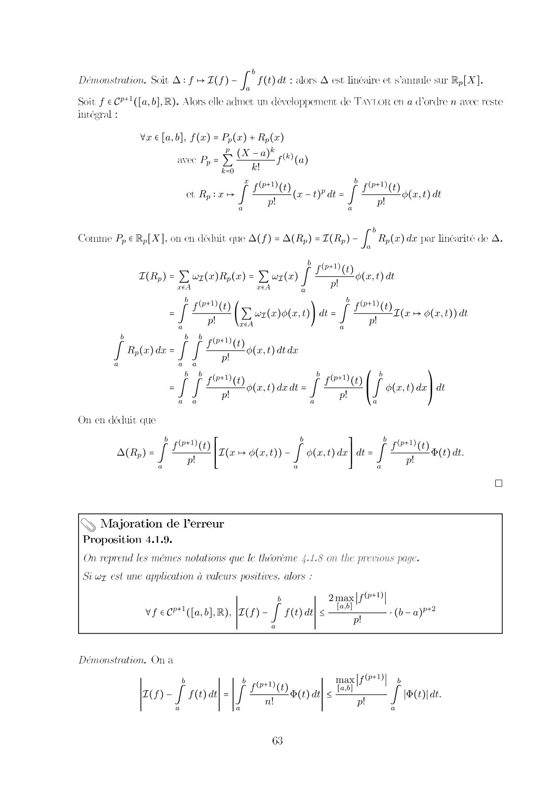

**Lecture OCR à contrôler**

~~~text
b
émonstration. Soit A: fo - t) dt : alors A est linéaire et s’annule sur
Di Soit A pA dt : alors A est linéai : Il R,
a

Soit f €C?**([a,b],R). Alors elle admet un développement de TAYLOR en a d'ordre n avec reste
intégral :

Va € [a,b], f(x) = Py(x) + Rp(x)
avec Py = rae a) 0 (a)

e(p+1) D e(p+1)
ct Ryans [Oe opare [ LD de

b
Comme P, €R,[X], on en déduit que A(f) = A(Rp) = T(Ry) - J R,(&) de par linéarité de

D (p41)
T(Rp) = = w(x) Rp(x) = à yore) f rm CL

eA

- (0 DET (@)o(e.) ja Or sun

TEA

[rt [jae Op t) dt dx
jee. t) dx dt = je mo (fee nas] dt

a

On en déduit que

D px n 5 sce
au [ fre sen focanae ae [aa

a

$S Majoration de l’erreur
Proposition 4.1.9.

On reprend les mêmes notations que le théorème 4

8 on the previous page.
Siwr est une application à valeurs positives. alors :

max | F0]

Vf eCP*l([a,b], < > _-(b- a)?

b
B). 2 - f FO

Démonstration. On a

max | “ b

“a HO

b b (p+1)
ain - [ scat =| f Caw ad <

a
~~~

## Page 5

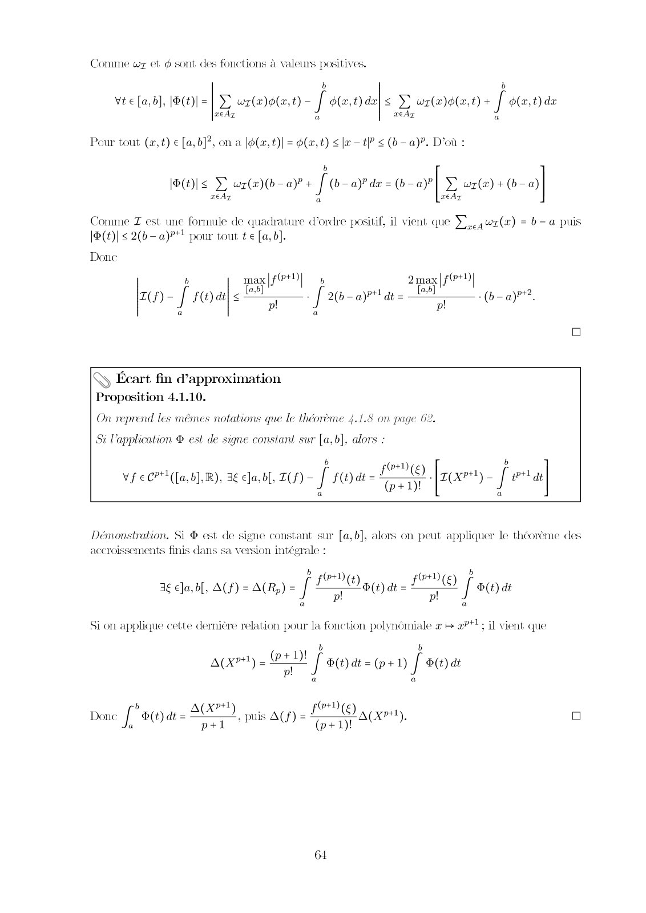

**Lecture OCR à contrôler**

~~~text
Comme wz et sont des fonctions à valeurs positives.

b

yr wr(o)o(a.t)+ [ état) dr

Az

VE € [a,b], |®(t)| =

aéAz

b
3 ex(x)o(a.t)- f état) dx <

Pour tout (a, t) € [a,b]?, on a |6(a,£)| = (a, t) < la -4P < (b-a)?. D'où :
b
BIS Y wx(\(o-a)+ f (b= a)? de = ur Z wr(x)+ o-a|
veAr PA veAz

Comme Z est unc formule de quadrature d'ordre positif, il vient que ,.4wr(x) = b- a puis
|®(t)| < 2(b-a)?*" pour tout + € [a,b].

Donc

max pr 2max | f*|

Z() - f Fal <

INS Ecart fin d’approximation
Proposition 4.1.10.

On reprend les mêmes notations que le théorème 4.1.8 on page 62.

Si l'application ® est de signe constant sur [a,b], alors :

(p+1)!

; FOO) ;
vfeC™([a,b],R), 3€ Ja, 2- f roa FO [rer fra

Démonstration. Si ® est de signe constant sur [a,b], alors on peut appliquer le théorème des
accroissements finis dans sa version intégrale :

D e(p+1) (p+1) b
36 eJabl, AC) = AR) = fh data: [wa

Si on applique cette dernière relation pour la fonction polynomiale «+ 2?*!; il vient que

b b
ag) ED f'atpa-@+n few

Donc f”° (1) dt = LA) nu am Hs ATOS = oe " RE acer,

61
~~~

## Page 6

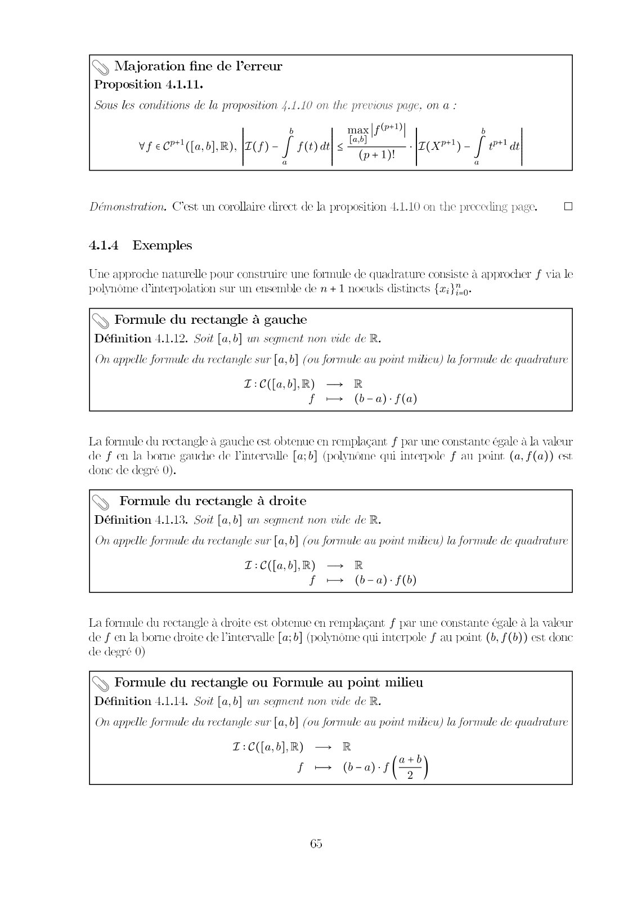

**Lecture OCR à contrôler**

~~~text
S Majoration fine de erreur
Proposition 4.1.11.

Sous les conditions de la proposition 4.1.10 on the previous page, on a :

b max |f@+0 b
vs ec" (La bl,R). ZU) - J sat enr cx) — far

Démonstration. C’est un corollaire direct de la proposition 4.1.10 on the preceding page. Qo
4.1.4 Exemples

Une approche naturelle pour construire une formule de quadrature consiste à approcher f via le
polynôme d’interpolation sur un ensemble de n + 1 noeuds distincts {a}? 9.

$S Formule du
Définition 4.1.12.

rectangle à gauche

Soit [a,b] un segment non vide de R.
On appelle formule du rectangle sur [a,b] (ou formule au point milieu) la formule de quadrature

T:C({a,b],R) — R
f > (b-a)- f(a)

La formule du rectangle à gauche est obtenue en remplaçant f par une constante égale à la valeur
de f en la borne gauche de Vintervalle [a;b] (polynôme qui interpole f an point (a, f(a)) est
done de degré 0).

$ Formule du rectangle à droite

Définition 4.1.13. Soit [a,b] un segment non vide de R.

On appelle formule du rectangle sur [a,b] (ou formule au point milieu) la formule de quadrature
T:C([a,b],R) — R
f > (b-a)-f(6)

La formule du rectangle à droite est obtenue en remplaçant f par une constante égale à la valeur
de f en la borne droite de l'intervalle [a;b] (polynôme qui interpole f au point (b, f(b)) est donc
de degré 0)

% Formule du rectangle ou Formule au point milieu
Définition 4.1.14. Soit [a,b] un segment non vide de R.
On appelle formule du rectangle sur [a,b] (ou formule au point milieu) la formule de quadrature

T:C([a,b],R) — R

1 (-a)-7(S)

65
~~~

## Page 7

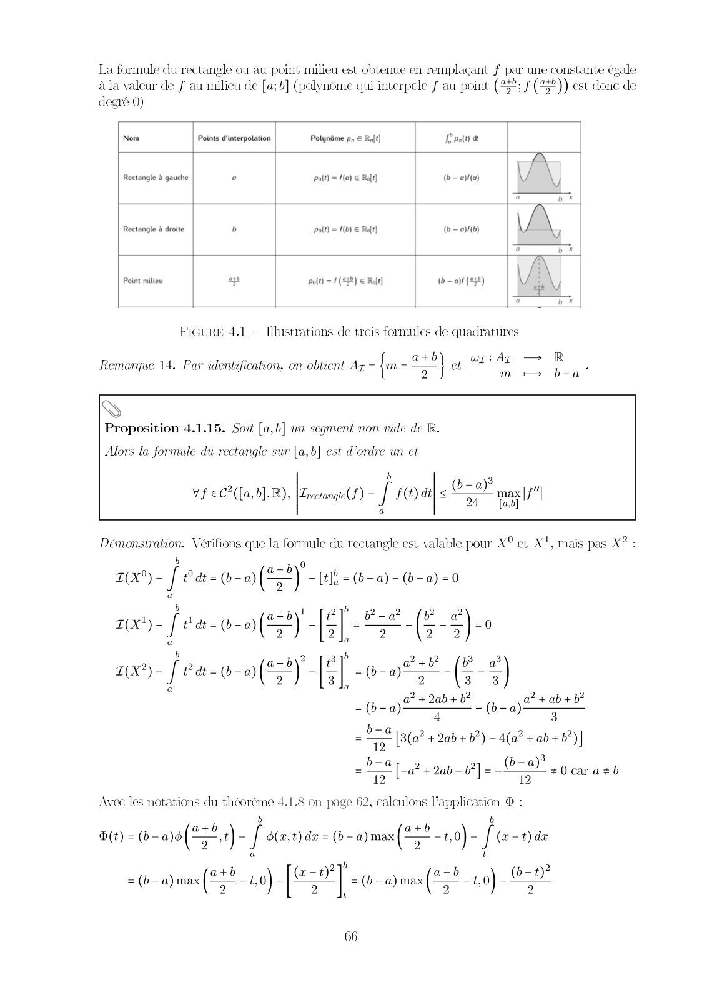

**Lecture OCR à contrôler**

~~~text
La formule du rectangle ou au point milieu est obtenue en remplaçant f par une constante égale

à la valeur de f au milieu de [a;b] (polynôme qui interpole f au point (42: f (432)) est donc de
degré 0)

Nom Points d'iterpolation Polunôme p, € alt pat à
Rectangle à gauche 0 alt) = Ho) € Ral] &= aya)
Rectangle à droite b lt) = Hb) Ral] = ayn)

Point milieu ony

E Rat) CETTE

BPE

FIGURE 4.1 — Ilustrations de trois formules de quadratures

Remarque 14. Par identification, on obtient Ar

$

Proposition 4.1.15. Soit [a,b] un segment non vide de R.

2

aa ee wri:Ar — R

m > b-a°

Alors la formule du rectangle sur [a,b] est d'ordre un et

vf €C?([a,b],R),

(=a)?
Er

Ercan) ~ Î HOME

7
|

Démonstration. Vérifions que la formule du rectangle est valable pour X° et X!, mais pas X? :

ZX) - fea: (b- (24) — [J = (b-a) - (b-a) =0

a+b)' [2] ba (? @
ax thdt = (b- = -(2-]=0
- Î ( (5 ) [5] 2 (5 *)
375 24 p2 3 4;
n feu un ath) [2] -o-ge eh (Hs
(Xx?) frac «)( =: =] =0-a) = -<
a? +2ab+ a Robe
= (b- a) - (0- a) —
- 28 Ta (a? +200 +02) —4(0? —.
b-ar 2 (b-a)*
= ay [+o + 20b- 8] = SS 40 car a #6

Avec les notations du théorème 4.1.8 on page 62, calculons Papplication ® :
b b
+"
H(t) = (b- a)o( 2, t)- fo td = (b- a) max (5 -t, 0) - [@-bae
t

= (0a) max (222 4,0) [ED "= (6-a)max(*4 10) CE

66
~~~

## Page 8

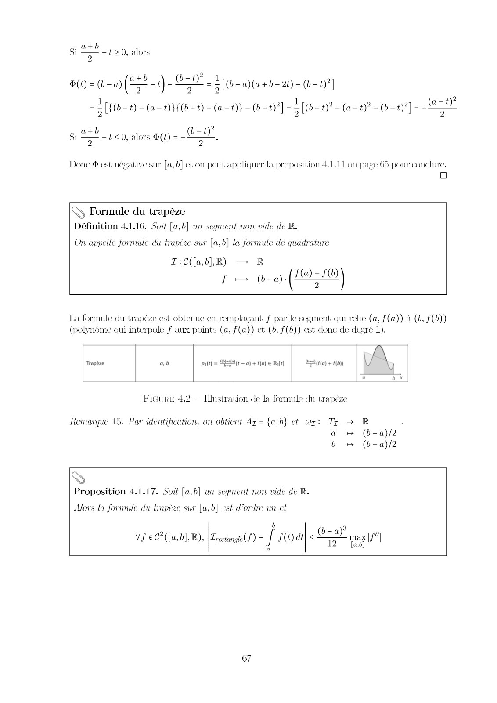

**Lecture OCR à contrôler**

~~~text
Si wt 120, alors

_#2 :
a= (0-0) (224-1) -& = = 5 [6-ay(a+b-24) -(0-1))]
1

2
=F [0-0 - (a-DHO-0 + (a=) - 6-87] = 5 [0-07 (a1? (6-07) -

Le
Si = b -t<0, alors ®(t) = oe

Donc © est négative sur [a,b] et on peut appliquer la proposition 4.1.11 on page 65 pour conclure,
oO

SY Formule du trapéze
Définition 4.1.16. Soit [a,b] un segment non vide de R.

On appelle formule du trapeze sur [a,b] la formule de quadrature
T:C({a,6],R) — R

fir (0). (A910)

La formule du trapeze est obtenue en remplaçant f par le segment qui relie (a, f(a)) à (b, f(b))
(polynome qui interpole f aux points (a, f(a)) et (b, f(b)) est donc de degré 1).

| iA
Ait + on |

FIGURE 4.2 — Illustration de la formule du trapèze

Trapeze ob

to) +o) € Rift]

Remarque 15. Par identification, on obtient Ar = {a,b} et wr: Tr > R

a + (b-a)/2
b > (b-a)/2
> citon 4.1.17. Soit [a,b] un segment non vide de R.
Alors la formule du trapèze sur [a,b] est d'ordre un et
2 ; (=a) yy
VF €C*([a,b],R), [Zrctange( S)— i FO ae] s max "|

GT
~~~

## Page 9

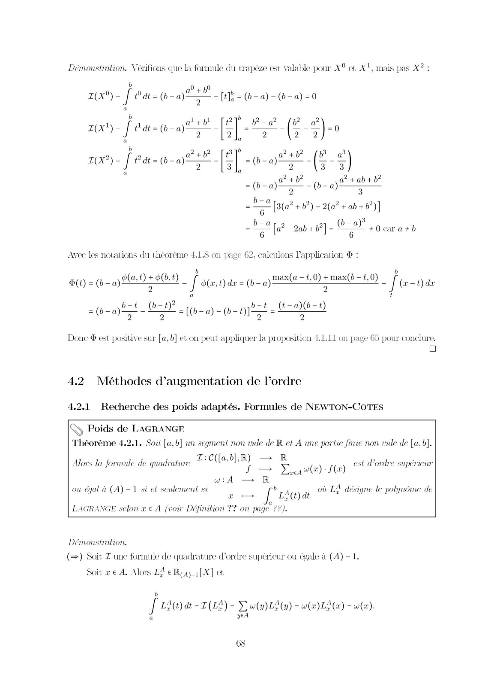

**Lecture OCR à contrôler**

~~~text
Démonstration. Vérifions que la formule du trapèze est valable pour X° et X!, mais pas X

Z(X°) - fru-o- oe ea -[t]2 = (b-a)-(b-a) =0

b
1(X}) - fe dt = (b- ot as -(5] ESS)

2 g
9 9 Ds be a
(x2 = 2 a _ a - a of oe
( )- fra (b= a) ==) +
ne +b *- Pas cu

a? +b?) - 2(a? ab)
(b-a)*
6

b-ar:
=" [a? - 2ab +0? +0 cr a+b

Avec les notations du théorème 4.1.8 on page 62, calculons Papplication © :
ñ b ees
B(t) = (b- a) te +O(b,t) | [ 4(«,t) dx = (= a) max ~ t,0) +max(b~t,0) | (e-t)de
2 J 2 J
b-t (b-t)? b-t  (t-a)(b-t)
= (b-a)—— - ~~ = -a)-(b-t)]— =
(a) - SS = [(b- a) - 6-1-5

Donc ® est positive sur [a,b] et on peut appliquer la proposition 4.1.11 on page 65 pour conclure.

im
4.2 Méthodes d’augmentation de l’ordre

4.2.1 Recherche des poids adaptés. Formules de NEWTON-COTES
® Poids de LAGRANGE

Théorème 4.2.1. Soit [a,b] un segment non vide de R et A une partie finie non vide de [a,b]

T:C([a,b],R) — ; :
Abel Jormilledequadratara T° ï 5 (a) fle) d'ordre supérieur
> eA AS
wA +R
ow égal à (A) -1 si et seulement si oT A(t at où LA désigne le polynôme de
;
— 4

a
LAGRANGE selon x € A (voir Définition ?? on page ??).

Démonstration.
(=) Soit Z une formule de quadrature d'ordre supérieur ou égale à (A) - 1.
Soit x € A. Alors LA € R(4)1[X] et

a(t) dt =Z(L2) = Y wy) L2(y) = w(x) £3 (x)

yA

6S
~~~

## Page 10

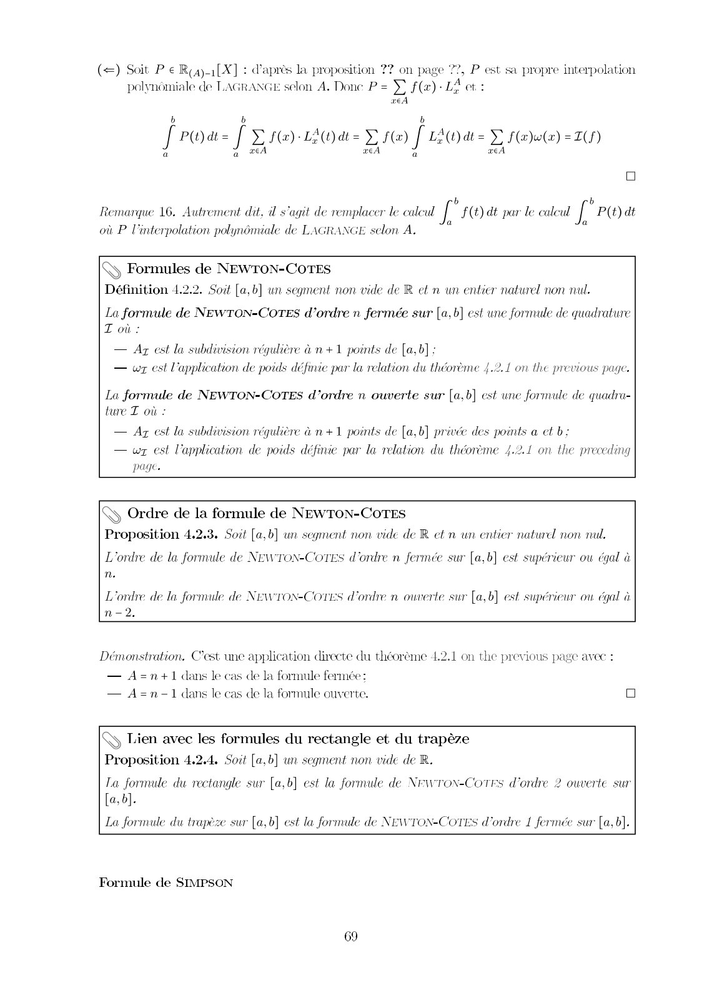

**Lecture OCR à contrôler**

~~~text
(=) Soit P € R(4-1[X] : d'après la proposition ?? on page ??, P est sa propre interpolation
polynomiale de LAGRANGE selon A. Done P= Y f(x): L4 et:
TEA
b

b b
froa Eire LEE He) fa E ae =1)

a

a

b b
Remarque 16. Autrement dit, it s’agit de remplacer le caleul f F(t) dt par le caleul [ P(t) dt
ott P Vinterpolation polynomiale de LAGRANGE selon A. ~“ °

 Formules de NEWTON-COTES
Définition 4.2.2

Soit [a,b] un segment non vide de R et n un entier naturel non nul.

La formule de NEWTON-COTES d'ordre n fermée sur [a,b] est une formule de quadrature
T où :

— Az est la subdivision régulière à n + 1 points de [a,b] ;
— wr est l'application de poids définie par la relation du thé

ème 4.2.1 on the previous page.

La formule de NEWTON-COTES d'ordre n ouverte sur [a,b] est une formule de quadra-
ture T où :
— Az est la subdivision régulière à n +1 points de [a,b] privée des points a et b;

— wr est l'application de poids définie par la relation du théorème 4.2.1 on the preceding
page.

Ordre de la formule de NEWTON-COTES
Proposition 4.2.3. Soit [a,b] un segment non vide de R et n un entier naturel non nul.

L'ordre de la formule de NEWTON-COTES d'ordre n fermée sur [a,b] est supérieur ou égal à
ne

L'ordre de la formule de NEWTON-COTES d'ordre n ouverte sur [a,b] est supérieur où égal à
n-2,

Démonstration. C’est une application directe du théorème 4.
— A=n+1 dans le cas de la formule fermée :
— A=n-1 dans le cas de la formule ouverte.

.1 on the previous page avec :

NN Lien avec les formules du rectangle et du trapèze
Proposition 4.2.4. Soit [a,b] un segment non vide de R.

La formule du rectangle sur [a,b] est la formule de NEWTON-COTES d'ordre 2 ouverte sur
[a,b].

La formule du trapeze sur [a,b] est la formule de NEWTON-COTES d'ordre 1 fermée sur [a,b].

Formule de SIMPSON

69
~~~

## Page 11

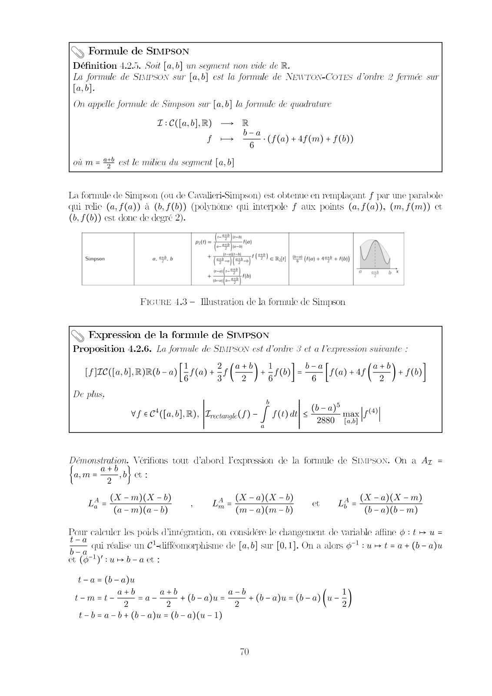

**Lecture OCR à contrôler**

~~~text
® Formule de SIMPSON

Définition 1. Soit [a,b] un segment non vide de R.
La formule de SIMPSON sur [a,b] est la formule de NEWTON-COTES d'ordre
[a,b].

2 fermée sur
On appelle formule de Simpson sur [a,b] la formule de quadrature
Z:C([a,b],R) — R
b-a
Fo A (F(a) + 4/0) + £0)

où m= & est le milicu du segment [a,b]

La formule de Simpson (ou de Cavalic

mpson) est obtenue en remplaçant f par une parabole

qui relic (a, f(a)) à (b, f(b)) (polynôme qui interpole f aux points (a, f(a)), (m, f(m)) et
(b, f(b)) est donc de ck 2).

Simpson

{ (À \
Lol (Ha) + 4232 + 1) yy

\

FIGURE 43 — Illustration de la formule de Simpson

NN Expression de la formule de SIMPSON
Proposition 4.2.6. La formule de SIMPSON est d'ordre 3 et a Vexpi

[IC ([a, b], RJR( - a) FO # st( + *) + 0) =
De plus,

esston Suivante +

“rc +4 (52) +10]

vf eC{([a,b],R), (b=

2880 a 1

Zrectante( 1) ~ Fat} <

Démonstration. Vérifions tout d’abord Vexpression de la formule de SIMPSON, On a Az
a+
a,m= ——,b} et:

rh

Laz na? | LA = ga? LA = (X -a)(X -m)

6 "(b= a)(b=m)
Pour calculer les poids d'intégration, on considére le changement de variable affine é
t-a | °

bog i réalise un Cl-difféomorphisme de [a,b] sur [0,1]. On a alors ¢
<a
et (@1) sue b-act:

:teus

tiuetsat(b-a)u

feet ou
tt pe one + (- dust a)(u-5)
Frbae-be Goes dd

t-m=t-
~~~

## Page 12

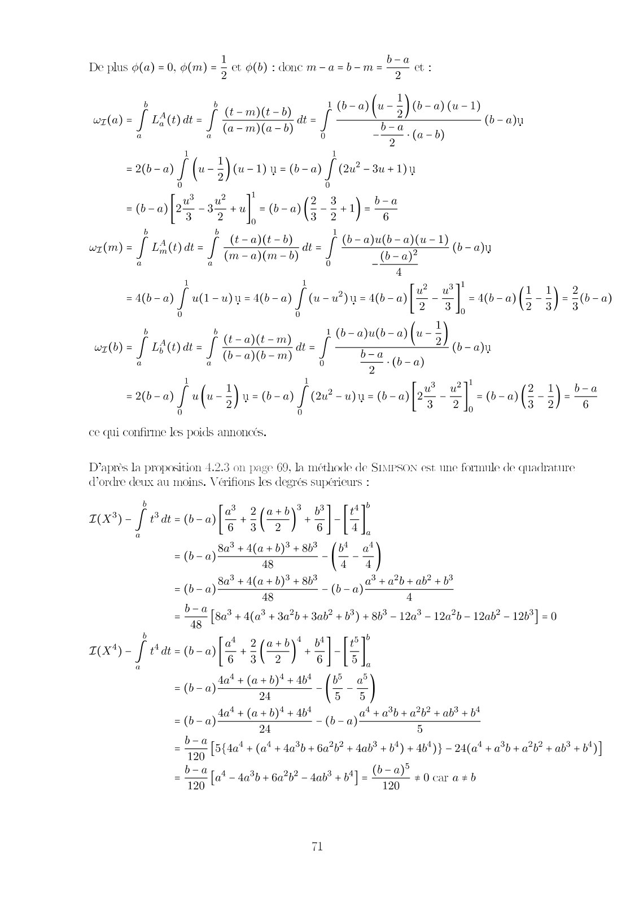

**Lecture OCR à contrôler**

~~~text
1
5 et @(b) : donc m-a=b-m= ok et:

De plus 6(a) = 0, o(m

1
b à 1 (b-a)(u-1)(b-a)(u-1)
fau P Meme) (x-5) :
wx(a)= f Lk) a= ae À Et ny (b=a)u
1 1 af
=26-0) { (u- 5) (=D u-(-a) fete nu
=(b- fe oie 4] = (b- o( 3 j="
b
7 Lf_Cot-D yf Gra)ulb-a\(u-1) 7,
me [ro ) nat =5 J “Gna? (b-a)y
4
is wy! it
=4A(b-a) f u(1-w)u=4(0-a) f (w-w?)u=4(b-a)|“ -“]} = 46-0) (+-+)=2 0-0
0-0 fie 16-0 f y=ae-a)[ FF] = 40-0) (5-3)= 20-0)
+
b b 1 (b-a)u(b-a)(u-=
fau fm) ( ha
ex) [aa | Graeme i) r= = Ow (b-ayu

=2(b- of (u-5)u=6- 0 fw “y = apes] “(i= a)(5-5

ce qui confirme les poids annoncés.

D’après la proposition 4.
d'ordre deux au moins. \

; 3 ib
1(x%)- J Pat= (0-2 +2(St) EL [ET

Sa +4(a +b) +809 _ (5 *)

3 on page 69, la méthode de SIMPSON est 1me formule de quadrature
‘ifions les degrés supérieurs :

=(b-a)

48 174
6-0 tés de +8) GS rad +5

= _ [8a° + 4(a° + 3a°b + Bab” + 5°) + 8DŸ — 12a° — 12a7b — 12ab? - 126°] = 0

T(x") - fraso-oft2(esty +]

a

4 Abt na
= (b-ayte tas byt aot La
24 5 5
or ne ~ (ba) Lab + att? + ab + Of
24 5
= a 2 [5{4a! + (a‘ + 4a°b + 6a7b? + dab? + D?) + 4b")} — 24(a" + ab + a7b? + ab? +b!)]
b-a - a)

[at 4090 + 6a7b? - dab? + 64] =

+0cara+b

7120 os
~~~

## Page 13

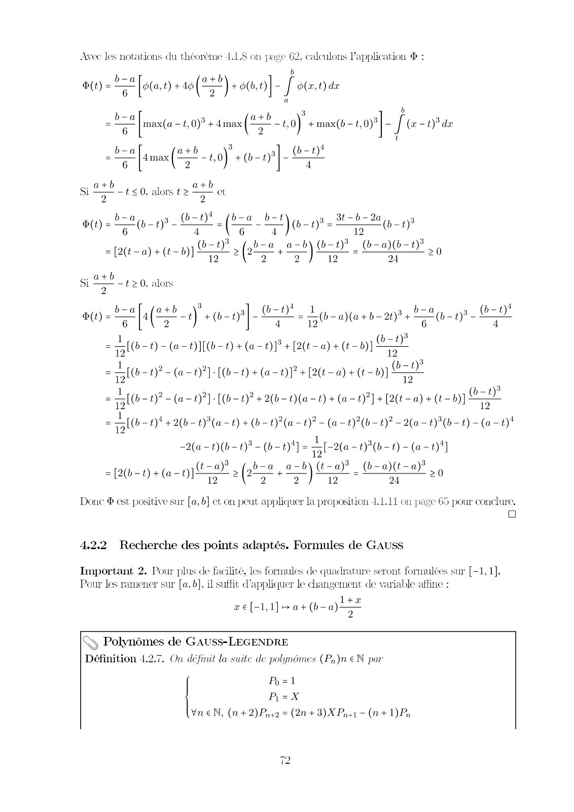

**Lecture OCR à contrôler**

~~~text
Avec les notations du théorème 4.18 on page 62, calculons l'application & :
b

(0) =" [o(a,t) +402) +00,0]- f otroar

- oS [manta = 4,0)? + 4inax(

æ ue [+mas(25* = 1.0), # 0-05] = ee

+b b
UT 40, alors t2 = é

a+b

3 b
ns max(0—t, 3) T-t Bs T
#0) + (b 10) J' ned

Si

= ~=$)* = = ae
a(t) = 8 6-99- 020 (= ‘\o-o=% 2 2a (y_ 43

4
= [2(¢-a) + 4-0] wo 7 (Gan +s) ve L (00 50

Si at =120, alors

-a a ? 4 -t)! 4 -a à +)
wy ="*[4( = -1) +-o5]- G9 = KO-ay(a+b— 20° + 40-49 L “2
-ty
= BIG-)- (a HI) + NP + 2-2) + ¢- 9) HB
3
2516-07 = (a= 1}-(0-8) + (aH + [204 a) + (01 OD
#8
= LLG-0?-(a- 0°] 16-07 + 200-9000) + (a-1)7] + PE a) + (=D) OD.

= ale ~t)4 +2(b-t)3(a-t) + (b-t)?(a-t)? - (a t)?(b- t)? - 2(a - t)3(b-t) - (a-t)4
-2(a=1)(0- 1) = 0-8)" = S[-20- 986-8) - (0-1)

= (206-1) + (ony abst shee = Gate 20

Donc ® est positive sur [a,b] et on peut appliquer la proposition 4.1.11 on page 65 pour conclure.
Oo

4.2.2 Recherche des points adaptés. Formules de GAUSS

Important 2. Pour plus de facilité, les formules de quadrature seront formulées sur [-1, 1].
Pour les ramener sur [a, b], il suffit d'appliquer le changement de variable affine :
l+x

2

ze[-1,1]ma+(b-a)

S Polynômes de GAUSS-LEGENDRE
Définition 4.2.7. On définit la suite de polmômes (Pin eN par
Po=l
P,=X
Wn EN, (n +2) Ps = (2n +3) X Pasi — (n+1)Pa
~~~

## Page 14

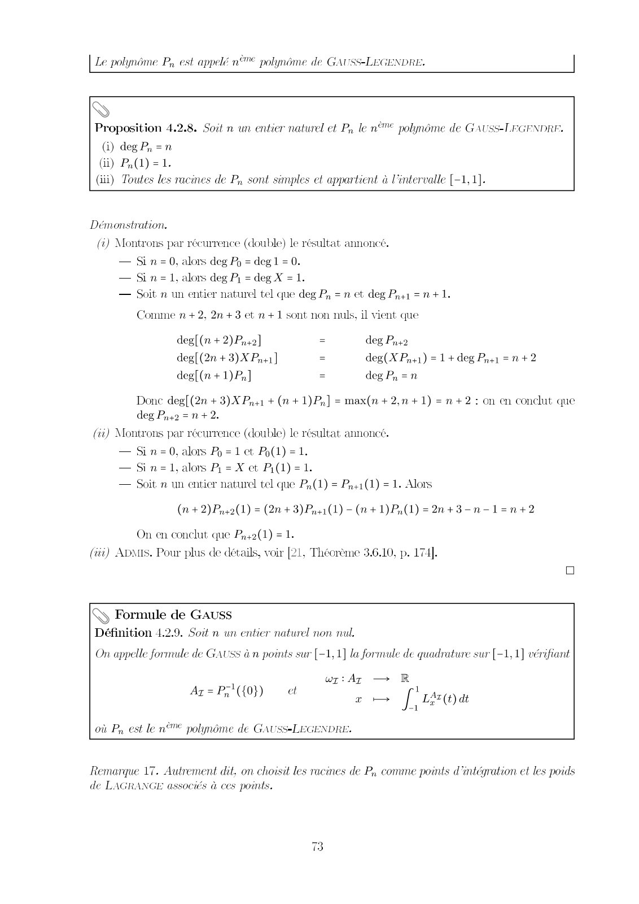

**Lecture OCR à contrôler**

~~~text
Le polynôme Py est appelé n&"© polynôme de GAUSS-LEGENDRE.

$

Proposition 4.2.8. Soit n un entier naturel et Py le n° polynôme de GAv
(i) deg P, =n

Gi) P,(1) =1

(iii) Toutes les racines de P, sont simples et appartient à l'intervalle [-1,1).

2GENDRE.

Démonstration.
(i) Montrons par récurrence (double) le résultat annoncé.
— Si n=0, alors deg Po = deg1 = 0.
— Sin=1, alors deg P; = deg X = 1.
— Soit n un entier naturel tel que deg P, =n et deg Pry =n+1.

Comme n +2, 2n +3 et n +1 sont non nuls, il vient que

deg[(n +2)Pu+2] = deg Paso
deg[(2n +3)X Pasi] = deg(X Pas) = 1+ deg Pi =n +2
deg[(n +1) Pp] = deg P, =n
Donc deg[(2n + 3)X Pasi + (m+ 1)P,] = max(n + 2,n +1) = n +2: on en conchit que
deg Py4g =n +2.
(ii) Montrons par récurrence (double) le résultat annoncé.
Sin = 0, alors Po = 1 ct Po(1) = 1.
Si n=1, alors P; = X et P)(1) = 1.
Soit n un entier naturel tel que Pa(1) = Pasi(1) = 1. Alors

(n+ 2)Pyso(1) = (2 +3) Pri (1) = (n+ 1)Pa(1) = 2n+38-n-1=n+2
On en conclut que Pas2(1) = 1.
(wi) Ab\us. Pour plus de détails, voir [21, Théorème 3.6.10, p. 174].

® Formule de Gauss
Définition 4.

Soit n un entier naturel non nul.
On appelle formule de GAUSS à n points sur [-1, 1] la formule de quadrature sur [-1,1] vérifiant
wr: Ar — R

Ar=P,'({0}) et ro [Lao

où Py est len polyndme de GAUSS-LEGENDRE.

Remarque 17.

ulrement dit, on chi
de LAGRANGE associés à ces points.

sit les racines de P, comme points d'intégration et les poids
~~~

## Page 15

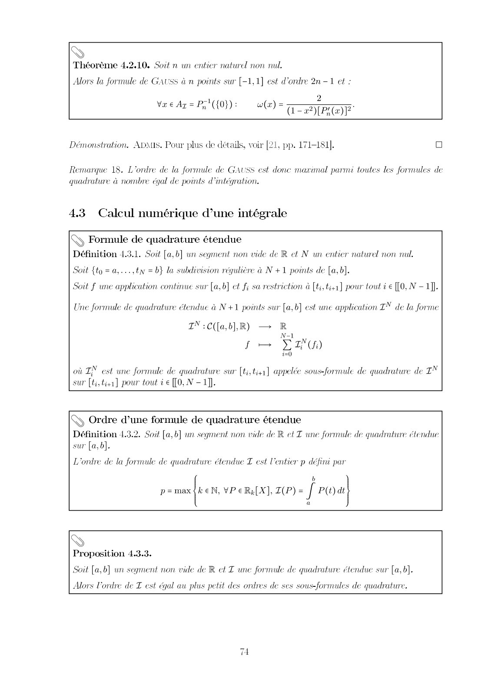

**Lecture OCR à contrôler**

~~~text
YS

Théorème 4.2.10. Soit n un entier naturel non nul.

Alors la formule de GAUSS à n points sur [-1,1] est d'ordre 2n-1 et :

= 2
Va € Az = P>'({0}): TPP Or

Démonstration. ADMIS. Pour plus de détails, voir [2L, pp. 171-181]. a

Remarque 18. L'ordre de la formule de GAUSS est done maximal parmi toutes les formules de
quadrature à nombre égal de points d'intégration.

4.3 Calcul numérique d’une intégrale

$ Formule de quadrature étendue

Définition 1.3.1. Soit [a,b] un segment non vide de

R et N un entier naturel non nul.
Soit {to =a,..

tn =D} la subdivision régulière à N +1 points de [a,b].
Soit f une application continuc sur [a,b] et fi sa restriction à [ti,tis1] pour tout à ¢ [[0, N - 1].
Une formule de quadrature étendue à N +1 points sur [a,b] est une application ZN de la forme

TN :C([a,b],R) — R
N-1

fo LT)
i=0

où TN est une formule de quadrature sur [t;,tis1] appelée sous-formule de quadrature de IN
sur [titi] pour tout i¢ [[0,.N - 1].

NN Ordre d’une formule de quadrature étendue
Définition 4.3.2. Soit [a,b] un segment non vide de R et T une formule de quadrature étendue
sur [a,b].

L'ordre de la formule de quadrature étendue T est Ventier p défini par

b
p=maxlkeN, VPERXT, Z(P)= [ Pat
.

$

Proposition 4.3.3.

Soit [a,b] un segment non vide de R et Z une formule de quadrature étendue sur [a, b].

Alors l'ordre de Z est égal au plus petit des ordres de ses sous-formules de quadrature.
~~~

## Page 16

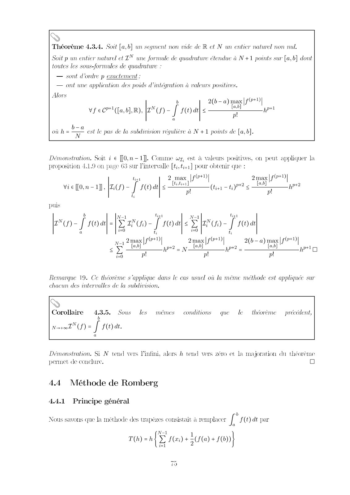

**Lecture OCR à contrôler**

~~~text
$

Théorème 4.3.4. Soit [a,b] un segment non vide de R et N un entier naturel non nul.

Soit p un entier naturel et TN une formule de quadrature étendue à N +1 points sur [a,b] dont
toutes les sous-formules de quadrature :

— sont d'ordre p exactement ;

— ont une application des poids d'intégration à valeurs positives.
Alors

vfec?*!([a,b],R),

<

2(b- a) max|f?*)|
[a,b] ptt

b
L'(n- [ ro

p!
où h=

est le pas de la subdivision régulière à N +1 points de [a,b]

Démonstration. Soit à € [[0,n-1]]. Comme wz, est à valeurs positives, on peut appliquer la
proposition 4.1.9 on page 63 sur l'intervalle [¢;,ti+1] pour obtenir que :

tes 2 max [fo] Imax [0]
: [tistiv] +2 [ab] +2
Vieln-11, ZN) f ra < tans ns
puis
: b Net tin N-l tig
'(p- f say =|¥ )- f ras TE

ZN (n)- | seat

1 2max| fer) Bmax |f|

D pre =n
0 p!

2(b- a) max |f(+1)
pee _ 5 de | |

weg
p! pl

Remarque 19. Ce théorème s'applique dans le cas usuel où la même méthode est appliquée sur
chacun des intervalles de la subdivision.

S

Corollaire

43.5. Sous les mêmes conditions que ke
b

woewl%(f)= f FO at.

théortme précélent,

Démonstration. SiN tend vers infini, alors À tend vers zéro et la majoration dn théorème
permet de conclure.

o
44 Méthode de Romberg

44.1 Principe général
£ . b
Nous savons que la méthode des trapèzes consistait à remplacer [ f(t) dt par
a

N-1
AO DCE TON D)
~~~

## Page 17

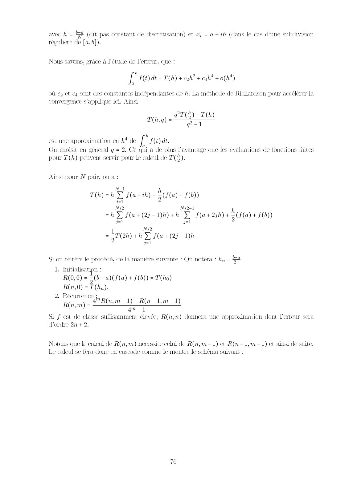

**Lecture OCR à contrôler**

~~~text
Be (dit pas constant de discrétisation) et a; = a+ éh (dans le cas d’une subdivision

régulière de [a,b]).

avec h =

Nous savons, grace à l'étude de l'erreur, que :

b 0
[ f(t) dt = T(h) + eh? + eqh! + o(h!)
a

où € et 64 sont des constantes indépendantes de h. La méthode de Richardson pour accélérer la
convergence s'applique ici. Ainsi

r(haq) = LD =TU)

b
est une approximation en h4 de f f(t)dt.
ae fay fy 1 as i ‘a : qe. É ae
On choisit en général q = 2. Ce qui a de plus Pavantage que les évaluations de fonctions faites
pour T(h) peuvent servir pour le caleul de T(4).

Ainsi pour N pair, on a :
N-1 h
T(h)=h Y f(a+ih)+ 3) + f(b))
i=l
N/2 N/2-1

=hY f(a+(25-Dh)+h D f(a+2jh)+ TO) + f(b))
jal jal

1 N/2
==1(2h) +h D f(a+(2j-1)h
2 4
b-a

re le procédé, de la manière suivante : On notera thy = Fr

Si on réit
L Tnitialisatipn à
R(0,0) = 5(b- a)(f(a) + F(b)) = T(ho)
R(n,0) = T(hn),
2. Recurrence ;
R(n,m) = 4" R(n,m-1) - R(n-1,m-1)
am
Si f est de classe suffisamment ¢le
d'ordre 2n +2.

ée.

, R(n,n) donnera une approximation dont Verreur sera

Notons que le calcul de R(n,m) nécessite celui de R(n,m-1) et R(n-1,m-1) et ainsi de suite.
Le calcul se fera donc en cascade comme le montre le schéma suivant :
~~~

## Page 18

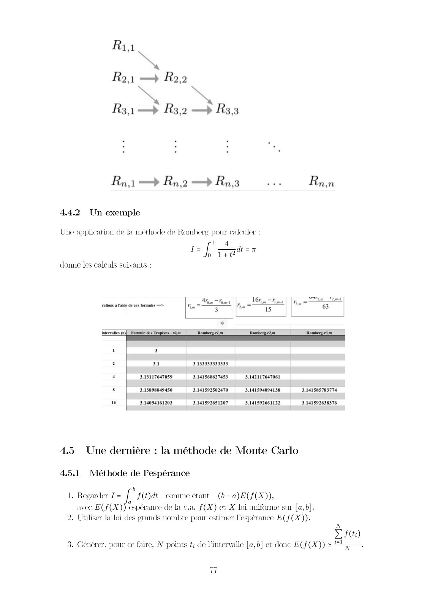

**Lecture OCR à contrôler**

~~~text
Ria

N

Roi — Rio

n°

R3i1—> R32 — Rss

Raa > Rng —_— Rn tee Ran

4.4.2 Un exemple

Une application de la méthode de Romberg pour calculer :

donne les calculs suivants :

rations à l'aide de ces Formaes —>

1 3
2 31 3.153535353533

4 313117647059 314168627455 314211764706!

5 313898849450 3141802502470 314159409415 314158578374
16 3.14094161203 3.141592651207 | 314159266122 3.141592638376

4.5 Une dernière : la méthode de Monte Carlo
4.5.1 Méthode de l’espérance
b
L. Regarder 1 = f f(t)dt comme étant (b- a)E(f(X)),

avec E(f(X)) espérance de la va. f(X) et X loi uniforme sur [a,b].
2. Utiliser la loi des grands nombre pour estimer l'espérance E({(X)).

3. Générer, pour ce faire, N points ¢; de l'intervalle [a,b] et donc E(f(X)) =

re
Df)

il
~~~

## Page 19

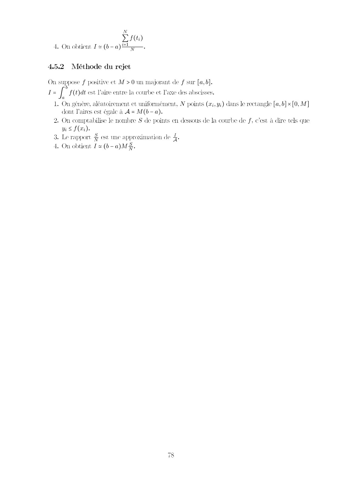

**Lecture OCR à contrôler**

~~~text
4. On obtient I = (b- a) = —

4.5.2 Méthode du rejet

On suppose f positive et M > 0 un majorant de f sur [a,b].
b
I= f f(t)dt est l'aire entre la courbe et l'axe des abscisses.
a
1. On génère, aléatoirement et uniformément, N points (a;,y;) dans le rectangle [a,b]*<([0, M]
dont l'aires est égale à A = M(b-a).
. On comptabilise le nombre S$ de points en dessous de la courbe de f, c'est à dire tels que
gi < (ai).
3. Le rapport % est ame approximation de 4.
4. On obtient I= (b- a)M
~~~

## Page 20

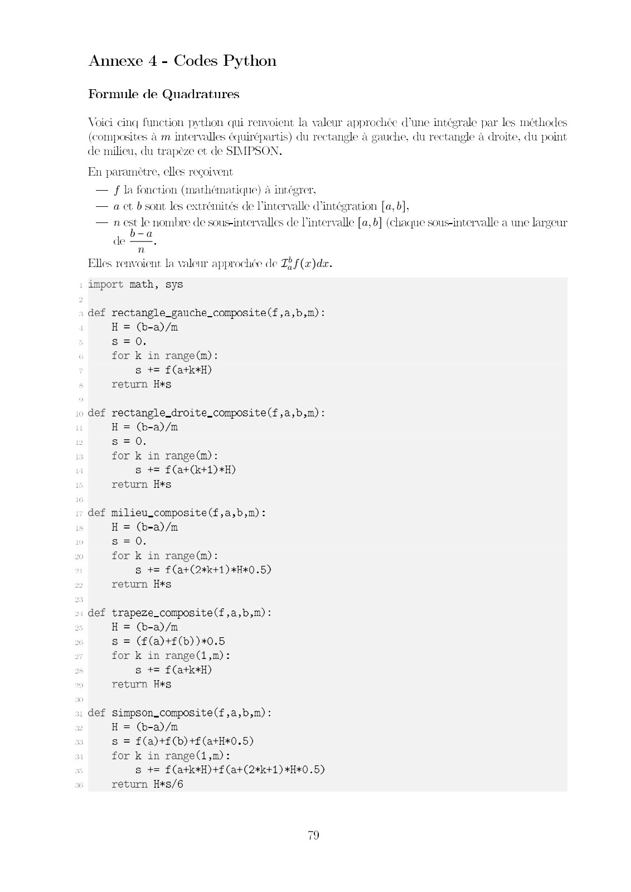

**Lecture OCR à contrôler**

~~~text
Annexe 4 - Codes Python

Formule de Quadratures

Voici cinq function python qui renvoient la valeur approchée d’une intégrale par les méthodes
(composites à m intervalles équirépartis) du rectangle à gauche, du rectangle à droite, du point
de milicu, du trapéze et de SIMPSON.
En paramètre, elles reçoivent

— f la fonction (mathématique) à intégrer,

— a ct b sont les extrémités de l'intervalle d'intégration [a,b],

— nest le nombre de sous-intervalles de l'intervalle [a,b] (chaque sous-intervalle à une largeur

ae 88

nm
Elles renvoient la valeur approchée de Z?f(x)dx.

import math, sys

def rectangle_gauche_composite(f,a,b,m):
H = (b-a)/m
s=0.
for k in range(m):
s += f(atk*H)
return Hts

o def rectangle_droite_composite(f,a,b,m):
H = (b-a)/m
s=0.
for k in range(m):
s += f(at(k+1)+H)
return H*s

def milieu_composite(f,a,b,m):
H = (b-a)/m
Ss = 0.
for k in range(m):
s t= f(at(2*k+1) ¥*H*0.5)
return Hts

def trapeze_composite(f,a,b,m):
H = (b-a)/m
s = (£(a)+f(b))#0.5
for k in range(1,m):
s += f(atk*H)
return Hs

def simpson_composite(f,a,b,m):
H = (b-a)/m
s = f(a)+f£(b) +f (atH*0.5)
for k in range(1,m):
s += f(atk+H)+f(at+(2+k+1) *H+0.5)
return H+s/6
~~~

## Page 21

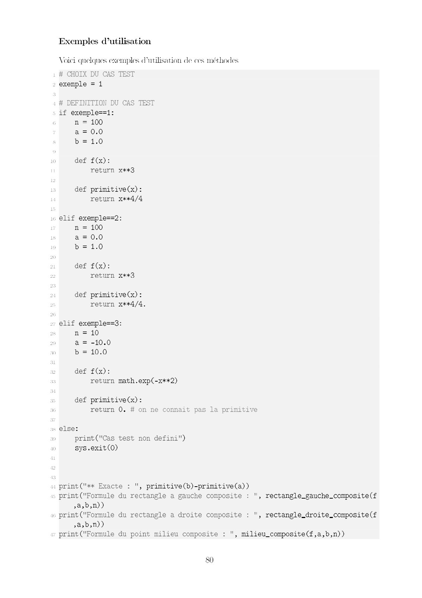

**Lecture OCR à contrôler**

~~~text
Exemples d’utilisation

Voici quelques exemples d'utilisation de ces méthodes
# CHOIX DU CAS TEST
2 exemple = 1

DU CAS TEST

def f(x):
return x#*3

def primitive(x):
return x**4/4

© elif exemple==2:

n = 100
8 a = 0.0

b=1.0

def f(x):

2 return x**3

def primitive (x):
return x#*4/4,

2 def f(x):
return math.exp(-x**2)

def primitive(x):
x return 0. # on ne connait pas la primitive

s else:
print("Cas test non defini")
sys.exit(0)

print ("** Exacte : ", primitive(b)-primitive(a))
print ("Formule du rectangle a gauche composite : ", rectangle_gauche_composite(f
»a,b,n))
 print("Formule du rectangle a droite composite : ", rectangle_droite_composite(f
»a,b,n))
print ("Formule du point milieu composite : ", milieu_composite(f,a,b,n))

80
~~~

## Page 22

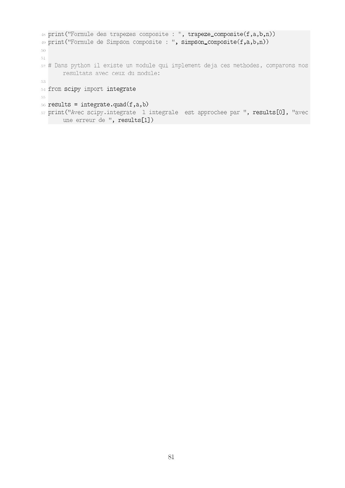

**Lecture OCR à contrôler**

~~~text
« print ("Formule des trapezes composite : ", trapeze_composite(f,a,b,n))
» print("Formule de Simpson composite : ", simpson_composite(f,a,b,n))

# Dans python il existe un module qui implement deja ces methodes, comparons nos
resultats avec ceux du module:

from scipy import integrate
© results = integrate.quad(f,a,b)

print ("Avec scipy.integrate 1 integrale est approchee par ", results[0], "avec
une erreur de ", results[1])

sl
~~~
