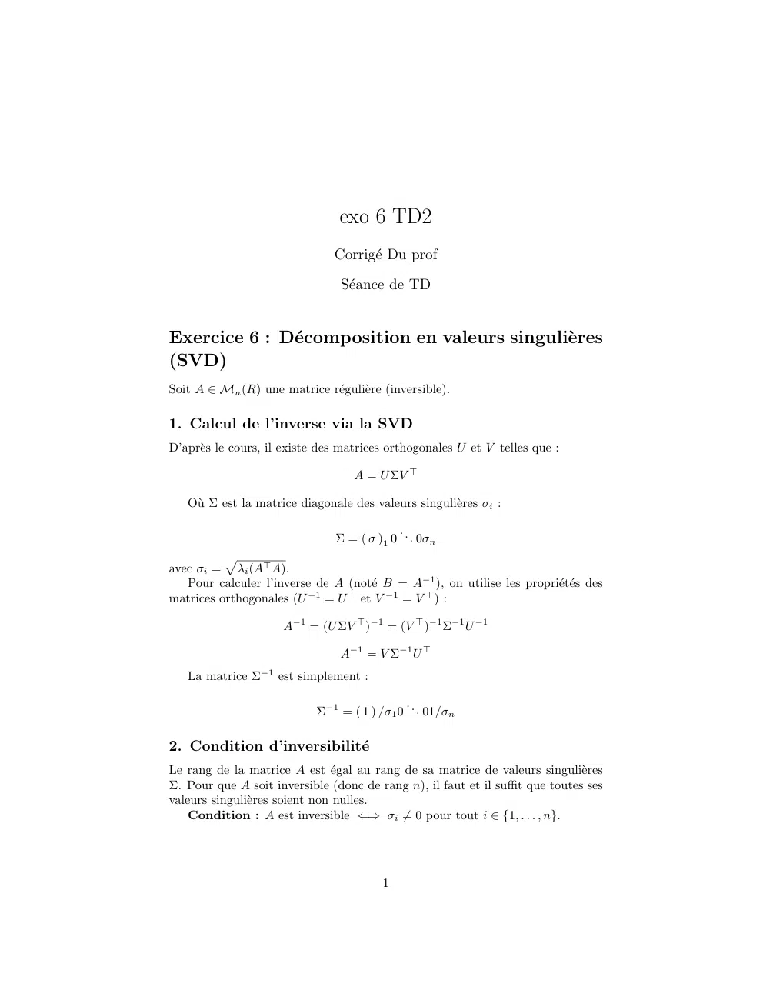

# ex6_TD2.pdf

[Ouvrir l’original](https://drive.google.com/open?id=1BrYTU4hOvlh8QFOWbor5pXnBhHXT9SuA) · Les deux lectures automatiques du PDF divergent sur les pages indiquées. Leur fac-similé accompagne le texte.

**Pages présentant un écart entre les deux extractions** — 1.

## Page 1

~~~text
                                exo 6 TD2
                               Corrigé Du prof
                                Séance de TD

Exercice 6 : Décomposition en valeurs singulières
(SVD)
Soit A ∈ Mn (R) une matrice régulière (inversible).

1. Calcul de l’inverse via la SVD
D’après le cours, il existe des matrices orthogonales U et V telles que :

                                   A = U ΣV ⊤

   Où Σ est la matrice diagonale des valeurs singulières σi :

                                           .
                               Σ = ( σ )1 0 . . 0σn
          p
avec σi = λi (A⊤ A).
   Pour calculer l’inverse de A (noté B = A−1 ), on utilise les propriétés des
matrices orthogonales (U −1 = U ⊤ et V −1 = V ⊤ ) :

                     A−1 = (U ΣV ⊤ )−1 = (V ⊤ )−1 Σ−1 U −1

                                A−1 = V Σ−1 U ⊤
   La matrice Σ−1 est simplement :

                                             .
                            Σ−1 = ( 1 ) /σ1 0 . . 01/σn

2. Condition d’inversibilité
Le rang de la matrice A est égal au rang de sa matrice de valeurs singulières
Σ. Pour que A soit inversible (donc de rang n), il faut et il suffit que toutes ses
valeurs singulières soient non nulles.
    Condition : A est inversible ⇐⇒ σi ̸= 0 pour tout i ∈ {1, . . . , n}.

                                        1
~~~
