# Cours 2 - Cluster - Manuscrit.pdf

[Ouvrir l’original](https://drive.google.com/open?id=17EIRyewFd6sPHZA4vrPfhBuQjXuCQxwL) · Les pages signalées comprennent du texte reconnu automatiquement ou des éléments graphiques. Le fac-similé permet de vérifier chaque lecture.

**Pages avec fac-similé ou lecture OCR** — 1–19.

## Page 1

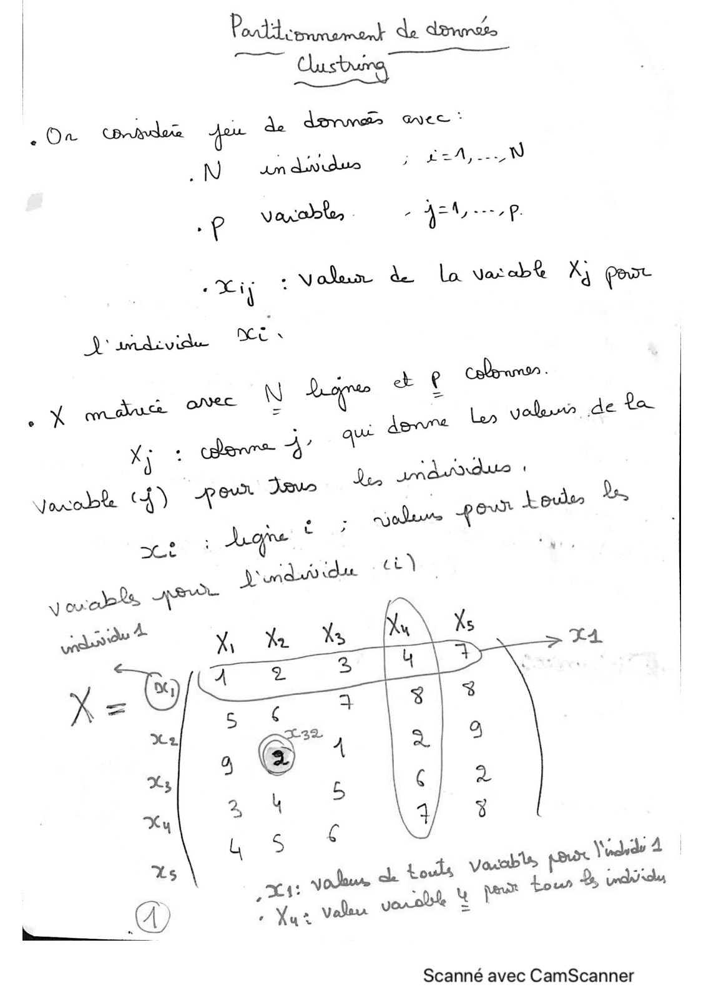

**Lecture OCR à contrôler**

~~~text
|” Les

das jou ae. donms acc *
KO and ¢ Seine
jp veste Ur

"Kij

«Ou

. Nolum de La verbe Ky pour

ye A Ayuides Me x

; €
Lorain ee ET LA Le vel de te

Scanné avec CamScanner
~~~

## Page 2

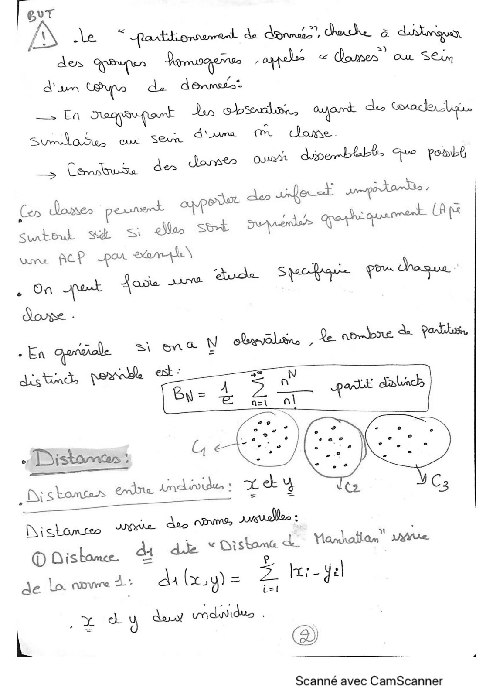

**Lecture OCR à contrôler**

~~~text
UT
EX le “podtlemered de demi? Juuhe à dt
| den aguaqu Jomoqpe cape « Qomes” au Sein

d'un Uys de denmist

— En seagiv font Jan obsrdlain, ayant de Corader lige
d'isume Tm done

um : wr Sen |

| _. danses Out dinerbabe que ponbt

: et urgente Se, |

Ces dome pere oppodse de SF arme CAE
Sunkiouk ad S du Soi perde qe que

ume AC? P tude Spebÿau gow dhaque

» Oa Josie se
| ann,
E Si Mme N doy yaliine | de aobne e
«ka N ae

MA
2.

Aistiad, perl of: RE i err
y= SF ian nl *

«Distomcs:
as

Di "

Nislomrso White do NME urusssoo :

© Distomes. ay die “ODistana ad. Vadollan vr.
is 4

yok dos umdnidu .
° @

nm |

da (x.y) = Z Fi gel

Scanné avec CamScanner
~~~

## Page 3

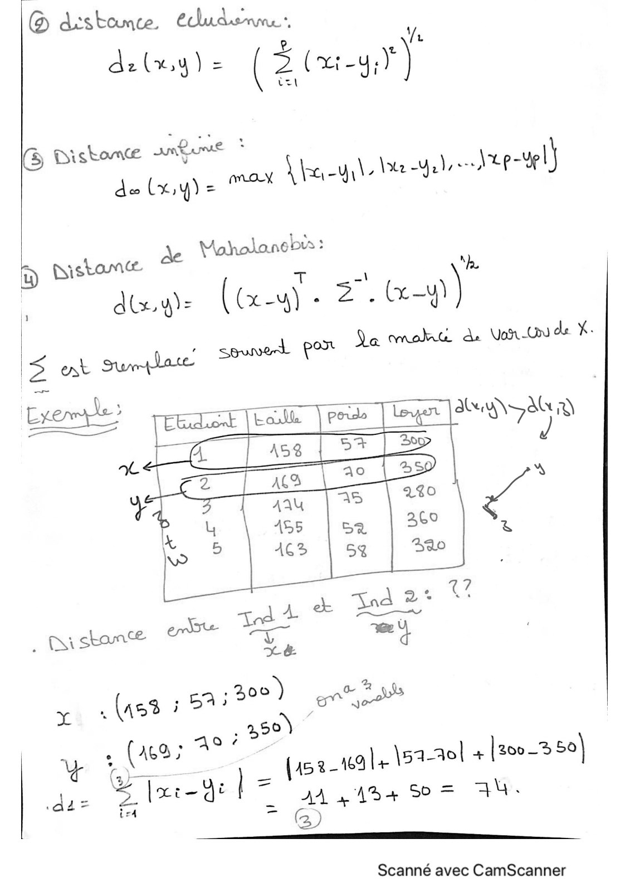

**Lecture OCR à contrôler**

~~~text
© dis tounce, edudsrme :,

del) = ( 5 y)

À ce spe Rint
© Diston ;

de (x,y) = may Large be alot tebe)
M holanebis :
mn pistamæ de ‘v
h dlxy)=

‘be
(cut x 4 (xy) }

por Na

mob de VonGn de ¥-

(ass

\5a-Aol + |z00_3 50]

AA 4 AD4 = Wh.

Scanné avec CamScanner
~~~

## Page 4

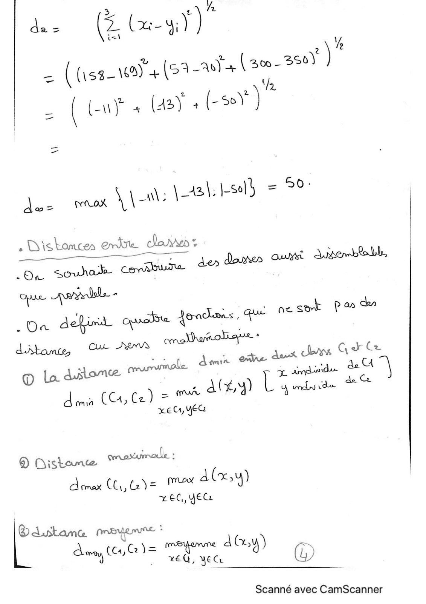

**Lecture OCR à contrôler**

~~~text
2 A
ae (Zerg)

ttt

2 ) k
(52 as) ETS _350)

(lisse) + 7
(-se¥* ) se

( Lay + Le:

{\)

=

a pron ME \ 431 |-sel} — 50:

Distances ete clown: L
D ook Commute den dame omis Aero bb,
-On 2

ane Sins, qu: ne sot Pan dr
. On defini Sa s,

omoïhuwrolaue +

| Geet Ca
dadtomce, 25. dé ee dex is ws

La duaslome pmarumale. . c
© damn CC Ce) = ms 04,4) L ein ide

xetu, EG

(

mic d(x;u)
LEG, YECe

® Distome
Arex Ci, GE

@autanc ABLE © i .
dry (CCE D ©

xeû, vecu

Scanné avec CamScanner
~~~

## Page 5

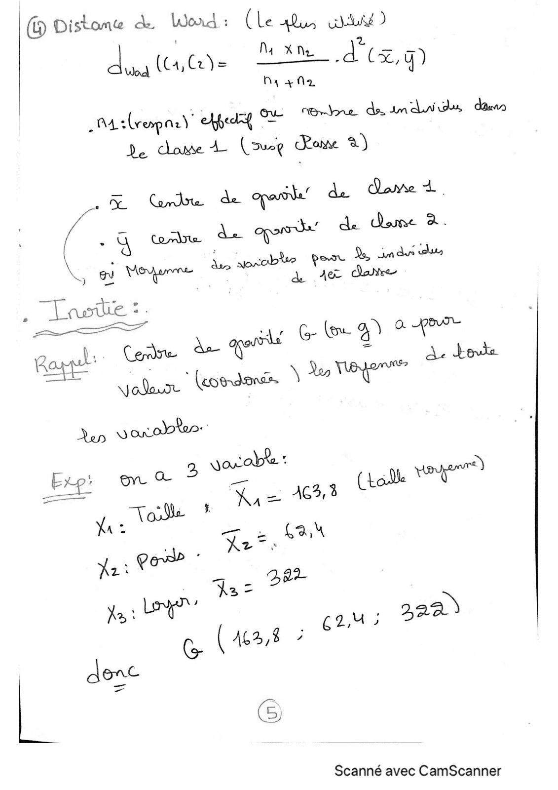

**Lecture OCR à contrôler**

~~~text
( Distance &. Wad: (Le ur wt)
| n D à > =
dus (Ca, Cr) = M xm  d (x,q)

Ny ana
na (ropar ete corre des amd ile date
| De dome 4 Crus Rome à)

Le a Peas Me a Ae dre
que :
ET . ene G (om 9) a. Pou
els Comoe = | Ae bovis
= afar.” lose Ye HPN
den yor cokes
aco \
2 N
—_ a ; at AGI, 3 (tod VAT
Toile ?
ie Pow : Kee ON
7 , Yat a \
& aan

Scanné avec CamScanner
~~~

## Page 6

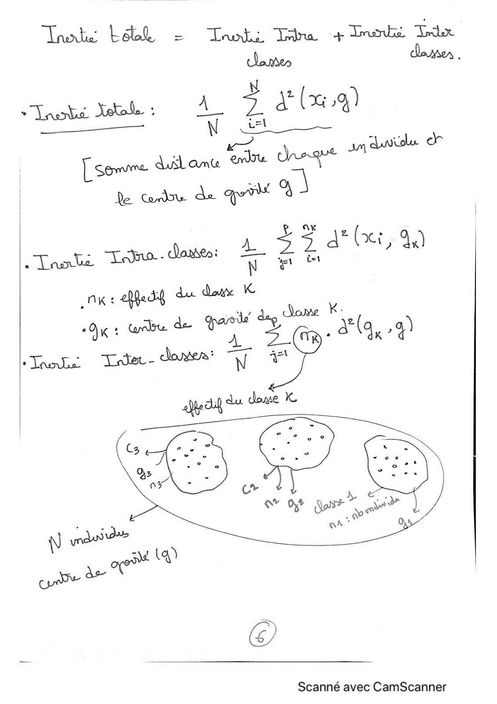

**Lecture OCR à contrôler**

~~~text
Tube bate = Tai Tara + Trott Dé
dames dunes ,
ÿ z
Trobe Xl: À + (x)
Ne ge mue
[sore duil ane it dns ai
R OF
a* (xi, 40
. Lao + na. - dames: a 22 4
nk : eds dye tate esa
a wae ms à (a, -4)
Lun Teter dora: W 4

©

Scanné avec CamScanner
~~~

## Page 7

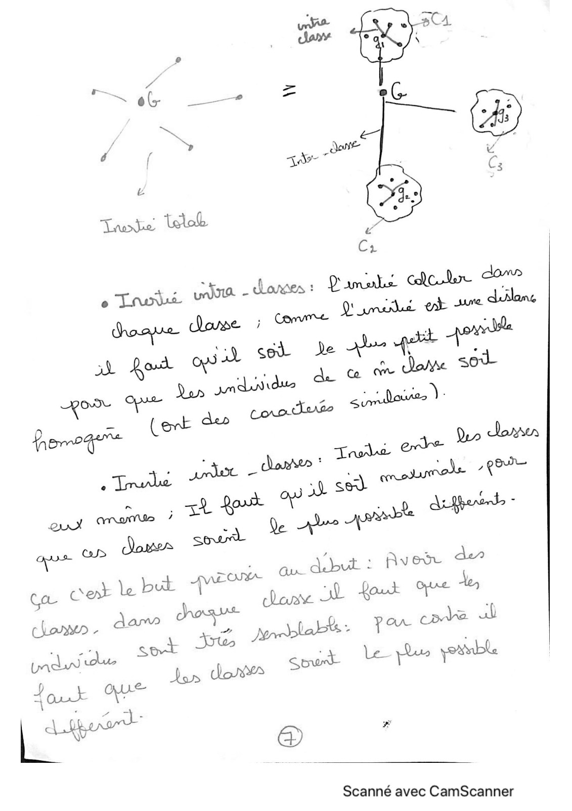

**Lecture OCR à contrôler**

~~~text
4 / ahr ae us
| ce
Tate lol é
Cr
” i ax D mans cl don

Scanné avec CamScanner
~~~

## Page 8

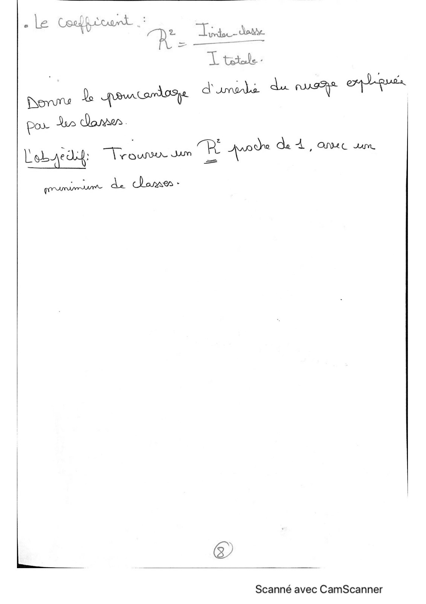

**Lecture OCR à contrôler**

~~~text
si cor. À
° le Coats OY 2 ihe pean

Ltt
soe be Soe dem
pos. Us dames
Neh zat “Pease Jode de 4, anec sum
gramme de dames -

Scanné avec CamScanner
~~~

## Page 9

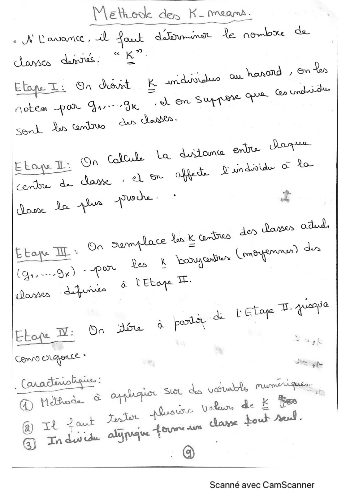

**Lecture OCR à contrôler**

~~~text
Mathove des K- mea.
LA Vawamee, AL aout d'nemot de now. de
Elo Es Oa dont K anduisdur om Wen
netem or Yar Oe jak Oe Sue PT
sk À tu es Ca

ond , em.
Cp Und Dee

Calcul La duilome ee OM

Log IL: On Le au € do
à chain Jan ojpde Dani
ce

oe * z
dome do A ve |

does adel,
Tm. © Sunpbace Vs k trie . 3 ds
Ek \L + cn!
“arte me des & onsen LP

wet é LEboy T-
LE TT. JQ
EL Ww: On pire o P + # beer “
Peas =
Cone _ de |
_ Cadiiolue:

: Gosualots, unique |
© Häfod © op ‘tin ae a. k f= |
ONE bout Anal.

& In dis du opaque forme

.@

Scanné avec CamScanner
~~~

## Page 10

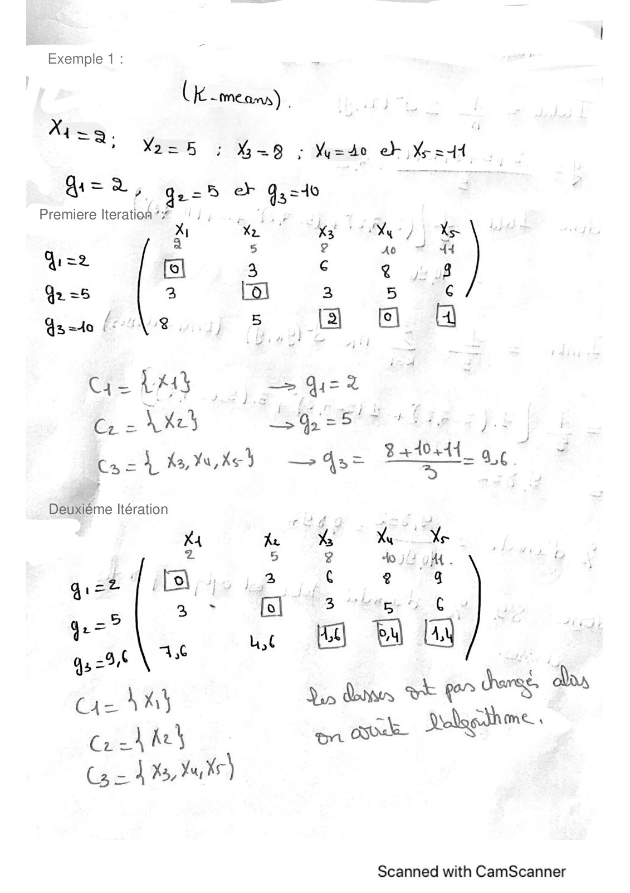

~~~text
 Exemple 1 :

Premiere Iteration :

 Deuxiéme Itération
~~~

**Lecture OCR à contrôler**

~~~text
Exemple 1 :
(K-means) |
Xà =o i
X2=5 ; X-9 ; Y=do ek Xea4t
M2, qg25 ef qd

Premiere Iteration *#

x, Ye .,r xs 4 dy ) Xs
dice a 5 2 4 — Yi
- 3 € @ ys gf
Q. =5 3 ra! 3 5 €
gs Ve; 5 _E ©. 4
Cte LAS — Mu?
Cr = X25 — D

F.<

Ca = \ fa, Yu, Xo} —> As= tt, 4,6 à

Deuxiéme ltération

KA ke ét xq iy
2 5 2 qo uM.
quet 1, Lo beg? . € g
5 a+ I 7 “pret y
+ Es we HE] Pl LM
43=" >
A4 Ban dus aot gon durs, dos
SEAL Srabagthone.
Een RC on Ca

Scanned with CamScanner
~~~

## Page 11

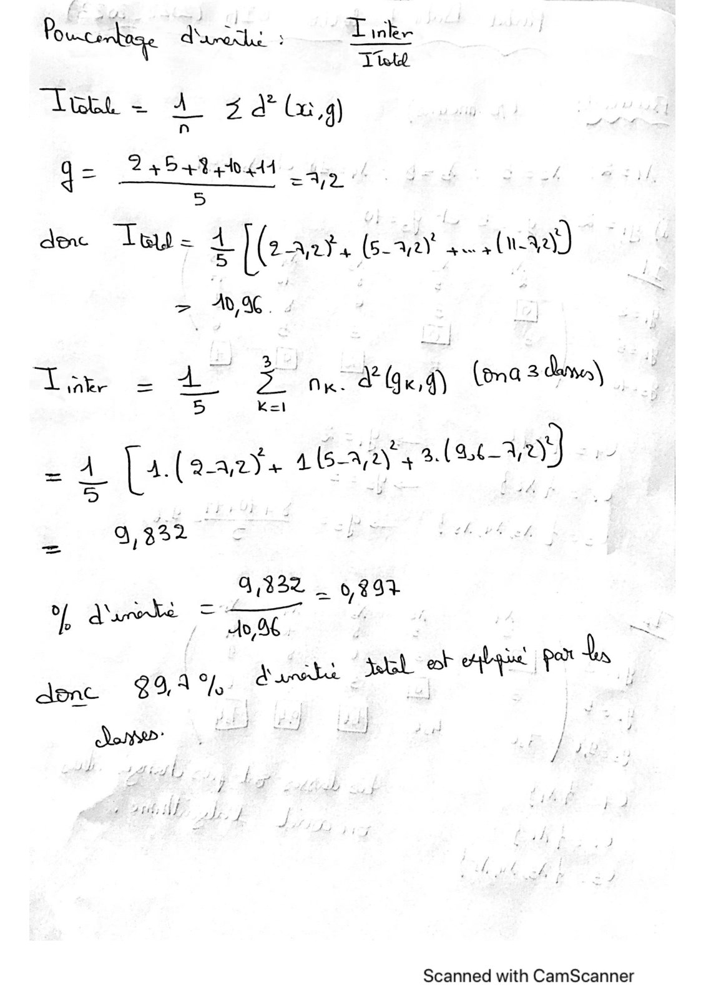

**Lecture OCR à contrôler**

~~~text
P ee as 4: : a ink.
et ee Tied
Tuer = A 34,9)

- 245 À
q= Pl dd Die ib Hye
Fe

doc las 4 alg AU 4 (s- A) à MA)

> MX.
ALES = 17 a nr. a (9x,4) (oma 2 des) 0 |
5 Kel

Es À. La.(eaeŸe 1EAN TZ ala ay)

9,332
4,832 _ 0,894
ANS te aad
a fis sat ap pote

Bc

donc 827%

Scanned with CamScanner
~~~

## Page 12

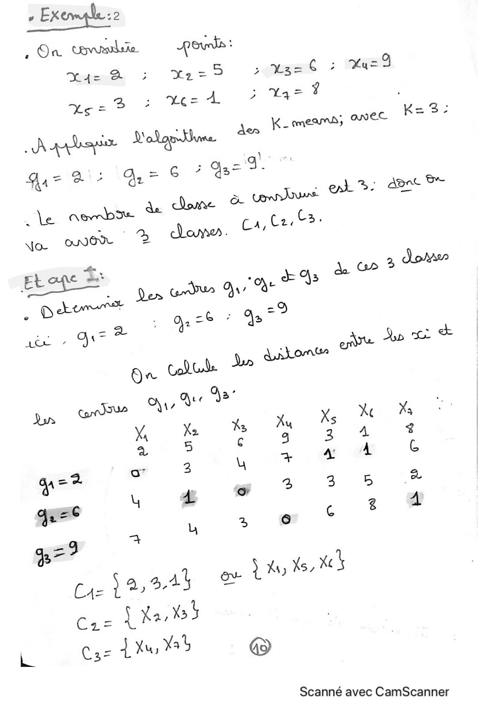

~~~text
2
~~~

**Lecture OCR à contrôler**

~~~text
| L'oap- Klum den Kemeny Over ene
Abe
fae ai: Aa. = G. 2 As | . ane
k expr de donc & Wen ous et —
an we , C3:
~ on à dem. C4
= fags à dom
Ar À à A3 de
a Yen tre ee
a à ps” Pe Nop ES
ee. Le LE ee pos
à 7. Jo atoms
Le DES
ou À
DIS condo x Ke Xu Xs À À
x 5 ¢ 4 3 À G
2 oF - 4 4 € a
a À © 3 2 Ë À
eae 4 à 3) e .
“ee? : ik Xs x
ay atm
Fac } Bye
Gaz { ka,%35

L C3= AUTRE ©

Scanné avec CamScanner
~~~

## Page 13

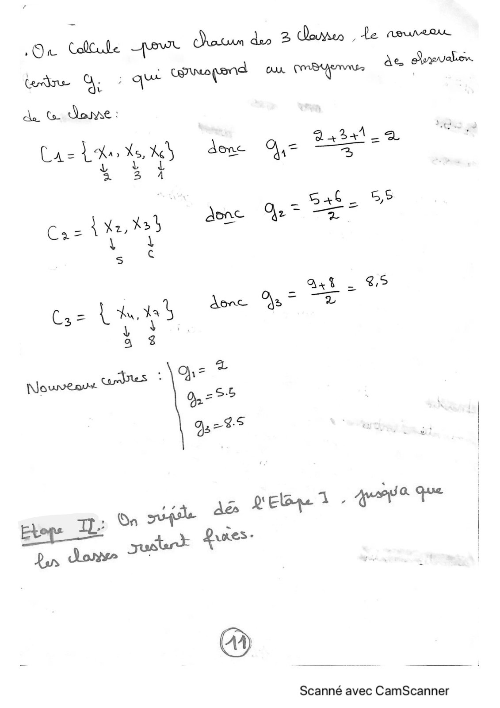

**Lecture OCR à contrôler**

~~~text
>
= Sas _ 5,5
ere.
Ax _ gio

Scanné avec CamScanner
~~~

## Page 14

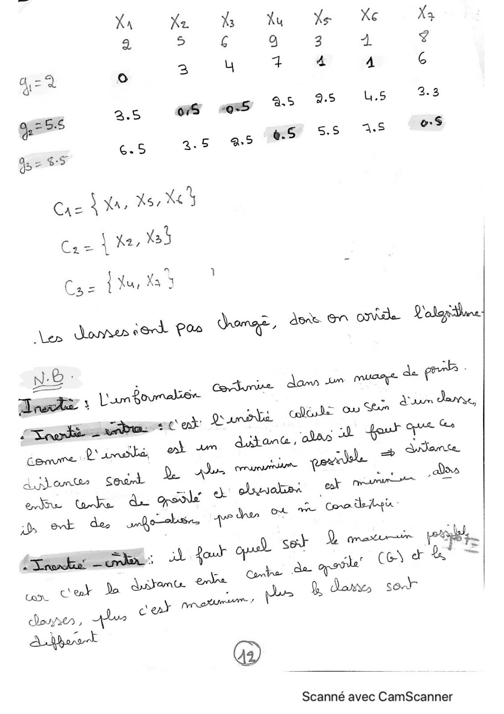

**Lecture OCR à contrôler**

~~~text
ave 2 °
| 2
; os “055 4.5 2-5 u.s 3
a.S
: oS
we 2.5 a9 @.5 3S 4,8
6.5 ,

Caz À ya, X56, XY
on ko, X35

Caz } Xu, Ka

Ven conver end Pos dome, dors En onde Lolgiue
-Les

a 5 Dam Sean um dare,
pone ans ec at
QS wld, et wm .
Cent
dont Se Qe A rein ( = “Das
Je ke de go ee nae AE
ont de o—obsn, 4°

= 5 gr le SA yee
pus en sed

Scanné avec CamScanner
~~~

## Page 15

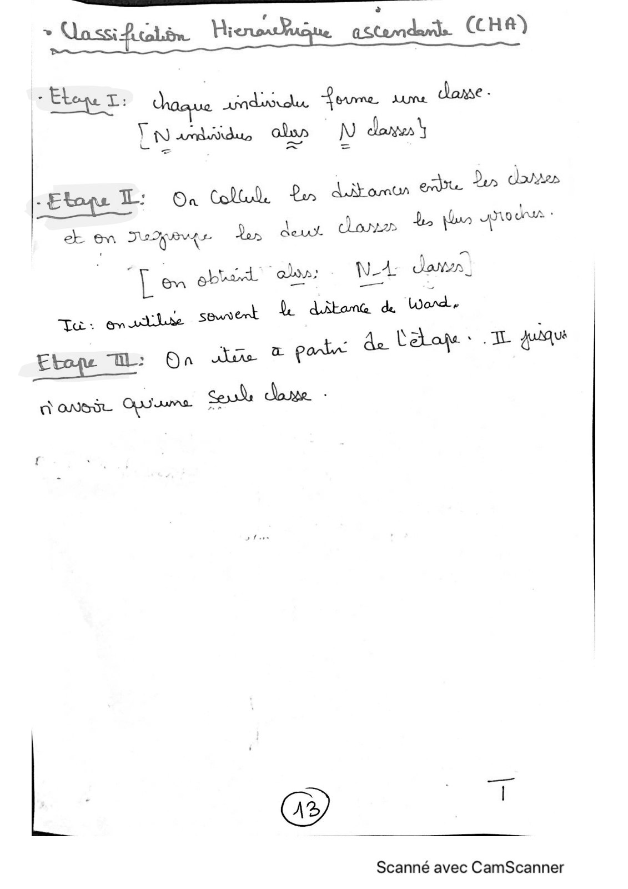

**Lecture OCR à contrôler**

~~~text
~Q si fucabé HienowPud actemderts (CHA)

|- Ehege ney cha | and foun JAUNE dame -
VNamwidus abs dans V

Eteqe IL Où Cellule Be diamine
ek en Tu vA Xen cert .

. Len ob as: NE Jan,

Tu: male sewsert le ditent de nus .

| : ds » Te ua
Eboge WM: On Ae à par let ical

ones. Owes

Scanné avec CamScanner
~~~

## Page 16

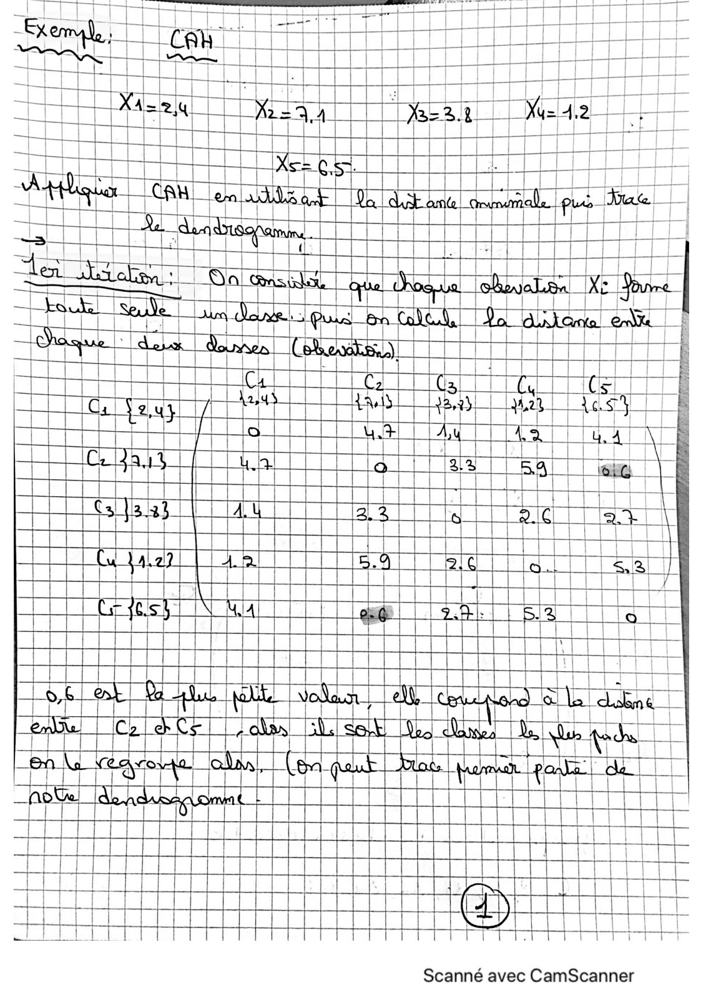

**Lecture OCR à contrôler**

~~~text
ie)

LL.

+ |
| TAR, [TT
1]
LT
CH
| ae
+ |
— |
7 4 LED
ET FPT D D D

Scanné avec CamScanner
~~~

## Page 17

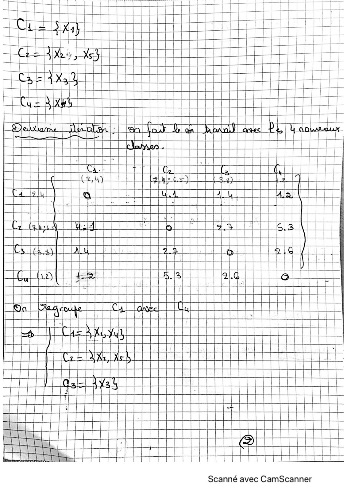

**Lecture OCR à contrôler**

~~~text
LLC
re TT
i | a
T [] [TT
[Lt JE
LI] [1
CO
D
Japan) crvec Yoowse
Coo
DED
G Li]
| |
aH | |
|
2.4. ch
| | TI
| | LT
aid ju
21.6. =n
| |
Coo
Ky |
a
tH
Le |
|
@ [
| T
Lae

Scanné avec CamScanner
~~~

## Page 18

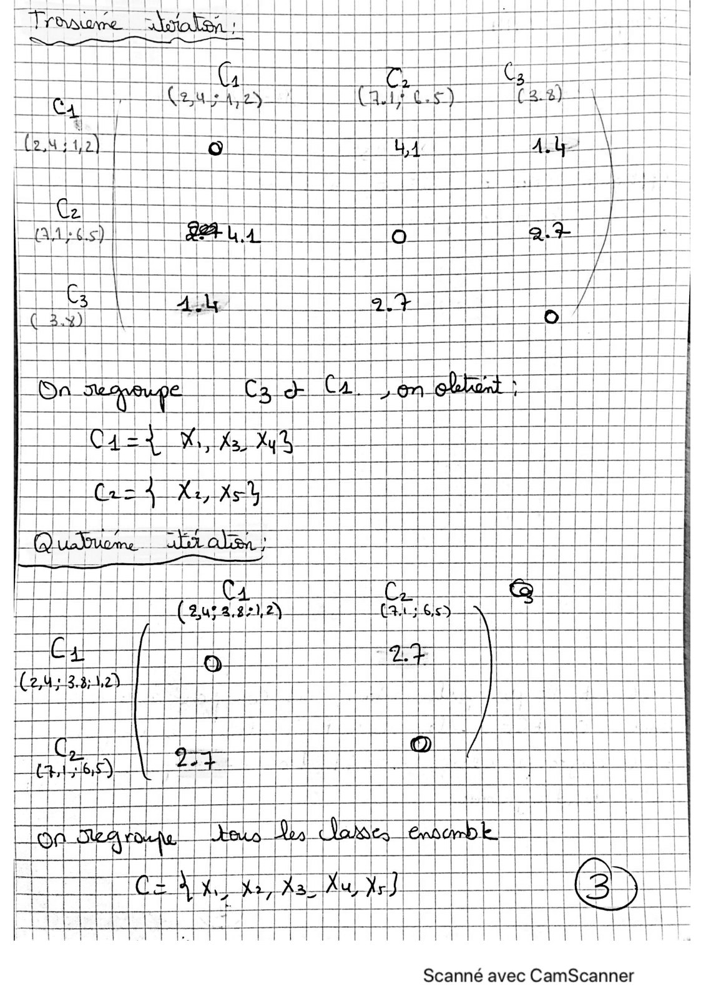

**Lecture OCR à contrôler**

~~~text
FRS ER EEE HEHE ED,
le] = a =
CLÉ LHC ls
AELLPETIEHEE ES R
TES =
ce

À

x,

ol | ap! i
al PEER
—|4 ! ai dl 3 n ea
= pS pes RSR

Ty hal Xu XsJ

X,

a

A

XE

(au; :

za

:

TAT

|

Ci

ai
TT

Les

t

T
i

1
|

T
| 3.3)
[|

E 1
TEXAS)

Scanné avec CamScanner
~~~

## Page 19

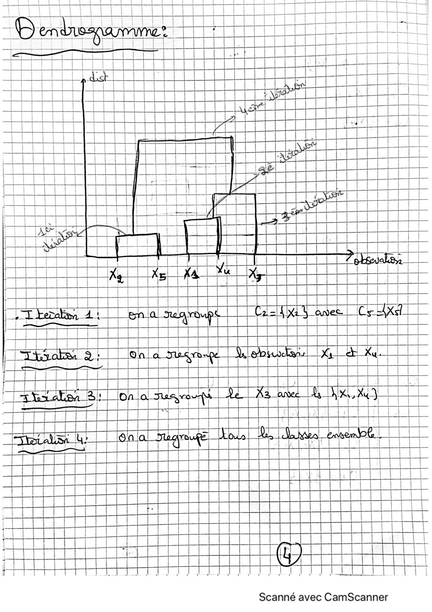

**Lecture OCR à contrôler**

~~~text
|

ET

|

a)

|
à

EX

T Wlebibdlass Xs

Xe | X3 ek a x

“pe

VO

oe

|
|

Iola

|
aol Sears
0

[TI
|

'

ni | lon!

CAS VE

ie Si LU;

Scanné avec CamScanner
~~~
