# Cours 4 - Resolution_EDO.pdf

[Ouvrir l’original](https://drive.google.com/open?id=13AhJPCVxC-YrQi0CgSCp54fevV5DZmUA) · Les pages signalées comprennent du texte reconnu automatiquement ou des éléments graphiques. Le fac-similé permet de vérifier chaque lecture.

**Pages avec fac-similé ou lecture OCR** — 1–12.

## Page 1

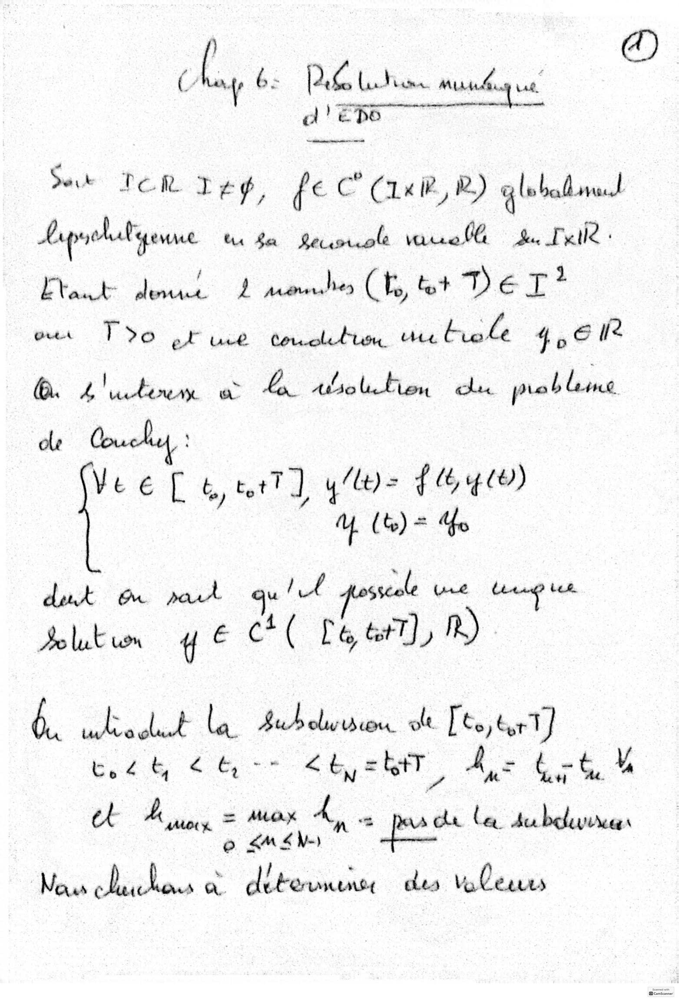

**Lecture OCR à contrôler**

~~~text
)
( # 5) 6 Pry exe Luttes Mu ue
CDR See

Sur POR Lee, fe C (ini, R) global nd
Lepnckaligenawe tu du Racin widen à Dalle:
Etat det À amen CE hr De TI?
eu T%o el tue touts Ue tolé 40 6 Ife
BR: 2 actin. à a doll du prob lame
ole

Vee [ te, tet J y (Lt) = { & qv)
4 (te) = Mo

dut Ow part gulf sscale Ure aan dances
Blu y € CC Laer), nh)

à RER D a la. bur olw dion. olt [te,tur]

teh <b < ty = tT Az bint M

« M

et M ue = sega n> «A Cle ba. dubeluwrne
eo <MA£N-

Nous PE ETS PR a dit Cruenny cles Vale

@)
~~~

## Page 2

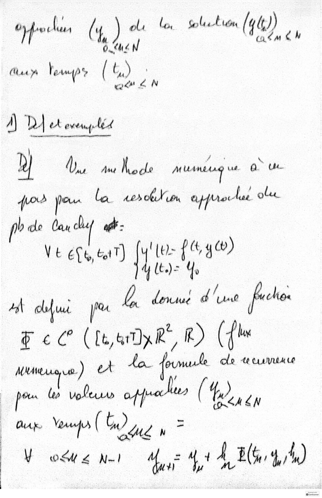

**Lecture OCR à contrôler**

~~~text
où lo Go a E umn (y4))
if : - (4, ct

Guen Temps (ba) ,

A\ Dy wh Léa ns ACA

D) db Ane A de Hung is © Be
for jou la radin afro lai plac
b de lay clu of - ' “i
Ve ete, bit) [y'lo: fé 4
_ just

dewiue Fier eon
4 qui qu À F
. (bw
$c (ewe, ©) (f
Le) er Lo ual cle «cuve

PAT
| tes leo Vole pe (4)
Ap aq (GO ayy > F
du Mae 44 À BCS 4,4)

(On SA EN
~~~

## Page 3

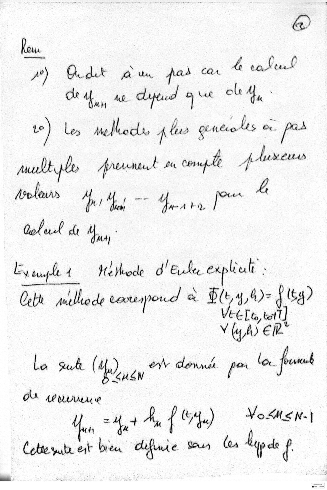

**Lecture OCR à contrôler**

~~~text
fous.
7°) dr a du pos Cat ke t.Q/ ne

de, ae dyeud 9 vx ole
te) Les nelloc pl gutoles 0 prs
put lo perl du cornpele À Aurea
#oleus bd Yaya, [PO L
Golul di Hy

Hiode d'Eule exp Cut :

ey uay-le 4
Cebt Willie verespord oe Ble, 4,4)- Jey
Vee Lt tet]
Ÿ (y y) € ir

la suk ( He), be ew denne pe lox fout

où AP ULUUU €
VMoMEN-|

# at A, { Au)
Cobte vate ext bree difinre go (oa Hep

Comscaone
~~~

## Page 4

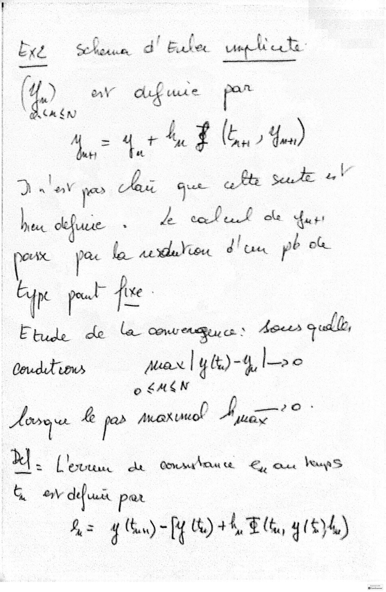

**Lecture OCR à contrôler**

~~~text
& x2 cr d' Buber wren se vey

eed

eee
| ) onl” aug ui € ee

"ACAEN
A. ~ 4 + 4, q fe, ) 4.)
Delage chit qu ta side =t
en ‘ ke Po ee ok dur:

| c pac by sexton dun pb om

aig pot Te (xe -

Etude de la convenu ce» hors quel
Coudt'ions jer | yk)-4 le

op SHON

Homo he je Max uuol AE sad

X] . Levees di Cowra ce Ey, re Vea
(of A2 se ar

fz 4 (bu) -[Y Ui) +4, ER, 4 (8)40)
~~~

## Page 5

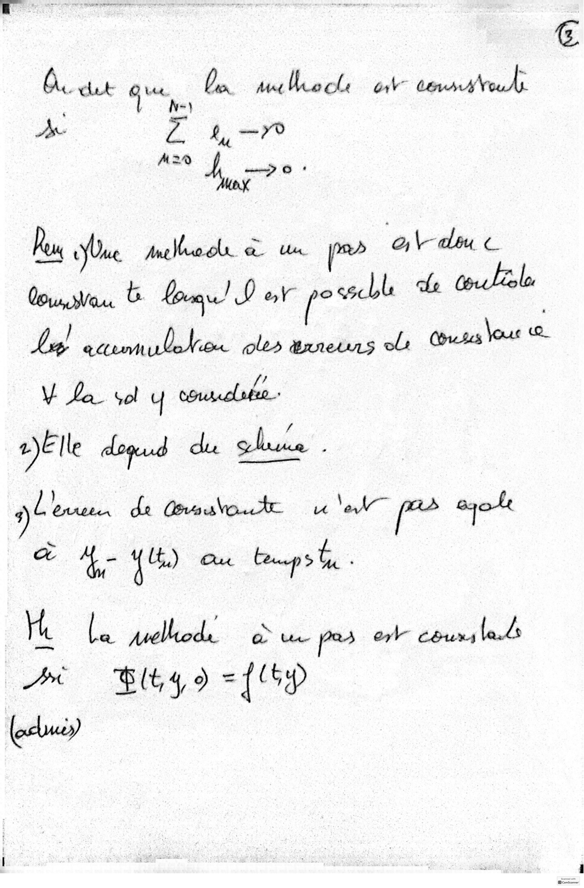

**Lecture OCR à contrôler**

~~~text
(9
En Mat bec or danas Vouds:

A. det Oia,
l N=)
A L 4-70
M2” A, soi Xb

luc un pms Adu c
(4 ot pecs de ton Melee
Lg axmmulekes oles anneuns el: Cnet out
V Le sol y coutolubee +

2)E lle doqud du chine -

ab borate de Onsateute ui Sok pas aoe
à 4- {HD au bop bu -

He me tele. a ue pas ork cours lands

AX Blt 49 ={ 6p
(buy
~~~

## Page 6

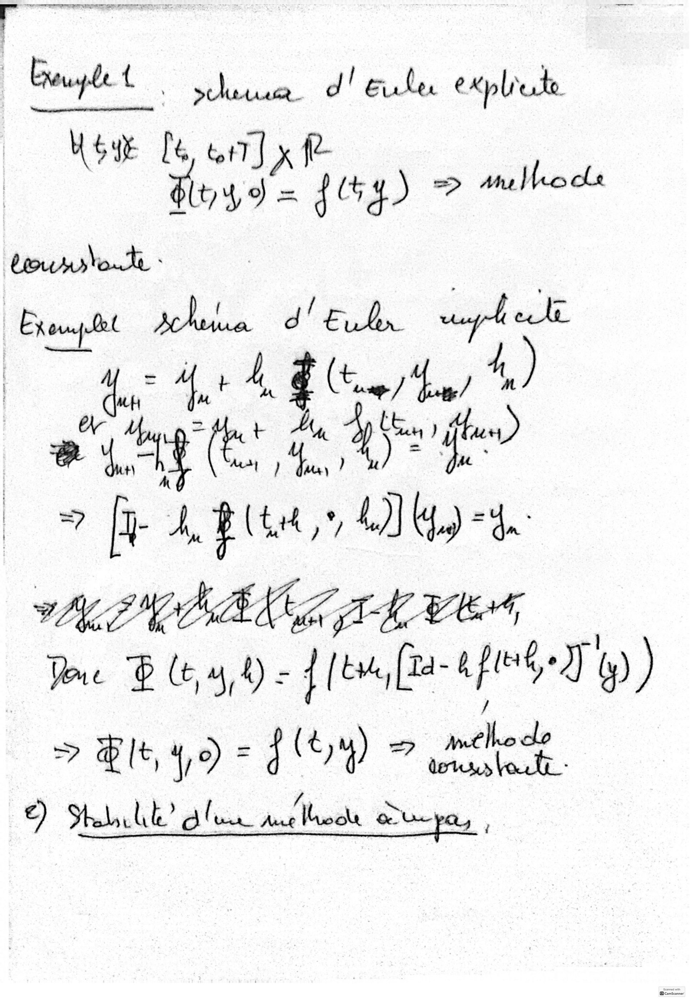

**Lecture OCR à contrôler**

~~~text
Euuy
le { \ pect. d | E ue e kpliete

Hoye le it] x fe
Hoy d= 244) 2 smlhod

ror vote -

ior oe d eo “gre
| a ee 4, )
ce) lag ter be at cut
7 [FA Blte,* AD) Hs) = 4a
WENO LEK Gb LE,
ue À (t,4 4) - ll [ ti |[Za- tk °)) ) )
> Blt, yo = FO) + méthode.
Salut” Slur melee Due,
~~~

## Page 7

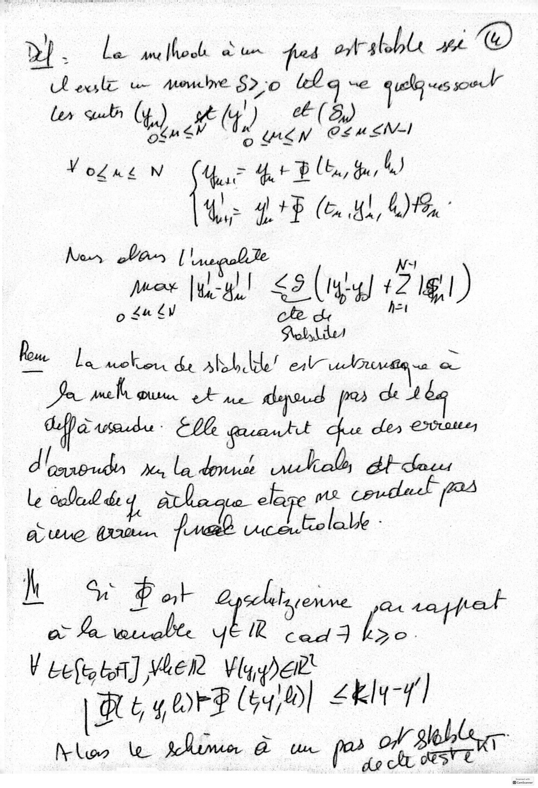

**Lecture OCR à contrôler**

~~~text
> ‘ i ane [hook a Un fuss atalsble ph Xu)

Lexsle u meule 520 ich q we queues soul

i,
ler cut (te), à hd iy (D0 ews

Vogue Le tase ge lb, Hus 4)
‘ a +p (Eu aL, OLA

Res chars | uegohte rs
pow all £9 (ly) 42181)
o £4 EV cle de het
Petsbibes
Eu Le a abbde" elles où
Pa me Dusen et me depoud ck 4
Aa wseudu. Elle quautt ae
d'énnbuda je la dut mal bt-choss

h ve P ot “bte
Ne ee eMme. Qe ew
a Fa wrrabte ap oe po. |
H Lee, LA] WEEN Viger
| RG 4 OrF (iy) Zkly-4]

Nw le fem à aa pos orf SET
~~~

## Page 8

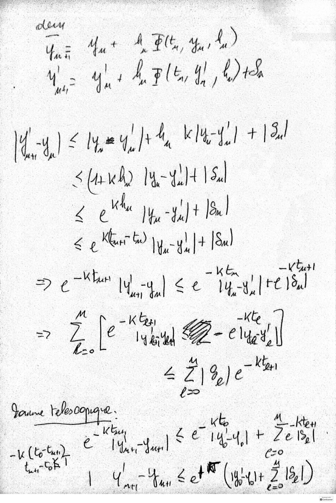

**Lecture OCR à contrôler**

~~~text
due
Ue - à + À UE, Me ; 1.)
de yl Alert DA

du) < peghh MALI IA
sae MERE
pK
A I fu 44) 4 IS.
€ % Ge) lu -y! |+ Fe

kta
€ + bu
ge ec tre 4, IT

M
=? 7: Le : Gus ay
be del G-e at

MA
A ee Kan
Sane hope.
; | oe Kb à à «& À. os
ue (ter tun) etal yy) + Zell
(29°

tach |
aa ir 4
| Tax < ef (war 2180)
~~~

## Page 9

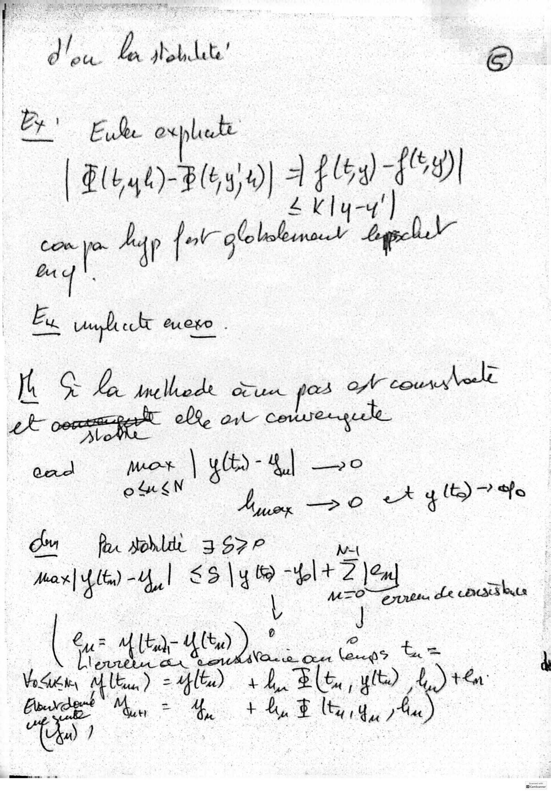

**Lecture OCR à contrôler**

~~~text
| du  Houdb ©

| By : El expluté
[ Pl ye)-BlGy 0] À Fld Bd
4 Kl y-y'
com ym Aap {ort globoleenonv bagel
q
Ey. abe et eve :
jt Oe tallcde ise pod of course

dt coca, ke en

Gud Pr Cb) - D so
hi 0 ih get ae

Om fu hit 3 $7

Jar] 4lt) -Y,,1 $3 \y 69 #4 ma |

jus AL Alta) ) ot eee
Vo É ; À
a Has ee = le) +4. Fe “eS Ltn
aoa Hn he Ae Mg, le
~~~

## Page 10

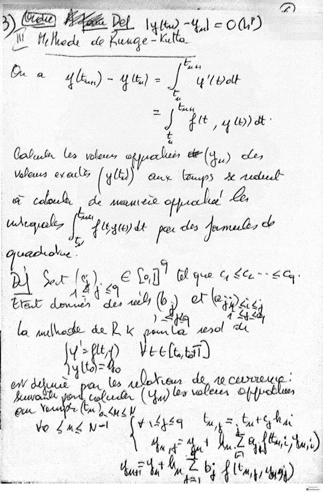

**Lecture OCR à contrôler**

~~~text
a tt oes
Dy ol kee RAs

à) (ie, Nae. ae) coi

a Me lhece de auge - Ke :

Om lig) ~ qu - © pal
Le

ay ip Gate
7 Gq wo) dt
Cobuste ler voles of de (4) Le,
Voleus ey ecl® (4) Au Gps A Arde
té ch À deu o alu | &

+ Lt 6400) dt pe dey frrubs d

où ‘cm G) 1 fall Glau uéa-.< ety.
bar dant an ch ot le pe

we A ed
la mlhed da Rk la ol et

Ke nw Vee(e bi)
vs tbs aan. de AO CÉLOR AE. »
en Be (44) ba alien Crcblue

te :

| _. LAS ot | F444 be but ghar

: Ur: Er l za feu)
Aus 4,1 À an b; Ally Oy |

tentée où on ‘ Z
@canscamer
~~~

## Page 11

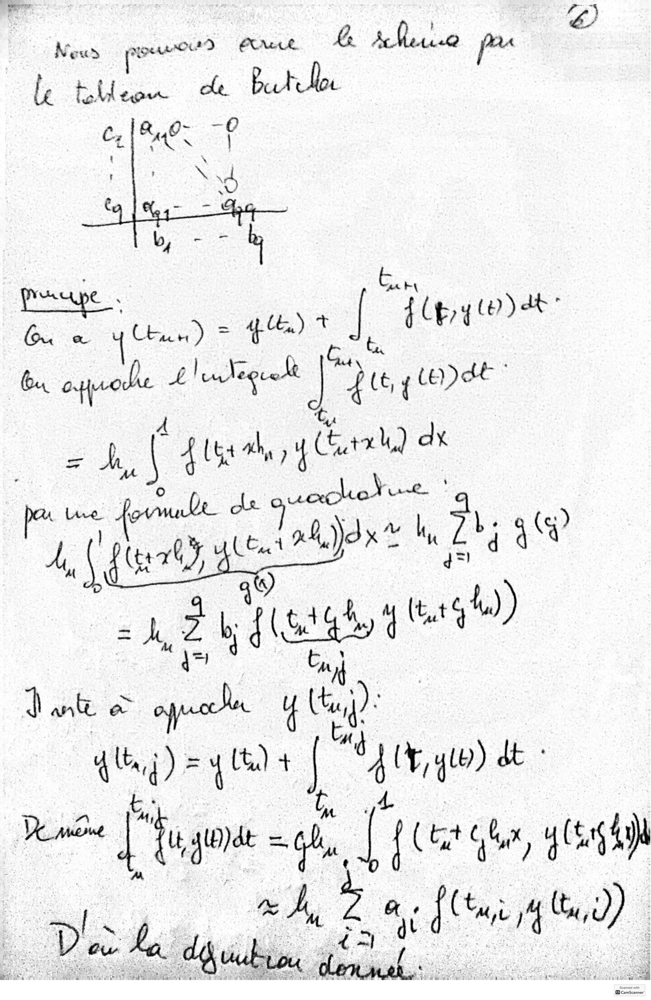

**Lecture OCR à contrôler**

~~~text
7)
ES
Nows nourou nt Be AMerise pe

le de a eh

bu ey Use) = ss | NA tere
bu 1 : pec pe une

eh | Ags, y Carat de

da quechotint
| Lune foule : ‘
(te akan Mu is ae

En
Dante à ou 1)

thug) = yids [” Sty i) ee

oe Le yt
Ve mine 1. duo - = Gly 4 f ( tit Ghar, (Es
A 2 a cdl 7 <

ben
Vin ka dean

Beamscanner
~~~

## Page 12

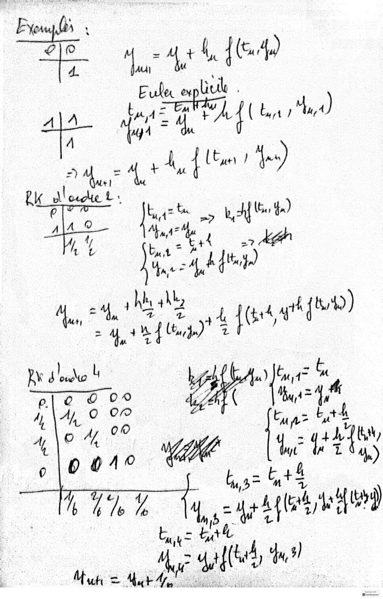

**Lecture OCR à contrôler**

~~~text
em
A\A jad is A bi 4,4)
: Lt 1 as)
aces 2 “
Rk d'equet

h ah
Han hi 4 te
eos D 4 M Br 7

- &
Rx 4e L ae ier. a
pe ees AN (ut
DORE L' ay tii)
polo on et 1 Sy.)
4; res ty)

PTE ad

A dl

Mu = = S| yer ae a sth; *
~~~
