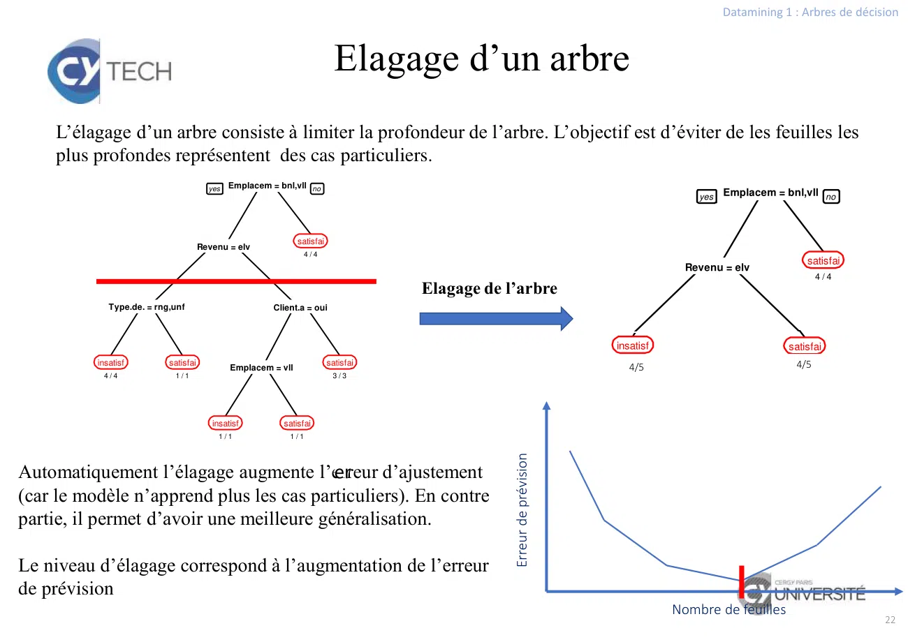

# Cours 5 - Arbre de decision-2026.pdf

[Ouvrir l’original](https://drive.google.com/open?id=1YCKac6mUhS9WtkWgNAz-X8EWFOyqgz82) · Les deux lectures automatiques du PDF divergent sur les pages indiquées. Leur fac-similé accompagne le texte.

**Pages présentant un écart entre les deux extractions** — 20.

## Page 1

~~~text
                                                                                                      Datamining 1 : Arbres de décision

                                        Arbres de décision
      Un arbre de décision est une méthode supervisée de classification 1.
      On considère donc une variable cible 𝑌 qualitative dont les modalités sont appelées classes, et
      p variables explicatives 𝑋1 , 𝑋2 , … , 𝑋𝑝 , appelées attributs.

      L’objectif est de construire un modèle qui permet de prédire la probabilité qu’une observation
      appartienne à une classe en fonction des valeurs de ses attributs,
                                                       𝑃(𝑌 ∈ 𝐶) = 𝑓(𝑋1 , 𝑋2 , … , 𝑋𝑝 ).
      Par exemple, quelle est la probabilité qu’un emprunteur assure le remboursement de son prêt
      en fonction de son salaire, sa situation maritale, sa CSP,… ou bien quelle est la probabilité
      qu’un patient présente une maladie connaissant ses caractéristiques physiques, ses
      antécédents,…

      Le cours se décompose en 2 parties :
             • Généralités sur les méthodes de classification
             • Construction et utilisation d’un arbre de décision

1 Les arbres de décision peuvent être utilisés comme méthode de régression mais cela est plus rare.
~~~

## Page 2

~~~text
                                                                                 Datamining 1 : Arbres de décision

                   Généralités sur les
                méthodes de classification
Toutes les méthodes de prévision, et plus spécifiquement de classification, suivent les mêmes
règles, le même processus de construction et de validation. Nous ferons quelques unes des ces
règles :

         • Le calcul de l’erreur
         • La validation croisée (base d’apprentissage et base test)
         • La détection du sur-apprentissage
~~~

## Page 3

~~~text
                                                                                                         Datamining 1 : Arbres de décision

                                                    Base d’apprentissage

    Pour construire un modèle de prévision, on utilise une base d’apprentissage, c'est-à-dire un jeu
    de données pour lequel la variable cible est connue 2.
    Nous allons illustrer ce chapitre avec le jeu de données suivant :
                                                                 Client
                             Emplacement Type de maison Revenu anterieur? Cible
                             banlieue    jumelée       bas     non       insatisfait                         n=14
                             banlieue    rangée        bas     oui       insatisfait
                             banlieue    unifamiliale  élevé   non       satisfait

                                                                                       d’apprentissage
                                                                                       Base
                             banlieue    unifamiliale  élevé   oui       satisfait
                             banlieue    rangée        élevé   non       satisfait
                             rural       jumelée       bas     oui       insatisfait
                             rural       unifamiliale  bas     non       satisfait
                             rural       unifamiliale  élevé   non       insatisfait
                             rural       rangée        élevé   oui       satisfait
                             ville       jumelée       bas     non       satisfait
                             ville       jumelée       bas     oui       satisfait
                             ville       rangée        bas     non       satisfait
                             ville       jumelée       élevé   non       satisfait
                             ville       rangée        élevé   oui       Satisfait

                             banlieue     jumelée        élevé   non          ???

    L’objectif est de construire à partir de la base d’apprentissage un modèle permettant de prédire
    la satisfaction du client.
2 Ce qui pose le problème de l’étiquetage des données.
                                                                                                                                       3
~~~

## Page 4

~~~text
                                                                                                                                                                                        Datamining 1 : Arbres de décision

                                                                                                            Calcul de l’erreur
  Une fois le modèle construit, on va vérifier s’il donne bien les résultats attendus. Pour chaque
  observation, on va confronter la valeur de la variable cible prédite par le modèle à la vraie valeur.
                                                                                                 Type de                Client
                                                                                     Emplacement maison      Revenu   anterieur?      Cible                               Prévision
                                                                                       banlieue  jumelée       bas       non        insatisfait                           insatisfait
                      adapté de http://www.decisiontrees.net/tutorial/1_intro.html

                                                                                       banlieue   rangée       bas       oui        insatisfait                           insatisfait
                                                                                       banlieue unifamiliale élevé       non         satisfait                            insatisfait
                                                                                       banlieue unifamiliale élevé       oui         satisfait                             satisfait
                                                                                       banlieue   rangée      élevé      non         satisfait           𝑓                 satisfait
                                                                                                                                                                                                 Erreurs du modèle
                                                                                         rural   jumelée       bas       oui        insatisfait                            satisfait
                                                                                         rural  unifamiliale   bas       non         satisfait                             satisfait
                                                                                         rural  unifamiliale élevé       non        insatisfait                           insatisfait
                                                                                         rural    rangée      élevé      oui         satisfait                             satisfait
                                                                                         ville   jumelée       bas       non         satisfait                             satisfait
                                                                                         ville   jumelée       bas       oui         satisfait                             satisfait
                                                                                         ville    rangée       bas       non         satisfait                             satisfait
                                                                                         ville   jumelée      élevé      non         satisfait                             satisfait
                                                                                         ville    rangée      élevé      oui         satisfait                            insatisfait

                                                                                                                                                        Prévision
On construit ensuite un tableau de                                                                                                                satisfait insatisfait
                                                                                                                        valeur

contingence entre la prévision et la vraie                                                                                         statisfait              8          2
                                                                                                                         vraie

valeur, appelé matrice de confusion                                                                                                insatisfait             1          3

Sur la diagonale se trouve le nombre d’observations bien prédites par le modèle. On en déduit le nombre
de bien classés (somme de la diagonale sur effectif total) et le nombre de mal classés.

 2 Ce qui pose le problème de l’étiquetage des données.                                                                                                                                                                4
~~~

## Page 5

~~~text
                                                                                             Datamining 1 : Arbres de décision

                                            Taux d’erreur

                                                                                       Predicted cluster
                                                                                     C1 C2       …     Ck
Calcul simple du taux d’erreur

                                                                 True cluster
                                                                                C1
                                                                                C2
            nb d' éléments mal classés                                          …
     te                                                                        Ck
               nb total d' éléments
                                                                   Matrice de confusion
Exemple : Cas d’un diagnostic médical sur une base constituée de 5 personnes malades et
995 saines. Si le classifieur considère les 1000 personnes comme étant saines alors
te=0,5%. Autrement dit, une très bonne performance alors qu’il n’a détecté aucune des
personnes malades.
                                     Problème des classes non
                                            équilibrées
Calcul pondéré du taux d’erreur

 Notons Ci, i=1,…,C les C classes, ni             C
                                                 
 le nombre d’éléments dans la classe            1 nb d' éléments mal classés dans C i
                                           te 
 Ci et n le nombre total d’éléments             C i1             ni

Exemple : Avec ce nouveau calcul, on obtient un taux d’erreur
te=50%.
                                                                                                                           5
~~~

## Page 6

~~~text
                                                                                        Datamining 1 : Arbres de décision

                    Erreur d’ajustement vs erreur de prévision

Deux types d’erreur:
• l’erreur d’ajustement : calculée sur la base
d’apprentissage. Une petite erreur d’ajustement
                                                                             Data set
signifie que le modèle reproduit bien les
données connues.
• l’erreur de prévision : calculée sur de
nouvelles données. Une petit erreur de                     Testing                 Training
prévision signifie que le modèle est capable de            set                     set
prédire de nouvelles valeurs

                 La validation croisée consiste à :
                 • Diviser la base d’apprentissage en p sous-ensembles
                 • Pour chaque sous-ensemble i,
                    - Apprendre un modèle sur les (p-1) sous-ensembles restant
                    - À l’aide du modèle, prédire les valeurs du sous ensemble i
                    - Comparer les valeurs prédites ou vraies valeurs
                 • Calculer un score de prévision
                                                                                                                      6
~~~

## Page 7

~~~text
                                                                                        Datamining 1 : Arbres de décision

                        Le sur-apprentissage (overfitting)

Dans la phase d’apprentissage certains modèles ont tendance à se complexifier pour ajustement au plus
près les données d’apprentissage. On parle alors de sur-ajustement ou sur-apprentissage. Le modèle aura
alors une très faible capacité de généralisation. Cela signifie que le modèle va reproduire parfaitement les
données qui ont servies à le construire mais sera incapable de prédire de nouveaux exemples.

 La détection du sur-apprentissage se fait en comparant l’évolution des erreurs d’apprentissage et de
 prévision en fonction de la complexité du modèle (profondeur d’un arbre, nombre de neurones…).
                            Le modèle        Le modèle
                           apprend des      apprend des
                           généralités          cas
                       Erre

                                            particuliers                    Complexité du
                       ur

                                                                            modèle

                                                                                                                      7
~~~

## Page 8

~~~text
                                                                                    Datamining 1 : Arbres de décision

                       Les arbres de décision

Dans cette deuxième partie nous allons voir un modèle de prévision particulier : les arbres de
décision.
               • Principe
               • Construction
               • Utilisation
               • Elagage
~~~

## Page 9

~~~text
                                                                                       Datamining 1 : Arbres de décision

                                            Définition
Un arbre de décision est une méthode d’apprentissage supervisée très intuitive. Son résultat est
un graphe où chaque nœud intermédiaire représente un test et chaque nœud final (feuille)
représente une décision (classe).
Lorsque la classe à prédire est une variable qualitative, nous avons un arbre de classification.

Si la classe à prédire est une variable quantitative, nous avons un arbre de régression.

Dans ce module, nous nous intéressons aux arbres de classification.

Exemple : Cet exemple simple permet d’expliquer comment un arbre de décision peut être
traduit sous la forme d’un ensemble de règles de décision.

Soit l’arbre de décision suivant qui permet de décider si une institution bancaire peut accorder
ou non un prêt à un demandeur de prêt.

La décision de la variable cible Prêt se base sur les variables moyenne du salaire (MoySal),
âge (Age) et possession d’autres comptes (Autres comptes). Les attributs des feuilles de
l’arbre, c’est-à-dire Prêt, sont des valeurs booléennes qui correspondent à une classification
dans l’ensemble {Oui, Non}.

                                                                                                                      9
~~~

## Page 10

~~~text
                                                                                     Datamining 1 : Arbres de décision

Cet arbre de décision engendre les règles de décisions suivantes :

1.   Si MoySal > 50000 $ alors Prêt = Oui.
2.   2. Si MoySal < 50000 $ et Age < 25 alors Prêt = Non.
3.   3. Si MoySal < 50000 $ et Age > 25 et AutresComptes = Oui alors Prêt = Oui.
4.   4. Si MoySal < 50000 $ et Age > 25 et AutresComptes = Non alors Prêt = Non.

En utilisant ces règles, l’institution est en mesure de décider facilement si elle
accorde ou non un prêt à un demandeur.
Exemple : Si Olivier a un salaire moyen de 35000$, âgé de 32 ans et qui ne
possède pas un autre compte désire obtenir un prêt, il sera vraisemblablement
classé sous la classe Prêt = Non. Contrairement à Sarah qui a 23 ans et qui a
un salaire moyen de 55000$.                                                                                      10
~~~

## Page 11

~~~text
                                                                                                                                      Datamining 1 : Arbres de décision

                                                     Client                                                       Emplacem = bnl,vll no
                                                                                                            yes
Emplacement Type de maison Revenu                    anterieur? Resultat
banlieue                    jumelée          bas     non        insatisfait
banlieue                        Attribut/variable
                            rangée          bas      oui          Cible
                                                                insatisfait
banlieue                    unifamiliale     élevé   non        satisfait                                                          satisfai
                                                                                                          Revenu = elv
                                                                                                                                      4/4
banlieue                    unifamiliale     élevé   oui        satisfait
 Instances/Observations

banlieue                    rangée           élevé   non        satisfait
rural                       jumelée          bas     oui        insatisfait
rural                       unifamiliale     bas     non        satisfait        Type.de. = rng,unf                         Client.a = oui

rural                       unifamiliale     élevé   non        insatisfait
rural                       rangée           élevé   oui        satisfait
ville                       jumelée          bas     non        satisfait     insatisf         satisfai                                       satisfai
                                                                                                                  Emplacem = vll
ville                       jumelée          bas     oui        satisfait      4/4              1/1                                            3/3

ville                       rangée           bas     non        satisfait
ville                       jumelée          élevé   non        satisfait
ville                       rangée           élevé   oui        satisfait                                    insatisf         satisfai
                                                                                                              1/1               1/1
Banlieue                  Jumelée          élevé     non

Ville                     Jumelée          bas       non
                                                                                                                                                                    11
~~~

## Page 12

~~~text
                                                                                   Datamining 1 : Arbres de décision

                                         Principe de construction

La démarche est récursive. Il s’agit de diviser le plus efficacement possible l’ensemble
d’apprentissage par des tests sur les observations jusqu’à obtenir des sous-ensembles ne
contenant que (ou presque) des observations d’une même classe.
Algorithme générique
Etape 0. Initialiser l’arbre à l’arbre vide et le nœud à la racine
Etape 1.
si nœud est terminal
      lui affecter une classe
sinon
      choisir une variable et un test
      pour chaque valeur du test
                  créer un sous-ensemble d’apprentissage avec les
          observations correspondantes à la valeur du test
                  répéter l’étape 1 avec le sous-ensemble
      finpour
finsi

Il existe plusieurs algorithmes de construction (arbres CART, arbres de
QUINLAN,…). Chacun se distingue par sa façon de répondre aux deux questions :
      • Décider si un nœud est terminal?
      • Choisir un attribut pour le partage du nœud?                                                           12
~~~

## Page 13

~~~text
                                                                                   Datamining 1 : Arbres de décision

                                            Le partage d’un nœud

  Le partage
      • Si l’attribut X est catégoriel ( qualitatif) alors on partage l’ensemble
      d’apprentissage suivant les modalités (ou regroupement de modalités) de
      l’attribut
      • Si l’attribut X est quantitatif alors on partage l’ensemble d’apprentissage
      suivant un test X<a ou Xa (fonction split). On teste « toutes » les valeurs
      intermédiaires entre xi et xi+1.
Exemple : Classification avec deux attributs quantitatifs
                                                                  Ne permet pas de modéliser
   Arbre de décision                                                  des classes du type
                             Classification obtenue dans
                               l’espace de variation des                 « patatoïdes »
                           variables explicatives X1 et X2

                                                                                                               13
~~~

## Page 14

~~~text
                                                                                                                Datamining 1 : Arbres de décision

                               Choix du meilleur attribut de partage (1/2)

 L’idée est de faire converger l’arbre le plus rapidement possible vers des feuilles qui caractérisent une
 classe de la variable cible, c.a.d. des feuilles contenant majoritairement une seule classe de la variable
 cible.
 Il existe deux critères usuels pour mesurer l’homogénéité (uniformité) de la répartition.
 Soient E un ensemble et E1,…,Ek une partition de E. La fréquence d’une classe Ei est
 données par
                                         card(Ei )                Exemple : 8 élèves de classe A et 2 de classe B :

                                    pi                           P(A)= 0.8 et P(B)= 0.2.

                                         card(E)

lndice de Gini : C’est une mesure statistique permettant d’étudier la répartition d’une variable
(Salaire, âge,...) au sein d’une population. Développé par le statisticien italien Corrado Gini, il
mesure le niveau de répartition d’une variable dans la population.
                                                k
                                   Gini(E)  pi  1  pi 
                                               i1
Ce coefficient varie entre 0 et 1. La valeur 0 signifie l’égalité parfaite c’est-à-dire la variable prend
une valeur identique sur l'ensemble de la population et 1 signifie une forte inégalité.
 Gini peut prendre des valeurs entre 0 et (1-(1/k)),   tel que K est le nombre des modalités de la variable cible.
~~~

## Page 15

~~~text
                                                                                              Datamining 1 : Arbres de décision

L'indice de Ginie varie entre 0 et 1, mais il n’atteint 1 que théoriquement quand le nombre de classes de la
Exemple   : Ce coefficient
variable cible             peut utiliser pour mesurer l’inégalité des revenus dans un pays. Si ce
               est très grand.
coefficient est égale à 0 ça signifie l’égalité parfaite et si c’est 1, qui ne peut être atteint, signifie
Si l'indice
une         de parfaite
      inégalité Gini est (une
                         0, alors toutes
                               seule     les observations
                                     personne   dispose de appartiennent
                                                            tous les revenus à une  seule
                                                                                et une    classe
                                                                                       infinité   (Noeud pur).
                                                                                                d’autres
n'ont aucun revenu).
Plus l'indice de Gini il est élevé, plus les classes sont mélangées (Nœud impur).
Entropie : L’entropie d’une distribution représente la quantité d’information qu’elle peut apporter.
                                                     𝑘

                                         𝐸𝑛𝑡(𝐸) = − ෍ 𝑝𝑖 × 𝑙𝑜𝑔2 𝑝𝑖
                                                    𝑖=1

log définie la fonction de logarithme en base 2 qui vérifie :

𝑙𝑜𝑔2 𝑥 = 𝑎  𝑥 = 2𝑎 .

                              log 𝑥
Pour les calculs : 𝑙𝑜𝑔2 𝑥 =         .
                              log 2

Les fonctions Ent(E) et Gini (E) sont maximales s’il y a uniformité :

                                              pi=card(E)/k

                                                                                                                            15
~~~

## Page 16

~~~text
                                                                                   Datamining 1 : Arbres de décision

Exemple : Dans l’exemple précedant, la variable cible était “Résultat” avec deux
modalités “Satisfait” et “Insatisfait”.

Parmi les clients, on a 4 clients qui sont insatisfait et 10 clients satisfait.

On commence à calculer la fréquence de chaque modlité (classe).

                                                   4
La fréquence de clients insatisfait est : 𝑝1 =       = 0.29
                                                  14

                                                10
La fréquence de clients satisfait est : 𝑝2 =       = 0.71
                                                14

Indice de Gini = 𝒑𝟏(1 - 𝒑𝟏) + 𝒑𝟐(1 - 𝒑𝟐) = 0.29( 1 - 0.29) + 0.71(1 - 0.71) =0.41

Ent (E) = - 𝒑𝟏 𝑙𝑜𝑔2 𝑝1 - 𝒑𝟐 𝑙𝑜𝑔2 𝑝2 = - 0.29 𝑙𝑜𝑔2 0.29 - 0.71 𝑙𝑜𝑔2 0.71

           log 0.29        log 0.71
= - 0.29            - 0.71          = 0.87
             log 2           log 2

                                                                                                               16
~~~

## Page 17

~~~text
                                                                                                                      Datamining 1 : Arbres de décision
                                                  Choix du meilleur attribut de partage (2/2)

 L’idée est donc de choisir l’attribut qui fera le plus progresser l’arbre vers un arbre « homogène ». On
 calcule pour cela le gain de l’attribut .
                                            k                                                   k
                       Gain  Gini(E)  pi  Gini(Ei )                    Gain  Ent(E)  pi  Ent(Ei )
                                            i1                                                 i1

 Le gain est maximal lors que le choix d’un attribut permet de classer correctement toutes les
Le gain mesure la réduction d'impureté obtenu après division et indique combien la séparation améliore la pureté des noeuds. Donc, c'est

la différence entre l'impureté de la variable cible et l'impureté après division selon une variable.   Plus le gain est élevé plus la variable
 instances.
sépare bien les classes. Si le gain est petit, donc la séparation n'apporte pas grande chose, et si c'est nul, donc la division est inutile.

 Exemple : Si on choisit la variable de partage (la variable racine) « Revenu », alors le gain est
                   G(Revenu)=0.41-[p(bas)*Gini(bas)+p(élevé)*Gini(élevé)]=0.10

 Le gain ne permet pas de comparer des variables n’ayant pas le même nombre de modalités.

 Solutions :
      • Binariser les variables (solution souvent adoptée par logiciel)
      • Pondérer le gain (cf. le GainRatio)

                                                                                                                                                  17
~~~

## Page 18

~~~text
                                                                                          Datamining 1 : Arbres de décision

                                             Critères d’arrêt

      On décide si un nœud est terminal quand :

           • les instances associés au nœud sont quasiment tous dans la même classe
           • un nœud à moins de k observations
           • toutes les variables ont été testées, s’il n’y a que des variables qualitatives 3

      Le choix de la condition d’arrêt influe sur la profondeur de l’arbre et sur la précision de
      la prévision. Plus un arbre est profond, meilleure sera la prévision, mais plus il sera long
      à calculer et plus il y aura de risque de sur-apprentissage.

      Exemple extrême d’un arbre ayant autant de feuilles que d’observations . Il n’a donc
      plus de capacité de généralisation.

      Afin d’éviter le sur-apprentissage, on évite d’avoir de arbres trop profonds. On procède
      à leur élagage si nécessaire.

3 On peut tester plusieurs fois de suite une variable quantitative
~~~

## Page 19

~~~text
                                                                                           Datamining 1 : Arbres de décision

                        Probabilité d’appartenir à
                               une classe
Le chemin dans l’arbre permet d’aboutir à une feuille. Dans une feuille, plusieurs classes de la variable
cible peuvent être présentes.

Pour connaitre la classe prédite, on calcule la probabilité de chacune des classes dans la feuille et on choisit
la plus probable.

Cette probabilité est importante pour
connaitre la fiabilité de la prévision. La
décision sera plus confortable si une
nouvelle observation à 95% de chance
d’appartenir à C1 et 5% de chance
d’appartenir à C2, que si le pourcentage est       100% pour Setosa

de 51% pour C1 et 49% pour C2.

                                                                 90,74% pour Versicolor
                                                                 9,26% pour Virginica      2,17pour Versicolor
                                                                                           97,83% pour Virginica
                                                                                                                         21
~~~

## Page 20

~~~text
                                                                                                                                                                   Datamining 1 : Arbres de décision

                                                                            Elagage d’un arbre
    L’élagage d’un arbre consiste à limiter la profondeur de l’arbre. L’objectif est d’éviter de les
                                                                                                  yes feuilles
                                                                                                      Emplacem =les
                                                                                                                 bnl,vll no

    plus profondes représentent des cas particuliers.
                                        yes   Emplacem = bnl,vll no
                                                                                                                                                           yes     Emplacem = bnl,vll no
                                                                                                                                                                                                      satisfai
                                                                                                                                                                     Revenu = elv
                                                                                                                                                                                                        4/4

                                                               satisfai
                                      Revenu = elv
                                                                  4/4
                                                                                                                                                                         satisfai
                                                                                                                                                   Revenu = elv
                                                                                                                                        Type.de. =yes
                                                                                                                                                   rng,unf
                                                                                                                                                      Emplacem = bnl,vll no4 / 4Client.a = oui
                                                                                     Elagage de l’arbre
             Type.de. = rng,unf                         Client.a = oui

                                                                                                                              Type.de. = rng,unf                             Client.a = oui
                                                                                                                                     insatisf        satisfai                  satisfai = vll                    sat
                                                                                                                                               Revenu = elv                  Emplacem
          insatisf         satisfai                                       satisfai                                                     4/4             1/1                       4 /4
                                                                                                                                                                                 4/5                               3
                                              Emplacem = vll                                                                            4/5
           4/4              1/1                                            3/3

                                                                                                                           insatisf          satisfai                                          satisfai
                                                                                                                                                                   Emplacem = vll
                                         insatisf         satisfai                                                          4/4                                         insatisf               satisfai
                                                                                                                          Type.de. = rng,unf 1 / 1                       Client.a = oui         3/3
                                          1/1               1/1                                                                                                           1/1                     1/1

                                                                                                 Erreur de prévision
                                          er
Automatiquement l’élagage augmente l’erreur     d’ajustement                                                                                                insatisf            satisfai
(car le modèle n’apprend plus les cas particuliers). En contre                                                         insatisf          satisfai             1/1
                                                                                                                                                             Emplacem = vll        1/1     satisfai
                                                                                                                        4/4               1/1                                               3/3
partie, il permet d’avoir une meilleure généralisation.

Le niveau d’élagage correspond à l’augmentation de l’erreur                                                                                             insatisf            satisfai
                                                                                                                                                         1/1                 1/1
de prévision
                                                                                                                                                    Nombre de feuilles
                                                                                                                                                                                                              22
~~~

## Page 21

~~~text
                                                                                                                                   Datamining 1 : Arbres de décision

                              Gestion des données manquantes

                                                                                                           yes   Emplacem = bnl,vll no

       Supposons que pour un nouvel individu une
       variable explicative n’est pas renseignée.
                                                                                                                                  satisfai
       Si cette variable intervient dans l’arbre alors il                                                Revenu = elv
                                                                                                                                     4/4

       n’est pas possible de prédire la classe de ce nouvel
       individu.
                                                                                Type.de. = rng,unf                         Client.a = oui
                  Soit le nouvel individu défini par :
                         • Emplacement=ville
                         • Revenu : Non renseigné                            insatisf         satisfai                                       satisfai
                         • Type de maison = jumelée                           4/4              1/1
                                                                                                                 Emplacem = vll
                                                                                                                                              3/3

                         • Client antérieur = oui
                  Impossible de lui appliquer l’arbre ci-contre
                  au niveau du 2ème split.                                                                  insatisf         satisfai
                                                                                                             1/1               1/1

                                                                            Une solution consiste à utiliser des
       E={1,2,3,4,5,6,7,8,9,10}              E={1,2,3,4,5,6,7,8,9,10}
                                                                            variables de substitution (surrogate-
X1=0                      X1=1        X2=0                      X2=1        split), c’est-à-dire une variable qui
                                                                            aboutit au même sous-ensembles
E={1,5,6,7,8}        E={2,3,4,9,10} E={1,5,6,7,8}          E={2,3,4,9,10}
                                                                            lors du split. La variable de
        X1 et X2 sont des variables de substitution                         substitution vient remplacer la
                                                                            variable explicative non renseignée
                                                                            pour la prévision.
                                                                                                                                                                 23
~~~
