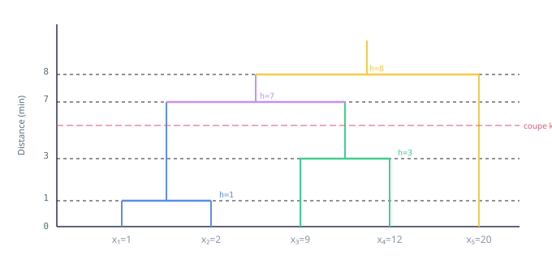

# TP2_Clustering_Correction.html

[Ouvrir l’original](https://drive.google.com/open?id=1LRLGFhEFfE-WU6sJslGv3HleFmNoMBjx) · Texte structuré depuis le fichier original. Les mises en page complexes peuvent nécessiter une vérification.

CY Tech · ING1 · 2024

# TP6 — Clustering Correction & Cours

K-Means · CAH · Inertie expliquée · Dendrogramme · R

### Table des matières

[📚 Rappels de cours](#cours) <a href="#exo1" class="toc-sub">Exercice 1 — K-Means à la main</a> <a href="#exo1a" class="toc-sub">· 1a) k=2, g₁=1, g₂=20</a> <a href="#exo1b" class="toc-sub">· 1b) k=2, g₁=2, g₂=9</a> <a href="#exo1c" class="toc-sub">· 1c) k=3, g₁=1, g₂=9, g₃=12</a> <a href="#exo1d" class="toc-sub">· 1d) Meilleur regroupement</a> <a href="#exo1cah" class="toc-sub">· 2) CAH + Dendrogramme</a> [Exercice 2 — K-Means & CAH sur R](#exo2) [Exercice 3 — Jeu de données Iris](#exo3)

Rappels théoriques

## 📚 Cours : Clustering

Le **clustering** (classification non supervisée) vise à regrouper des individus en classes homogènes, sans étiquettes préexistantes. Les deux grandes familles sont les méthodes partitionnelles (K-Means) et hiérarchiques (CAH).

### L'algorithme K-Means

Principe — Algorithme K-Means

**Objectif :** minimiser l'inertie intra-classe (somme des distances au centroïde).

1.  **Initialisation :** choisir k centroïdes initiaux g₁, …, gₖ
2.  **Affectation :** affecter chaque point au centroïde le plus proche : C_i = { x : d(x, gᵢ) ≤ d(x, gⱼ) ∀j }
3.  **Mise à jour :** recalculer les centroïdes comme la moyenne de chaque classe
4.  **Répéter** 2–3 jusqu'à convergence (plus de changement d'affectation)

#### Inertie et qualité de partition

-- Inertie Totale (T) -- T = Σᵢ (xᵢ - x̄)² où x̄ = moyenne générale -- Inertie Intra-classe (W) -- W = Σₖ Σ\_{x∈Cₖ} (x - gₖ)² où gₖ = centroïde de Cₖ -- Inertie Inter-classe (B) -- B = T - W -- % Inertie expliquée -- η² = B/T × 100 = (T-W)/T × 100 plus c'est élevé, mieux c'est

Le K-Means dépend de l'initialisation ! Des départs différents peuvent mener à des optimums locaux différents. On recommande de lancer l'algorithme plusieurs fois (paramètre `nstart` dans R).

### Classification Ascendante Hiérarchique (CAH)

Principe — CAH

**Approche bottom-up :** on part de n classes (chaque individu seul), puis on fusionne itérativement les deux classes les plus proches selon un critère de dissimilarité.

**Principaux critères de liaison :**

- **Distance minimum (single linkage) :** d(A,B) = min{ d(a,b), a∈A, b∈B }
- **Distance maximum (complete linkage) :** d(A,B) = max{ d(a,b), a∈A, b∈B }
- **Liaison moyenne (average) :** d(A,B) = moyenne des distances entre paires
- **Critère de Ward :** minimise la perte d'inertie intra-classe à chaque fusion

Dendrogramme

Le dendrogramme est la représentation graphique de la hiérarchie de fusions. La hauteur de chaque branche représente la distance à laquelle la fusion a eu lieu. On choisit le nombre de classes en coupant le dendrogramme là où le saut de hauteur est le plus grand.

### Comparaison K-Means vs CAH

Points clés à retenir

- **K-Means :** rapide, scalable, sensible à l'initialisation, suppose des clusters sphériques
- **CAH :** déterministe, produit une hiérarchie, coûteux en mémoire (O(n²))
- **Ward + CAH :** souvent le meilleur critère, similaire à K-Means en pratique
- Les **points atypiques** perturbent beaucoup K-Means (ils tirent les centroïdes)

Exercice 1

## K-Means à la main

Points : **x₁=1, x₂=2, x₃=9, x₄=12, x₅=20**

#### Calcul préliminaire : Inertie Totale

x̄ = (1+2+9+12+20)/5 = 44/5 = 8.8 T = (1-8.8)² + (2-8.8)² + (9-8.8)² + (12-8.8)² + (20-8.8)² = 60.84 + 46.24 + 0.04 + 10.24 + 125.44 = 242.8

### 1a) k=2, g₁=1, g₂=20

Itération 1 — Affectation

| Point | d(x, g₁=1) | d(x, g₂=20) | Classe |
|-------|------------|-------------|--------|
| x₁=1  | 0          | 19          | C₁     |
| x₂=2  | 1          | 18          | C₁     |
| x₃=9  | 8          | 11          | C₁     |
| x₄=12 | 11         | 8           | C₂     |
| x₅=20 | 19         | 0           | C₂     |

→ C₁ = {1,2,9} · C₂ = {12,20}

Nouveaux centroïdes : g₁ = (1+2+9)/3 = 4 \| g₂ = (12+20)/2 = 16

Itération 2 — Affectation (vérification convergence)

| Point | d(x, g₁=4) | d(x, g₂=16) | Classe |
|-------|------------|-------------|--------|
| x₁=1  | 3          | 15          | C₁     |
| x₂=2  | 2          | 14          | C₁     |
| x₃=9  | 5          | 7           | C₁     |
| x₄=12 | 8          | 4           | C₂     |
| x₅=20 | 16         | 4           | C₂     |

Même partition → **convergence atteinte.**

-- Inertie intra-classe W -- W(C₁) = (1-4)² + (2-4)² + (9-4)² = 9+4+25 = 38 W(C₂) = (12-16)² + (20-16)² = 16+16 = 32 W = 38 + 32 = 70 η² = (T-W)/T × 100 = (242.8-70)/242.8 × 100 ≈ 71.2 %

C₁

{1, 2, 9}

centroïde g₁ = 4

C₂

{12, 20}

centroïde g₂ = 16

Inertie expliquée

71.2%

W = 70

### 1b) k=2, g₁=2, g₂=9

Itération 1 — Affectation

| Point | d(x, g₁=2) | d(x, g₂=9) | Classe |
|-------|------------|------------|--------|
| x₁=1  | 1          | 8          | C₁     |
| x₂=2  | 0          | 7          | C₁     |
| x₃=9  | 7          | 0          | C₂     |
| x₄=12 | 10         | 3          | C₂     |
| x₅=20 | 18         | 11         | C₂     |

→ C₁ = {1,2} · C₂ = {9,12,20}

Nouveaux centroïdes : g₁ = (1+2)/2 = 1.5 \| g₂ = (9+12+20)/3 = 41/3 ≈ 13.67

Itération 2 — Vérification convergence (g₁=1.5, g₂=13.67)

| Point | d(x, g₁=1.5) | d(x, g₂=13.67) | Classe |
|-------|--------------|----------------|--------|
| x₁=1  | 0.5          | 12.67          | C₁     |
| x₂=2  | 0.5          | 11.67          | C₁     |
| x₃=9  | 7.5          | 4.67           | C₂     |
| x₄=12 | 10.5         | 1.67           | C₂     |
| x₅=20 | 18.5         | 6.33           | C₂     |

Même partition → **convergence.**

W(C₁) = (1-1.5)² + (2-1.5)² = 0.25 + 0.25 = 0.5 W(C₂) = (9-41/3)² + (12-41/3)² + (20-41/3)² = (-14/3)² + (-5/3)² + (19/3)² = 196/9 + 25/9 + 361/9 = 582/9 ≈ 64.67 W = 0.5 + 64.67 = 65.17 η² = (242.8-65.17)/242.8 × 100 ≈ 73.2 %

C₁

{1, 2}

g₁ = 1.5

C₂

{9, 12, 20}

g₂ ≈ 13.67

Inertie expliquée

73.2%

W ≈ 65.17

### 1c) k=3, g₁=1, g₂=9, g₃=12

Itération 1

| Point | d(x,g₁=1) | d(x,g₂=9) | d(x,g₃=12) | Classe |
|-------|-----------|-----------|------------|--------|
| x₁=1  | 0         | 8         | 11         | C₁     |
| x₂=2  | 1         | 7         | 10         | C₁     |
| x₃=9  | 8         | 0         | 3          | C₂     |
| x₄=12 | 11        | 3         | 0          | C₃     |
| x₅=20 | 19        | 11        | 8          | C₃     |

→ C₁={1,2} · C₂={9} · C₃={12,20}

g₁ = 1.5 \| g₂ = 9 \| g₃ = (12+20)/2 = 16

Itération 2 (g₁=1.5, g₂=9, g₃=16)

| Point | d(x,g₁=1.5) | d(x,g₂=9) | d(x,g₃=16) | Classe |
|-------|-------------|-----------|------------|--------|
| x₁=1  | 0.5         | 8         | 15         | C₁     |
| x₂=2  | 0.5         | 7         | 14         | C₁     |
| x₃=9  | 7.5         | 0         | 7          | C₂     |
| x₄=12 | 10.5        | 3         | 4          | C₂     |
| x₅=20 | 18.5        | 11        | 4          | C₃     |

→ C₁={1,2} · C₂={9,12} · C₃={20}

g₁ = 1.5 \| g₂ = (9+12)/2 = 10.5 \| g₃ = 20

Itération 3 (g₁=1.5, g₂=10.5, g₃=20)

| Point | d(x,g₁=1.5) | d(x,g₂=10.5) | d(x,g₃=20) | Classe |
|-------|-------------|--------------|------------|--------|
| x₁=1  | 0.5         | 9.5          | 19         | C₁     |
| x₂=2  | 0.5         | 8.5          | 18         | C₁     |
| x₃=9  | 7.5         | 1.5          | 11         | C₂     |
| x₄=12 | 10.5        | 1.5          | 8          | C₂     |
| x₅=20 | 18.5        | 9.5          | 0          | C₃     |

Même partition qu'à l'itération 2 → **convergence.**

W(C₁) = (1-1.5)² + (2-1.5)² = 0.5 W(C₂) = (9-10.5)² + (12-10.5)² = 2.25 + 2.25 = 4.5 W(C₃) = (20-20)² = 0 W = 0.5 + 4.5 + 0 = 5 η² = (242.8-5)/242.8 × 100 ≈ 97.9 %

C₁

{1, 2}

g₁ = 1.5

C₂

{9, 12}

g₂ = 10.5

C₃

{20}

g₃ = 20

Inertie expliquée

97.9%

W = 5

### 1d) Meilleur regroupement

| Cas | k   | Partition               | W     | η² (inertie expliquée) |
|-----|-----|-------------------------|-------|------------------------|
| a\) | 2   | {1,2,9} \| {12,20}      | 70    | 71.2%                  |
| b\) | 2   | {1,2} \| {9,12,20}      | 65.17 | 73.2%                  |
| c\) | 3   | {1,2} \| {9,12} \| {20} | 5     | **97.9%**              |

Le cas **c) avec k=3** donne l'inertie expliquée la plus élevée (97.9%). Parmi les deux partitions à k=2, le cas b) est légèrement meilleur (73.2% \> 71.2%) car il sépare mieux le groupe {1,2} des points intermédiaires. La partition {1,2} \| {9,12} \| {20} est la plus naturelle car elle sépare les trois "groupes visuels" visibles sur la droite réelle.

Attention : un k plus grand donne toujours une inertie expliquée plus élevée. Pour comparer des partitions avec k différents, on utilise des critères pénalisés (coude dans la courbe d'inertie, critères AIC/BIC, silhouette…).

### 2) CAH — Distance minimum + Dendrogramme

#### Matrice des distances initiales

|       | x₁=1 | x₂=2 | x₃=9 | x₄=12 | x₅=20 |
|-------|------|------|------|-------|-------|
| x₁=1  | —    | 1    | 8    | 11    | 19    |
| x₂=2  | 1    | —    | 7    | 10    | 18    |
| x₃=9  | 8    | 7    | —    | 3     | 11    |
| x₄=12 | 11   | 10   | 3    | —     | 8     |
| x₅=20 | 19   | 18   | 11   | 8     | —     |

Étape 1 — Fusion à hauteur 1

Distance minimum = d(x₁,x₂) = 1 → Fusion : **C₁₂ = {1, 2}**

Mise à jour (distance min) :

d(C₁₂, x₃) = min(8, 7) = 7 d(C₁₂, x₄) = min(11, 10) = 10 d(C₁₂, x₅) = min(19, 18) = 18

Étape 2 — Fusion à hauteur 3

Distance minimum = d(x₃,x₄) = 3 → Fusion : **C₃₄ = {9, 12}**

d(C₁₂, C₃₄) = min(d(C₁₂,x₃), d(C₁₂,x₄)) = min(7, 10) = 7 d(C₃₄, x₅) = min(d(x₃,x₅), d(x₄,x₅)) = min(11, 8) = 8

Étape 3 — Fusion à hauteur 7

Distance minimum = d(C₁₂, C₃₄) = 7 → Fusion : **C₁₂₃₄ = {1,2,9,12}**

d(C₁₂₃₄, x₅) = min(d(C₁₂,x₅), d(C₃₄,x₅)) = min(18, 8) = 8

Étape 4 — Fusion à hauteur 8

Fusion finale : **C₁₂₃₄₅ = {1,2,9,12,20}**

#### Dendrogramme

Couper le dendrogramme entre la hauteur 3 et 7 donne **3 groupes** : {1,2} \| {9,12} \| {20}. C'est le regroupement le plus naturel car le saut de hauteur 3→7 est le plus important (différence de 4), indiquant une rupture forte entre les groupes. Cette partition coïncide avec celle de k-means en 1c).

Exercice 2

## K-Means & CAH sur R

### Partie 1 — Algorithme K-Means

#### a) Test sur Test_Clusters_Distincts.txt — choisir le meilleur k

    R# Chargement des données
    data_dist <- read.table("Test_Clusters_Distincts.txt", header = TRUE)

    # Méthode du coude : calculer W pour k = 1 à 8
    inertie <- sapply(1:8, function(k) {
      km <- kmeans(data_dist, centers = k, nstart = 25)
      km$tot.withinss
    })

    # Graphique du coude
    plot(1:8, inertie,
         type = "b", pch = 19,
         xlab = "Nombre de classes k",
         ylab = "Inertie intra-classe (W)",
         main = "Méthode du coude - Clusters Distincts")

    # Application avec le meilleur k (ex: k=4)
    km_dist <- kmeans(data_dist, centers = 4, nstart = 25)
    plot(data_dist, col = km_dist$cluster,
         main = "K-Means k=4 — Clusters Distincts", pch = 20)
    points(km_dist$centers, col = 1:4, pch = 8, cex = 2, lwd = 2)

    # Pourcentage d'inertie expliquée
    pct <- km_dist$betweenss / km_dist$totss * 100
    cat("Inertie expliquée :", round(pct, 1), "%\n")

Interprétation attendue

Pour des clusters bien séparés (`Distincts`), la méthode du coude doit montrer un coude net. Le k optimal correspond au "coude" de la courbe W(k). L'inertie expliquée devrait être très élevée (≥ 90%).

#### b) Comparaison Distincts / Mélanges / Random

    Rdatasets <- list(
      Distincts = read.table("Test_Clusters_Distincts.txt", header=T),
      Melanges  = read.table("Test_Clusters_Melanges.txt",  header=T),
      Random    = read.table("Test_Clusters_Random.txt",    header=T)
    )

    par(mfrow = c(1, 3))
    for (name in names(datasets)) {
      km <- kmeans(datasets[[name]], centers = 4, nstart = 25)
      pct <- round(km$betweenss / km$totss * 100, 1)
      plot(datasets[[name]], col = km$cluster,
           main = paste(name, "-", pct, "%"), pch = 20)
    }

Résultats attendus

- **Distincts :** inertie expliquée très élevée (~90–95%). K-Means performe excellemment.
- **Mélanges :** inertie modérée (~60–75%). Les clusters se chevauchent, les frontières sont floues.
- **Random :** inertie faible (~30–50%). Les points étant uniformément distribués, K-Means crée des clusters arbitraires sans réelle structure.

#### c) Test sur Clusters Corrélés — amélioration

    Rdata_corr <- read.table("Test_Clusters_Corr.txt", header = TRUE)

    # K-Means direct (résultat médiocre car clusters allongés/elliptiques)
    km_corr <- kmeans(data_corr, centers = 3, nstart = 25)
    plot(data_corr, col = km_corr$cluster,
         main = "K-Means direct (données corrélées)", pch = 20)

    # Amélioration : réduire d'abord par ACP puis appliquer K-Means
    pca <- prcomp(data_corr, scale. = TRUE)
    km_pca <- kmeans(pca$x[, 1:2], centers = 3, nstart = 25)
    plot(pca$x[, 1:2], col = km_pca$cluster,
         main = "K-Means après ACP", pch = 20)

Explication

K-Means utilise la distance euclidienne et suppose des clusters sphériques. Sur des données corrélées (clusters allongés/elliptiques), les résultats sont mauvais. On peut améliorer en :

- Appliquant une **ACP préalable** pour décorréler les variables
- Utilisant une **distance de Mahalanobis** (prend en compte la covariance)
- Passant à des modèles à **mélanges gaussiens** (EM algorithm)

#### d) K-Means avec individus atypiques — initialisation forcée

    Rdata_aty <- read.table("Test_Clusters_Atypique.txt", header = TRUE)

    # Initialisation avec les individus 1 et 1499 (atypiques)
    init_centers <- data_aty[c(1, 1499), ]
    km_aty <- kmeans(data_aty, centers = init_centers)

    plot(data_aty, col = km_aty$cluster,
         main = "K-Means — init. atypiques (n°1, 1499)", pch = 20)
    points(km_aty$centers, pch = 8, cex = 3, lwd = 2, col = "red")

Impact des points atypiques

Initialiser avec des points atypiques (outliers) crée des centroïdes initiaux très éloignés. Cela force K-Means à créer au moins un cluster autour de chaque outlier, ce qui biaise fortement la partition finale. L'inertie expliquée sera dégradée. → La CAH avec Ward est plus robuste dans ce cas.

### Partie 2 — Classification Ascendante Hiérarchique (CAH)

#### a) CAH sur Distincts, Mélanges et Random

    Rlibrary(ggdendro)

    par(mfrow = c(1, 3))
    for (name in names(datasets)) {
      d <- dist(datasets[[name]])
      cah <- hclust(d, method = "ward.D2")
      plot(cah, main = paste("CAH (Ward) —", name),
           labels = FALSE, hang = -1, xlab = "")
      rect.hclust(cah, k = 4, border = 2:5)
    }

#### b) CAH sur données atypiques — ward.D2

    Rd_aty <- dist(data_aty)
    cah_aty <- hclust(d_aty, method = "ward.D2")
    plot(cah_aty, main = "CAH (Ward.D2) — Données Atypiques",
         labels = FALSE, hang = -1)
    rect.hclust(cah_aty, k = 4, border = 2:5)

    # Récupérer les classes
    classes_cah <- cutree(cah_aty, k = 4)
    plot(data_aty, col = classes_cah, pch = 20,
         main = "CAH Ward — Données atypiques (k=4)")

#### c) Comparaison CAH vs K-Means

    R# Pour chaque jeu de données, comparer les partitions KM vs CAH
    for (name in names(datasets)) {
      dat <- datasets[[name]]

      # K-Means
      km  <- kmeans(dat, centers = 4, nstart = 50)
      pct_km <- km$betweenss / km$totss * 100

      # CAH Ward
      cah <- hclust(dist(dat), method = "ward.D2")
      cl_cah <- cutree(cah, k = 4)

      # Inertie CAH (calcul manuel)
      W_cah <- sum(sapply(1:4, function(k)
        sum(scale(dat[cl_cah==k, ], scale=F)^2)))
      T_tot <- sum(scale(dat, scale=F)^2)
      pct_cah <- (1 - W_cah/T_tot) * 100

      cat(sprintf("%s  |  KM: %.1f%%  |  CAH: %.1f%%\n", name, pct_km, pct_cah))
    }

Résultats attendus — Comparaison

- **Distincts :** KM ≈ CAH, tous deux excellent (~92–95%). CAH légèrement meilleure car déterministe.
- **Mélanges :** KM souvent légèrement meilleur car optimise directement W.
- **Random :** Tous deux mauvais, résultats aléatoires. Aucune structure réelle.
- **Atypiques :** CAH Ward nettement supérieur — isole les outliers en feuilles isolées du dendrogramme.

Exercice 3

## Jeu de données Iris

Le jeu de données **iris** contient 150 observations de fleurs, 4 variables métriques (longueur/largeur des sépales et pétales) et 3 espèces : *setosa*, *versicolor*, *virginica*.

    R## ── Chargement et exploration ──────────────────────────────────
    data(iris)
    head(iris)
    summary(iris)

    ## ── K-Means sur les 4 variables numériques ─────────────────────
    iris_num <- iris[, 1:4]  # enlever la variable Species

    # Méthode du coude
    inertie <- sapply(1:8, function(k)
      kmeans(iris_num, centers = k, nstart = 50)$tot.withinss)
    plot(1:8, inertie, type="b", pch=19,
         xlab="k", ylab="W", main="Coude iris")

    # Application k=3 (on cherche à retrouver les 3 espèces)
    set.seed(42)
    km_iris <- kmeans(iris_num, centers = 3, nstart = 50)

    ## ── Comparaison clusters vs vraies espèces ─────────────────────
    table(Cluster = km_iris$cluster, Espece = iris$Species)

    ## ── Visualisation ──────────────────────────────────────────────
    par(mfrow = c(1, 2))
    plot(iris[, c("Petal.Length", "Petal.Width")],
         col = km_iris$cluster, pch = 20,
         main = "K-Means k=3 (couleurs = clusters)")
    points(km_iris$centers[, c(3,4)], pch = 8, cex = 2, col = "black")

    plot(iris[, c("Petal.Length", "Petal.Width")],
         col = as.integer(iris$Species), pch = 20,
         main = "Vraies espèces (couleurs = species)")

    ## ── CAH sur Iris ───────────────────────────────────────────────
    cah_iris <- hclust(dist(iris_num), method = "ward.D2")
    plot(cah_iris, labels = FALSE, hang = -1,
         main = "Dendrogramme CAH Ward — Iris")
    rect.hclust(cah_iris, k = 3, border = c("blue", "green", "red"))

    cl_cah_iris <- cutree(cah_iris, k = 3)
    table(CAH = cl_cah_iris, Espece = iris$Species)

#### Résultat typique de la table de confusion K-Means (k=3)

| Cluster | setosa | versicolor | virginica |
|---------|--------|------------|-----------|
| 1       | 50     | 0          | 0         |
| 2       | 0      | 48         | 14        |
| 3       | 0      | 2          | 36        |

**Oui, les clusters correspondent globalement aux 3 espèces.**  
— *Setosa* est parfaitement isolée (cluster pur à 100%) car ses pétales sont beaucoup plus petits.  
— *Versicolor* et *Virginica* sont plus proches et se chevauchent légèrement (~16 erreurs sur 100 individus, soit ~84% d'accord).  
— La variable la plus discriminante est la **longueur des pétales** (Petal.Length).

Conclusion générale du TP

- K-Means est efficace sur des clusters **sphériques et bien séparés**, mais sensible aux initialisations et outliers
- CAH avec Ward produit des résultats similaires à K-Means et est plus robuste aux atypiques
- La méthode du coude et le dendrogramme sont les outils de choix pour sélectionner k
- L'inertie expliquée (B/T) mesure la qualité de la partition — plus elle est haute, mieux les clusters sont séparés
- Sur iris : clustering non supervisé retrouve quasi-parfaitement les vraies espèces → signe d'une vraie structure dans les données

TP6 Clustering · CY Tech ING1 · K-Means & CAH · 2024

