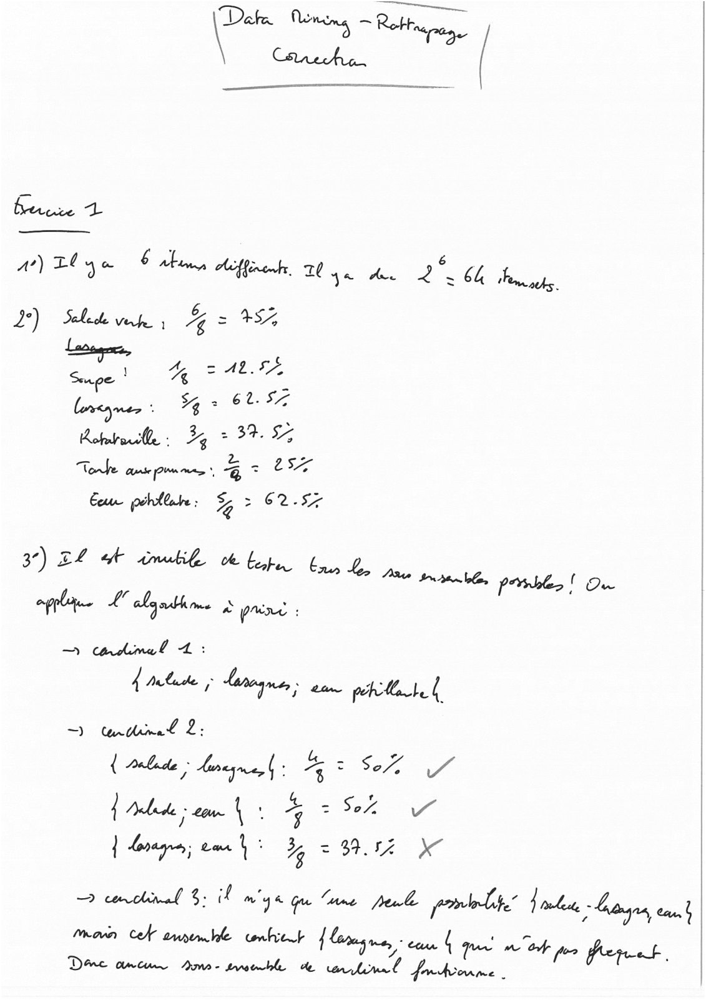
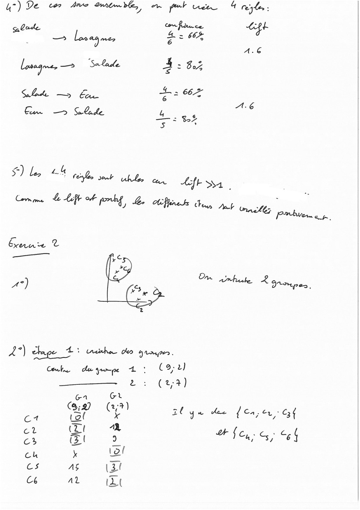
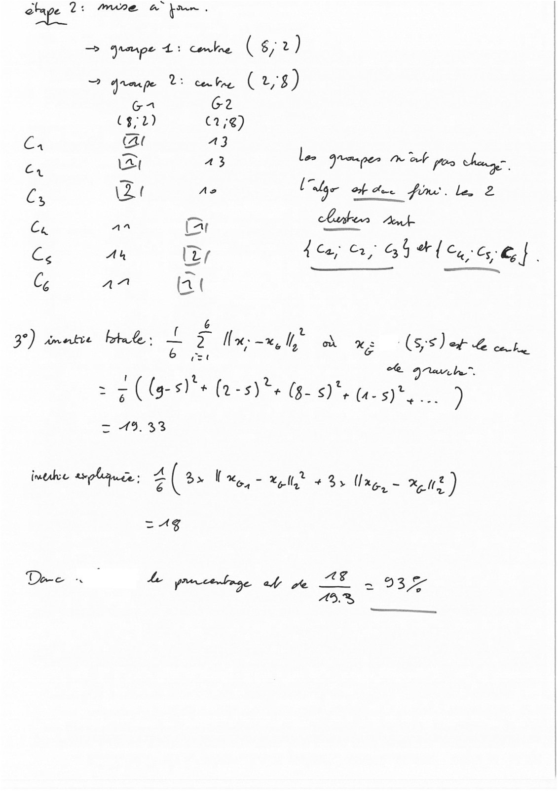
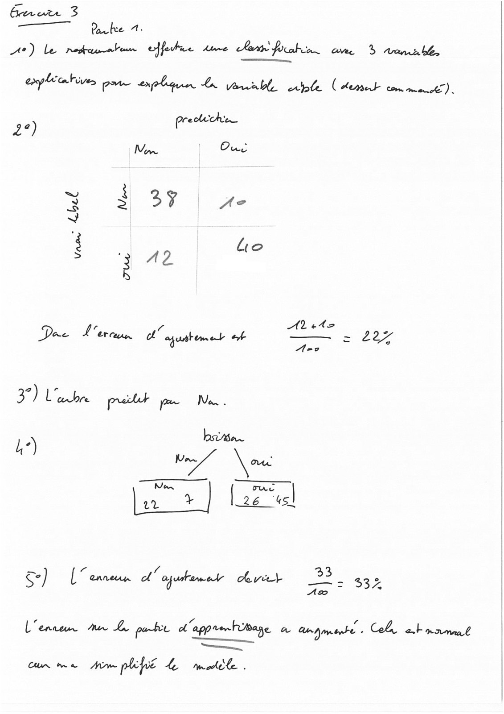
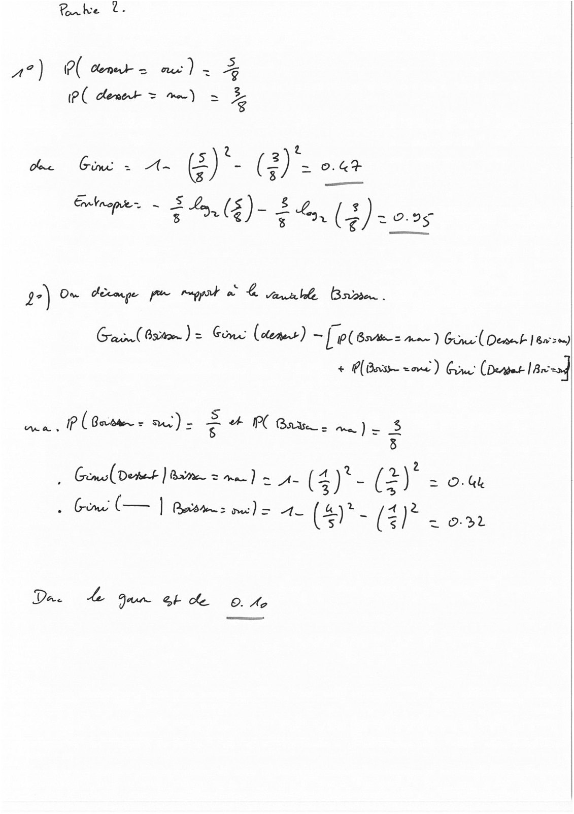

# corr_rattrapageDAtaMIning-2024-2025.pdf

[Ouvrir l’original](https://drive.google.com/open?id=1UJnsjQ8TFa9NFAC1C02MQ54IatAxKojB) · Les pages signalées comprennent du texte reconnu automatiquement ou des éléments graphiques. Le fac-similé permet de vérifier chaque lecture.

**Pages avec fac-similé ou lecture OCR** — 1–5.

## Page 1

**Lecture OCR à contrôler**

~~~text
‘ « + nr.
Le . ere

a) Dla Éd heffinenk 20 ya dee he 64 huge.

0

s

2) anni % = 48
Supe | ty SATA
$ 6.2575
l nese 7% 2 A
hote: 3 > 37. 5

Tobe ease (Dis mee *, 4 + LS

Cour pachtlate : % > 62-57

A tidimel 1:
date; dope. eam getMeta |
Dee SS
ee ee a A
À Arlede - com À ; a Ae re
| borage em 3 BE X
email $2 iF 98 Gu Mane peas ponte | mbes, Loges tau}

mown Cf avt unlit a - cou À te
an M Of
De amtur Dmr- twoerhle de tu nou F5 eps.

Ame |
~~~

## Page 2

**Lecture OCR à contrôler**

~~~text
=) De Ce Arve RENE oi put nee A Fey low:

De. con finuce ph
= - — Law as) mer ae 664, ae
AG
Losagnt,—> Stade A: bz
Sb ee $3 62
— = BS
Ss
$) len 4 4

rejet blo ous tft SA |
Comm ame & Lift of pry Le Affine ts

Eau T
a

A2)

Ga Gt
i (27) >

cs PF OP ah ye joue
ct (Lt "à
ca Gti Le
Ch x Lol
cs AS (ZI
Cb AL IZ
~~~

## Page 3

**Lecture OCR à contrôler**

~~~text
etape 2: mre a pn.
= pape ts dde (6/2)

7? oro pe cite. (2,8)

Ga G2

(3,2) (1;@)
(Ga CA A3 L .
a, Br 43 na EN eee
Es at Ae [alge ot de fine. le, 2
Cr an Cr lunes Am
Es An (tr 4 Ce; 2, G5 ef Cy Cee,
Ce AA (2 (

6
3°) umatic bk: = 2 | Hal od a: (Je.

oe Qranb

= ((g- 51° Gan Ge) oa. see)

wv
|

np (os Fae tt tg)

=Ag

Dee à L png of pe LE 2935
43%

-__.
~~~

## Page 4

**Lecture OCR à contrôler**

~~~text
Grete 3
fiona

Portree 1.
A?) le repauaten ejfulne dune Aer pubic. ane > vemublr

explicatives ee explique L Varable le PATATE ne)

2°) preclichin
Ma Ons

VU 3 29

3 2 pe

re)

vrac

“ D te
Doe K ercun cL” aputhemet #4 ee

= 207
Ano

De yee à
i)

———

ban.
A \ oe
Es eee
es 26 us]

5) [“ ennerin of l'ojuhamet vit 33

L'enreus Aus es pobe ot apprenhibage a anÿmte - Zhe ,
Ru Cl Ana

cum me Horm phcpié Le mail.
~~~

## Page 5

**Lecture OCR à contrôler**

~~~text
Rnke t.

1°) P( Cent = ne) =
PC dément = mm) = 7

he Gime > A-~ ()*- (ie o.4«+

pire RC) (2) +025

2°) On décoge pe muppet à À aurhe Brite.

Ga Gorton) = Cone (lem) LC rine! (Demet 18m)
+ PB zone) Grr’ (Dermt 18x04

ca, P (Bote = ac) - + PC Baw, ma )

q

MA IP os

à Gema(Detet | Bare = me) = 4 iy ( jé = ot
Gun | ae) + [ely le

Da bs Gan OE Cc OA,
~~~
