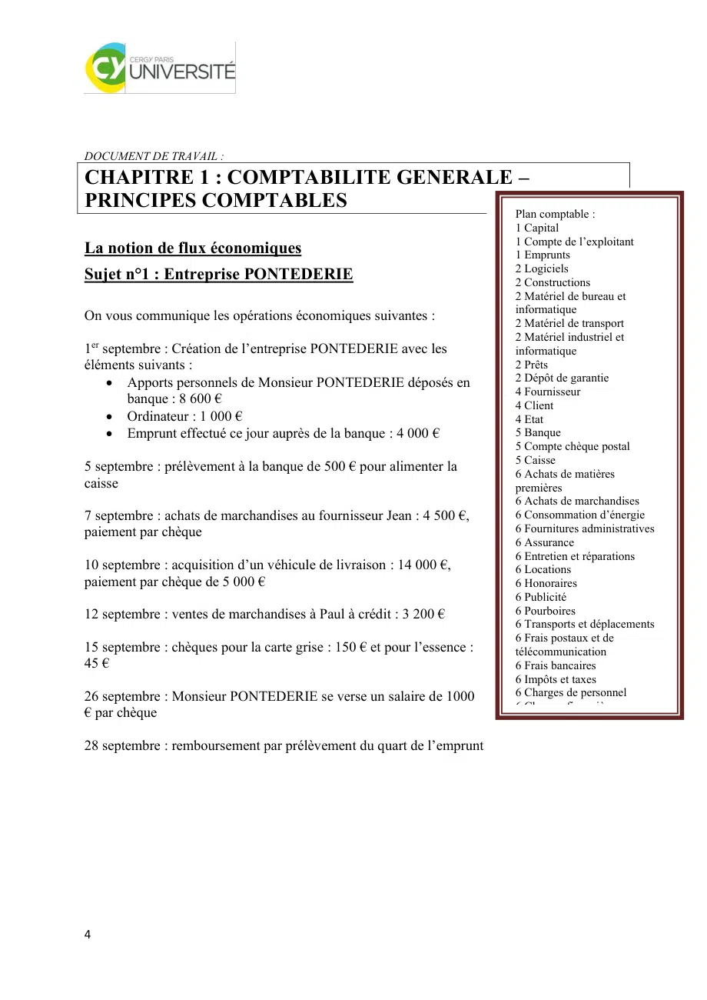

# 1 -_ Doc Synthèse.pdf

[Ouvrir l’original](https://drive.google.com/open?id=1gwh3c6dEuaGwAN9rS8kvJkuhlRCAFXV4) · Les deux lectures automatiques du PDF divergent sur les pages indiquées. Leur fac-similé accompagne le texte.

**Pages présentant un écart entre les deux extractions** — 2.

## Page 1

~~~text
    Introduction à la Gestion-
          Comptabilité

                       ING1

                Septembre 2025

Intervenant : Djammel RABEHI

3
~~~

## Page 2

~~~text
DOCUMENT DE TRAVAIL :

CHAPITRE 1 : COMPTABILITE GENERALE –
PRINCIPES COMPTABLES
                                                                         Plan comptable :
                                                                         1 Capital
                                                                         1 Compte de l’exploitant
La notion de flux économiques                                            1 Emprunts
                                                                         2 Logiciels
Sujet n°1 : Entreprise PONTEDERIE                                        2 Constructions
                                                                         2 Matériel de bureau et
                                                                         informatique
On vous communique les opérations économiques suivantes :                2 Matériel de transport
                                                                         2 Matériel industriel et
1er septembre : Création de l’entreprise PONTEDERIE avec les             informatique
éléments suivants :                                                      2 Prêts
     • Apports personnels de Monsieur PONTEDERIE déposés en              2 Dépôt de garantie
                                                                         4 Fournisseur
        banque : 8 600 €                                                 4 Client
     • Ordinateur : 1 000 €                                              4 Etat
     • Emprunt effectué ce jour auprès de la banque : 4 000 €            5 Banque
                                                                         5 Compte chèque postal
                                                                         5 Caisse
5 septembre : prélèvement à la banque de 500 € pour alimenter la         6 Achats de matières
caisse                                                                   premières
                                                                         6 Achats de marchandises
7 septembre : achats de marchandises au fournisseur Jean : 4 500 €,      6 Consommation d’énergie
paiement par chèque                                                      6 Fournitures administratives
                                                                         6 Assurance
                                                                         6 Entretien et réparations
10 septembre : acquisition d’un véhicule de livraison : 14 000 €,        6 Locations
paiement par chèque de 5 000 €                                           6 Honoraires
                                                                         6 Publicité
12 septembre : ventes de marchandises à Paul à crédit : 3 200 €          6 Pourboires
                                                                         6 Transports et déplacements
                                                                         6 Frais postaux et de
15 septembre : chèques pour la carte grise : 150 € et pour l’essence :   télécommunication
45 €                                                                     6 Frais bancaires
                                                                         6 Impôts et taxes
26 septembre : Monsieur PONTEDERIE se verse un salaire de 1000           6 Charges de personnel
                                                                         6 Charges financières
€ par chèque                                                             7 Ventes de produits finis
                                                                         7 Ventes de marchandises
28 septembre : remboursement par prélèvement du quart de l’emprunt       7 Produits financiers

4
~~~

## Page 3

~~~text
Enregistrer ces écritures AU JOURNAL de l’entreprise PONTEDERIE

                               1/9                        Débit +   Crédit -

Reporter ces écritures AU GRAND LIVRE de l’entreprise PONTEDERIE
5
~~~

## Page 4

~~~text
        512 Banque                     101 Capital       2183 Matériel Informat.
1/09 8600      500 5/09                      8600 1/09   1/09 1000
1/09 4000      4500 7/09                     1000 1/09
               5000 10/09
               195 15/09
               1000 26/09
               1000 28/09
TD 12600       TC 12195         TD 0         9600 TC      TD 1000     TC 0

                                                              641 Charges de
       164 Emprunts                   530 Caisse                personnel
28/09 1000    4000 1/09         5/09 500                 26/09 1000

TD 1000         TC 4000         TD 500       TC 0         TD 1000     TC 0

                                2182 Achat Matériel de
     707 Ventes de M/ses               transport           411 Créances clients
                 3200 12/09   10/09 14000                12/09 3200

TD 0            TC 3200        TD 14000     TC 0         TD 3200      TC 0

    631 Achat carte grise       602 Achat de carburant      607 Achats de m/ses
15/09 150                      15/09 45                   7/09 4500

TD 150          TC 0           TD 45        TC 0         TD 4500      TC 0

         40 Dettes Frs
                 9000 10/09

TD 0            TC 9000

                              BALANCE AU …/…/…

 6
~~~

## Page 5

~~~text
                                            Sommes                        Soldes
             Comptes
                                    Débit            Crédit      Débit             Crédit
 101     Capital                                     9600                          9600
 164     Emprunts                    1000            4000                          3000
 2182    Mat transpo                14000                        14000
 2183    Mat info                    1000                         1000
 401     Dettes                                      9000                          9000
 411     Créances                    3200                        3200
 512     Banque                     12600            12195        405
 530     Caisse                       500                         500
 602     Energie                       45                          45
 607     Ach MSES                    4500                        4500
 631     IMP                          150                         150
 641     Che pers                    1000                        1000
 707     Vente                                        3200                          3200
         TOTAUX                     37995            37995       24800             24800

                            BILAN AU 31/ …./…..

          ACTIF               Montants               PASSIF                    Montants
ACTIF IMMOBILISE                            CAPITAUX PROPRES
Classe 2                                    Classe 1

                 TOTAL I

ACTIF CIRCULANT                                                TOTAL I
Classe 3                                    DETTES LT
Classe 4 et 5 SD
                                                               TOTAL II
                                            DETTES CT
                                            Classe 4 et 5 SC

                 TOTAL II

7
~~~

## Page 6

~~~text
       TOTAL GENERAL                                                  TOTAL III

                                                           TOTAL GENERAL

                        COMPTE DE RESULTAT AU 31/…. /…..

            CHARGES                     Montants                PRODUITS                    Montants
    Exploitation                                     Exploitation

                          Total 1                                          Total 1
    Financier                                        Financier

                          Total 2                                          Total 2
    Exceptionnel                                     Exceptionnel

                          Total 3                                          Total 3

                TOTAL                                              TOTAL

TAF : Compléter la balance puis le bilan et le compte de résultat.

                                                                               707 Ventes M/SES

Exercice 2 : entreprise Béchille                                               607 Achats M/ses

a) achat à crédit de marchandises au fournisseur Blorent : 260 €               512 Banque
b) achat au comptant de matériel de bureau : 415 €                             401 Dettes FRS
c) Vente à crédit de marchandises au client Blément : 583 €
d) Ventes au comptant de marchandises au client Dée : 367 €                    411 Créances Clients
e) Paiement par chèque du fournisseur Blorent
                                                                               218 Achat Matériel
f) Blément paye par chèque 583 €

8
~~~

## Page 7

~~~text
Faire le schéma des flux et enregistrer chaque opération dans les comptes en « T » en
indiquant la classe du compte (1er chiffre – consulter la liste des comptes à utiliser en page 2)

9
~~~

## Page 8

~~~text
Exercice 3 : entreprise H.A.M.
                                                                                       707 Ventes M/SES
a) Achat à crédit de marchandises au fournisseur Bartin : 467 €
                                                                                       607 Achats M/ses
b) Acquisition d’une camionnette : 15830 € payés par chèque
c) Ventes de marchandises au comptant : 370 €                                          512 Banque
d) Paiement de la facture d’électricité : 287 € réglés par chèque au fournisseur EDF
                                                                                       401 Dettes FRS
e) Vente à crédit au client Blamet : 347 €
f) Paiement par chèque de la somme due au fournisseur Bartin                           411 Créances Clients
g) Encaissement du chèque de Blamet 347 €
                                                                                       218 Achat Matériel

                                                                                       606 Achat Electricité

10
~~~

## Page 9

~~~text
                                                                       Finance Entrepreneuriale

                                                          BILAN                                                                                          COMPTE DE RESULTAT
            ACTIF                                                                                      PASSIF   CHARGES                                                                               PRODUITS
                  ACTIF IMMOBILISE           BRUT   DAP    NET               CAPITAUX PROPRES                   CHARGES D'EXPLOITATION                           PRODUITS D'EXPLOITATION
                      fonds commercial                                                      Capital
                      Matériel industriel                                                                       Variation de stocks matieres                     Prestations
                      Outillage industriel                                                                      Achat non stockés de M. et F.
                          I.G.A.A.divers                                                                        Achat de marchandises                            Produits des activités annexes
                  Matériel de transport                                                                         Locations
Matériel de bureau et mat. Informatique                                                                         Entretien et réparations
                                 Mobilier                                                                       Primes d'assurance
                                    Prêts                                                                       Publicité, publications, …
                                                                                                                Transports de biens et …
                                                                                                                Frais postaux, …
                                                                                                                Services bancaires et assimilés
                                                                           Résultat                             Impôts, taxes
                                                                                                                Impôts, taxes
                                                                                                                Rémunérations du personnel
                                                                                                                Charges de S.S.et de prévoyance
                                                                                          TOTAL1
                                                                            DETTES LONG TERME                   Dotations sur amortissements et provisions
                                                                  Emprunts auprès des ets de crédit
                               TOTAL 1
                     ACTIF CIRCULANT         BRUT   DAP    NET                                                                               TOTAL 1 :                                    TOTAL 1 :
                                                                                          TOTAL 2               CHARGES FINANCIERES                              PRODUITS FINANCIERS
            Stocks                                                        DETTES COURT TERME
                                                                                                                Charges d'intérêts                               Escomptes obtenus
            Créances clients                                                          Fournisseurs              Escomptes accordés
                                                                     Fournisseurs d'immobilisations
            Banque                                                                 Sécurité sociale
            Chèques postaux                                                   Etat, taxes sur le C.A
            Caisse
                                                                                                                                             TOTAL 2 :                                    TOTAL 2 :
                                                                                                                CHARGES EXCEPTIONNELLES                          PRODUITS EXCEPTIONNELLES

                                                                                                                Charges exceptionnelles                          Produits exceptionnels

                                                                                                                                             TOTAL 3 :                                    TOTAL 3 :
                                                                                                                        TOTAL CHARGES                                   TOTAL PRODUITS
                               TOTAL 2                                                    TOTAL 3                                          BENEFICE                                        PERTE
             Total Général                                           Total Général                                      TOTAL GENERAL                                   TOTAL GENERAL

                             11
~~~

## Page 10

~~~text
    Application 1 :

    On vous communique les opérations économiques suivantes :

    1er septembre : Création de l’entreprise PONTEDERIE avec les éléments suivants :

•   Apports personnels de Monsieur PONTEDERIE déposés en banque : 8 600 €

•   Ordinateur : 1 000 €

•   Emprunt effectué ce jour auprès de la banque : 4 000 €

    5 septembre : prélèvement de 500 € pour alimenter la caisse

    7 septembre : achats de marchandises au fournisseur Jean : 4 500 €, paiement par chèque

    10 septembre : acquisition d’un véhicule de livraison : 4 000 €, paiement par chèque

    12 septembre : ventes de marchandises à Paul à crédit : 3 200 €

    15 septembre : chèques pour la carte grise : 150 € et pour l’essence : 45 €

    21 septembre : prêt accordé à la stagiaire de l’entreprise : 600 €, chèque

    26 septembre : Monsieur PONTEDERIE prélève 1 000 € à la banque au titre de sa
    rémunération

    28 septembre : remboursement du quart de l’emprunt

         Application 2 :

         12
~~~

## Page 11

~~~text
       Le 15/07/N, M. Paul crée l’entreprise « librairie Paul » en rachetant une ancienne papeterie
    librairie qui comprend les éléments suivants :

-   Stock de marchandises : 130 000 €.

-   Fonds de commerce : 170 000 €.

-   Dettes fournisseurs : 25 000 €.

-   Matériel de transport : 15 000 €.

-   Matériel de bureau et informatique : 5 700 €.

-   Créances clients : 32 000 €.

-   Dettes fiscales : 19 000 €.

-   Emprunt : 27 000 €.

-   Prêt : 32 000 €.

-   Banque : 7 000 €.

    Travail à faire : Présenter le bilan d’ouverture de la « librairie Paul » au 15/07/N.

    Application 3 : Etablissements BACCIS

    Un bilan au 31/08 comprend les éléments suivants :

    -    Rémunération due : 80 000 €.

    -    Construction : 200 000 €.

    -    Prêt : 20 000 €.

    -    Titres de participation : 7 000 €.

    -    Fournisseur : 30 000 €.

    -    Stock de marchandises : 20 000 €.

    -    Clients : ??????

    -    Emprunt : 50 000 €.

    -    Fonds de commerce : 160 000 €.

    -    Capital : 150 000 €.

    -    Terrain : 50 000 €.

         13
~~~

## Page 12

~~~text
-    Résultat de l’exercice : 150 000 €.

Travail à faire : Déterminer le montant des créances clients au 31/08/N en réalisant un bilan
simplifié.

Application 4 :

Soit les soldes des comptes en € :

Produits exceptionnels : 32 000.

Charges financières : 28 500.

Impôts : 7 380.

Ventes de prestations de services : 290 380.

Charges exceptionnelles : 28 770.

Ventes de marchandises : 79 890.

Charges financières : 9 090.

Achats de marchandises : 58 770.

Locations : 12 200.

Charges de personnel ?

Résultat de l’exercice : - 27 090.

Travail à faire : Quel est le montant du compte charges de personnel ?

     14
~~~

## Page 13

~~~text
                                       Les documents de synthèse

                                                 I – Le Bilan
          Le Bilan rend compte de la situation financière et patrimoniale de l’entreprise à un moment donné.
     Le patrimoine est l’ensemble des biens, créances et dettes d’une personne juridique.
                                            BILAN
                         Actif                                        Passif
      A l’actif, le capital est classé selon son Au passif, le capital est classé selon son
      utilisation, c’est-à-dire selon son emploi origine, c’est-à-dire selon sa ressource
      (débits).                                  (crédits).

      ACTIFS IMMOBILISÉS                            CAPITAUX PROPRES
      (terrains, véhicules, etc…)
                                                    RESULTAT
      ACTIF CIRCULANT
      (stocks, banques, etc…)                       DETTES

                                       ACTIF = PASSIF

           Le Bilan peut être débiteur ou créditeur en fonction des montants des pertes ou profits enregistrés.
     Un profit est une ressource ; il figure au passif dans le Bilan avec un +. Une perte est un emploi qui
     figure également dans le passif avec un -.

                                       II – Le Compte de résultat
          L’entreprise procède à la comparaison de deux valeurs : les valeurs produites sur le marché
     (produits) et les valeurs utilisées pour faire face à cette production (charges). La comparaison entre les
     produits et les charges permet de dégager le résultat.

            Le Compte de résultat permet de faire une analyse par nature des produits et des charges de
     l’entreprise pour un exercice. Il mesure la variation du patrimoine de l’entreprise et permet de
     comprendre les raisons de cette variation.
                                              CDR

              Charges = Dépenses                            Produits = Recettes
      - Charges d’exploitation                      - Produits d’exploitation
      - Charges financières                         - Produits financiers
      - Charges exceptionnelles                     - Produits exceptionnels
      - Participation des Salariés                  - Pertes de l’exercice
      - Impôts sur les bénéfices
      - Bénéfices de l’exercice

15
~~~

## Page 14

~~~text
Exemple :
Entreprise DU MERLE - BALANCE AU 31/12
 N°         Intitulés      Mouvements                    Soldes
Cptes    des comptes     DEBIT   CREDIT          DEBITEUR    CREDITEUR
101 Capital                       600000                           600000
16     Emprunts                   300000                           300000    Plan comptable :
211 Terrains             140000                     140000
213 Constructions        350000                     350000                   101 Capital
                                                                             16 Emprunts
2182 Mat. de Transport   100000                     100000
                                                                             211 Terrains
2183 Mat. de bureau       25000                      25000
                                                                             213 Constructions
2184 Mobilier             20000                      20000
                                                                             2182 Matériel de transport
401 Fournisseur                   160000                           160000    2183 Matériel de bureau et
411 Clients              120000   120000                                     informatique
512 Banque              1160000   868050            291950                   2184 Mobilier
530 Caisse                 3000      1700             1300                   401 Fournisseurs
606 Achats non stockés     1700                       1700                   411 Clients
607 Achats de m/ses      360000                     360000                   512 Banque
616 Prime d'assurance      5600                       5600                   530 Caisse
6226 Honoraires           21200                      21200                   606 Achats non stockés de
661 Charges d'intérêt      3250                       3250                   matières et Fournitures
707 Ventes de m/ses               260000                           260000    607 Achats de marchandises
                                                                             616 Prime d’assurance
      TOTAUX               2309750    2309750      1320000        1320000    618 Divers (séminaires…)
                                                                             6226 Honoraires
            DU MERLE - COMPTE DE RESULTAT AU 31/12                           63 Impôts et taxes
                                                                             661 Charges d’intérêt
             CHARGES                           PRODUITS
                                                                             707 Ventes de marchandises
Charges d'exploitation              Produits d'exploitation
Achats de marchandises       360000 Ventes de marchandises 260000
Achats non stockés             1700
Services extérieurs           26800
Impôts et taxes
Charges de personnel
Autres charges
                Total C.Expl 388500             Total P. Expl. 260000

Charges financières             3250 Produits financiers                 0

Charges exceptionnelles              0 Produits exceptionnels            0

TOTAL CHARGES                 391750 TOTAL PRODUITS                260000
                                     Résultat = PERTE              131750
TOTAL                         391750 TOTAL                         391750

                        DU MERLE - BILAN AU 31/12
                  Actif                             Passif
Actif immobilisé                      Capitaux propres
Immobilisation incorporelles                Capital                 600000
Immobilisation corporelles    635000 Résultat de l'exercice        -131750
Immobilisations financières
               Total I        635000                   Total I     468250
Actif circulant
Stocks                                Dettes
Créances                              Emprunt                      300000
Disponibilités                293250 Fournisseur                   160000
               Total II       293250                   Total II    460000

TOTAL ACTIF                   928250 TOTAL PASSIF                  928250

16
~~~

## Page 15

~~~text
Exercice 4 : SA Denis
  Les opérations effectuées par la SA. Denis, pendant le premier mois (février) de son activité commerciale,
ont été enregistrées dans les comptes ci – dessous :

D    101 CAPITAL C                    D   164 EMPRUNT C                         D      211 TERRAIN                  C
           1 160 000                              200 000
           240 000

                                                             Montant à déterminer

D       213 Construction       C      D 2182 Matériel de transport C            D 215 Matériel industriel       C
     600 000                              166 100                                    42464
                                                                                      5556
                                                                                     41900

D 2183 Matériel de bureau      C             D       411 Clients C         D 401 Fournisseurs    C
    8 200                                           12 482 480                         7 484
                                                     7 590 7 590                       8 544

D 607 Achats de marchandises C         D 631 Impôts C             D      641 Charges de personnel C
      7 482     480                    6 139                                9 000
      8 544

D       623 Publicité C      D       665 Intérêts            C        D 707 Ventes de marchandises          C
        506                        4 956                                           12 482
                                                                                    7 590
                                                                                     3 686

D             512 Banque              C                D            530 Caisse                       C
         200 000     42 464                                   320 000       41 900
           7 590      9 000                                     3 686      140 000
         140 000    166 100                                    69 432       60 000
          60 215       8 200                                                   506
         145 000       4 956

Travail à faire : Concernant la SA. Denis :
 2) Solder les comptes.
 3) Etablir une balance par soldes au 28/02/N.
 4) Etablir le bilan et le compte de résultat au 28/02/N.

                                                              BALANCE AU 28/02/N
17
~~~

## Page 16

~~~text
                                           Sommes                          Soldes
           Comptes
                                   Débit            Crédit        Débit             Crédit

        TOTAUX

                                BILAN AU 31/ …./…..

          ACTIF              Montants               PASSIF                      Montants
ACTIF IMMOBILISE                           CAPITAUX PROPRES

                                                             TOTAL I
                                           DETTES LT

              TOTAL I

ACTIF CIRCULANT                                                 TOTAL II
                                           DETTES CT

              TOTAL II
                                                TOTAL III
     TOTAL GENERAL

                                               TOTAL GENERAL

                        COMPTE DE RESULTAT AU 31/…. /…..

18
~~~

## Page 17

~~~text
             CHARGES                           Montants              PRODUITS              Montants
     Exploitation                                         Exploitation

                                                          Produits

                                                                            Total 1
                                                          Financier

                       Total 1
     Financier                                                               Total 2
                                                          Exceptionnel
     Intérêts :
                             Total 2
     Exceptionnel
                                                                            Total 3

                                                          TOTAL
                             Total 3

              TOTAL
Exercice 5 : Etablissements Troyens
Numéros de                        Comptes                          Sommes                      Soldes
 compte                                                        Débit     Crédit        Débit            Crédit
101               Capital                                             25000
164               Emprunts                                  834       3334
211               Terrains                                  4167
213               Constructions                             16660
2154              Matériel industriel                       5542
2182              Matériel de transport                     7632      3111
2183              Matériel de bureau                        567
2184              Mobilier                                  303
271               Titres                                    566       41
275               Prêts et créances diverses                162       21
401               Fournisseurs                              10121     17224
411               Clients                                   35955     30402
424               Personnel                                 10418     10703
431               Etat                                      88        612
451               Sécurité sociale                          3526      3712
512               Banque                                    22841     20521

19
~~~

## Page 18

~~~text
530                    Caisse                                                           3436                3166
607                    Achats de marchandises                                           20381               2208
624                    Services extérieurs                                              2421
631                    Impôts                                                           508
641                    Charges de personnel                                             14204
661                    Charges financières                                              448
671                    Charges exceptionnelles                                          103
707                    Ventes de marchandises                                           3324                42849
761                    Produits financiers                                                                  253
771                    Produits exceptionnels                                                               1050
                       TOTAUX

 Travail à faire :
 Terminer cette balance
 Dire si le résultat comptable est un bénéfice ou une perte de deux manières (par le haut de la balance puis par le bas)
                                                                   BILAN AU 31/ …./…..

          ACTIF                                              Montants                     PASSIF                                Montants
ACTIF IMMOBILISE                                                                 CAPITAUX PROPRES

                               TOTAL I                                                                           TOTAL I
                                                                                 DETTES LT
ACTIF CIRCULANT
                                                                                                                 TOTAL II
                                                                                 DETTES CT

                               TOTAL II                                                                         TOTAL III

          TOTAL GENERAL                                                                     TOTAL GENERAL

                                                COMPTE DE RESULTAT AU 31/…. /…..

             CHARGES                                          Montants                        PRODUITS                          Montants
     Exploitation                                                                  Exploitation

                                        Total 1                                                                       Total 1
     Financier                                                                     Financier
                                        Total 2                                                                       Total 2
     Exceptionnel                                                                  Exceptionnel
                                       Total 3                                                                        Total 3

20
~~~

## Page 19

~~~text
                 TOTAL                                              TOTAL
        CHAPITRE 2 : Amortissement linéaire et dégressif
Application N°1.
   Le 22/02/N, achat d’une machine pour 100 000 € HT, TVA à 20%, paiement à crédit. Facture N° 0270.
Amortissement sur 5 ans en linéaire. Date de mise en service le 15/03/N. Date de clôture : le 31/12 de
chaque année.
Travail à faire:
     1) Etablir le tableau d’amortissement

                   TABLEAU D’AMORTISSEMENT LINEAIRE
Immobilisation : Machine
Valeur d’acquisition :
Base amortissement :
Date d’acquisition :                                Date de mise en service :
Durée d’utilisation prévue :
Taux d’amortissement :
Prorata temporis :
       Ne pas arrondir le taux et le PT
                        Base                Annuité        Amortissements       Valeur nette
     Exercice
                    amortissement         amortissement      cumulés             comptable

Cession 23/09/N+3 pour 28000 €

Donc : Résultat =

21
~~~

## Page 20

~~~text
                     TABLEAU D’AMORTISSEMENT DEGRESSIF
Base amortissement :              Prorata temporis :
Date d’acquisition :                       Date de mise en service :
Durée d’utilisation prévue :
Taux d’amortissement :
                 Base           Taux      Annuité          Amortissements       Valeur nette
Exercice
             amortissement              amortissement        cumulés             comptable

 Application N°2.
    Le 13/07/N, l’entreprise Rose achète un camion pour un montant de 15 000 €HT, amortissable sur 3 ans
 en linéaire. La date de mise en service a été fixée au 17/08/N.
 TAF :
     1) Présenter le tableau complet
     2) Si cession le 9/08/N+2 pour 2750 €, plus ou moins-value ?
                        TABLEAU D’AMORTISSEMENT LINEAIRE
 Base amortissement :                           Prorata temporis :
 Date d’acquisition :                       Date de mise en service :
 Durée d’utilisation prévue :
 Taux d’amortissement :
                       Base              Annuité         Amortissements      Valeur nette
      Exercice
                   amortissement       amortissement       cumulés            comptable

 22
~~~

## Page 21

~~~text
 Détail du calcul de la première annuité :

                     TABLEAU D’AMORTISSEMENT DEGRESSIF
Base amortissement :              Prorata temporis :
Date d’acquisition :                         Date de mise en service :
Durée d’utilisation prévue :
Taux d’amortissement :
                 Base           Taux       Annuité           Amortissements        Valeur nette
Exercice
             amortissement               amortissement         cumulés              Comptable

 Travail à faire:
     1) Compléter le tableau d’amortissement,

 Application N° 3
    Le 10/04/N, achat d’un véhicule de tourisme Renault pour 29 390 € HT ;
 La date de mise en service a été fixée au 3/05/N. Amortissement en dégressif sur 5 ans.
  Exercice comptable : 1er juin – 31 mai
 Travail à faire :
      1) Compléter le tableau d’amortissement
                       TABLEAU D’AMORTISSEMENT LINEAIRE
 Base amortissement :                         Prorata temporis :
 Date d’acquisition :                         Date de mise en service :
 Durée d’utilisation prévue :
 Taux d’amortissement :
                       Base              Annuité           Amortissements       Valeur nette
      Exercice
                   amortissement       amortissement         cumulés             comptable

 23
~~~

## Page 22

~~~text
                     TABLEAU D’AMORTISSEMENT DEGRESSIF
Base amortissement :              Prorata temporis :
Date d’acquisition :                         Date de mise en service :
Durée d’utilisation prévue :
Taux d’amortissement :
                Base           Taux        Annuité           Amortissements       Valeur nette
Exercice
            amortissement                amortissement         cumulés             Comptable

 Détail du calcul de la première annuité :

         Chapitre 3 : Calculs commerciaux : coefficients et marges
 Support de cours :
 Une entreprise commerciale passe commande auprès de son fournisseur d’un lot de marchandises aux
 conditions suivantes :
 Le lot est vendu au prix d’achat brut de 18 000 €, il bénéficiera d’une remise de 5 % sur le prix d’achat
 brut.
 Les frais d’achat représentent 10 % du Prix d’achat net.
 Les frais de gestion et de vente représentent 30 % du cout d’achat.
 Le bénéfice du commerçant sera égal à 25 % de son prix de vente HT.
 La TVA est de 20 %.
 Calculer tous les prix intermédiaires jusqu’au prix de vente TTC.

 24
~~~

## Page 23

~~~text
Le 15 octobre N, l'entreprise TORK livre un lot de 10 tonnes de matières premières à son client Boguey
au Népal aux conditions suivantes :

                                                FACTURE 1                       FACTURE 2

Prix d'achat brut                                 2000.00 €
Remise : 5 %

………………………..
                                                                                  3 420.00 €
Rabais : 8 %

……………………….

Escompte de règlement : 2 %

……………………….

TVA au taux normal

……………………….

Questions :

           1)     Compléter cette facture schématisée

           2)  Déterminer le coefficient multiplicateur permettant d’obtenir le PVTTC à
partir du PAB de 2 manières.

25
~~~

## Page 24

~~~text
Calculs commerciaux : EXERCICES
                                                     A

Facture N°1                                              Facture N°2
Montant Brut             :                               Montant Brut   :

Remise 8 %                   :                           Remise 3 %             :

Remise 5 %                   :               5 500       Remise 4 %             :

Escompte 2 %                 :                           Escompte 5 %       :

Tva à 10 %                       :                       Port facturé   :               5 000

Transport                    :               240         TVA à 20 %                 :

Acompte                      :               1 000       Acompte            :            7 000

Net à payer      :                                       Net à payer        :           203 900

Facture N°3
Montant Brut :

Rabais 3 %           :

Rabais 8 %           :

Port facturé     :                   1 000

26
~~~

## Page 25

~~~text
Escompte 5 % :        5 000

TVA à 20 %        :

Acompte       :          4 000

Net à payer   :

Travail à faire : Compléter ces factures

                                            B

              PRODUITS             A                 B      C
 Coût d'achat                     500
 Taux de marge                                      30%   20%
 Marge
 PVHT                                            1300     7 000
 Taux de TVA                     Réduit         Normal
 PVTTC                                                    7 700
 Coefficient
 multiplicateur
 Coût d'achat vers
 PVTTC                           1,3715

Travail à faire : Compléter le tableau ci-dessus.

27
~~~
