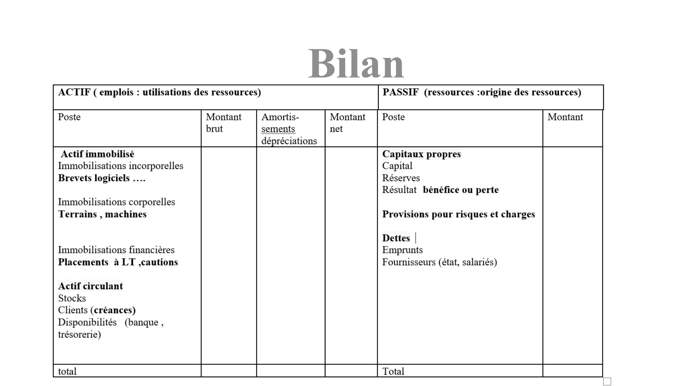
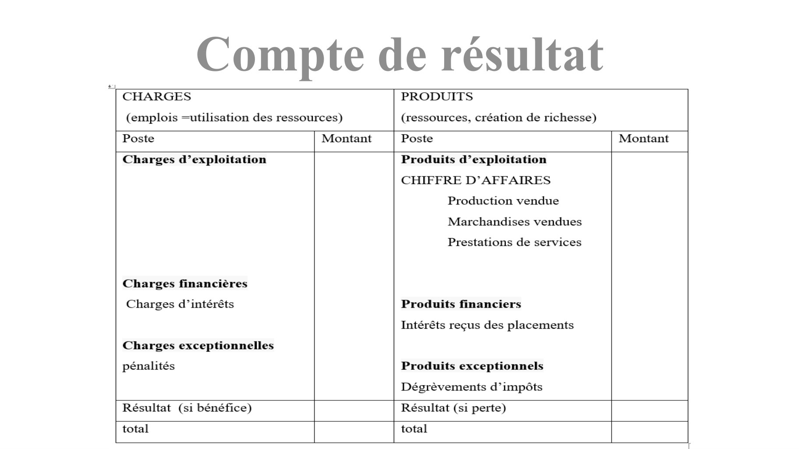
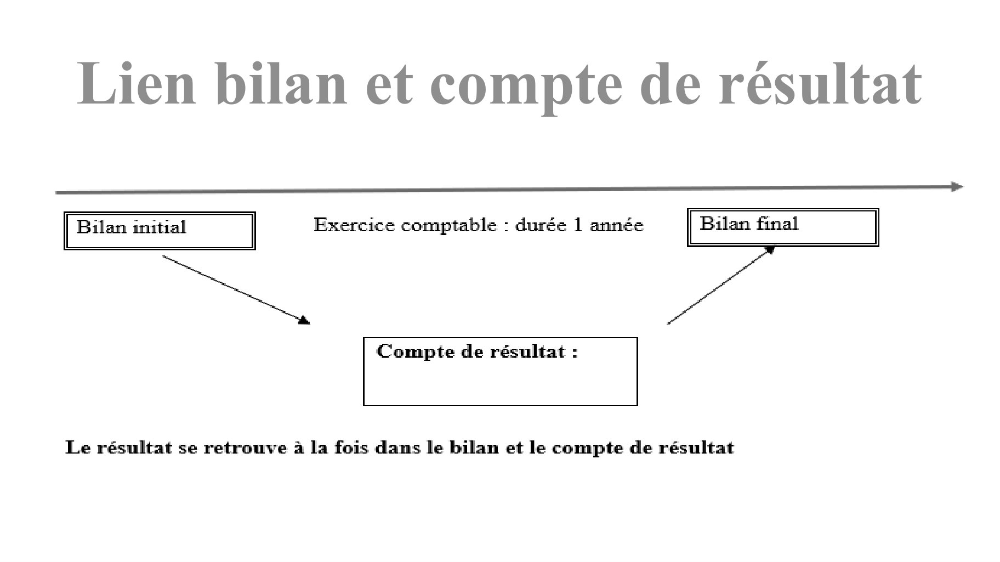

# présentation_annexes.pdf

[Ouvrir l’original](https://drive.google.com/open?id=1ZmC4Si0jmMUaxX1VFKcA0bFtWjSKQQhN) · Les pages signalées comprennent du texte reconnu automatiquement ou des éléments graphiques. Le fac-similé permet de vérifier chaque lecture.

**Pages avec fac-similé ou lecture OCR** — 6, 9, 11.

## Page 1

~~~text
          Organisation du cours
6 heures
Rappels de gestion : bilan et compte de résultat
~~~

## Page 2

~~~text
                    Remarques
Des changements sont intervenus en janvier 2025 ; ils seront
incorporés dans ce cours et dans les applications .

Source : règlement 2022-06 du 6 novembre 2022 provenant de
l’ANC (Autorité des Normes Comptables).
~~~

## Page 3

~~~text
                      Les objectifs
Connaître et comprendre l’entreprise

Déceler les problèmes éventuels (niveau et évolution du chiffre
d’affaires, des charges, de la rentabilité, de la trésorerie…)

Aboutir à des conclusions destinées à aider l’entreprise à
prendre les bonnes décisions pour améliorer sa situation.
~~~

## Page 4

~~~text
                        Sources
Le bilan
Le compte de résultat
L’annexe :
c’est un ensemble de documents comme les tableaux
d’amortissements, tableaux de dépréciations, de provisions …
ces documents complètent le bilan et le compte de résultat, et
permettent d’en expliquer les variations entre deux périodes
~~~

## Page 5

~~~text
                           Bilan
C’est le patrimoine de l’entreprise à un instant donné.
On parle de photo
     Actif                         Passif
      Ce sont les emplois          Ce sont les ressources dont
     autrement dit comment est     dispose l’entreprise.
     utilisé l’argent mis à        C’est l’origine des fonds
     disposition de l’entreprise   dont dispose l’entreprise.
~~~

## Page 6

~~~text
Bilan
~~~

**Lecture OCR à contrôler**

~~~text
Bilan

ACTIF ( emplois : utilisations des ressources) PASSIF (ressources :origine des ressources)

Poste Montant Amortis- Montant | Poste Montant
brut sements net
dépréciations
Actif immobilisé Capitaux propres
Immobilisations incorporelles Capital

Brevets logiciels .... Réserves
Résultat bénéfice ou perte
Immobilisations corporelles

Terrains , machines Provisions pour risques et charges
Dettes |

Immobilisations financières Emprunts

Placements à LT ,cautions Fournisseurs (état, salariés)

Actif circulant

Stocks

Clients (créances)
Disponibilités (banque ,
trésorerie)

total Total
~~~

## Page 7

~~~text
                Compte de résultat
Le résultat = bénéfice ou perte réalisé par l’entreprise dans le cadre de son
activité ; on parle de film
on distingue :
▪ Les opérations qui enrichissent l’entreprise :
Par exemple les ventes de prestations de services, de marchandises

• Les opérations qui appauvrissent l’entreprise :
Il y en a beaucoup ! elles sont nécessaires au fonctionnement de
l’entreprise : les salaires, les impôts, l’essence, les locations, assurances...

       Ce sont des opérations à court terme (sur l’année)
~~~

## Page 8

~~~text
            Compte de résultat
charges (= Emplois )            Produits
                                Ressources : création de
                                ressources
Locations, entretien, salaires, Chiffre d’affaires: principale
impôts, assurances, Intérêts ressource
d’emprunts, amendes,            Revenus annexes :
Pénalités ….                   dégrèvement d’impôts….
~~~

## Page 9

~~~text
Compte de résultat
~~~

**Lecture OCR à contrôler**

~~~text
Compte de résultat

CHARGES

(emplois =utilisation des ressources)

PRODUITS

(ressources, création de richesse)

Poste Montant

Poste

Montant

Charges d’exploitation

Charges financiéres

Charges d’intérêts

Charges exceptionnelles

pénalités

Produits d’exploitation

CHIFFRE D’AFFAIRES
Production vendue
Marchandises vendues

Prestations de services

Produits financiers

Intérêts reçus des placements

Produits exceptionnels

Dégrévements d’impôts

Résultat (si bénéfice)

Résultat (si perte)

total

total
~~~

## Page 10

~~~text
            Compte de résultat
CA et recettes ne sont pas les mêmes notions.
Les recettes sont du CA qui a été réellement encaissé.

En gestion : on distingue plusieurs types de CA
prestations de services (CA en vendant des services)
production vendue (CA réalisé en vendant des produits finis)
marchandises vendues (commerçants)
~~~

## Page 11

~~~text
Lien bilan et compte de résultat
~~~

**Lecture OCR à contrôler**

~~~text
Lien bilan et compte de résultat

| Bilan initial | Exercice comptable : durée 1 année Bilan final |

Compte de résultat :

Le résultat se retrouve à la fois dans le bilan et le compte de résultat
~~~

## Page 12

~~~text
Exemple
Julien crée son commerce de trottinettes en novembre 2025 :
Il apporte ses économies soit 20 000 euros ; il les dépose sur le
compte bancaire qu’il a créé pour son entreprise
Comme il n’a pas assez d’argent (il a fait des prévisions de ses
divers besoins) : il emprunte 10 000 euros à la banque qui lui vire
l’argent sur son compte
Il réalise ses premières opérations afin de mettre en place son
activité : Fonds de commerce : 10 000 € et Matériel : 8 000 € payé
par chèque bancaire .
~~~

## Page 13

~~~text
        compléter le bilan :
ACTIF                          PASSIF

Poste                Montant   Poste              Montant
Actif immobilisé               Capitaux propres

Actif circulant                Dettes

                               Emprunt

                                                            10 000

total                          total
~~~

## Page 14

~~~text
        compléter le bilan :
ACTIF                                       PASSIF

Poste                    Montant            Poste              Montant
Actif immobilisé                            Capitaux propres

Fonds de commerce                  10 000

Matériel                            8 000 capital                        20 000

                                            Dettes

Actif circulant

                                            Emprunt                      10 000

Banque 30 000 – 18 000             12 000

total                              30 000 total                          30 000
~~~

## Page 15

~~~text
 Répondre aux questions :

•
• Quelles sont les ressources dont dispose l’entreprise ?
• 30 000= Ressources apportées (20 000)+ ressources empruntées(10 000)
  car souvent les apports personnels ne suffisent pas.

• Où est l’argent qu’elle n’a pas encore utilisé ?
• A la banque !
~~~

## Page 16

~~~text
Julien achète une camionnette qui vaut 10 000 euros.
• Il règle 5 000 euros immédiatement par chèque ;
• le reste sera réglé dans 3 mois à l’entreprise Autrans qui lui vend
  la camionnette.
~~~

## Page 17

~~~text
        compléter le bilan :
ACTIF                          PASSIF

Poste                Montant   Poste              Montant
Actif immobilisé               Capitaux propres

Actif circulant                Dettes

total                          total
~~~

## Page 18

~~~text
ACTIF                                      PASSIF

Poste                   Montant            Poste              Montant
Actif immobilisé                           Capitaux propres

Fonds de commerce                 10 000 capital                        20 000

Matériel                           8 000

Matériel de transport             10 000

                                           Dettes

Actif circulant

                                           Emprunt                      10 000

                                   7 000 Fournisseurs                    5 000

Banque 12 000 – 5 000

total                             35 000 total                          35 000
~~~

## Page 19

~~~text
• L’entreprise est prête à réaliser ses premières opérations liées à
  son activité : vente de trottinettes ;

• Son objectif est bien sûr de gagner de l’argent ; elle pourra ainsi
  rembourser son emprunt auprès de la banque ; elle pourra
  investir, se développer …

• le dirigeant souhaite aussi par la suite rémunérer
~~~

## Page 20

~~~text
 opérations liées à l’ activité réalisées au cours de son premier
 exercice comptable qui se termine en décembre 2025
• Recrutement de deux salariés début novembre
• salaires: 4 000 € (1000 *2 * 2 mois ) . Règlement par virement bancaire
• Paiement de l’assurance du matériel de transport (chèque) :500 €
• Paiement de l’électricité (virement bancaire) : 800 €
• Paiement des factures de plein concernant la camionnette (chèque):
  600 €
• Paiement d’une facture d’eau (virement bancaire) :400 €
• Achat d’un stock de trottinettes : 50 * 250 euros pièce réglé par chèque
• Elle vend 50 trottinettes pour 700 euros pièce HT ;les clients paient
  immédiatement
~~~

## Page 21

~~~text
                                    Compte de résultat

CHARGES                                       PRODUITS

Poste                     Montant             Poste                     Montant
Charges d’exploitation                        Produits d’exploitation

Charges financières

                                              Produits financiers

Charges exceptionnelles

                                              Produits exceptionnels

BENEFICE                                      Perte
total                                         total
~~~

## Page 22

~~~text
        compléter le bilan :
ACTIF                          PASSIF

Poste                Montant   Poste              Montant
Actif immobilisé               Capitaux propres

Actif circulant                Dettes

total                          total
~~~

## Page 23

~~~text
                                                  Compte de résultat
CHARGES                                                     PRODUITS

Poste                                   Montant             Poste                        Montant
Charges d’exploitation                                      Produits d’exploitation
Achat de marchandises                             12 500 Vente de marchandises (CA)                35 000
50*250                                                      50 * 700
Achats d’essence                                     600
Assurance                                            500
Electricité                                          800
Eau                                                  400
Salaires                                            4 000
Charges financières                                     - Produits financiers                           -
Charges exceptionnelles                                 - Produits exceptionnels                        -
BENEFICE                                          16 200 Perte
total                                             35 000 total                                     35 000

        Bénéfice = chiffre d’affaires – total des charges = 35 000 – 18 800 = 16 200 €
~~~

## Page 24

~~~text
ACTIF                                      PASSIF

Poste                   Montant            Poste              Montant
Actif immobilisé                           Capitaux propres

Fonds commercial                           capital                      20 000

Matériel                          10 000   bénéfice                     16 200

                                   8 000

Matériel de transport             10 000 Dettes

                                            Emprunt                     10 000

Actif circulant                            Fournisseurs                  5 000

 Banque 7 000+16 200              23 200

total                             51 200 total                          51 200
~~~

## Page 25

~~~text
     Calcul de la variation de stock
Achat d’un stock de trottinettes : 50 * 250 euros pièce réglé par
chèque
Elle vend 30 trottinettes pour 700 euros pièce HT ;les clients paient
immédiatement
Il reste 20 trottinettes

Solution :Calcul de la variation de stocks : SI(stock initial) -SF
(stock final) 0 – 20 * 250 = 0 – 5 000 = - 5000
~~~

## Page 26

~~~text
                                             Compte de résultat
CHARGES                                              PRODUITS

Poste                              Montant           Poste                             Montant
Charges d’exploitation                               Produits d’exploitation
Achat de marchandises                        12 500 Vente de marchandises (CA)                   21 000
50*250                                        -5000 30 * 700
Variation de stocks 0- 5000

                                                                                                      -
                                                                                                      -

Vente de 30 trottinettes ; on fait alors une marge de 30 ( 700 – 250 )= 30 * 450 = 13 500 €

Impact avec la variation de stocks = 21 000 – (12500-5000)= 13 500
~~~
