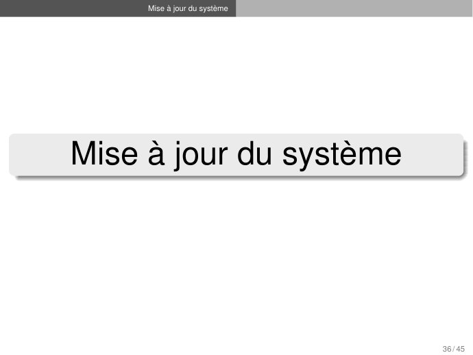
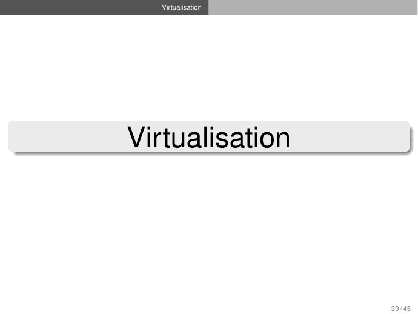
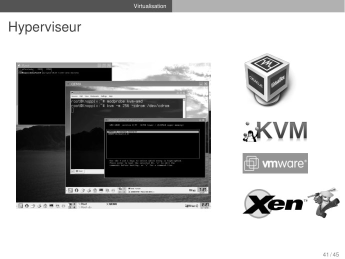

# 04_Linux_SystemeFichiers.pdf

[Ouvrir l’original](https://drive.google.com/open?id=1_BlhEEtDbmabO-o-kadTpnTsr-aOUxM0) · Les pages signalées comprennent du texte reconnu automatiquement ou des éléments graphiques. Le fac-similé permet de vérifier chaque lecture.

**Pages avec fac-similé ou lecture OCR** — 37, 40, 45.

## Page 1

~~~text
Système d’Exploitation
     Système de Fichiers
      Machine virtuelle

Juan Angel Lorenzo del Castillo
            jlo@cy-tech.fr

          Contributions de :
          Stefan Bornhofen
            Florent Devin

ING1 Informatique - Mathématique appliquée
                2021-2022

                                             1 / 45
~~~

## Page 2

~~~text
                     Système de gestion des fichiers

Plan

1   Système de gestion des fichiers
      Introduction
      Les Fichiers
      Hiérarchie de fichiers
      Gestionnaire de système de fichiers
      Quelques systèmes de fichiers
      Accès au stockage
      Disques
      Processus de démarrage
      systemd

2   Mise à jour du système

3   Virtualisation

                                                       2 / 45
~~~

## Page 3

~~~text
 Système de gestion des fichiers

Système de gestion des fichiers

 Partiellement tiré du cours de Stefan Bornhofen

                                                   3 / 45
~~~

## Page 4

~~~text
                    Système de gestion des fichiers   Introduction

Système de Gestion de Fichiers (SGF)
Un Système de Gestion de Fichiers (SGF) est une structure de données permettant
de stocker les informations et de les organiser dans des fichiers sur des mémoires
secondaires.

     Le SGF est la partie la plus visible d’un SE.
     Le SGF se charge de gérer le stockage et la manipulation des fichiers sur le
     matériel physique. Il offre également les primitives pour manipuler les fichiers.
     Les tâches effectuées par le SGF :
       I Fournit une interface “conviviale” pour faciliter la manipulation des fichiers
       I Gestion de l’organisation des fichiers sur le disque (allocation de l’espace
         disque aux fichiers)
       I Gestion de l’espace libre
       I Gestion des fichiers dans un environnement multi-utilisateurs

     Quelques systèmes de fichiers connus :
       I   Linux: Ext3, Ext4, XFS, Btrfs
       I   Windows: FAT, NTFS

                                                                                         4 / 45
~~~

## Page 5

~~~text
                     Système de gestion des fichiers   Les Fichiers

Fichiers

Un fichier est l’unité de stockage logique persistant, non volatile, mise à la disposition
des utilisateurs pour l’enregistrement de leurs données : c’est l’unité d’allocation.

     Les fichiers sont gérés par le système d’exploitation.
     La manière dont ils sont
        I structurés
        I nommés
        I utilisés
        I protégés

     est à la charge du SE.
Remarque : Le SE fait la correspondance entre le fichier et le système binaire utilisé
lors du stockage de manière transparente pour les utilisateurs

                                                                                       5 / 45
~~~

## Page 6

~~~text
                      Système de gestion des fichiers   Les Fichiers

Fichiers
Attributs des fichiers
     Exemple : UID, GID, droits d’accès, dates (dernière modification) , taille, type
     (fichier, repertoire, lien symbolique, périphérique)
     Affichage des attributs : ls -l ou stat fichier.
     Sous Linux : numéro du fichier (unique) : numéro d’i-nœud (i-node)
        I   Affichage de l’i-nœud : ls -i fichier
     Concernant les droits d’accès, sous Unix, il existe 3 niveaux de confidentialité
     (modifiables avec la commande chmod):
        I propriétaire (user)
        I groupe (group)
        I autres (others)

Opérations sur les fichiers
     Création, suppression, lecture-écriture, modification des attributs.

Noms des fichiers
     Sous Windows : est un attribut du fichier
     Sous Linux : est associé à un lien sur le fichier
        I   un fichier peut avoir plusieurs noms/liens
                                                                                        6 / 45
~~~

## Page 7

~~~text
                        Système de gestion des fichiers   Les Fichiers

Fichiers
Attributs des fichiers
      Chaque fichier possède un nom et des attributes (meta-données + informations
      des droits et du propriétaire).
      Tous les SE y associent des informations complémentaires. Exemples:

... mais pas le nom !
                                                                                7 / 45
~~~

## Page 8

~~~text
                   Système de gestion des fichiers   Les Fichiers

Répertoires

   Un répertoire (directory ou dossier) est un fichier dont le contenu est une
   liste de descriptions de fichiers. Il contient les liens physiques vers d’autres
   fichiers ou répertoires.

    C.a.d. le répertoire est une table de correspondance entre entre le nom d’un
    fichier et sa localisation sur disque.
    Un répertoire a donc les même types de propriétés qu’un fichier.
    Les opérations possibles : création, suppression (si vide), ajout d’un lien vers un
    autre fichier/repertoire.
    Lorsqu’un fichier est effacé, il est effacé de la table de correspondance.

Arborescence
    Chaque fichier ou répertoire est référencé par un autre répertoire, ce qui forme
    une hiérarchie cohérente, appelée aussi arborescence, dont le point d’entrée est
    le répertoire racine. La racine est unique sur un système de type UNIX (noté
    comme « / »),
                                                                                      8 / 45
~~~

## Page 9

~~~text
                      Système de gestion des fichiers   Les Fichiers

I-node (Index Node)
Structure de données contenant des informations à propos d’un fichier ou répertoire
stocké dans certains systèmes de fichiers (notamment de type Linux/Unix).
     À chaque fichier correspond un numéro d’inode dans le système de fichiers dans lequel il
     réside, unique au périphérique sur lequel il est situé.
     Chaque fichier a un seul inode, même s’il peut avoir plusieurs noms (chacun de ceux-ci fait
     référence au même inode). Chaque nom est appelé lien.
Les informations stockées dans un i-node disque sont :
     Les attributs du fichier (type, propriétaire, droits, date de modification, etc.)
     13 adresses de blocs contenant le fichier (10x direct, 3x indirect)

                                                                                             9 / 45
~~~

## Page 10

~~~text
                  Système de gestion des fichiers   Les Fichiers

I-node
Gestion des i-nodes
   L’i-node ne contient pas le nom du fichier
       I Un fichier peut avoir plusieurs noms
       I Les noms sont stockés dans la structure d’information des répertoires

   Référence d’un fichier se fait par l’i-node (unique)
   I-node 0 : jamais utilisé
   I-node 1 : gestion des blocs (disques) défectueux
   I-node 2 : racine du disque (généralement)
   . : lien sur le répertoire lui-même
   .. : lien sur le répertoire parent, numéro d’i-node des i-nodes
                                                                                 10 / 45
~~~

## Page 11

~~~text
               Système de gestion des fichiers   Les Fichiers

I-node

   Question
   Numéro de bloc sur 32 bits (4 octets), et bloc de 1 Ko. Quelle est
   la taille maximale d’un fichier?

                                                                    11 / 45
~~~

## Page 12

~~~text
               Système de gestion des fichiers   Les Fichiers

I-node

   Question
   Numéro de bloc sur 32 bits (4 octets), et bloc de 1 Ko. Quelle est
   la taille maximale d’un fichier?
   Réponse
   On peut donc mettre 1Ko / 4 = 256 numéros de blocs dans un
   bloc.
     I blocs directs : 10 blocs,
     I bloc indirect_1 : 256 blocs,
     I bloc indirect_2 : 2562 blocs,
     I bloc indirect_3 : 2563 blocs.

   Nombre maximum de blocs dans un fichier : (10 + 256 + 2562 +
   2563 ) * 1Ko ∼ 16 Go

                                                                    11 / 45
~~~

## Page 13

~~~text
                    Système de gestion des fichiers   Hiérarchie de fichiers

Hiérarchie de fichiers
Système de fichiers virtuel (UNIX)
     Une seule hiérarchie arborescente (répertoires + fichiers).
     Le SE masque les spécificités des disques.
     Modèle de programmation “unique”, indépendant, avec des appels systèmes pour la
     création, suppression, lecture écriture, ouverture, fermeture.
     Notion de montage d’un système de fichier (mount, umount)
       I Greffer la racine d’une arborescence non encore montée en un point accessible
           depuis la racine absolue.
       I D’autres partitions, des clés USB, des CD-ROM, des péripheriques, etc., peuvent
           être montés dans des répertoires.
       I Les péripheriques sont des fichiers dans /dev/ :
                 /dev/pts/X, /dev/hda, /dev/sda, /dev/mouse, /dev/keyboard, . . .

                                                                                       12 / 45
~~~

## Page 14

~~~text
                     Système de gestion des fichiers   Hiérarchie de fichiers

Hiérarchie de fichiers
Montage d’un système de fichiers
    Exemple de fonctionnement :
      (a) Avant montage les fichiers du CD ne sont pas accessibles.
      (b) Après montage, ils font partie de la hiérarchie des fichiers.

    Accès aux partitions en Unix/Linux :
       I Pointeurs stockés dans /dev/xxyz
       I xx: type du bus (hd : IDE, sd : SCSI, fd : floppy)
       I y : lettre de périphérique
       I z : numéro de partition
       I hda1 : Première partition (1), du premier disque (a), du bus IDE (hd)

    Adressage par Universally Unique IDentifier (UUID)
       I   Identificateur de 128 bits
       I   À consulter en Linux avec blkid
    En linux, points de montage permanents sur /etc/fstab
                                                                                 13 / 45
~~~

## Page 15

~~~text
                          Système de gestion des fichiers      Hiérarchie de fichiers

Structure hiérarchique des répertoires Unix

/            ←   racine
|
|__ /bin     ←   fichiers binaires (exécutables).
|__ /etc     ←   fichiers de configuration.                     /usr
|__ /media   ←   dispositifs CDROM, clé USB, etc.               |
|__ /root    ←   home de l’administrateur du système.           |__ /bin         ←      fichiers binaires d’utilisateur.
|__ /dev     ←   fichiers des périphériques.                    |__ /local       ←      programmes compilés d’utilisateur.
|__ /home    ←   répertoires home des utilisateurs.             |__ /src         ←      sources des utilisateurs.
|__ /sbin    ←   fichiers binaires n’accessibles qu’au root.    |__ /share       ←      fichiers indépendants de l’architecture
|__ /tmp     ←   fichiers temporaires.                                                  matérielle.
|__ /var     ←   fichiers qui peuvent varier (p.ex logs).       |__ /include     ←      fichiers header des applications.
|__ /usr     ←   logiciel pour l’utilisateur.                   |__ /lib         ←      liens dynamiques à des librairies.
|__ /lib     ←   librairies dynamiques.
|__ /boot    ←   fichiers de démarrage du système.
|__ /mnt     ←   dispositifs éjectables.

       usr : logiciel de seule lecture, disponible pour tout le système. Structure
       similaire à la racine

                                                                                                                           14 / 45
~~~

## Page 16

~~~text
                    Système de gestion des fichiers   Gestionnaire de système de fichiers

Implantation des systèmes de fichiers

Sous LINUX : 12 Millions de lignes !

Organisation en couches :
  1   Gestionnaire de système de fichiers virtuels
  2   Gestionnaires de systèmes de fichiers (FAT, Ext4, NTFS, ISO9660, NFS, Btrfs,
      ...)
  3   Gestion des buffers
  4   Pilotes disques/cdrom/clé USB — Pile réseau
  5   Pilotes bus IDE, SCSI, USB . . .
  6   Matériel (contrôleurs disques, réseau)

                                                                                            15 / 45
~~~

## Page 17

~~~text
                      Système de gestion des fichiers   Gestionnaire de système de fichiers

Gestionnaire de système de fichiers virtuels

Fournit :
     Fonctions de création/suppression de fichiers/répertoires
     Fonctions de lecture/écriture dans un fichier/répertoire
         I   Ces fonctions utilisent des chemins (absolus ou relatifs) pour désigner les
             fichiers/répertoires

Rôle :
     Contrôle les droits d’accès
     Doit déterminer à partir des chemins sur quel périphérique se trouve un fichier
     donné et quel système de fichier est utilisé
         I   Contacte alors le bon gestionnaire de système de fichier

                                                                                              16 / 45
~~~

## Page 18

~~~text
                    Système de gestion des fichiers   Gestionnaire de système de fichiers

Gestionnaire de système de fichiers

Fournit :
     idem que pour le gestionnaire de système de fichiers virtuels mais seulement
     pour un système de fichier particulier (ex. FAT, Ext4, ISO9660, NFS, Btrfs, . . . )
     il y a donc plusieurs gestionnaires
Rôle :
     Contrôle dans quels blocs du disque sont stockés les fichiers.

                                                                                            17 / 45
~~~

## Page 19

~~~text
                             Système de gestion des fichiers       Quelques systèmes de fichiers

Quelques systèmes de fichiers actuels

      Microsoft FAT (File Allocation Table)
          I Format de Microsoft à l’origine
          I L’un des plus simples
          I Limitations :
               F Racine stockée sur un emplacement fixe de la partition
               F Mise à jour de la table d’allocation non efficace
               F Pas d’organisation de la structure de répertoire ⇒ fragmentation importante
               F Taille des blocs variables en fonctions de la taille des partitions
          I Évolutions : FAT12, FAT16 et FAT32

      Microsoft NTFS (New Technology File System)
          I Peu documenté
          I Respecte la norme POSIX. Gestion des droits
          I Pas de taille maximum d’un fichier (taille de la partition)
          I Système journalisé 1

  1. Permet d’éviter la corruption d’un fichier afin de garantir l’intégrité des données en cas d’arrêt brutal de l’écriture.
                                                                                                                                18 / 45
~~~

## Page 20

~~~text
                  Système de gestion des fichiers   Quelques systèmes de fichiers

Quelques systèmes de fichiers actuels
   Ext4 (Extended File System Version 4)
     I Système le plus commun en Linux
     I Liste d’i-nodes
     I Quatre catégories de fichiers :
          F Fichiers normaux (textes, exécutables)
          F Fichiers répertoires
          F Fichiers spéciaux, contenus dans le répertoire /dev
          F Fichiers liens symboliques qui font référence à d’ autres fichiers.
     I Sensible à la casse
     I Fichiers cachés commencent par "."
     I Défragmentation inutile
     I Système journalisé

   Btrfs (B-tree file system)
     I Système de fichiers avec du copy on write (CoW)
     I Création de subvolumes, ou partitions racines différentes dans le même système de
       fichiers.
     I Création de snapshots : photographie à un instant donné pour sauvegarder le
       système de fichiers dans un état cohérent tout en continuant à travailler.
     I Compression

                                                                                     19 / 45
~~~

## Page 21

~~~text
                  Système de gestion des fichiers   Accès au stockage

Types d’accès au stockage

 Accès séquentiel (bande magnétique)
   I Les premiers SE n’offraient qu’un seul type d’accès aux
     fichiers
   I Un processus pouvait lire tous les octets dans l’ordre à

     partir du début du fichier, mais pas dans le désordre
   I Un fichier pouvait être rembobiné donc être lu plusieurs

     fois
   I Utilisé aujourd’hui pour la sauvegarde à long terme

     (backup)
 Accès aléatoire «Random Access File» (disque dur)
   I   L’arrivée des DD a autorisé la lecture dans le désordre des octets
   I   Les fichiers à accès aléatoire sont indispensables à de nombreuses
       applications comme les systèmes de gestion de base de données (accès à
       un enregistrement sans parcourir tous les enregistrements mémorisés).

                                                                            20 / 45
~~~

## Page 22

~~~text
                   Système de gestion des fichiers   Accès au stockage

Organisation physique d’un disque

Structuration du disque

   Un enregistrement physique, aussi appelé bloc, est la plus
   petite unité de stockage manipulée par le système.
   Un fichier est un ensemble de blocs
   Les blocs sont numérotés par le système
   Le système doit connaître l’emplacement sur disque (numéro
   de cylindre, piste et secteur) de chaque bloc.

                                                                         Structure d’un disque:
Méthodes possibles:
                                                                           A) piste
     contiguë
                                                                           B) secteur géométrique
     chaînée                                                               C) secteur de piste
     indexée                                                               D) bloc

                                                                                                  21 / 45
~~~

## Page 23

~~~text
                    Système de gestion des fichiers   Accès au stockage

Allocation contiguë
Stocker chaque fichier dans une suite de bloc consécutifs.
     Un fichier de N Ko occupe N blocs consécutifs sur un disque dont la taille d’un
     bloc est de 1Ko.
Avantages
    simple, il suffit de mémoriser un seul nombre, l’adresse du
    premier bloc pour localiser le fichier.
    performance excellente car le fichier peut être lu en une seule
    opération.
Inconvénients
    si la taille du fichier doit être connu au moment de leur création
    et peut difficilement grandir.
    fragmentation du disque (le compactage peut y remédier mais
    il est coûteux).

Adapté aux systèmes de fichiers en lecture seule (CD-ROM)
                                                                                   22 / 45
~~~

## Page 24

~~~text
                  Système de gestion des fichiers   Accès au stockage

Allocation chaînée
Le premier mot de chaque bloc est un pointeur sur le bloc suivant. Le
reste contient les données.
  Avantages
       facilite les modifications et l’accroissement
  Inconvénients
       alourdit la recherche d’une donnée
       pas d’accès aléatoire mais séquentiel

                                                                        23 / 45
~~~

## Page 25

~~~text
                     Système de gestion des fichiers   Accès au stockage

Allocation indexée

Tous les pointeurs sont regroupés dans un tableau (index block).
Avantages
    facilite les modifications et l’accroissement
    accès aléatoire
Inconvénients
    les index prennent de l’espace
    taille du fichier limitée

                                                                           24 / 45
~~~

## Page 26

~~~text
                       Système de gestion des fichiers   Disques

Organisation logique d’un disque
  1   Un schéma de partitionnement
  2   Des partitions
Vocabulaire :
      Partitionnement :
         I fractionnement d’un disque dur réel (matériel) en plusieurs disques virtuels
             (logiques).
         I Chaque partition contient un système de fichiers (FAT, Ext4, . . . ).
         I C’est un “superbloc”.
         I Une Partition a un type, emplacement de début et taille.
         I Le partitionnement est réversible.

      Formattage :
         I Pour qu’un système de fichiers puisse gérer des fichiers sur une unité de stockage,
           son unité doit être formatée (selon les spécificités du SGF).
         I Le formatage inspecte les secteurs, efface les données, crée le répertoire racine du
           système de fichiers et crée un “superbloc” pour stocker les informations nécessaires
           pour assurer l’intégrité du système.
Utilité :
      Permet d’installer plusieurs systèmes
      Permet la sauvegarde des données
      Permet une séparation logique des répertoires (système,utilisateur, log, . . . )
                                                                                           25 / 45
~~~

## Page 27

~~~text
                     Système de gestion des fichiers   Disques

Organisation logique d’un disque
Vocabulaire :

     BIOS (Basic Input Output System) :
       I Préinstallé sur la carte mère.
       I C’est le premier logiciel qui est exécuté après avoir allumé l’ordinateur.
       I Il est utilisé pour effectuer l’initialisation du matériel.

     UEFI (Unified Extensible Firmware Interface) :
       I Nouveau micrologiciel. Remplacement du BIOS. Utilisation d’une nouvelle table de
         partitionnement : le GPT.
       I Renforcement de la sécurité.

     MBR (Master Boot Record) :
       I   Le premier secteur physique d’un disque dur. Il contient la table de partitionnement
           du disque et un code d’amorçage (boot) permettant de démarrer le système
           d’exploitation. Il fonctionne de pair avec le BIOS.

     GPT (Globally Unique IDentifier Partition Table) :
       I nouveau standard pour la table de partitionnement qui fonctionne de pair avec
         l’UEFI.
       I Il remplace le MBR.

                                                                                             26 / 45
~~~

## Page 28

~~~text
                Système de gestion des fichiers   Disques

Organisation logique d’un disque

BIOS vs UEFI:

                                                            27 / 45
~~~

## Page 29

~~~text
                    Système de gestion des fichiers   Disques

Organisation logique d’un disque
Schémas de partitionnement
    Schéma MBR
      I   Quatre partitions maximum et taille maximale de 2.1 TBytes.
      I   partition principale : au maximum quatre, accepte tout type de système de fichiers.
          Si nous avons moins de quatre partitions principales, possibilité de créer une
          partition étendue :
             F partition étendue : ne peut contenir que des partitions logiques, ne peut pas
                 recevoir de système de fichiers, ne peut exister que s’il existe une partition
                 principale
             F partition logique : contenue dans une partition étendue, pas de limitation en
                 nombre, accepte tout type de système de fichiers

    Schéma GPT
      I Créé pour le standard Unified Extensible Firmware Interface (UEFI) : replacement
        de la BIOS traditionnelle
      I Supporté aussi par Linux dans la BIOS traditionnelle
      I Nombre illimité de partitions (Microsoft : 128).
      I Jusqu’à 256 TBytes par partition.
      I Taille maximale théorique de disque : 9.4 zettabytes (9.4 billion terabytes).

                                                                                           28 / 45
~~~

## Page 30

~~~text
                             Système de gestion des fichiers   Disques

Organisation logique d’un disque
MBR vs GPT :

Source : technet.microsoft.com
                                                                         29 / 45
~~~

## Page 31

~~~text
                  Système de gestion des fichiers   Processus de démarrage

Démarrage de l’ordinateur

   BIOS contenu dans une ROM (Read-Only Memory )
   Disque dur divisé en partitions, chacune avec un système de fichiers.
   Le secteur 0 ou MBR (Master Boot Record) est lu au moment du démarrage
     I   La fin du MBR contient la table de partitions
     I   L’une d’entre elles est marqué comme active

                                                                             30 / 45
~~~

## Page 32

~~~text
                   Système de gestion des fichiers   Processus de démarrage

Démarrage de l’ordinateur
   Systèmes MBR :
     1   La BIOS cherche, lit et exécute le first-stage boot loader contenu dans le MBR du
         disque dur.
     2   Le MBR cherche la partition active, lit son premier bloc (bloc de démarrage, Volume
         Boot Record ou Boot Block ) et l’exécute.
     3   Le second-stage boot loader dans le bloque de démarrage (GRUB2, par exemple)
         charge le SE contenu dans ce partition.
   Systèmes UEFI :
     I   L’UEFI charge directement le chargeur d’amorçage (bootloader) du système
         d’exploitation, enregistré sous la forme d’un fichier .efi sur la partition EFI du disque
         GPT.

                                                                                               31 / 45
~~~

## Page 33

~~~text
                       Système de gestion des fichiers   Processus de démarrage

Processus de démarrage SysVinit
Initialisation :
  1    Décompression du noyau linux
  2    Initialisation des périphériques (disque, réseau, son, . . . )
  3    Configuration “automatique” des pilotes
  4    Montage du système de fichier racine
          I   Lecture seule : permet de vérifier s’il y a des erreurs
  5    Lacement du processus init (PID 1)
  6    Lecture du fichier /etc/inittab
  7    Lancement des processus à partir des scripts shell contenus dans
       /etc/rc<n>.d/
  8    Commutation vers le mode multi utilisateurs
  9    Exécution de getty pour chaque console
  10   Remontage du système de fichier en lecture-écriture
  11   Exécution des processus de services (daemon)
  12   Construction d’une arborescence de processus
                                                                                  32 / 45
~~~

## Page 34

~~~text
                   Système de gestion des fichiers   systemd

Processus de démarrage systemd

   Simplicité d’utilisation
   Maîtrise du système moins éparpillée
   L’utilisation de scripts de lancement est découragée
   Services pilotés par des fichiers texte de configuration à la place des scripts de
   SysVinit

                                                                                   33 / 45
~~~

## Page 35

~~~text
                       Système de gestion des fichiers   systemd

Apports de systemd

      Allocation fine des ressources (processeur, mémoire, E/S, etc) aux services
      (cgroups)
      Surveillance améliorée
      Log plus complet (au format binaire) et normalisation du format
      Possibilité de démoniser tout processus en le relançant automatiquement s’il
      s’arrête
      Séparation claire entre les services fournis par la distribution et les services
      créés par l’administrateur
      Simplification du processus d’empaquetage des services
      Centralisation du développement des briques de base du système
Source : linuxfr.org

                                                                                         34 / 45
~~~

## Page 36

~~~text
                     Mise à jour du système

Plan

1   Système de gestion des fichiers
      Introduction
      Les Fichiers
      Hiérarchie de fichiers
      Gestionnaire de système de fichiers
      Quelques systèmes de fichiers
      Accès au stockage
      Disques
      Processus de démarrage
      systemd

2   Mise à jour du système

3   Virtualisation

                                              35 / 45
~~~

## Page 37

~~~text
     Mise à jour du système

Mise à jour du système

                              36 / 45
~~~

**Lecture OCR à contrôler**

~~~text
Mise à jour du système
~~~

## Page 38

~~~text
                             Mise à jour du système

Mise à jour en Debian/Ubuntu
apt-get update
La commande update permet de resynchroniser un fichier répertoriant les paquets disponibles et
sa source. Ces fichiers sont récupérés aux endroits spécifiés dans /etc/apt/sources.list (...). On
doit toujours exécuter une commande update avant les commandes upgrade ou
dist-upgrade.

apt-get upgrade
La commande upgrade permet d’installer les versions les plus récentes de tous les paquets
présents sur le système en utilisant les sources énumérées dans /etc/apt/sources.list.
Les paquets installés dont il existe de nouvelles versions sont récupérés et mis à niveau. En
aucun cas des paquets déjà installés ne sont supprimés ; de même, des paquets qui ne sont
pas déjà installés ne sont ni récupérés ni installés.

apt-get dist-upgrade (à ne pas faire sur vos machines CY Tech !)
La commande dist-upgrade effectue la fonction upgrade en y ajoutant une gestion
intelligente des changements de dépendances dans les nouvelles versions des paquets ; apt-get
possède un système « intelligent » de résolution des conflits et il essaye, quand c’est nécessaire,
de mettre à niveau les paquets les plus importants aux dépens des paquets les moins
importants. Le fichier /etc/apt/sources.list contient une liste de sources où récupérer les paquets
désirés.
                                                                                               37 / 45
~~~

## Page 39

~~~text
                             Virtualisation

Plan

1   Système de gestion des fichiers
      Introduction
      Les Fichiers
      Hiérarchie de fichiers
      Gestionnaire de système de fichiers
      Quelques systèmes de fichiers
      Accès au stockage
      Disques
      Processus de démarrage
      systemd

2   Mise à jour du système

3   Virtualisation

                                              38 / 45
~~~

## Page 40

~~~text
   Virtualisation

Virtualisation

                    39 / 45
~~~

**Lecture OCR à contrôler**

~~~text
Virtualisation |
~~~

## Page 41

~~~text
                              Virtualisation

Virtualisation

  Infrastructure Matérielle

                                               40 / 45
~~~

## Page 42

~~~text
                              Virtualisation

Virtualisation

  Infrastructure Matérielle

                                     Guest OS

                                                40 / 45
~~~

## Page 43

~~~text
                              Virtualisation

Virtualisation

  Infrastructure Matérielle

                                     Guest OS

                                                Environnement Virtualisé

                                                                           40 / 45
~~~

## Page 44

~~~text
                              Virtualisation

Virtualisation

  Infrastructure Matérielle

                                     Guest OS

                                                   Environnement Virtualisé

 Création d’une version virtuelle (par rapport à une réelle) de quelque
  chose, tel que une plate-forme matérielle, système d’exploitation,
    dispositif de stockage, ou ressources du réseau (Wikipedia).

                                                                              40 / 45
~~~

## Page 45

~~~text
              Virtualisation

Hyperviseur

                               41 / 45
~~~

**Lecture OCR à contrôler**

~~~text
Hyperviseur
~~~

## Page 46

~~~text
                     Virtualisation

Types de Virtualisation

                   Traduction Binaire
                   Paravirtualisation
                Virtualisation Matérielle

                                            42 / 45
~~~

## Page 47

~~~text
                                 Virtualisation

Types de Virtualisation
Anneaux de Privilèges

                         Anneaux de privilèges pour les processeurs x86
                        disponibles en mode protégé (source: Wikipedia).

                                                                           43 / 45
~~~

## Page 48

~~~text
                            Virtualisation

Types de Virtualisation
Virtualisation Matérielle

                                             44 / 45
~~~

## Page 49

~~~text
                       Virtualisation

Types de Virtualisation
Types d’hyperviseurs

                                        45 / 45
~~~
