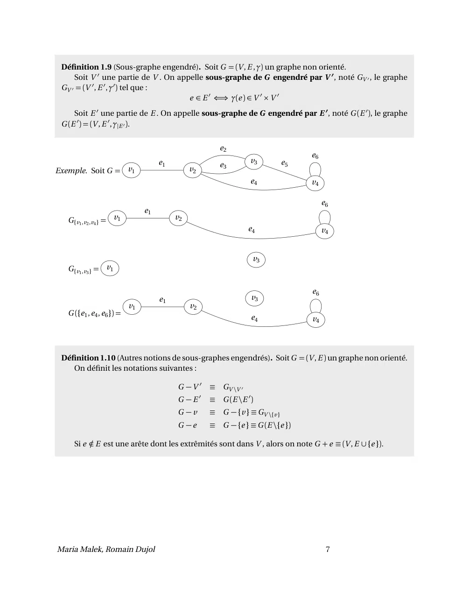
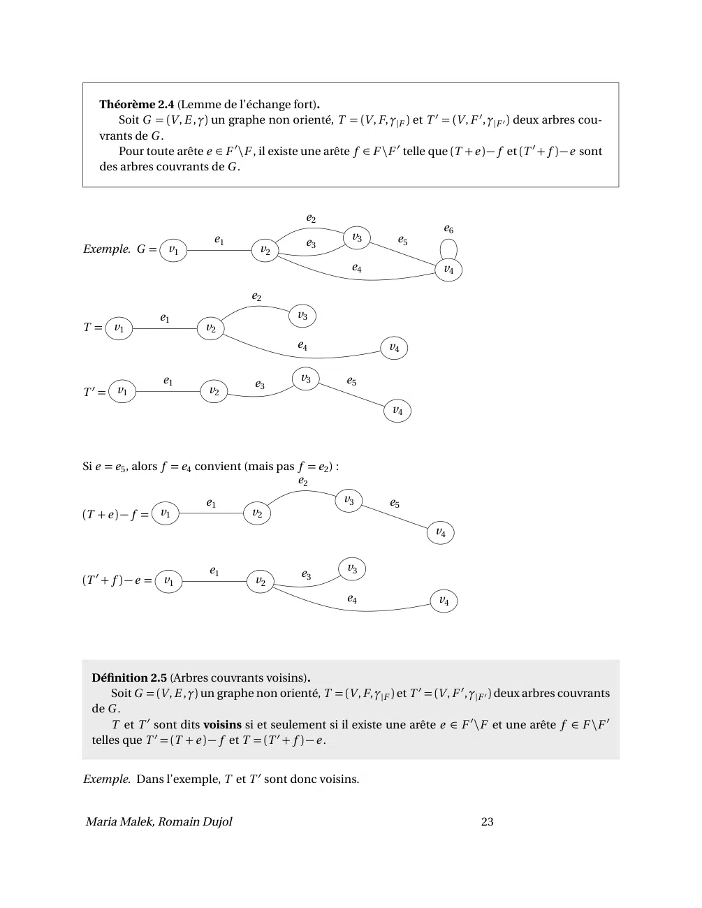

# TheoGraphes - Notes de cours.pdf

[Ouvrir l’original](https://drive.google.com/open?id=16xqZUbFJeiIb8r3F-fT2zRS6cwV-Y1gG) · Les deux lectures automatiques du PDF divergent sur les pages indiquées. Leur fac-similé accompagne le texte.

**Pages présentant un écart entre les deux extractions** — 8, 24.

## Page 1

~~~text
   ING1 – Mathématiques Appliquées
Théorie des graphes – Notes de cours

        Maria Malek, Romain Dujol
~~~

## Page 2

~~~text
Table des matières
1 Généralités                                                                                                                              4
  1.1 Graphe non orienté . . . . . . . . . . . . . . . . . . . . . . . . . . . . . . . . . . . . . . . . . . . . . . . . . . .             4
       1.1.1 Définition et terminologie . . . . . . . . . . . . . . . . . . . . . . . . . . . . . . . . . . . . . . . .                    4
       1.1.2 Graphe simple . . . . . . . . . . . . . . . . . . . . . . . . . . . . . . . . . . . . . . . . . . . . . . . . .               5
       1.1.3 Matrice d’adjacence . . . . . . . . . . . . . . . . . . . . . . . . . . . . . . . . . . . . . . . . . . . . .                 6
       1.1.4 Sous-graphe . . . . . . . . . . . . . . . . . . . . . . . . . . . . . . . . . . . . . . . . . . . . . . . . . .               6
       1.1.5 Isomorphisme de graphes . . . . . . . . . . . . . . . . . . . . . . . . . . . . . . . . . . . . . . . .                       8
       1.1.6 Chaîne et cycle . . . . . . . . . . . . . . . . . . . . . . . . . . . . . . . . . . . . . . . . . . . . . . . . .             8
       1.1.7 Degré . . . . . . . . . . . . . . . . . . . . . . . . . . . . . . . . . . . . . . . . . . . . . . . . . . . . . . .          10
  1.2 Graphes particuliers . . . . . . . . . . . . . . . . . . . . . . . . . . . . . . . . . . . . . . . . . . . . . . . . . .            11
       1.2.1 Graphe planaire . . . . . . . . . . . . . . . . . . . . . . . . . . . . . . . . . . . . . . . . . . . . . . . .              11
       1.2.2 Graphe complet . . . . . . . . . . . . . . . . . . . . . . . . . . . . . . . . . . . . . . . . . . . . . . . .               11
       1.2.3 Graphe connexe . . . . . . . . . . . . . . . . . . . . . . . . . . . . . . . . . . . . . . . . . . . . . . . .               12
       1.2.4 Graphe biparti . . . . . . . . . . . . . . . . . . . . . . . . . . . . . . . . . . . . . . . . . . . . . . . . .             13
       1.2.5 Graphe régulier . . . . . . . . . . . . . . . . . . . . . . . . . . . . . . . . . . . . . . . . . . . . . . . .              15
  1.3 Type de données . . . . . . . . . . . . . . . . . . . . . . . . . . . . . . . . . . . . . . . . . . . . . . . . . . . . .           15
       1.3.1 Tableau/liste des arêtes . . . . . . . . . . . . . . . . . . . . . . . . . . . . . . . . . . . . . . . . . .                 15
       1.3.2 Matrice d’adjacence . . . . . . . . . . . . . . . . . . . . . . . . . . . . . . . . . . . . . . . . . . . . .                15
       1.3.3 Tableau de la liste des voisins . . . . . . . . . . . . . . . . . . . . . . . . . . . . . . . . . . . . . .                  16
  1.4 Graphe valué . . . . . . . . . . . . . . . . . . . . . . . . . . . . . . . . . . . . . . . . . . . . . . . . . . . . . . .          16
  Exercices . . . . . . . . . . . . . . . . . . . . . . . . . . . . . . . . . . . . . . . . . . . . . . . . . . . . . . . . . . . . . .   17

2 Arbres                                                                                                                                  18
  2.1 Arbre . . . . . . . . . . . . . . . . . . . . . . . . . . . . . . . . . . . . . . . . . . . . . . . . . . . . . . . . . . . . .     18
       2.1.1 Définition . . . . . . . . . . . . . . . . . . . . . . . . . . . . . . . . . . . . . . . . . . . . . . . . . . . .           18
       2.1.2 Structure . . . . . . . . . . . . . . . . . . . . . . . . . . . . . . . . . . . . . . . . . . . . . . . . . . . . .          19
       2.1.3 Forêt . . . . . . . . . . . . . . . . . . . . . . . . . . . . . . . . . . . . . . . . . . . . . . . . . . . . . . . .        19
       2.1.4 Isthme . . . . . . . . . . . . . . . . . . . . . . . . . . . . . . . . . . . . . . . . . . . . . . . . . . . . . . .         20
       2.1.5 Caractérisation d’un arbre . . . . . . . . . . . . . . . . . . . . . . . . . . . . . . . . . . . . . . . .                   20
  2.2 Arbre couvrant . . . . . . . . . . . . . . . . . . . . . . . . . . . . . . . . . . . . . . . . . . . . . . . . . . . . . .          21
       2.2.1 Définition . . . . . . . . . . . . . . . . . . . . . . . . . . . . . . . . . . . . . . . . . . . . . . . . . . . .           21
       2.2.2 Caractérisations . . . . . . . . . . . . . . . . . . . . . . . . . . . . . . . . . . . . . . . . . . . . . . . .             21
       2.2.3 Lemmes d’échange . . . . . . . . . . . . . . . . . . . . . . . . . . . . . . . . . . . . . . . . . . . . .                   22
       2.2.4 Arbre couvrant minimum . . . . . . . . . . . . . . . . . . . . . . . . . . . . . . . . . . . . . . . . .                     24
  Exercices . . . . . . . . . . . . . . . . . . . . . . . . . . . . . . . . . . . . . . . . . . . . . . . . . . . . . . . . . . . . . .   26

Maria Malek, Romain Dujol                                                                                  1
~~~

## Page 3

~~~text
3 Coloration de graphes                                                                                                                   27
  3.1 Coloration d’un graphe . . . . . . . . . . . . . . . . . . . . . . . . . . . . . . . . . . . . . . . . . . . . . . . .              27
       3.1.1 Définition . . . . . . . . . . . . . . . . . . . . . . . . . . . . . . . . . . . . . . . . . . . . . . . . . . . .           27
       3.1.2 Recherche de coloration . . . . . . . . . . . . . . . . . . . . . . . . . . . . . . . . . . . . . . . . . .                  28
       3.1.3 Calcul du nombre chromatique . . . . . . . . . . . . . . . . . . . . . . . . . . . . . . . . . . . .                         29
  3.2 Polynôme chromatique d’un graphe . . . . . . . . . . . . . . . . . . . . . . . . . . . . . . . . . . . . . .                        30
       3.2.1 Contraction d’une arête d’un graphe . . . . . . . . . . . . . . . . . . . . . . . . . . . . . . . . .                        30
       3.2.2 Définition . . . . . . . . . . . . . . . . . . . . . . . . . . . . . . . . . . . . . . . . . . . . . . . . . . . .           30
  3.3 Colorations des arêtes . . . . . . . . . . . . . . . . . . . . . . . . . . . . . . . . . . . . . . . . . . . . . . . . .            31
  3.4 Graphes extrêmaux . . . . . . . . . . . . . . . . . . . . . . . . . . . . . . . . . . . . . . . . . . . . . . . . . . .             32
  Exercices . . . . . . . . . . . . . . . . . . . . . . . . . . . . . . . . . . . . . . . . . . . . . . . . . . . . . . . . . . . . . .   33

4 Tournées eulériennes et hamiltoniennes                                                                                                  34
  4.1 Chaînes et cycles eulériens . . . . . . . . . . . . . . . . . . . . . . . . . . . . . . . . . . . . . . . . . . . . .               34
       4.1.1 Définition . . . . . . . . . . . . . . . . . . . . . . . . . . . . . . . . . . . . . . . . . . . . . . . . . . . .           34
       4.1.2 Conditions d’existence . . . . . . . . . . . . . . . . . . . . . . . . . . . . . . . . . . . . . . . . . . .                 35
       4.1.3 Calcul de cycle eulérien . . . . . . . . . . . . . . . . . . . . . . . . . . . . . . . . . . . . . . . . . .                 36
  4.2 Cycles hamiltoniens . . . . . . . . . . . . . . . . . . . . . . . . . . . . . . . . . . . . . . . . . . . . . . . . . .             37
       4.2.1 Définition . . . . . . . . . . . . . . . . . . . . . . . . . . . . . . . . . . . . . . . . . . . . . . . . . . . .           37
       4.2.2 Conditions d’existence . . . . . . . . . . . . . . . . . . . . . . . . . . . . . . . . . . . . . . . . . . .                 37
       4.2.3 Problème du voyageur de commerce (PVC) . . . . . . . . . . . . . . . . . . . . . . . . . . . .                               37
  Exercices . . . . . . . . . . . . . . . . . . . . . . . . . . . . . . . . . . . . . . . . . . . . . . . . . . . . . . . . . . . . . .   40

5 Graphes orientés                                                                                                                        41
  5.1 Graphe orienté . . . . . . . . . . . . . . . . . . . . . . . . . . . . . . . . . . . . . . . . . . . . . . . . . . . . . .          41
       5.1.1 Définition et terminologie de base . . . . . . . . . . . . . . . . . . . . . . . . . . . . . . . . . .                       41
       5.1.2 Graphe strict . . . . . . . . . . . . . . . . . . . . . . . . . . . . . . . . . . . . . . . . . . . . . . . . . .            42
       5.1.3 Matrice d’adjacence . . . . . . . . . . . . . . . . . . . . . . . . . . . . . . . . . . . . . . . . . . . . .                43
       5.1.4 Sous-graphe . . . . . . . . . . . . . . . . . . . . . . . . . . . . . . . . . . . . . . . . . . . . . . . . . .              43
       5.1.5 Chemin et circuit . . . . . . . . . . . . . . . . . . . . . . . . . . . . . . . . . . . . . . . . . . . . . . .              44
       5.1.6 Degré . . . . . . . . . . . . . . . . . . . . . . . . . . . . . . . . . . . . . . . . . . . . . . . . . . . . . . .          46
       5.1.7 Type de données . . . . . . . . . . . . . . . . . . . . . . . . . . . . . . . . . . . . . . . . . . . . . . .                47
       5.1.8 Graphe orienté valué . . . . . . . . . . . . . . . . . . . . . . . . . . . . . . . . . . . . . . . . . . . .                 47
  5.2 Arborescences . . . . . . . . . . . . . . . . . . . . . . . . . . . . . . . . . . . . . . . . . . . . . . . . . . . . . .           48
       5.2.1 Définition . . . . . . . . . . . . . . . . . . . . . . . . . . . . . . . . . . . . . . . . . . . . . . . . . . . .           48
       5.2.2 Terminologie . . . . . . . . . . . . . . . . . . . . . . . . . . . . . . . . . . . . . . . . . . . . . . . . . .             49
       5.2.3 Caractérisations . . . . . . . . . . . . . . . . . . . . . . . . . . . . . . . . . . . . . . . . . . . . . . . .             49
  5.3 Parcours en profondeur d’abord . . . . . . . . . . . . . . . . . . . . . . . . . . . . . . . . . . . . . . . . .                    50
       5.3.1 Cas d’une arborescence . . . . . . . . . . . . . . . . . . . . . . . . . . . . . . . . . . . . . . . . . .                   50
       5.3.2 Cas général . . . . . . . . . . . . . . . . . . . . . . . . . . . . . . . . . . . . . . . . . . . . . . . . . . .            51
       5.3.3 Parcours en profondeur d’abord étendu . . . . . . . . . . . . . . . . . . . . . . . . . . . . . .                            52
       5.3.4 Tri topologique . . . . . . . . . . . . . . . . . . . . . . . . . . . . . . . . . . . . . . . . . . . . . . . .              53
  5.4 Recherche de chemin optimal . . . . . . . . . . . . . . . . . . . . . . . . . . . . . . . . . . . . . . . . . . .                   55
       5.4.1 Définition . . . . . . . . . . . . . . . . . . . . . . . . . . . . . . . . . . . . . . . . . . . . . . . . . . . .           55
       5.4.2 Classification des types de recherche . . . . . . . . . . . . . . . . . . . . . . . . . . . . . . . .                        56
  Exercices . . . . . . . . . . . . . . . . . . . . . . . . . . . . . . . . . . . . . . . . . . . . . . . . . . . . . . . . . . . . . .   63

Maria Malek, Romain Dujol                                                                                  2
~~~

## Page 4

~~~text
6 Graphes bipartis et problèmes d’affectation                                                                                             65
  6.1 Graphes bipartis . . . . . . . . . . . . . . . . . . . . . . . . . . . . . . . . . . . . . . . . . . . . . . . . . . . . .          65
       6.1.1 Couplage . . . . . . . . . . . . . . . . . . . . . . . . . . . . . . . . . . . . . . . . . . . . . . . . . . . . .           65
       6.1.2 Transversal . . . . . . . . . . . . . . . . . . . . . . . . . . . . . . . . . . . . . . . . . . . . . . . . . . .            65
       6.1.3 Théorème de KÖNIG . . . . . . . . . . . . . . . . . . . . . . . . . . . . . . . . . . . . . . . . . . . . .                  66
  6.2 Problèmes d’affectation . . . . . . . . . . . . . . . . . . . . . . . . . . . . . . . . . . . . . . . . . . . . . . .               67
       6.2.1 Modélisation . . . . . . . . . . . . . . . . . . . . . . . . . . . . . . . . . . . . . . . . . . . . . . . . . .             67
       6.2.2 Méthode « hongroise » . . . . . . . . . . . . . . . . . . . . . . . . . . . . . . . . . . . . . . . . . . .                  68
  6.3 Problèmes de planification . . . . . . . . . . . . . . . . . . . . . . . . . . . . . . . . . . . . . . . . . . . . .                69
       6.3.1 Introduction . . . . . . . . . . . . . . . . . . . . . . . . . . . . . . . . . . . . . . . . . . . . . . . . . .             69
       6.3.2 Modélisation . . . . . . . . . . . . . . . . . . . . . . . . . . . . . . . . . . . . . . . . . . . . . . . . . .             69
       6.3.3 Ajout de la contrainte des salles . . . . . . . . . . . . . . . . . . . . . . . . . . . . . . . . . . . .                    69
       6.3.4 Existence d’emploi du temps équilibré . . . . . . . . . . . . . . . . . . . . . . . . . . . . . . .                          70
       6.3.5 Application . . . . . . . . . . . . . . . . . . . . . . . . . . . . . . . . . . . . . . . . . . . . . . . . . . .            71
  Exercices . . . . . . . . . . . . . . . . . . . . . . . . . . . . . . . . . . . . . . . . . . . . . . . . . . . . . . . . . . . . . .   73

7 Réseaux de transport                                                                                                                    74
  7.1 Définitions . . . . . . . . . . . . . . . . . . . . . . . . . . . . . . . . . . . . . . . . . . . . . . . . . . . . . . . . .       74
       7.1.1 Réseau de transport . . . . . . . . . . . . . . . . . . . . . . . . . . . . . . . . . . . . . . . . . . . . .                74
       7.1.2 Flot . . . . . . . . . . . . . . . . . . . . . . . . . . . . . . . . . . . . . . . . . . . . . . . . . . . . . . . . .       74
       7.1.3 Coupe . . . . . . . . . . . . . . . . . . . . . . . . . . . . . . . . . . . . . . . . . . . . . . . . . . . . . . .          75
  7.2 Recherche de flot maximal . . . . . . . . . . . . . . . . . . . . . . . . . . . . . . . . . . . . . . . . . . . . .                 76
       7.2.1 Flot et couplage d’un graphe biparti . . . . . . . . . . . . . . . . . . . . . . . . . . . . . . . . .                       77
       7.2.2 Théorème flot-max/coupe-min . . . . . . . . . . . . . . . . . . . . . . . . . . . . . . . . . . . .                          77
       7.2.3 Algorithme de FORD-FULKERSON . . . . . . . . . . . . . . . . . . . . . . . . . . . . . . . . . . .                           78
  Exercices . . . . . . . . . . . . . . . . . . . . . . . . . . . . . . . . . . . . . . . . . . . . . . . . . . . . . . . . . . . . . .   81

Maria Malek, Romain Dujol                                                                                  3
~~~

## Page 5

~~~text
Chapitre 1

Généralités

1.1      Graphe non orienté
1.1.1     Définition et terminologie

  Définition 1.1 (Graphe non orienté).
  Un graphe non orienté est un triplet G = (V , E , γ) où :
     — V est un ensemble fini non vide : tout élément de V est appelé un sommet de G ;
     — E est un ensemble fini (éventuellement vide) : tout élément de E est appelé une arête de G ;
     — γ est une application de E dans V 2 .
  Pour tout e ∈ E , les composantes de γ(e ) sont appelées les extrêmités de E .

On peut représenter graphiquement un graphe non orienté de la manière suivante :
   — tout sommet est représenté soit par un point ou par cercle contenant le nom du sommet ;
   — toute arête est représentée par un trait reliant ses deux extrêmités.
                                                               e2
                                                                                                 e6
                                         e1                               v3          e5
Exemple.                                                       e3
                              v1                    v2
                                                                          e4                     v4

est une représentation de G = ({v1 , v2 , v3 , v4 }, {e1 , e2 , e3 , e4 , e5 , e6 }, γ) avec : γ :       E    →         V2
                                                                                                         e1   7→        (v1 , v2 )
                                                                                                         e2    7→       (v2 , v3 )
                                                                                                         e3     7→      (v2 , v3 )
                                                                                                         e4      7→     (v2 , v4 )
                                                                                                         e5       7→    (v3 , v4 )
                                                                                                         e6        7→   (v4 , v4 )

Maria Malek, Romain Dujol                                                                            4
~~~

## Page 6

~~~text
 Définition 1.2 (Sommets adjacents). Soit G = (V , E , γ) un graphe non orienté.
    On dit que v1 ∈ V et v2 ∈ V sont voisins ou adjacents si et seulement si il existe une arête e ∈ E
 dont les extrêmités sont v1 et v2 .
    Si v ∈ V n’est adjacent à aucun autre sommet, il est dit isolé.

Remarque. On dit aussi que l’arête e relie v 1 et v 2 .

 Définition 1.3 (Boucle). Soit G = (V , E , γ) un graphe non orienté. Une boucle est une arête dont les
 deux extrêmités sont égales, i.e.

                                 e est une boucle ⇐⇒ ∃v ∈ V , γ(e ) = (v, v )

 Définition 1.4 (Arêtes multiples). Soit G = (V , E , γ) un graphe non orienté.
     Deux arêtes de G sont dites multiples ou parallèles si et seulement si elles partagent les mêmes
 extrêmités.

                                                        e2
                                                                                       e6
                                   e1                             v3         e5
                                                        e3
Exemple.                 v1                   v2
                                                                  e4                   v4

    — v1 et v2 sont adjacents ;
    — v1 et v3 ne sont pas adjacents ;
    — e6 est une boucle ;
    — e2 et e3 sont parallèles.

1.1.2   Graphe simple

 Définition 1.5 (Graphe simple). Un graphe non orienté G = (V , E , γ) est dit simple si et seulement
 si il n’a ni boucle, ni arêtes multiples.

IMPORTANT. Dans un graphe simple, une arête peut être identifiée à ses extrêmités : on pourra alors
noter v v 0 l’arête d’extrêmités v et v 0 .
   E sera alors identifié à une partie de V 2 et γ sera omis.

 Définition 1.6 (Graphe sous-jacent). Soit G = (V , E , γ) un graphe non orienté.
    Le graphe sous-jacent de G est le graphe non orienté simple G 0 = (V , E 0 ) tel que

                       ∀(v, v 0 ), v v 0 ∈ E 0 ⇐⇒ (v 6= v 0 ) et ∃e ∈ E d’extrêmités v et v 0

Remarque. Pour passer au graphe sous-jacent, il suffit donc de supprimer les boucles et les arêtes mul-
tiples (sauf une).

Maria Malek, Romain Dujol                                                               5
~~~

## Page 7

~~~text
                                                                                   e2
                                                                                                               e6
                                                       e1                                    v3       e5
                                                                                   e3
Exemple. Le graphe sous-jacent de v1                                 v2
                                                                                             e4                v4

                                   v3
est     v1           v2                           v4        .

1.1.3        Matrice d’adjacence

 Définition 1.7 (Matrice d’adjacence). Soit G = (V , E , γ) un graphe non orienté. On note V = {vi }1≤i ≤n .
    La matrice d’adjacence de G est une matrice M carrée d’ordre n = card V telle que :
                                     2
                      ∀(i , j ) ∈ J1, n K , M i j est le nombre d’arêtes d’extrêmités vi et v j

                                                e2
                                                                                        e6
                            e1                                  v3            e5
                                                e3
Exemple. G = v1                         v2                                                    a pour matrice
                                                                e4                      v4

                                                                          
                                                    0           1    0    0
                                                  1            0    2    1
                                               M =
                                                  0
                                                                           
                                                                2    0    1
                                                    0           1    1    1

Proposition 1.1 (Matrice d’adjacence).
   Soit G = (V , E , γ) un graphe non orienté et M sa matrice d’adjacence. Alors :
  1. M est symétrique
                                      2
                             ∈ J1, n K , M i i = 0
                 ¨
                   ∀i
  2. G simple ⇔                       2
                   ∀(i , j ) ∈ J1, n K , M i j ∈ {0, 1}

1.1.4        Sous-graphe

 Définition 1.8 (Sous-graphe). Soit G = (V , E , γ) un graphe non orienté.
    Un sous-graphe de G est un graphe non orienté G 0 = (V 0 , E 0 , γ0 ) tel que :
    — V 0⊂V ;
    — E 0 ⊂ E et γ(E 0 ) ⊂ V 0 × V 0 .
    Un sous-graphe G 0 = (V 0 , E 0 , γ0 ) est dit couvrant (ou partiel) si et seulement si V 0 = V .

Maria Malek, Romain Dujol                                                                         6
~~~

## Page 8

~~~text
 Définition 1.9 (Sous-graphe engendré). Soit G = (V , E , γ) un graphe non orienté.
     Soit V 0 une partie de V . On appelle sous-graphe de G engendré par V 0 , noté GV 0 , le graphe
 GV 0 = (V 0 , E 0 , γ0 ) tel que :
                                      e ∈ E 0 ⇐⇒ γ(e ) ∈ V 0 × V 0
     Soit E 0 une partie de E . On appelle sous-graphe de G engendré par E 0 , noté G (E 0 ), le graphe
 G (E 0 ) = (V , E 0 , γ|E 0 ).

                                                           e2
                                                                                     e6
                                     e1                             v3          e5
                                                           e3
Exemple. Soit G = v1                           v2
                                                                    e4               v4

                                                                                          e6
                                e1
   G{v1 ,v2 ,v4 } = v1                    v2
                                                                    e4                    v4

                                                                     v3
   G{v1 ,v3 } = v1

                                                                                     e6
                                     e1                             v3
                           v1                  v2
   G ({e1 , e4 , e6 }) =
                                                                    e4               v4

 Définition 1.10 (Autres notions de sous-graphes engendrés). Soit G = (V , E ) un graphe non orienté.
    On définit les notations suivantes :

                                          G −V 0        ≡ GV \V 0
                                                    0
                                          G −E          ≡ G (E \E 0 )
                                          G −v          ≡ G − {v } ≡ GV \{v }
                                          G −e          ≡ G − {e } ≡ G (E \{e })

          / E est une arête dont les extrêmités sont dans V , alors on note G + e ≡ (V , E ∪ {e }).
     Si e ∈

Maria Malek, Romain Dujol                                                                  7
~~~

## Page 9

~~~text
1.1.5     Isomorphisme de graphes

 Définition 1.11 (Isomorphisme de graphes).
    Soit G1 = (V1 , E1 , γ1 ) et G2 = (V2 , E2 , γ2 ) deux graphes non orientés.
 Un isomorphisme de G 1 dans G 2 est un couple (φ, ψ) tel que :
    — φ est une bijection de V1 dans V2 ;
    — ψ est une bijection de E1 dans E2 ;
    — ∀e ∈ E , ∀(v, v 0 ) ∈ V 2 , v et v 0 extrêmités de e ⇐⇒ φ(v ) et φ(v 0 ) extrêmités de ψ(e )

 Définition 1.12 (Graphes isomorphes). Deux graphes non orientés G1 et G2 sont dits isomorphes
 si et seulement si il existe un isomorphisme de G1 sur G2 .

IMPORTANT. Lorsque deux graphes sont isomorphes, leurs structures sont identiques et seuls les noms
des sommets et des arêtes diffèrent.
   Donc l’isomorphisme conserve la plupart des propriétés qui seront abordées dans ce cours.
Remarque. L’isomorphisme n’est pas forcément unique. . .

                                                                                                                                ♠

                                               v3
Exemple.                                                                      et                        ♦
             v1           v2                                         v4               ♣
                                                                                                                                    ♥

sont isomorphes via φ1         {v1 , v2 , v3 , v4 }           →   {♣, ♦, ♥, ♠} ou φ2        {v1 , v2 , v3 , v4 }           →   {♣, ♦, ♥, ♠} .
                                      v1              7 →         ♣                                v1              7 →         ♣
                                      v2                7 →       ♦                                v2                7 →       ♦
                                      v3                  7 →     ♥                                v3                  7 →     ♠
                                      v4                    7 →   ♠                                v4                    7 →   ♥

1.1.6     Chaîne et cycle
1.1.6.1    Chaîne

 Définition 1.13 (Chaîne). Soit G = (V , E , γ) un graphe non orienté.
 Une chaîne de G est une suite finie C = (v0 , e1 , v1 , . . . , ei , vi , . . . , ep , vp ) telle que :
     — ∀i ∈ J0, p K , vi ∈ V
     — ∀i ∈ J1, p K , ei ∈ E et ses extrêmités sont vi −1 et vi .
 L’entier p est appelé la longueur de C et noté `(C ). v0 et vp sont appelés les extrêmités de C .

Remarque. Si G est simple, une chaîne peut être identifiée à la suite de ses sommets :

                                                 C = (v0 , v1 , . . . , vi , . . . , vp )

Maria Malek, Romain Dujol                                                                               8
~~~

## Page 10

~~~text
  Définition 1.14 (Chaîne simple). Soit G = (V , E , γ) un graphe non orienté.
     Une chaîne C = (v0 , e1 , v1 , . . . , ep , vp ) de G est dite simple si et seulement si les arêtes constituant
  C sont distinctes deux à deux :
                                                                     2
                                                   ∀(i , j ) ∈ J1, p K , (i 6= j ) =⇒ ei 6= e j

  Définition 1.15 (Chaîne élémentaire). Soit G = (V , E , γ) un graphe non orienté.
     Une chaîne C = (v0 , e1 , v1 , . . . , ep , vp ) de G est dite élémentaire si et seulement si les sommets
  constituant C sont distincts deux à deux :
                                                                     2
                                                   ∀(i , j ) ∈ J0, p K , (i 6= j ) =⇒ vi 6= v j

Proposition 1.2. Soit G = (V , E , γ) un graphe non orienté.
   Toute chaîne élémentaire de G est une chaîne simple de G .

                                                                         e2
                                                                                                              e6
                                              e1                                    v3           e5
Exemple.                                                                 e3
                                  v1                       v2
                                                                                    e4                       v4

     — La chaîne (v2 , e2 , v3 , e5 , v4 , e4 , v2 , e2 , v3 ) n’est pas simple (répétition de l’arête e2 ), donc pas élé-
       mentaire.
     — La chaîne (v1 , e1 , v2 , e2 , v3 , e3 , v2 , e4 , v4 ) est simple, mais pas élémentaire (répétition du sommet
       v2 ).
     — La chaîne (v1 , e1 , v2 , e4 , v4 ) est élémentaire, donc simple.

Lemme (Existence de chaîne élémentaire). Soit G = (V , E ) un graphe non orienté et (v, v 0 ) ∈ V 2 .
    Si v et v 0 sont les extrêmités d’une chaîne de G , alors ils sont les extrêmités d’une chaîne élémen-
taire de G .
Démonstration. Soit C = (v0 = v, e1 , v1 , . . . , ep , vp = v 0 ) une chaîne reliant v et v 0 .
    — Si C est élémentaire, C 0 = C convient.
    — Sinon il existe i < j tel que vi = v j . Alors C1 = (v0 = v, e1 , v1 , . . . , ei , vi = v j , . . . , e j +1 , . . . , en , vn = v 0 ) a pour
       extrêmités v et v 0 et `(C1 ) = `(C ) − ( j − i ) < `(C ).
On repéte ce procédé jusqu’à ce que la chaîne obtenue soit élémentaire. La terminaison est assurée par :
    — la finitude de C ;
    — la stricte décroissance de la suite des longueurs des chaînes obtenues à chaque étape.

1.1.6.2      Cycle

  Définition 1.16 (Cycle). Soit G = (V , E , γ) un graphe non orienté.
     Un cycle de G est une chaîne simple C = (v0 , e1 , v1 , . . . , ep , vp ) telle que `(C ) > 0 et vp = v0 .

Maria Malek, Romain Dujol                                                                                      9
~~~

## Page 11

~~~text
Remarque.
   — Un cycle de longueur un est tout simplement une boucle.
   — Un cycle peut être décrit par des suites distinctes (contrairement à une chaîne non cycle).
                                                                e2
                                                                                                         e6
                                       e1                                          v3          e5
                                                                e3
Exemple.                    v1                    v2
                                                                                   e4                    v4

    C = (v2 , e2 , v3 , e5 , v4 , e4 , v2 ) est un cycle aussi représenté par :
    — C = (v3 , e5 , v4 , e4 , v2 , e2 , v3 )
    — C = (v4 , e4 , v2 , e2 , v3 , e5 , v4 )

1.1.7    Degré

 Définition 1.17 (Degré d’un sommet). Soit G = (V , E , γ) un graphe non orienté et v ∈ V .
    On appelle degré de v , noté d (v ), le réel d (v ) = card{e ∈ E , v est une extrêmité de e }.

IMPORTANT. Une boucle sur v compte double dans le calcul de d (v ).
Proposition 1.3 (Sommet isolé). Soit G = (V , E , γ) un graphe non orienté.
   Alors v ∈ V est isolé si et seulement si d (v ) = 0.

   Théorème 1.1 (Lemme des poignées de main).           X
      Soit G = (V , E , γ) un graphe non orienté. Alors   d (v ) = 2 card E .
                                                                          v ∈V

Corollaire. Soit G = (V , E , γ) un graphe non orienté.
   Le nombre de sommets de degré impair d’un graphe est pair.
Corollaire. Soit G = (V , E ) un graphe non orienté.
   On note n = card V , m = card E , δ = min d (v ) et ∆ = max d (v ). Alors
                                                  v ∈V                           v ∈V

                                                       n δ ≤ 2m ≤ n ∆
                                                  X           X                   X
Démonstration. ∀v ∈ V , δ ≤ d (v ) ≤ ∆. Donc             δ≤          d (v ) ≤           ∆, i.e. n δ ≤ 2m ≤ n ∆.
                                                  v ∈V        v ∈V               v ∈V

Exemple.                                                        e2
                                                                                                         e6
                                       e1                                         v3          e5
                                                                e3
                            v1                    v2
                                                                                  e4                     v4

                                                  v       v1         v2      v3         v4
                                                d (v )    1          4       3          4

Maria Malek, Romain Dujol                                                                                10
~~~

## Page 12

~~~text
   — Vérifions
        X le lemme des poignées de main :
     —      d (v ) = 1 + 4 + 3 + 4 = 12
           v ∈V
     — card E = 6
   — Il y a deux sommets de degré impair (v1 et v3 ).
   — Comme δ = 1 et ∆ = 4, on a 4 = 4 · 1 ≤ 2 · 6 ≤ 4 · 4 = 16.

1.2     Graphes particuliers
1.2.1   Graphe planaire

 Définition 1.18 (Graphe planaire). Un graphe non orienté planaire est un graphe dont les arêtes
 ne se chevauchent pas dans au moins une représentation graphique.

                                                                                     2
                      2

                                3                                                                      4
Exemple.                             est planaire, car représentable en
            1                                                              1

                      4
                                                                                         3

Proposition 1.4. Soit G1 et G2 deux graphes non orientés tel que G1 soit planaire.
  1. Tout sous-graphe de G1 est planaire.
  2. Si G1 et G2 sont isomorphes, alors G2 est planaire.

1.2.2   Graphe complet

 Définition 1.19 (Graphe complet). Un graphe non orienté est dit complet si et seulement si il est
 simple et que tous les sommets sont adjacents deux à deux.

Proposition 1.5 (Nombre d’arêtes d’un graphe complet).
                                                                                           n (n − 1)
                                                                                      
                                                                                      n
   Soit G = (V , E , γ) un graphe non orienté complet et n = card V . Alors card E =     =           .
                                                                                      2        2

                                                                                               n (n − 1)
Corollaire. Soit G = (V , E , γ) un graphe non orienté simple et n = card V . Alors card E ≤             .
                                                                                                   2

Maria Malek, Romain Dujol                                                      11
~~~

## Page 13

~~~text
   Théorème 1.2 (Graphe complet K n ). Soit n un entier naturel non nul.
       Alors tout graphe complet G = (V , E , γ) tel que card V = n est isomorphe au graphe simple
   K n = (J1, n K , En , γn ) contenant toutes les arêtes :

                                             ∀(v, v 0 ) ∈ J1, n K , v v 0 ∈ En

Exemple (Les premiers graphes complets).
                                                                                                           2
     1                               1               2                                    1                         3
    K1                               K 2 (1 arête)                                                 K 3 (3 arêtes)

                                              1
                4                                                                     4                5
                                              2
                            2
                                 ≡
         1                                                                       1
                                         3                                                                 2

                    3                                                                         3
                                              4
                    K 4 (6 arêtes)                                                   K 5 (10 arêtes)

Proposition 1.6 (Graphes complets planaires).
   Soit n un entier naturel non nul. Alors K n est planaire si et seulement si n ≤ 4.

1.2.3    Graphe connexe

 Définition 1.20 (Graphe connexe). Soit G = (V , E , γ) un graphe non orienté.
    G est dit connexe si et seulement si pour tout couple (v, v 0 ) ∈ V 2 , il existe une chaîne d’extrê-
 mités v et v 0 .

 Définition 1.21 (Composantes connexes). Soit G = (V , E , γ) un graphe non orienté.
    Une composante connexe de G est un sous-graphe connexe maximal au sens de l’inclusion des
 sommets et des arêtes.

Proposition 1.7.
  1. Un graphe est connexe si et seulement si il a une seule composante connexe : auquel cas, la com-
     posante connexe est le graphe lui-même.
  2. Les composantes connexes d’un graphe sont disjontes : elles n’ont ni sommet, ni arête en com-
     mun.

Maria Malek, Romain Dujol                                                                     12
~~~

## Page 14

~~~text
                                                   e2
                                                                            e6
                             e1                              v3   e5
                                                   e3
Exemple. G = v1                          v2                                      est connexe.
                                                             e4             v4

                                              e2
                                                                       e6
                                                        v3
                                              e3
    G = v1                        v2
                                                                       v4

a trois composantes connexes : G{v1 } , G{v2 ,v3 } et G{v4 } .

1.2.4    Graphe biparti

  Définition 1.22 (Graphe biparti). Soit G = (V , E , γ) un graphe non orienté.
     G est dit biparti si et seulement si il existe une partition (V1 , V2 ) de V telle que V1 et V2 soient
  non vides et :
                          ∀e ∈ E , e a une extrêmité dans V1 et l’autre dans V2
  On note alors G = (V1 , V2 , E , γ).

Remarque. Un graphe biparti est souvent utilisé pour représenter des associations entre deux classes
d’objets.

Corollaire. Un graphe non orienté biparti n’a pas de boucle.

Remarque. Mais un graphe non orienté biparti n’est pas toujours simple pour autant : il peut avoir des
arêtes multiples.

Proposition 1.8 (Matrice d’adjacence d’un graphe biparti).
   Soit G = (V , E , γ) un graphe non orienté et M sa matrice d’adjacence. Alors G est biparti si et seule-
ment si                                                                                   
                                                                           0n1 ,n1   B
                      ∃(n1 , n2 ) ∈ N, n1 + n2 = n, ∃B ∈ M n1 ,n2 (R), M = t
                                                                             B     0n2 ,n2

  Définition 1.23 (Graphe biparti complet). Soit G = (V1 , V2 , E , γ) un graphe non orienté biparti.
     G est dit complet si et seulement si il est simple et tout sommet de V1 est adjacent à tout sommet
  de V2 .

ATTENTION. Un graphe biparti complet n’est pas un graphe complet !

Maria Malek, Romain Dujol                                                         13
~~~

## Page 15

~~~text
   Théorème 1.3 (Graphe biparti complet K n1 ,n2 ). Soit n1 et n2 deux entiers naturels non nuls.
       Alors tout graphe biparti complet G = (V1 , V2 , E , γ) tel que card V1 = n1 et card V2 = n2 est
   isomorphe au graphe simple K n1 ,n2 = (J1, n1 K , Jn1 + 1, n1 + n2 K , En1 ,n2 , γn1 ,n2 ) contenant toutes les
   arêtes possibles pour un graphe biparti :

                                          ∀(v1 , v2 ) ∈ V1 × V2 , v1 v2 ∈ En1 ,n2

                   v1

Exemple. G = v3                   v2 = ({v1 , v3 , v4 }, {v2 , v5 }, E , γ) est biparti.

                   v4             v5
                                                                     3                              1             4
                                                      1
    1            3                                                   4                              2             5
                                                      2
    2            4                                                   5                              3             6
         K 2,2                                              K 2,3                                        K 3,3

Proposition 1.9 (Graphes bipartis complets planaires). Soit n1 et n2 deux entiers naturels non nuls.
Alors K n1 ,n2 si et seulement si min(n1 , n2 ) ≤ 2.

Proposition 1.10 (Caractérisation des graphes bipartis). Soit G = (V , E , γ) un graphe non orienté. Alors
G est biparti si et seulement si tout cycle de G est de longueur paire.

Démonstration.
   (⇒) Soit G = (V1 , V2 , E , γ) un graphe non orienté biparti. Suppposons par l’absurde qu’il existe un cycle
      C = (v0 , . . . , vp −1 , ep , v0 ) de G tel que p = `(C ) soit impair.
      — Si v0 ∈ V1 , alors comme p − 1 est pair, il vient que vp −1 ∈ V1 . Donc v0 ∈ V2 , ce qui est impossible.
      — Si v0 ∈ V2 , alors comme p − 1 est pair, il vient que vp −1 ∈ V2 . Donc v0 ∈ V1 , ce qui est impossible.
   (⇐) Soit C = (v0 , e1 , v1 , . . . , ep , vp ) une chaîne élémentaire de G dont les sommets sont alternativement mar-
      qués « 0 » et « 1 ». Tout cycle étant pair, on est assuré de ne pas marquer un sommet de deux manières
      différentes.
      On répète ce procédé sur le sous-graphe engendré par les sommets non marqués jusqu’à épuisement
      des sommets.
      Alors G = (V1 , V2 , E ) où V1 est alors l’ensemble des sommets marqués « 0 » et V2 l’ensemble des sommets
      marqués « 1 ».

Maria Malek, Romain Dujol                                                                  14
~~~

## Page 16

~~~text
1.2.5   Graphe régulier

 Définition 1.24 (Graphe régulier). Soit k un entier naturel.
    Un graphe G = (V , E , γ) est dit k -régulier si et seulement si tout sommet de G est de degré k :
 ∀v ∈ V , d (v ) = k .
    G est dit régulier si et seulement si il existe un entier naturel k tel que G est k -régulier.

Proposition 1.11. Soit k un entier naturel.
   Si G = (V , E , γ) est un graphe k -régulier, alors k · card V = 2 card E .

Démonstration. C’est une conséquence directe du lemme des poignées de main.

                                                                                       n (n − 1)
Exemple. Comme K n est (n − 1)-régulier, on a (n − 1) · n = 2 card E : donc card E =             .
                                                                                           2

1.3     Type de données
1.3.1   Tableau/liste des arêtes
   On implémente un graphe comme le tableau (ou la liste) des arêtes, chacune étant un couple de
sommets (ses extrêmités).
                                                       e2
                                                                                 e6
                                    e1                           v3        e5
Exemple.                                               e3
                          v1                 v2
                                                                 e4              v4

La représentation est un tableau (ou une liste) t de longueur 6 :
    — t(1) = (v1 , v2 )
    — t(2) = (v2 , v3 )
    — t(3) = (v2 , v3 )
    — t(4) = (v2 , v4 )
    — t(5) = (v3 , v4 )
    — t(6) = (v4 , v4 )

1.3.2   Matrice d’adjacence
    On implémente un tableau bi-dimensionnel contenant les valeurs de la matrice d’adjacence de la
définition 1.7 page 6.

Maria Malek, Romain Dujol                                                        15
~~~

## Page 17

~~~text
1.3.3   Tableau de la liste des voisins
   On implémente un graphe comme le tableau des listes des sommets adjacents à chaque sommet.
                                                  e2
                                                                             e6
                                e1                         v3          e5
Exemple.                                          e3
                       v1                v2
                                                           e4                v4

La représentation est un tableau t de longueur 4 :
    — t(1) = [2]
    — t(2) = [1, 3, 3, 4]
    — t(3) = [2, 2, 4]
    — t(4) = [2, 3, 4]

1.4     Graphe valué

 Définition 1.25 (Graphe valué).
 Un graphe non orienté valué est un quadruplet G = (V , E , γ, w ) où :
    — G = (V , E , γ) est un graphe non orienté ;
    — w est une application de E dans R appelée valuation de G .

Remarque. La valuation des arêtes est la valuation la plus communue. Il existe également une valuation
des sommets.

 Définition 1.26 (Matrice d’adjacence). Soit G = (V , E , γ, w ) un graphe non orienté valué simple.
    La matrice d’adjacence de G est une matrice M carrée d’ordre n = card V telle que :
                                                        
                                                        0
                                                                    si i = j
                                              2
                           ∀(i , j ) ∈ J1, n K , M i j = w (vi v j ) si vi v j ∈ E
                                                        +∞
                                                        
                                                                     si v v ∈  /E
                                                                   i    j

Maria Malek, Romain Dujol                                                    16
~~~

## Page 18

~~~text
Chapitre 1. Généralités — TD

Exercice 1.1. Une entreprise compte cinq employés. Est-il possible que chacun d’entre eux serre la main
à trois autres personnes exactement ?

Exercice 1.2. Soit G un graphe non orienté.
   1. Soit v un sommet de G de degré impair. Montrer qu’il existe un sommet v 0 de degré impair, distinct
      de v tel qu’il existe une chaîne entre v et v 0 .
   2. En déduire que, si G a exactement deux sommets de degré impair, alors il existe une chaîne entre
      ces deux sommets.

Exercice 1.3. Soit n > 1 et G un graphe simple à n sommets.
   1. Justifier rapidement que chaque sommet de G a un degré strictement inférieur à n .
   2. (a) Montrer G ne peut admettre un sommet de degré nul et un sommet de degré n − 1.
       (b) En déduire qu’il existe au moins deux sommets ayant même degré.
   3. Que dire l’affirmation :
         « Parmi un ensemble d’au moins deux personnes, au moins deux ont le même nombre d’amis » ?

Exercice 1.4. Soit G = (V , E ) un graphe simple.
                                 (card V − 1)(card V − 2)
  1. Montrer que, si card E >                             , alors G est connexe.
                                            2
                                                                             (card V − 1)(card V − 2)
  2. Trouver un graphe simple G = (V , E ) non connexe tel que card E =                               .
                                                                                        2

Exercice 1.5. Montrer que tout graphe biparti G = (V1 , V2 , E , γ) régulier avec au moins une arête est
équilibré, i.e. card V1 = card V2 .

Exercice 1.6. Soit G = (V , E , γ) un graphe non orienté. On note V = {v1 , . . . , vn } avec n = card V .
   Soit M est la matrice d’adjacence de G . Montrer que :
                                    2
          ∀k ∈ N∗ , ∀(i , j ) ∈ J1, n K , (M k )i j = card{chaînes d’extrêmités vi et v j de longueur k }

    Appliquer ce résultat sur l’exemple du cours lorsque k = 3 et (i , j ) = (2, 3).

Maria Malek, Romain Dujol                                                              17
~~~

## Page 19

~~~text
Chapitre 2

Arbres

2.1     Arbre
2.1.1   Définition

 Définition 2.1 (Arbre). Un arbre est un graphe non orienté connexe et acyclique (i.e. sans cycle).

Proposition 2.1.
  1. Tout arbre est un graphe simple
  2. Toute chaîne élémentaire est un arbre.

Démonstration.
  1. Toute boucle est un cycle et deux arêtes multiples induisent un cycle.
     Donc un arbre ne peut contenir ces éléments : il est donc simple.
  2. Soit C = (v0 , v1 , . . . , vp ) une chaîne élémentaire :
     — comme tous les sommets sont reliés, C est connexe ;
     — comme tous les sommets sont distincts, C est acyclique.
     Donc C est un arbre.

Exemple.

Maria Malek, Romain Dujol                                                     18
~~~

## Page 20

~~~text
2.1.2    Structure
Proposition 2.2 (Existence de sommets de degré un). Soit T = (V , E , γ) un arbre tel que card V ≥ 2.
   Alors il existe au moins deux sommets de degré un.

Démonstration. Soit C = (v0 , v1 , . . . , vp ) une chaîne élémentaire de T maximale (au sens de la longueur).
    Supposons par l’absurde que d (v0 ) ≥ 2. Alors il existe un somme v distinct de v tel que v0 v ∈ E .
Soit C 0 = (v, C ) = (v, v0 , v1 , . . . , vp ) :
     — Si v ∈ {vi }2≤i ≤n , alors C 0 contient un cycle de T , ce qui est impossible car T est acyclique.
     — Si v ∈  / {vi }2≤i ≤n , alors C 0 est une chaîne élémentaire strictement plus long que C , ce qui est impossible
         par maximalité de C .
Donc d (v0 ) = 1. On montre de manière identique que d (vp ) = 1.

   Théorème 2.1 (Nombre de sommets et d’arêtes dans un arbre). Soit T = (V , E , γ) un arbre.
      Alors card E = card V − 1.

Démonstration. Montrons le résultat par récurrence sur n = card V .
   — Si n = card V = 1, alors comme T n’admet pas de boucle on a card E = 0 = 1 − 1.
   — Soit n ∈ N tel que ∀T = (V , E ) arbre, card V = n ⇒ card E = n − 1.
     Soit T = (V , E ) arbre à n + 1 sommets.
     Soit v un sommet de T de degré un (qui existe d’après la proposition 2.2) et e l’arête incidente en v .
     Alors G − v = (V \{v }, E \{e }) est un arbre et :
      — card(E \{e }) = card E − 1 ;
      — card(V \{v }) = n donc card(E \{e }) = n − 1 par hypothèse de récurrence.
     Donc card E − 1 = n − 1, puis card E = n = card V − 1.

Proposition 2.3 (Unicité de chaîne élémentaire). Soit T = (V , E , γ) un arbre.
   Alors pour tout couple (v, v 0 ) ∈ V 2 , il existe une unique chaîne élémentaire d’extrêmités v et v 0 .

Démonstration.
   — Comme G est connexe, l’existence de la chaîne élémentaire est assurée par le lemme page 9.
   — Supposons par l’absurde qu’il existe deux chaînes élémentaires distinctes d’extrémités v et v 0 .
     Alors elles induisent un cycle, ce qui est impossible.

2.1.3    Forêt

  Définition 2.2 (Forêt). Une forêt est un graphe non orienté acyclique.

Proposition 2.4 (Composantes connexes d’une forêt).
   Toute composante connexe d’une forêt est un arbre.

Démonstration. Toute composante connexe est donc connexe et acyclique : c’est un arbre.

Maria Malek, Romain Dujol                                                               19
~~~

## Page 21

~~~text
Proposition 2.5 (Nombre de sommets et d’arêtes dans une forêt). Soit G = (V , E , γ) une forêt.
   Alors card E ≤ card V − 1.
Démonstration. On note T1 , . . . , Tp les composantes connexes de G .
   Pour tout i ∈ J1, p K, Ti = (Vi , Ei ) est un arbre : donc card Ei = card Vi − 1. D’où
                                 p
                                 X                  p
                                                    X                        p
                                                                             X
                     card E =           card Ei =          (card Vi − 1) =          card Vi − p = card V − p ≤ card V − 1
                                 i =1               i =1                     i =1

2.1.4      Isthme

  Définition 2.3 (Isthme). Soit G = (V , E , γ) un graphe non orienté.
     Un isthme de G est une arête e telle G − e ait une composante connexe de plus que G .

Proposition 2.6. Soit G = (V , E , γ) un graphe non orienté et e ∈ E .
   Alors e est un isthme de G si et seulement si ses extrémités ne sont reliés par aucune chaîne de
G −e.
Proposition 2.7 (Arbre et isthmes). Toute arête d’un arbre est un isthme.
Lemme. Soit G = (V , E , γ) un graphe non orienté et e ∈ E .
   e est un isthme de G si et seulement si elle n’appartient à aucun cycle de G
Démonstration. Quitte à considérer les composantes connexes de G , on peut se ramener au cas où G est connexe.
On raisonne par contraposition pour les deux implications.
    (⇒) Soit e ∈ C = (v0 , e , v1 , e2 , . . . , ep , v0 ) cycle de G .
       Soit (v, v 0 ) ∈ V 2 et D = (u 0 = v, f1 , u 1 , . . . , e` , u ` = v 0 ) :
        — si e ∈/ D , alors D est une chaîne de G − e ;
        — si e ∈ D , alors il existe i ∈ J1, `K tel que e = fi : donc D 0 = (u 0 = v, f1 , u 1 , . . . , u i −1 , C − e , u i , . . . , u ` = v 0 )
           est une chaîne de G − e .
       Donc G − e reste connexe et e n’est pas un isthme.
    (⇐) Soit e ∈ E une arête d’extrêmités v et v 0 qui n’est pas un isthme. Alors il existe une chaîne élémentaire
       C de G − e d’extrêmités v et v 0 et C + e est un cycle de G contenant e .

2.1.5      Caractérisation d’un arbre

    Théorème 2.2 (Caractérisations d’un arbre). Soit G = (V , E , γ) un graphe non orienté.
    Les propositions suivantes sont équivalentes.
        1. G est un arbre.
        2. G est connexe et card E = card V − 1.
        3. G est acyclique et card E = card V − 1.
        4. G est connexe et toute arête est un isthme.
        5. Pour tout couple (v, v 0 ) ∈ V 2 , il existe une unique chaîne élémentaire d’extrêmités v et v 0 .

Maria Malek, Romain Dujol                                                                                   20
~~~

## Page 22

~~~text
2.2      Arbre couvrant

2.2.1        Définition

 Définition 2.4 (Arbre couvrant). Soit G = (V , E , γ) un graphe non orienté.
    Un sous-graphe T est un arbre couvant de G si et seulement si T est un arbre et un graphe
 couvrant de G .

Proposition 2.8 (Existence d’arbre couvrant).
   Tout graphe fini connexe admet au moins un arbre couvrant.

Démonstration. Soit G = (V , E , γ) un graphe non orienté fini.
    Tant qu’il reste des arètes qui ne sont pas isthmes, on en supprime une : la terminaison de ce processs est
assurée par la finitude de E .
    Le graphe ainsi obtenu est couvrant et ne contient que des isthmes : donc c’est un arbre.

Corollaire. Soit G = (V , E , γ) un graphe non orienté connexe fini. Alors card E ≥ card V − 1.

Démonstration. Soit T = (V , F, γ|F ) un arbre couvrant de G : alors card F = card V − 1.
Comme card F ⊂ card E , card E ≥ card F = card V = 1.

                                                   e2
                                                                                  e6
                               e1                            v3        e5
Exemple. G = v1                                    e3
                                         v2
                                                             e4                  v4
                                    e2
                  e1                          v3
        v1                v2                                                et
                                              e4                  v4

                  e1                          v3        e5
                                    e3
      v1                  v2                                                sont des arbres couvrants de G .
                                                                  v4

2.2.2        Caractérisations
Proposition 2.9. Soit G = (V , E , γ) un graphe connexe et G 0 un graphe partiel de G .
    Alors G 0 est un arbre couvrant de G si et seulement si il est le plus petit graphe connexe (au sens de
la suppression des arêtes).

Démonstration.
   (⇒) Toute arête de G 0 est un isthme, donc supprimer une arête fait perdre la connexité.
   (⇐) Pour toute arête e , G 0 − e n’est pas connexe : donc e est un isthme de G 0 . Donc aucune arête de G n’est
      contenue dans un cycle : G est acyclique. Comme G 0 est connexe, c’est donc un arbre.

Maria Malek, Romain Dujol                                                                21
~~~

## Page 23

~~~text
Proposition 2.10. Soit G = (V , E ) un graphe connexe et G 0 un graphe partiel de G .
    Alors G 0 est un arbre couvrant de G si et seulement si il est le plus grand graphe acyclique (au sens
de l’ajout des arêtes).
Démonstration. On note G 0 = (V , F, γ|F ).
   (⇒) Soit e ∈ E \F , alors les extrêmités de e sont reliées par une chaîne C de G 0 et C + e est un cycle de G .
   (⇐) Soit (v, v 0 ) ∈ V 2 et C une chaîne de G d’extrémités v et v 0 .
      Pour toute arête e ∈ E \E 0 de C , G 0 + e est un cycle par maximalité, donc e n’est pas un isthme : on
      substitue e dans C par une chaîne de G 0 reliant les extrêmités de e . La chaîne obtenue après toutes les
      substitutions est une chaîne de G 0 .
      Donc tout couple de sommets est relié par une chaîne de G 0 : G est connexe. Comme G 0 est acyclique,
      c’est donc un arbre.

2.2.3    Lemmes d’échange
Proposition 2.11. Soit G = (V , E , γ) un graphe non orienté et T = (V , F, γ|F ) un arbre couvrant de G .
   Alors pour toute arête e ∈ E \F, T + e contient un unique cycle élémentaire.
Démonstration.
(Existence) Comme T est couvrant, il est maximal au sens de l’ajout d’arête et T + e contient un cycle, et donc
      un cycle élémentaire.
(Unicité) Soit C et C 0 deux cycles élémentaires de T + e . Alors C − e et C 0 − e chaînes élémentaires reliant les
      extrêmités de e . Comme T est un arbre, on a C − e = C 0 − e , puis C = C 0 .

   Théorème 2.3 (Lemme de l’échange).
       Soit G = (V , E , γ) un graphe non orienté et T = (V , F, γ|F ) un arbre couvrant de G .
       Pour toute arête e ∈ E \F et pour toute arête f de l’unique cycle élémentaire de T + e ,
   (T + e ) − f est un arbre couvrant de G .

Démonstration. Soit e ∈ E \F et f une arête de T + e . Comme f appartient à un cycle, f n’est pas un isthme :
donc (T + e ) − f est connexe. De plus, T = (V , F 0 ) avec card F 0 = card F = card V − 1 : (T + e ) − f est un arbre.

                                                 e2
                                                                                e6
                             e1                            v3        e5
                                                 e3
Exemple. G = v1                        v2
                                                           e4                  v4

                                     e2
                 e1                            v3
T = v1                     v2
                                               e4                  v4

Avec e = e5 et f = e4 ,                        e2
                           e1                            v3         e5
(T + e ) − f = v1                    v2
                                                                              v4
est un arbre couvrant de G .

Maria Malek, Romain Dujol                                                               22
~~~

## Page 24

~~~text
      Théorème 2.4 (Lemme de l’échange fort).
         Soit G = (V , E , γ) un graphe non orienté, T = (V , F, γ|F ) et T 0 = (V , F 0 , γ|F 0 ) deux arbres cou-
      vrants de G .
         Pour toute arête e ∈ F 0 \F , il existe une arête f ∈ F \F 0 telle que (T + e ) − f et (T 0 + f ) − e sont
      des arbres couvrants de G .

                                                  e2
                                                                                e6
                              e1                            v3        e5
                                                  e3
Exemple. G = v1                         v2
                                                            e4                  v4

                                      e2
                   e1                           v3
T = v1                      v2
                                                e4                  v4

                   e1                            v3        e5
                                       e3
T = v1
  0                          v2
                                                                     v4

Si e = e5 , alors f = e4 convient (mais pas f = e2 ) :
                                            e2
                             e1                           v3        e5
(T + e ) − f = v1                      v2
                                                                              v4

                             e1                            v3
                                                 e3
(T 0 + f ) − e = v1                    v2
                                                           e4                  v4

 Définition 2.5 (Arbres couvrants voisins).
     Soit G = (V , E , γ) un graphe non orienté, T = (V , F, γ|F ) et T 0 = (V , F 0 , γ|F 0 ) deux arbres couvrants
 de G .
     T et T 0 sont dits voisins si et seulement si il existe une arête e ∈ F 0 \F et une arête f ∈ F \F 0
 telles que T 0 = (T + e ) − f et T = (T 0 + f ) − e .

Exemple. Dans l’exemple, T et T 0 sont donc voisins.

Maria Malek, Romain Dujol                                                               23
~~~

## Page 25

~~~text
2.2.4   Arbre couvrant minimum

 Définition 2.6 (Valeur d’un arbre couvrant).
    Soit G = (V , E , γ, w ) un graphe non orienté valué et T = (V , E 0 , γX
                                                                            |E 0 ) un arbre couvrant de G .
     On appele la valeur de T , notée w (T ) le réel défini par w (T ) =                  w (e ).
                                                                                 e ∈E 0

 Définition 2.7 (Arbre couvrant minimum). Soit G = (V , E , w ) un graphe valué simple et connexe.
    Un arbre couvrant minimum de G est un arbre couvrant de G dont la valeur est minimale
 parmi tous les arbres couvrants de G .

Remarque. Un arbre couvrant minimum n’est pas toujours unique.
                                        Lille
                                725
                                                522
                                      222
                        Brest                          Strasbourg
                                                490
                                596
                       623                              804
Exemple. G =                            Paris
                                583

                                                932
                                      857
                      Bordeaux                           Nice
                                                476

                                451
                                      Perpignan

                                                                        Lille

                                                                      222
                                                       Brest                               Strasbourg
                                                                                490
                                                                596
   Un arbre couvrant minium de G est                                    Paris
                                                                583

                                                      Bordeaux                                Nice
                                                                                476

                                                               451
                                                                      Perpignan

Recherche d’arbre couvrant minimum

Une première solution peut consister en une recherche exhaustive, c’est-à-dire :
   — recenser tous les arbres couvrants ;
   — pour chacun d’entre eux, calculer sa valeur ;
   — en choisir un parmi ceux qui ont la valeur la plus faible.
Cette solution a une complexité exponentielle : elle est donc inutilisable en pratique car trop coûteuse.

Maria Malek, Romain Dujol                                                                     24
~~~

## Page 26

~~~text
   Une autre solution consiste en l’application d’un algorithme de type « glouton » : l’algorithme de
KRUSKAL.
  1. On initialise le graphe couvrant avec aucune arête.
  2. Soit e l’arête non encore testée de plus faible valuation : si e n’induit pas un cycle, on l’ajoute au
     graphe couvrant en cours.
D’après le théorème 2.2 page 20, il suffit d’ajouter card V − 1 arêtes.

  préconditions : G = (V , E , γ, w ) graphe valué simple et connexe
  postconditions : G (F ) est un arbre couvrant minimal de G
  Ec ←E
  F ←;
  tant que card F < card V − 1 faire
     e est choisi dans argmin{w (e ), e ∈ E c }
     E c ← E c \{e }
     si G (F ∪ {e }) est acyclique alors
        F ← F ∪ {e }
     fin si
  fin tant que

                                 Algorithme 1: Algorithme de KRUSKAL

   Théorème 2.5 (Terminaison et complexité de l’algorithme de KRUSKAL).
      L’algorithme de KRUSKAL converge vers un arbre couvrant minimum.
      Sa complexité est O card E · log(card V ) .

Exemple. On reprend l’exemple page précédente.
Initialisation F = ;
Itération no 1 e = Paris – Lille ⇒ F = F ∪ {e }
Itération no 2 e = Bordeaux – Perpignan ⇒ F = F ∪ {e }
Itération no 3 e = Perpignan – Nice ⇒ F = F ∪ {e }
Itération no 4 e = Paris – Strasbourg ⇒ F = F ∪ {e }
Itération no 5 e = Lille – Strasbourg ⇒ F inchangé
Itération no 6 e = Paris – Bordeaux ⇒ F = F ∪ {e }
Itération no 7 e = Paris – Brest ⇒ F = F ∪ {e }
Terminaison card F = 6 = card V − 1 ⇒ STOP

Maria Malek, Romain Dujol                                                      25
~~~

## Page 27

~~~text
Chapitre 2. Arbres — TD

Exercice 2.1. Déterminer tous les arbres à six sommets.
[ Indication : Il y en a six, à isomorphisme près.]

Exercice 2.2. Soit T = (V , E ) un arbre et ∆ = max{d (v ), v ∈ V }.
   Montrer que T admet au moins ∆ sommets de degré un.

Exercice 2.3. Démontrer le théorème 2.2 page 20 (Caractérisations d’un arbre).

Exercice 2.4. Soit G un graphe connexe.
  1. Montrer que e est un isthme de G si et seulement si elle appartient à tout arbre couvrant de G .
  2. Montrer que e est une boucle de G si et seulement si elle n’appartient à aucun arbre couvrant de G .

Exercice 2.5. Démontrer le théorème 2.4 page 23 (lemme de l’échange fort).

Exercice 2.6. Soit G = (V , E , γ, w ) un graphe non orienté valué.
  1. Soit T un arbre couvrant de G tel que w (T ) ≤ w (T 0 ) pour tout arbre couvrant T 0 de G voisin de T .
     Montrer que T est un arbre couvrant minimum de G .
  2. En déduire que l’algorithme de KRUSKAL converge toujours vers un arbre couvrant minimum.

Maria Malek, Romain Dujol                                                       26
~~~

## Page 28

~~~text
Chapitre 3

Coloration de graphes

3.1     Coloration d’un graphe
3.1.1   Définition

 Définition 3.1 (Coloration. Coloration propre).
    Soit G = (V , E , γ) un graphe non orienté et C un ensemble.
    Une coloration (des sommets) deG est une application c de V dans C : C est appelé l’ensemble
 des couleurs de c .
    Une coloration c de G est dite propre si et seulement si

                            ∀(v, v 0 ) ∈ V 2 , v et v 0 adjacents ⇒ c (v ) 6= c (v 0 )

 Définition 3.2 (k -coloration. Graphe k -colorable).
    Soit G = (V , E , γ) un graphe non orienté et k un entier non nul.
    Une k -coloration de G est une coloration c de G telle que card c (V ) = k .
    G est dit k -colorable si et seulement si il existe une k -coloration propre de G .

 Définition 3.3 (Nombre chromatique). Soit G = (V , E , γ) un graphe non orienté.
    Le nombre chromatique de G , noté χ(G ), est l’entier défini par :

                          χ(G ) = min{card c (V ), c coloration propre de G }

 Définition 3.4 (Coloration optimale). Soit G = (V , E , γ) un graphe non orienté.
    Une coloration propre c de G optimale est une χ(G )-coloration propre de G .

Maria Malek, Romain Dujol                                                                27
~~~

## Page 29

~~~text
Remarque. La coloration des sommets d’un graphe permet de modéliser des relations de type incom-
patibilité entre éléments.
Exemple. Soit G un graphe dont les sommets représentent des produits chimiques. Deux sommets
sont adjacents si et seulement si les produits chimiques correspondants ne peuvent être transportés
ensemble dans un camion (car trop volatiles).

                                        H
                                                    E
                                F

                                                          B
                                            A
                                                                       C

                                                G          D

Alors une coloration propre modélise les sous-ensembles de produits transportables ensemble et le
nombre chromatique est le nombre minimal de camions nécessaires pour effectuer le transport si-
multané de tous les produits chimiques.

                                        H
                                                    E
                                F

                                                          B
                                            A
                                                                       C

                                                G          D

Ainsi une répartition est possible avec quatre camions, l’un transportant A tout seul, un autre B , D et
H , un autre C , E et G et un dernier F tout seul.

3.1.2   Recherche de coloration
Une première solution peut consister en une recherche exhaustive, c’est-à-dire :
   — recenser toutes les colorations propres ;
   — en choisir une parmi celles avec le plus faible nombre de couleurs.
Cette solution a une complexité exponentielle : elle est donc inutilisable en pratique car trop coûteuse.

   Une autre solution consiste en l’application d’un algorithme de type « glouton » : l’algorithme de
WELSH et POWELL.
Tant qu’il reste des sommets non coloriés,
  1. colorer un sommet non coloré de plus haut degré avec une nouvelle couleur ;
  2. colorer itérativement, par degré décroissant, tous les sommets non colorés possibles en conser-
     vant une coloration propre.
ATTENTION. La convergence vers une coloration optimale n’est pas assurée.

Maria Malek, Romain Dujol                                                     28
~~~

## Page 30

~~~text
Exemple. On reprend l’exemple page précédente et on trie les sommets par degré décroissant :

                                    v      E       A   B       H   D   F   G   C
                                  d (v )   5           4               3       2

L’application de l’algorithme de WELSH et POWELL donne la coloration suivante.
    — Couleur no 1 : E , G puis C
    — Couleur no 2 : A puis D
    — Couleur no 3 : B puis H
    — Couleur no 4 : F

                                           H
                                                           E
                                  F

                                                                   B
                                               A
                                                                               C

                                                       G           D

3.1.3   Calcul du nombre chromatique
Proposition 3.1 (Majorant du nombre chromatique).
   Soit G = (V , E , γ) un graphe non orienté fini et ∆ = max{d (v ), v ∈ V }. Alors χ(G ) ≤ ∆ + 1.

Démonstration. Soit v le dernier sommet coloré par l’algorithme glouton. Alors v est adjacent à toutes les cou-
leurs précédentes (il y en a au plus d (v )). Donc χ(G ) ≤ d (v ) + 1 ≤ ∆ + 1

   Théorème 3.1 (Théorème des quatre couleurs, 1976).
      Soit G = (V , E , γ) un graphe non orienté fini planaire. Alors χ(G ) ≤ 4.

Proposition 3.2 (Nombre chromatique d’un graphe complet). Soit n ∈ N∗ . Alors χ(K n ) = n

Démonstration.
    — Comme ∆ = n − 1, il vient que χ(K n ) ≤ (n − 1) + 1 = n .
    — Comme tous les sommets voisins deux à deux, il faut au moins n couleurs, i.e. χ(K n ) ≥ n
On en conclut que χ(K n ) = n .

Proposition 3.3 (Croissance du nombre chromatique).
   Soit G = (V , E , γ) un graphe non orienté et G 0 est un sous-graphe de G . Alors χ(G 0 ) ≤ χ(G ).

Corollaire (Minoration du nombre chromatique). Soit G = (V , E , γ) un graphe non orienté.
   Si G contient un sous-graphe complet à p sommets, alors χ(G ) ≥ p .

Démonstration. Comme K p est un sous-graphe de G , χ(G ) ≥ χ(K p ) = p .

Maria Malek, Romain Dujol                                                          29
~~~

## Page 31

~~~text
3.2     Polynôme chromatique d’un graphe
3.2.1   Contraction d’une arête d’un graphe

 Définition 3.5 (Contraction d’une arête).
    Soit G = (V , E , γ) un graphe non orienté et e ∈ E une arête d’extrêmités v et v 0 .
    On définit le graphe G .e = (V 0 , E 0 ) issue de la contraction de e avec :
    — V 0 = V \{v1 , v2 } ∪ {v ∗ }
    — E 0 = E \{ f ∈ E , v1 ou v2 extrêmité de } ∪ {v v ∗ , v ∈ V adjacent à v1 ou v2 }

Remarque. Autrement dit :
   — on remplace les extrêmités v et v 0 de E par un sommet commun v ∗ ;
   — on remplace les arêtes d’extrêmité v1 ou v2 par des arêtes d’extrêmité v ∗ .
                                            e2
                                                                      e6
                          e1                        v3       e5
                                            e3
Exemple. Si G = v1                v2
                                                         e4                v4

   alors G .e2 = v1             v∗            v4

3.2.2   Définition

   Théorème 3.2 (Polynôme chromatique). Soit G = (V , E , γ) un graphe non orienté fini simple.
       Alors il existe un unique polynôme P , appelé polynôme chromatique de G , à coefficients en-
   tiers, de degré card V tel que pour tout k ∈ N∗ , P (k ) est le nombre de k -colorations propres de G .

Démonstration. On raisonne par récurrence forte sur la taille de G , i.e. t (G ) = card V + card E .
    • Si card E = 0, alors chaque sommet peut être coloré avec n’importe quelle couleur, et ce de manière
      indépendante. Donc P (k ) = k card V pour tout k ∈ J1, card V K et P = X card V
    • Si card E > 0, alors il existe une arête e ∈ E :
      — comme le graphe G − e a une arête de moins que G , on a t (G − e ) < t (G ) : donc G − e admet un
          polynôme chromatique Q par hypothèse de récurrence ;
      — comme le graphe G .e a au moins un sommet de moins que G , on a t (G .e ) < t (G ) : donc G .e admet
          un polynôme chromatique R par hypothèse de récurrence.
      Soit k ∈ J1, card V K. Alors le nombre de k -colorations de G est le nombre de k -colorations de G − e
      qui ne colorent pas les extrêmités de e de la même couleur. Comme toute coloration de ce type est une
      coloration de G .e , on en conclut que P (k ) = Q (k ) − R (k ) puis que P = Q − R .

Exemple. Le polynôme chromatique de                            est X (X − 1)3 − X (X − 1)(X − 2).

Maria Malek, Romain Dujol                                                        30
~~~

## Page 32

~~~text
Proposition 3.4 (Polynômes chromatiques particuliers). Soit n un entier naturel non nul.
   — Le polynôme chromatique d’un graphe à n sommets isolés est X n .
   — Le polynôme chromatique d’un arbre à n sommets est X (X − 1)n−1 .

3.3     Colorations des arêtes

  Définition 3.6 (Coloration des arêtes). Soit G = (V , E , γ) un graphe non orienté et C un ensemble.
     Une coloration des arêtes de G est une application c1 de E dans C : C est appelé l’ensemble
  des couleurs de c1 .
     Une coloration c1 de G est dite propre si et seulement si

                     ∀(e , e 0 ) ∈ E 2 , e et e 0 ont une extrémité commune ⇒ c1 (e ) 6= c1 (e 0 )

  Définition 3.7 (k -coloration des arêtes. Graphe k -colorable pour les arêtes).
     Soit G = (V , E , γ) un graphe non orienté et k un entier non nul.
     Une k -coloration des arêtes de G est une coloration des arêtes c1 de G telle que card c1 (E ) = k .
     G est dit k -colorable pour les arêtes si et seulement si il existe une k -coloration pour les arêtes
  propre de G .

  Définition 3.8 (Indice chromatique). Soit G = (V , E , γ) un graphe non orienté.
     L’indice chromatique de G , noté χ1 (G ) (ou χ 0 (G )), est l’entier défini par :

                       χ1 (G ) = min{card c1 (E ), c1 coloration propre des arêtes de G }

  Définition 3.9 (Coloration des arêtes optimale). Soit G = (V , E , γ) un graphe non orienté.
  Une coloration des arêtes propre c1 de G optimale est une χ1 (G )-coloration des arêtes propre de G .

Exemple. La coloration des arêtes permet de modeliser des associations incompatibles dans le cadre
de planification d’emplois du temps ou d’organisation de tournois par exemple.
Proposition 3.5. Soit G = (V , E , γ) un graphe fini simple et ∆ = max{d (v ), v ∈ V }. Alors χ1 (G ) ≥ ∆
Démonstration. Soit v ∈ V tel que d (v ) = ∆ : alors il faut ∆ couleurs pour colorer les arêtes incidentes en v .

   Théorème 3.3 (KÖNIG, 1916).
      Soit G = (V , E , γ) un graphe fini biparti et ∆ = max{d (v ), v ∈ V }. Alors χ1 (G ) = ∆.

   Théorème 3.4 (VIZING, 1964).
      Soit G = (V , E , γ) un graphe fini simple et ∆ = max{d (v ), v ∈ V }. Alors χ1 (G ) ≤ ∆ + 1.

Remarque. Donc, si G est fini et simple, alors χ1 (G ) n’a que deux valeurs possibles : ∆ ou ∆ + 1.

Maria Malek, Romain Dujol                                                                31
~~~

## Page 33

~~~text
3.4   Graphes extrêmaux

 Définition 3.10 (Graphe extrêmal). Soit P (G ) un prédicat sur l’ensemble des graphes.
     Un graphe non orienté G = (V , E ) est dit extrêmal pour P si et seulement si les deux conditions
 suivantes sont vérifiées :
     — P (G ) n’est pas vraie ;
     — pour toute arête e ∈ / E , P (G + e ) est vraie.

  Théorème 3.5 (MANTEL, 1907).
     Soit G = (V , E , γ) un graphe fini n’admettant jamais K 3 comme sous-graphe.
                       (card V )2
     Alors card E ≤               .
                           4

  Théorème 3.6 (TURÁN, 1941).
     Soit G = (V , E , γ) un graphe fini n’admettant jamais K r +1 comme sous-graphe.
                            1 (card V )2
                             ‹
     Alors card E ≤ 1 −         ·         .
                            r       2

Remarque. On retrouve le théorème de MANTEL lorsque r = 2.

Maria Malek, Romain Dujol                                                   32
~~~

## Page 34

~~~text
Chapitre 3. Coloration de graphes — TD
Coloration des sommets
                                      B                                      F
Exercice 3.1. Soit G =    A                        D            E                         H      .
                                      C                                      G
  1. Appliquer l’algorithme de WELSH et POWELL.
  2. Montrer que χ(G ) = 3. Que peut-on en conclure ?

Exercice 3.2. On souhaite planifier les examens de fin de session en ING3. Comme il y a des modules
communs à plusieurs options, on souhaite mutualiser les épreuves.
    — L’option 1 contient les modules m1 , m2 et m3 .
    — L’option 2 contient les modules m4 et m6 .
    — L’option 3 contient les modules m4 et m5 .
    — L’option 4 contient les modules m3 et m5 .
    Sachant que chaque examen dure trois heures, quel est le nombre minimal d’heures nécessaire pour
l’ensemble des examens ?

Exercice 3.3.
  1. Montrer que le polynôme chromatique d’un arbre à n sommets est X (X − 1)n−1 .

  2. Montrer que le polynôme chromatique de                     est X (X − 1)3 − X (X − 1)(X − 2).

Coloration des arêtes
Exercice 3.4. Une soirée rassemble six invités. Montrer que l’une des propositions est vraie :
   — trois invités se connaissent mutuellement ;
   — trois invités ne connaissent pas deux à deux.

Exercice 3.5. Soit n ≥ 3. On analyse les résultats d’étudiants sur n examens :
   — pour chaque examen, exactement trois étudiants ont obtenu la meilleure note ;
   — pour deux examens différents, seul un étudiant a obtenu la meilleure note pour ces deux examens.
Determiner l’ensemble des valeurs de n pour lesquelles ces conditions impliquent un étudiant ait eu la
meilleure pour tous les examens.

Graphes extrêmaux
Exercice 3.6. Un pays possède vingt aéroports tel que pour tout groupe de trois aéroports, au moins deux
n’ont pas de vol direct.
    Donner un majorant du nombre de vols directs dans ce pays.

Maria Malek, Romain Dujol                                                        33
~~~

## Page 35

~~~text
Chapitre 4

Tournées eulériennes et hamiltoniennes

4.1      Chaînes et cycles eulériens
4.1.1     Définition

 Définition 4.1 (Chaîne eulérienne. Cycle eulérien). Soit G = (V , E , γ) un graphe non orienté.
    Une chaîne ou un cycle C de G est dit eulérien(ne) si et seulement toute arête e de E est conte-
 nue dans C sans répétition.

 Définition 4.2 (Graphe eulérien).
    Un graphe non orienté G est dit eulérien si et seulement si il existe un cycle de G eulérien.

Exemple (Problème des sept ponts de Königsberg, 1736).
   Ce problème est considéré le problème fondateur de la théorie des graphes.

                    FIGURE 4.1 – Königsberg (actuellement Kaliningrad) au XVIIIe siècle

   Le problème est le suivant :
        « Peut-on passer une fois et une seule par tous les ponts et revenir à son point de départ ? »

Maria Malek, Romain Dujol                                                         34
~~~

## Page 36

~~~text
     On modélise le graphe représentant la topologie de Königsberg en associant les sommets à des rives
et les arêtes aux ponts reliant les rives. On obtient le graphe G suivant :

                                                        N

                                                        O                E

                                                          S

Le problème des sept ponts de Königsberg se ramène alors au problème suivant :
        « G est-il eulérien ? »

                                        2             4              6
Exemple. G =             1                                                       8   est eulérien.
                                        3             5              7

En effet, (1, 2, 4, 6, 8, 7, 5, 3, 2, 5, 6, 7, 4, 3, 1) est un cycle eulérien.

4.1.2     Conditions d’existence

    Théorème 4.1 (Théorème d’EULER).
       Soit G = (V , E , γ) un graphe non orienté connexe tel que card E ≥ 1.
       Alors G est eulérien si et seulement si tous ses sommets sont de degré pair.

Démonstration.
   (⇒) Soit C un cycle eulérien de G .
      Tout passage de v ∈ V utilise une arête entrante et une arête sortante (distincte de l’entrante).
      Comme un jeu d’arêtes différent est utilisé à chaque passage, d (v ) est nécessairement pair.
    (⇐) On raisonne par récurrence forte sur m = card E .
      — Si m = 1, alors l’unique arête ne peut relier deux sommets distincts (sinon ceux-ci seraient de degré
         un) : donc il s’agit d’une boucle sur un sommet de degré deux.
      — Soit m ≥ 1 tel que tout graphe non orienté connexe d’au plus m −1 arêtes dont tous les sommets sont
         de degré pair soit eulérien.
         Soit G = (V , E , γ) un graphe non orienté connexe tel que card E = m dont tous les sommets sont de
         degré pair. Comme G n’admet aucun sommet de degré un, G n’est pas un arbre et n’est donc pas
         acyclique.
         Soit donc C un cycle de G , EC l’ensemble de ses arêtes et {Hi = (Vi , Ei )}1≤i ≤p les composantes connexes
         de G − E c . Alors pour tout i ∈ J1, p K, le degré de chaque sommet est diminué d’un nombre pair.
         Donc tous les sommets de Hi sont de degré pair et Hi est eulérien par hypothèse de récurrence. Soit
         Ci un cycle eulérien de Hi . Comme G est connexe, il existe xi ∈ V commun à C et Ci .
         Pour tout i ∈ J1, p K, on insère Ci dans C à la place de xi : le cycle ainsi obtenu est eulérien.

Maria Malek, Romain Dujol                                                                 35
~~~

## Page 37

~~~text
Corollaire (Existence de chaîne eulérienne).
   Soit G = (V , E , γ) un graphe non orienté connexe tel que card E ≥ 1.
   G admet une chaîne eulérienne si et seulement si au plus deux de ses sommets sont de degré impair.
Démonstration.
   (⇒) On reprend le raisonnement du théorème d’EULER : les sommets potentiellement de degré impair sont
      les extrêmités de la chaîne considérée.
    (⇐) D’après le lemme des poignées de main, le nombre de sommets de degré impair est alors zéro ou deux.
      — Si ce nombre est zéro, alors tous les sommets de G sont de degré pair.
          Donc G est eulérien d’après le théorème d’EULER et admet une chaîne eulérienne.
      — Si ce nombre est deux, soit alors (v, v 0 ) ∈ V 2 tel que v 6= v 0 et d (v ) = d (v 0 ) = 2.
                 / E une arête d’extrémités v et v 0 . Tous les sommets de G 0 = G + e sont de degré pair : donc G 0
          Soit e ∈
          est eulérien. Soit C un cycle eulérien de G 0 : alors C − e est une chaîne eulérienne de G .

4.1.3    Calcul de cycle eulérien
   La démonstration du théorème d’EULER est constructive et permet de proposer un algorithme (ré-
cursif) de recherche de cycle eulérien.

  fonction euler(G ) : C
  préconditions :            G = (V , E ) connexe dont les sommets sont de degré pair
  postconditions :            C est un cycle eulérien de G
     C ← cycle de G
     si E 6= EC alors
        (H1 , . . . , Hp ) ← composantes connexes de G − EC
        pour i ← 1 à p faire
           Ci ← euler(Hi )
           xi ← point de contact entre C et Ci
           Insérer Ci en xi dans C
        fin pour
     fin si
     retourner C
  fin fonction

                                     Algorithme 2: Algorithme de HIERHOLZER

   Théorème 4.2. Soit G = (V , E , γ) un graphe eulérien.
      La complexité de l’algorithme de HIERHOLZER est O(card E ).

                                 2             4             6
Exemple. G =       1                                                      8
                                 3             5             7
   L’appel de euler(G ) avec comme choix de cycle initial C = (1, 2, 4, 6, 8, 7, 5, 3, 1) donne une compo-
sante connexe H1 = G ({23, 25, 34, 47, 56, 67}) commune à C au sommet 2.
   L’appel de euler(H1 ) donne le cycle eulérien euler(H1 ) = C1 = (2, 5, 6, 7, 4, 3, 2).
   Le résultat final est alors euler(G ) = (1, C1 , 4, 6, 8, 7, 5, 3, 1) = (1, [2, 5, 6, 7, 4, 3, 2], 4, 6, 8, 7, 5, 3, 1)

Maria Malek, Romain Dujol                                                                 36
~~~

## Page 38

~~~text
4.2      Cycles hamiltoniens
4.2.1     Définition

 Définition 4.3 (Chaîne hamiltonienne. Cycle hamiltonien). Soit G = (V , E , γ) un graphe non orienté.
    Une chaîne ou un cycle C de G est dit hamiltonien(ne) si et seulement tout sommet v de V est
 contenu dans C sans répétition.

 Définition 4.4 (Graphe hamiltonien).
 Un graphe non orienté G est dit hamiltonien si et seulement si il existe un cycle de G hamiltonien.

Proposition 4.1 (Cas particuliers de graphes hamiltoniens).
                                                                      (n − 1)!
  1. Pour tout entier naturel n ≥ 3, K n est hamiltonien et admet              cycles hamiltoniens.
                                                                          2
  2. Un graphe biparti G = (V1 , V2 , E ) biparti est hamiltonien si et seulement si card V1 = card V2 .

4.2.2     Conditions d’existence
Proposition 4.2 (Condition nécessaire). Soit G = (V , E , γ) un graphe hamiltonien et V 0 ∈ P (V )\{;, V }.
   Alors le nombre de composantes connexes de G − V 0 ne dépasse pas card V 0 .

   Théorème 4.3 (Condition suffisante). Soit G = (V , E , γ) un graphe simple tel que :

                        ∀(v, v 0 ) ∈ V 2 , v et v 0 non adjacents =⇒ d (v ) + d (v 0 ) ≥ card V

   Alors G est hamiltonien.

4.2.3     Problème du voyageur de commerce (PVC)
    Ce problème est également connu sous le sigle TSP (pour Traveling Salesman Problem) :
        « On se donne un ensemble de villes toutes reliées directement entre elles. Quelle est la tournée
        la plus courte couvrant toutes les villes une fois et une seule ? »
   On modélise le graphe représentant la cartographie de l’ensemble des villes en associant les som-
mets aux différentes villes et les arêtes aux voies entre les villes : ces arêtes sont valuées par leur distance.
   Le graphe G = (V , E , γ, w ) obtenu doit alors être complet et w doit être à valeurs positives :
   — pour tout cycle hamiltonien C de G , on définit la valeur de C , notée w (C ), par
                                                            X
                                                w (C ) =            w (e )
                                                            e arête de C

      (i.e. la somme des valuations des arêtes qui composent C ) ;
    — on définit la valeur de G , notée w ∗ (G ), par
                                    w ∗ (G ) = min{w (C ), C cycle hamiltonien de G }
         (i.e. la plus faible valeur de cycle hamiltonien).

Maria Malek, Romain Dujol                                                                37
~~~

## Page 39

~~~text
   Le problème PVC se ramène alors au problème suivant :
     « Quel est le cycle hamiltonien tel que w (C ∗ ) = w ∗ (G ) ? »

   Théorème 4.4 (KARP, 1972). Le problème PVC est un problème NP-complet.

Une première solution peut consister en une recherche exhaustive, c’est-à-dire :
   — recenser tous les cycles hamiltoniens ;
   — en choisir un parmi ceux avec la valeur la plus faible.
Cette solution a une complexité exponentielle : elle est donc inutilisable en pratique car trop coûteuse.

Une autre solution consiste en l’application d’un algorithme de type « glouton » :
  1. on initialise le cycle avec un sommet du graphe choisi arbitrairement ;
  2. le sommet suivant est le sommet adjacent non encore visité le plus proche (en terme de valuation
     d’arête).

4.2.3.1   Algorithme 12 -approché

 Définition 4.5 (Algorithme "-approché).
    Un algorithme est dit "-approché si et seulement si pour toute instance G = (V , E , γ, w ) du
                                                         w (C )   1
 problème PVC, il fournit un cycle hamiltonien C tel que        ≤     .
                                                         w (G ) 1 − "
                                                          ∗

    On présente un algorithme qui n’est valable que sur des instances G = (V , E , γ, w ) dites métriques,
c’est-à-dire telles que :
                            ∀(v, v 0 , v 00 ) ∈ V 3 , w (v v 00 ) ≤ w (v v 0 ) + w (v 0 v 00 )
Remarque. « La voie directe entre deux villes est toujours la voie la plus courte. »
    Autrement dit, la distance la plus courte entre deux sommets en terme de valuation est aussi celle
en terme de longueur de chaîne. . .

Soit G = (V , E , γ, w ) une instance du problème PVC
  1. On calcule arbre couvrant minimal T de G (à l’aide de l’algorithme de KRUSKAL).
  2. U est le graphe obtenu par duplication de chaque arête de T . Par construction, U est eulérien :
     on calcule alors un cycle eulérien D de U (à l’aide de l’algorithme de HIERHOLZER par exemple).
  3. Le cycle hamiltonien C final est obtenu par « nettoyage » de D , c’est-à-dire en retirant les sommets
     surnuméraires de D .

                                   Algorithme 3: Algorithme 21 -approché

Maria Malek, Romain Dujol                                                     38
~~~

## Page 40

~~~text
   Théorème 4.5.
      L’algorithme précédent est 12 -approché pour tout instance métrique du problème PVC.

Démonstration. Soit G = (V , E , γ, w ) une instance métrique du problème PVC et C le cycle produit par l’algo-
rithme précédent pour cette instance.
    Soit C 0 un cycle hamiltonien de G : alors pour toute arête e de C 0 , C 0 − e est un arbre couvrant de G .
Donc w (C 0 − e ) ≥ w (T ) où T est un arbre couvrant minimal de G , puis w (C 0 ) ≥ w (C 0 − e ) ≥ w (T ) car w est
positive : on en déduit que w ∗ (G ) = min{w (C 0 ), C 0 hamiltonien} ≥ w (T ).
    Par construction, w (D ) = 2w (T ). Comme G est métrique, le cycle hamiltonien C obtenu par « nettoyage »
de D est plus direct que D . Donc w (C ) ≤ w (D ).
                                                                                w (C )       1
    On en conclut alors que w (C ) ≤ w (D ) = 2w (T ) ≤ 2w ∗ (G ), c’est-à-dire        ≤2=        .
                                                                                w (G )
                                                                                 ∗         1 − 12

                                     E             F

Exemple. Soit G =           D                               C    dont la matrice de valuation est

                                     A             B

                                              A        B    C    D    E    F
                                          A    0        7    9   12   13   11
                                          B    7        0   16   16   15   13
                                          C    9       16    0   14   14   16
                                          D   12       16   14    0   25    5
                                          E   13       15   14   25    0   24
                                          F   11       13   16    5   24    0

Alors l’algorithme 21 -approché peut donner le résultat suivant.
   1. T = G ({DF, AB, AC, AF, AE})
   2. D = (A, F, D, F, A, E, A, C, A, B, A)
   3. C = (A, F, D, E, C, B, A) avec w (C ) = 78

Maria Malek, Romain Dujol                                                              39
~~~

## Page 41

~~~text
Chapitre 4. Tournées eulériennes et hamiltoniennes — TD
Tournées eulériennes
Exercice 4.1. Résoudre le problème des sept ponts de Königsberg.

Exercice 4.2. Trouver une chaîne ou cycle eulérien dans les graphes suivants :

Exercice 4.3. Soit G = (V , E ) un graphe non orienté tel que tous ses sommets sont de degré pair.
   Montrer qu’il existe une partition (Ei )i ≤i ≤p de E telle que Ei est l’ensemble des arêtes d’un cycle élé-
mentaire pour tout i ∈ J1, p K.

Tournées hamiltoniennes
Exercice 4.4. Soit G = (V , E , γ) un graphe non orienté simple tel que card V ≥ 3.
                                               card V
   On suppose que δ = min{d (v ), v ∈ V } ≥           .
                                                  2
  1. Sans utiliser les résultats de ce chapitre, montrer que G admet un cycle élémentaire.
  2. Montrer que G est hamlitonien.

Exercice 4.5. On considère l’exemple de PVC du cours.
  1. Appliquer l’algorithme glouton à cet exemple, en considérant chaque sommet comme point de dé-
     part.
     Comparer les résultats entre eux et avec le résultat de l’algorithme 21 -approché.
  2. Proposer un (ou plusieurs) représentation(s) adaptée(s) aux deux algorithmes.

Exercice 4.6. Appliquer l’algorithme 12 -approché à l’instance du PVC géographique sur six villes dont la
matrice de valuation est :
                                     A       B      C      D       E      F
                                A    0       5     12,5   16,5    25     14
                                B    5       0     11,5   13,5    24,5   16
                                C   12,5    11,5    0      7      13      9,5
                                D   16,5    13,5    7      0      15,5   16,5
                                E   25      24,5   13     15,5     0     14
                                F   14      16      9,5   16,5    14      0

Maria Malek, Romain Dujol                                                        40
~~~

## Page 42

~~~text
Chapitre 5

Graphes orientés

5.1      Graphe orienté
5.1.1     Définition et terminologie de base

  Définition 5.1 (Graphe orienté). Un graphe orienté est un triplet G = (V , A, γ) où :
     — V est un ensemble non vide : tout élément de V est appelé un sommet de G ;
     — A est un ensemble (éventuellement vide) : tout élément de A est appelé un arc de G ;
     — γ est une application de A dans V 2 .
  Pour tout a ∈ A, si γ(a ) = (v, v 0 ), v est l’origine de a et v 0 est la destination de a .

On peut représenter graphiquement un graphe orienté de la manière suivante :
   — tout sommet est représenté soit par un point ou par cercle contenant le nom du sommet ;
   — tout arc est représentée par une flèche allant de l’origine vers la destination.

Exemple.

                                                                  a2
                                                                                                    a6
                                          a1                                 v3          a5
                                                                  a3
                               v1                     v2
                                                                             a4                      v4

est une représentation de G = ({v1 , v2 , v3 , v4 }, {a 1 , a 2 , a 3 , a 4 , a 5 , a 6 }, γ) avec : γ :    A   →          V2
                                                                                                           a1   7 →        (v1 , v2 )
                                                                                                           a2     7→       (v2 , v3 )
                                                                                                           a3      7→      (v2 , v3 )
                                                                                                           a4       7→     (v2 , v4 )
                                                                                                           a5        7→    (v3 , v4 )
                                                                                                           a6         7→   (v4 , v4 )

Maria Malek, Romain Dujol                                                                            41
~~~

## Page 43

~~~text
 Définition 5.2. Soit G = (V , A, γ) un graphe orienté et (v1 , v2 ) ∈ V 2 .
    On dit que v 2 est un successeur de v 1 ou v 1 est un prédecesseur de v 2 si et seulement si il existe
 un arc a ∈ A tel que γ(a ) = (v1 , v2 ).

Remarque. On dit aussi que l’arc a va de v 1 à v 2 .

 Définition 5.3 (Boucle). Soit G = (V , A, γ) un graphe orienté. Une boucle est un arc dont l’origine
 et la destination coïncident, i.e.

                                a est une boucle ⇐⇒ ∃v ∈ V , γ(a ) = (v, v )

 Définition 5.4 (Arcs multiples). Soit G = (V , A, γ) un graphe orienté.
     Deux arcs de G a et a 0 sont dits multiples ou parallèles si et seulement si ils ont même origine
 et même destination, i.e. γ(a ) = γ(a 0 ).

 Définition 5.5 (Arcs opposés). Soit G = (V , A, γ) un graphe orienté.
    Deux arcs de G a et a 0 sont dits opposés si et seulement si γ(a ) = (v, v 0 ) ⇐⇒ γ(a 0 ) = (v 0 , v ).

Remarque. Autrement dit, l’origine de l’un est la destination de l’autre et réciproquement.

 Définition 5.6 (Graphe non orienté associé). Soit G = (V , A, γ) un graphe orienté.
    Le graphe non orienté associé à G est le graphe non orienté G = (V , E , γ) où tout arc de A d’ori-
 gine v et destination v 0 est remplacé par une arête d’extrêmités v et v 0

Proposition 5.1. Soit G = (V , E , γ) un graphe non orienté.
   Alors il y a 2card E graphes orientés dont G est le graphe non orienté associé.

5.1.2   Graphe strict

 Définition 5.7 (Graphe strict).
    Un graphe orienté G = (V , A, γ) est dit strict si et seulement si il n’a ni boucle, ni arcs multiples.

IMPORTANT. Dans un graphe strict, un arc est donc identifiable uniquement à partir de son origine et
de sa destination : on pourra alors noter v v 0 l’arc d’origine v et de destination v 0 .
    A sera alors identifié à une partie de V 2 et γ sera omis.

 Définition 5.8 (Graphe symétrique).
    Un graphe orienté strict G = (V , A, γ) est dit symétrique si et seulement si

                                   ∀a ∈ A, ∃a 0 ∈ A, a et a 0 sont opposés

Maria Malek, Romain Dujol                                                           42
~~~

## Page 44

~~~text
                                                 a2
                                                                              a6
                            a1                             v3           a5
                                                 a3
Exemple. G = v1                        v2
                                                           a4                 v4

    — a 6 est une boucle, donc le graphe n’est pas strict ;
    — a 2 et a 3 sont opposés, mais le graphe n’est pas symétrique.
Le graphe non orienté associé à G est :
                                                          e2
                                                                                     e6
                                      e1                            v3       e5
                                                          e3
                          v1                   v2
                                                                    e4               v4

5.1.3   Matrice d’adjacence

 Définition 5.9 (Matrice d’adjacence). Soit G = (V , A, γ) un graphe orienté. On note V = {vi }1≤i ≤n .
    La matrice d’adjacence de G est une matrice M carrée d’ordre n = card V telle que :
                                  2
                 ∀(i , j ) ∈ J1, n K , M i j est le nombre d’arcs d’origine vi et destination v j

                                                 a2
                                                                              a6
                            a1                             v3           a5
                                                 a3
Exemple. G = v1                        v2                                          a pour matrice
                                                           a4                 v4

                                                                    
                                                     0     1    0   0
                                                   0      0    1   1
                                                M =
                                                   0
                                                                     
                                                           1    0   1
                                                     0     0    0   1
Proposition 5.2 (Matrice d’adjacence).
   Soit G = (V , A, γ) un graphe orienté et M sa matrice d’adjacence. Alors :
  1. G symétrique ⇐⇒ M symétrique
                                     2
                            ∈ J1, n K , M i i = 0
                ¨
                  ∀i
  2. G strict ⇔                      2
                  ∀(i , j ) ∈ J1, n K , M i j ∈ {0, 1}

5.1.4   Sous-graphe

 Définition 5.10 (Sous-graphe). Soit G = (V , A, γ) un graphe orienté.
    Un sous-graphe de G est un graphe orienté G 0 = (V 0 , A 0 , γ0 ) tel que :
    — V 0⊂V ;
    — A 0 ⊂ A et γ(A 0 ) ⊂ V 0 × V 0 .

Maria Malek, Romain Dujol                                                            43
~~~

## Page 45

~~~text
  Définition 5.11 (Sous-graphe engendré). Soit G = (V , A, γ) un graphe orienté.
      Soit V 0 une partie de V . On appelle sous-graphe de G engendré par V 0 , noté GV 0 , le graphe
  GV 0 = (V 0 , A 0 , γ0 ) tel que :
                                       a ∈ A 0 ⇐⇒ γ(a ) ∈ V 0 × V 0
      Soit A 0 une partie de A. On appelle sous-graphe de G engendré par A 0 , noté G (A 0 ), le graphe
  G (A 0 ) = (V , A 0 , γ|A 0 ).

  Définition 5.12 (Autres notions de sous-graphes engendrés). Soit G = (V , A) un graphe orienté.
     On définit les notations suivantes :

                                          G −V 0     ≡ GV \V 0
                                                 0
                                          G −A       ≡ G (A\A 0 )
                                          G −v       ≡ G − {v } ≡ GV \{v }
                                          G −a       ≡ G − {a } ≡ G (A\{a })

           / A est un arc dont les extrêmités sont dans V , alors on note G + a ≡ (V , A ∪ {a }).
      Si a ∈

5.1.5     Chemin et circuit
5.1.5.1    Chemin

  Définition 5.13 (Chemin). Soit G = (V , A, γ) un graphe orienté.
  Un chemin de G est une suite finie C = (v0 , a 1 , v1 , . . . , a i , vi , . . . , a p , vp ) telle que :
      — ∀i ∈ J0, p K , vi ∈ V
      — ∀i ∈ J1, p K , a i ∈ A et son origine est vi −1 et sa destination vi .
  L’entier p est appelé la longueur de C et noté `(C ). v0 et vp sont appelés les extrémités de C .

Remarque. Si G est strict, un chemin peut être identifié à la suite de ses sommets : C = (v0 , v1 , . . . , vi , . . . , vp ).

  Définition 5.14 (Chemin simple). Soit G = (V , A, γ) un graphe orienté.
     Un chemin C = (v0 , a 1 , v1 , . . . , a p , vp ) de G est dit simple si et seulement si les arcs constituant C
  sont distincts deux à deux :
                                                              2
                                           ∀(i , j ) ∈ J1, n K , (i 6= j ) =⇒ a i 6= a j

  Définition 5.15 (Chemin élémentaire). Soit G = (V , A, γ) un graphe orienté.
     Un chemin C = (v0 , a 1 , v1 , . . . , a p , vp ) de G est dit élémentaire si et seulement si les sommets
  constituant C sont distincts deux à deux :
                                                           2
                                         ∀(i , j ) ∈ J0, n K , (i 6= j ) =⇒ vi 6= v j

Maria Malek, Romain Dujol                                                                  44
~~~

## Page 46

~~~text
Proposition 5.3. Soit G = (V , A, γ) un graphe orienté.
   Tout chemin élémentaire de G est un chemin simple de G .

                                                                a2
                                                                                                      a6
                                         a1                                 v3         a5
Exemple.                                                        a3
                             v1                     v2
                                                                            a4                        v4

   — Le chemin (v2 , a 2 , v3 , a 3 , v2 , a 2 , v3 , a 5 , v4 ) n’est pas simple (répétition de l’arc a 2 ), donc pas élé-
     mentaire.
   — Le chemin (v1 , a 1 , v2 , a 2 , v3 , a 3 , v2 , a 4 , v4 ) est simple, mais pas élémentaire (répétition de v2 ).
   — Le chemin (v1 , a 1 , v2 , a 4 , v4 ) est élémentaire donc simple.

5.1.5.2   Circuit

 Définition 5.16 (Cycle). Soit G = (V , A, γ) un graphe orienté.
    Un cycle de G est un chemin simple C = (v0 , a 1 , v1 , . . . , a p , vp ) tel que `(C ) > 0 et vp = v0 .

Remarque.
   — Un circuit de longueur un est tout simplement une boucle.
   — Un circuit peut être décrit par des suites distinctes (contrairement à un chemin non circuit).

                                                                a2
                                                                                                      a6
                                         a1                                 v3         a5
Exemple.                                                        a3
                             v1                     v2
                                                                            a4                        v4

   C = (v2 , a 2 , v3 , a 3 , v2 ) est un circuit aussi représenté par (v3 , a 3 , v2 , a 2 , v3 ).

5.1.5.3   Graphe fortement connexe

 Définition 5.17 (Graphe fortement connexe). Soit G = (V , A, γ) un graphe orienté.
    G est dit fortement connexe si et seulement si pour tout couple (v, v 0 ) ∈ V 2 , il existe un chemin
 d’origine v et de destination v 0 .

 Définition 5.18 (Composantes fortement connexes). Soit G = (V , A, γ) un graphe orienté.
    Une composante fortement connexe de G est un sous-graphe fortement connexe maximal au
 sens de l’inclusion des sommets et des arcs.

Maria Malek, Romain Dujol                                                                             45
~~~

## Page 47

~~~text
Proposition 5.4.
  1. Un graphe est connexe si et seulement si il a une seule composante connexe : auquel cas, la com-
     posante connexe est le graphe lui-même.
  2. Les composantes connexes d’un graphe sont disjontes : elles n’ont ni sommet, ni arc en commun.
                                                a2
                                                                              a6
                           a1                               v3      a5
                                                a3
Exemple. G = v1                       v2                                              n’est pas fortement connexe
                                                            a4                 v4

et ses composantes fortement connexes sont G{v1 } , G{v2 ,v3 } et G{v4 } .

Proposition 5.5. Soit G = (V , A, γ) un graphe orienté.
   Tout circuit de G est contenu dans une seule composante fortement connexe de G .

5.1.6        Degré

 Définition 5.19 (Degrés d’un sommet). Soit G = (V , A, γ) un graphe orienté et v ∈ V .
    On appelle :
    — le degré intérieur de v , noté d − (v ), le réel d − (v ) = card{a ∈ A, ∃v 0 ∈ V , γ(a ) = (v 0 , v )}
    — le degré extérieur de v , noté d + (v ), le réel d − (v ) = card{a ∈ A, ∃v 0 ∈ V , γ(a ) = (v, v 0 )}
    — le degré de v , noté d (v ), le réel d (v ) = d − (v ) + d + (v ).

 Définition 5.20 (Source. Puits). Soit G = (V , A) graphe orienté et v ∈ V .
    v est une source (de G ) si et seulement si d − (v ) = 0.
    v est un puits (de G ) si et seulement si d + (v ) = 0.

   Théorème 5.1 (Lemme des poignées de main).   X            X
      Soit G = (V , A) un graphe orienté. Alors   d − (v ) =   d + (v ) = card A.
                                                     v ∈V          v ∈V

Exemple.
                                   a2                                                 v        v1   v2   v3    v4
                                                                  a6
                 a1                           v3        a5                          d (v )
                                                                                      −
                                                                                               0    2    1     3
                                   a3
        v1               v2                                                         d + (v )   1    2    2     1
                                              a4                  v4                d (v )     1    4    3     4

Vérifions
        Xle lemme des poignées de main :
    —      d − (v ) = 0 + 2 + 1 + 3 = 6
        ∈V
       vX
    —      d + (v ) = 1 + 2 + 2 + 1 = 6
         v ∈V
    — card A = 6

Maria Malek, Romain Dujol                                                                 46
~~~

## Page 48

~~~text
5.1.7     Type de données
5.1.7.1   Tableau/liste des arcs

   On implémente un graphe comme le tableau (ou la liste) des arcs, chacun étant un couple de som-
mets (son origine et sa destination)
                                            a2
                                                                         a6
                                 a1                    v3       a
                                            a3                    5
Exemple.                v1           v2
                                                       a4                v4

La représentation est un tableau (ou une liste) t de longueur 6 :
    — t(1) = (v1 , v2 )
    — t(2) = (v2 , v3 )
    — t(3) = (v3 , v2 )
    — t(4) = (v2 , v4 )
    — t(5) = (v3 , v4 )
    — t(6) = (v4 , v4 )

5.1.7.2   Matrice d’adjacence

    On implémente un tableau bi-dimensionnel contenant les valeurs de la matrice d’adjacence de la
définition 5.9 page 43.

5.1.7.3   Tableau de la liste des voisins

   On implémente un graphe comme le tableau des listes des successeurs (ou des prédecesseurs) de
chaque sommet.
                                            a2
                                                                       a6
                            a1                        v3      a5
                                            a3
Exemple.            v1             v2
                                                     a4                v4

La représentation est un tableau t de longueur 4 :
    — t(1) = [2]
    — t(2) = [3, 4]
    — t(3) = [2, 4]
    — t(4) = [4]

5.1.8     Graphe orienté valué

 Définition 5.21 (Graphe valué). Un graphe orienté valué est un quadruplet G = (V , A, γ, w ) où :
    — G = (V , A, γ) est un graphe orienté ;
    — w est une application de A dans R appelée valuation de G

Remarque. La valuation des arcs est la valuation la plus communue. Il existe également une valuation
des sommets.

Maria Malek, Romain Dujol                                                  47
~~~

## Page 49

~~~text
 Définition 5.22 (Matrice d’adjacence). Soit G = (V , A, γ, w ) un graphe orienté valué strict.
    La matrice d’adjacence de G est une matrice M carrée d’ordre n = card V telle que :
                                                         
                                                         0
                                                                     si i = j
                                               2
                            ∀(i , j ) ∈ J1, n K , M i j = w (vi v j ) si vi v j ∈ A
                                                         +∞
                                                         
                                                                      si v v ∈  /A
                                                                          i   j

5.2     Arborescences
5.2.1   Définition

 Définition 5.23 (Racine d’un graphe orienté). Soit G = (V , A, γ) un graphe orienté et r ∈ V .
    r est une racine de G si et seulement si il existe un chemin de r à tout sommet de G .

 Définition 5.24 (Arborescence). Une arborescence est un graphe orienté admettant une racine et
 tel que son graphe non orienté associé soit un arbre.

Proposition 5.6. La racine d’une arborescence est unique.

Démonstration. Si il y a deux racines, alors elles induisent un circuit et donc un cycle dans le graphe non orienté
associé, ce qui est impossible car ce dernier est un arbre.

Remarque. On peut représenter graphiquement une arborescence de manière plus spécifique :
   — on place la racine en haut ;
   — on peut omettre l’orientation des arcs.
Exemple.

Maria Malek, Romain Dujol                                                            48
~~~

## Page 50

~~~text
5.2.2     Terminologie

 Définition 5.25 (Profondeur). Soit G = (V , A, γ) une arborescence de racine r .
    Soit v ∈ V . La profondeur de v est la longueur du chemin entre r et v .

 Définition 5.26 (Feuille. Nœud). Soit G = (V , A, γ) une arborescence.
    Une feuille de G est un puits de G .
    Tout autre sommet est un nœud de G .

Remarque. On utilise largement une terminologie empruntée de la généalogie. Ainsi :
   — fils, enfant de v : successeur de v
   — père, parent de v : prédecesseur de v
   — frère, descendant, etc. . .

5.2.3     Caractérisations

 Définition 5.27 (Condition des degrés intérieurs). Soit G = (V , A) un graphe orienté.
    Un grapne orienté G = (V , A, γ) vérifie la condition des degrés intérieurs si et seulement si :
                                          ¨
                                              ∃!r ∈ V ,      d − (r ) = 0
                                              ∀v ∈ V \{r }, d − (r ) = 1

   Théorème 5.2 (Caractérisations d’une arborescence). Soit G = (V , A, γ) un graphe orienté.
   Les propositions suivantes sont équivalentes.
        1. G est une arborescence.
        2. G admet une racine et son graphe non orienté associé est acyclique.
        3. G admet une racine et card A = card V − 1.
        4. ∃r ∈ V , ∀v ∈ V , ∃! chemin de r vers v
        5. G est connexe et vérifie la condition des degrés intérieurs.
        6. G vérifie la condition des degrés intérieurs et son graphe non orienté associé est acyclique.
        7. G n’admet pas de circuit et vérifie la condition des degrés intérieurs.

Plan de la démonstration.
        — 1 ⇐⇒ 2, 1 ⇐⇒ 3
        — 6 ⇐⇒ 7                                                                         2KS       7KS
        — 1⇒4⇒5⇒6⇒1
                                                                                                   
                                                                            3 ks        +3 1 ks    6KS

                                                                                           
                                                                                         4        +3 5

Maria Malek, Romain Dujol                                                          49
~~~

## Page 51

~~~text
5.3     Parcours en profondeur d’abord
5.3.1   Cas d’une arborescence
   On présente l’algorithme de parcours en profondeur d’abord ou Depth-First Search (DFS) pour une
arborescence.
  procedure DFS(T , v0 )
  préconditions : T = (V , A, γ) est une arborescence et v0 ∈ V
     pour v successeur de v0 faire
        /* Prévisite de v */
        DFS(T , v )
        /* Postvisite de v */
     fin pour
  fin procedure

                 Algorithme 4: Parcours en profondeur d’abord d’une arborescence

Proposition 5.7 (Complexité). Soit G = (V , A, γ) une arborescence.
   Alors la complexité de l’algorithme 4 est O(card A) = O(card V ).

Remarque. G est une arborescence, donc card A = card V − 1.

Exemple.

                                              1|7

                                              2|6

                                  3|1         4|2          5|5

                                                     6|3          7 |4

                                Ordre de prévisite | Ordre de postvisite

Maria Malek, Romain Dujol                                                  50
~~~

## Page 52

~~~text
5.3.2   Cas général
   On présente l’algorithme de parcours en profondeur d’abord pour un graphe orienté quelconque.

  procedure DFS(G , v0 )
  préconditions : G = (V , A, γ) graphe orienté et v0 ∈ V
     visited : Tableau associatif de<Sommet> de booléen
     pour v ∈ V faire
        visited(v ) ← FAUX
     fin pour
     /* Prévisite de v0 */
     visited(v0 ) ← VRAI
     pour v successeur de v0 faire
        si visited(v ) alors
           /* Revisite de v */
        sinon
           /* Prévisite de v */
           DFS(T , v )
           /* Postvisite de v */
        fin si
     fin pour
     /* Postvisite de v0 */
  fin procedure

                  Algorithme 5: Parcours en profondeur d’abord d’un graphe orienté

Proposition 5.8. Soit G = (V , A, γ) un graphe orienté strict et v0 ∈ V .
   Soit v ∈ V tel qu’il existe un chemin de v0 à v . Alors durant l’appel de DFS(G , v0 ), v est accédé :
   — d’abord en prévisite ;
   — puis (éventuellement) en revisite ;
   — et enfin en postviste.

Proposition 5.9 (Complexité). Soit G = (V , A, γ) un graphe orienté.
   Alors la complexité de l’algorithme 5 est O(card A + card V ).

Remarque. L’expression de la complexité se décompose en deux parties :
   — le parcours des sommets : O(card A) ;
   — le traitement de visited : O(card V ).

Maria Malek, Romain Dujol                                                       51
~~~

## Page 53

~~~text
Exemple.
                                                                     v4

                                                            v3              v9

                                                                    v8
                                   v2
                                                      v1                              v10

                      v6
                                        v5                          v7

L’appel de DFS(G , v1 ) donne les étapes suivantes :
     • — Prévisite de v1 , v2 , v5 , v6
       — Revisite de v2
       — Postvisite de v6 , v5 , v2
     • — Prévisite de v3 , v9 , v10 , v7 + Revisite de v1
       — Prévisite de v8 + Revisite de v1 , v3 , v9 , v10
       — Postvisite de v8 , v7 , v10 , v9 , v3
     • Revisite de v5 + Postvisite de v1
Remarque. Comme il n’existe pas de chemin de v1 vers v4 , ce dernier v4 n’est pas visité lors de l’appel.

5.3.3   Parcours en profondeur d’abord étendu
   Comme le montre l’exemple précédent, un parcours en profondeur d’abord peut ne pas atteindre
tous les sommets : il faut alors étendre l’algorithme pour atteindre tous les sommets.
   C’est l’objectif de l’algorithme de parcours en profondeur d’abord étendu ou extended Depth-First
Search (xDFS) présenté dans l’algorithme 6 page suivante.
IMPORTANT. La procédure DFS a été modifiée en ajoutant visited comme paramètre (et non plus
comme variable locale) afin de la transmettre d’un appel de DFS à l’autre.

Proposition 5.10. Soit G = (V , A, γ) un graphe orienté strict et v ∈ V .
   Alors durant l’appel de xDFS(G ), v est accédé :
   — d’abord en prévisite ;
   — puis (éventuellement) en revisite ;
   — et enfin en postviste.

Maria Malek, Romain Dujol                                                        52
~~~

## Page 54

~~~text
  procedure xDFS(G )
  préconditions : G = (V , A, γ) graphe non orienté
     visited : Tableau associatif de<Sommet> de booléen
     pour v ∈ V faire
        visited(v ) ← FAUX
     fin pour
     tant que {v ∈ V , visited(v ) = FAUX} = 6 ; faire
        v0 est choisi dans {v ∈ V , visited(v ) = FAUX}
        DFS(G , visited, v0 )
     fin tant que
  fin procedure

                          Algorithme 6: Parcours en profondeur d’abord étendu

Exemple. L’appel de xDFS(G ) donne les étapes suivantes :
    • DFS(G , v1 ) (cf. page 52)
    • DFS(G , v4 )
      — Prévisite de v4
      — Revisite de v3 , v9
      — Postvisite de v4

5.3.4   Tri topologique
Lemme (Existence de source et puits). Tout graphe orienté sans circuit admet une source et un puits.
Démonstration. Soit G = (V , A, γ) un graphe orienté sans circuit et v ∈ V .
    On construit un chemin partant de v : la non-existence de circuit assure la finitude du chemin et son autre
extrêmité est un puits.
    On raisonnement de manière analogue pour la source.

 Définition 5.28 (Tri topologique). Soit G = (V , A, γ) un graphe orienté.
    Un tri topologique de G est une bijection φ de V → J1, card V K telle que :

                              ∀a ∈ A d’origine v et destination v 0 , φ(v ) < φ(v 0 )

Proposition 5.11 (Existence de tri topologique). Un graphe orienté admet un tri topologique si et seule-
ment si il n’admet pas de circuit.

Remarque. Même dans un tel cas, le tri topologique n’est pas forcément unique.
                                                       a2
                                                                                        a6
                                    a1                           v3        a5
                                                       a3
Exemple.                 v1                   v2
                                                                 a4                     v4

n’admet pas de tri topologique.

Maria Malek, Romain Dujol                                                               53
~~~

## Page 55

~~~text
                                                                                        v4
Exemple.                  v1             v2
                                                              v3                        v5         v6

admet deux tris topologiques : v1              7→   1 et v1        7→             1 .
                               v2     7→            2    v2         7 →           2
                               v3      7 →          3    v3           7 →         3
                               v4        7 →        4    v4             7 →       5
                               v5          7 →      5    v5               7 →     4
                               v6            7 →    6    v6                 7 →   6

Proposition 5.12 (Existence et calcul). Soit G = (V , A, γ) un graphe orienté strict.
   G est sans circuit si et seulement si, lors de l’appel de xDFS(G ), tout sommet n’est revisité qu’après
avoir été postvisité.
   Auquel cas, un tri topologique de G est l’ordre inverse des postvisites.

IMPORTANT. Donc xDFS détecte les circuits : c’est un algorithme de test d’existence de tri topologique.
   En conclusion, si on modifie xDFS afin qu’il mémorise les postvisites, on obtient un algorithme qui,
non seulement établit si un tri topologique est possible, mais en plus en calcule un.
Exemple.

                                                                                             v4

                                                                                  v3              v9

                                                                                         v8
                                 v2
                                                              v1                                            v10

                     v6
                                       v5                                                v7

Exemple. Reprenons les étapes obtenues lors de l’appel de xDFS(G ) :
   DFS(G , v1 )
       • — Prévisite de v1 , v2 , v5 , v6
          — Revisite de v2 : STOP car v2 n’a pas encore été postvisité.
Donc ce graphe admet un circuit et n’admet pas de tri topologique.

Maria Malek, Romain Dujol                                                                              54
~~~

## Page 56

~~~text
                                                            v4
Exemple. G = v1                 v2
                                              v3            v5            v6

   L’appel de xDFS(G ) donne les étapes suivantes :
    • DFS(G , v1 ) :
        • — Prévisite de v1 , v2 , v3 , v4 , v6
          — Postvisite de v6 , v4
        • — Prévisite de v5 + Revisite de v6 + Postvisite de v5
          — Revisite de v6
          — Postvisite de v3
        • Revisite de v4
        • Postvisite de v2 , v1
Comme les postvisites ont été faites dans l’ordre suivant : v6 , v4 , v5 , v3 , v2 et v1 , on en déduit qu’un tri
topologique de G est v1 7→ 1 .
                       v2 7→ 2
                       v3 7→ 3
                       v5 7→ 4
                       v4 7→ 5
                       v6 7→ 6

5.4     Recherche de chemin optimal
5.4.1   Définition

 Définition 5.29 (Valeur d’un chemin).
    Soit G = (V , A, γ, w ) un graphe orienté valué et XC un chemin de G .
    La valeur de C , notée w (C ), est le réel w (C ) =    w (a )
                                                         a ∈C

 Définition 5.30 (Chemin optimal). Soit G = (V , A, γ, w ) un graphe orienté et (s , t ) ∈ V 2 .
    Un chemin de s à t est dit optimal si et seulement si sa valeur est minimale parmi tous les
 chemins de G reliant s à t .

 Définition 5.31 (Circuit absorbant). Soit G = (V , A, γ, w ) un graphe orienté valué.
    Un circuit de G est dit absorbant si et seulement si sa valeur est négative.

Maria Malek, Romain Dujol                                                          55
~~~

## Page 57

~~~text
   Théorème 5.3 (Condition d’existence de chemin optimal).
        Soit G = (V , A, γ, w ) un graphe orienté valué et (s , t ) ∈ V 2 .
        Si il existe un chemin de s à t et qu’aucun chemin de s à t n’admet de circuit absorbant, alors
   il existe un chemin optimal de s à t .

Remarque. Soit G = (V , A, γ, w ) un graphe orienté valué.                        ¨
                                                                                      w (vi v j ) si vi v j ∈ A
   On note V = {v1 , v2 , . . . , vn } avec v1 = s et vn = t , ainsi que wi j =                                   .
                                                                                      0           sinon
                             2
   Pour tout (i , j ) ∈ J1, n K , on note xi j l’appartenance (ou non) de vi v j au chemin optimal de s à t .
Alors la recherche de chemin optimal de s à t se ramène au problème d’optimisation linéaire suivant :
                             X n X  n
                          min            wi j xi j
                         
                         
                         
                         
                         
                         
                             i =1 i =1
                                                                      
                                                                       1  si i = 1
                         
                                                 n            n
                                                                       
                                               X            X
                         
                             ∀i ∈ J1, n K ,         xk i −      xi k = 0  si i ∈ J2, n − 1K
                                                 =1           =1
                         
                                               k            k
                                                                        −1 si i = n
                                                                      
                                                                       
                         
                         
                         
                         
                                                   2
                              ∀(i , j ) ∈ J1, n K , xi j ∈ {0, 1}
                         

5.4.2     Classification des types de recherche
   Soit G = (V , A, γ, w ) un graphe orienté et valué.
On identifie les recherches de chemins optimaux dites :
   — « à source unique s et destination unique t » : recherche du chemin optimal de s à t
   — « à source unique s » : recherche du chemin optimal de s à t pour tout t ∈ V
   — « à destination unique t » : recherche du chemin optimal de s à t pour tout s ∈ V
   — « à sources multiples » : recherche du chemin optimal de s à t pour tout (s , t ) ∈ V 2
On peut alors faire les remarques suivantes :
   — la recherche « à destination unique t » sur G est équivalente à la recherche « à source unique t »
      sur le graphe obtenu par inversion de tous les arcs de G ;
   — effectuer une recherche « à source unique s et destination unique t » permet d’obtenir des che-
      mins optimaux de s aux prédecesseurs de t .
Autrement dit, on se ramène à deux types de problématiques :
   — la recherche de chemins optimaux à « source unique » ;
   — la recherche de chemins optimaux à « sources multiples ».

5.4.2.1    Problème à source unique

Proposition 5.13 (Structure de l’ensemble des chemins optimaux).
   Soit G = (V , A, γ, w ) un graphe orienté valué de v0 ∈ V .
   Alors l’ensemble des chemins optimaux de v0 à tout sommet v ∈ V est une arborescence couvrante
dont la racine est v0 .

Maria Malek, Romain Dujol                                                                    56
~~~

## Page 58

~~~text
Il est possible de résoudre le problème en appliquant un algorithme de type « glouton » :
     — Initialement, tous les sommets sont à distance infinie de v0 , sauf v0 qui est à distance nulle.
     — Tant qu’il reste des sommets non visités,
        — visiter un sommet s non encore visité de distance à v0 minimale ;
        — mettre à jour les distances des successeurs de s .
Plusieurs algorithmes gloutons de recherche de chemin optimal à source unique existent :
BELLMAN-FORD (1956) Cet algorithme est adapté aux valuations quelconques et permet de détecter
    la présence de circuit absorbant.
DIJKSTRA (1959) Cet algorithme est une optimisation de l’algorithme de BELLMAN-FORD pour les graphes
     à valuations positives, peu adaptée pour des graphes de grande taille.
Nous présentons ici l’algorithme de DIJKSTRA :

  préconditions : G = (V , A, γ, w ) graphe orienté valué et v0 ∈ V
  postconditions : G (B ) est l’arborescence des chemins optimaux depuis v0
  postconditions : ∀v ∈ V , d[v ] est la valeur du chemin optimal de v0 à v
 1 d : Tableau associatif de<Sommet> de réel
 2 pour v ∈ V \{v0 } faire
 3    d[v ] ← +∞
 4 fin pour
 5 d[v0 ] ← 0
      c
 6 V ←∅
 7 B ←∅
 8 tant que V 6= V faire
                  c

 9    s est choisi dans argmin{d[v ], v ∈     / V c}
10    V c ← V c ∪ {s }
11    pour v ∈  / V c successeur de s faire
12       si d[v ] > d[s ] + w (s v ) alors
13          B ← B \{v 0 v, v 0 v ∈ B } ∪ {s v }
14          d(v ) ← d(s ) + w (s v )
15       fin si
16    fin pour
17 fin tant que

                                 Algorithme 7: Algorithme de DIJKSTRA

Remarque. Pour une recherche à source unique v0 et destination unique v ∗ , il suffit de remplacer la
condition « V c 6= V » ligne 8 par la condition « v ∗ ∈
                                                      / V c ».

Proposition 5.14 (Convergence de l’algorithme de DIJKSTRA).
   Soit G = (V , A, γ, w ) un graphe orienté et valué.
   Si w est à valeurs positives et G n’admet aucun circuit absorbant, alors l’algorithme de DIJKSTRA
converge vers l’arborescence des chemins optimaux depuis v0 pour tout v0 ∈ V . 
   La complexité de l’algorithme de DIJKSTRA est O card E + (card V ) · log(card V ) .

Maria Malek, Romain Dujol                                                      57
~~~

## Page 59

~~~text
                                                                                                                                                                                                                                                                                   Exemple.

                                                                                                                                                                            Poitiers

                                                                                                        Bordeaux
                                                                                                                          135
                                                                                                                                                              120

                                                                                                                                          Angoulême
                                                                                                                                                                                             108
                                                                                                                                                                                                          Tours

                                                                                                                                                                                       118

                                                                                                                    48
                                                                                                                                                                                                                      119

                                                                                                                          147
                                                                                                                                                              107

Maria Malek, Romain Dujol
                                                                                                                                                                                                                                   Orléans
                                                                                                                                                                                                                                                 150
                                                                                                                                                                                                                                                             EISTI Cergy

                                                                                                                                                                                                          273

                                                                                                                                                                            Limoges

                                                                                                         Langon
                                                                                                                                        223

                                                                             150

                                               EISTI Pau
                                                                                                                                                              96

                                                               107
                                                                             Auch
                                                                                           89
                                                                                                                          246

                                                                                                        Montauban
                                                                     EISTI Cergy         Orléans          Tours            Poitiers     Brive-la-Gaillarde
                                                                                                                                         Limoges               Angoulême         Brive-la-G.           Bordeaux         Langon           Montauban           Auch            EISTI Pau
                                                                     0               ∞                 ∞                  ∞            ∞                      ∞                 ∞                   ∞               ∞                  ∞                 ∞                  ∞
                            V c ← V c ∪ {EISTI Cergy}                0              150 EISTI Cergy    ∞                  ∞            ∞                      ∞                 ∞                   ∞               ∞                  ∞                 ∞                  ∞
                            V c ← V c ∪ {Orléans}                    0              150 EISTI Cergy   269 Orléans         ∞           423 Orléans             ∞                 ∞                   ∞               ∞                  ∞                 ∞                  ∞

58
                            V c ← V c ∪ {Tours}                      0              150 EISTI Cergy   269 Orléans        377 Tours    423 Orléans             ∞                 ∞                   ∞               ∞                  ∞                 ∞                  ∞
                            V c ← V c ∪ {Poitiers}                   0              150 EISTI Cergy   269 Orléans        377 Tours    423 Orléans            497 Poitiers       ∞                   ∞               ∞                  ∞                 ∞                  ∞
                            V c ← V c ∪ {Limoges}                    0              150 EISTI Cergy   269 Orléans        377 Tours    423 Orléans            497 Poitiers      519 Limoges          ∞              646 Limoges         ∞                 ∞                  ∞
                            V c ← V c ∪ {Angoulême}                  0              150 EISTI Cergy   269 Orléans        377 Tours    423 Orléans            497 Poitiers      519 Limoges         632 Angoulême   644 Angoulême       ∞                 ∞                  ∞
                            V c ← V c ∪ {Brive-la-Gaillarde}         0              150 EISTI Cergy   269 Orléans        377 Tours    423 Orléans            497 Poitiers      519 Limoges         632 Angoulême   644 Angoulême      765 Brive-la-G.    ∞                  ∞
                            V c ← V c ∪ {Bordeaux}                   0              150 EISTI Cergy   269 Orléans        377 Tours    423 Orléans            497 Poitiers      519 Limoges         632 Angoulême   644 Angoulême      765 Brive-la-G.    ∞                  ∞
                            V c ← V c ∪ {Langon}                     0              150 EISTI Cergy   269 Orléans        377 Tours    423 Orléans            497 Poitiers      519 Limoges         632 Angoulême   644 Angoulême      765 Brive-la-G.    ∞                 794 Langon
                            V c ← V c ∪ {Montauban}                  0              150 EISTI Cergy   269 Orléans        377 Tours    423 Orléans            497 Poitiers      519 Limoges         632 Angoulême   644 Angoulême      765 Brive-la-G.   854 Montauban      794 Langon
                            V c ← V c ∪ {EISTI Pau}                  0              150 EISTI Cergy   269 Orléans        377 Tours    423 Orléans            497 Poitiers      519 Limoges         632 Angoulême   644 Angoulême      765 Brive-la-G.   854 Montauban      794 Langon
                            V c ← V c ∪ {Auch}                       0              150 EISTI Cergy   269 Orléans        377 Tours    423 Orléans            497 Poitiers      519 Limoges         632 Angoulême   644 Angoulême      765 Brive-la-G.   854 Montauban      794 Langon
~~~

## Page 60

~~~text
  L’arborescence des chemins optimaux depuis l’EISTI Cergy est :

                                  EISTI Cergy

                                          150

                                      Orléans

                                        119

                              Tours               273

                               108

                   Poitiers                   Limoges

                          120                                    96

                   Angoulême                                    Brive-la-Gaillarde

                          135           147                               246

                   Bordeaux                     Langon           Montauban

                                                                        89

                                                         150       Auch

                                                    EISTI Pau

Maria Malek, Romain Dujol                                                       59
~~~

## Page 61

~~~text
5.4.2.2   Problème à sources multiples

Une première solution peut consister en une recherche exhaustive, c’est-à-dire :
   — recenser tous les chemins ;
   — en choisir parmi ceux dont la valeur est la plus faible.
Cette solution a une complexité exponentielle : elle est donc inutilisable en pratique car trop coûteuse.

Une autre solution consiste en l’application d’un algorithme de type « glouton » : l’algorithme de FLOYD-
WARSHALL.
   — Initialement, on part de la matrice d’adjacence du graphe.
   — Pour chaque sommet, on met à jour les distances des chemins passant par ce sommet.

 Définition 5.32 (Matrice des prédecesseurs).
    Soit G = (V , A, γ) un graphe orienté. On note V = {vi }1≤i ≤n .
    La matrice des prédecesseurs de G est une matrice M carrée d’ordre n = card V à coefficients
 dans V telle que :
                                                      2
                                   ∀(i , j ) ∈ J1, n K , Pi j = vi si vi v j ∈ A
 les autres éléments du tableau restant indéfinis.

   Nous présenterons ici l’algorithme de FLOYD-WARSHALL :
  préconditions : M est la matrice d’adjacence de G = (V , A, w )
  préconditions : P est la matrice des prédecesseurs de G = (V , A, w )
  postconditions : M contient les distances optimales
  postconditions : P contient les prédecesseurs des chemins optimaux
  pour k ∈ J1, n K faire
     pour i ∈ J1, n K faire
        pour j ∈ J1, n K faire
           si M i j > M i k + M k j alors
              Mi j ← Mi k + Mk j
              Pi j ← Pk j
              si M i i < 0 alors
                 /* Existence de circuit absorbant */
              fin si
           fin si
        fin pour
     fin pour
  fin pour

Maria Malek, Romain Dujol                                                     60
~~~

## Page 62

~~~text
Exemple. On reprend l’exemple page 58 ainsi que l’ordre des sommets : EISTI Cergy, Orléans, Tours,
Poitiers, Limoges, Angoulême, Brive-la-Gaillarde, Bordeaux, Langon, Montauban, Auch et EISTI Pau.

   Initialement, on a :

                          C       O        T         P     L        A        B-G     B        La        M     Au   Pa
                                                                                                                       
                C         0       150     ∞         ∞     ∞     ∞            ∞       ∞        ∞         ∞     ∞    ∞
                                                                                                                 
                O ∞              0       119       ∞     273   ∞            ∞       ∞        ∞         ∞     ∞∞
                                                                                                                 
              T
                  ∞              ∞       0         108   ∞     ∞            ∞       ∞        ∞         ∞ ∞ ∞
                                                                                                                 
                                                                                                                 
              P   ∞              ∞       ∞         0     118   120          ∞       ∞        ∞         ∞ ∞ ∞
                                                                                                                 
              L   ∞              ∞       ∞         ∞      0    107          96      ∞        223       ∞ ∞ ∞
                                                                                                                 
                  ∞              ∞       ∞         ∞     ∞         0        ∞       135      147       ∞ ∞ ∞
                                                                                                                 
              A
           M=                                                                                                    
              B-G  ∞             ∞       ∞         ∞     ∞     ∞            0       ∞        ∞         246 ∞ ∞ 
                                                                                                                 
              B
                  ∞              ∞       ∞         ∞     ∞     ∞            ∞        0       48        ∞ ∞ ∞
                                                                                                                 
                                                                                                                 
              La  ∞              ∞       ∞         ∞     ∞     ∞            ∞       ∞         0        ∞ ∞ 150 
                                                                                                                 
              M  ∞              ∞       ∞         ∞     ∞     ∞            ∞       ∞        ∞          0  89 ∞ 
              Au  ∞              ∞       ∞         ∞     ∞     ∞            ∞       ∞        ∞         ∞   0 107 
                                                                                                                 

                Pa        ∞       ∞       ∞         ∞     ∞     ∞            ∞       ∞        ∞         ∞     ∞    0

                          C   O       T   P     L    A    B-G   B       La       M    Au       Pa
                                                                                                   
                C             C
                                                                                                
              O                   O            O                                                
                                                                                                
              T
                  
                                         T                                                      
                                                                                                 
                                                                                                
              P                                P    P                                           
                                                                                                
              L   
                                                    L    L             L                        
                                                                                                 
                                                                A       A
                                                                                                
              A
           P=
                                                                                                
                                                                                                
              B-G 
                                                                             B-G                
                                                                                                 
              B
                  
                                                                       B                        
                                                                                                 
                                                                                                
              La                                                                             La 
                                                                                                
              M                                                                         M      
                                                                                                 
                                                                                              Au 
                                                                                                
              Au 
                Pa

Maria Malek, Romain Dujol                                                                                61
~~~

## Page 63

~~~text
  L’application de l’algorithme de FLOYD-WARSHALL donne :

                       C       O        T         P     L        A        B-G     B     La        M     Au    Pa
                                                                                                                   
              C        0       150     269       377   423   497          519     632   644       765   854   794
                                                                                                                 
              O ∞             0       119       227   273   347          369     482   494       615   704   644 
                                                                                                                 
            T
                ∞             ∞       0         108   226   228          322     363   375       568   657   525 
                                                                                                                 
                                                                                                                 
            P   ∞             ∞       ∞         0     118   120          214     255   267       460   549   417 
                                                                                                                 
            L   ∞             ∞       ∞         ∞      0    107          96      242   223       342   431   373 
                                                                                                                 
                ∞             ∞       ∞         ∞     ∞         0        ∞       135   147       ∞     ∞     297 
                                                                                                                 
            A
         M=                                                                                                      
            B-G  ∞            ∞       ∞         ∞     ∞     ∞            0       ∞     ∞         246   335   442 
                                                                                                                 
            B
                ∞             ∞       ∞         ∞     ∞     ∞            ∞        0    48        ∞     ∞     198 
                                                                                                                 
                                                                                                                 
            La  ∞             ∞       ∞         ∞     ∞     ∞            ∞       ∞      0        ∞     ∞     150 
                                                                                                                 
            M  ∞             ∞       ∞         ∞     ∞     ∞            ∞       ∞     ∞          0    89    196 
                                                                                                                  
            Au  ∞             ∞       ∞         ∞     ∞     ∞            ∞       ∞     ∞         ∞     0     107 
                                                                                                                 

              Pa       ∞       ∞       ∞         ∞     ∞     ∞            ∞       ∞     ∞         ∞     ∞      0

                       C   O       T   P     L    A    B-G   B       La       M    Au   Pa
                                                                                             
              C            C    O      T     O    P    L     A       A     B-G     M    La
                                                                                          
              O                O      T     O    P    L     A       A     B-G     M    La 
                                                                                          
             T
                 
                                      T     P    P    L     A       A     B-G     M    La 
                                                                                           
                                                                                          
             P                              P    P    L     A       A     B-G     M    La 
                                                                                          
             L   
                                                 L    L     A       L     B-G     M    La 
                                                                                           
                                                             A       A                  La 
                                                                                          
             A
          P=
                 
                                                                                          
             B-G 
                                                                          B-G     M    Au 
                                                                                           
             B
                 
                                                                    B                  La 
                                                                                           
                                                                                          
             La                                                                        La 
                                                                                          
             M                                                                   M    Au 
                                                                                           
                                                                                        Au 
                                                                                          
             Au 
              Pa

  On peut alors obtenir les chemins optimaux en remontant la liste des prédecesseurs :
  — le chemin optimal d’Orléans à Angoulême (valeur : 347) est A ← P ← T ← O ;
  — le chemin optimal entre les deux campus (valeur : 794) est Pa ← La ← A ← P ← T ← O ← C qui
     est bien celui obtenu par l’algorithme de DIJKSTRA.

Maria Malek, Romain Dujol                                                                          62
~~~

## Page 64

~~~text
Chapitre 5. Graphes orientés — TD

Graphes orientés
Exercice 5.1. Soit G un graphe orienté et C un circuit de G .
   Montrer qu’il existe une partition (Ci )i ≤i ≤p de C telle que Ci est l’ensemble des arcs d’un circuit élé-
mentaire pour tout i ∈ J1, p K.

Exercice 5.2. Soit G = (V , E , γ) un graphe orienté. On note V = {v1 , . . . , vn } avec n = card V et M est la
matrice d’adjacence de G .
  1. Montrer que :
                                      2
             ∀k ∈ N∗ , ∀(i , j ) ∈ J1, n K , (M k )i j = card{chemins d’extrêmités vi et v j de longueur k }

      Appliquer ce résultat sur l’exemple du cours lorsque k = 3 et (i , j ) = (2, 3).
  2. En déduire que G est sans circuit si et seulement si M est nilpotente, i.e. il existe k ∈ N∗ tel que
     M k = 0.

Arborescences
Exercice 5.3. Montrer qu’un graphe orienté est une arborescence si et seulement si il admet une racine
et qu’il est minimal pour cette propriété (au sens de la suppression des arcs).

Exercice 5.4. Déterminer (si il existe) un tri topologique du graphe suivant :

Maria Malek, Romain Dujol                                                            63
~~~

## Page 65

~~~text
Recherche de chemins optimaux
Exercice 5.5. Le graphe ci-dessous donne le temps (très) indicatif en minutes de parcours en métro/RER/OrlyBus
entre deux stations.

                                      EISTI Cergy

                                            39 min

                                      La Défense

                                  15 min                        9 min

      Champs-Élysées          4 min                           8 min
                                           Concorde                       Châtelet
       Clémenceau

                                                                                     2 min

                              6 min          11 min           9 min            Saint-Michel

                                                                                       6 min

                                                              6 min
                              Gare Montparnasse                            Denfert-Rochereau               42 min

                                                                                12 min            20 min

                                                                                     6 min
                                                                      Antony                      Aérogare Orly-Ouest

Quel est le chemin le plus court de l’école jusqu’à la gare ? jusqu’à l’aéroport ?

Exercice 5.6. Appliquer l’algorithme de FLOYD-WARSHALL au graphe suivant :

                                              1           B           4

                                      A               1                        D
                                              3                       2
                                                          C

Maria Malek, Romain Dujol                                                                    64
~~~

## Page 66

~~~text
Chapitre 6

Graphes bipartis et problèmes d’affectation

6.1     Graphes bipartis
6.1.1   Couplage

 Définition 6.1 (Couplage). Soit G = (V , E , γ) un graphe non orienté.
     Un couplage de G est une partie C de E telle que deux arêtes quelconques de C n’aient aucun
 sommet en commun.
     Un couplage de G est dit maximal si et seulement si il est maximal en nombre d’arêtes.
     Un couplage C de G est dit complet ou parfait si et seulement si son sous-graphe engendré GC
 est couvrant.

Proposition 6.1. Tout couplage parfait d’un graphe non orienté est maximal.

Démonstration. Comme le couplage est couvrant, l’ajout d’une arête brise la condition de couplage.

                     A        B       C

Exemple. G =

                         D        E

   {AD , B E } est un couplage (maximal) de G , mais G n’admet pas de couplage parfait.

6.1.2   Transversal

 Définition 6.2 (Transversal). Soit G = (V , E , γ) un graphe non orienté.
     Un transversal de G est une partie T de V telle que toute arête de E soit incidente à un sommet
 de T .
     Un transversal de G est dit minimal si et seulement si il est minimal en nombre de sommets.

Maria Malek, Romain Dujol                                                       65
~~~

## Page 67

~~~text
                   A           B           C

Exemple. G =

                       D           E
    {A, B , C } et {D , E } sont des transversaux de G : le dernier est minimal.

6.1.3    Théorème de KÖNIG

   Théorème 6.1 (Dualité faible). Soit G un graphe non orienté.
      Pour tout couplage C de G , pour tout transversal T de G , card C ≤ card T .

Démonstration. Soit C un couplage de G et T un transversal de G .
Alors chaque sommet de T est extrémité d’au plus une arête de C . Donc card C ≤ card T .

   Théorème 6.2 (Dualité forte (KÖNIG, 1931)). Soit G un graphe biparti.
      Pour tout couplage maximal C de G , pour tout transversal minimal T de G , card C = card T .

Démonstration. On définit d’abord la notion de chaîne alternante.

  Définition (Chaîne alternante). Soit G = (V1 , V2 , E , γ) un graphe biparti et C un couplage de G .
      Une chaîne alternante par rapport à C est une chaîne telle que :
      — l’une des extrêmités est un sommet de V1 qui n’est pas une extrêmité d’une arête de C ;
      — les arêtes qui la composent sont alternativement dans C et dans E \C .

                       A       B       C

Exemple. Dans G =                          , (C , E , B , D , A) est une chaîne alternante par rapport au couplage {AD , B E }.

                           D       E

Soit G = (V1 , V2 , E , γ) un graphe biparti et C un couplage maximal et :
     — U l’ensemble des sommets de V1 qui ne sont pas des extrêmités d’arêtes de C ;
     — Z l’ensemble des sommets accessibles depuis un sommet de U par une chaîne (éventuellement de lon-
        gueur nulle) alternant arête de E \C et arête de C .
Soit e une arète de C d’extrêmités x1 ∈ V1 et x2 ∈ V2 :
     — si x2 ∈ Z , alors la chaîne alternante C atteint x2 par une arête de E \C : donc C ∪ e est une chaîne alter-
        nante atteignant x1 ; d’où x1 ∈ Z ;
     — si x1 ∈ Z , alors x1 ∈   / U : x1 a donc été atteint par une chaî ne alternante de longueur non nulle avec une
        arête de C ; comme C est un couplage, il s’agit nécessairement de e ; d’où x2 ∈ Z .
c’est-à-dire x1 ∈ Z ⇐⇒ x2 ∈ Z .
    Notons T = (V1 \Z ) ∪ (V2 ∩ Z ) :
     — si x1 ∈ Z alors x2 ∈ Z : donc x1 ∈    / T et x2 ∈ T
     — si x1 ∈ / Z alors x2 ∈  / Z : donc x1 ∈ T et x2 ∈
                                                       /T.
Donc T contient exactement une extrêmité de chaque arête de C et card T ≥ card C .

Maria Malek, Romain Dujol                                                                    66
~~~

## Page 68

~~~text
                    A       B        C

Exemple. G =

                        D       E

   — {AD , B E } est un couplage maximal de G et n’est pas unique ({B D , C E } convient également) ;
   — {D , E } est l’unique transversal minimal de G .

6.2     Problèmes d’affectation
6.2.1   Modélisation

 Définition 6.3 (Problème d’affectation).
    Soit G = (V1 , V2 , E , γ, w ) un graphe biparti complet valué tel que card V1 = card V2 . X
    Un problème d’affectation sur G est la recherche d’un couplage parfait C tel que             w (e ) soit
                                                                                              e ∈C
 minimal.

IMPORTANT. L’application standard de ce type de problème est la recherche de l’affectation à moindre
coût de n agents à n tâches :
   — V1 est l’ensemble des n agents ;
   — V2 est l’ensemble des n tâches à réaliser ;
   — w ({x1 , x2 }) est le coût d’affectation de l’agent x1 à la tache x2 .

 Définition 6.4 (Matrice d’affectation).
    Soit G = (V1 , V2 , E , γ, w ) un graphe biparti complet valué tel que card V1 = card V2 .
    La matrice d’affectation de G est une matrice carrée A d’ordre n = card V1 = card V2 telle que :
                                                                          (1) (2)
                                                                       €          Š
                                                           2
                                        ∀(i , j ) ∈ J1, n K , a i j = w vi v j

              (1)                   (2)
 avec V1 = {vi }1≤i ≤n et V2 = {vi }1≤i ≤n .

                                                                                                               2
Remarque. Si on note xi j affectation (ou non) de l’agent no i à la tâche no j pour tout (i , j ) ∈ J1, n K ,
alors le problème d’affectation sur G se ramène au problème d’optimisation linéaire en nombres en-
tiers suivant :                    
                                         X  n X  n
                                     min            a i j xi j
                                   
                                   
                                   
                                   
                                          i =1 i =1
                                   
                                   
                                   
                                         X  n                    X n
                                   
                                              x ij =   1    ,        xi j = 1
                                          i =1                   j =1
                                   
                                   
                                   
                                   
                                                               2
                                         ∀(i , j ) ∈ J1, n K , xi j ∈ {0, 1}
                                   

Maria Malek, Romain Dujol                                                        67
~~~

## Page 69

~~~text
6.2.2   Méthode « hongroise »
  On présente un algorithme de recherche de solution du problème d’affectation, l’algorithme de
KUHN-MUNKRES, souvent appelé « méthode hongroise ».
   Init. On part de la matrice d’affectation du graphe.
Étape 1 (a) On enlève à chaque ligne sa plus petite valeur.
         (b) On enlève à chaque colonne sa plus petite valeur.
        Si des emplacements des valeurs nulles donnent une affectation valide, l’algorithme s’arrête.
        Sinon, on passe à l’étape 2.
Étape 2 (a) On choisit un ensemble minimal de lignes et de colonnes couvrant la totalité des valeurs
            nulles.
         (b) On cherche la plus petite valeur non couverte et :
             — on la soustrait à tous les élements non couverts ;
             — on l’ajoute aux intersections des lignes et colonnes couvrantes.
        Si des emplacements des valeurs nulles donnent une affectation valide, l’algorithme s’arrête.
        Sinon, on recommence l’étape 2.

   Théorème 6.3 (KUHN, 1955 ; MUNKRES, 1957).
      L’algorithme de KUHN-MUNKRES résout le problème d’affectation en un temps polynômial.

                                                                    
                                                              7 1 3
Exemple. Soit le problème d’affectation associé à la matrice 5 2 8.
                                                              6 9 4
                                                                    
                                                               6 0 2
Étape 1 (a) On enlève à chaque ligne sa plus petite valeur : 3 0 6.
                                                               2 5 0
                                                                       
                                                                  4 0 2
        (b) On enlève à chaque colonne sa plus petite valeur. 1 0 6.
                                                                  0 5 0
        L’affectation n’est pas valide.
Étape 2 (a) Un ensemble minimal de lignes et colonnes couvrant les valeurs nulles est composé de
            la ligne no 3 et de la colonne no 2.
         (b) La valeur minimale non couverte est alors 1 (ligne no2, colonne  o
                                                                             n 1).
                                                                    3 0 1
             — on la soustrait à tous les élements non couverts : 0 0 5.
                                                                  
                                                                    0 5 0
                                                                                        
                                                                                   3 0 1
             — on l’ajoute aux intersections des lignes et colonnes couvrantes : 0 0 5.
                                                                                   0 6 0
         (c) L’affectation est valide et a un coût de 1 + 5 + 4 = 10.

Maria Malek, Romain Dujol                                                   68
~~~

## Page 70

~~~text
6.3     Problèmes de planification
6.3.1   Introduction
    La problématique est la suivante : étant des cours à assurer des enseignants donnés à des classes
données, comment répartir ces cours sur la période la plus courte possible sachant que :
    — un enseignant ne peut faire cours à deux classes différentes simultanément ;
    — une classe ne peut avoir deux cours avec des enseignants différents simultanément.
Afin d’alléger les calculs, on fait l’hypothèse que tous les cours ont la même durée.

6.3.2   Modélisation
   On choisit de modéliser un tel problème par un graphe biparti G = (V1 , V2 , E , γ) où
   — V1 est l’ensemble des enseignants ;
   — V2 est l’ensemble des classes ;
   — E est l’ensemble des cours, représentés comme des associations enseignant-classe.
Compte tenu des contraintes de non-simultanéité, l’ensemble des cours pouvant être dispensés simul-
tanément est un couplage de G .
   On recherche donc une partition de E , dont le nombre de parties est minimal, telle que chaque
partie soit un couplage.

 Définition 6.5 (Créneau. Emploi du temps). Soit G = (V1 , V2 , E , γ) un graphe biparti.
    Un emploi du temps de G est une partition T de E dont chaque élément est un couplage de G .
    Tout élément de cette partition T est appelé un créneau de T .

Proposition 6.2. Soit G = (V1 , V2 , E , γ) un graphe biparti.
   L’ensemble des emplois du temps de G est en bijection avec l’ensemble des colorations des arêtes
propres de G .
Démonstration. Si T est un emploi du temps de G , on associe une couleur à chaque partie constitutive de T .
Comme chacune de ces parties est un couplage, la coloration des arêtes associée est propre.
    Si c1 est une coloration des arêtes propre de G , alors pour chaque couleur, la partie des arêtes de même
couleur est un couplage de G . Donc la partition de E en parties de même couleur constitue un emploi du temps
de G .

6.3.3   Ajout de la contrainte des salles
    Jusqu’à présent, on fait l’hypothèse que l’on peut dispenser autant de cours simultanément que
nécessaire.
    Si le nombre de salles est limité, cette hypothèse peut ne plus être vérifiée : le nombre de salles
effectivement utilisé pour chaque créneau est le nombre d’arêtes dans le couplage correspondant.

 Définition 6.6 (Emploi du temps à s salles). Soit G = (V1 , V2 , E , γ) un graphe biparti et s ∈ N.
    Un emploi du temps de G à s salles est un emploi du temps T = (Ci )1≤i ≤p tel que

                                           ∀ ∈ J1, p K , card Ci ≤ s

Maria Malek, Romain Dujol                                                        69
~~~

## Page 71

~~~text
Proposition 6.3 (Nombre minimal de créneaux).
   Soit G = (V1 , V2 , E , γ) un graphe biparti et ∆ = max{d (v ), v ∈ V1 ∪ V2 }.
                                                                                             card E
                                                                                          ¡        ¤‹
   Le plus petit nombre de créneaux d’un emploi du temps de G à s salles est pmin = max ∆,             .
                                                                                                s
                                                                                  card E
                                                                                ¡        ¤
Remarque. La limitation par le nombre de salles n’est effective que lorsque ∆ <            .
                                                                                     s

6.3.4    Existence d’emploi du temps équilibré
   L’emploi du temps final a intérêt à utiliser au maximum les salles disponibles, et ce à chaque cré-
neau. Il faut alors éviter les emplois du temps trop disparates et considérer des versions équilibrées.

 Définition 6.7 (Emploi du temps équilibré). Soit G = (V1 , V2 , E , γ) un graphe biparti.
    Un emploi du temps T = (Ci )1≤i ≤p de G est dit équilibré si et seulement si

                                          ∀(i , j ) ∈ J1, p K , | card Ci − card C j | ≤ 1

Proposition 6.4 (Nombre d’arêtes dans les créneaux).
   Soit G = (V1 , V2 , E , γ) un graphe biparti et T = (Ci )1≤i ≤p un emploi du temps équilibré de G .
                           card E                 card E
                         ›        ž             ¡        ¤
   Alors ∀i ∈ J1, p K ,             ≤ card Ci ≤            .
                              p                     p

   Théorème 6.4 (Existence d’emploi du temps équilibré).
      Soit G = (V1 , V2 , E , γ) un graphe biparti et ∆ = max{d (v ), v ∈ V1 ∪ V2 }.
      Alors pour tout entier p ≥ ∆, il existe un emploi du temps équilibré à p créneaux

Démonstration. Soit p ≥ ∆. D’après le théorème de KÖNIG, χ1 (g ) = ∆ : donc p ≥ χ1 (G ).
Donc il existe une p -coloration propre de G pour les arêtes, c’est-à-dire un emploi à p créneaux.
    Soit T = (Ci )1≤i ≤p un emploi du temps quelconque à p créneaux et
                                                                                                2
                                                    
                                (i 1 , j1 ) = argmax | card Ci − card C j |, (i , j ) ∈ J1, p K
   On échange les appartenances des arêtes de Ci 1 et C j1 dans les chaînes alternantes de Ci 1 ∪ C j1 de longueur
impaire jusquà ce que | card Ci 1 − card C j1 | ≤ 1.
   On recommence l’opération jusqu’à équilibrer l’emploi du temps dans son ensemble.

Remarque.
   — L’emploi du temps initial n’a pas à être équilibré.
   — La démonstration est constructive : elle donne donc une technique d’équilibrage d’un emploi
     du temps.

Maria Malek, Romain Dujol                                                                           70
~~~

## Page 72

~~~text
6.3.5        Application

                            A        B                C               D

    Soit G =

                        1        2        3               4           5
   On a G = (V1 , V2 , E , γ) avec card V1 = 4, card V2 = 5, card E = 13.  ¡ ¤‹
                                                                             13
   On fait l’hypothèse de s = 3 salles disponibles. Alors pmin = max 4,          = max(4, 5) = 5.
                                                                             3
On cherche donc un emploi du temps T = (Ci )1≤i ≤5 équilibré, i.e. tel que

                                                      ∀i ∈ J1, 5K , card Ci ∈ J2, 3K

Choix de l’emploi du temps initial

On choisit l’emploi du temps à cinq créneaux T = (C1 , C2 , C3 , C4 , C5 ) avec (cf. figure 6.1) :
   — C1 = {A1, B2, C3, D4} (en bleu dans la figure 6.1)
   — C2 = {A2, B3, C4, D5} (en rouge dans la figure 6.1)
   — C3 = {A2, B1, C5} (en marron dans la figure 6.1)
   — C4 = {C2, D5} (en vert dans la figure 6.1)
   — C5 = ∅ (en noir)
Comme card C1 > 3, T n’est pas équilibré.

                                                  A               B           C        D

                                              1               2           3       4    5

                                FIGURE 6.1 – Emploi du temps à cinq créneaux initial

Première itération : C1 (4 arêtes) et C5 (0 arête)

    On échange deux arêtes de C1 et que l’on place dans C5 (cf. figure 6.2) :

         A          B           C             D                                                A       B       C       D

                                                                      −→

     1          2           3        4        5                                            1       2       3       4   5

                                         FIGURE 6.2 – Première étape : C1 et C5

Maria Malek, Romain Dujol                                                                          71
~~~

## Page 73

~~~text
Deuxième itération : C2 (4 arêtes) et C4 (2 arêtes)

   On échange l’appartenance des arêtes dans la chaîne (A,2,C,4) de longueur trois (cf. figure 6.3) :

        A        B         C          D                                    A       B       C       D

                                                     −→

    1        2       3         4      5                                1       2       3       4   5

                                   FIGURE 6.3 – Deuxième étape : C2 et C4

Conclusion

   On obtient donc l’emploi du temps de la figure 6.4.

                                         A       B        C        D

                                     1       2       3        4    5

                         FIGURE 6.4 – Emploi du temps à cinq créneaux équilibré

    Comme card C1 = card C5 = 2 et card C2 = card C3 = card C4 = 3, cet emploi du temps à trois salles
est équilibré. Il correspond à la planification suivante :
Premier créneau (C1 )
    — Salle 1 : Enseignant A, classe 1
    — Salle 2 : Enseignant B, classe 2
Deuxième créneau (C2 )
    — Salle 1 : Enseignant B, classe 3
    — Salle 2 : Enseignant C, classe 2
    — Salle 3 : Enseignant D, classe 5
Troisième créneau (C3 )
      — Salle 1 : Enseignant A, classe 2
      — Salle 2 : Enseignant B, classe 1
      — Salle 3 : Enseignant C, classe 5
Quatrième créneau (C4 )
    — Salle 1 : Enseignant A, classe 2
    — Salle 2 : Enseignant C, classe 4
    — Salle 3 : Enseignant D, classe 5
Cinquième créneau (C5 )
    — Salle 1 : Enseignant C, classe 3
    — Salle 2 : Enseignant D, classe 4

Maria Malek, Romain Dujol                                                      72
~~~

## Page 74

~~~text
Chapitre 6. Graphes bipartis et problèmes d’affectation — TD
Problèmes d’affectation
Exercice 6.1. Un agent immobilier dispose de cinq maisons à vendre dont les prix de vente sont donnés
en table 6.1.
                                   Maison     m1    m2    m3    m4     m5
                                   Prix        7    12    10    15      9

                 TABLE 6.1 – Prix de vente des maisons (en dizaine de milliers d’euros)
   Cinq acheteurs potentiels sont interéssés par ces maisons, mais ils ne décideront d’acheter une maison
que si son prix de vente est inférieur à leur propre estimation. Ces estimations sont données en table 6.2.

                                            m1     m2   m3     m4    m5
                                      a1     8     14    9     15     7
                                      a2     9     11   10     14     8
                                      a3     6     13    9     17    10
                                      a4     8     10   11     14     7
                                      a5     9     11   11     12     8

         TABLE 6.2 – Estimation des maisons (en dizaine de milliers d’euros) par les acheteurs
  1. Montrer que la demande des cinq acheteurs ne pourra pas être satisfaite, mais qu’elle le sera si le
     prix de vente de m5 est réévalué à 70 000 €.
  2. Dans cette question, le prix de vente de m5 est fixé à 70 000 €.
     Déterminer une affectation des cinq maisons aux cinq acheteurs de manière à maximiser la somme
     des écarts entre l’estimation de la maison et son prix de vente.

Problèmes de planification
Exercice 6.2. On considère l’emploi du temps suivant (A, B, C, D : enseignants ; 1, 2, 3, 4, 5 : classes) :
                                              A B C D
                                         C1 1 2             4
                                         C2 3 1 4 5
                                         C3 5 1             2
                                         C4       3 2 1
                                         C5 4               3
                                         C6 5          1 3
  1. Combien cet emploi du temps nécessite-t-il de salles ?
  2. (a) Montrer, sans le calculer, qu’il existe un emploi du temps pour le même ensemble de cours avec
         le même nombre de créneaux qui nécessite une salle de moins.
       (b) Calculer un tel emploi du temps de manière à ce que l’enseignant B n’ait pas de cours durant
           les deux derniers créneaux.
  3. (a) Déterminer le nombre de créneaux nécessaires pour assurer le même ensemble de cours avec
         deux salles.
       (b) Calculer un tel emploi du temps.

Maria Malek, Romain Dujol                                                         73
~~~

## Page 75

~~~text
Chapitre 7

Réseaux de transport

7.1       Définitions
7.1.1     Réseau de transport

 Définition 7.1 (Réseau de transport).
 Un réseau de transport est un graphe orienté simple et valué N = (V , A, γ, c ) tel que :
    — il existe un unique sommet source s ;
    — il existe un unique sommet puits t ;
    — il existe un chemin reliant s à t ;
    — c est une fonction à valeurs positives appelée capacité de N .
    — pour tout arc de A, l’arc opposé n’est pas dans A.

Exemple.                                        1

                                   3                     1
                     v1                v2                                  v4
             2                                  1                 3                   2

      s                            1                                       2
                                                         v3                                  t

7.1.2     Flot

 Définition 7.2 (Flot dans un réseau de transport). Soit N = (V , A, γ, c ) un réseau de transport.
    Un flot sur N est une valuation w du graphe orienté (V , A, γ) telle que :
    — ∀(v, v 0 ) ∈ V 2 , 0 ≤Pw (v v 0 ) ≤ c (vP
                                              v 0)
    — ∀v ∈ V \{s , t },        w (a v ) =         w (v b ) (« loi de KIRCHHOFF » ou « loi des nœuds »).
                          a v ∈A       v b ∈A

Remarque. On représente un flot un réseau transport en ajoutant les informations de valuations en
                             w (v v 0 )/c (v v 0 )
plus de la capacité : v                            v0

Maria Malek, Romain Dujol                                                        74
~~~

## Page 76

~~~text
                               X Soit N = X
 Définition 7.3 (Valeur d’un flot).            (V , A, γ, c ) un réseau de transport et w un flot sur N .
    La valeur de w est le réel      v (s x ) =      v (x t ).
                                   s x ∈A            x t ∈A

Remarque. Autrement dit, la valeur du flot est la somme des valeurs de tous les arcs sortant de s (ou
de tous les arcs entrant en t , l’égalité des deux expressions étant assurée par la loi « des nœuds »).
Exemple.
                                                              1/1

                                    0/3                                      1/1
                         v1                     v2                                               v4
             1/2                                                                                         2/2
                                                              1/1                  2/3
                                    1/1                                                          0/2
     s                                                                        v3                                   t

   La valeur de ce flot est 2. En effet, w (s v1 ) + w (s v3 ) = 1 + 1 = 2 et w (v4 t ) + w (v3 t ) = 2 + 0 = 2.

 Définition 7.4 (Flot maximal). Soit N = (V , A, γ, c ) un réseau de transport et w un flot sur N .
    w est dit maximal sur N si et seulement si sa valeur est maximale parmi tous les flots sur N .

7.1.3    Coupe

 Définition 7.5 (Coupe). Soit G = (V , A, γ) un graphe orienté.
    On définit une coupe sur G de deux manières équivalentes :
    — une partition {X 1 , X 2 } des sommets de X ;
    — l’ensemble des arcs dont l’origine est dans X 1 et la destination dans X 2 .
    Soit (s , t ) ∈ V 2 . Une coupe s − t sur G est une coupe {X 1 , X 2 } sur G telle que s ∈ X 1 et t ∈ X 2 .

 Définition 7.6 (Poids d’une coupe). Soit G = (V , A, γ, w ) un graphe orienté valué.
    Soit C = {X 1 , X 2 } une coupe sur (V , A, γ).     X                    X
    Le poids de C , noté w (C ), est le réel w (C ) =           w (v1 v2 ) =   w (a ).
                                                              (v1 ,v2 )∈X 1 ×X 2     a ∈C

Remarque. Autrement dit, le poids d’une coupe est la somme des valeurs des arcs qui la composent.

Maria Malek, Romain Dujol                                                                   75
~~~

## Page 77

~~~text
Exemple.                                                    1

                                 0                                      1
                       v1                  v2                                                v4
             1                                              1                   2                      2

      s                          1                                                           0
                                                                        v3                                     t

   C = {{s , v1 , v2 }, {v4 , v3 , t }} est une coupe s − t également représentable par {v1 v4 , v2 v3 , s v3 }.
   Son poids est w (C ) = w (v1 v4 ) + w (v2 v3 ) + w (s v3 ) = 1 + 1 + 1 = 3.

 Définition 7.7 (Coupe s − t minimale). Soit G = (V , A, γ, w ) un graphe orienté valué et (s , t ) ∈ V 2 .
    Une coupe s −t C sur G est dite minimale sur G si et seulement si son poids est minimal parmi
 toutes les coupes s − t sur G .

7.2       Recherche de flot maximal
Remarque. Soit N = (V , A, γ, c ) un réseau de transport.                            ¨
                                                                                         c (vi v j ) si vi v j ∈ A
   On note V = {v1 , v2 , . . . , vn } avec v1 = s et vn = t , ainsi que ci j =                                      .
                                                                                         0          sinon
                                                     ¨
                                                         w (vi v j ) si vi v j ∈ A
   Pour tout flot w sur N , on note wi j =                   .
                                               0   sinon
   Alors la recherche de flot maximal sur N se ramène au problème d’optimisation linéaire suivant :
                            n        n−1
                   
                          X          X
                               w1i =
                   
                   
                   
                    max                  wi n
                          i =2       i =1
                   
                   
                   
                                                2
                             ∀(i , j ) ∈ J1, n K , 0 ≤ wi j ≤ ci j
                     
                     
                                                X n         n
                                                             X
                                                                 wi k = 0
                     
                     
                     
                            ∀i ∈ J2, n − 1K ,        wk i −                     (loi de KIRCHHOFF)
                                                    k =1         k =1

Maria Malek, Romain Dujol                                                                         76
~~~

## Page 78

~~~text
7.2.1   Flot et couplage d’un graphe biparti

 Définition 7.8 (Réseau de transport associé à un graphe biparti).
    Soit G = (V1 , V2 , E ) un graphe biparti.
 On construit le réseau de transport associé à G de la manière suivante :
    1. on ajoute deux sommets s et t ;
    2. pour tout v1 ∈ V1 , on ajoute un arc de s vers v1 ;
    3. pour tout v2 ∈ V2 , on ajoute un arc de v2 vers t ;
    4. on remplace toute arête de G entre v1 ∈ V1 et v2 ∈ V2 , par un arc de v1 vers v2 ;
    5. tout arc a une capacité de 1.

                                                      A
                                                                  D
Exemple. Le réseau de transport associé à K 3,2 =     B               est :
                                                                  E
                                                      C

                                              A       1
                                       1                          1
                                                  1       1   D
                                  s     1
                                              B                        t
                                                  1       1   E   1
                                       1
                                              C       1

   Théorème 7.1 (Recherche de couplage maximal).
      Rechercher un couplage maximal dans un graphe biparti revient à rechercher un flot maxi-
   mal dans le réseau de transport associé.

IMPORTANT. Le couplage est alors constitué des arêtes dont les arcs correspondants dans le réseau de
transport sont de valeur un dans le flot maximal.

7.2.2   Théorème flot-max/coupe-min

   Théorème 7.2 (Flot-max/coupe-min).
      Soit N = (V , A, c ) un réseau de transport de source s et de puits t .
      Alors la valeur d’un flot maximal sur N est égal au poids d’une coupe minimale s − t sur le
   graphe orienté valué (V , A, c ).

Maria Malek, Romain Dujol                                                      77
~~~

## Page 79

~~~text
7.2.3    Algorithme de FORD-FULKERSON
    Plusieurs algorithmes de recherche de flot maximal existent :
FORD-FULKERSON (1956) Cet algorithme est adapté aux capacités à valeurs entières, mais peu adapté
    pour des flots de grande valeur.
EDMONDS-K ARP (1972) C’est une modification de l’algorithme de FORD-FULKERSON en forçant à chaque
    itération une recherche en largeur d’abord du chemin.
etc...
    Nous présenterons ici l’algorithme de FORD-FULKERSON :

             Soit N = (V , A, c ) un réseau de transport de source s et de puits t .
               0. On part d’un flot nul, i.e. w (v v 0 ) = 0, ∀v v 0 ∈ A.
               1. Tant qu’il existe un chemin P de s à t dans N tel que c (P ) = min c (x , y ) > 0,
                                                                                       (x ,y )∈P
                    on met à jour w et N de la manière suivante : pour toute arête x y ∈ P ,
                    — w (x y ) ← w (x y ) + c (P )
                    — c (x y ) ← c (x y ) − c (P )
                    — c (y x ) ← c (y x ) + c (P ) [si y x n’existait pas, on le crée]
               2. Si un tel chemin n’existe pas, w est un flot maximal et l’algorithme s’arrête.

                                   Algorithme 8: Algorithme de FORD-FULKERSON

Exemple. Initialisation

                                                         1

                                       3                          1
                              v1              v2                                      v4
                    2                                    1                  3                        2

         s                             1                                              2
                                                                  v3                                      t

                                                        0/1

                                     0/3                              0/1
                         v1                   v2                                                v4
              0/2                                                                                        0/2
                                                        0/1                     0/3
                                     0/1                                                    0/2
    s                                                                  v3                                      t

Maria Malek, Romain Dujol                                                                  78
~~~

## Page 80

~~~text
Itération no 1 : P = (s , v1 , v2 , v3 , v4 , t ) et c (P ) = 1

                                                                      1

                                               2                          1
                                    v1                  v2                              v4
                       1                                              0         2                      1
                                               1
                           1                                      1                                1
                                               1                                    1   2
             s                                                            v3                                 t

                                                                  0/1

                                         1/3                              0/1
                               v1                    v2                                      v4
                 1/2                                                                                       1/2
                                                                  1/1           1/3
                                         0/1                                                 0/2
    s                                                                     v3                                     t

Itération no 2 : P = (s , v1 , v4 , t ) et c (P ) = 1

                                                                      0

                                                                      1
                                               2                          1
                                    v1                  v2                              v4
                       0                                              0         2                      0
                                               1
                           2                                      1                                2
                                               1                                    1   2
             s                                                            v3                                 t

                                                                  1/1

                                         1/3                              0/1
                               v1                    v2                                      v4
                 2/2                                                                                       2/2
                                                                  1/1           1/3
                                         0/1                                                 0/2
    s                                                                     v3                                     t

Maria Malek, Romain Dujol                                                               79
~~~

## Page 81

~~~text
Itération no 3 : P = (s , v3 , t ) et c (P ) = 1

                                                             0

                                                             1
                                              2                  1
                                   v1               v2                           v4
                      0                                      0         2                        0
                                              1
                          2                              1                                  2
                                              0                            1     1
            s                                                    v3                                   t
                      1                                                                         1
                                                         1/1

                                        1/3                      0/1
                              v1                   v2                                  v4
                2/2                                                                                 2/2
                                                         1/1               1/3
                                        1/1                                           1/2
    s                                                            v3                                       t

    Tout chemin P de s à t vérifie c (P ) = 0, donc l’algorithme s’arrête.
Remarque. La valeur du flot maximal trouvé est 3 donc, d’après le théorème flot-max/coupe-min, toute
coupe minimale a un poids égal à 3, comme {s v1 , s v3 } ou {v1 v4 , v2 v3 , s v3 } :

                                                             1

                                              3                  1
                                   v1               v2                           v4
                      2                                      1         3                    2

            s                                 1                                  2
                                                                 v3                                   t

                                                             1

                                              3                  1
                                   v1               v2                           v4
                      2                                      1         3                        2

            s                                 1                                  2
                                                                 v3                                   t

Maria Malek, Romain Dujol                                                         80
~~~

## Page 82

~~~text
Chapitre 7. Réseaux de transport — TD
Exercice 7.1. Déterminer un couplage maximal de K 3,2 à l’aide de l’algorithme de FORD-FULKERSON.

Exercice 7.2. On considère le réseau de transport suivant :

                                         1000         u           1000

                                 s                1                      t
                                         1000                     1000
                                                      v

  1. Montrer que l’algorithme de FORD-FULKERSON peut converger en deux itérations.
  2. Montrer que l’algorithme de FORD-FULKERSON peut nécessiter deux mille itérations.
  3. Que dire de la complexité de cet algorithme tel qu’il est présenté ?

Exercice 7.3. Un serveur s est connecté à une machine t via un réseau de quatre nœuds. On donne les
capacités des connexions entre les nœuds dans la table 7.1.

                                              a   b       c   d     t
                                         s    2   6       2
                                         a        3           7
                                         b                    3     5
                                         c        2           6
                                         d                          4

                  TABLE 7.1 – Capacités des connexions entre les nœuds (en Mb/s)

    On souhaite établir une règle de routage permettant le débit maximal lors du téléchargement d’une
ressource sur le serveur s par la machine t .
  1. Identifier le type de problème posé et un algorithme pour le résoudre.
  2. Appliquer cet algorithme de manière détaillée.
  3. En déduire le débit maximal et le routage obtenu.

Maria Malek, Romain Dujol                                                     81
~~~
