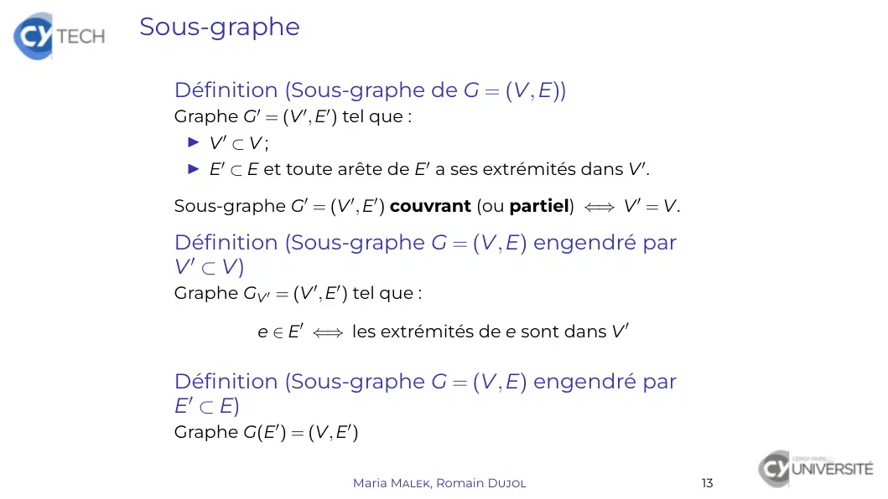

# TheoGraphes_1.pdf

[Ouvrir l’original](https://drive.google.com/open?id=1rvdu2zVPSg-jTyi392kK4wkhw-uVoaky) · Les deux lectures automatiques du PDF divergent sur les pages indiquées. Leur fac-similé accompagne le texte.

**Pages présentant un écart entre les deux extractions** — 15.

## Page 1

~~~text
Théorie des graphes

Maria Malek, Romain Dujol

      CY Tech – ING1-MA

   Maria Malek, Romain Dujol   1
~~~

## Page 2

~~~text
Généralités

  Graphe non orienté

  Graphes particuliers

  Type de données

  Graphe valué

                         Maria Malek, Romain Dujol   2
~~~

## Page 3

~~~text
Introduction

  (Au moins) Deux problèmes fondateurs
   I Problème des « sept ponts de Königsberg »
     (Euler, XVIIIème siècle)
   I Problème des « quatre couleurs » (XIXème siècle)

  Formalisation récente (XXème siècle)
  Discipline entre informatique fondamentale et optimisation

  Applications nombreuses et variées
   I ordonnancement de tâches ;
   I couverture de réseaux ;
   I recherche de chemins optimaux. . .

                      Maria Malek, Romain Dujol                3
~~~

## Page 4

~~~text
Graphe non orienté

  Graphe non orienté
     Définition
     Terminologie de base
     Matrice d’adjacence
     Sous-graphe
     Isomorphisme de graphes

  Graphes particuliers

  Type de données

  Graphe valué

                         Maria Malek, Romain Dujol   4
~~~

## Page 5

~~~text
Graphe non orienté

  Définition (Graphe non orienté)
  Graphe (non orienté) G = (V, E) :
   I V ensemble fini non vide des sommets de G ;
   I E ensemble fini des arêtes de G.
  À chaque arête e, on associe deux sommets : ses extrêmités.

  Représentation graphique
    Sommet Point ou cercle contenant le nom du sommet
       Arête Trait reliant ses deux extrêmités

                      Maria Malek, Romain Dujol                 5
~~~

## Page 6

~~~text
Graphe non orienté

  Exemple
                                             e2
                                                                          e6
                     e1                                  v3         e5
                                             e3
         v1                      v2
                                                        e4                v4

  Alors G = ({v1 , v2 , v3 , v4 }, {e1 , e2 , e3 , e4 , e5 , e6 }) où :
   I e1 a pour extrêmités v1 et v2 ;
    I e2 a pour extrêmités v2 et v3 ;
    I e3 a pour extrêmités v2 et v3 ;
    I e4 a pour extrêmités v2 et v4 ;
    I e5 a pour extrêmités v3 et v4 ;
    I e6 a pour extrêmités v4 et. . . v4 .

                                Maria Malek, Romain Dujol                      6
~~~

## Page 7

~~~text
Terminologie (1/2)

  G = (V, E) graphe non orienté
  « v1 ∈ V et v2 ∈ V sont les extrêmités de e ∈ E » ou :
   I « L’arête e relie v1 et v2 ».
   I v1 et v2 sont dits voisins ou adjacents.

  Définition (Boucle)
  Arête dont les deux extrêmités sont égales

  Définition (Arêtes multiples)
  Arêtes distinctes ayant les mêmes extrêmités
  (On parle aussi d’arêtes parallèles.)

                         Maria Malek, Romain Dujol         7
~~~

## Page 8

~~~text
Terminologie (1/2)

  Exemple
                           e2
                                                  e6
            e1                        v3     e5
                           e3
      v1         v2
                                      e4          v4

                 Maria Malek, Romain Dujol             8
~~~

## Page 9

~~~text
Terminologie (1/2)

  Exemple
                                 e2
                                                        e6
               e1                           v3     e5
                                 e3
       v1               v2
                                            e4          v4

   I v1 et v2 sont adjacents ;
   I v1 et v3 ne sont pas adjacents ;
   I e6 est une boucle ;
   I e2 et e3 sont parallèles.

                       Maria Malek, Romain Dujol             8
~~~

## Page 10

~~~text
Terminologie (2/2)

  Définition (Graphe simple)
  Graphe non orienté sans boucle, ni arêtes multiples
     Dans un graphe simple, une arête est donc identifiable
            uniquement à partir de ses extrêmités.

  Définition (Graphe sous-jacent de G = (V, E))
  Graphe non orienté simple G0 = (V, E0 ) tel que

      ∀(v, v 0 ), vv 0 ∈ E0 ⇐⇒ v 6= v 0 et ∃e ∈ E d’extrêmités v et v 0

                          Maria Malek, Romain Dujol                       9
~~~

## Page 11

~~~text
Terminologie (2/2)

  Exemple
  Le graphe sous-jacent de
                                e2
                                                       e6
              e1                          v3     e5
                                e3
        v1            v2
                                          e4           v4

  est

                                        v3
             v1            v2                     v4

                     Maria Malek, Romain Dujol              10
~~~

## Page 12

~~~text
Matrice d’adjacence

  Définition (Matrice d’adjacence de G = (V, E))
  Matrice M carrée d’ordre n = card V telle que :

   ∀(i, j) ∈ J1, nK2 , Mij est le nombre d’arêtes d’extrémités vi et vj

  avec V = {vi }1≤i≤n .

  Propriété (Matrice d’adjacence M de G = (V, E))
   I M est symétrique
                (
                  ∀i      ∈ J1, nK2 , Mii = 0
   I G simple ⇔
                  ∀(i, j) ∈ J1, nK2 , Mij ∈ {0, 1}

                          Maria Malek, Romain Dujol                       11
~~~

## Page 13

~~~text
Matrice d’adjacence

  Exemple
                                  e2
                                                        e6
              e1                             v3    e5
                                  e3
       v1               v2
                                             e4         v4

  a pour matrice M =                     .

                       Maria Malek, Romain Dujol             12
~~~

## Page 14

~~~text
Matrice d’adjacence

  Exemple
                              e2
                                                    e6
             e1                           v3   e5
                              e3
      v1            v2
                                          e4        v4
                                    
                      0 1   0      0
                     1 0   2      1
  a pour matrice M = 
                     0 2
                                     .
                            0      1
                      0 1   1      1

                   Maria Malek, Romain Dujol             12
~~~

## Page 15

~~~text
Sous-graphe

  Définition (Sous-graphe de G = (V, E))
  Graphe G0 = (V 0 , E0 ) tel que :
   I V0 ⊂ V ;
   I E0 ⊂ E et toute arête de E0 a ses extrémités dans V 0 .

  Sous-graphe G0 = (V 0 , E0 ) couvrant (ou partiel) ⇐⇒ V 0 = V.

  Définition (Sous-graphe G = (V, E) engendré par
  V 0 ⊂ V)
  Graphe GV 0 = (V 0 , E0 ) tel que :

             e ∈ E0 ⇐⇒ les extrémités de e sont dans V 0

  Définition (Sous-graphe G = (V, E) engendré par
  E0 ⊂ E)
  Graphe G(E0 ) = (V, E0 )

                           Maria Malek, Romain Dujol               13
~~~

## Page 16

~~~text
Sous-graphe

  Exemple                            e2
                                                                   e6
                     e1                        v3     e5
                                     e3
  G = v1                  v2
                                               e4                  v4

                                                                        e6
                            e1
  G{v1 ,v2 ,v4 } =   v1                  v2
                                                             e4         v4

                                                             v3
  G{v1 ,v3 } = v1

                                                                        e6
                                    e1                            v3
  G({e1 , e4 , e6 }) = v1                     v2
                                                                  e4    v4

                                 Maria Malek, Romain Dujol                   14
~~~

## Page 17

~~~text
Sous-graphe

  G = (V, E) graphe non orienté
  Autres notations
                  G − V0      ≡ GV\V 0
                        0
                  G−E         ≡ G(E\E0 )
                  G−v         ≡ G − {v} ≡ GV\{v}
                  G−e         ≡ G − {e} ≡ G(E\{e})

  Soit e ∈
         / E une arête dont les extrêmités sont dans V, alors :

                            G + e ≡ (V, E ∪ {e})

                       Maria Malek, Romain Dujol                  15
~~~

## Page 18

~~~text
Isomorphisme de graphes

  Définition (Isomorphisme de graphes)
  Isomorphisme (φ , ψ) de G1 = (V1 , E1 ) sur G2 = (V2 , E2 )
    I φ bijection de V1 dans V2 ;
   I ψ bijection de E1 dans E2 ;
   I ∀e ∈ E, ∀(v, v 0 ) ∈ V 2 ,
      v et v 0 extrémités de e ⇐⇒ φ (v) et φ (v 0 ) extrémités de ψ(e)

  G1 et G2 isomorphes ⇔ il existe un isomorphisme de G1 sur G2 .
  (L’isomorphisme n’est pas forcément unique. . . )

  Lorsque deux graphes sont isomorphes,. . .
   I leurs structures sont identiques ;
   I seuls les noms des sommets et des arêtes diffèrent.

                            Maria Malek, Romain Dujol               16
~~~

## Page 19

~~~text
Isomorphisme de graphes

  Exemple
                          v4                               ♥

               v2
                                 et        ♣                              ♠
     v1
                            v3                             ♦

  sont isomorphes via       v1   7→ ♣          ou   v1   7→         ♣ .
                            v2    7→ ♦              v2    7 →       ♦
                            v3     7→ ♥             v3      7 →     ♠
                            v4      7→ ♠            v4        7 →   ♥

                        Maria Malek, Romain Dujol                             17
~~~

## Page 20

~~~text
Graphes particuliers

  Graphe non orienté

  Graphes particuliers
     Graphe planaire
     Graphe complet
     Graphe connexe
       Chaîne. Cycle
       Définition
    Graphe biparti
    Graphe régulier
       Degré
       Définition

  Type de données

  Graphe valué

                         Maria Malek, Romain Dujol   18
~~~

## Page 21

~~~text
Graphe planaire

  Définition (Graphe planaire)
  Graphe dont les arêtes ne se chevauchent pas dans au moins
  une représentation graphique.

  Exemple
                                                        2
      2

                                                                4
           3
               est planaire, car représentable en   1
  1

      4                                                     3

  Propriété (Conservation
            (             par isomorphisme)
               G1 et G2 isomorphes
                                       =⇒ G2 planaire
               G1 planaire

  Propriété    G planaire ⇒ tout sous-graphe de G est planaire

                      Maria Malek, Romain Dujol                     19
~~~

## Page 22

~~~text
Graphe complet

  Définition (Graphe complet Kn (n ≥ 1))
  Graphe simple Kn = (J1, nK , E) contenant toutes les arêtes :

                         ∀(v, v 0 ) ∈ J1, nK2 , vv 0 ∈ E

  Propriété (Nombre d’arêtes
                           d’un
                                graphe complet)
                                          n   n(n − 1)
  Si Kn = (J1, nK , E), alors card E =      =          .
                                          2      2

  Corollaire
  G = (V, E) graphe non orienté simple.

                               n(n − 1)
                    card E ≤            où n = card V
                                  2

                          Maria Malek, Romain Dujol               20
~~~

## Page 23

~~~text
Graphe complet

  Les premiers graphes complets
                                                                         2
       1                        1         2                1                         3

       K1                      K2 (1 arête)                        K3 (3 arêtes)

                                     1
            4
                                                                     4
                                                                             5
                                     2
                        2
   1
                                3
                                                               1
                                                                                 2

                3                                                        3
                                     4

                    K4 (6 arêtes)                              K5 (10 arêtes)

  Propriété (Graphes complets planaires)
  Kn planaire ⇐⇒ n ≤ 4

                               Maria Malek, Romain Dujol                                 21
~~~

## Page 24

~~~text
Chaîne (1/2)
  Définition (Chaîne de G = (V, E))
  Suite (finie) C = (v0 , e1 , v1 , . . . , ei , vi , . . . , en , vn ) telle que :
   I ∀i ∈ J0, nK , vi ∈ V
   I ∀i ∈ J1, nK , ei ∈ E et ses extrémités sont vi−1 et vi .
  n = `(C) : longueur de C                        v0 , vn : extrémités de C
  Si G est simple, on réduit C à C = (v0 , v1 , . . . , vi , . . . , vn ).

  Définition (Chaîne simple C = (v0 , e1 , v1 , . . . , en , vn ))
  Les arêtes sont distinctes deux à deux :
                   ∀(i, j) ∈ J1, nK2 , (i 6= j) =⇒ ei 6= ej

  Définition (Chaîne élémentaire
  C = (v0 , e1 , v1 , . . . , en , vn ))
  Les sommets sont distincts deux à deux (même les
  extrêmités) :
                ∀(i, j) ∈ J0, nK2 , (i 6= j) =⇒ vi 6= vj
  Propriété            C élémentaire =⇒ C simple

                                 Maria Malek, Romain Dujol                            22
~~~

## Page 25

~~~text
Chaîne (1/2)

  Exemple
                                                e2
                                                                        e6
                    e1                                  v3       e5
                                                e3
       v1                         v2
                                                        e4              v4

                     Chaîne                          Simple ?   Élementaire ?

     (v2 , e2 , v3 , e5 , v4 , e4 , v2 , e2 , v3 )

     (v1 , e1 , v2 , e2 , v3 , e3 , v2 , e4 , v4 )

     (v1 , e1 , v2 , e4 , v4 )

                                 Maria Malek, Romain Dujol                      23
~~~

## Page 26

~~~text
Chaîne (1/2)

  Exemple
                                                e2
                                                                          e6
                    e1                                  v3       e5
                                                e3
       v1                         v2
                                                        e4                v4

                     Chaîne                          Simple ?   Élementaire ?

     (v2 , e2 , v3 , e5 , v4 , e4 , v2 , e2 , v3 )      ×             ×

     (v1 , e1 , v2 , e2 , v3 , e3 , v2 , e4 , v4 )      X             ×

     (v1 , e1 , v2 , e4 , v4 )                          X             X

                                 Maria Malek, Romain Dujol                      23
~~~

## Page 27

~~~text
Chaîne (2/2)

  Lemme (Existence de chaîne élémentaire)
  Soit G = (V, E) un graphe non orienté et (v, v 0 ) ∈ V 2 .

   ∃C d’extrémités v et v 0 ⇒ ∃C0 d’extrémités v et v 0 élémentaire

  Démonstration.
  Si C = (v0 , e1 , v1 , . . . , en , vn ) est élémentaire, C0 = C convient.
  Sinon il existe i < j tel que vi = vj .
  Alors C1 = (v0 , e1 , v1 , . . . , ei , vi = vj , . . . , ej+1 , . . . , en , vn ) a pour extrêmités
  v0 et vn et `(C1 ) = `(C) − (j − i) < `(C).
  On repéte ce procédé jusqu’à ce que la chaîne soit élémentaire. La
  terminaison est assurée par :
    I la finitude de C ;
    I la stricte décroissance de la suite des longueurs des chaînes
      obtenues à chaque étape.

                                   Maria Malek, Romain Dujol                                             24
~~~

## Page 28

~~~text
Cycle

  Définition (Cycle de G = (V, E))
  Chaîne simple C = (v0 , e1 , v1 , . . . , en , vn ) telle que :
   I `(C) > 0 ;
   I vn = v0 .

  Remarque
   I Cycle de longueur 1 ≡ boucle
   I Un cycle peut être décrit par des suites distinctes
     (contrairement à une chaîne).

                             Maria Malek, Romain Dujol              25
~~~

## Page 29

~~~text
Cycle

  Exemple
                                           e2
                                                                     e6
                    e1                             v3      e5
                                           e3
        v1                      v2
                                                   e4                v4

  C = (v2 , e2 , v3 , e5 , v4 , e4 , v2 ) est un cycle aussi représenté par :
   I C = (v3 , e5 , v4 , e4 , v2 , e2 , v3 )
   I C = (v4 , e4 , v2 , e2 , v3 , e5 , v4 )

                              Maria Malek, Romain Dujol                         26
~~~

## Page 30

~~~text
Graphe connexe

  Définition (Graphe G = (V, E) connexe)
  ∀(v, v 0 ) ∈ V 2 , il existe une chaîne d’extrêmités v et v 0 .

  Définition (Composantes connexes de G = (V, E))
  Sous-graphes connexes maximaux
   (au sens de l’inclusion des sommets et des arêtes)

  Propriété
  G connexe ⇐⇒ G a une seule composante connexe
  Remarque Alors la composante connexe est G lui-même.
  Propriété
  Les composantes connexes d’un graphe sont disjontes
   (ni sommet, ni arêtes en commun).

                          Maria Malek, Romain Dujol                 27
~~~

## Page 31

~~~text
Graphe connexe
  Exemple
                                e2
                                                            e6
            e1                           v3       e5
                                e3
       v1             v2
  G=                                     e4
                                                                 est connexe.
                                                            v4

                                         e2
                                                                          e6
                                                       v3
                                         e3
  G = v1                    v2
                                                                          v4

  a trois composantes connexes :

                 G{v1 }     ,        G{v2 ,v3 }        et        G{v4 }

                           Maria Malek, Romain Dujol                            28
~~~

## Page 32

~~~text
Graphe biparti (1/2)

  Définition (Graphe biparti G = (V1 , V2 , E))
  (V1 , V2 ) partition de V telle que :

         ∀e ∈ E, e a une extrêmité dans V1 et l’autre dans V2

  Corollaire
  Un graphe biparti n’a pas de boucle.

  Définition (Graphe biparti complet Kn1 ,n2 (n1 ≥ 1,
  n2 ≥ 1))
  Graphe simple Kn1 ,n2 = (J1, n1 K , Jn1 + 1, n1 + n2 K , E) contenant
  toutes les arêtes possibles pour un graphe biparti :

                        ∀(v1 , v2 ) ∈ V1 × V2 , v1 v2 ∈ E

  Propriété (Graphes bipartis complets planaires)
  Kn1 ,n2 planaire ⇐⇒ min(n1 , n2 ) ≤ 2

                          Maria Malek, Romain Dujol                       29
~~~

## Page 33

~~~text
Graphe biparti (1/2)

  Exemple
         v1

         v3          v2
  G=                      = ({v1 , v3 , v4 }, {v2 , v5 }, E) est biparti.

         v4          v5

                                          3           1            4
                            1
     1           3                        4           2            5
                           2
     2           4                        5           3            6
          K2,2                   K2,3                     K3,3

                          Maria Malek, Romain Dujol                         30
~~~

## Page 34

~~~text
Graphe biparti (2/2)
  Propriété (Caractérisation des graphes bipartis)
  G = (V, E) biparti ⇐⇒ Tout cycle de G est de longueur paire.

  Démonstration.
  (⇒) Par l’absurde. Soit C = (v0 , . . . , vp−1 , ep , v0 ) un cycle de
      G = (V1 , V2 , E) de longueur p impaire et v0 ∈ V1 .
      p − 1 pair, donc vp−1 ∈ V1 . Donc v0 ∈ V2 : impossible !
  (⇐) I Choix de v0 ∈ V : on le marque « 0 ».
         I Choix de v1 ∈ V adjacent à v0 : on le marque « 1 ».
         I Choix de v2 ∈ V adjacent à v0 : on le marque « 0 ».
         I ...
       On répète ce procédé pour obtenir une chaîne simple C.
       Comme `(C) est pair, les sommets « 0 » ne sont adjacents
       qu’aux sommets « 1 ».
       On répète ce procédé sur le sous-graphe engendré par
       les sommets non marqués jusqu’à épuisement des
       sommets.
       V1 est alors l’ensemble des sommets marqués 0.
       V2 est alors l’ensemble des sommets marqués 1.

                            Maria Malek, Romain Dujol                      31
~~~

## Page 35

~~~text
Degré d’un sommet

  Définition (Degré d(v) d’un sommet v de G = (V, E))
  Nombre d’arêtes incidentes en v
  Attention !    Une boucle sur v compte double !
  Définition (Sommet isolé d’un graphe)
  Sommet de degré zéro, i.e. sans voisin

  Théorème (Lemme des poignées de main)
  Soit G = (V, E) graphe non orienté. Alors ∑ d(v) = 2 card E.
                                                   v∈V
  Corollaire
  Le nombre de sommets de degré impair d’un graphe est
  pair.

  Corollaire
  Soit G = (V, E) un graphe non orienté.
  On note n = card V, m = card E, δ = min d(v) et ∆ = max d(v).
                                         v∈V             v∈V
                           nδ ≤ 2m ≤ n∆

                       Maria Malek, Romain Dujol                  32
~~~

## Page 36

~~~text
Degré d’un sommet

  Exemple
                             e2
                                                       e6
            e1                          v3        e5
                             e3
     v1           v2
                                        e4             v4

                  v     v1    v2   v3        v4
                 d(v)

                 Maria Malek, Romain Dujol                  33
~~~

## Page 37

~~~text
Degré d’un sommet

  Exemple
                                      e2
                                                                e6
                  e1                             v3        e5
                                      e3
       v1                  v2
                                                 e4             v4

                          v      v1    v2   v3        v4
                         d(v)    1     4    3         4

   I Lemme des poignées de main :
        I   ∑ d(v) = 1 + 4 + 3 + 4 = 12
            v∈V
        I card E = 6
   I Il y a deux sommets de degré impair (v1 et v3 ).
   I δ = 1 et ∆ = 4 : on a 4 = 4 · 1 ≤ 2 · 6 ≤ 4 · 4 = 16.

                          Maria Malek, Romain Dujol                  33
~~~

## Page 38

~~~text
Graphe régulier

  Définition (Graphe G = (V, E) régulier)
  Graphe k-régulier : ∀v ∈ V, d(v) = k.

  Propriété
  Si G = (V, E) est k-régulier, alors k · card V = 2 card E.

  Exemple : Kn est (n − 1)-régulier
                                                 n(n − 1)
  Alors (n − 1) · n = 2 card E : donc card E =            .
                                                    2

                        Maria Malek, Romain Dujol              34
~~~

## Page 39

~~~text
Type de données

  Graphe non orienté

  Graphes particuliers

  Type de données
     Tableau/liste des arêtes
     Matrice d’adjacence
     Tableau de la liste des voisins

  Graphe valué

                         Maria Malek, Romain Dujol   35
~~~

## Page 40

~~~text
Tableau/liste des arêtes

  Principe
  Tableau (ou liste) de couples de sommets numéroté par arête

  Exemple                           e2
                                                          e6
                 e1                           v3     e5
                                    e3
       v1                 v2
                                              e4          v4

  La représentation est un tableau (ou une liste) t de longueur
  6:
   I t(1) = (v1 , v2 )
   I t(2) = (v2 , v3 )
   I t(3) = (v2 , v3 )
   I t(4) = (v2 , v4 )
   I t(5) = (v3 , v4 )
   I t(6) = (v4 , v4 )

                         Maria Malek, Romain Dujol             36
~~~

## Page 41

~~~text
Représentation en machine : matrice
d’adjacence

  Principe
  Tableau bi-dimensionnel contenant les valeurs de la matrice
  d’adjacence

                     Maria Malek, Romain Dujol              37
~~~

## Page 42

~~~text
Représentation en machine : tableau de listes
de voisins

  Principe
  Tableau de listes des sommets adjacents numéroté par
  sommet

  Exemple                             e2
                                                            e6
                 e1                             v3     e5
                                      e3
       v1                   v2
                                                e4          v4

  La représentation est un tableau t de longueur 4 :
   I t(1) = [2]
   I t(2) = [1, 3, 3, 4]
   I t(3) = [2, 2, 4]
   I t(4) = [2, 3, 4]

                           Maria Malek, Romain Dujol             38
~~~

## Page 43

~~~text
Graphe valué

  Graphe non orienté

  Graphes particuliers

  Type de données

  Graphe valué

                         Maria Malek, Romain Dujol   39
~~~

## Page 44

~~~text
Graphe valué

  Définition (Graphe valué)
  Graphe (non orienté) valué G = (V, E, w) :
   I G = (V, E) graphe (non orienté)
   I w : E → R fonction de valuation

  Définition (Matrice d’adjacence de G = (V, E, w)
  simple)
  Matrice M carrée d’ordre n = card V telle que :
                                      
                                      0
                                                si i = j
             ∀(i, j) ∈ J1, nK2 , Mij = w(vi vj ) si vi vj ∈ E
                                      
                                       +∞        si vi vj ∈
                                                          /E
                                      

  Remarque
  Une valuation des sommets existe, mais elle reste peu
  classique.

                         Maria Malek, Romain Dujol              40
~~~
