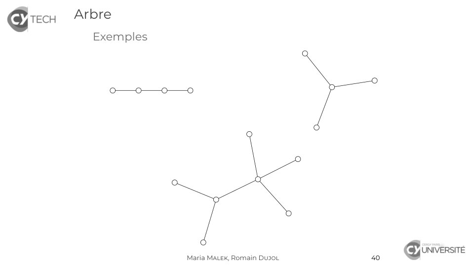
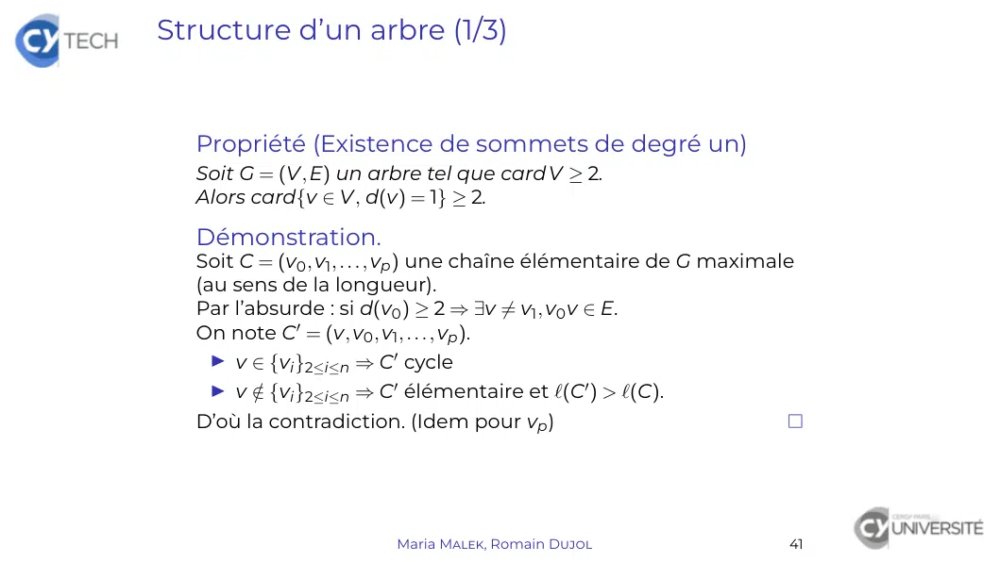
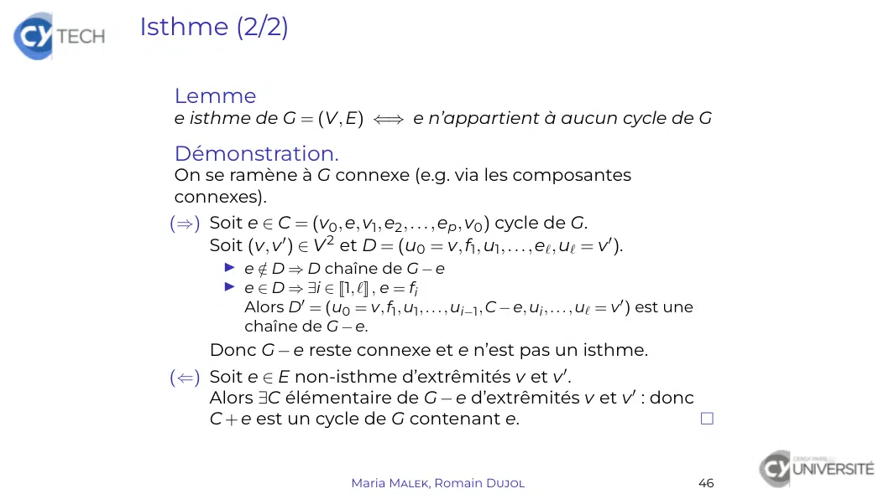
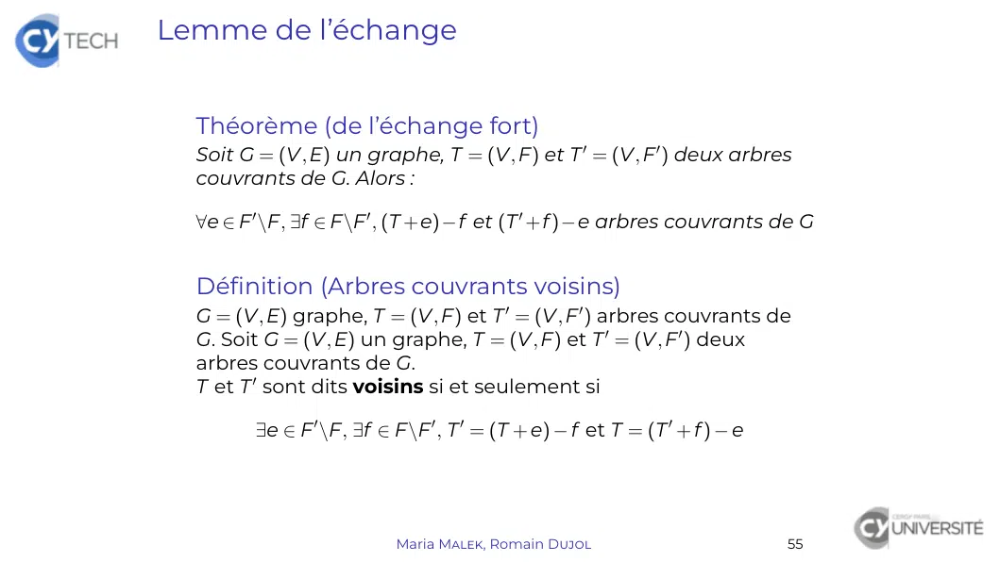

# TheoGraphes_2.pdf

[Ouvrir l’original](https://drive.google.com/open?id=10JxZAhwFFw8n07SeqpFtyAXir7kMh1KZ) · Les pages signalées comprennent du texte reconnu automatiquement ou des éléments graphiques. Le fac-similé permet de vérifier chaque lecture.

**Pages avec fac-similé ou lecture OCR** — 5.

**Pages présentant un écart entre les deux extractions** — 6, 11, 20.

## Page 1

~~~text
Théorie des graphes

Maria Malek, Romain Dujol

      CY Tech – ING1-MA

   Maria Malek, Romain Dujol   1
~~~

## Page 2

~~~text
Arbres

  Arbre

  Arbre couvrant

                   Maria Malek, Romain Dujol   37
~~~

## Page 3

~~~text
Arbre

  Arbre
     Définition
     Structure
     Forêt
     Isthme
     Caractérisations

  Arbre couvrant

                        Maria Malek, Romain Dujol   38
~~~

## Page 4

~~~text
Arbre

  Définition (Arbre)
  Graphe non orienté connexe et acyclique (i.e. sans cycle)

  Propriété
   1. Tout arbre est un graphe simple
   2. Toute chaîne élémentaire est un arbre.

  Démonstration.
   1. Toute boucle est un cycle.
      Deux arêtes multiples induisent un cycle.
   2. Soit C = (v0 , v1 , . . . , vp ) élémentaire :
        I tous les sommets sont reliés ⇒ C connexe
        I tous les sommets sont distincts ⇒ C acyclique
      Donc C est un arbre.

                        Maria Malek, Romain Dujol             39
~~~

## Page 5

~~~text
Arbre
  Exemples

             Maria Malek, Romain Dujol   40
~~~

**Lecture OCR à contrôler**

~~~text
[CES Arbre

Exemples

irversre
Maria MALEK, Romain DUJOL 40
~~~

## Page 6

~~~text
Structure d’un arbre (1/3)

  Propriété (Existence de sommets de degré un)
  Soit G = (V, E) un arbre tel que card V ≥ 2.
  Alors card{v ∈ V, d(v) = 1} ≥ 2.

  Démonstration.
  Soit C = (v0 , v1 , . . . , vp ) une chaîne élémentaire de G maximale
  (au sens de la longueur).
  Par l’absurde : si d(v0 ) ≥ 2 ⇒ ∃v 6= v1 , v0 v ∈ E.
  On note C0 = (v, v0 , v1 , . . . , vp ).
    I v ∈ {vi }2≤i≤n ⇒ C0 cycle
      / {vi }2≤i≤n ⇒ C0 élémentaire et `(C0 ) > `(C).
   I v∈
  D’où la contradiction. (Idem pour vp )

                         Maria Malek, Romain Dujol                    41
~~~

## Page 7

~~~text
Structure d’un arbre (2/3)

  Théorème (Nombre de sommets et d’arêtes)
  Soit G = (V, E) un arbre. Alors card E = card V − 1.

  Démonstration.
  Par récurrence sur n = card V.
   I Si n = card V = 1, alors card E = 0 (pas de boucle !).
   I Soit n ∈ N tel que

              ∀G = (V, E) arbre, card V = n ⇒ card E = n − 1

      Soit G = (V, E) arbre à n + 1 sommets.
      Soit v un sommet de degré un et e l’arête incidente en v.
      Alors G − v = (V\{v}, E\{e}) est un arbre et :
        I card(E\{e}) = card E − 1
        I card(V\{v}) = n donc card(E\{e}) = n − 1
          (hypothèse de récurrence)
      Donc card E = n = card V − 1.

                        Maria Malek, Romain Dujol              42
~~~

## Page 8

~~~text
Structure d’un arbre (3/3)

  Propriété (Unicité de chaîne élémentaire)
  Soit G = (V, E) arbre.

         ∀(v, v 0 ) ∈ V 2 , ∃!C d’extrêmités v et v 0 élémentaire

  Démonstration.
   I Comme G est connexe, on a l’existence de la chaîne
     élémentaire :

            ∀(v, v 0 ) ∈ V 2 , ∃C d’extrêmités v et v 0 élémentaire

   I Par l’absurde : si il y a deux chaînes élémentaires
     distinctes, elles induisent un cycle, ce qui est
     impossible.

                           Maria Malek, Romain Dujol                  43
~~~

## Page 9

~~~text
Forêt

  Définition (Forêt)
  Graphe non orienté acyclique

  Propriété (Composantes connexes d’une forêt)
  Toute composante connexe d’une forêt est un arbre.

  Propriété (Nombre de sommets et d’arêtes)
  Soit G = (V, E) une forêt. Alors card E ≤ card V − 1.

  Démonstration.
  Soit G1 , . . . , Gp les composantes connexes de G.
         ∀i ∈ J1, pK , Gi = (Vi , Ei ) arbre ⇒ card Ei = card Vi − 1
           p             p
  card E = ∑ card Ei = ∑(card Vi − 1)
           i=1          i=1
                         p
                      = ∑ card Vi − p = card V − p ≤ card V − 1
                        i=1

                         Maria Malek, Romain Dujol                     44
~~~

## Page 10

~~~text
Isthme (1/2)

  Définition (Isthme de G = (V, E))
  Arête e telle G − e ait une composante connexe de plus que G.

  Propriété
  Soit G = (V, E) un graphe.
  L’arête e ∈ E est un isthme de G si et seulement si ses
  extrémités ne sont reliés par aucune chaîne de G − e.

  Propriété (Arbre et isthmes)
  Toute arête d’un arbre est un isthme.

                      Maria Malek, Romain Dujol              45
~~~

## Page 11

~~~text
Isthme (2/2)

  Lemme
  e isthme de G = (V, E) ⇐⇒ e n’appartient à aucun cycle de G

  Démonstration.
  On se ramène à G connexe (e.g. via les composantes
  connexes).
  (⇒) Soit e ∈ C = (v0 , e, v1 , e2 , . . . , ep , v0 ) cycle de G.
      Soit (v, v 0 ) ∈ V 2 et D = (u0 = v, f1 , u1 , . . . , e` , u` = v 0 ).
          I e∈/ D ⇒ D chaîne de G − e
          I e ∈ D ⇒ ∃i ∈ J1, `K , e = fi
            Alors D0 = (u0 = v, f1 , u1 , . . . , ui−1 , C − e, ui , . . . , u` = v 0 ) est une
            chaîne de G − e.
        Donc G − e reste connexe et e n’est pas un isthme.
  (⇐) Soit e ∈ E non-isthme d’extrêmités v et v 0 .
      Alors ∃C élémentaire de G − e d’extrêmités v et v 0 : donc
      C + e est un cycle de G contenant e.

                                 Maria Malek, Romain Dujol                                        46
~~~

## Page 12

~~~text
Caractérisations d’un arbre

  Théorème (Caractérisations d’un arbre)
  Soit G = (V, E) un graphe non orienté. Les propositions
  suivantes sont équivalentes
    1. G est un arbre.
   2. G est connexe et card E = card V − 1.
   3. G est acyclique et card E = card V − 1.
   4. G est connexe et toute arête est un isthme.
   5. ∀(v, v 0 ) ∈ V 2 , ∃!C d’extrêmités v et v 0 élémentaire

                         Maria Malek, Romain Dujol               47
~~~

## Page 13

~~~text
Arbre couvrant

  Arbre

  Arbre couvrant
     Définition
     Caractérisations
     Lemmes d’échange
     Arbre couvrant minimum

                   Maria Malek, Romain Dujol   48
~~~

## Page 14

~~~text
Arbre couvrant (1/3)

  Définition (Arbre couvrant de G = (V, E))
  Arbre et graphe couvrant de G

  Propriété (Existence d’arbre couvrant)
  Tout graphe fini connexe admet au moins un arbre couvrant.

  Démonstration.
  On enlève une à une les arêtes qui ne sont pas des isthmes.
  (terminaison assurée par la finitude de E).
  Le graphe obtenu est couvrant, connexe et acyclique.

  Corollaire
  Soit G = (V, E) un graphe connexe. Alors card E ≥ card V − 1.

  Démonstration.
  Soit T = (V, F) arbre couvrant de G avec F ⊂ E.
  Alors card E ≥ card F = card V − 1

                       Maria Malek, Romain Dujol                  49
~~~

## Page 15

~~~text
Arbre couvrant (1/3)

  Exemple                            e2
                                                                     e6
                e1                             v3          e5
                                     e3
  G = v1                   v2
                                               e4                    v4

  Deux arbres couvrants de G sont :
                          e2
           e1                             v3
   v1                v2
                                          e4                    v4

  et
           e1                             v3          e5
                                e3
   v1                v2
                                                                v4

                          Maria Malek, Romain Dujol                       50
~~~

## Page 16

~~~text
Arbre couvrant (2/3)

  Propriété
  Soit G = (V, E) un graphe connexe et G0 un graphe partiel de
  G. Alors G0 est un arbre couvrant de G si et seulement si il est
  le plus petit graphe connexe (au sens de la suppression des
  arêtes).

  Démonstration.
  (⇒) Toute arête de G0 est un isthme, donc supprimer une
      arête fait perdre la connexité.
  (⇐) ∀e ∈ E, G0 − e non connexe : donc e isthme de G0 .
      Donc G est acyclique : comme G0 connexe, c’est un
      arbre

                       Maria Malek, Romain Dujol                 51
~~~

## Page 17

~~~text
Arbre couvrant (3/3)

  Propriété
  Soit G = (V, E) un graphe connexe et G0 un graphe partiel de
  G. Alors G0 est un arbre couvrant de G si et seulement si il est
  le plus grand graphe acyclique (au sens de l’ajout des arêtes).

  Démonstration.
  On note G0 = (V, F).
  (⇒) ∀e ∈ E\F, les extrêmités de e sont reliées par une chaîne C
      de G0 . Donc C + e est un cycle de G.
  (⇐) Soit (v, v 0 ) ∈ V 2 et C chaîne d’extrémités v et v 0
      Pour toute arête e ∈ E\E0 de C, G0 + e est un cycle par
      maximalité, donc e n’est pas un isthme.
      On substitue e dans C par une chaîne de G0 reliant les
      extrêmités de e.
      La chaîne obtenue après toutes les substitutions est une
      chaîne de G0 .

                         Maria Malek, Romain Dujol              52
~~~

## Page 18

~~~text
Lemme de l’échange

  Propriété
  Soit G = (V, E) un graphe et T = (V, F) un arbre couvrant de G.
  ∀e ∈ E\F, T + e contient un unique cycle élémentaire.
  Démonstration.
  (Existence) Comme T est maximal, T + e contient un cycle.
  (Unicité) Soit C et C0 deux cycles élémentaires de T + e. Alors
  C − e et C0 − e chaînes élémentaires reliant les extrêmités de e.
  Comme T est un arbre, on a C − e = C0 − e, puis C = C0 .

  Théorème (de l’échange)
  Soit G = (V, E) un graphe et T = (V, F) un arbre couvrant de G.
  ∀e ∈ E\F, ∀f arête du cycle de T + e, (T + e) − f arbre couvrant
  Démonstration.
  Soit e ∈ E\F et f une arête de T + e. Comme f est dans un
  cycle, f n’est pas un isthme : donc (T + e) − f connexe.
  De plus, T = (V, F 0 ) avec card F 0 = card F = card V − 1. Donc
  (T + e) − f est un arbre.

                        Maria Malek, Romain Dujol                    53
~~~

## Page 19

~~~text
Lemme de l’échange

  Exemple                         e2
                                                        e6
                e1                          v3     e5
                                  e3
  G = v1                v2
                                            e4          v4

                                  e2
                e1                          v3
  T = v1                v2
                                            e4          v4

  e = e5 ⇒ f = e4 convient (mais pas f = e1 )
                                        e2
                        e1                         v3   e5
  (T + e) − f = v1                v2
                                                              v4
  est un arbre couvrant de G.

                       Maria Malek, Romain Dujol             54
~~~

## Page 20

~~~text
Lemme de l’échange

  Théorème (de l’échange fort)
  Soit G = (V, E) un graphe, T = (V, F) et T 0 = (V, F 0 ) deux arbres
  couvrants de G. Alors :

  ∀e ∈ F 0 \F, ∃f ∈ F\F 0 , (T +e)−f et (T 0 +f )−e arbres couvrants de G

  Définition (Arbres couvrants voisins)
  G = (V, E) graphe, T = (V, F) et T 0 = (V, F 0 ) arbres couvrants de
  G. Soit G = (V, E) un graphe, T = (V, F) et T 0 = (V, F 0 ) deux
  arbres couvrants de G.
  T et T 0 sont dits voisins si et seulement si

        ∃e ∈ F 0 \F, ∃f ∈ F\F 0 , T 0 = (T + e) − f et T = (T 0 + f ) − e

                          Maria Malek, Romain Dujol                         55
~~~

## Page 21

~~~text
Lemme de l’échange fort

  Exemple                            e2
                                                                    e6
                e1                              v3        e5
  G=                                 e3
         v1               v2
                                                e4                  v4

                                     e2
                e1                              v3
  T=     v1               v2
                                                e4                  v4

                e1                              v3        e5
                                      e3
  T0 =   v1               v2
                                                                    v4

  e = e5 ⇒ f = e4 convient (mais pas f = e2 )
                                                     e2
                               e1                              v3        e5
  (T + e) − f =      v1                    v2
                                                                              v4

                               e1                              v3
                                                     e3
  (T 0 + f ) − e =   v1                    v2
                                                               e4             v4

                                    Maria Malek, Romain Dujol                      56
~~~

## Page 22

~~~text
Arbres couvrants et graphes valués

  Définition (Valeur d’un arbre couvrant)
  Soit G = (V, E, w) un graphe valué et T = (V, E0 ) arbre couvrant
  de G.
  Valeur de T : w(T) = ∑ w(e)
                       e∈E0

  Définition (Arbre couvrant minimum)
  Soit G = (V, E, w) un graphe valué simple et connexe.
  Arbre couvrant minimum de G : arbre couvrant Tm de G tel
  que :
             w(Tm ) = min{w(T), T arbre couvrant de G}

  Remarque
  Un arbre couvrant minimum n’est pas toujours unique.

                       Maria Malek, Romain Dujol                 57
~~~

## Page 23

~~~text
Arbres couvrants et graphes valués
  Exemple

                               Lille
                    725
                                       522
                             222
            Brest                             Strasbourg
                                       490
                    596
         623                                      804
                              Paris
                    583

                                       932
                             857
        Bordeaux                                   Nice
                                       476

                    451
                           Perpignan

                      Maria Malek, Romain Dujol            58
~~~

## Page 24

~~~text
Arbres couvrants et graphes valués
  Exemple

                               Lille

                             222
            Brest                                 Strasbourg
                                       490
                    596
                               Paris
                    583

         Bordeaux                                   Nice
                                       476

                    451
                           Perpignan

                      Maria Malek, Romain Dujol                58
~~~

## Page 25

~~~text
Recherche d’arbre couvrant minimum

  Première solution : recherche exhaustive
   I Recenser tous les arbres couvrants
   I Calculer leurs valeurs et trouver celui de valeur minimale
  =⇒ Complexité exponentielle
  =⇒ Beaucoup trop coûteux, donc inutilisable

  Deuxième solution : algorithme glouton
   I Initialisation : sous-graphe partiel sans arête
   I Ajout itératif de card V − 1 arêtes de valuation minimale
     ne créant pas de cycle.
  =⇒ Algorithme de Kruskal

                      Maria Malek, Romain Dujol                  59
~~~

## Page 26

~~~text
Recherche d’arbre couvrant minimum

  Algorithme de Kruskal
    préconditions : G = (V, E, w) graphe valué simple et
   connexe
    postconditions : G(F) est un arbre couvrant minimal de G
   Ec ← E
   F ← 0/
   tant que card F < card V − 1 faire
     e est choisi dans argmin{w(e), e ∈ Ec }
     Ec ← Ec \{e}
     si G(F ∪ {e}) est acyclique alors
        F ← F ∪ {e}
     fin si
   fin tant que
  =⇒ G(F) = (V, F) arbre couvrant minimal de G

  Propriété
  L’algorithme de Kruskal converge vers un arbre couvrant
                                                   
  minimum. Sa complexité est O card E · log(card V) .

                     Maria Malek, Romain Dujol              60
~~~

## Page 27

~~~text
      Recherche d’arbre couvrant minimum

          Exemple
Initialisation F = 0/
Itération no 1 e = Paris – Lille ⇒ F = F ∪ {e}
Itération no 2 e = Bordeaux – Perpignan ⇒ F = F ∪ {e}
Itération no 3 e = Perpignan – Nice ⇒ F = F ∪ {e}
Itération no 4 e = Paris – Strasbourg ⇒ F = F ∪ {e}
Itération no 5 e = Lille – Strasbourg ⇒ F inchangé
Itération no 6 e = Paris – Bordeaux ⇒ F = F ∪ {e}
Itération no 7 e = Paris – Brest ⇒ F = F ∪ {e}
Terminaison card F = 6 = card V − 1 ⇒ STOP

                                 Maria Malek, Romain Dujol   61
~~~
