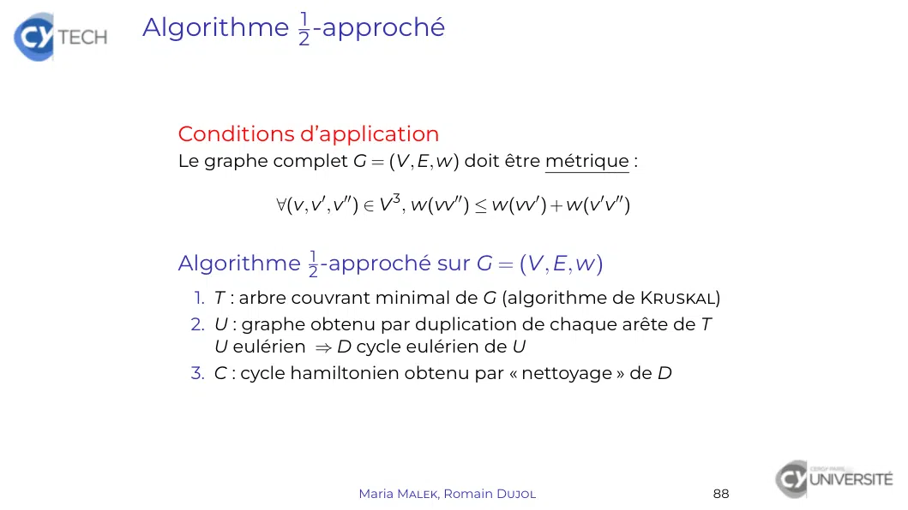

# TheoGraphes_4.pdf

[Ouvrir l’original](https://drive.google.com/open?id=1lCFfNdVs8VeM6bPDLA3i9RwTVrBbtXrv) · Les deux lectures automatiques du PDF divergent sur les pages indiquées. Leur fac-similé accompagne le texte.

**Pages présentant un écart entre les deux extractions** — 17.

## Page 1

~~~text
Théorie des graphes

Maria Malek, Romain Dujol

      CY Tech – ING1-MA

   Maria Malek, Romain Dujol   1
~~~

## Page 2

~~~text
Tournées eulériennes et hamiltoniennes

  Chaînes et cycles eulériens

  Cycles hamiltoniens

                        Maria Malek, Romain Dujol   73
~~~

## Page 3

~~~text
Chaînes et cycles eulériens

  Chaînes et cycles eulériens
    Définition
    Conditions d’existence
    Calcul de cycle eulérien

  Cycles hamiltoniens

                        Maria Malek, Romain Dujol   74
~~~

## Page 4

~~~text
Chaîne eulérienne. Cycle eulérien

  Définition (Chaîne/Cycle eulérien(ne) de G = (V, E))
  Chaîne/Cycle contenant toutes les arêtes de E sans répétition

  Définition (Graphe eulérien)
  G = (V, E) eulérien ⇐⇒ ∃ cycle eulérien de G

  Exemple
                    2             4             6
      1                                                       8     est
                    3             5             7
  eulérien

  car (1, 2, 4, 6, 8, 7, 5, 3, 2, 5, 6, 7, 4, 3, 1) est un cycle eulérien.

                            Maria Malek, Romain Dujol                        75
~~~

## Page 5

~~~text
Chaîne eulérienne. Cycle eulérien

  Problème des sept ponts de Königsberg, 1736

    Figure – Königsberg (actuellement Kaliningrad) au XVIIIe siècle
  Peut-on passer une fois et une seule par tous les ponts et
  revenir à son point de départ ?

                       Maria Malek, Romain Dujol                      76
~~~

## Page 6

~~~text
Chaîne eulérienne. Cycle eulérien

  Modélisation
   I Sommets ≡ rives
   I Arêtes ≡ ponts
  La question posée est donc :

                    N

                    O              E    est-il eulérien ?

                    S

                        Maria Malek, Romain Dujol           77
~~~

## Page 7

~~~text
Théorème d’Euler

  Théorème (Euler)
  Soit G = (V, E) un graphe connexe tel que card E ≥ 1. Alors :

      G eulérien ⇐⇒ tous les sommets sont de degré pair

  Démonstration.
  (⇒) Soit C un cycle eulérien de G.
      Tout passage de v ∈ V utilise une arête entrante et une
      arête sortante (distincte de l’entrante).
      Comme un jeu d’arêtes différent est utilisé à chaque
      passage, d(v) est nécessairement pair.

                       Maria Malek, Romain Dujol                  78
~~~

## Page 8

~~~text
Théorème d’Euler

  Théorème (Euler)
  Soit G = (V, E) un graphe connexe tel que card E ≥ 1. Alors :

      G eulérien ⇐⇒ tous les sommets sont de degré pair

  Démonstration.
  (⇐) Par récurrence forte sur card E
        I card E = 1 : e = vv 0 avec v 6= v 0 impossible ⇒ boucle (degré 2)
        I Comme card E > 1, G n’est pas acyclique car n’admet pas de
          sommets de degré 1.
          Soit C un cycle de G, EC l’ensemble de ses arêtes et
          {Hi = (Vi , Ei )}1≤i≤p composantes connexes de G − Ec .
          Comme on enlève un nombre pair d’arêtes, tous les
          sommets de G − EC , et donc de Hi sont de degré pair et Hi
          est eulérien. Soit Ci cycle eulérien de Hi : G étant connexe, il
          existe xi ∈ V commun à C et Ci .
          Pour tout i ∈ J1, pK, on insère Ci dans C à la place de xi : le
          cycle ainsi obtenu est eulérien.

                         Maria Malek, Romain Dujol                       79
~~~

## Page 9

~~~text
Théorème d’Euler

  Corollaire (Existence de chaîne eulérienne)
  Soit G = (V, E) un graphe connexe.
    G admet une chaîne eulérienne ⇐⇒
                     au plus deux sommets sont de degré impair
  Démonstration.
  (⇒) cf. théorème d’Euler
  (⇐) D’après le lemme des poignées de main, il y a 0 ou 2
      sommets de degré impair.
        I Si il y en a 0, alors G est eulérien.
        I Si il y en a 2, alors ∃(v, v 0 ) ∈ V 2 , v 6= v 0 et d(v) = d(v 0 ) = 2.
          Soit e ∈ / E d’extrémités v et v 0 et G0 = G + e.
          Alors G0 eulérien et C est un cycle eulérien de G0 .
          Donc C − e est une chaîne eulérienne de G.

  Démonstrations constructives ⇒ algorithmes (récursifs)

                             Maria Malek, Romain Dujol                               80
~~~

## Page 10

~~~text
Algorithme de Hierholzer

  Algorithme de Hierholzer
   fonction euler(G) : C
    préconditions :            G = (V, E) connexe dont les sommets sont de
      degré pair
    postconditions :            C est un cycle eulérien de G
      C ← cycle de G
      si E 6= EC alors
         (H1 , . . . , Hp ) ← composantes connexes de G − EC
         pour i ← 1 à p faire
            Ci ← euler(Hi )
            xi ← point de contact entre C et Ci
            Insérer Ci en xi dans C
         fin pour
      fin si
      retourner C
   fin fonction

  Théorème
  La complexité de l’algorithme de Hierholzer est O(card E).

                        Maria Malek, Romain Dujol                       81
~~~

## Page 11

~~~text
Algorithme de Hierholzer

  Exemple

                            2              4             6
              1                                                  8
                            3              5             7

  euler(G) avec C = (1, 2, 4, 6, 8, 7, 5, 3, 1) :
   I H1 = G({2, 3, 4, 5, 6, 7}) en 2
      ⇒ euler(H1 ) = (2, 5, 6, 7, 4, 3, 2)
  ⇒ euler(G) = (1, [2, 5, 6, 7, 4, 3, 2], 4, 6, 8, 7, 5, 3, 1)

                             Maria Malek, Romain Dujol               82
~~~

## Page 12

~~~text
Cycles hamiltoniens

  Chaînes et cycles eulériens

  Cycles hamiltoniens
    Définition
    Conditions d’existence
    Problème du voyageur de commerce

                      Maria Malek, Romain Dujol   83
~~~

## Page 13

~~~text
Cycle hamiltonien

  Définition (Chaîne/Cycle hamiltonien(ne) de
  G = (V, E))
  Chaîne/Cycle contenant tous les sommets de V
  sans répétition

  Définition (Graphe hamiltonien)
  G = (V, E) hamiltonien ⇐⇒ ∃ cycle hamiltonien de G

  Propriété (Cas particuliers de graphes
  hamiltoniens)
   I ∀n ≥ 3, Kn est hamiltonien
                                                     (n − 1)!
      Nombre de cycles hamiltoniens de Kn :
                                                        2
   I Soit G = (V1 , V2 , E) biparti. Alors :

                  G hamiltonien ⇐⇒ card V1 = card V2

                         Maria Malek, Romain Dujol              84
~~~

## Page 14

~~~text
Cycle hamiltonien

  Propriété (Condition nécessaire)
  Soit G = (V, E) un graphe hamiltonien et V 0 ∈ P(V)\{0,
                                                       / V}.

     nombre de composantes connexes de G − V 0 ≤ card V 0

  Théorème (Condition suffisante)
  Soit G = (V, E) un graphe simple tel que :

    ∀(v, v 0 ) ∈ V 2 , v et v 0 non adjacents ⇒ d(v) + d(v 0 ) ≥ card V

  Alors G est hamiltonien.

                         Maria Malek, Romain Dujol                        85
~~~

## Page 15

~~~text
Problème du voyageur de commerce (PVC)
  a.k.a. TSP (Traveling Salesman Problem)
  Formulation du problème
  Ensemble de villes toutes reliées directement entre elles
  Objectif : Tournée la plus courte couvrant toutes les villes une
  fois et une seule

  Modélisation
  Soit G = (V, E, w) un graphe complet valué tel que w ≥ 0.
    Définition (Valeur d’un cycle hamiltonien C de
    G)
    Valeur de C : w(C) =       ∑          w(e)
                           e arête de C

    Définition (Valeur du PVC)
    Valeur de G :
    w ∗ (G) = min{w(C), C cycle hamiltonien de G}

  ⇒ Trouver C∗ tel que w(C∗ ) = w ∗ (G) Problème NP-complet
                       Maria Malek, Romain Dujol                86
~~~

## Page 16

~~~text
Recherche de cycle hamiltonien minimal

  Première solution : recherche exhaustive
   I Recenser tous les cycles hamiltoniens
   I Calculer leurs valeurs et trouver celui de valeur minimale
  =⇒ Complexité super-exponentielle
  =⇒ Beaucoup trop coûteux, donc inutilisable

  Deuxième solution : algorithme glouton
   I Initialisation : sommet du graphe (choix arbitraire)
   I Ajout itératif de sommets non encore visités adjacents
     dont les arêtes ont la valuation la plus faible

  Définition (Algorithme ε-approché)
                                                  w(C)      1
  Fournit une solution approchée C telle que             ≤
                                                  w ∗ (G) 1 − ε

                      Maria Malek, Romain Dujol                   87
~~~

## Page 17

~~~text
Algorithme 21 -approché

  Conditions d’application
  Le graphe complet G = (V, E, w) doit être métrique :

             ∀(v, v 0 , v 00 ) ∈ V 3 , w(vv 00 ) ≤ w(vv 0 ) + w(v 0 v 00 )

  Algorithme 21 -approché sur G = (V, E, w)
   1. T : arbre couvrant minimal de G (algorithme de Kruskal)
   2. U : graphe obtenu par duplication de chaque arête de T
      U eulérien ⇒ D cycle eulérien de U
   3. C : cycle hamiltonien obtenu par « nettoyage » de D

                           Maria Malek, Romain Dujol                         88
~~~

## Page 18

~~~text
Algorithme 21 -approché

  Théorème
  L’algorithme précédent est 21 -approché pour tout graphe
  complet métrique.

  Démonstration.
  On note C le cycle produit par l’algorithme précédent.
  ∀C0 cycle hamiltonien, ∀e arête de C0 , C0 − e arbre couvrant de
  G
  Donc w(C0 ) ≥ w(C0 − e) ≥ w(T) puis

            w ∗ (G) = min{w(C0 ), C0 hamiltonien} ≥ w(T)

  Par construction, w(D) = 2w(T).
  Comme G est métrique, C est plus direct que D et
  w(C) ≤ w(D).

                                            w(C)          1
      w(C) ≤ w(D) = 2w(T) ≤ 2w ∗ (G) ⇒              ≤2=
                                            w ∗ (G)     1 − 21

                       Maria Malek, Romain Dujol                 89
~~~

## Page 19

~~~text
Algorithme 21 -approché

  Exemple
                            Matrice de valuation :
       E       F                     A     B     C     D      E       F
                               A      0     7     9    12      13      11
                               B      7     0    16    16      15     13
                               C      9    16     0    14     14     16
   D                    C      D     12    16    14     0     25       5
                               E     13    15    14    25       0    24
                               F      11   13    16     5     24       0
                              1. T = G({df , ab, ac, af , ae})
       A       B              2. D = (a, f , d, f , a, e, a, c, a, b, a)
                              3. C = (a, f , d, e, c, b, a)

                   Maria Malek, Romain Dujol                                90
~~~
