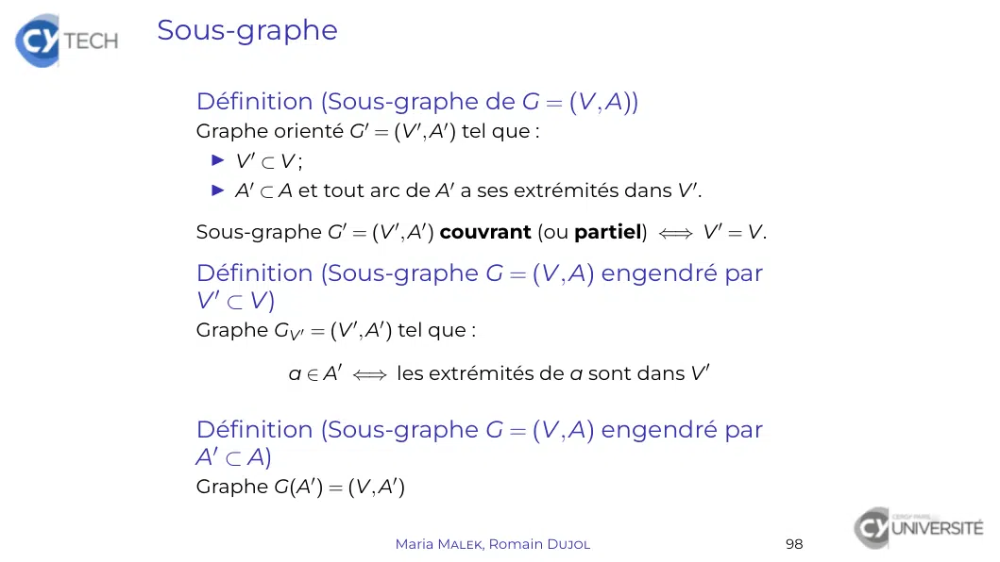
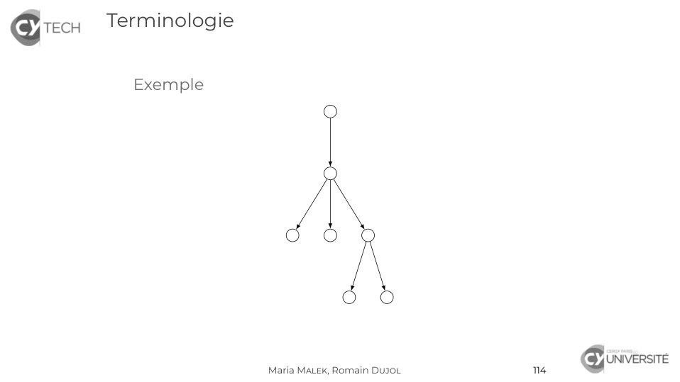
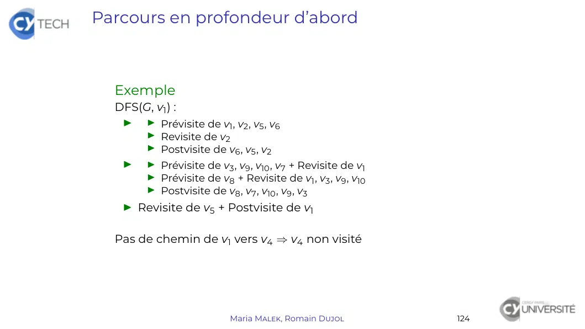
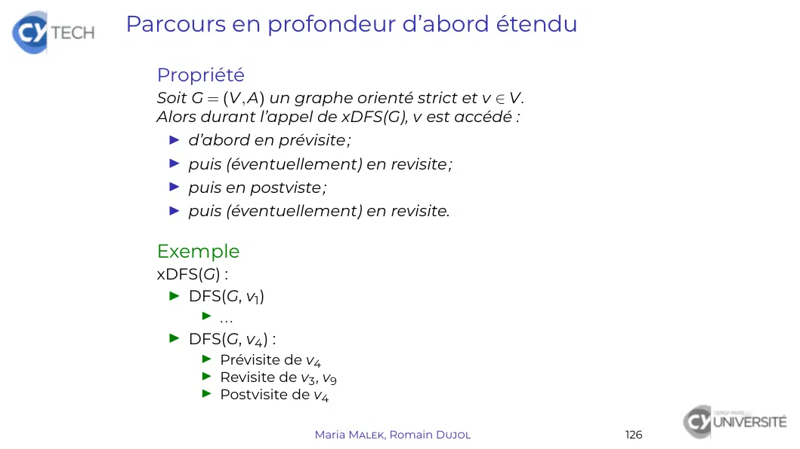
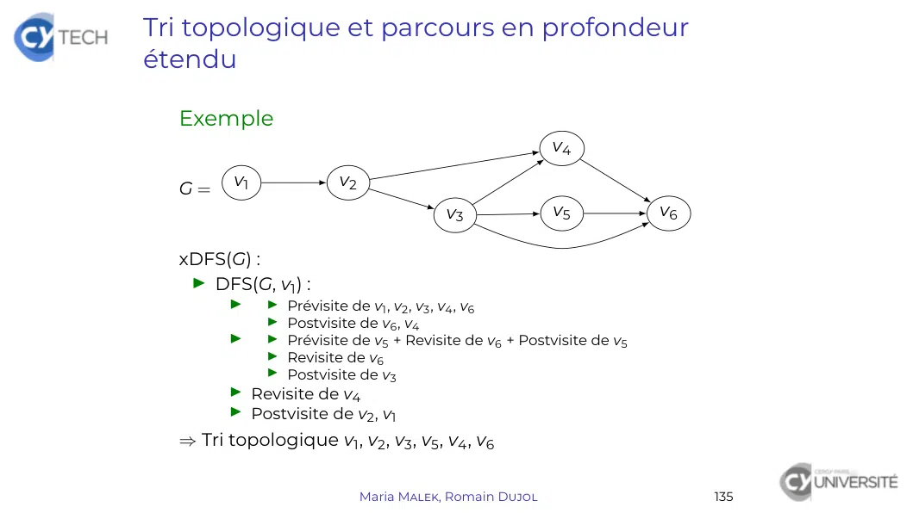

# TheoGraphes_5.pdf

[Ouvrir l’original](https://drive.google.com/open?id=1B4hRTPcQbMCsG_T4-TkQF9jfpT_j8cEg) · Les pages signalées comprennent du texte reconnu automatiquement ou des éléments graphiques. Le fac-similé permet de vérifier chaque lecture.

**Pages avec fac-similé ou lecture OCR** — 34.

**Pages présentant un écart entre les deux extractions** — 13, 44, 46, 55.

## Page 1

~~~text
Théorie des graphes

Maria Malek, Romain Dujol

      CY Tech – ING1-MA

   Maria Malek, Romain Dujol   1
~~~

## Page 2

~~~text
Graphes orientés et recherche arborescente

  Graphe orienté

  Arborescences

  Parcours en profondeur d’abord

  Tri topologique

                    Maria Malek, Romain Dujol   89
~~~

## Page 3

~~~text
Graphe orienté

  Graphe orienté
     Définition
     Terminologie de base
     Extension de définitions au cas orienté
        Matrice d’adjacence
        Sous-graphe
        Degré
     Chemin. Circuit
     Type de données
     Graphe orienté valué

  Arborescences

  Parcours en profondeur d’abord

  Tri topologique

                        Maria Malek, Romain Dujol   90
~~~

## Page 4

~~~text
Graphe orienté

  Définition (Graphe orienté)
  Graphe orienté G = (V, A) :
   I V ensemble non vide des sommets de G ;
   I A ensemble des arcs de G.
  À chaque arc a, on associe deux sommets ou extrêmités :
  une origine et une destination.

  Représentation graphique
    Sommet Point ou cercle contenant le nom du sommet
         Arc Flèche de l’origine vers la destination

                     Maria Malek, Romain Dujol              91
~~~

## Page 5

~~~text
Graphe orienté

  Exemple
                                            a2
                                                                          a6
                     a1                                 v3         a5
                                            a3
         v1                     v2
                                                       a4                 v4

  Alors G = ({v1 , v2 , v3 , v4 }, {a1 , a2 , a3 , a4 , a5 , a6 }) où :
   I a1 a pour origine v1 et destination v2 ;
    I a2 a pour origine v2 et destination v3 ;
    I a3 a pour origine v2 et destination v3 ;
    I a4 a pour origine v2 et destination v4 ;
    I a5 a pour origine v3 et destination v4 ;
    I a6 a pour origine v4 et destination. . . v4 .

                               Maria Malek, Romain Dujol                       92
~~~

## Page 6

~~~text
Terminologie (1/2)
  G = (V, A) graphe orienté
  « a ∈ A a pour origine v1 ∈ V et destination v2 ∈ V »
  ou :
   I « a va de v1 à v2 »
   I « a est un arc sortant de v1 », « a est un arc entrant de v2 »
   I « v2 est un successeur de v1 », « v1 est un prédecesseur de v2 »

  Définition (Boucle)
  Arc dont l’origine et la destination sont égales

  Définition (Arcs multiples)
  Arcs distincts ayant même origine et même destination
  (On parle aussi d’arcs parallèles.)

  Définition (Arcs opposés)
  Arcs distincts ayant dont l’origine de l’un est la destination de
  l’autre et réciproquement

                           Maria Malek, Romain Dujol                    93
~~~

## Page 7

~~~text
Terminologie (2/2)

  Définition (Graphe strict)
  Graphe orienté sans boucle, ni arcs multiples
      Dans un graphe strict, un arc est donc identifiable
    uniquement à partir de son origine et de sa destination.

  Définition (Graphe symétrique)
  Graphe orienté G = (V, A) strict tel que :
              ∀a ∈ A, ∃a0 ∈ A, a et a0 sont opposés

  Définition (Graphe non orienté associé à G = (V, A))
  Graphe non orienté (V, E) où tout arc de A d’origine v et
  destination v 0 est remplacé par une arête d’extrêmités v et v 0

  Propriété
  G = (V, E) graphe non orienté admet 2card E graphes orientés
  dont il est le graphe non orienté associé.

                       Maria Malek, Romain Dujol                 94
~~~

## Page 8

~~~text
Terminologie (2/2)

  Exemple
                            a2
                                                  a6
            a1                        v3     a5
                            a3
      v1          v2
                                      a4          v4

                 Maria Malek, Romain Dujol             95
~~~

## Page 9

~~~text
Terminologie (2/2)

  Exemple
                                  a2
                                                        a6
               a1                           v3     a5
                                  a3
       v1               v2
                                            a4          v4

   I v2 est un successeur de v1 (par a1 ) ;
   I a6 est une boucle, donc le graphe n’est pas strict ;
   I a2 et a3 sont opposés.
  Le graphe non orienté associé est
                                  e2
                                                            e6
                e1                          v3     e5
                                  e3
       v1               v2
                                            e4              v4

                       Maria Malek, Romain Dujol                 95
~~~

## Page 10

~~~text
Matrice d’adjacence

  Définition (Matrice d’adjacence de G = (V, A))
  Matrice M carrée d’ordre n = card V telle que :

  ∀(i, j) ∈ J1, nK2 , Mij est le nombre d’arcs d’origine vi et destination vj

  avec V = {vi }1≤i≤n .

  Propriété (Matrice d’adjacence M de G = (V, A))
   I G symétrique ⇐⇒ M symétrique
                (
                 ∀i      ∈ J1, nK2 , Mii = 0
   I G strict ⇔
                 ∀(i, j) ∈ J1, nK2 , Mij ∈ {0, 1}

                          Maria Malek, Romain Dujol                    96
~~~

## Page 11

~~~text
Matrice d’adjacence

  Exemple
                                  a2
                                                        a6
              a1                             v3    a5
                                  a3
       v1               v2
                                             a4         v4

  a pour matrice M =                     .

                       Maria Malek, Romain Dujol             97
~~~

## Page 12

~~~text
Matrice d’adjacence

  Exemple
                               a2
                                                     a6
              a1                           v3   a5
                               a3
      v1             v2
                                           a4        v4
                                     
                      0   1 0       0
                     0   0 1       1
  a pour matrice M = 
                     0
                                      .
                          1 0       1
                      0   0 0       1

                    Maria Malek, Romain Dujol             97
~~~

## Page 13

~~~text
Sous-graphe

  Définition (Sous-graphe de G = (V, A))
  Graphe orienté G0 = (V 0 , A0 ) tel que :
   I V0 ⊂ V ;
   I A0 ⊂ A et tout arc de A0 a ses extrémités dans V 0 .

  Sous-graphe G0 = (V 0 , A0 ) couvrant (ou partiel) ⇐⇒ V 0 = V.

  Définition (Sous-graphe G = (V, A) engendré par
  V 0 ⊂ V)
  Graphe GV 0 = (V 0 , A0 ) tel que :

             a ∈ A0 ⇐⇒ les extrémités de a sont dans V 0

  Définition (Sous-graphe G = (V, A) engendré par
  A0 ⊂ A)
  Graphe G(A0 ) = (V, A0 )

                          Maria Malek, Romain Dujol                98
~~~

## Page 14

~~~text
Sous-graphe

  G = (V, A) graphe orienté
  Autres notations
                  G − V0      ≡ GV\V 0
                        0
                  G−A         ≡ G(A\A0 )
                  G−v         ≡ G − {v} ≡ GV\{v}
                  G−a         ≡ G − {a} ≡ G(A\{a})

  Soit a ∈
         / A un arc dont les extrêmités sont dans V, alors :

                            G + a ≡ (V, A ∪ {a})

                       Maria Malek, Romain Dujol               99
~~~

## Page 15

~~~text
Degré

  Définition (Degré intérieur/extérieur. Degré)
  Soit G = (V, A) graphe orienté et v ∈ V.
  Degré intérieur d− (v) : nombre d’arcs ayant v pour
  destination
  Degré extérieur d+ (v) : nombre d’arcs ayant v pour origine
  Degré d(v) : d(v) = d− (v) + d+ (v)

  Définition (Source. Puits)
  Soit G = (V, A) graphe orienté et v ∈ V.
                      v source ⇐⇒ d− (v) = 0
                         v puits ⇐⇒ d+ (v) = 0

  Théorème (Lemme des poignées de main)
  Soit G = (V, A) graphe orienté. Alors

                    ∑ d− (v) = ∑ d+ (v) = card A
                   v∈V            v∈V

                         Maria Malek, Romain Dujol              100
~~~

## Page 16

~~~text
Degré

  Exemple
                                 a2
                                                           a6
             a1                             v3        a5
                                 a3
        v1          v2
                                            a4             v4

                     v      v1        v2   v3    v4
                   d− (v)
                   d+ (v)
                   d(v)
  Lemme des poignées de main :

                   Maria Malek, Romain Dujol                    101
~~~

## Page 17

~~~text
Degré

  Exemple
                                 a2
                                                           a6
             a1                             v3        a5
                                 a3
        v1          v2
                                            a4             v4

                     v      v1        v2   v3    v4
                   d− (v)   0         2     1    3
                   d+ (v)
                   d(v)
  Lemme des poignées de main :

                   Maria Malek, Romain Dujol                    101
~~~

## Page 18

~~~text
Degré

  Exemple
                                 a2
                                                           a6
             a1                             v3        a5
                                 a3
        v1          v2
                                            a4             v4

                     v      v1        v2   v3    v4
                   d− (v)   0         2     1    3
                   d+ (v)   1         2    2      1
                   d(v)
  Lemme des poignées de main :

                   Maria Malek, Romain Dujol                    101
~~~

## Page 19

~~~text
Degré

  Exemple
                                 a2
                                                           a6
             a1                             v3        a5
                                 a3
        v1          v2
                                            a4             v4

                     v      v1        v2   v3    v4
                   d− (v)   0         2     1    3
                   d+ (v)   1         2    2      1
                   d(v)     1         4    3     4
  Lemme des poignées de main :

                   Maria Malek, Romain Dujol                    101
~~~

## Page 20

~~~text
Degré

  Exemple
                                      a2
                                                                a6
                a1                               v3        a5
                                      a3
        v1                v2
                                                 a4             v4

                          v      v1        v2   v3    v4
                        d− (v)   0         2     1    3
                        d+ (v)   1         2    2      1
                        d(v)     1         4    3     4
  Lemme des poignées de main :
   I ∑ d− (v) = 0 + 2 + 1 + 3 = 6
       v∈V
   I   ∑ d+ (v) = 1 + 2 + 2 + 1 = 6
       v∈V
   I card A = 6

                        Maria Malek, Romain Dujol                    101
~~~

## Page 21

~~~text
Chemin
  Définition (Chemin de G = (V, A))
  Suite (finie) C = (v0 , a1 , v1 , . . . , ai , vi , . . . , an , vn ) telle que :
   I ∀i ∈ J0, nK , vi ∈ V
   I ∀i ∈ J1, nK , ai ∈ A et son origine est vi−1 et sa destination vi .
  n = `(C) : longueur de C                   v0 , vn : extrémités de C
  Si G est simple, on réduit C à C = (v0 , v1 , . . . , vi , . . . , vn ).

  Définition (Chemin simple C = (v0 , a1 , v1 , . . . , an , vn ))
  Les arcs sont distincts deux à deux :
                   ∀(i, j) ∈ J1, nK2 , (i 6= j) =⇒ ai 6= aj

  Définition (Chemin élémentaire
  C = (v0 , a1 , v1 , . . . , an , vn ))
  Les sommets sont distincts deux à deux (même les
  extrêmités) :
                ∀(i, j) ∈ J0, nK2 , (i 6= j) =⇒ vi 6= vj

  Propriété          C élémentaire =⇒ C simple
                              Maria Malek, Romain Dujol                          102
~~~

## Page 22

~~~text
Circuit

  Définition (Circuit de G = (V, A))
  Chemin simple C = (v0 , a1 , v1 , . . . , an , vn ) telle que :
   I `(C) > 0 ;
    I vn = v0 .

  Remarque
    I Circuit de longueur 1 ≡ boucle
    I Un circuit peut être décrit par des suites distinctes
      (contrairement à une chemin).

                            Maria Malek, Romain Dujol               103
~~~

## Page 23

~~~text
Chemin
  Exemple
                                              a2
                                                                       a6
                   a1                                  v3      a5
                                              a3
      v1                         v2
                                                       a4              v4

                    Chemin                          Simple ?   Élementaire ?

    (v2 , a2 , v3 , a3 , v2 , a2 , v3 , a5 , v4 )

    (v1 , a1 , v2 , a2 , v3 , a3 , v2 , a4 , v4 )

    (v1 , a1 , v2 , a4 , v4 )

   Le circuit (v2 , a2 , v3 , a3 , v2 ) peut aussi être représenté par
                               (v3 , a3 , v2 , a2 , v3 ).

                                Maria Malek, Romain Dujol                      104
~~~

## Page 24

~~~text
Chemin
  Exemple
                                              a2
                                                                        a6
                   a1                                  v3      a5
                                              a3
      v1                         v2
                                                       a4               v4

                    Chemin                          Simple ?   Élementaire ?

    (v2 , a2 , v3 , a3 , v2 , a2 , v3 , a5 , v4 )      ×            ×

    (v1 , a1 , v2 , a2 , v3 , a3 , v2 , a4 , v4 )      X            ×

    (v1 , a1 , v2 , a4 , v4 )                          X            X

   Le circuit (v2 , a2 , v3 , a3 , v2 ) peut aussi être représenté par
                               (v3 , a3 , v2 , a2 , v3 ).

                                Maria Malek, Romain Dujol                      104
~~~

## Page 25

~~~text
Graphe fortement connexe
  Définition (Graphe G = (V, A) fortement connexe)
  ∀(v, v 0 ) ∈ V 2 , il existe un chemin d’origine v et de destination v 0 .

  Définition (Composantes fortement connexes de
  G = (V, A))
  Sous-graphes fortement connexes maximaux
   (au sens de l’inclusion des sommets et des arcs)

  Propriété
  Les composantes fortement connexes d’un graphe sont
  disjontes
   (ni sommet, ni arc en commun).

  Propriété
  G fortement connexe ⇐⇒ G a une seule composante
  fortement connexe

  Propriété
  Soit G = (V, A) graphe orienté et C un circuit de G.
  Alors C est contenu dans une seule composante fortement
  connexe de G.        Maria Malek, Romain Dujol         105
~~~

## Page 26

~~~text
Graphe fortement connexe

  Exemple
                                a2
                                                     a6
              a1                          v3    a5
  G=                            a3
       v1             v2
                                          a4         v4
  n’est pas fortement connexe et ses composantes fortement
  connexes sont G{v1 } , G{v2 ,v3 } et G{v4 } .

                    Maria Malek, Romain Dujol             106
~~~

## Page 27

~~~text
Tableau/liste des arcs

  Principe
  Tableau (ou liste) de couples de sommets numéroté par arc

  Exemple                           a2
                                                          a6
                 a1                            v3    a5
                                    a3
       v1                 v2
                                              a4          v4

  La représentation est un tableau (ou une liste) t de longueur
  6:
   I t(1) = (v1 , v2 )
   I t(2) = (v2 , v3 )
   I t(3) = (v3 , v2 )
   I t(4) = (v2 , v4 )
   I t(5) = (v3 , v4 )
   I t(6) = (v4 , v4 )

                         Maria Malek, Romain Dujol             107
~~~

## Page 28

~~~text
Représentation en machine : matrice
d’adjacence

  Principe
  Tableau bi-dimensionnel contenant les valeurs de la matrice
  d’adjacence

                     Maria Malek, Romain Dujol             108
~~~

## Page 29

~~~text
Représentation en machine : tableau de listes
de voisins

  Principe
  Tableau de listes des successeurs (ou prédecesseurs)
  numéroté par sommet

  Exemple                         a2
                                                         a6
                  a1                         v3    a5
                                  a3
       v1               v2
                                            a4           v4

  La représentation est un tableau t de longueur 4 :
   I t(1) = [2]
   I t(2) = [3, 4]
   I t(3) = [2, 4]
   I t(4) = [4]

                       Maria Malek, Romain Dujol              109
~~~

## Page 30

~~~text
Graphe orienté valué

  Définition (Graphe valué)
  Graphe orienté valué G = (V, A, w) :
   I G = (V, A) graphe orienté
   I w : A → R fonction de valuation

  Définition (Matrice d’adjacence de G = (V, A, w)
  strict)
  Matrice M carrée d’ordre n = card V telle que :
                                    
                                    0
                                                  si i = j
                            2
            ∀(i, j) ∈ J1, nK , Mij = w((vi , vj )) si vi vj ∈ A
                                    
                                     +∞            si vi vj ∈
                                                            /A
                                    

  Remarque
  Une valuation des sommets existe, mais elle reste peu
  classique.

                          Maria Malek, Romain Dujol               110
~~~

## Page 31

~~~text
Arborescences

  Graphe orienté

  Arborescences
     Définitions
     Caractérisations
     Recherche dans une arborescence

  Parcours en profondeur d’abord

  Tri topologique

                    Maria Malek, Romain Dujol   111
~~~

## Page 32

~~~text
Définition

  Définition (Racine d’un graphe orienté G = (V, A))
  Sommet r ∈ V tel qu’il existe un chemin de r à tout sommet
  de G

  Définition (Arborescence)
  Graphe orienté admettant une racine tel que son graphe non
  orienté associé soit un arbre
  Remarque      Dans une arborescence, la racine est unique.
  Représentation graphique
   I Racine en haut
   I Orientation des arcs parfois omises

                      Maria Malek, Romain Dujol                112
~~~

## Page 33

~~~text
Terminologie

  Définition (Profondeur)
  Soit G = (V, A) une arborescence de racine r.
  Profondeur de v ∈ V : longueur du chemin entre r et v

  Définition (Feuille. Nœud)
  Soit G = (V, A) une arborescence.
  Feuille de G ≡ puits de G
  Nœud de G ≡ sommet non-puits de G.

  Terminologie « généalogique »
  Soit G = (V, A) une arborescence et v ∈ V.
  Fils, enfant de v ≡ successeur de v
  Père, parent de v ≡ prédecesseur de v
  Frère, descendant, etc. . .

                      Maria Malek, Romain Dujol           113
~~~

## Page 34

~~~text
Terminologie

  Exemple

               Maria Malek, Romain Dujol   114
~~~

**Lecture OCR à contrôler**

~~~text
or Terminologie

Exemple

Gikiversre
Maria MALEK, Romain DUJOL n4
~~~

## Page 35

~~~text
Caractérisations d’une arborescence

  Définition (Condition des degrés intérieurs)
  Soit G = (V, A) un graphe orienté.
  G vérifie la condition des degrés intérieurs si et seulement si
                       (
                        ∃!r ∈ V,     d− (r) = 0
                        ∀v ∈ V\{r}, d− (r) = 1

                      Maria Malek, Romain Dujol                115
~~~

## Page 36

~~~text
Caractérisations d’une arborescence

  Théorème (Caractérisations d’une arborescence)
  Soit G = (V, A) un graphe orienté. Les propositions suivantes
  sont équivalentes
   1. G est une arborescence.
   2. G admet une racine et son graphe non orienté associé
      est acyclique.
   3. G admet une racine et card A = card V − 1.
   4. ∃r ∈ V, ∀v ∈ V, ∃! chemin de r vers v
   5. G est connexe et vérifie la condition des degrés intérieurs.
   6. G vérifie la condition des degrés intérieurs et son graphe
      non orienté associé est acyclique.
   7. G n’admet pas de circuit et vérifie la condition des
      degrés intérieurs.

                       Maria Malek, Romain Dujol                116
~~~

## Page 37

~~~text
Caractérisations d’une arborescence

  Plan de la démonstration.
   I 1 ⇐⇒ 2, 1 ⇐⇒ 3
   I 6 ⇐⇒ 7
   I 1⇒4⇒5⇒6⇒1
                                   2KS       7KS

                                             
                         3 ks     +3 1 ks    6KS

                                    
                                   4        +3 5

                      Maria Malek, Romain Dujol    117
~~~

## Page 38

~~~text
Parcours en profondeur d’abord

  Algorithme (DFS : Depth-First Search)
   procedure DFS(T, v0 )
    préconditions : T = (V, A) est une arborescence et v0 ∈ V
     pour v successeur de v0 faire
       /* Prévisite de v */
       DFS(T, v)
       /* Postvisite de v */
     fin pour
   fin procedure

  Propriété (Complexité)
  L’algorithme DFS a pour complexité O(card A) = O(card V).

                     Maria Malek, Romain Dujol                118
~~~

## Page 39

~~~text
Parcours en profondeur d’abord
  Exemple
                                1|7

                               2|6

                  3|1          4|2           5|5

                                      6|3           7|4

  Pour chaque sommet : ordre de prévisite | ordre de postvisite
                        Maria Malek, Romain Dujol            119
~~~

## Page 40

~~~text
Parcours en profondeur d’abord

  Graphe orienté

  Arborescences

  Parcours en profondeur d’abord

  Tri topologique

                    Maria Malek, Romain Dujol   120
~~~

## Page 41

~~~text
Parcours en profondeur d’abord
  Algorithme (DFS : Depth-First Search)
   procedure DFS(G, v0 )
    préconditions :        G = (V, A) graphe orienté et v0 ∈ V
      visited : Tableau associatif de<Sommet> de booléen
      pour v ∈ V faire
         visited(v) ← FAUX
      fin pour
      /* Prévisite de v0 */
      visited(v0 ) ← VRAI
      pour v successeur de v0 faire
         si visited(v) alors
            /* Revisite de v */
         sinon
            /* Prévisite de v */
            DFS(T, v)
            /* Postvisite de v */
         fin si
      fin pour
      /* Postvisite de v0 */
   fin procedure
                        Maria Malek, Romain Dujol                121
~~~

## Page 42

~~~text
Parcours en profondeur d’abord

  Propriété
  Soit G = (V, A) un graphe orienté strict et v0 ∈ V.
  Soit v ∈ V tel qu’il existe un chemin de v0 à v.
  Alors durant l’appel de DFS(G, v0 ), v est accédé :
   I d’abord en prévisite ;
   I puis (éventuellement) en revisite ;
   I et enfin en postviste.

  Propriété (Complexité de DFS)
   I Parcours des sommets : O(card A)
   I Traitement de visited : O(card V)

                       Maria Malek, Romain Dujol        122
~~~

## Page 43

~~~text
Parcours en profondeur d’abord
  Exemple
                                                  v4

                                          v3           v9

                                                  v8
            v2
                                 v1                         v10

    v6
                 v5                               v7

                      Maria Malek, Romain Dujol                   123
~~~

## Page 44

~~~text
Parcours en profondeur d’abord

  Exemple
  DFS(G, v1 ) :
   I I Prévisite de v1 , v2 , v5 , v6
        I Revisite de v2
        I Postvisite de v6 , v5 , v2
   I    I Prévisite de v3 , v9 , v10 , v7 + Revisite de v1
        I Prévisite de v8 + Revisite de v1 , v3 , v9 , v10
        I Postvisite de v8 , v7 , v10 , v9 , v3
   I Revisite de v5 + Postvisite de v1

  Pas de chemin de v1 vers v4 ⇒ v4 non visité

                          Maria Malek, Romain Dujol          124
~~~

## Page 45

~~~text
Parcours en profondeur d’abord étendu

  Objectif
  Étendre le parcours en profondeur pour atteindre tous les
  sommets

  Algorithme (xDFS : extended Depth-First Search)
   procedure xDFS(G)
    préconditions : G = (V, A) graphe orienté
     visited : Tableau associatif de<Sommet> de booléen
     pour v ∈ V faire
       visited(v) ← FAUX
     fin pour
     tant que {v ∈ V, visited(v) = FAUX} 6= 0/ faire
       v0 est choisi dans {v ∈ V, visited(v) = FAUX}
       DFS(G, visited, v0 )
     fin tant que
   fin procedure
  DFS modifiée pour transmettre visited d’un appel à l’autre

                     Maria Malek, Romain Dujol                 125
~~~

## Page 46

~~~text
Parcours en profondeur d’abord étendu

  Propriété
  Soit G = (V, A) un graphe orienté strict et v ∈ V.
  Alors durant l’appel de xDFS(G), v est accédé :
   I d’abord en prévisite ;
   I puis (éventuellement) en revisite ;
   I puis en postviste ;
   I puis (éventuellement) en revisite.

  Exemple
  xDFS(G) :
   I DFS(G, v1 )
        I ...
   I DFS(G, v4 ) :
        I Prévisite de v4
        I Revisite de v3 , v9
        I Postvisite de v4

                         Maria Malek, Romain Dujol     126
~~~

## Page 47

~~~text
Tri topologique

  Graphe orienté

  Arborescences

  Parcours en profondeur d’abord

  Tri topologique
      Graphe orienté sans circuit
      Définition
      Recherche de tri topologique

                     Maria Malek, Romain Dujol   127
~~~

## Page 48

~~~text
Graphe orienté sans circuit

  Lemme (Existence de source et puits)
  Tout graphe orienté sans circuit admet une source et un
  puits.

  Démonstration.
  Soit G = (V, A) un graphe orienté sans circuit et v ∈ V.
  On construit un chemin partant de v : la non-existence de
  circuit assure la finitude du chemin et son autre extrêmité est
  un puits.
  On raisonnement de manière analogue pour la source.

                      Maria Malek, Romain Dujol               128
~~~

## Page 49

~~~text
Tri topologique

  Définition (Tri topologique de G = (V, A))
  Bijection φ : V → J1, card VK telle que :

          ∀a ∈ A d’origine v et destination v 0 , φ (v) < φ (v 0 )

  Propriété (Existence de tri topologique)
  Un graphe orienté admet un tri topologique si et seulement
  si il n’admet pas de circuit.

  Remarque
  Il n’y a pas forcément unicité du tri topologique.

                        Maria Malek, Romain Dujol                    129
~~~

## Page 50

~~~text
Tri topologique

  Exemple
                                a2
                                                      a6
              a1                          v3     a5
                                a3
       v1             v2
                                          a4          v4

  n’admet pas de tri topologique.

                     Maria Malek, Romain Dujol             130
~~~

## Page 51

~~~text
Tri topologique

  Exemple
                                                    v4
       v1          v2
                                    v3              v5               v6

  admet deux tris topologiques : v1             7→ 1 et v1              7→ 1 .
                                 v2              7 →     2 v2            7 → 2
                                 v3                7 →   3 v3   7 →          3
                                 v4                  7 → 4 v4     7 →        5
                                 v5           7 →        5 v5       7 →      4
                                 v6         7 →          6 v6         7 →    6

                        Maria Malek, Romain Dujol                                131
~~~

## Page 52

~~~text
Tri topologique et parcours en profondeur
étendu

  Propriété (Existence et calcul)
  Soit G = (V, A) un graphe orienté strict.
  G est sans circuit si et seulement si, lors de l’appel de xDFS(G),
  tout sommet n’est revisité qu’après avoir été postvisité.
  Auquel cas, un tri topologique de G est l’ordre inverse des
  postvisites.

  Autrement dit. . .
   I xDFS détecte les circuits
     ⇒ Test d’existence de tri topologique
   I xDFS + mémorisation de l’ordre des postvisites
     ⇒ Calcul du tri topologique

                       Maria Malek, Romain Dujol                 132
~~~

## Page 53

~~~text
Tri topologique et parcours en profondeur
étendu
  Exemple
                                                  v4

                                          v3           v9

                                                  v8
            v2
                                 v1                         v10

    v6
                 v5                               v7

                      Maria Malek, Romain Dujol                   133
~~~

## Page 54

~~~text
Tri topologique et parcours en profondeur
étendu

  Exemple
  xDFS(G) :
   I DFS(G, v1 ) :
        I   I Prévisite de v1 , v2 , v5 , v6
            I Revisite de v2 : STOP (v2 non postvisité)

  ⇒ G admet un circuit : pas de tri topologique

                         Maria Malek, Romain Dujol        134
~~~

## Page 55

~~~text
Tri topologique et parcours en profondeur
étendu

  Exemple
                                                         v4
         v1             v2
  G=
                                         v3              v5           v6

  xDFS(G) :
   I DFS(G, v1 ) :
         I    I Prévisite de v1 , v2 , v3 , v4 , v6
              I Postvisite de v6 , v4
         I    I Prévisite de v5 + Revisite de v6 + Postvisite de v5
              I Revisite de v6
              I Postvisite de v3
         I Revisite de v4
         I Postvisite de v2 , v1
  ⇒ Tri topologique v1 , v2 , v3 , v5 , v4 , v6

                             Maria Malek, Romain Dujol                     135
~~~
