# polygraph.pdf

[Ouvrir l’original](https://drive.google.com/open?id=1g4knzh9dmRS5-yUcQPF1OJtfEDSK6Oew) · Les deux lectures automatiques du PDF divergent sur les pages indiquées. Leur fac-similé accompagne le texte.

**Pages présentant un écart entre les deux extractions** — 2–3, 7–8, 17, 22–23, 25–26, 28, 31–32, 35, 40–41, 44–47, 50, 53–56, 58–61, 67–68, 71, 74–77, 79–83, 89, 96–103.

## Page 1

~~~text
      Graphes
Pour la Terminale ES

 Groupe IREM de Luminy
      Pierre Arnoux
     Fernand Didier
    Catherine Dufosse
   Nicolas Lichiardopol
    Christian Mauduit
   Dominique Proudhon
   Christiane Rambaud
     18 octobre 2002
~~~

## Page 2

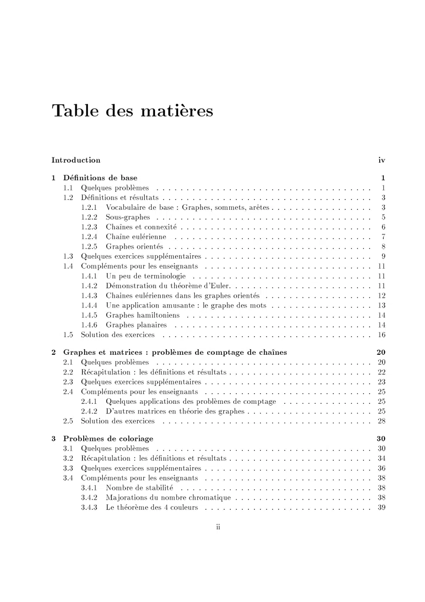

~~~text
Table des matieres
Introduction                                                                                           iv
1 De nitions de base                                                                                   1
  1.1 Quelques problemes . . . . . . . . . . . . . . . . . . . . . . . . . . . . . . . . . . . . 1
  1.2 De nitions et resultats . . . . . . . . . . . . . . . . . . . . . . . . . . . . . . . . . . . 3
      1.2.1 Vocabulaire de base : Graphes, sommets, ar^etes . . . . . . . . . . . . . . . . . 3
      1.2.2 Sous-graphes . . . . . . . . . . . . . . . . . . . . . . . . . . . . . . . . . . . . 5
      1.2.3 Cha^nes et connexite . . . . . . . . . . . . . . . . . . . . . . . . . . . . . . . . 6
      1.2.4 Cha^ne eulerienne . . . . . . . . . . . . . . . . . . . . . . . . . . . . . . . . . 7
      1.2.5 Graphes orientes . . . . . . . . . . . . . . . . . . . . . . . . . . . . . . . . . . 8
  1.3 Quelques exercices supplementaires . . . . . . . . . . . . . . . . . . . . . . . . . . . . 9
  1.4 Complements pour les enseignants . . . . . . . . . . . . . . . . . . . . . . . . . . . . 11
      1.4.1 Un peu de terminologie . . . . . . . . . . . . . . . . . . . . . . . . . . . . . . 11
      1.4.2 Demonstration du theoreme d'Euler. . . . . . . . . . . . . . . . . . . . . . . . 11
      1.4.3 Chaines euleriennes dans les graphes orientes . . . . . . . . . . . . . . . . . . 12
      1.4.4 Une application amusante : le graphe des mots . . . . . . . . . . . . . . . . . 13
      1.4.5 Graphes hamiltoniens . . . . . . . . . . . . . . . . . . . . . . . . . . . . . . . 14
      1.4.6 Graphes planaires . . . . . . . . . . . . . . . . . . . . . . . . . . . . . . . . . 14
  1.5 Solution des exercices . . . . . . . . . . . . . . . . . . . . . . . . . . . . . . . . . . . 16
2 Graphes et matrices : problemes de comptage de cha^nes                                             20
  2.1 Quelques problemes . . . . . . . . . . . . . . . . . . . . . . . . . . . . . . . . . . . . 20
  2.2 Recapitulation : les de nitions et resultats . . . . . . . . . . . . . . . . . . . . . . . . 22
  2.3 Quelques exercices supplementaires . . . . . . . . . . . . . . . . . . . . . . . . . . . . 23
  2.4 Complements pour les enseignants . . . . . . . . . . . . . . . . . . . . . . . . . . . . 25
      2.4.1 Quelques applications des problemes de comptage . . . . . . . . . . . . . . . 25
      2.4.2 D'autres matrices en theorie des graphes . . . . . . . . . . . . . . . . . . . . . 25
  2.5 Solution des exercices . . . . . . . . . . . . . . . . . . . . . . . . . . . . . . . . . . . 28
3 Problemes de coloriage                                                                              30
  3.1   Quelques problemes . . . . . . . . . . . . . . . . . . . . . . . . . . . . . . . . . . . . 30
  3.2   Recapitulation : les de nitions et resultats . . . . . . . . . . . . . . . . . . . . . . . . 34
  3.3   Quelques exercices supplementaires . . . . . . . . . . . . . . . . . . . . . . . . . . . . 36
  3.4   Complements pour les enseignants . . . . . . . . . . . . . . . . . . . . . . . . . . . . 38
        3.4.1 Nombre de stabilite . . . . . . . . . . . . . . . . . . . . . . . . . . . . . . . . 38
        3.4.2 Majorations du nombre chromatique . . . . . . . . . . . . . . . . . . . . . . . 38
        3.4.3 Le theoreme des 4 couleurs . . . . . . . . . . . . . . . . . . . . . . . . . . . . 39
                                                   ii
~~~

## Page 3

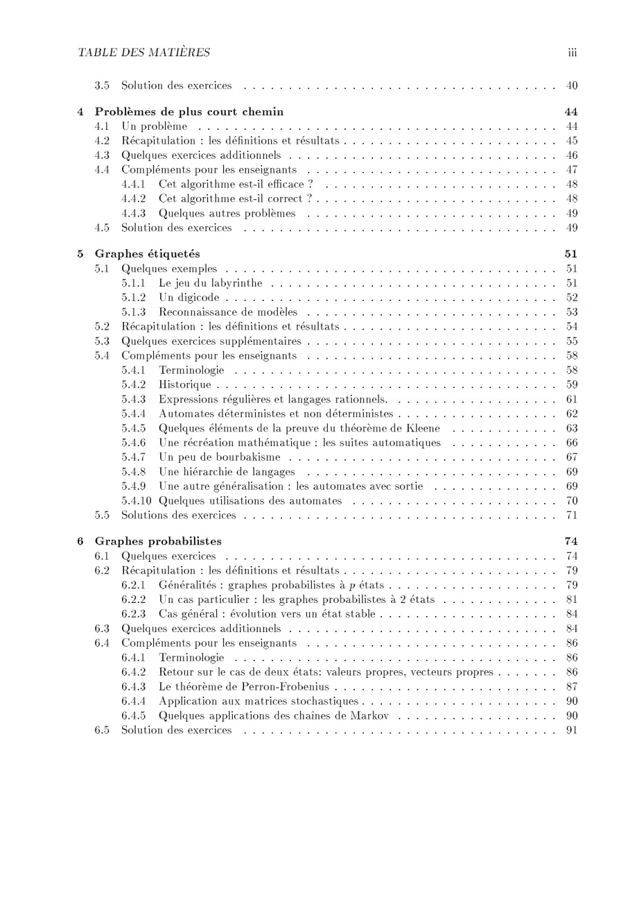

~~~text
TABLE DES MATIERES                                                                                  iii

  3.5 Solution des exercices . . . . . . . . . . . . . . . . . . . . . . . . . . . . . . . . . . . 40
4 Problemes de plus court chemin                                                                    44
  4.1 Un probleme . . . . . . . . . . . . . . . . . . . . . . . . . . . . . . . . . . . . . . . . 44
  4.2 Recapitulation : les de nitions et resultats . . . . . . . . . . . . . . . . . . . . . . . . 45
  4.3 Quelques exercices additionnels . . . . . . . . . . . . . . . . . . . . . . . . . . . . . . 46
  4.4 Complements pour les enseignants . . . . . . . . . . . . . . . . . . . . . . . . . . . . 47
      4.4.1 Cet algorithme est-il ecace ? . . . . . . . . . . . . . . . . . . . . . . . . . . 48
      4.4.2 Cet algorithme est-il correct ? . . . . . . . . . . . . . . . . . . . . . . . . . . . 48
      4.4.3 Quelques autres problemes . . . . . . . . . . . . . . . . . . . . . . . . . . . . 49
  4.5 Solution des exercices . . . . . . . . . . . . . . . . . . . . . . . . . . . . . . . . . . . 49
5 Graphes etiquetes                                                                                51
  5.1 Quelques exemples . . . . . . . . . . . . . . . . . . . . . . . . . . . . . . . . . . . . . 51
      5.1.1 Le jeu du labyrinthe . . . . . . . . . . . . . . . . . . . . . . . . . . . . . . . . 51
      5.1.2 Un digicode . . . . . . . . . . . . . . . . . . . . . . . . . . . . . . . . . . . . . 52
      5.1.3 Reconnaissance de modeles . . . . . . . . . . . . . . . . . . . . . . . . . . . . 53
  5.2 Recapitulation : les de nitions et resultats . . . . . . . . . . . . . . . . . . . . . . . . 54
  5.3 Quelques exercices supplementaires . . . . . . . . . . . . . . . . . . . . . . . . . . . . 55
  5.4 Complements pour les enseignants . . . . . . . . . . . . . . . . . . . . . . . . . . . . 58
      5.4.1 Terminologie . . . . . . . . . . . . . . . . . . . . . . . . . . . . . . . . . . . . 58
      5.4.2 Historique . . . . . . . . . . . . . . . . . . . . . . . . . . . . . . . . . . . . . . 59
      5.4.3 Expressions regulieres et langages rationnels. . . . . . . . . . . . . . . . . . . 61
      5.4.4 Automates deterministes et non deterministes . . . . . . . . . . . . . . . . . . 62
      5.4.5 Quelques elements de la preuve du theoreme de Kleene . . . . . . . . . . . . 63
      5.4.6 Une recreation mathematique : les suites automatiques . . . . . . . . . . . . 66
      5.4.7 Un peu de bourbakisme . . . . . . . . . . . . . . . . . . . . . . . . . . . . . . 67
      5.4.8 Une hierarchie de langages . . . . . . . . . . . . . . . . . . . . . . . . . . . . 69
      5.4.9 Une autre generalisation : les automates avec sortie . . . . . . . . . . . . . . 69
      5.4.10 Quelques utilisations des automates . . . . . . . . . . . . . . . . . . . . . . . 70
  5.5 Solutions des exercices . . . . . . . . . . . . . . . . . . . . . . . . . . . . . . . . . . . 71
6 Graphes probabilistes                                                                              74
  6.1 Quelques exercices . . . . . . . . . . . . . . . . . . . . . . . . . . . . . . . . . . . . . 74
  6.2 Recapitulation : les de nitions et resultats . . . . . . . . . . . . . . . . . . . . . . . . 79
      6.2.1 Generalites : graphes probabilistes a p etats . . . . . . . . . . . . . . . . . . . 79
      6.2.2 Un cas particulier : les graphes probabilistes a 2 etats . . . . . . . . . . . . . 81
      6.2.3 Cas general : evolution vers un etat stable . . . . . . . . . . . . . . . . . . . . 84
  6.3 Quelques exercices additionnels . . . . . . . . . . . . . . . . . . . . . . . . . . . . . . 84
  6.4 Complements pour les enseignants . . . . . . . . . . . . . . . . . . . . . . . . . . . . 86
      6.4.1 Terminologie . . . . . . . . . . . . . . . . . . . . . . . . . . . . . . . . . . . . 86
      6.4.2 Retour sur le cas de deux etats: valeurs propres, vecteurs propres . . . . . . . 86
      6.4.3 Le theoreme de Perron-Frobenius . . . . . . . . . . . . . . . . . . . . . . . . . 87
      6.4.4 Application aux matrices stochastiques . . . . . . . . . . . . . . . . . . . . . . 90
      6.4.5 Quelques applications des cha^nes de Markov . . . . . . . . . . . . . . . . . . 90
  6.5 Solution des exercices . . . . . . . . . . . . . . . . . . . . . . . . . . . . . . . . . . . 91
~~~

## Page 4

~~~text
Introduction
Ce texte presente la partie \graphes" de l'option de mathematiques de terminale ES. Le but de cette
option n'est pas, bien s^ur, de transformer les eleves de terminale ES en specialistes de la theorie
des graphes, mais de montrer comment l'utilisation judicieuse d'un graphe peut rendre certains
problemes concrets accessibles a un raisonnement mathematique.
    Il n'est donc pas question, comme cela est bien precise dans le programme, de faire un cours
formel ; ce parti-pris se re ete dans le present texte. Chaque chapitre debute donc par quelques
problemes dont la resolution est facilitee par la consideration des proprietes d'un graphe. Une
deuxieme partie, courte, donne les de nitions et proprietes necessaires pour enseigner ce cours.
Une troisieme partie donne d'autres exercices possibles, avec quelques explications, en particulier
sur leur inter^et pedagogique.
    En n, une quatrieme partie de chaque chapitre, intitulee Complements pour les enseignants,
est consacree a des connaissances plus approfondies permettant d'avoir un certain recul, et de
comprendre les raisons pour lesquelles on a choisi d'introduire ces notions. Insistons sur le fait
qu'elle n'est absolument pas necessaire pour l'enseignement de l'option, et qu'elle ne
fait pas du tout partie du programme ! Elle peut par contre donner des pistes pour
les TPE, en montrant nombre de themes \pratiques" a propos desquels on peut developper une
theorie mathematique utile; elle peut aussi, dans certains cas, donner des idees d'exercices, tels que
le graphe des mots, ou les cha^nes euleriennes orientees.
     La terminologie a ete volontairement restreinte au maximum, pour ne pas surcharger les eleves
(il s'agit d'une option de 24H !). En particulier, nous avons choisi de commencer par les graphes non
orientes, plus simples au depart, et d'introduire quand la situation le demande les graphes orientes,
en reprenant le vocabulaire precedent (on parlera donc d'ar^ete orientee, de chaine orientee, etc. . . ).
Nous reviendrons sur ce point dans les chapitres concernes.
     De m^eme, on a choisi de parler de graphes probabilistes la ou les probabilistes parlent de
cha^nes de Markov, et de graphes etiquetes la ou les informaticiens parlent d'automates nis ;
les complements de chaque chapitre donnent la terminologie usuelle. Il peut ^etre interessant de
signaler aux eleves le vocabulaire couramment utilise dans ces domaines, mais seul le vocabulaire
donne dans le programme est exigible au baccalaureat.
     Le texte a ete redige entre mars et octobre 2002 par le groupe de l'IREM d'Aix-Marseille, a
Luminy.

                                                     iv
~~~

## Page 5

~~~text
Chapitre 1

De nitions de base
1.1 Quelques problemes
Commencons par un probleme recreatif :
Exercice 1 Une ligue de football contient 15 clubs. Pour des raisons de temps, on decide que
chaque club ne jouera que la moitie des matchs possibles. Comment organiser le tournoi ? (on
pourra commencer par etudier le cas de 7 clubs).
     Avec 15 clubs, il est assez dicile de demarrer le travail sur ce probleme , a cause de la taille
des donnees. Avec 7 clubs, on est rapidement amene a un dessin ou chaque club est represente par
un point, et ou on relie par un trait deux clubs qui disputent un match. Une bonne idee est alors
de compter le nombre de traits, c'est-a-dire le nombre de matchs qui seront joues ; comme chaque
trait a deux extremites, c'est aussi la moitie du nombre de participations : si chacun des 7 clubs
joue 3 matchs, il y a 21 participations, dont 212 matchs, ce qui est absurde ! De m^eme, dans le cas
de 15 clubs, si chaque club joue la moitie des matchs possibles, soit 7, il doit y avoir 1527 matchs :
l'organisation d'un tel tournoi n'est pas possible, pour de pures raisons arithmetiques. On voit que,
plus generalement, pour la m^eme raison, s'il y a un nombre impair d'equipes, il n'est pas possible
qu'elles jouent toutes un nombre impair de matchs.
     L'idee essentielle est de representer la situation par un dessin particulier, un graphe : des points
relies par des traits. Dans ce dessin, la situation geometrique n'est pas importante, ce qui compte
ce sont les points (ou sommets), et la facon dont ils sont relies a d'autres par des traits (ou ar^etes).
Des problemes tres di erents peuvent se ramener a une m^eme representation :
Exercice 2 Comment tracer 5 segments sur une feuille, de telle maniere que chaque segment en
coupe exactement 3 autres ?
     Si l'on pense a representer chaque segment par un point, et a relier 2 points si les segments
correspondants se coupent, on voit, exactement comme pour l'exercice precedent, que l'exercice
propose est impossible.
     Remarquons que nous avons obtenu un resultat qui n'etait nullement evident : pour montrer
qu'un probleme est possible, il sut d'en exhiber une solution ; il est en general bien plus dicile
de demontrer qu'un probleme est impossible, et cela ne peut se faire sans un raisonnement.
     Continuons par le probleme suivant, qui est un classique : propose en 1736 par Leonhart Euler,
c'est le premier probleme de la theorie des graphes. Il est aujourd'hui parfaitement resolu, mais
les habitants de Koenigsberg (aujourd'hui Kaliningrad, ville russe enclavee entre la Pologne et la
Lituanie) ne voyaient pas comment faire.
                                                     1
~~~

## Page 6

~~~text
2                                                          CHAPITRE 1. DEFINITIONS DE BASE
Exercice 3 Probleme des ponts de Konigsberg : Au XVIIIe siecle, la ville de Koenisberg comprenait
2 ^les et 7 ponts suivant le plan ci-dessous :

                                Figure 1.1: Les ponts de Koenigsberg
   Les habitants souhaitaient faire une promenade passant une et une seule fois sur chaque pont.
Y sont ils arrives ?

    Traduisons de m^eme ce probleme a l'aide d'un graphe. Chaque region de la ville est representee
par un sommet, et un pont entre deux regions, par une ar^ete entre les sommets concernes, quel
graphe obtient-on ? Comment interprete-on alors la condition sur la promenade ? Nous reviendrons
plus loin sur ce probleme.

     De tres nombreux problemes pratiques peuvent ^etre ainsi schematises a l'aide d'un graphe ;
en simpli ant la representation, on peut ainsi trouver plus rapidement la solution (ou en voir
l'impossibilite !). Pour certains problemes, comme ceux que nous venons de voir, les ar^etes n'ont
pas d'orientation. Pour d'autres, il est indispensable d'avoir une orientation sur le graphe : le plan
d'une ville comme graphe non oriente satisfera le pieton, tandis que ce m^eme graphe oriente par les
sens de circulation sera bien plus apprecie de l'automobiliste. Une autre utilisation classique des
graphes est l'ordonnancement des t^aches : pour un projet tel que la construction d'une maison, il y
a di erentes t^aches qui doivent ^etre e ectuees dans un certain ordre : on doit creuser les fondations
avant d'elever les murs. On peut representer le projet par un graphe dont les sommets sont les
di erentes t^aches, et ou on relie A a B si A doit ^etre terminee avant de commencer B . L'ar^ete
correspondante possede une orientation naturelle.
     Une question importante est celle du choix du graphe associe a une situation donnee (il peut
y en avoir plusieurs) ; comment choisir les sommets et les ar^etes ? Comme on vient de le voir
dans l'exercice 2, ce n'est pas toujours evident : dans la modelisation proposee, les segments sont
les sommets du graphe, et les ar^etes correspondent aux points d'intersection. Dans des chapitres
ulterieurs, on etudiera des questions de compatibilite, il faudra decider si les ar^etes correspondent
aux couples de points compatibles ou incompatibles, et si les ar^etes sont orientees ou non.
~~~

## Page 7

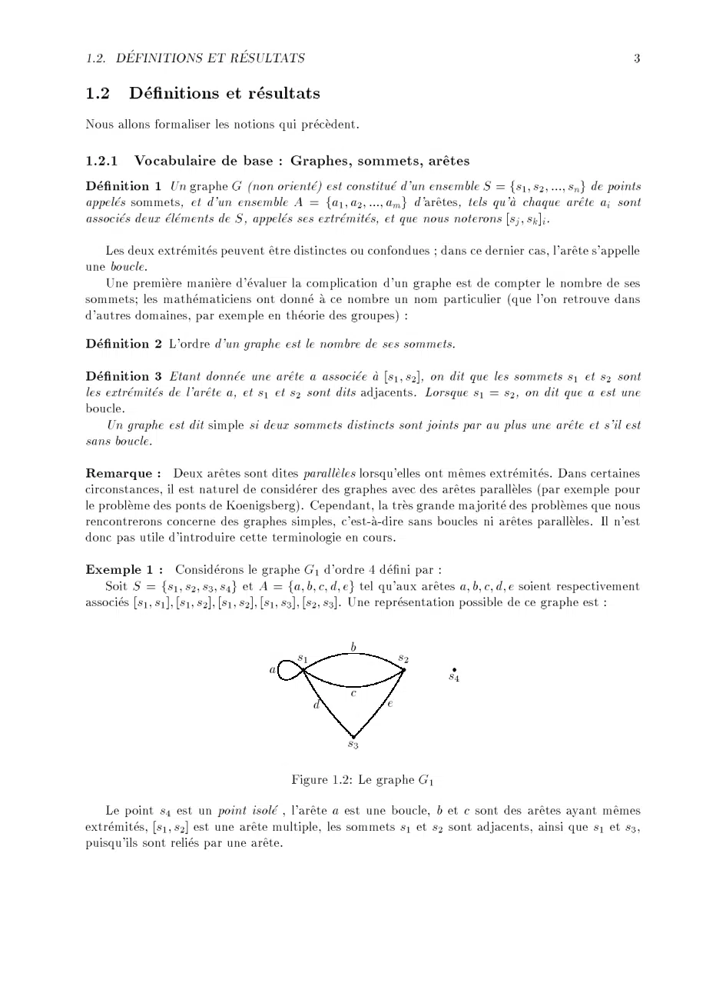

~~~text
1.2. DEFINITIONS ET RESULTATS                                                                                 3

1.2 De nitions et resultats
Nous allons formaliser les notions qui precedent.

1.2.1 Vocabulaire de base : Graphes, sommets, ar^etes
De nition 1 Un graphe G (non oriente) est constitue d'un ensemble S = fs1; s2; :::; sng de points
appeles sommets, et d'un ensemble A = fa1 ; a2; :::; amg d'ar^etes, tels qu'a chaque ar^ete ai sont
associes deux elements de S , appeles ses extremites, et que nous noterons [sj ; sk ]i .
   Les deux extremites peuvent ^etre distinctes ou confondues ; dans ce dernier cas, l'ar^ete s'appelle
une boucle.
   Une premiere maniere d'evaluer la complication d'un graphe est de compter le nombre de ses
sommets; les mathematiciens ont donne a ce nombre un nom particulier (que l'on retrouve dans
d'autres domaines, par exemple en theorie des groupes) :
De nition 2 L'ordre d'un graphe est le nombre de ses sommets.
De nition 3 Etant donnee une ar^ete a associee a [s1; s2], on dit que les sommets s1 et s2 sont
les extremites de l'ar^ete a, et s1 et s2 sont dits adjacents. Lorsque s1 = s2 , on dit que a est une
boucle.
    Un graphe est dit simple si deux sommets distincts sont joints par au plus une ar^ete et s'il est
sans boucle.
Remarque : Deux ar^etes sont dites paralleles lorsqu'elles ont m^emes extremites. Dans certaines
circonstances, il est naturel de considerer des graphes avec des ar^etes paralleles (par exemple pour
le probleme des ponts de Koenigsberg). Cependant, la tres grande majorite des problemes que nous
rencontrerons concerne des graphes simples, c'est-a-dire sans boucles ni ar^etes paralleles. Il n'est
donc pas utile d'introduire cette terminologie en cours.
Exemple 1 : Considerons le graphe G1 d'ordre 4 de ni par :
  Soit S = fs1 ; s2; s3; s4g et A = fa; b; c; d; eg tel qu'aux ar^etes a; b; c; d; e soient respectivement
associes [s1; s1 ]; [s1; s2]; [s1; s2]; [s1; s3 ]; [s2; s3]. Une representation possible de ce graphe est :

                                                       b
                                            s1                     s2
                                      a                                  s4
                                                       c
                                                 d             e

                                                      s3
                                           Figure 1.2: Le graphe G1
    Le point s4 est un point isole , l'ar^ete a est une boucle, b et c sont des ar^etes ayant m^emes
extremites, [s1 ; s2] est une ar^ete multiple, les sommets s1 et s2 sont adjacents, ainsi que s1 et s3 ,
puisqu'ils sont relies par une ar^ete.
~~~

## Page 8

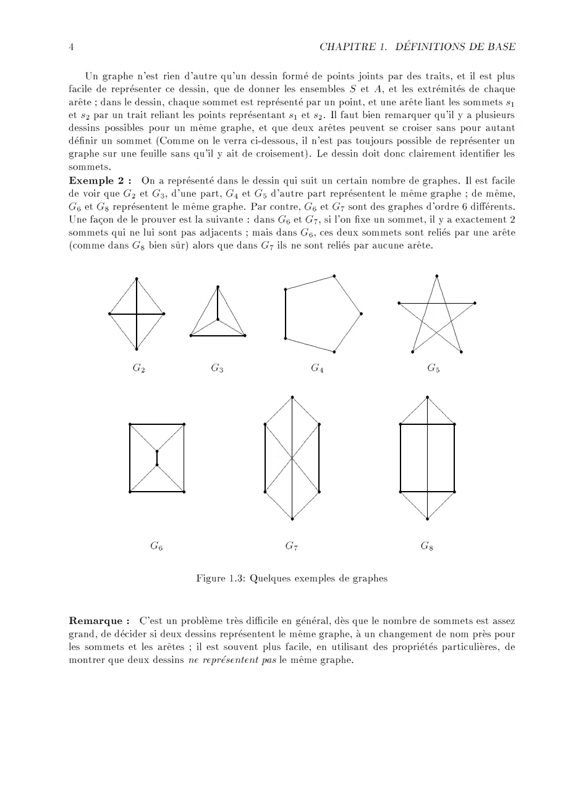

~~~text
4                                                                                CHAPITRE 1. DEFINITIONS DE BASE
     Un graphe n'est rien d'autre qu'un dessin forme de points joints par des traits, et il est plus
facile de representer ce dessin, que de donner les ensembles S et A, et les extremites de chaque
ar^ete ; dans le dessin, chaque sommet est represente par un point, et une ar^ete liant les sommets s1
et s2 par un trait reliant les points representant s1 et s2 . Il faut bien remarquer qu'il y a plusieurs
dessins possibles pour un m^eme graphe, et que deux ar^etes peuvent se croiser sans pour autant
de nir un sommet (Comme on le verra ci-dessous, il n'est pas toujours possible de representer un
graphe sur une feuille sans qu'il y ait de croisement). Le dessin doit donc clairement identi er les
sommets.
Exemple 2 : On a represente dans le dessin qui suit un certain nombre de graphes. Il est facile
de voir que G2 et G3, d'une part, G4 et G5 d'autre part representent le m^eme graphe ; de m^eme,
G6 et G8 representent le m^eme graphe. Par contre, G6 et G7 sont des graphes d'ordre 6 di erents.
Une facon de le prouver est la suivante : dans G6 et G7 , si l'on xe un sommet, il y a exactement 2
sommets qui ne lui sont pas adjacents ; mais dans G6 , ces deux sommets sont relies par une ar^ete
(comme dans G8 bien s^ur) alors que dans G7 ils ne sont relies par aucune ar^ete.

                                                                           hhhh66                         ))
                    8                                                          6
                    888                      11                    hhhhh       66                     ))
                                                                                                                )
                       88                     11                 hh
                                                                                    66
                         88                                                                              )))
                           88                   11                                  66     FFF                       x
            
         888                                      1                                   6       FF            )) xxx
                                            LLL 111
                                                                                                  FF             x
              88                          rr                                                          F        x)x
                                         rr       LLL1                                              FFFxxx )))
                88
                  88 
                                      rrr
                                                     L1
                                                                                                   xxxFFF ))
                                                                   VVVVVVV       
                   8                                                    VVVV                xxxx           FF )
                                                                                                                     F
                                                                                              
                  G2                          G3                             G4                       G5

                                                                      ??                           ??
                                                                        ?                              ?
                                                                   ???                          ???
                                                                            ??                          ??
                                                                                ?                             ?
                 ???                                    999              
                                                                                                          
                     ??                                        99           
                       ??                                       99       
                         ??                                        99 
                                                                     9
                                                                      999
                          ??                                       
                        ???                                           99
                              ??                                          99
                              ??                                          99
                 
                                                          ??
                                                            ?
                                                                                          ???           
                                                                 ??                           ??        
                                                                   ??                          ?? 
                                                                     ??                           ?? 
                                                                                                   

                         G6                                        G7                               G8

                                           Figure 1.3: Quelques exemples de graphes

Remarque : C'est un probleme tres dicile en general, des que le nombre de sommets est assez
grand, de decider si deux dessins representent le m^eme graphe, a un changement de nom pres pour
les sommets et les ar^etes ; il est souvent plus facile, en utilisant des proprietes particulieres, de
montrer que deux dessins ne representent pas le m^eme graphe.
~~~

## Page 9

~~~text
1.2. DEFINITIONS ET RESULTATS                                                                        5

De nition 4 Un graphe simple est dit complet si tous ses sommets sont adjacents, c'est a dire si
toutes les ar^etes possibles existent (sauf les boucles). On appelera Kn le graphe complet a n sommet
(il n'y en a qu'un).
De nition 5 On appelle degre d'un sommet le nombre d'ar^etes dont ce sommet est une extremite
( les boucles etant comptees deux fois ). Un sommet est pair (respectivement impair) si son degre
est un nombre pair (respectivement impair).
Exemple 3 :
   Dans le graphe G1 de l'exemple 1 : s1 est de degre 5, s2 de degre 3, s4 de degre 0.
   Les sommets du graphe complet d'ordre n sont tous de degre n-1.

   On prouve facilement le theoreme suivant :
Theoreme 1 La somme des degres de tous les sommets d'un graphe est egale a deux fois le nombre
d'ar^etes de ce graphe ; c'est donc un nombre pair.
Demonstration : Il sut de faire comme pour le premier exercice : lorsque on additionne les
degres des sommets, une ar^ete est comptee deux fois, une fois pour chaque extremite.

Corollaire 1 Dans un graphe le nombre de sommets impairs est toujours pair.

Demonstration : En e et, sinon, la somme des degres des sommets serait impaire.
   On retrouve ici le fait que le premier exercice pose en introduction est impossible : il n'existe
pas de graphe d'ordre 15 tel que chaque sommet soit de degre 7.
1.2.2 Sous-graphes
On a souvent besoin d'isoler une partie d'un graphe :
De nition 6 Soit G = (S; A) un graphe, le graphe G0 = (S 0; A0) est un sous-graphe de G, si S 0
 et A0 sont des sous ensembles de S et A, tels que toutes les extremites des ar^etes de A0 soient des
elements de S 0. Si de plus A0 contient exactement toutes les ar^etes de A dont les extremites sont
 des elements de S 0 alors on dit que G0 = (S 0; A0) est le sous-graphe de G engendre par S 0 ; il est
 determine de maniere unique par la donnee de S 0 .
Exemple 4 : Le graphe suivant :
                                            s1                 s2
                                       a                       
                                                      c

                                                      s3
~~~

## Page 10

~~~text
6                                                           CHAPITRE 1. DEFINITIONS DE BASE
    est un sous graphe de G1, le sous graphe engendre par s1 ; s2; s3 est G1 ; fs4 g.
     Le sous-graphe engendre par fs4 ; s3g est sans ar^ete, c'est lui m^eme.
     Si S est l'ensemble des villes de France qui ont une gare, et A l'ensemble des voies ferrees les
reliant, si S 0 est l'ensemble des villes d'un departement, avec une gare, et A0 l'ensemble des voies
ferrees les reliant, le graphe G0 = (S 0; A0) est le sous-graphe du graphe G = (S; A) engendre par S 0.
Maintenant si on considere le reseau TGV : S 00 ensemble des villes de France qui ont une gare TGV,
et A00 ensemble des voies ferrees TGV les reliant, le graphe G00 = (S 00; A00) est un sous graphe de G,
mais n'est pas engendre par S 00, il existe des voies ordinaires entre Lyon et Marseille par exemple.
De nition 7 On dit qu'un sous-ensemble de l'ensemble des sommets est stable s'il ne contient pas
de paire de sommets adjacents.
    On peut aussi parler de sous-graphe stable : cela revient au m^eme, puisque si un ensemble de
sommets est stable, le graphe engendre, par de nition, n'a pas d'ar^ete. Dans l'exemple ci-dessus,
le sous-ensemble fs4 ; s3g est stable.
    Ce terme de \stable" peut para^tre arbitraire. Il est en fait naturel si l'on considere ce qu'on
appelle \graphe d'incompatibilite": dans un groupe d'individus, on peut de nir un graphe en
reliant par une ar^ete les individus qui ne peuvent se supporter. Si l'on veut choisir un sous-groupe
de personnes qui travaillent ensemble, il est preferable de choisir un sous-ensemble stable ! C'est
une notion importante pour divers problemes ; on verra en particulier beaucoup d'applications de
cette notion dans le chapitre sur les coloriages.
1.2.3 Cha^nes et connexite
Dans bien des problemes de graphes, il est naturel de considerer ce que l'on peut appeler, de facon
informelle, des \parcours" ou \chemins". Le mot utilise en theorie des graphes est \cha^ne".
     La notion intuitive de cha^ne, ou plus tard de cha^ne orientee, se comprend bien sur un dessin,
et il est essentiel que les eleves sachent reconna^tre si un ensemble donnee d'ar^etes est une cha^ne.
Il est moins facile d'en donner une de nition e ective. C'est un bon exercice de tenter de donner
une de nition formelle de cette notion, non pour obliger les eleves a l'apprendre par coeur, mais
pour leur montrer les dicultes qu'il peut y avoir a rediger une de nition ou un theoreme, et la
raison pour laquelle cette redaction est parfois complexe :
Exercice 4 Les de nitions suivantes formalisent-elles bien ce que l'on veut?
   De nition 1 : on appelle cha^ne une suite a1; a2; : : :; an d'ar^etes qui est telle que deux ar^etes
consecutives aient une extremite commune.
   De nition 2 : on appelle cha^ne une suite s0 ; s1; : : :; sn telle que deux sommets consecutifs soient
adjacents.
   Apres avoir passe un peu de temps sur cet exercice, on appreciera mieux la de nition suivante,
d'apparence un peu complexe :
De nition 8 Une cha^ne dans un graphe G est une suite nie : s0; a1; s1; a2; s2; a3; s3::::an; sn
debutant et nissant par un sommet, alternant sommets et ar^etes de telle maniere que chaque ar^ete
soit encadree par ses sommets extremites. La longueur de la cha^ne est egale au nombre d'ar^etes
qui la constituent ; la cha^ne est fermee si s0 = sn , si de plus toutes ses ar^etes sont distinctes on
dit alors que c'est un cycle. Un k-cycle est un cycle de longueur k.
~~~

## Page 11

~~~text
1.2. DEFINITIONS ET RESULTATS                                                                          7

Remarque : Quand il n'y a pas d'ambigute (pas d'ar^etes multiples), on peut de nir une cha^ne
par seulement la suite de ses sommets ou de ses ar^etes; dans ce cas, la de nition 2 proposee dans
l'exercice 4 est correcte, mais toujours pas la de nition 1. On peut la remplacer par la suivante, qui
est correcte dans tous les cas: on appelle cha^ne une suite a1 ; a2; : : :; an d'ar^etes telles que chaque
ar^ete ai , pour 1 < i < n, est reliee a ai;1 par une de ses extremites, et a ai+1 par l'autre.
Exemple 5 : a; b; c; b; e est une cha^ne de longueur 5 dans G1 ; b; e; d ainsi que a; b; c, sont des
3-cycles de G1.
   Considerons maintenant le probleme suivant :
Exercice 5 Dans un tout petit pays, il n'y a que 15 villes. On peut aller de chaque ville a au moins
7 autres villes du pays par une autoroute. Peut-on se rendre, par autoroute, de la capitale du pays
a chacune des autres villes ?
     Soit A une ville quelconque. L'autoroute nous conduit de la capitale vers au moins 7 villes
di erentes ; on a donc un reseau de 8 villes reliees par autoroute. De la ville A on peut egalement
relier par autoroute au moins 7 autres villes di erentes ; on a donc un nouveau reseau de 8 villes
reliees par autoroute. Il doit y avoir une ville commune a ces deux reseaux, car sinon le pays aurait
au moins 16 villes. La capitale est donc reliee a A en au plus deux coups, en passant par cette ville
commune ; elle est donc reliee a toutes les autres villes du pays.
     Le graphe qui represente la situation precedente sera dit connexe.
De nition 9 Un graphe est connexe si deux sommets quelconques sont relies par une cha^ne (c'est
un graphe en un seul morceau). On appelle composante connexe du graphe G un sous-graphe
connexe maximal de G (c'est a dire qui n'est contenu dans aucun autre sous-graphe connexe.)
1.2.4 Cha^ne eulerienne
Posons nous le probleme suivant :
Exercice 6 Peut-on dessiner sans lever le crayon et en ne passant qu'une seule fois sur chaque
ar^ete les graphes ci dessous ?
                           uII                                                  uII
                        uuu III                                               uuu III
                       u        II                                           u          II
                    uu                      GGG           w         uGGuG          ww
                                                  GG      www                 GG      ww
                                                    GG ww                       GG ww
                                                      Gw                          Gw
                                                     wwGG                        wwGG
                                                  www GGG                     www GGG
                                                 w          GG               w          GG
                                            ww                      ww               

                                     Figure 1.4: Le probleme d'Euler

   En faisant des essais, on constate assez vite que ceci est possible pour les graphes 1 et 3, mais
apparemment pas pour le graphe 2. Ceci nous conduit a de nir :
De nition 10 Une cha^ne est eulerienne si elle contient une fois et une seule chaque ar^ete du
graphe ; si la cha^ne est un cycle, on l'appelle cycle eulerien.
~~~

## Page 12

~~~text
8                                                           CHAPITRE 1. DEFINITIONS DE BASE
    Le theoreme suivant, dit theoreme d' Euler, est a l'origine de la theorie des graphes :
Theoreme 2 Un graphe connexe a une cha^ne eulerienne si et seulement si tous ses sommets sont
pairs sauf au plus deux.
    De facon plus precise :
     si le graphe n'a pas de sommet impair, alors il a un cycle eulerien.
     le graphe ne peut avoir un seul sommet impair, par le corollaire 1.
     si le graphe a deux sommets impairs, ce sont les extremites de la cha^ne eulerienne.
    On verra la demonstration du theoreme d'Euler dans les complements ; elle peut ^etre faite en
classe a titre d'exercice. Le corollaire suivant, consequence immediate du theoreme, est souvent
utile :
Corollaire 2 Un graphe ayant plus de deux sommets impairs ne possede pas de cha^ne eulerienne.
    Ces resultats permettent de resoudre beaucoup de problemes pratiques se traitant en theorie
des graphes. Reprenons le probleme des ponts de Konigsberg cite au debut du chapitre. Le graphe
associe au plan de la ville est donc le graphe suivant :
                                                     

                                                                

                                                     

                                 Figure 1.5: Le graphe de Koenigsberg
   Le probleme pose devient : le graphe a-t-il une chaine eulerienne ? Le theoreme d'Euler nous
permet de repondre non, puisque les 4 sommets sont impairs.

1.2.5 Graphes orientes
Il existe de nombreux domaines ou les graphes sont orientes. Par exemple : plan de ville, avec les
sens interdits ; parcours en montagne, ou il est utile d'indiquer le sens de montee ! Circuit electrique
en courant continu, ou il faut orienter les ar^etes pour decider du signe de l'intensite : ce n'est pas
la m^eme chose de faire passer 10 amperes de A vers B ou de B vers A ; graphe d'ordonnancement,
ou les ar^etes relient une t^ache a une autre qui doit la suivre : on ne peut faire la peinture avant le
pl^atre.
De nition 11 On appelle graphe oriente un graphe ou chaque ar^ete est orientee, c'est-a-dire
qu'elle va de l'une des ses extremites, appelee origine ou extremite initiale a l'autre, appelee
extremite terminale .
~~~

## Page 13

~~~text
1.3. QUELQUES EXERCICES SUPPLEMENTAIRES                                                                                                                   9

     Dans un graphe oriente, chaque ar^ete orientee possede un debut et une n.
     Toutes les notions que nous avons de nies pour un graphe ont un equivalent pour un graphe
oriente. Nous nous contenterons de rajouter le mot \oriente" pour preciser ; le contexte rendra
evidente l'interpretation a donner.
     En particulier, une cha^ne orientee est une suite d'ar^etes telle que l'extremite nale de chacune
soit l'extremite initiale de la suivante. On prendra garde au fait que l'on peut de nir et utiliser
des cha^nes (non orientees) sur un graphe oriente. Par exemple, sur un plan de ville ou toutes les
rues sont en sens unique, un parcours de voiture correspond a une cha^ne orientee, un parcours de
pieton correspond a une cha^ne (non orientee).

1.3 Quelques exercices supplementaires
Pour s'habituer un peu a la representation des graphes :
Exercice 7 Decider si les dessins suivants representent les m^emes graphes.
                        ??
                      ???
                                                                                           hhhh                               vv HHH
                                        ?                                                                                           H
                                                                                hhhh 
                                                                                 h                                           vv       HH
                                         IIII                          8U8UUUU 
                                                                                 8
                                                                                 h
                                                                                 U h                                         vv            HH
                                                                                    88 UU UUUU                        vv                         HH
                                                                                                           (v( v
                                
                                                      II                            88          UUUU                                           xx
                                                  IIII                        88               U
                                                                                                           
                                                                                                                   ((                      x
                                                                                                                                          x 
                                                                                                                                              x
                                                          II                  88                       ((                 xx 
                                                                      III                  88                       ((           xx
                                                                                                                                       x
                                                
                                                                   I
                                                                                                                                                
                               
                          
                                                                               VVVVVVV 888                          ((     x xx
                                                                                                                                               
                                                                                            VVVV8                         (xxxx
                                                                                                                                     

               G1                                          G2                            G3                                   G4
    L'exercice qui suit montre aux eleves qu'un m^eme graphe peut representer des situations tres
diverses.
Exercice 8 Dessiner les graphes suivants :
   Les sommets sont les faces d'un cube, deux sommets sont relies si les faces correspondantes
       ont une ar^ete du cube en commun.
      Les sommets du graphe sont tous les sous ensembles a deux elements de f1, 2, 3, 4 g deux
       sommets sont relies si leur intersection est non vide.
      Graphe associe a la situation : Trois pays envoient chacun a une conference deux espions qui
       ne se connaissent pas, chaque espion doit entrer en contact avec tous les espions des autres
       pays.
    Il est utile de montrer quelques cas simples, qui permettent aussi de voir a quelle vitesse la
situation se complique quand l'ordre augmente ; c'est le but des deux exercices suivants.
Exercice 9 Dessiner les graphes complets Kn, pour n = 2; 3; 4; 5. Combien ont ils d'ar^etes ?
Exercice 10 Dessiner les graphes simples d'ordre 3, 4, 5, 6 dont tous les sommets sont de degre
2.
~~~

## Page 14

~~~text
10                                                       CHAPITRE 1. DEFINITIONS DE BASE
    La diculte de l'exercice suivant est presque toute dans la representation sous forme de graphe.
Il sut ensuite de compter le nombre d'ar^etes d'un graphe complet.
Exercice 11 Le conseil municipal d'une ville comprend 7 commissions, qui obeissent aux regles
suivantes :
    Regle 1 : tout conseiller municipal fait partie de 2 commissions exactement.
    Regle 2 : deux commissions quelconques ont exactement un conseiller en commun ;
    Combien y a-t-il de membres dans le conseil municipal ?
     La regle 1 nous permet d'obtenir la representation graphique suivante :
     les commissions sont les sommets et un conseiller faisant partie d'exactement 2 commissions
est represente par une ar^ete reliant les 2 sommets qui les representent (remarquons que sans cette
regle la representation obtenue ne serait pas un graphe, mais un objet plus complique, un \hyper
graphe"). La regle 1 nous dit aussi que le graphe obtenu est sans boucle. La regle 2 implique qu'il
n'y a pas d'ar^ete multiple, et que deux sommets quelconques sont adjacents ; c'est a dire que le
graphe est complet, c'est K7, il a (72) ar^etes, soit 21 conseillers municipaux. On peut m^eme en
deduire le nombre de membres de chaque commission, c'est-a-dire 6.
     L'exercice suivant est une application simple du theoreme sur les degres.
Exercice 12 Dans un groupe de vingt enfants, est-il possible que sept d'entre eux aient chacun ex-
actement trois amis, neuf d'entre eux en aient exactement quatre, et quatre d'entre eux exactement
cinq ?
    Voici une generalisation pas tout-a-fait evidente de l'exercice 5 :
Exercice 13 Un graphe simple d'ordre 2p est tel que chacun de ses sommets est de degre au moins
p. Montrer que ce graphe est connexe. A-t-on le m^eme resultat pour un graphe simple d'ordre n tel
que chacun de ses sommets soit de degre superieur ou egal a (n-1)/2 ?
    L'exercice qui suit est une application classique du theoreme d'Euler ; la diculte est toute
dans la construction du graphe (c'est le graphe dual de celui qui appara^t sur la gure). Il est facile
de trouver de nombreuses variantes sur ce theme.
Exercice 14 Cinq pays sont representes avec leurs frontieres. Est il possible de partir d'un pays
et d'y revenir en franchissant chaque frontiere une fois et une seule ?

                               Figure 1.6: Le probleme des frontieres
~~~

## Page 15

~~~text
1.4. COMPLEMENTS POUR LES ENSEIGNANTS                                                                   11

    Voici un autre exercice qui, sans ^etre une application directe du theoreme d'Euler, repose sur
les m^emes idees.
Exercice 15 On dispose d'un l de fer de 120 cm. Est-il possible de preparer une carcasse de cube
de 10 cm d'ar^ete sans couper le l ? Sinon, combien de fois au minimun faut-il couper le l de fer
pour fabriquer cette carcasse ?

1.4 Complements pour les enseignants
1.4.1 Un peu de terminologie
L'option de terminale ES n'est qu'une initiation. Les concepteurs du programme ont donc voulu
reduire au minimum la terminologie employee, pour que l'eleve se concentre sur la modelisation et
le raisonnement. En particulier, on evitera l'emploi de vocabulaire particulier pour les cas orientes,
en se contentant de rajouter l'adjectif \oriente" la ou c'est necessaire. Au niveau ou nous nous
placons, ceci ne devrait pas entra^ner de dicultes.
      Pour les specialistes de la theorie des graphes, il est bien entendu necessaire de xer en detail
 la terminologie. Nous la donnons ici pour information, en rappelant qu'elle n'est pas exigible des
eleves (mais elle peut ^etre utile dans certains cas pour acceder a la litterature).
      Une ar^ete orientee s'appelle un arc. Une cha^ne orientee s'appelle un chemin. Une cha^ne
orientee fermee s'appelle un circuit.
      On dit qu'un graphe est fortement connexe si, pour tout couple de sommets distincts a; b, il
 existe un chemin de a a b. Un graphe fortement connexe est connexe ; la reciproque est fausse. Par
 exemple, un plan de ville, avec les sens interdits, ne doit pas seulement ^etre connexe, il doit aussi
^etre fortement connexe, sinon il y aurait des points inaccessibles a partir de certains autres.
      Pour les graphes orientes, le degre d'un sommet x se divise en demi-degre interieur, nombre
 des arcs qui arrivent en x, et demi-degre exterieur, nombre des arcs qui partent de x. De m^eme,
 les sommets adjacents a x se divisent en predecesseurs et successeurs de x. Si le graphe est simple
 (c'est-a-dire, si pour tout couple (x; y ), il y a au plus un arc qui va de x a y ), le nombre de
 successeurs (resp. predecesseurs) de x est le demi-degre exterieur (resp. interieur) de x.

1.4.2 Demonstration du theoreme d'Euler.
Demonstration : Supposons que le graphe connexe G possede une cha^ne eulerienne. Chaque
fois qu'en parcourant cette cha^ne on arrive a un sommet par une ar^ete, on en repart par une
autre, sauf pour les extremites de cette cha^ne. Comme cette cha^ne est eulerienne, chaque ar^ete
est parcourue une et une seule fois, ainsi si la cha^ne est passee n fois par le sommet s, ce sommet
est de degre 2n. Par consequent tous les sommets du graphe sont pairs sauf peut-^etre deux (les
extremites de la cha^ne si elles sont di erentes).
    Nous allons demontrer reciproquement que, si tous les sommets d'un graphe connexe sont pairs
sauf deux (notes u et v ), il existe une cha^ne eulerienne reliant ces deux sommets, ceci par recurrence
sur le nombre d'ar^etes du graphe. L'on en deduira alors qu'un graphe connexe dont tous les sommets
sont pairs possede un cycle eulerien. En e et, si dans un tel graphe on o^te arbitrairement une ar^ete
a, on est ramene au cas precedent, la cha^ne eulerienne est alors completee en un cycle eulerien
par ajout de l'ar^ete a. On peut toujours le faire car il n'y a pas de sommet de degre zero dans un
graphe connexe.
    Recurrence : C'est clair pour un graphe connexe a une ar^ete.
~~~

## Page 16

~~~text
12                                                                        CHAPITRE 1. DEFINITIONS DE BASE
    Supposons demontre le theoreme pour les graphes ayant au plus n ; 1 ar^etes, et considerons un
graphe G ayant n ar^etes ; lorsque une cha^ne partant du sommet u dans une direction quelconque
et ne parcourant jamais deux fois la m^eme ar^ete, arrive a un sommet s (di erent de v ), elle a
parcourue un nombre impair d'ar^etes incidentes a s, et par consequent, cette cha^ne peut repartir
de s par une ar^ete non encore parcourue ; le seul sommet d'ou l'on ne peut repartir etant le sommet
v.
                                                               EEE
                                                                   E
                                                               
                                                                          v
                                             ooo''                         666
                                                 '
                                       u    o             
                                          oo                                      66
                                        
                                        o          '' o 
                                                         2
                                                    ooo 2222                       66
                                                                                      6
                                                                    22
                                                                      22        llll
                                                                        22 
                                                                          22 
                                                                            2
                                                                            
                                                                   
                                                                          si 
                                                                            
                                                                           ci

                             Figure 1.7: La preuve du theoreme d'Euler
     Cependant dans cette cha^ne c arbitraire reliant les sommets u et v , il est possible que toutes
les ar^etes du graphe n'aient pas ete parcourues, il reste donc un graphe G0 dont tous les sommets
sont de degre pair. Soient C1 :::Ck ses composantes connexes, par hypothese de recurrence elles
admettent des cycles euleriens c1::::; ck, et , comme le graphe G est connexe, la cha^ne c rencontre
forcement les composantes connexes Ci en au moins un sommet soit si . On obtient alors une cha^ne
eulerienne en intercalant dans la cha^ne c, les cycles ci lorsqu'on rencontre le sommet si (voir gure
1.7).

1.4.3 Chaines euleriennes dans les graphes orientes
Toutes les de nitions precedentes s'etendent d'une maniere naturelle aux graphes orientes. Il est
naturel de se poser la m^eme question pour un graphe oriente : est-il possible de parcourir toutes
les ar^etes, en respectant l'orientation, sans passer deux fois par une m^eme ar^ete?
     On de nit facilement (exercice !) la notion de cha^ne orientee eulerienne et de cycle oriente
eulerien (chemin ou circuit eulerien, avec la terminologie standard).
     C'est un exercice de bon niveau de trouver la generalisation naturelle du theoreme d'Euler pour
les graphes orientes :
Theoreme 3 Un graphe oriente connexe possede un cycle oriente eulerien si et seulement si de
chaque sommet il part autant d'ar^etes qu'il en arrive.
    On laisse au lecteur le soin de trouver la condition necessaire et susante pour qu'il existe une
chaine oriente connexe dans un graphe oriente.
    On remarquera aussi que le theoreme sur la somme des degres se precise un peu pour les graphes
orientes : avec le vocabulaire donne ci-dessus, la somme des demi-degres interieurs est egale a la
somme des demi-degres exterieurs, et au nombre d'arcs (puiqu'il revient au m^eme de compter les
~~~

## Page 17

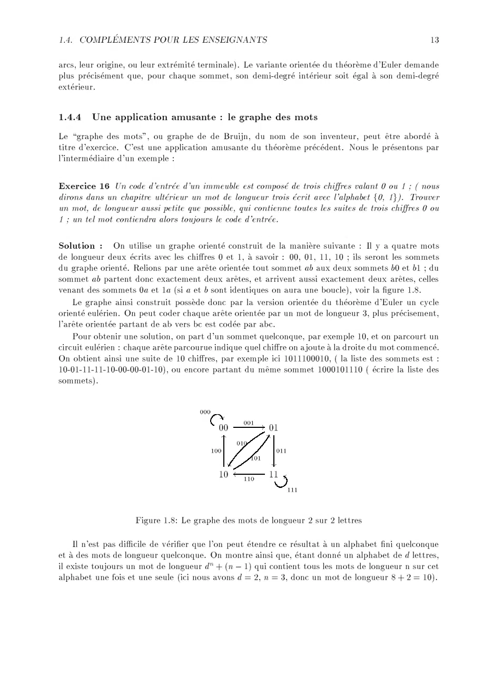

~~~text
1.4. COMPLEMENTS POUR LES ENSEIGNANTS                                                                13

arcs, leur origine, ou leur extremite terminale). Le variante orientee du theoreme d'Euler demande
plus precisement que, pour chaque sommet, son demi-degre interieur soit egal a son demi-degre
exterieur.

1.4.4 Une application amusante : le graphe des mots
Le \graphe des mots", ou graphe de de Bruijn, du nom de son inventeur, peut ^etre aborde a
titre d'exercice. C'est une application amusante du theoreme precedent. Nous le presentons par
l'intermediaire d'un exemple :

Exercice 16 Un code d'entree d'un immeuble est compose de trois chi res valant 0 ou 1 ; ( nous
dirons dans un chapitre ulterieur un mot de longueur trois ecrit avec l'alphabet f0, 1g). Trouver
un mot, de longueur aussi petite que possible, qui contienne toutes les suites de trois chi res 0 ou
1 ; un tel mot contiendra alors toujours le code d'entree.

Solution : On utilise un graphe oriente construit de la maniere suivante : Il y a quatre mots
de longueur deux ecrits avec les chi res 0 et 1, a savoir : 00, 01, 11, 10 ; ils seront les sommets
du graphe oriente. Relions par une ar^ete orientee tout sommet ab aux deux sommets b0 et b1 ; du
sommet ab partent donc exactement deux ar^etes, et arrivent aussi exactement deux ar^etes, celles
venant des sommets 0a et 1a (si a et b sont identiques on aura une boucle), voir la gure 1.8.
     Le graphe ainsi construit possede donc par la version orientee du theoreme d'Euler un cycle
oriente eulerien. On peut coder chaque ar^ete orientee par un mot de longueur 3, plus precisement,
l'ar^ete orientee partant de ab vers bc est codee par abc.
     Pour obtenir une solution, on part d'un sommet quelconque, par exemple 10, et on parcourt un
circuit eulerien : chaque ar^ete parcourue indique quel chi re on ajoute a la droite du mot commence.
On obtient ainsi une suite de 10 chi res, par exemple ici 1011100010, ( la liste des sommets est :
10-01-11-11-10-00-00-01-10), ou encore partant du m^eme sommet 1000101110 ( ecrire la liste des
sommets).

                                      000

                                              00                   001
                                                                                  01
                                                  

                                                                              /

                                                      O                           E

                                                                  010
                                            100                                           011
                                                                        101

                                              10                                  11
                                                                                     

                                                              o

                                                                    110
                                                                                            g

                                                                                                111

                     Figure 1.8: Le graphe des mots de longueur 2 sur 2 lettres
     Il n'est pas dicile de veri er que l'on peut etendre ce resultat a un alphabet ni quelconque
et a des mots de longueur quelconque. On montre ainsi que, etant donne un alphabet de d lettres,
il existe toujours un mot de longueur dn + (n ; 1) qui contient tous les mots de longueur n sur cet
alphabet une fois et une seule (ici nous avons d = 2, n = 3, donc un mot de longueur 8 + 2 = 10).
~~~

## Page 18

~~~text
14                                                          CHAPITRE 1. DEFINITIONS DE BASE
1.4.5 Graphes hamiltoniens
Au lieu de passer une fois et une seule par chaque ar^ete, il est naturel de demander a passer une fois
et une seule par chaque sommet. On de nit ainsi une cha^ne hamiltonienne, c'est-a-dire une cha^ne
qui contient une fois et une seule chaque sommet du graphe, exception faite pour les extremites de
la cha^ne si celle ci est fermee. Si la cha^ne est un cycle, on l'appelle cycle hamiltonien. Un graphe
qui possede un cycle hamiltonien est dit graphe hamiltonien .
    De facon un peu surprenante, la theorie des graphes hamiltoniens est considerablement plus
dicile que celle des graphes euleriens (et completement hors programme !). On dispose de condi-
tions necessaires et de conditions susantes pour savoir si un graphe est hamiltonien, mais jusqu'en
1972 on ne connaissait pas de condition necessaire et susante. Citons le theoreme de Dirac qui
donne une condition susante simple pour qu'un graphe non oriente soit hamiltonien.

Theoreme 4 Si chaque sommet d'un graphe d'ordre n est de degre superieur ou egal a n2 alors le
graphe admet un cycle hamiltonien.
     On peut cependant appliquer les resultats de la section precedente pour montrer que les graphes
de mots sont toujours hamiltoniens. Fixons un alphabet, et considerons le graphe des mots de
longueur n sur cet alphabet. Il est relie au graphe des mots de longueur n ; 1 : ses sommets sont
exactement les ar^etes du graphe des mots precedent ! De plus, on voit facilement qu'un sommet du
graphe des mots de longueur n est le successeur d'un autre si et seulement si l'ar^ete correspondante
a ce sommet dans le graphe des mots de longueur n ; 1 a pour origine l'extremite terminale de
 l'autre ar^ete. Par exemple, dans le graphe des mots de longueur 3, 110 est un successeur de 011;
 dans le graphe des mots de longueur 2, l'ar^ete 110 a pour origine 11, qui est l'extremite terminale
 de 011. On montre alors facilement que tout circuit eulerien dans le graphe des mots de longueur
 n ; 1 correspond a un circuit hamiltonien dans le graphe des mots de longueur n.

1.4.6 Graphes planaires
Des que l'on commence a dessiner un graphe, on se heurte a un probleme tres naturel: quels sont
les graphes que l'on peut dessiner sur une feuille de papier sans que leurs ar^etes ne se croisent?
C'est le probleme bien connu des trois usines et des trois maisons :
Exercice 17 Trois maisons doivent ^etre reliees a 3 usines qui leur fournissent l'eau, le gaz et
l'electricite ; on demande de tracer le plan du reseau de telle maniere que les tuyaux ne se croisent
pas.
    Ce graphe est ce qu'on appelle le graphe bi-parti complet d'ordre 3, note K3;3. Il n'est pas du
tout evident de voir s'il peut ^etre dessine sur un plan, on trouvera la reponse ci-dessous. (on appelle
graphe bi-parti un graphe tel que l'ensemble des sommets est partitionne en deux sous-ensembles,
et ou toute ar^ete relie un sommet contenu dans l'un des sous-ensembles a un sommet contenu
dans l'autre ; par exemple, le graphe representant les mariages dans une population est un graphe
bi-parti).
De nition 12 On dit qu'un graphe est planaire s'il peut ^etre dessine dans un plan sans que les
ar^etes ne se croisent.
~~~

## Page 19

~~~text
1.4. COMPLEMENTS POUR LES ENSEIGNANTS                                                                                          15

     Une fois represente sur le plan, un graphe planaire nous donne des donnees supplementaires : il
y a les sommets et les ar^etes, mais il y a aussi les faces qu'elles delimitent ; il y a un certain nombre
de faces interieures, bornees, et une face exterieure, non bornee.
     On peut alors de nir un graphe dual, dont les sommets sont les faces du graphe precedent, et
dont les ar^etes sont les ar^etes du graphe precedent, chaque ar^ete reliant les deux faces qu'elle borde
(il peut se faire que ce soit la m^eme face des deux c^otes; dans ce cas, on a une boucle dans le graphe
dual).
     Si l'on note s le nombre de sommets (l'ordre du graphe), a le nombre d'ar^etes, et f le nombre de
faces, on a une relation remarquable, appelee suivant les auteurs relation d'Euler ou de Descartes :
Theoreme 5 Pour un graphe planaire connexe, on a :
                                       s;a+f = 2
    Cette relation peut se demontrer par recurrence, de facon non triviale. On trouvera une autre
demonstration, utilisant l'algebre lineaire (plus precisement, la dimension de l'espace des cycles du
graphe et des cocycles du graphe dual) dans le livre [10].
    Cette relation a une interpretation geometrique remarquable : elle est en e et aussi vraie pour
tout polyedre convexe, car on peut toujours projeter un tel polyedre, d'abord sur la sphere, puis
sur le plan. On a ainsi, pour le tetraedre, 4 sommets, 6 ar^etes et 4 faces, pour le cube, 8 sommets,
12 ar^etes et 6 faces, pour l'octaedre, 6 sommets, 12 ar^etes et 8 faces. On remarquera que le cube et
l'octaedre echangent leur nombre de sommets et de faces; en fait, les graphes correspondant sont
duaux l'un de l'autre (voir la gure ci-dessous). Il en est de m^eme de l'icosaedre et du dodecaedre.

                    ???                                                                      /&&/
                        ??                                                                &&///
                          ??                
                            ??                                                            && /
                                       
                                                                                       && ///
                                                                                                       && /
                                                                                                       & ///
                                                                                                      && /
                                                                                        
                                                                             ..                     ::: //
                                                                                                                  /
                                                                                         .                    :
                                                                           ..                              :: //
                             
                            
                                        ???                                            ..                 :: //
                                                                                                                     :/
                                        ??
                                             ??                                  jj    j  j   T
                                                                                                      TT   TTTT ::://
                                             ??               jjjjjj                                        TTTT :/
                                                                                                                         TT:/
                                                       jjj                                                          

                            Figure 1.9: Les graphes du cube et de l'octaedre
    On peut utiliser cette formule pour demontrer que certains graphes ne sont pas planaires. En
e et, considerons un graphe simple planaire; alors, chaque face est bordee par au moins 3 ar^etes (une
face bordee par une seule ar^ete correspond a une boucle, une face bordee par 2 ar^etes correspond a
2 ar^etes joignant les m^emes sommets). Si toutes les faces etaient triangulaires, on aurait 3f = 2a,
puiqu'il y a 3 ar^etes par face, mais qu'en comptant ainsi, on compte chaque ar^ete 2 fois. En general,
on a seulement 3f  2a, puisque chaque ar^ete borde deux faces, et que chaque face est bordee par
au moins trois ar^etes. En remplacant f par 2 + a ; s, au moyen de la relation d'Euler-Descartes,
on obtient :
Proposition 1 Pour un graphe simple, planaire, connexe, on a a  3s ; 6
~~~

## Page 20

~~~text
16                                                      CHAPITRE 1. DEFINITIONS DE BASE
   En particulier, un graphe planaire simple connexe d'ordre 5 a au plus 9 ar^etes. Or le graphe
complet d'ordre 5, K5, a 10 ar^etes. Donc :

Proposition 2 Le graphe K5 n'est pas planaire
   On peut raner un peu s'il n'y a pas de face triangulaire ; dans ce cas, toute face est bordee
par au moins 4 ar^etes, et on a donc 4f  2a ; en remplacant, on obtient :

Proposition 3 Pour un graphe simple, planaire, connexe, sans faces triangulaires, on a a  2s ; 4
   Il est facile de voir qu'un graphe simple bi-parti ne peut avoir de faces triangulaires ; donc un
graphe planaire simple, connexe, bi-parti, a 6 sommets a au plus 8 ar^etes. Mais le graphe K3;3 que
nous avons rencontre au debut de cette section a 9 sommets, donc :

Proposition 4 Le graphe K3;3 n'est pas planaire.
    Cette proposition repond a l'exercice initial : le plan demande est impossible.
    Il est clair qu'un graphe obtenu a partir d'un graphe non planaire en subdivisant une ar^ete par
insertion de sommets est encore non planaire. Il est aussi clair que tout graphe qui contient un
graphe non planaire est encore non planaire. C'est un resultat remarquable que les deux graphes
que nous venons de voir sont les seules obstructions a ^etre planaire :

Theoreme 6 (Theoreme de Kuratowski) Un graphe est planaire si et seulement si il ne con-
tient aucun sous-graphe obtenu a partir de K5 et de K3;3 par subdivision des ar^etes.

     On pourra trouver une preuve de ce theoreme dans [10], page 118.

1.5 Solution des exercices
Solution de l'exercice 1 : Comme on l'a vu dans la section 2, c'est juste un probleme de parite:
puisque chacune des 15 equipes joue 7 matchs, le double du nombre de matchs doit ^etre 7  15, ce
qui est impossible.
Solution de l'exercice 2 : C'est le m^eme probleme que le precedent.
Solution de l'exercice 3 : Il a ete resolu dans le cours du chapitre: on schematise la situation
par un graphe dont les sommets sont les ^les, et les ar^etes sont les ponts. On constate alors que
tous les sommets sont impairs, il ne peut donc y avoir de cha^ne eulerienne, et le probleme est
impossible.
Solution de l'exercice 4 : La de nition 1 n'est jamais correcte. En e et, on pourrait alors
prendre comme cha^ne une suite de 3 ar^etes a1; a2; a3 dont la premiere joint le sommet a au sommet
b, la seconde le sommet b au sommet c, et la troisieme le sommet b au sommet d. Cela satisfait
bien la de nition: chaque ar^ete possede un sommet en commun avec la suivante. Le probleme est
~~~

## Page 21

~~~text
1.5. SOLUTION DES EXERCICES                                                                                    17

que la deuxieme ar^ete possede le m^eme sommet en commun avec la precedente et la suivante; cela
donne une gure en Y qui n'est pas ce que l'on veut de nir, comme dans le dessin ci-dessous :
                                    a ????                              
                                                                                                         c
                                                ??                      
                                                  ??    a                      a
                                                    ??1           2
                                                      ??          
                                                        ??      
                                                          ?? 
                                                            ?
                                                                  b
                                                                          a3
                                                                  d
    La de nition 2 n'est pas correcte si le graphe n'est pas simple: en e et, s'il y a plusieurs ar^etes
d'un sommet a un autre, la suite des sommets ne sut pas a de nir le parcours. Elle est par contre
correcte si le graphe est simple.
Solution de l'exercice 5 : La solution a ete donnee a la suite de l'exercice.
Solution de l'exercice 6 : Le premier graphe a 2 sommets impairs ; il contient donc une cha^ne
eulerienne, mais pas de cycle eulerien. Le deuxieme a 4 sommets impairs. Il ne contient donc pas
de cha^ne eulerienne. Le dernier graphe, comme le premier, a 2 sommets impairs ; il contient donc
aussi une cha^ne eulerienne, mais pas de cycle eulerien.
Solution de l'exercice 7 : Les graphes G1 et G2 representent tous deux le m^eme graphe, qui
est un graphe cyclique d'ordre 6. Les graphes G3 et G4 representent tous deux le m^eme graphe,
un pentagone ou l'un des sommets est relie a tous les autres, les autres sommets etant seulement
relies a leurs deux voisins.
Solution de l'exercice 8 : Ces trois situations correspondent toutes au graphe de l'octaedre
(voir gure 1.10).

                                                                            /&&/
                                                                         &&///
                                                                        && /
                                                                    && ///
                                                                                   && /
                                                                                   & ///
                                                                                  && /
                                                                    
                                                         ..                     ::: //
                                                                                              /
                                                                     .                    :
                                                       ..                              :: //
                                                                    ..                 :: //
                                                                               T
                                                                                                :/
                                                             jj    j  j        TT   TTTT ::://
                                            jjjjjj                                        TTTT ://
                                                                                                     TT:
                                       jjj                                                         

                                Figure 1.10: Le graphe de l'octaedre

Solution de l'exercice 9 : Les graphes complets sont representes ci-dessous. Puisque le graphe
~~~

## Page 22

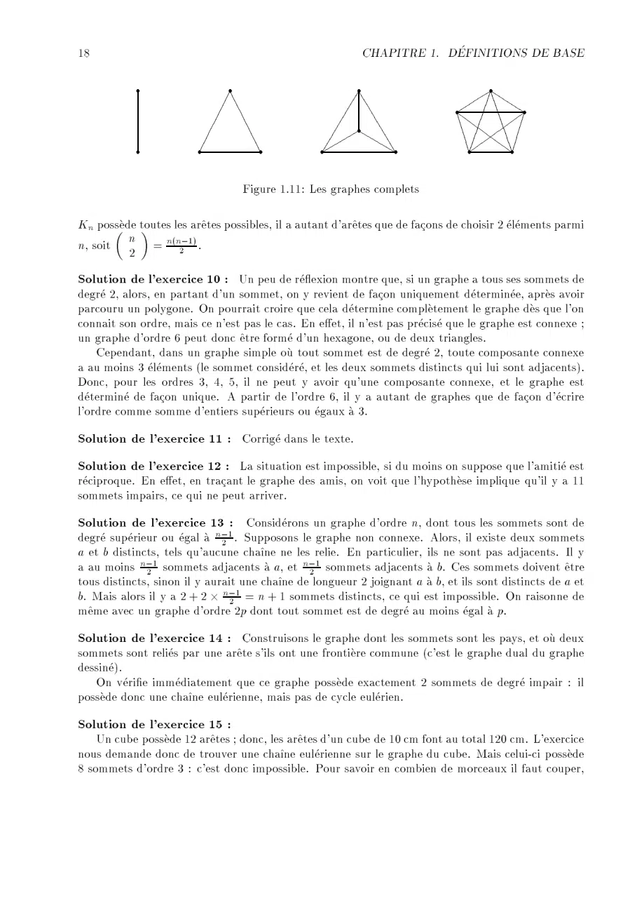

~~~text
18                                                                    CHAPITRE 1. DEFINITIONS DE BASE

                                      //                         222                               K* K
                                                                                                    sss * KK
                                     ///                           22                   s   ss  ** KKKK
                                          //                          22         )sH) sHH  *** vv
                                                                          22            )) HH               * vv 
                                           //
                                                //                rLLL 22                )) HHHvHvvv** 
                                                                 r
                                                //         rrr
                                                                r        LL 22
                                                                            LL 2            ))  vvv HHH*** 
                                                                                                  
                                                     rr                 L             v v            H

                                            Figure 1.11: Les graphes complets

Kn poss
       eden toutes
              les ar^etes possibles, il a autant d'ar^etes que de facons de choisir 2 elements parmi
n, soit 2 = n(n2;1) .
Solution de l'exercice 10 : Un peu de re exion montre que, si un graphe a tous ses sommets de
degre 2, alors, en partant d'un sommet, on y revient de facon uniquement determinee, apres avoir
parcouru un polygone. On pourrait croire que cela determine completement le graphe des que l'on
connait son ordre, mais ce n'est pas le cas. En e et, il n'est pas precise que le graphe est connexe ;
un graphe d'ordre 6 peut donc ^etre forme d'un hexagone, ou de deux triangles.
    Cependant, dans un graphe simple ou tout sommet est de degre 2, toute composante connexe
a au moins 3 elements (le sommet considere, et les deux sommets distincts qui lui sont adjacents).
Donc, pour les ordres 3, 4, 5, il ne peut y avoir qu'une composante connexe, et le graphe est
determine de facon unique. A partir de l'ordre 6, il y a autant de graphes que de facon d'ecrire
l'ordre comme somme d'entiers superieurs ou egaux a 3.
Solution de l'exercice 11 : Corrige dans le texte.
Solution de l'exercice 12 : La situation est impossible, si du moins on suppose que l'amitie est
reciproque. En e et, en tracant le graphe des amis, on voit que l'hypothese implique qu'il y a 11
sommets impairs, ce qui ne peut arriver.
Solution de l'exercice 13 : Considerons un graphe d'ordre n, dont tous les sommets sont de
degre superieur ou egal a n;2 1 . Supposons le graphe non connexe. Alors, il existe deux sommets
a et b distincts, tels qu'aucune cha^ne ne les relie. En particulier, ils ne sont pas adjacents. Il y
a au moins n;2 1 sommets adjacents a a, et n;2 1 sommets adjacents a b. Ces sommets doivent ^etre
tous distincts, sinon il y aurait une cha^ne de longueur 2 joignant a a b, et ils sont distincts de a et
b. Mais alors il y a 2 + 2  n;2 1 = n + 1 sommets distincts, ce qui est impossible. On raisonne de
m^eme avec un graphe d'ordre 2p dont tout sommet est de degre au moins egal a p.
Solution de l'exercice 14 : Construisons le graphe dont les sommets sont les pays, et ou deux
sommets sont relies par une ar^ete s'ils ont une frontiere commune (c'est le graphe dual du graphe
dessine).
   On veri e immediatement que ce graphe possede exactement 2 sommets de degre impair : il
possede donc une cha^ne eulerienne, mais pas de cycle eulerien.
Solution de l'exercice 15 :
    Un cube possede 12 ar^etes ; donc, les ar^etes d'un cube de 10 cm font au total 120 cm. L'exercice
nous demande donc de trouver une cha^ne eulerienne sur le graphe du cube. Mais celui-ci possede
8 sommets d'ordre 3 : c'est donc impossible. Pour savoir en combien de morceaux il faut couper,
~~~

## Page 23

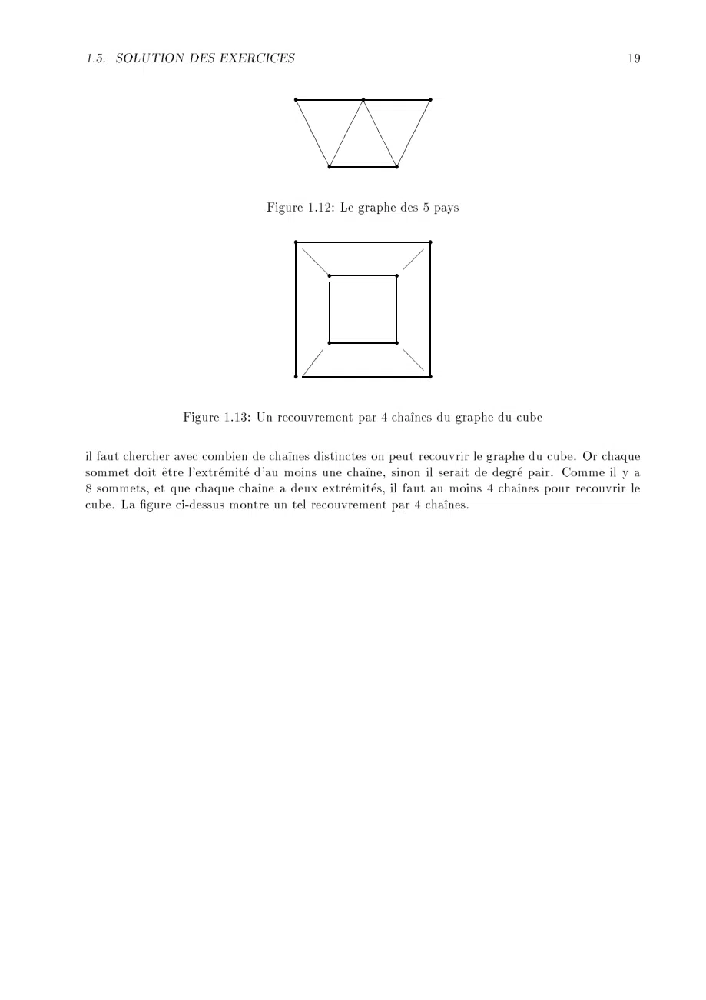

~~~text
1.5. SOLUTION DES EXERCICES                                                                      19

                                     //                       /                        
                                         //                   ///                   
                                           //                      //                
                                             //                    //           
                                               //                       //      
                                                 //                     // 
                                                   /                       /
                                                                            

                                Figure 1.12: Le graphe des 5 pays
                                     ?                                                 
                                            ??                                     
                                              ??                                 
                                                ??                             
                                                                          

                                                                          ?
                                                                               ??
                                                                               ??
                                                                                     

                 Figure 1.13: Un recouvrement par 4 cha^nes du graphe du cube

il faut chercher avec combien de cha^nes distinctes on peut recouvrir le graphe du cube. Or chaque
sommet doit ^etre l'extremite d'au moins une cha^ne, sinon il serait de degre pair. Comme il y a
8 sommets, et que chaque cha^ne a deux extremites, il faut au moins 4 cha^nes pour recouvrir le
cube. La gure ci-dessus montre un tel recouvrement par 4 cha^nes.
~~~

## Page 24

~~~text
Chapitre 2

Graphes et matrices : problemes de
comptage de cha^nes
Dans ce chapitre, on va voir que l'algebre lineaire et les matrices, telles qu'on les a vues en premiere
ES, jouent un r^ole fondamental dans bien des problemes de comptage en theorie des graphes.
   Rappelons que le calcul matriciel est au programme de l'annee precedente, et que les eleves
savent calculer un produit de matrices enutilisant une machine. Il n'est donc pas question, hors
des exemples triviaux comme la matrice 01 10 , de calculer a la main des carres ou des cubes
de matrices. Il est par contre possible de traiter un ou deux exemples d'une taille raisonnable
(une dizaine de sommets) a la machine, et c'est une bonne occasion pour les eleves d'utiliser leurs
connaissances.

2.1 Quelques problemes
Exercice 18 Sebastien se rend regulierement en train de la ville U a la ville V , dans un reseau
donne par le graphe ci-dessous. Il fait toujours le trajet en 5 etapes, et veut faire a chaque fois un
chemin di erent. Combien de trajets pourra-t-il faire?

                                            2                    4            5                 8
                                      
                                                                          //                  ???
                                                                            //                    ??
                                                                                 //                    ??
                                                                                 //                   ??
                                                                                                             ??
                                                                                   //                     ??
                                                                                                                ??
                                                                                       //
                                                                                       /                      ??
             U   = 1  ???
                     
                     ?
                                                   
                                                                                                               lll   V =9
                                                                                        7
                                                                                                             l l
                          ??                                                                           lll
                            ??                                                                 l  llll
                                                                                                 l
                              ??                                                          lll
                                ??
                                  ??                                      lllll
                                                                            ll
                                    ?? 
                                      ?                              lllll
                                                                     
                                                                      
                                                                      ll
                                            3                         6

                                                Figure 2.1: Un reseau ferroviaire

                                                                      20
~~~

## Page 25

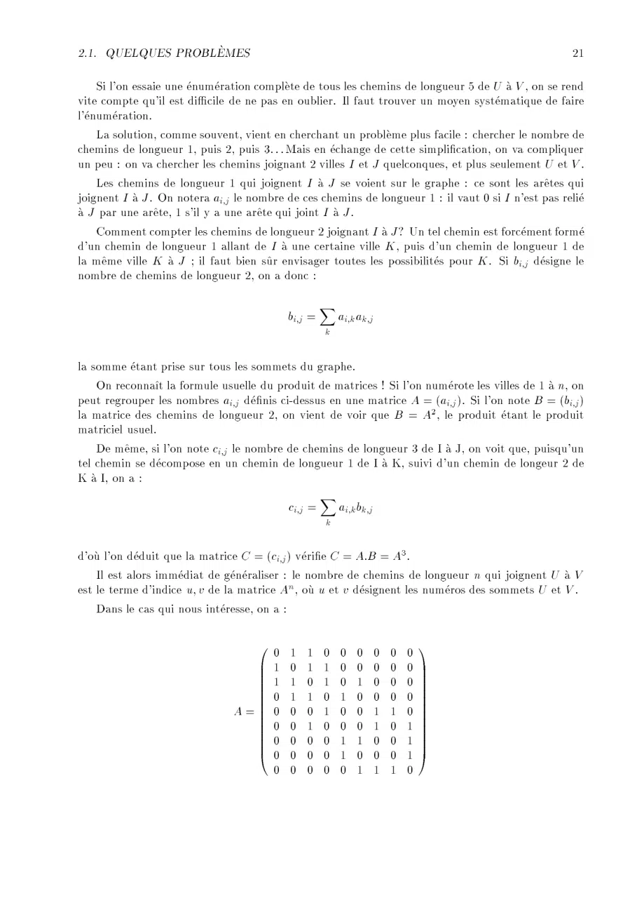

~~~text
2.1. QUELQUES PROBLEMES                                                                               21

     Si l'on essaie une enumeration complete de tous les chemins de longueur 5 de U a V , on se rend
vite compte qu'il est dicile de ne pas en oublier. Il faut trouver un moyen systematique de faire
l'enumeration.
     La solution, comme souvent, vient en cherchant un probleme plus facile : chercher le nombre de
chemins de longueur 1, puis 2, puis 3. . . Mais en echange de cette simpli cation, on va compliquer
un peu : on va chercher les chemins joignant 2 villes I et J quelconques, et plus seulement U et V .
     Les chemins de longueur 1 qui joignent I a J se voient sur le graphe : ce sont les ar^etes qui
joignent I a J . On notera ai;j le nombre de ces chemins de longueur 1 : il vaut 0 si I n'est pas relie
a J par une ar^ete, 1 s'il y a une ar^ete qui joint I a J .
     Comment compter les chemins de longueur 2 joignant I a J ? Un tel chemin est forcement forme
 d'un chemin de longueur 1 allant de I a une certaine ville K , puis d'un chemin de longueur 1 de
 la m^eme ville K a J ; il faut bien s^ur envisager toutes les possibilites pour K . Si bi;j designe le
 nombre de chemins de longueur 2, on a donc :
                                                     X
                                           bi;j =        ai;k ak;j
                                                     k

la somme etant prise sur tous les sommets du graphe.
    On reconna^t la formule usuelle du produit de matrices ! Si l'on numerote les villes de 1 a n, on
peut regrouper les nombres ai;j de nis ci-dessus en une matrice A = (ai;j ). Si l'on note B = (bi;j )
la matrice des chemins de longueur 2, on vient de voir que B = A2 , le produit etant le produit
matriciel usuel.
    De m^eme, si l'on note ci;j le nombre de chemins de longueur 3 de I a J, on voit que, puisqu'un
tel chemin se decompose en un chemin de longueur 1 de I a K, suivi d'un chemin de longeur 2 de
K a I, on a :
                                                     X
                                            ci;j =       ai;k bk;j
                                                     k

d'ou l'on deduit que la matrice C = (ci;j ) veri e C = A:B = A3 .
    Il est alors immediat de generaliser : le nombre de chemins de longueur n qui joignent U a V
est le terme d'indice u; v de la matrice An , ou u et v designent les numeros des sommets U et V .
    Dans le cas qui nous interesse, on a :

                                  00 1 1 0 0 0 0 0 01
                                  BB 1 0 1 1 0 0 0 0 0 C
                                   BB 1 1 0 1 0 1 0 0 0 C  C
                                    BB 0 1 1 0 1 0 0 0 0 C C
                                                           C
                                     B
                                A=B 0 0 0 1 0 0 1 1 0 C
                                     BB 0 0 1 0 0 0 1 0 1 CC
                                      BB 0 0 0 0 1 1 0 0 1 C
                                                           C
                                       @0 0 0 0 1 0 0 0 1C A
                                        0 0 0 0 0 1 1 1 0
~~~

## Page 26

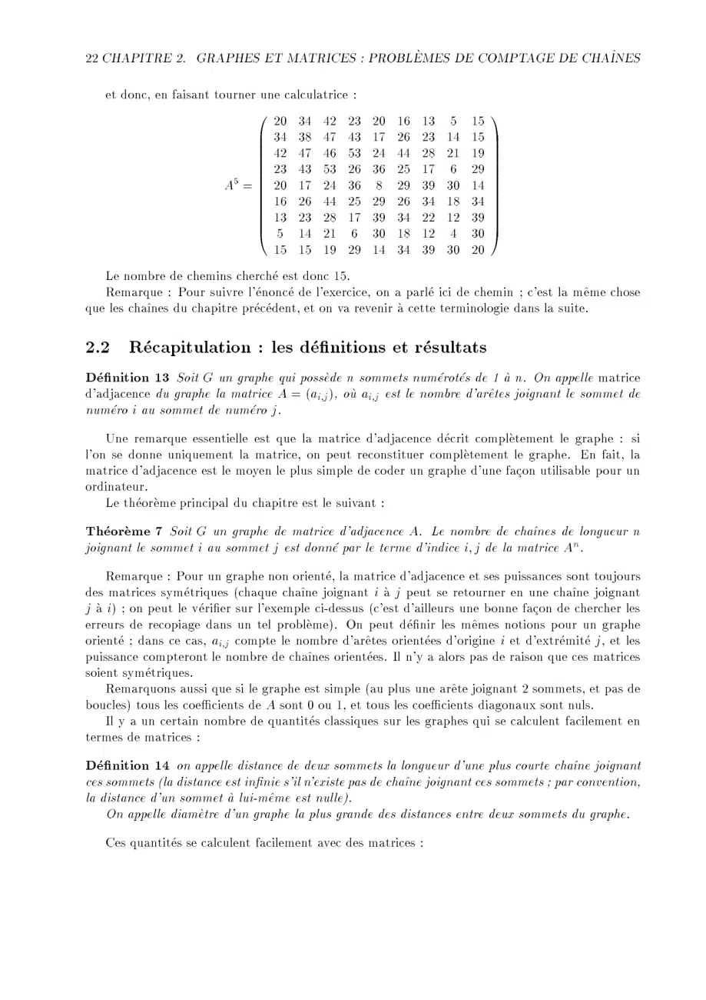

~~~text
22 CHAPITRE 2. GRAPHES ET MATRICES : PROBLE MES DE COMPTAGE DE CHA^INES

   et donc, en faisant tourner une calculatrice :
                                0 20 34 42 23 20 16 13 5 15 1
                                BB 34 38 47 43 17 26 23 14 15 C
                                 BB 42 47 46 53 24 44 28 21 19 C             C
                                  BB 23 43 53 26 36 25 17 6 29 C             C
                                                                             C
                          A =B
                           5
                                   BB 20 17 24 36 8 29 39 30 14 C            C
                                    BB  16 26 44  25  29   26   34   18  34  C
                                                                             C
                                     B@ 13 23 28 17 39 34 22 12 39 C         C
                                        5 14 21 6 30 18 12 4 30 A
                                        15 15 19 29 14 34 39 30 20
   Le nombre de chemins cherche est donc 15.
   Remarque : Pour suivre l'enonce de l'exercice, on a parle ici de chemin ; c'est la m^eme chose
que les cha^nes du chapitre precedent, et on va revenir a cette terminologie dans la suite.

2.2 Recapitulation : les de nitions et resultats
De nition 13 Soit G un graphe qui possede n sommets numerotes de 1 a n. On appelle matrice
d'adjacence du graphe la matrice A = (ai;j ), ou ai;j est le nombre d'ar^etes joignant le sommet de
numero i au sommet de numero j .
    Une remarque essentielle est que la matrice d'adjacence decrit completement le graphe : si
l'on se donne uniquement la matrice, on peut reconstituer completement le graphe. En fait, la
matrice d'adjacence est le moyen le plus simple de coder un graphe d'une facon utilisable pour un
ordinateur.
    Le theoreme principal du chapitre est le suivant :
Theoreme 7 Soit G un graphe de matrice d'adjacence A. Le nombre de cha^nes de longueur n
joignant le sommet i au sommet j est donne par le terme d'indice i; j de la matrice An .
     Remarque : Pour un graphe non oriente, la matrice d'adjacence et ses puissances sont toujours
des matrices symetriques (chaque cha^ne joignant i a j peut se retourner en une cha^ne joignant
j a i) ; on peut le veri er sur l'exemple ci-dessus (c'est d'ailleurs une bonne facon de chercher les
erreurs de recopiage dans un tel probleme). On peut de nir les m^emes notions pour un graphe
oriente ; dans ce cas, ai;j compte le nombre d'ar^etes orientees d'origine i et d'extremite j , et les
puissance compteront le nombre de cha^nes orientees. Il n'y a alors pas de raison que ces matrices
soient symetriques.
     Remarquons aussi que si le graphe est simple (au plus une ar^ete joignant 2 sommets, et pas de
boucles) tous les coecients de A sont 0 ou 1, et tous les coecients diagonaux sont nuls.
     Il y a un certain nombre de quantites classiques sur les graphes qui se calculent facilement en
termes de matrices :
De nition 14 on appelle distance de deux sommets la longueur d'une plus courte cha^ne joignant
ces sommets (la distance est in nie s'il n'existe pas de cha^ne joignant ces sommets ; par convention,
la distance d'un sommet a lui-m^eme est nulle).
    On appelle diametre d'un graphe la plus grande des distances entre deux sommets du graphe.
   Ces quantites se calculent facilement avec des matrices :
~~~

## Page 27

~~~text
2.3. QUELQUES EXERCICES SUPPLEMENTAIRES                                                            23

Proposition 5 Soit G un graphe (non oriente) de matrice d'adjacence A. La distance entre deux
sommets distincts i et j est le plus petit n tel que le terme d'indice i; j de An soit non nul.
Remarque : Il est naturel de poser, par convention, A0 = Id. Avec la convention prise ci-dessus,
que la distance d'un sommet a lui-m^eme est nulle, la proposition est alors aussi valable pour deux
sommets confondus.

Proposition 6 Sous les m^emes hypotheses, le diametre du graphe G est le plus petit entier n tel
que la matrice (A + Id)n ait tous ses termes strictement positifs.
Preuve. La demonstration la plus simple utilise la formule du bin^ome, elle est donc probablement
trop dicile a faire en cours :
                                                Xn  
                                             n
                                     (A + Id) =     n Ak
                                                k=0
                                                    k
en utilisant la convention A0 = Id ; cette formule montre que le terme d'indice (i; j ) de (A + Id)n
est non nul si et seulement si le terme d'indice (i; j ) de l'une des puissances Ak , avec k  n, est
non nul, c'est-a-dire s'il existe un chemin de longueur au plus n qui joint le sommet I au sommet
J.                                                                                          C.Q.F.D.
    Remarque : il ne faut pas chercher le plus petit n tel que An ait tous ses termes strictement
positifs ; en e et, il existe des graphes non orientes de diametre ni pour lesquels An n'a jamais
tous ses termes strictement positifs.
 0Exercice
       1
             : chercher un exemple (on pourra examiner le cas du graphe associe a la matrice
   1 0 ).

2.3 Quelques exercices supplementaires
Les competences attendues des eleves sont :
    ^etre capable de passer d'un graphe a sa matrice d'adjacence.
    reciproquement, reconstituer un graphe a partir de sa matrice d'adjacence.
    Savoir utiliser le lien entre les puissances de la matrice et le nombre de chemins de longueur
      n.
    savoir en deduire des donnees diverses telles que la distance entre 2 sommets ou le diametre
      du graphe.
    comprendre la di erence entre un graphe oriente et un graphe non oriente, et ce que cela
      implique sur les matrices.
   On peut, pour s'assurer que les notions sont bien comprises, donner quelques exercices simples
consistant a ecrire la matrice d'un graphe donne, a dessiner le graphe correspondant a une matrice
donnee, ou a etablir la correspondance entre une liste de graphes et une liste de matrices ; autant
que possible, il faudra ensuite completer ces exercices pour utiliser les matrices obtenues.
   Les exercices suivants font travailler sur ces matrices :
~~~

## Page 28

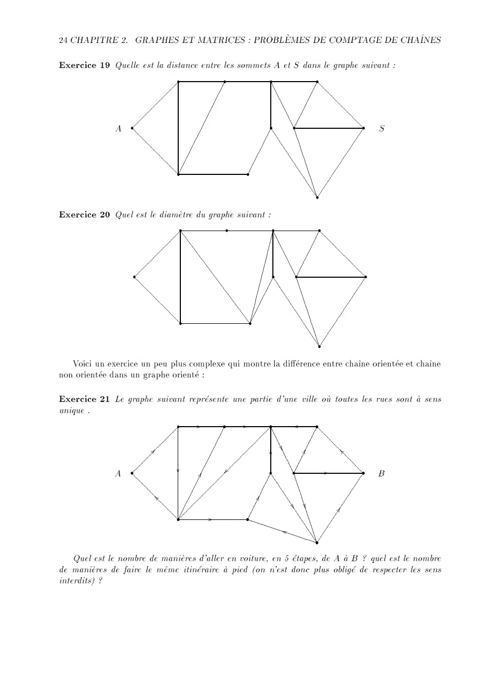

~~~text
24 CHAPITRE 2. GRAPHES ET MATRICES : PROBLE MES DE COMPTAGE DE CHA^INES

Exercice 19 Quelle est la distance entre les sommets A et S dans le graphe suivant :
                                                                                        //                               ??
                                                                                          //                        ???
                                                                                               //                            ??
                                                                                              //                          ??
                                                                                                                                     ??
                                                                                                   //                             ??
                                                                                                  //                             ??
                                                                                                                                          ??
              A   ???                                                                 444
                                                                                                          /  
                                                                                                          **                                    S
                        ??                                                             44                **
                          ??
                            ??                                                                    44         **
                              ??                                                                 44 **
                                ??                                                                       44 **
                                  ??                                          
                                                                                    
                                                                                                             44 **
                                    ??                                                                          44 *
                                                                                                                44 **
                                                                                                                      44**
                                                                                                                          4*4*
                                                                                                                      
Exercice 20 Quel est le diametre du graphe suivant :
                                    77                                                       //                             ??
                                  77                                                        //                         ???
                                        77                                                         /                               ??
                                        77                                               //                                   ??
                                                                                                                                       ??
                                          77
                                                                                     
                                                                                                      //             
                                                                                                                                          ??
                                              777                                                       /                                 ??
                                               77                                                     // 
                                                                                                                                              ??
                                                                                  4                       /* 
                    ??
                   
                   ?                                77                        
                                                                                           44           *                                 
                       ??                             77                       4                              **
                         ??                             77                 
                                                                                                  4            **
                           ??                                                                         44
                             ??                           77
                                                            7                                       44 **
                               ??                            77                                         44 **
                                 ??                            77                                          44 **
                                   ??                            7                                             44 *
                                                                                                                     44 **
                                                                                                                         44**
                                                                                                                             4*4*
                                                                                                                      
   Voici un exercice un peu plus complexe qui montre la di erence entre cha^ne orientee et cha^ne
non orientee dans un graphe oriente :
Exercice 21 Le graphe suivant represente une partie d'une ville ou toutes les rues sont a sens
unique .
                                                                                    //                             ??
                                                                                 //                               ???
                                                       /                        /                         o

                                                                                                                         ??
                                                                                        //                      
                                                                                       //                           ??
                                                                                                                                 ??
                                                                                              /                                ??
                                                                                            // 
                                  ?                                                         O                    G              _

                                                                                                //                             ??
                                                                                                                                  ??
                                                                                                   /                                 ?
              A   ???
                       ??
                                           

                                                    G

                                                                

                                                                                       44
                                                                                            4
                                                                                                       **
                                                                                                           *
                                                                                                                           /

                                                                                                                                                  B
                         ??                                                      44                  **
                           ??                                                                 44            *
                             ??                                                           44 **
                               ??                                                                 44 **
                                 ??                                       
                              _                                                       G

                                   ??                                                              44 **
                                                                                                             44 **
                                                                                                                                   D

                                      
                                     ?                                  TTT
                                                                           T                                    44 *
                                                                                   TTTT                            4 **
                                                             /

                                                                                            TTTT
                                                                                                    TTTT 444**
                                                                                                                TTTT4*
                                                                                                      j

                                                                                                                        
    Quel est le nombre de manieres d'aller en voiture, en 5 etapes, de A a B ? quel est le nombre
de manieres de faire le m^eme itineraire a pied (on n'est donc plus oblige de respecter les sens
interdits) ?
~~~

## Page 29

~~~text
2.4. COMPLEMENTS POUR LES ENSEIGNANTS                                                                 25

    Remarque : On a vu au chapitre precedent la de nition de graphe connexe : c'est un graphe ou
tout couple de sommets est joint par une cha^ne. Cette notion est de nie pour un graphe oriente
ou non oriente, mais il existe une notion plus forte (et hors programme !) pour un graphe oriente :
un tel graphe est dit fortement connexe si tout couple de sommets est joint par une cha^ne orientee.
Un plan de circulation est toujours fortement connexe : sinon, il y aurait des couples de sommets
(A; B ) tels que l'on ne puisse pas aller de A a B ! Par contre, un graphe qui represente les priorites
dans une liste de t^aches a e ectuer ne peut jamais ^etre fortement connexe : si A doit ^etre fait avant
B et B avant A, il sera dicile de nir !

2.4 Complements pour les enseignants
Ces complements sont bien s^ur hors programme, et ne sont pas a faire en cours. Ils peuvent par
contre donner des idees utilisables pour les TPE.
2.4.1 Quelques applications des problemes de comptage
Le probleme par lequel nous avons commence peut sembler restreint. Il intervient en fait dans
divers contextes :
    C'est un probleme courant de chercher le nombre de mots de n lettres satisfaisant certaines
      contraintes : on en verra des exemples dans le chapitre 5. On est alors immediatement amene
      a compter des chemins dans un graphe.
    Une variation assez simple nous conduira, dans le chapitre 6, a remplacer le coecient ai;j de
       la matrice par la probabilite de passer de I a J , au lieu de 0 ou 1.
    De nombreux problemes de sociologie font appel a la distance entre 2 personnes dans un graphe
       de connaissance, et au diametre de ce graphe. Il est rare de pouvoir disposer de donnees
       s^ures portant sur beaucoup de personnes ; signalons le graphe dit \du nombre d'Erd}os",
       dont les sommets sont les mathematiciens, et ou une ar^ete relie 2 personnes si elles ont
     ecrit un article en commun. On peut voir de nombreuses proprietes de ce graphe sur le site
       http://www.oakland.edu/ grossman/erdoshp.html ; ce graphe a 337 000 sommets ; il contient
       un sous-graphe connexe a 208 000 sommets, l'un des sommets etant le mathematicien Erd}os.
       le nombre d'Erd}os d'un mathematicien est sa distance a Erd}os dans ce graphe ; si elle est
         nie, elle est au maximum de 15, et dans la plupart des cas, elle est plus petite que 8.
     Il est souvent interessant de conna^tre une estimation du nombre de chemins de longueur n,
quand n cro^t. Cela revient a calculer la puissance n-ieme d'une matrice. Le plus simple est,
quand cela est possible, de mettre, par changement de variables, la matrice sous forme diagonale ;
c'est-a-dire, de trouver une matrice inversible P et une matrice diagonale D telle que A = PDP ;1 .
On a alors An = PDn P ;1 , et on voit que le terme general de An cro^t essentiellement comme n ,
ou  est le plus grand coecient de D (c'est-a-dire la plus grande valeur propre de A). Il existe
des cas ou la croissance est polynomiale, mais ceci n'est possible que pour des graphes orientes tres
degeneres, avec un petit nombre d'ar^etes.
2.4.2 D'autres matrices en theorie des graphes
Donnons brievement quelques idees non formalisees, qui montrent comment des techniques clas-
siques d'algebre lineaire s'appliquent en theorie des graphes (par exemple pour le calcul des circuits
~~~

## Page 30

~~~text
26 CHAPITRE 2. GRAPHES ET MATRICES : PROBLE MES DE COMPTAGE DE CHA^INES

electriques) ; on trouvera des explications plus completes dans le livre de Aime Sache [10] cite en
 reference (maheureusement epuise, mais on peut le trouver en bibliotheque).
       On peut de nir une autre matrice associee a un graphe oriente : la matrice d'incidence . Il
 s'agit d'une matrice M a coecients 0, 1 ou -1, indicee par l'ensemble S  A produit des sommets
 par les ar^etes, ou mi;j vaut 1 si le sommet i est l'extremite de l'ar^ete j , -1 si i est l'origine de j , et
 0 sinon. On voit en particulier que, puisque chaque colonne correspond a une ar^ete, il doit y avoir
 exactement un 1 et un -1 sur chaque colonne.
       Cette matrice est tres utile pour tous les problemes de transports ; en e et, considerons un
 vecteur V = (Va), indice par les ar^etes. Un tel vecteur de nit un poids pour chaque ar^ete (ce
 poids peut ^etre un courant electrique si le graphe represente un circuit electrique, ou un debit de
 vehicules s'il s'agit d'un reseau routier ; en general, on parlera de ux a travers l'ar^ete a). Fixons
 un sommet S , et considerons l'ensemble P     A+s des ar^etes qui arrivent en S , et l'ensemble A;s des
 ar^
 Petes;qui    partent de S . Le nombre a2A+ Va peut ^etre considere comme le ux arrivant en S , et
     a2A a comme le ux sortant de S (s'il s'agit d'un tra c de vehicules, les nombres Va sont tous
           V
                                                s

 positifs, et cela correspond a l'intuition ; pour un circuit electrique, les Va peuvent ^etre negatifs, si
      s

 le courant circule en sens inverse de l'orientation de l'ar^ete). En regime stationnaire, il ne peut y
 avoir d'accumulation en un sommet, et l'on a :
                                                X              X
                                        Ws =            Va ;          Va = 0
                                               a2A+ s          a2A;
                                                                 s

     C'est ce que l'on appelle en electricite la loi de Kircho .
     Le vecteur W = (Ws ) est un vecteur indice par les sommets ; ce vecteur se calcule facilement :
on voit que l'on a W = M:V . La loi de Kircho s'exprime alors tres simplement par M:V = 0 ;
autrement dit, le noyau de M est l'ensemble des ux stationnaires possibles.
     La dimension du noyau de M est un nombre important, appele nombre cyclomatique du graphe ;
il donne le nombre de "boucles independantes" que l'on peut trouver dans le graphe. En particulier,
un arbre est de nombre cyclomatique 0, et un graphe circulaire, constitue par un polygone, est de
nombre cyclomatique 1.
     La transposee de M est aussi utile, pour l'analyse des tensions : par exemple, supposons que le
graphe represente un reseau routier, et associons a chaque ar^ete son denivele (algebrique : positif
si l'ar^ete monte, negatif sinon ; c'est pourquoi il faut que l'ar^ete soit orientee). Soit U le vecteur
obtenu, et H le vecteur donne par les altitudes de chaque sommet : il est facile de voir que l'on a :
                                                  U = M tH
ce qui veut juste dire que le denivele de chaque ar^ete est la di erence entre l'altitude de son extremite
et celle de son origine.
     Une consequence simple de cette remarque est que, si U est un tel vecteur, et si V represente
un ot stationnaire tel qu'on l'a vu dans le paragraphe precedent, le produit scalaire U:V doit ^etre
nul : en e et, on a U = M t H , donc U t = H tM ; mais le produit scalaire de U et V s'ecrit en
termes de matrices U tV = H tMV = 0.
     On peut ainsi resoudre, par des considerations d'algebre lineaire simple, un grand nombre de
problemes de tensions et de transports sur les graphes.
     Ces exemples permettent d'illustrer de nombreuses proprietes d'algebre lineaire. En particulier,
les questions de dualite jouent un r^ole important, et il y a une dualite naturelle entre les ots et
les tensions.
     Dans le cas particulier des graphes planaires, vu au chapitre precedent, on a une interpretation
naturelle de l'espace des cycles, noyau de la matrice M . Toute face est en e et entouree par un
~~~

## Page 31

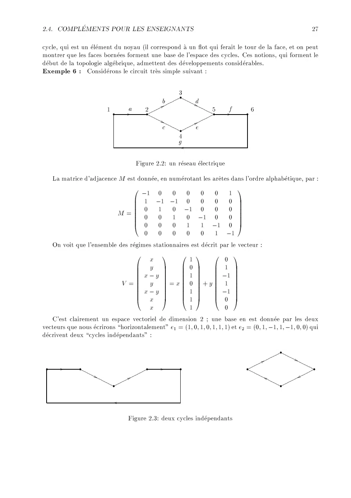

~~~text
2.4. COMPLEMENTS POUR LES ENSEIGNANTS                                                                              27

cycle, qui est un element du noyau (il correspond a un ot qui ferait le tour de la face, et on peut
montrer que les faces bornees forment une base de l'espace des cycles. Ces notions, qui forment le
debut de la topologie algebrique, admettent des developpements considerables.
Exemple 6 : Considerons le circuit tres simple suivant :

                                                               3O
                                                   boooooooo OOOOOOdOO
                           1     a       2OooOoooo
                                                           7

                                                                   OOO
                                                                    '

                                                                      OO5   f           6
                                              OOO                   oooo           
                                   /                                        /

                                                 OOO               o
                                                    OOO         ooo
                                                       OOO ooooo
                                                       c            e
                                                           '        7

                                                          o
                                                               4
                                                               g
                                                               o

                                       Figure 2.2: un reseau electrique
     La matrice d'adjacence M est donnee, en numerotant les ar^etes dans l'ordre alphabetique, par :
                                   0 ;1 0 0 0 0                  0 1
                                                                                1
                                   BB 1 ;1 ;1 0 0                0 0 C    C
                                M =B
                                    B 0 1 0 ;1 0                 0 0 C    C
                                    BB 0 0 1 0 ;1                0 0 C    C
                                     @0 0 0 1 1 ;1 0 A
                                      0 0 0 0 0 1 ;1
     On voit que l'ensemble des regimes stationnaires est decrit par le vecteur :
                                   0 x 1 011 0 0 1
                                   BB y C           B 0C    B  1 C
                                    BB x ; y C C
                                               C
                                                    B
                                                    B
                                                    B
                                                        C   B
                                                      1 C B ;1 C
                                                        C   B    C
                                                                 C
                                V =B BB y C    C = xB
                                                    B 0CC +yB
                                                            B  1 C
                                                                 C
                                      B@ x ; y C
                                               C    B
                                                    B 1CC   B
                                                            B ;1 C
                                                                 C
                                           x A @1A @ 0 A
                                              x      1                0
    C'est clairement un espace vectoriel de dimension 2 ; une base en est donnee par les deux
vecteurs que nous ecrirons \horizontalement" e1 = (1; 0; 1; 0; 1; 1; 1) et e2 = (0; 1; ;1; 1; ;1; 0; 0) qui
decrivent deux \cycles independants" :

                                                                                                    ooOOOOO
                                                                                               ooooo        OOO
                                                                                            ooo                OOO
                                                                                           o                      OOO
                                                                                            7                '

             OOOOO                    oo                                        OooOOoOO                      oo
                                     ooo                                                                        ooo
         /                                             /

                   OOO             oo                                                        OOO              oo
                      OOO         o                                                             OOO          o
                         OOO ooooo                                                                 OOO ooooo
                       '           7                                                        g                w

                            
                            o                                                                         o

                            o

                                  Figure 2.3: deux cycles independants
~~~

## Page 32

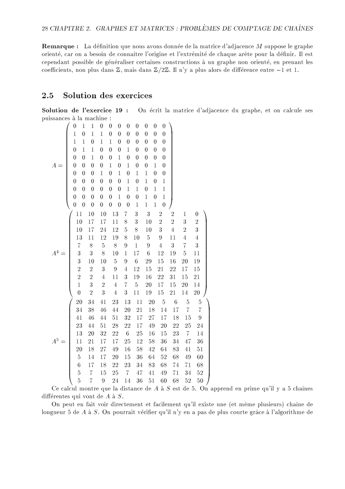

~~~text
28 CHAPITRE 2. GRAPHES ET MATRICES : PROBLE MES DE COMPTAGE DE CHA^INES

Remarque : La de nition que nous avons donnee de la matrice d'adjacence M suppose le graphe
oriente, car on a besoin de conna^tre l'origine et l'extremite de chaque ar^ete pour la de nir. Il est
cependant possible de generaliser certaines constructions a un graphe non oriente, en prenant les
coecients, non plus dans Z, mais dans Z=2Z. Il n'y a plus alors de di erence entre ;1 et 1.

2.5 Solution des exercices
Solution de l'exercice 19 : On ecrit la matrice d'adjacence du graphe, et on calcule ses
         0 a la machine :
puissances                                                           1
                                  0 1 1 0 0 0 0 0 0 0 0
         BB 1 0 1 1 0 0 0 0 0 0 0 C
          BB 1 1 0 1 1 0 0 0 0 0 0 C                                 C
           BB 0 1 1 0 0 0 1 0 0 0 0 C                                C
            BB 0 0 1 0 0 1 0 0 0 0 0 C                               C
                                                                     C
    A=B      B                                                       C
             BB 00 00 00 01 10 01 10 01 01 10 00 C                   C
              BB 0 0 0 0 0 0 1 0 1 0 1 C                             C
               BB 0 0 0 0 0 0 1 1 0 1 1 C                            C
                B@ 0 0 0 0 0 1 0 0 1 0 1 C                           C
                                                                     A
                         0        0   0  0 0  0   0  0  1  1   1   0            1
                                   11 10 10 13 7 3 3 2 2 1 0
                         BB 10 17 17 11 8 3 10 2 2 3 2 C
                          BB 10 17 24 12 5 8 10 3 4 2 3 C                       C
                           BB 13 11 12 19 8 10 5 9 11 4 4 C                     C
                            BB 7 8 5 8 9 1 9 4 3 7 3 C                          C
                                                                                C
    A =B                     B                                                  C
                             BB 3 10 10 5 9 6 29 15 16 20 19 C
                                    3    3  8  10   1  17   6    12  19   5  11
      4
                                                                                C
                              BB 2 2 3 9 4 12 15 21 22 17 15 C                  C
                               BB 2 2 4 11 3 19 16 22 31 15 21 C                C
                                B@ 1 3 2 4 7 5 20 17 15 20 14 C                 C
                                                                                A
                 0                  0    2  3   4   3  11  19    15  21  14  20  1
                                   20 34 41 23 13 11 20 5 6 5 5
                 BB 34 38 46 44 20 21 18 14 17 7 7 C
                  BB 41 46 44 51 32 17 27 17 18 15 9 C                           C
                   BB 23 44 51 28 22 17 49 20 22 25 24 C                         C
                    BB 13 20 32 22 6 25 16 15 23 7 14 C                          C
                                                                                 C
    A =B             B                                                           C
                     BB 20 18 27 49 16 58 42 64 83 41 51 C
                                   11   21 17  17   25  12   58   36  34  47  36
      5
                                                                                 C
                      BB 5 14 17 20 15 36 64 52 68 49 60 C                       C
                       BB 6 17 18 22 23 34 83 68 74 71 68 C                      C
                        B@ 5 7 15 25 7 47 41 49 71 34 52 C                       C
                                                                                 A
                                    5 7 9 24 14 36 51 60 68 52 50
    Ce calcul montre que la distance de A a S est de 5. On apprend en prime qu'il y a 5 cha^nes
di erentes qui vont de A a S .
    On peut en fait voir directement et facilement qu'il existe une (et m^eme plusieurs) cha^ne de
longueur 5 de A a S . On pourrait veri er qu'il n'y en a pas de plus courte gr^ace a l'algorithme de
~~~

## Page 33

~~~text
2.5. SOLUTION DES EXERCICES                                                                           29

recherche de plus courte cha^ne du chapitre 4.
Solution de l'exercice 20 : Cet exercice se resout de la m^eme maniere que le precedent : on
calcule la matrice, on veri e que la puissance quatrieme de cette matrice a un terme nul, qui est
aussi nul dans toutes les puissances precedentes (il correspond aux cha^nes qui joignent le sommet
le plus a gauche au sommet le plus a droite), et que la puissance cinquieme a tous ses termes
strictement positifs.
    Le diametre du graphe est donc 5.
Solution de l'exercice 21 : On commence par calculer la matrice M associee au graphe oriente,
puis la puissance cinquieme de cette matrice, et l'on veri e qu'il y a exactement une facon d'aller
de A a B en cinq etapes.
    On calcule ensuite la matrice N associee au graphe non oriente. Un maniere simple de le faire
est de remarquer que, comme il n'y a pas d'ar^etes a double sens, N est somme de M et de sa
transposee, ce qui simpli e l'ecriture. On veri e, en calculant la puissance cinquieme de N , qu'il y
a 13 facons d'aller a pied de A a B en 5 etapes.
~~~

## Page 34

~~~text
Chapitre 3

Problemes de coloriage
3.1 Quelques problemes
Regardons quelques situations plus ou moins courantes :
Exercice 22 Un groupe de 8 personnes doit participer a deux reunions. A la premiere reunion,
ils sont tous assis autour d'une table ronde. Comme l'entente est totale, pour la seconde reunion,
chacun des participants, non seulement ne veut pas se retrouver a c^ote de l'un ou l'autre de ses
voisins, mais ne veut pas non plus qu'ils soient assis a la m^eme table.
     a) Combien de tables au minimum seront alors necessaires ? Combien de personnes au maxi-
mum pourront s'asseoir a une m^eme table ?
     b) On suppose maintenant qu'il y a 9 participants et que l'entente est tout aussi cordiale. Que
se passera-t-il alors ?
Exercice 23 Pendant un festival, on veut organiser des tournois de scrable (S), echecs (E), go
(G), dames (D), tarot (T) et master-mind (M). Plusieurs personnes se sont inscrites a la fois pour
les tournois E, S, G, d'autres personnes pour les tournois G, D, M, et en n d'autres personnes
pour les tournois M, T, S. Il est entendu qu'une participation simultanee a plusieurs tournois est
impossible et que les organisateurs veulent satisfaire tout le monde.
    a) Quel est le nombre maximum de tournois qui pourraient se derouler en m^eme temps ?
    b) En sachant que chaque tournoi doit durer au maximum 3 heures, proposer un horaire des
tournois necessitant une duree minimale et respectant bien s^ur les choix des participants.
Exercice 24 Voici la carte du pays d'Ovalie avec ses 5 regions A, B, C, D et E.

                                     A
                                                       C        D     E
                                     B

    On veut colorier cette carte de telle maniere que deux regions frontalieres aient des couleurs
di erentes. Combien de couleurs au minimum faudra-t-il prevoir ?
                                                 30
~~~

## Page 35

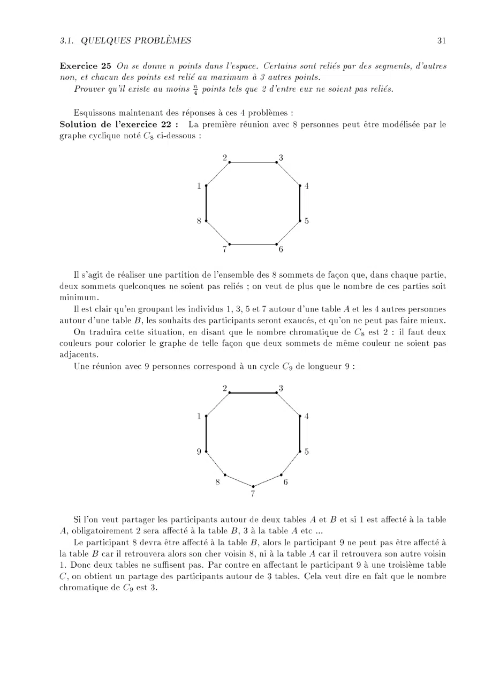

~~~text
3.1. QUELQUES PROBLEMES                                                                                 31

Exercice 25 On se donne n points dans l'espace. Certains sont relies par des segments, d'autres
non, et chacun des points est relie au maximum a 3 autres points.
   Prouver qu'il existe au moins n4 points tels que 2 d'entre eux ne soient pas relies.
   Esquissons maintenant des reponses a ces 4 problemes :
Solution de l'exercice 22 : La premiere reunion avec 8 personnes peut ^etre modelisee par le
graphe cyclique note C8 ci-dessous :
                                                2              ?3??
                                                                   ??
                                                                    ??
                                                                       ??
                                      1                                4

                                      8 ????                            5
                                            ??                       
                                              ??                   
                                                ?
                                                                
                                                7               6

   Il s'agit de realiser une partition de l'ensemble des 8 sommets de facon que, dans chaque partie,
deux sommets quelconques ne soient pas relies ; on veut de plus que le nombre de ces parties soit
minimum.
   Il est clair qu'en groupant les individus 1, 3, 5 et 7 autour d'une table A et les 4 autres personnes
autour d'une table B , les souhaits des participants seront exauces, et qu'on ne peut pas faire mieux.
   On traduira cette situation, en disant que le nombre chromatique de C8 est 2 : il faut deux
couleurs pour colorier le graphe de telle facon que deux sommets de m^eme couleur ne soient pas
adjacents.
   Une reunion avec 9 personnes correspond a un cycle C9 de longueur 9 :
                                                2              ?3??
                                                                   ??
                                                                    ??
                                                                       ??
                                      1                                4

                                      9 9999                         
                                                                         5
                                            99                      
                                              99                  
                                               RRRRR         ll
                                                                
                                            8        RRR lllll 6
                                                        l
                                                        7

    Si l'on veut partager les participants autour de deux tables A et B et si 1 est a ecte a la table
A, obligatoirement 2 sera a ecte a la table B, 3 a la table A etc ...
    Le participant 8 devra ^etre a ecte a la table B , alors le participant 9 ne peut pas ^etre a ecte a
la table B car il retrouvera alors son cher voisin 8, ni a la table A car il retrouvera son autre voisin
1. Donc deux tables ne susent pas. Par contre en a ectant le participant 9 a une troisieme table
C , on obtient un partage des participants autour de 3 tables. Cela veut dire en fait que le nombre
chromatique de C9 est 3.
~~~

## Page 36

~~~text
32                                                              CHAPITRE 3. PROBLEMES DE COLORIAGE
Solution de l'exercice 23 : Soit H le graphe dont les sommets sont les 6 tournois et dont les
ar^etes sont les paires de tournois ne pouvant avoir lieu en m^eme temps pour des raisons d'inscription
multiple (graphe d'incompatibilite).
                                                                 S
                                                                o9O9O O
                                                          ooooo 9O   99 OOOO
                                                      o oo             99 OOO
                                                     o      
                                          T   ooo                      99
                                                                             99
                                                                                    OO
                                                                                          E
                                                                             99
                                                                               99
                                                                                99
                                                                                   99
                                          M   OOOO
                                                      OOO                       ooo o o   G
                                                          OOO                oo
                                                              OOO ooooo
                                                                  o
                                                                 D
    Repondre a la premiere question revient a determiner un ensemble de sommets le plus grand
possible et tel que deux sommets de cet ensemble ne soient pas relies, c'est-a-dire, avec la ter-
minologie du chapitre 1, un sous-ensemble stable de G de taille maximale. Le cardinal d'un tel
ensemble sera le nombre cherche. Il est facile de se rendre compte qu'ici la reponse est 3 et que le
seul sous-ensemble qui convient est fT; E; Dg. Donc on peut organiser au maximum 3 tournois en
parallele et ces tournois sont : echecs, dames et tarot.
    Proposer un horaire optimum, revient a determiner le nombre chromatique (H ) de H et a
determiner une partition de l'ensemble S (H ) des sommets de H en (H ) parties de S (H ) telle
que le sous-graphe engendre par chacune de ces parties ne comporte pas d'ar^ete, c'est-a-dire en
  (H ) sous-ensembles stables. Il n'est pas dicile de voir que chercher le nombre chromatique de
H , revient en fait a determiner le nombre minimum de couleurs necessaire pour colorier tous les
sommets de telle facon que deux sommets adjacents aient des couleurs di erentes.
    Il est clair que pour colorier les sommets du sous-graphe complet de sommets S , G et M il faut
trois couleurs ce qui montre que (H )  3. On se rend vite compte que trois couleurs susent, par
exemple bleu pour S et D, blanc pour E et M et rouge pour G et T , et par consequent on pourrait
donc proposer l'horaire suivant :
     9h - 12h : scrable et dames.
     13h - 16h : echecs et master-mind.
     16h - 19h : go et tarot.
Solution de l'exercice 24 : Appelons G le graphe dont les sommets sont les 5 regions et dont
les ar^etes correspondent aux frontieres separant deux regions.
                        A RW??RWRWRWWW
                               ?? RRRWWWW
                                  ?? RRR WWWWW
                                    ??      RRR WWWWW
                                                RRR     W
                                      ??
                                        ??         RRR WWWWWWWW
                                                      RRR            WWWW
                                          ??             RRR             WWWWW
                                                             RRR
                                            ??
                                              C
                                              ?
                                              
                                                                 RRR
                                                                            DWWWWW
                                                                                   WWWW        E
                                                           l lll l
                                                                               gggggggg
                                                         lll
                                                             l               gg
                                         
                                                                        gggg
                                                   lllll       g gg gggg
                                               lll           g
                                                          gggg
                                    lllllgggggggg
                                   l gg l     g
                               lllglgggg
                            llglggg
                        B
                            
                            g
~~~

## Page 37

~~~text
3.1. QUELQUES PROBLEMES                                                                              33

    C'est ce qu'on appelle un graphe planaire, c'est a dire un graphe qui peut ^etre dessine sans que
deux ar^etes quelconques ne se croisent. Un coloriage de la carte revient en fait a un coloriage du
graphe G. Le nombre minimum de couleurs necessaires pour colorier la carte est donc le nombre
chromatique (G) de G.
    Or le sous-graphe H de sommets A, B , C et D est complet et il est evident que pour son
coloriage, il faut 4 couleurs, par consequent (G)  4 . Une fois le coloriage de H fait, en attribuant
au sommet E la couleur de C , on obtient le coloriage de G avec 4 couleurs. Par consequent, (G) = 4
et on peut donc colorier la carte avec 4 couleurs.

Solution de l'exercice 25 : On a a aire en fait a un graphe G dont les sommets sont les n
points et dont les ar^etes sont les paires de points adjacents.
    Il s'agit alors de prouver que le plus grand ordre d'un sous-ensemble stable de G (c'est-a-dire
d'un ensemble de sommets qui engendre un graphe n'ayant aucune ar^ete) est superieur ou egal a
n.
4
    Notons k cet ordre maximum. Il existe alors une partie A de S (G) de cardinal k et telle que
deux sommets quelconques de A ne soient pas adjacents. Soit B l'ensemble des sommets de S (G)
adjacents a un sommet de A. Il est clair que A et B sont disjoints, car sinon A contiendrait 2
sommets adjacents et ne serait pas stable. On a aussi A [ B = S (G) (sinon il existerait un sommet
x dans G n'ayant aucun voisin dans A, et A [fxg serait une partie stable de S (G) a k +1 elements,
ce qui contredit l'hypothese de maximalite de k). Puisque chaque element de A admet au plus 3
voisins dans B, on deduit que B a au plus 3k elements, donc S (G) = A [ B a au plus 4k elements,
soit n  4k et k  n4 , ce qui prouve le resultat.

Remarque : On peut obtenir un resultat plus precis : une majoration du nombre chromatique
de G, ce qui permet de donner une autre solution. Nous allons majorer ce nombre chromatique en
cherchant des sous-ensembles stables disjoints aussi grands que possible.
     Partons d'un sous-ensemble A de G qui est stable et de cardinal maximum. Si A = S (G) (ce
qui veut dire que G n'a pas d'ar^ete), on a clairement (G) = 1 . Sinon, soit A1 un sous-ensemble
stable de G de taille maximale disjoint de A. Si A [ A1 = S (G), on a clairement (G) = 2. S'il y a
inclusion stricte, soit A2 un sous-ensemble stable de G de taille maximale contenu dans les sommets
de G qui ne sont ni dans A ni dans A1 . Si A [ A1 [ A2 = S (G) on a (G) = 3. Sinon, appelons A3
le complementaire de A [ A1 [ A2 dans S (G). D'apres les de nitions de A, A1 et A2 , tout sommet
x de A3 a au moins un voisin dans chacun des ensembles cites, sinon on pourrait accroitre l'un au
moins des trois ensembles A, A1 , A2 , ce qui est contraire a leur de nition. Alors, comme tout point
est de degre au plus 3, on deduit que x n'a aucun voisin dans A3 . C'est donc un sous-ensemble
stable de G, et (A; A1 ; A2; A3) est une partition de S (G) en 4 sous-ensembles stables, donc (G)=4.
     On voit que dans tous les cas, on a : (G)  4.
     Par de nition du nombre chromatique, cela veut dire qu'on peut trouver une partition de S (G)
en au plus 4 sous-ensembles stables (c'est d'ailleurs ce que l'on a fait au cours de la preuve). Mais
alors, l'un au moins de ces 4 ensembles est de taille superieure ou egale a n4 , sinon S (G) serait de
taille strictement inferieure a n. C'est exactement ce que l'on voulait prouver.

   En generalisant ce raisonnement on pourrait prouver que le nombre chromatique d'un graphe
G est majore par r + 1, ou r est le plus grand des degres des sommets, mais on prouvera cela dans
la section suivante d'une maniere plus rapide.
~~~

## Page 38

~~~text
34                                                 CHAPITRE 3. PROBLEMES DE COLORIAGE
3.2 Recapitulation : les de nitions et resultats
A partir des exemples precedents et de leurs discussions, on peut donner quelques de nitions :
De nition 15 Un coloriage d'un graphe consiste en l'attribution de couleurs aux sommets, de telle
maniere que deux sommets voisins n'aient pas la m^eme couleur.
  Un coloriage du graphe avec k couleurs sera appele un k-coloriage.
Remarque : On peut se demander ce que sont ces mysterieuses \couleurs". Il s'agit simplement
d'un moyen de donner un contenu intuitif a une notion utile dans des contextes tres varies. D'un
point de vue formel, l'ensemble des couleurs est un ensemble ni C quelconque, et un coloriage est
tout simplement une application de l'ensemble S (G) des sommets du graphe dans l'ensemble C ,
telle que deux sommets adjacents aient toujours des images distinctes.
    Dans les exemples, cet ensemble ni peut ^etre un ensemble de tranches horaires dans lesquelles
on doit faire tenir diverses occupations de facon compatible, de cages de zoo dans lesquelles il ne faut
pas mettre des animaux qui vont s'attaquer, de salles de classes dans lesquelles on veut organiser
des options, etc: : :. Une grande partie de la diculte tient ici dans le travail de modelisation, pour
faire appara^tre la question comme un probleme de coloriage. En particulier, la contruction du
graphe n'est pas toujours evidente: pour les problemes de coloriage de carte, comme on l'a vu
dans l'exercice sur la carte d'Ovalie, c'est le graphe dual du graphe represente qu'il faut considerer.
Dans les problemes de compatibilite, ce ne sont pas les sommets compatibles qu'il faut relier sur le
graphe, comme on a spontanement tendance a le faire, mais les sommets incompatibles.
    Il n'est pas dans l'esprit du programme d'insister sur le c^ote formel (\on appelle coloriage une
application de S (G) dans un ensemble ni C , appele ensemble des couleurs, telle que: : :"), il est
par contre utile de montrer aux eleves comment ce qui pourrait, au depart, appara^tre comme une
pure recreation mathematique permet de repondre a des questions naturelles et diciles.

De nition 16 Le nombre chromatique d'un graphe est le nombre minimum de couleurs necessaires
a son coloriage.
    On note d'habitude (G) le nombre chromatique d'un graphe G. Rappelons une de nition utile
du chapitre 1 :
De nition 17 On dit qu'un sous-ensemble de l'ensemble des sommets est stable s'il ne contient
pas de paires de sommets adjacents.
    Si l'on se donne un coloriage d'un graphe, l'ensemble des sommets d'une couleur donnee est,
par de nition, un ensemble stable. C'est donc la m^eme chose de se donner un k-coloriage, ou une
partition en k sous-ensembles stables. En particulier, le nombre chromatique d'un graphe est le
nombre minimum de parties d'une telle partition ; nous avons utilise cette propriete dans l'exercice
25 ci-dessus.
    On ne conna^t pas de formule miracle permettant de determiner le nombre chromatique d'un
graphe quelconque. La plupart du temps il faut se contenter d'un encadrement, autrement dit d'un
minorant et d'un majorant du nombre chromatique. On a inter^et bien s^ur a ce que le minorant
soit le plus grand possible et que le majorant soit le plus petit possible. Si par hasard le minorant
et le majorant sont les m^emes, on a gagne puisqu'on a alors le nombre chromatique du graphe.
    Quelques remarques simples permettent de minorer ce nombre chromatique. Soit H un sous-
graphe d'un graphe G. Il est clair qu'un coloriage de G avec (G) couleurs induit un coloriage de
H avec au plus (G) couleurs. Cela veut dire en fait :
~~~

## Page 39

~~~text
3.2. RECAPITULATION : LES DEFINITIONS ET RESULTATS                                                 35

Proposition 7 Si G est un graphe, alors pour tout sous-graphe H de G on a :
                                         (H )  (G)
.
    Cette proposition est tres utile car elle donne un minorant du nombre chromatique de G; si en
plus on peut indiquer un coloriage de G avec (H ) couleurs, alors on a exactement (H ) = (G).
C'est exactement ce qu'on a fait dans les exemples 2 et 3 du paragraphe precedent, le sous-graphe
H etant a chaque fois un graphe complet. La morale de cela est qu'il est utile de regarder de plus
pres les graphes complets. Le resultat tres facile a prouver et qu'on laisse en exercice est :
Proposition 8 Le nombre chromatique du graphe complet Kn est n.
    Dans l'exemple 1, on a vu que le nombre chromatique d'un cycle de longueur 8 est 2 et que
par contre, le nombre chromatique d'un cycle de longueur 9 est 3. La generalisation, qu'on devine
facilement, est :
Proposition 9 Soit Cn le cycle de longueur n. Si n est pair on a : (Cn) = 2, et si n est impair
on a : (Cn) = 3.
    La aussi, nous laissons la demonstration en exercice.
    Il est plus dicile de prouver des majorations generales du nombre chromatique ; nous en avons
vu une dans l'exercice 25, et nous en donnons d'autres dans les complements ci-dessous ; certaines
peuvent ^etre faites en exercice, mais elles ne font pas partie des notions exigibles. Par contre, il
est clair que, si l'on dispose d'un coloriage, on a une majoration du nombre chromatique, ce qui
montre l'utilite d'avoir une strategie pour colorier un graphe, strategie qu'on appellera algorithme
de coloriage. Nous allons decrire ici l'algorithme de coloriage de Welch et Powell :
     On classe d'abord les sommets du graphe dans l'ordre decroissant de leur degre. On obtient
      ainsi une liste x1 ; : : :; xn de sommets telle que deg (x1)  : : :  deg (xn).
     A la premiere etape on choisit une couleur c1 pour le sommet x1, et en parcourant la liste,
      le premier sommet non colorie et non adjacent a un sommet deja colorie avec c1 (couleur
      d'usage) se verra attribuer la couleur c1.
     On reprend la demarche en attribuant a chaque fois une nouvelle couleur d'usage au premier
      sommet de la liste non encore colorie. On s'arr^ete des que tous les sommets ont ete colories.
Remarque : C'est un bon algorithme, mais precisons quand m^eme que le nombre de couleurs
utilise par cet algorithme n'est pas forcement le nombre chromatique du graphe. L'exemple qui
suit illustre cela. De plus, on remarquera qu'une partie de l'algorithme n'est pas entierement
determinee : en e et, s'il y a plusieurs sommets de m^eme degre, l'ordre dans lequel on les range
est arbitraire, donc deux personnes appliquant cet algorithme au m^eme graphe n'obtiendront pas
forcement le m^eme coloriage.
Exemple 7 : Considerons le graphe G dessine ci-dessous. Ce graphe n'est pas un graphe
quelconque, c'est un graphe de de Bruijn non oriente. Plus precisement c'est le graphe de de Bruijn
~~~

## Page 40

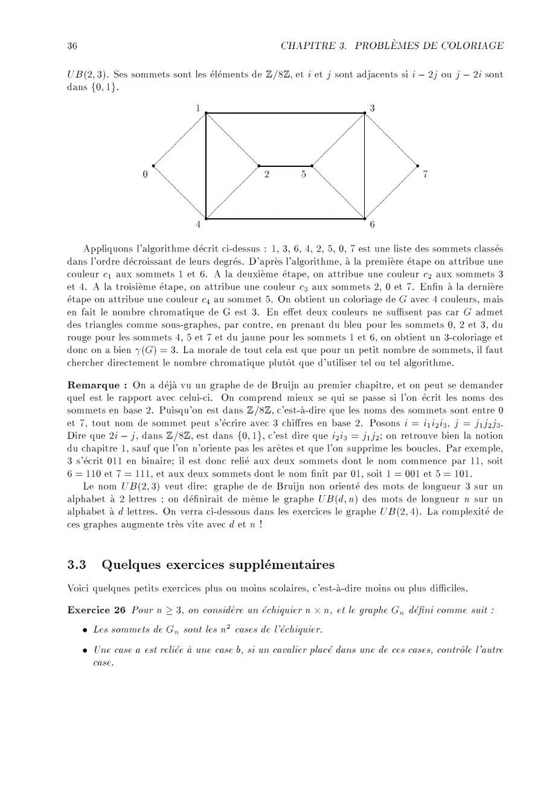

~~~text
36                                                        CHAPITRE 3. PROBLEMES DE COLORIAGE
UB (2; 3). Ses sommets sont les elements de Z=8Z, et i et j sont adjacents si i ; 2j ou j ; 2i sont
dans f0; 1g.
                                 1 ??                                         ? 3
                                     ??                                        ???
                                      ??                                 
                                                                                    ??
                                        ??
                                             ??                                     ??
                                                                                         ??
                                             ??                                        ??
                                                ??                                         ??
                                                ??                                       ??
                                                   ?                                         ?
                   ???                                    ???                              
                  0 ??  ?                          2
                                                    
                                                             5 ??  ?                           7
                                                                                                
                           ??                                       ??                    
                             ??                                      ??               
                               ??                                        ??            
                                 ??                                      ??       
                                   ??                                       ?? 
                                     ?                                        ?
                                 4                                              
                                                                                 6
     Appliquons l'algorithme decrit ci-dessus : 1, 3, 6, 4, 2, 5, 0, 7 est une liste des sommets classes
 dans l'ordre decroissant de leurs degres. D'apres l'algorithme, a la premiere etape on attribue une
 couleur c1 aux sommets 1 et 6. A la deuxieme etape, on attribue une couleur c2 aux sommets 3
 et 4. A la troisieme etape, on attribue une couleur c3 aux sommets 2, 0 et 7. En n a la derniere
etape on attribue une couleur c4 au sommet 5. On obtient un coloriage de G avec 4 couleurs, mais
 en fait le nombre chromatique de G est 3. En e et deux couleurs ne susent pas car G admet
 des triangles comme sous-graphes, par contre, en prenant du bleu pour les sommets 0, 2 et 3, du
 rouge pour les sommets 4, 5 et 7 et du jaune pour les sommets 1 et 6, on obtient un 3-coloriage et
 donc on a bien (G) = 3. La morale de tout cela est que pour un petit nombre de sommets, il faut
 chercher directement le nombre chromatique plut^ot que d'utiliser tel ou tel algorithme.
Remarque : On a deja vu un graphe de de Bruijn au premier chapitre, et on peut se demander
quel est le rapport avec celui-ci. On comprend mieux se qui se passe si l'on ecrit les noms des
sommets en base 2. Puisqu'on est dans Z=8Z, c'est-a-dire que les noms des sommets sont entre 0
et 7, tout nom de sommet peut s'ecrire avec 3 chi res en base 2. Posons i = i1 i2i3, j = j1 j2j3.
Dire que 2i ; j , dans Z=8Z, est dans f0; 1g, c'est dire que i2i3 = j1 j2; on retrouve bien la notion
du chapitre 1, sauf que l'on n'oriente pas les ar^etes et que l'on supprime les boucles. Par exemple,
3 s'ecrit 011 en binaire; il est donc relie aux deux sommets dont le nom commence par 11, soit
6 = 110 et 7 = 111, et aux deux sommets dont le nom nit par 01, soit 1 = 001 et 5 = 101.
    Le nom UB (2; 3) veut dire: graphe de de Bruijn non oriente des mots de longueur 3 sur un
alphabet a 2 lettres ; on de nirait de m^eme le graphe UB (d; n) des mots de longueur n sur un
alphabet a d lettres. On verra ci-dessous dans les exercices le graphe UB (2; 4). La complexite de
ces graphes augmente tres vite avec d et n !

3.3 Quelques exercices supplementaires
Voici quelques petits exercices plus ou moins scolaires, c'est-a-dire moins ou plus diciles.
Exercice 26 Pour n  3, on considere un echiquier n  n, et le graphe Gn de ni comme suit :
   Les sommets de Gn sont les n2 cases de l'echiquier.
   Une case a est reliee a une case b, si un cavalier place dans une de ces cases, contr^ole l'autre
      case.
~~~

## Page 41

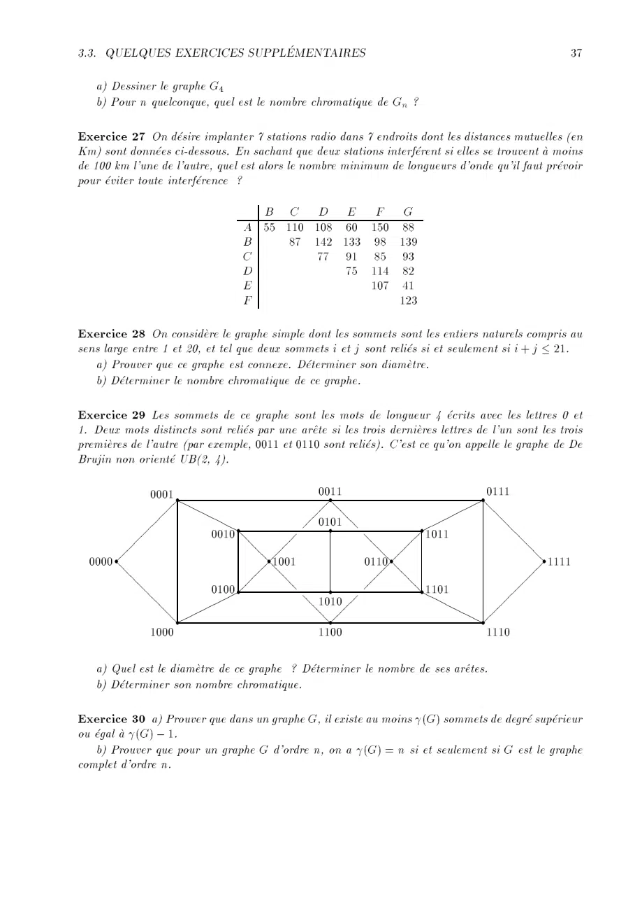

~~~text
3.3. QUELQUES EXERCICES SUPPLEMENTAIRES                                                                                        37

   a) Dessiner le graphe G4
   b) Pour n quelconque, quel est le nombre chromatique de Gn ?

Exercice 27 On desire implanter 7 stations radio dans 7 endroits dont les distances mutuelles (en
Km) sont donnees ci-dessous. En sachant que deux stations interferent si elles se trouvent a moins
de 100 km l'une de l'autre, quel est alors le nombre minimum de longueurs d'onde qu'il faut prevoir
pour eviter toute interference ?
                                                B C           D      E       F      G
                                          A 55 110 108 60 150 88
                                          B     87 142 133 98 139
                                          C        77 91 85 93
                                          D            75 114 82
                                          E                107 41
                                          F                    123

Exercice 28 On considere le graphe simple dont les sommets sont les entiers naturels compris au
sens large entre 1 et 20, et tel que deux sommets i et j sont relies si et seulement si i + j  21.
   a) Prouver que ce graphe est connexe. Determiner son diametre.
   b) Determiner le nombre chromatique de ce graphe.

Exercice 29 Les sommets de ce graphe sont les mots de longueur 4 ecrits avec les lettres 0 et
1. Deux mots distincts sont relies par une ar^ete si les trois dernieres lettres de l'un sont les trois
premieres de l'autre (par exemple, 0011 et 0110 sont relies). C'est ce qu'on appelle le graphe de De
Brujin non oriente UB(2, 4).

                  0001OOO                                   0011?
                                                                                                          0111
                                                                                                           ?
                            OOO                                ???                               ooooo ???
                               OOOO                                 ?                             o         ??
                                                                       ?                          oo
                                  OOO                    0101 ??                         oooo              ??
                                                                                                                   ??
                                       
                                        ?
                                   0010 ???
                                          ?                                ?                o
                                                                                             1011
                                                                                                                    ??
                                                                        ??
                                                                               ?                                      ??
                                            ??                             ??                                    ??
                                               ??                              ??                                     ?
  0000 ????                                 
                                                 
                                                 ?
                                                   1001
                                                   ?
                                                 ??                        0110 
                                                                                   ?
                                                                                    
                                                                                   ???
                                                                                                                          1111
                                                                                                                            
              ??                                    ??                               ??                             
                ??                                     ??                                ??                         
                  ??               0100                                                  ?O1101                 
                                       o
                                                          ?                                 OOOO                
                    ??              ooo                     ??
                                                              ??1010 
                                                                                                                
                      ??
                        ??     ooooo                            ?     
                                                                                                   OOO
                                                                                                      OO      
                          ?oooo                                  ??                                   OOO 
                                                                                                        
                  1000                                        1100                                        1110

   a) Quel est le diametre de ce graphe ? Determiner le nombre de ses ar^etes.
   b) Determiner son nombre chromatique.

Exercice 30 a) Prouver que dans un graphe G, il existe au moins (G) sommets de degre superieur
ou egal a (G) ; 1.
   b) Prouver que pour un graphe G d'ordre n, on a (G) = n si et seulement si G est le graphe
complet d'ordre n.
~~~

## Page 42

~~~text
38                                                CHAPITRE 3. PROBLEMES DE COLORIAGE
3.4 Complements pour les enseignants
3.4.1 Nombre de stabilite
De nition 18 On appelle nombre de stabilite d'un graphe G le cardinal maximal d'un sous-
ensemble stable de G. On le note (G).
Proposition 10 Si G est un graphe d'ordre s, on a :
                           (G) (G)  s        (G) + (G)  s + 1
Demonstration : Pour la premiere inegalite, considerons une partition de G en ensembles
stables qui realise le nombre chromatique. On a donc une partition de G en (G) sous-ensembles,
qui sont tous, par de nition de (G), de cardinal au plus (G); donc le cardinal de la reunion de
ces ensembles est majore par (G) (G), d'ou l'inegalite (G) (G)  s.
    Pour la seconde inegalite, soit A un sous-ensemble stable de taille maximale. Soit H le graphe
engendre par le complementaire de A (H est le sous-graphe de G dont les sommets sont les sommets
de G qui ne sont pas dans A, et dont les ar^etes sont les ar^etes de G dont aucune extremite n'est
dans A). On voit facilement que (G)  (H ) + 1: a toute coloration de H , on peut associer une
coloration de G avec exactement une couleur de plus en colorant tous les sommets de A avec la
nouvelle couleur. De plus, il est clair que (H ) est majore par le nombre s ; (G) de sommets de
H . On a donc montre (G) ; 1  (H )  s ; (G), d'ou l'inegalite cherchee.
     Ceci peut permettre des majorations de G en trouvant des sous-ensembles stables de taille
maximale. On remarquera que, des que le graphe n'est pas de petite taille, il n'est pas du tout
evident de trouver un ensemble stable de taille maximale ; en particulier, ce n'est pas parce qu'un
ensemble stable est maximal qu'il est de taille maximale ! La strategie elementaire qui consiste a
essayer d'augmenter un ensemble stable ne sut donc pas a determiner le nombre de stabilite.
3.4.2 Majorations du nombre chromatique
Il est clair que, si on arrive a construire un coloriage d'un graphe G avec un nombre m de couleurs,
on a (G)  m. En particulier, le nombre chromatique d'un graphe G est inferieur ou egal au
nombre de sommets de G, en donnant a chaque sommet une couleur di erente, mais c'est la une
majoration triviale. Une majoration plus ne est donnee par :
Proposition 11 Considerons un graphe G et soit r le plus grand des degres des sommets. Alors :
  (G)  r + 1
Demonstration : Soit n l'ordre de G. Il existe des parties de S (G) qu'on peut colorier avec
au plus r + 1 couleurs (il sut de prendre une partie a un element). Soit alors A une telle partie
de cardinal maximum. Supposons que A soit strictement inclus dans S (G). Il existerait alors un
sommet x de G n'appartenant pas a A. Or x a au plus r voisins dans A, par consequent parmi
les r + 1 couleurs utilisees pour le coloriage de A, il existe au moins une couleur non utilisee pour
les voisins de x dans A. En attribuant cette couleur a x, on obtient un coloriage de A [ fxg avec
toujours au plus r +1 couleurs, et comme le cardinal de A [fxg est strictement plus grand que celui
de A, on obtient une contradiction avec la de nition de A. Par consequent on a A = S (G), ce qui
veut dire qu'on peut colorier les sommets de G avec au plus r + 1 couleurs, et donc (G)  r + 1.
~~~

## Page 43

~~~text
3.4. COMPLEMENTS POUR LES ENSEIGNANTS                                                                   39

De nition 19 On appelle graphe complementaire du graphe G le graphe dont les sommets sont
ceux de G et dans lequel deux sommets sont adjacents si et seulement si ils ne sont pas adjacents
dans G. On le note G.
Theoreme 8 Pour un graphe G d'ordre s, on a : (G) + (G)  s.
    Voici maintenant un resultat un peu plus fort que la proposition 3.4.2 :
Theoreme 9 (Brooks, 1941). Soit G un graphe connexe de degre maximum r qui ne soit ni complet
ni un cycle de longueur impaire. Alors (G)  r.
    Le lecteur interesse trouvera les preuves dans la reference [3], avec d'autres resultats plus tech-
niques, et des exemples historiques assez savoureux.
    Les graphes de nombre chromatique 1 sont triviaux, puiqu'ils n'ont pas d'ar^etes. Par contre,
les graphes de nombre chromatique 2 sont tout-a-fait interessants :
De nition 20 On dit qu'un graphe est bi-parti s'il existe une partition de l'ensemble des sommets
en deux sous-ensembles, telle que toute ar^ete joint un sommet du premier ensemble a un sommet
du second.
    Les graphes bi-partis interviennent naturellement dans beaucoup de problemes, en particulier
tous les problemes de mariage; il est clair qu'une autre facon de dire qu'un graphe est bi-parti, c'est
de dire que son nombre chromatique est 2. On peut signaler un critere interessant :
Theoreme 10 (Konig) Le nombre chromatique d'un graphe G est 2 si et seulement si il n'admet
pas de cycles de longueur impaire.
    La demonstration gure dans la reference [4]. On ne connait pas de caracterisation interessante
des graphes de nombre chromatique 3 ou plus.
3.4.3 Le theoreme des 4 couleurs
On ne peut terminer cette section sans donner le theoreme de coloriage le plus fameux :
Theoreme 11 Toute carte de geographie peut ^etre coloriee avec 4 couleurs
     Il faut un peu preciser : on suppose que la carte est dessinee sur un plan (ou une sphere,
cela revient au m^eme), que les regions sont raisonnables (disons, des polygones connexes), et que
deux regions ayant une frontiere commune sont de couleurs distinctes. On n'exige pas que deux
regions qui ont seulement un coin en commun aient des couleurs distinctes, sinon on trouverait
immediatement un contre-exemple en divisant un disque en secteurs se touchant au centre.
     Pour demarrer la preuve, on remplace la carte par son graphe dual (dont les sommets sont les
regions de la carte, deux sommets etant adjacents si les regions correspondantes ont une frontiere
commune). Ce graphe est par contruction un graphe planaire, et on est donc amene a montrer que
le nombre chromatique d'un graphe planaire est au plus de 4.
     Ceci a ete fait en 1976 par Appel et Haken, dans une demonstration tres longue qui consiste a
se ramener a un nombre ni, mais grand, de con gurations, et a prouver que pour chacune des ces
con gurations, 4 couleurs susent. La n de la preuve a ete faite par ordinateur, soulevant une
controverse sur la validite d'une preuve qui n'est pas entierement veri able a la main, mais depend
du fonctionnement d'un programme ; par contre, il est facile de demontrer que 5 couleurs susent.
     On peut generaliser ce probleme aux cartes dessinees sur un tore, ou plus generalement sur un
bretzel a g trous. Curieusement, c'est plus facile que sur la sphpere, et l'on sait depuis longtemps
que le nombre de couleurs necessaires est la partie entiere de 7+ 1+48   g.
                                                                      2
~~~

## Page 44

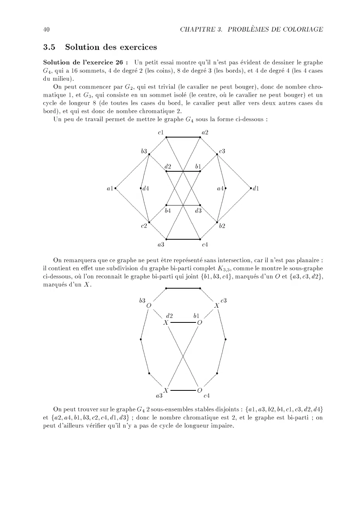

~~~text
40                                                                                 CHAPITRE 3. PROBLEMES DE COLORIAGE
3.5 Solution des exercices
Solution de l'exercice 26 : Un petit essai montre qu'il n'est pas evident de dessiner le graphe
G4, qui a 16 sommets, 4 de degre 2 (les coins), 8 de degre 3 (les bords), et 4 de degre 4 (les 4 cases
du milieu).
    On peut commencer par G2, qui est trivial (le cavalier ne peut bouger), donc de nombre chro-
matique 1, et G3, qui consiste en un sommet isole (le centre, ou le cavalier ne peut bouger) et un
cycle de longeur 8 (de toutes les cases du bord, le cavalier peut aller vers deux autres cases du
bord), et qui est donc de nombre chromatique 2.
    Un peu de travail permet de mettre le graphe G4 sous la forme ci-dessous :
                                        c1 /          ?
                                                         a2                                      ?
                                                                 /
                                                               //                         ???
                                                                     //                            ??
                                                 b 3??            //                         ?? 3
                                                                                                        '?' ?
                                                                                                                     c
                                                  ??   ?               //                        '' ???
                                                             ??             //                   
                                      
                                          
                                        
                                                                ?? 2
                                                                  
                                                                  // d         //           1 ''' ?????
                                                                                                b
                                                                //  ///                                '
                                                                                                                   ''     ??
                                                                                                                            ??
                                                                 /            /                               ''       ??
                                                                     //          //                                      ?
                        a   1 ???
                             
                             ?
                                         
                                           ' ' 4
                                               '
                                                    d                  ///       ///                     4 a  
                                                                                                                              
                                                                                                                               d
                                                                                                                                1
                                  ??             ''                   //  //                                            
                                    ??
                                      ?? ''                                  //            /?                      
                                        ?? ''                   
                                                                  
                                                                              /               ??                    
                                          ?? '                       b
                                                               4  ///                    3 d  ??  
                                                 ??'                                              ???          
                                                     ?'                             //                ?
                                                      ???                           //             
                                                 c 2 ???                                 //
                                                                                                     2
                                                                                                                    b
                                                               ??                           // 
                                                                 ?
                                                                                              
                                                               a3                                     c4
     On remarquera que ce graphe ne peut ^etre represente sans intersection, car il n'est pas planaire :
il contient en e et une subdivision du graphe bi-parti complet K3;3, comme le montre le sous-graphe
ci-dessous, ou l'on reconnait le graphe bi-parti qui joint fb1; b3; c4g, marques d'un O et fa3; c3; d2g,
marques d'un X .                                        ??
                                                                                                  ??
                                                                                                    ??
                                                b    3                                                ?
                                                                                                                       c3
                                                        O              ??                                   '' X
                                                                 ???                                 
                                                                  d          2             b   1  '''
                                                       
                                                                    X         //                  O
                                                                                                  
                                                                                                                    ''
                                                                                                                       ''
                                                                              //                                      ''
                                                                                  //          
                                                ''                                //                                    
                                                     ''                               //                              
                                                        '
                                                          ''                            //                         
                                                             ''                         //                       
                                                                                                                 
                                                                '                       /                     
                                                                  ''
                                                                                     ///                 
                                                                   ??
                                                                     ?                       ///         
                                                                                                         
                                                                                                           
                                                                        ??                     //    
                                                                          ??                        
                                                                                                   
                                                                    X                             O
                                                              a3                                       c4
    On peut trouver sur le graphe G4 2 sous-ensembles stables disjoints : fa1; a3; b2; b4; c1; c3; d2; d4g
et fa2; a4; b1; b3; c2; c4; d1; d3g ; donc le nombre chromatique est 2, et le graphe est bi-parti ; on
peut d'ailleurs veri er qu'il n'y a pas de cycle de longueur impaire.
~~~

## Page 45

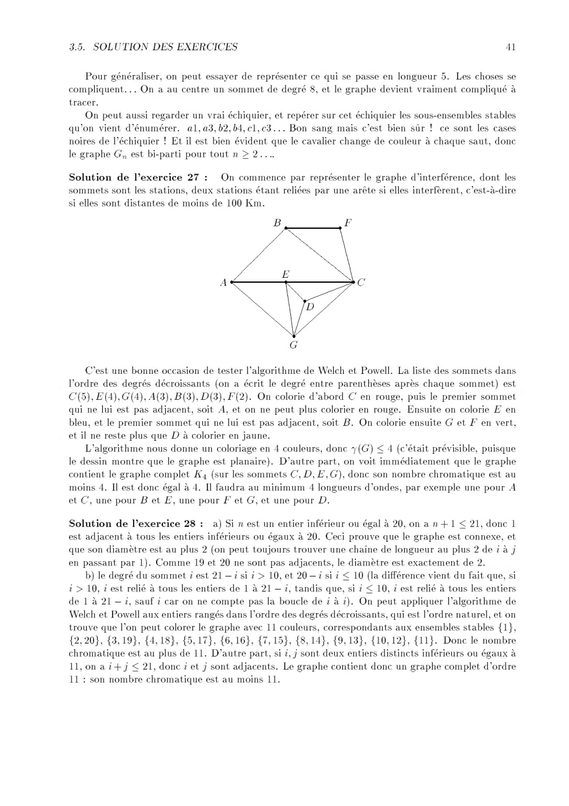

~~~text
3.5. SOLUTION DES EXERCICES                                                                                  41

    Pour generaliser, on peut essayer de representer ce qui se passe en longueur 5. Les choses se
compliquent: : : On a au centre un sommet de degre 8, et le graphe devient vraiment complique a
tracer.
    On peut aussi regarder un vrai echiquier, et reperer sur cet echiquier les sous-ensembles stables
qu'on vient d'enumerer. a1; a3; b2; b4; c1; c3 : : : Bon sang mais c'est bien s^ur ! ce sont les cases
noires de l'echiquier ! Et il est bien evident que le cavalier change de couleur a chaque saut, donc
le graphe Gn est bi-parti pour tout n  2 : : :.
Solution de l'exercice 27 : On commence par representer le graphe d'interference, dont les
sommets sont les stations, deux stations etant reliees par une ar^ete si elles interferent, c'est-a-dire
si elles sont distantes de moins de 100 Km.
                                                             B
                                                            EE                        ''    F
                                                          EEEE                          ''
                                                                             EE             '
                                                                                EE             ''
                                                                                EE             '
                                                                                   EEE ''
                                                                                        E
                                              
                                         CCC
                                                                 E                          EE''
                                                                                                    E
                                     A         CC
                                                             $?$ ??
                                                                 $$ ??                kk k    k|k|     C
                                                                                   kk ||
                                                 CC
                                                    CC             $$ ?kkkk |||
                                                      CC
                                                        CC $$  |||
                                                                     $      D
                                                                                   |
                                                          CC $  ||
                                                             CC $$  ||
                                                                      C| |
                                                                      
                                                                     G
     C'est une bonne occasion de tester l'algorithme de Welch et Powell. La liste des sommets dans
l'ordre des degres decroissants (on a ecrit le degre entre parentheses apres chaque sommet) est
C (5); E (4); G(4); A(3); B(3); D(3); F (2). On colorie d'abord C en rouge, puis le premier sommet
qui ne lui est pas adjacent, soit A, et on ne peut plus colorier en rouge. Ensuite on colorie E en
bleu, et le premier sommet qui ne lui est pas adjacent, soit B . On colorie ensuite G et F en vert,
et il ne reste plus que D a colorier en jaune.
     L'algorithme nous donne un coloriage en 4 couleurs, donc (G)  4 (c'etait previsible, puisque
le dessin montre que le graphe est planaire). D'autre part, on voit immediatement que le graphe
contient le graphe complet K4 (sur les sommets C; D; E; G), donc son nombre chromatique est au
moins 4. Il est donc egal a 4. Il faudra au minimum 4 longueurs d'ondes, par exemple une pour A
et C , une pour B et E , une pour F et G, et une pour D.
Solution de l'exercice 28 : a) Si n est un entier inferieur ou egal a 20, on a n + 1  21, donc 1
est adjacent a tous les entiers inferieurs ou egaux a 20. Ceci prouve que le graphe est connexe, et
que son diametre est au plus 2 (on peut toujours trouver une cha^ne de longueur au plus 2 de i a j
en passant par 1). Comme 19 et 20 ne sont pas adjacents, le diametre est exactement de 2.
    b) le degre du sommet i est 21 ; i si i > 10, et 20 ; i si i  10 (la di erence vient du fait que, si
i > 10, i est relie a tous les entiers de 1 a 21 ; i, tandis que, si i  10, i est relie a tous les entiers
de 1 a 21 ; i, sauf i car on ne compte pas la boucle de i a i). On peut appliquer l'algorithme de
Welch et Powell aux entiers ranges dans l'ordre des degres decroissants, qui est l'ordre naturel, et on
trouve que l'on peut colorer le graphe avec 11 couleurs, correspondants aux ensembles stables f1g,
f2; 20g, f3; 19g, f4; 18g, f5; 17g, f6; 16g, f7; 15g, f8; 14g, f9; 13g, f10; 12g, f11g. Donc le nombre
chromatique est au plus de 11. D'autre part, si i; j sont deux entiers distincts inferieurs ou egaux a
11, on a i + j  21, donc i et j sont adjacents. Le graphe contient donc un graphe complet d'ordre
11 : son nombre chromatique est au moins 11.
~~~

## Page 46

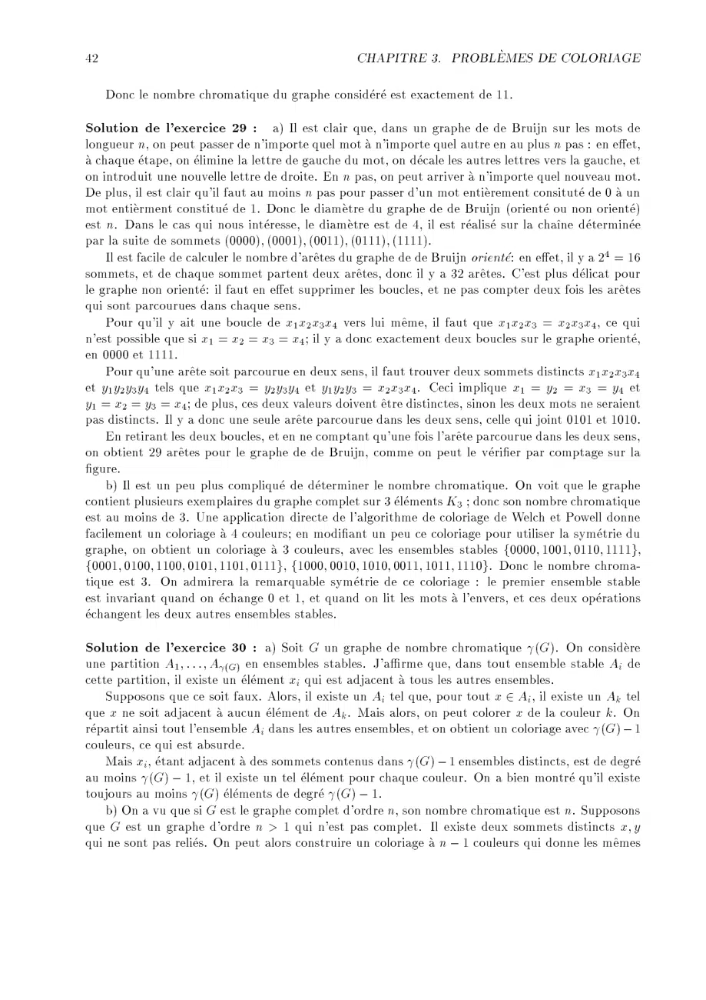

~~~text
42                                                   CHAPITRE 3. PROBLEMES DE COLORIAGE
     Donc le nombre chromatique du graphe considere est exactement de 11.
Solution de l'exercice 29 : a) Il est clair que, dans un graphe de de Bruijn sur les mots de
 longueur n, on peut passer de n'importe quel mot a n'importe quel autre en au plus n pas : en e et,
 a chaque etape, on elimine la lettre de gauche du mot, on decale les autres lettres vers la gauche, et
  on introduit une nouvelle lettre de droite. En n pas, on peut arriver a n'importe quel nouveau mot.
  De plus, il est clair qu'il faut au moins n pas pour passer d'un mot entierement consitute de 0 a un
  mot entierment constitue de 1. Donc le diametre du graphe de de Bruijn (oriente ou non oriente)
  est n. Dans le cas qui nous interesse, le diametre est de 4, il est realise sur la cha^ne determinee
 par la suite de sommets (0000); (0001); (0011); (0111); (1111).
      Il est facile de calculer le nombre d'ar^etes du graphe de de Bruijn oriente: en e et, il y a 24 = 16
 sommets, et de chaque sommet partent deux ar^etes, donc il y a 32 ar^etes. C'est plus delicat pour
 le graphe non oriente: il faut en e et supprimer les boucles, et ne pas compter deux fois les ar^etes
  qui sont parcourues dans chaque sens.
      Pour qu'il y ait une boucle de x1 x2 x3x4 vers lui m^eme, il faut que x1x2 x3 = x2 x3x4 , ce qui
  n'est possible que si x1 = x2 = x3 = x4 ; il y a donc exactement deux boucles sur le graphe oriente,
 en 0000 et 1111.
      Pour qu'une ar^ete soit parcourue en deux sens, il faut trouver deux sommets distincts x1 x2 x3x4
 et y1 y2 y3 y4 tels que x1 x2 x3 = y2 y3 y4 et y1 y2 y3 = x2 x3 x4. Ceci implique x1 = y2 = x3 = y4 et
y1 = x2 = y3 = x4; de plus, ces deux valeurs doivent ^etre distinctes, sinon les deux mots ne seraient
pas distincts. Il y a donc une seule ar^ete parcourue dans les deux sens, celle qui joint 0101 et 1010.
      En retirant les deux boucles, et en ne comptant qu'une fois l'ar^ete parcourue dans les deux sens,
on obtient 29 ar^etes pour le graphe de de Bruijn, comme on peut le veri er par comptage sur la
   gure.
      b) Il est un peu plus complique de determiner le nombre chromatique. On voit que le graphe
contient plusieurs exemplaires du graphe complet sur 3 elements K3 ; donc son nombre chromatique
est au moins de 3. Une application directe de l'algorithme de coloriage de Welch et Powell donne
facilement un coloriage a 4 couleurs; en modi ant un peu ce coloriage pour utiliser la symetrie du
graphe, on obtient un coloriage a 3 couleurs, avec les ensembles stables f0000; 1001; 0110; 1111g,
f0001; 0100; 1100; 0101; 1101; 0111g, f1000; 0010; 1010; 0011; 1011; 1110g. Donc le nombre chroma-
tique est 3. On admirera la remarquable symetrie de ce coloriage : le premier ensemble stable
est invariant quand on echange 0 et 1, et quand on lit les mots a l'envers, et ces deux operations
echangent les deux autres ensembles stables.
Solution de l'exercice 30 : a) Soit G un graphe de nombre chromatique (G). On considere
une partition A1 ; : : :; A (G) en ensembles stables. J'arme que, dans tout ensemble stable Ai de
cette partition, il existe un element xi qui est adjacent a tous les autres ensembles.
    Supposons que ce soit faux. Alors, il existe un Ai tel que, pour tout x 2 Ai , il existe un Ak tel
que x ne soit adjacent a aucun element de Ak . Mais alors, on peut colorer x de la couleur k. On
repartit ainsi tout l'ensemble Ai dans les autres ensembles, et on obtient un coloriage avec (G) ; 1
couleurs, ce qui est absurde.
    Mais xi , etant adjacent a des sommets contenus dans (G) ; 1 ensembles distincts, est de degre
au moins (G) ; 1, et il existe un tel element pour chaque couleur. On a bien montre qu'il existe
toujours au moins (G) elements de degre (G) ; 1.
    b) On a vu que si G est le graphe complet d'ordre n, son nombre chromatique est n. Supposons
que G est un graphe d'ordre n > 1 qui n'est pas complet. Il existe deux sommets distincts x; y
qui ne sont pas relies. On peut alors construire un coloriage a n ; 1 couleurs qui donne les m^emes
~~~

## Page 47

~~~text
3.5. SOLUTION DES EXERCICES                                                                       43

couleurs a x et y , et des couleurs di erentes aux n ; 2 autres sommets. On a donc bien (G)  n ; 1
pour tout graphe d'ordre n qui n'est pas complet.
~~~

## Page 48

~~~text
Chapitre 4

Problemes de plus court chemin
4.1 Un probleme
Demarrons par un exercice qui est repris du document d'accompagnement :
Exercice 31 Le graphe suivant represente un reseau routier (avec des sens interdits) ; quel est
l'itineraire le plus court qui relie E a S ?
                                       A ?     2          ?D
                                             ??                              ??
                                                                 /

                                          ???                            ???
                                  5           ??
                                                    ??2              4
                                                                                    ??
                                                                                      ??7
                                  
                                    
                                    ?

                                              1    O

                                                      ????
                                                            

                                                                    
                                                                      
                                                                                     

                                                                                        ??
                                                                                          ??
                                                        ???                            ??
                                                           ?                               ??
                        E    ??
                            
                            ?
                                ?? 3
                                        /

                                                       B    ??
                                                              ?
                                                                    G        O

                                                                                  1            
                                                                                                 S
                                  ??                      ???                           
                                    ??                             ??                  
                                      ??       1                    ??
                                                                         ?            
                                     2 ?????  3                 4 ????  6
                                                   O       ?                        ?

                                            ??                             ?? 
                                                                               ?
                                                                            
                                                C    2              F
                                                                 /

      Ce probleme est tres naturel, et se presente dans bien des domaines di erents. M^eme pour
un graphe aussi simple que celui-la, il n'est pas evident d'^etre s^ur que l'on a trouve le plus court
chemin.
      L'algorithme le plus immediat est de considerer tous les chemins de A a S , et de chercher le
plus court. Cet algorithme est tres inecace : on peut bien s^ur se limiter aux chemins sans cycles,
donc de longueur bornee par le nombre de sommets, mais m^eme comme cela, le nombre de chemins
possibles reste tres grand, comme on l'a vu dans le chapitre 2.
      Une methode plus ecace consiste a proceder de proche en proche : si l'on trouve un plus court
chemin de E a S qui passe par les sommets B1 ; B2 ; : : :; Bk , alors le debut de ce chemin est aussi
 un plus court chemin de E a B1 ; B2; : : :; Bk . On va donc commencer par chercher un sommet C
 pour lequel on conna^t un plus court chemin de E a C , puis rajouter un nouveau sommet a chaque
etape de l'algorithme.
      Si l'on conna^t deja un ensemble S de sommets pour lesquels on a trouve un plus court chemin,
 l'idee est de regarder tous les sommets lies par une ar^ete a un sommet de S , et de prendre parmi
 ces sommets le plus proche de A. On resout ainsi l'exercice de proche en proche.
      En pratique, ici, on part de E . A partir de E , on peut rejoindre en un coup trois sommets,
 A, B et C , et le plus proche est C . Donc il ne peut y avoir de chemin de longueur plus petite
                                                                44
~~~

## Page 49

~~~text
4.2. RECAPITULATION : LES DEFINITIONS ET RESULTATS                                                       45

que 2 de E a C : c'est la route directe, toutes les autres routes passeraient d'abord par un autre
sommet, donc seraient plus longue. La distance de E a C est 2. On sait de plus que la distance de
E a B est au plus 3, et celle de E a A au plus 5, puisqu'on a vu les chemins correspondants. On
regarde maintenant ou on peut aller a partir de C : on peut joindre B , par un chemin de longueur
3 a partir de E , ou G, a distance 5 (toujours a partir de E , on le repetera plus), ou F , a distance 4.
Le plus proche est B , et l'on voit qu'il ne peut y avoir de chemin de longueur inferieure a 3 de E
a B , puiqu'on a deja explore tous les chemins de longueur inferieure a 3. On explore maintenant a
 partir de B , et on voit que l'on peut joindre A, a distance 4; donc A est a distance 4 de E (la route
 directe en une ar^ete n'est pas la plus courte), et de m^eme, F est a distance 4 de E . En continuant
 ainsi, on voit que G est a distance 5, D a distance 5, et S a distance 10 ; un chemin de longueur
 minimale est ECFS , de longueur 10 (c'est m^eme le seul).
 Remarque : Attention a la terminologie: la notion de longueur de chemin que nous utilisons
 ici n'est pas la m^eme que celle que nous avons de nie au premier chapitre (nombre d'ar^etes qui
 composent un chemin donne); dans les termes du chapitre 1, ECFS est une cha^ne orientee de
 longueur 3. Nous avons fait cet abus de langage a cause de l'interpretation routiere evidente de
 l'exercice; dans la suite, on parlera plut^ot de poids que de longueur, pour eviter les confusions.
      Nous allons expliquer plus en detail cet algorithme.

4.2 Recapitulation : les de nitions et resultats
Formalisons plus precisement l'algorithme ci-dessus, d^u a Dijkstra ; la donnee de depart est un
graphe pondere connexe :
De nition 21 On appelle graphe pondere un graphe tel que, a chaque ar^ete a est associe un poids
la.
    Dans le probleme considere ici, on doit comprendre la comme la longueur de l'ar^ete a, et nous
supposerons toujours que c'est un nombre strictement positif. Il faut bien s^ur que le graphe soit
connexe pour que l'on puisse ^etre s^ur de trouver le plus court chemin. Dans un graphe non connexe,
on pourra trouver le plus court chemin entre deux points appartenant a la m^eme composante
connexe, sinon l'algorithme n'aboutira pas (mais on s'en apercevra: au bout d'un temps ni,
l'algorithme n'explore plus de nouveaux sommets, ce qui montre qu'il y a un blocage).
    L'idee de l'algorithme est d'ecrire a c^ote de certains sommets bien choisis leur distance a
l'origine A, en commencant par ecrire ces distances au crayon car elles peuvent diminuer, si on
trouve un chemin plus court. Puis on choisit la plus courte de ces distances et on l'ecrit a l'encre,
de nitivement, car la procedure suivie fait que l'on ne peut trouver un chemin plus court. On
appelera poids du sommet B le nombre associe a B , s'il existe.
     Dans la suite, on dira que l'on a marque le sommet S au crayon si l'on a ecrit a c^ote de ce
sommet une distance provisoire (longueur d'un chemin de A a S ; mais il pourrait y avoir un chemin
plus court), et que l'on a marque ce sommet a l'encre si l'on a trouve sa distance a A (longueur du
chemin le plus court).
     Au depart, les donnees sont : un graphe pondere, avec un poids strictement positif sur chaque
ar^ete, un sommet initial A et un sommet nal S .
     On initialise l'algorithme en ecrivant 0 au sommet A, qui peut evidemment ^etre relie a lui m^eme
par un chemin de longueur 0.
     On repete la suite d'operations suivante, jusqu'a ce qu'on ait marque de nitivement le sommet
S:
~~~

## Page 50

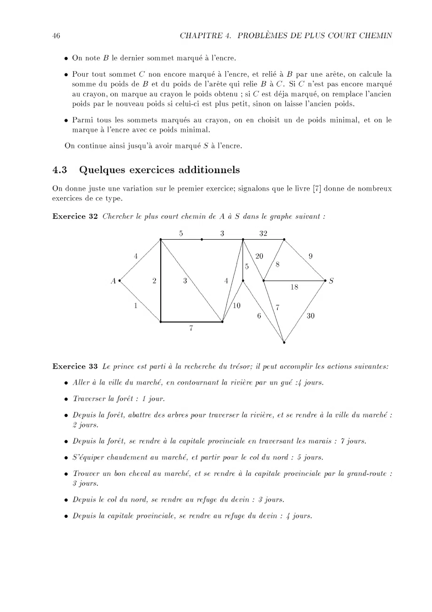

~~~text
46                                                          CHAPITRE 4. PROBLEMES DE PLUS COURT CHEMIN
      On note B le dernier sommet marque a l'encre.
      Pour tout sommet C non encore marque a l'encre, et relie a B par une ar^ete, on calcule la
       somme du poids de B et du poids de l'ar^ete qui relie B a C . Si C n'est pas encore marque
       au crayon, on marque au crayon le poids obtenu ; si C est deja marque, on remplace l'ancien
       poids par le nouveau poids si celui-ci est plus petit, sinon on laisse l'ancien poids.
      Parmi tous les sommets marques au crayon, on en choisit un de poids minimal, et on le
       marque a l'encre avec ce poids minimal.
     On continue ainsi jusqu'a avoir marque S a l'encre.

4.3 Quelques exercices additionnels
On donne juste une variation sur le premier exercice; signalons que le livre [7] donne de nombreux
exercices de ce type.
Exercice 32 Chercher le plus court chemin de A a S dans le graphe suivant :
                                                            5                         3                        32
                                         77                                                          //                              ??
                                        77                                                            //                          ???
                                            77                                                           /                                 ??
                               4           77                                                  // 20                                  ?? 9
                                                  77                                                          //                                ??
                                                  777                                     
                                                                                              
                                                                                                          5      /              8                 ??
                                                    77                                                        //                                ??
                                                                                                                                                        ??
                                                                                          4                        /*
                  A   ???           2             3   77               4          
                                                                                                       
                                                                                                     44             **                                   S
                            ??
                              ??
                                                           77
                                                             77
                                                                                     4
                                                                                                            44           **
                                                                                                                                             18
                                ??                             7                                           44 **
                                  ??                            7                                                           *
                               1 ???                             777   10
                                                                           
                                                                             
                                                                              
                                                                                                                  444 ** 7
                                                                                                                       4
                                       ??
                                         ?
                                                                    777                                       6      44 **                    30
                                                                     
                                                                                                                            44 **
                                                                                                                                    **
                                                        7                                                                        444*
                                                                                                                                      4*4*
                                                                                                                              

Exercice 33 Le prince est parti a la recherche du tresor; il peut accomplir les actions suivantes:
   Aller a la ville du marche, en contournant la riviere par un gue :4 jours.
   Traverser la for^et : 1 jour.
   Depuis la for^et, abattre des arbres pour traverser la riviere, et se rendre a la ville du marche :
       2 jours.
      Depuis la for^et, se rendre a la capitale provinciale en traversant les marais : 7 jours.
      S'equiper chaudement au marche, et partir pour le col du nord : 5 jours.
      Trouver un bon cheval au marche, et se rendre a la capitale provinciale par la grand-route :
       3 jours.
      Depuis le col du nord, se rendre au refuge du devin : 3 jours.
      Depuis la capitale provinciale, se rendre au refuge du devin : 4 jours.
~~~

## Page 51

~~~text
4.4. COMPLEMENTS POUR LES ENSEIGNANTS                                                                 47

    Se rendre de la capitale provinciale au palais du roi, en etant retarde par des contr^oles : 10
      jours.
    Au sortir du devin, partir directement chercher l'epee, et la trouver apres s'^etre perdu par
      manque de carte : 20 jours.
    Au sortir de chez le devin, au mepris de ses avis, se rendre directement a la grotte et tuer le
      dragon avec un canif : 32 jours (il faut du temps pour le tuer avec un canif).
    Bien conseille par le devin, prendre un raccourci pour le palais du roi : 5 jours.
    Un fois arrive au palais du roi, seduire la bibliothecaire, puis trouver les cartes qui expliquent
      l'emplacement de l'epee et du tresor : 6 jours.
    En utilisant les cartes trouvees dans la bibliotheque, faire tout le tour de la montagne, et
      traverser un labyrinthe qui mene directement au tresor : 30 jours.
    En utilisant les cartes, aller chercher l'epee pour combattre le dragon : 7 jours.
    S'entra^ner a l'epee, puis tuer le dragon : 8 jours.
    Une fois l'epee trouvee, au lieu d'a ronter le dragon, utiliser l'epee pour creuser un tunnel
      par dessous, et deboucher directement dans la cachette du tresor : 18 jours.
    Une fois le dragon tue, resoudre l'enigme qui ouvre la cachette du tresor : 9 jours.
Comment doit-il faire pour recuperer le tresor le plus vite possible? Quel temps lui faudra-t-il?
Remarque : Un grand nombre de jeux actuels sont bases sur un graphe plus ou moins complexe.
Celui-ci est assez trivial, mais il est facile, a partir de quelques branchements, de fabriquer des
graphes d'une grande complexite.

4.4 Complements pour les enseignants
Ces complements depassent bien s^ur le niveau du cours de terminale. Il n'est pas question de les
traiter formellement devant les eleves. Il est cependant souhaitable de signaler aux eleves les deux
points suivants :
    Il ne sut pas d'avoir un algorithme, il faut encore prouver qu'il marche. L'algorithme qui
      consiste a repondre systematiquement "5" a chaque fois qu'on demande la longueur du plus
      court chemin de A a S est le plus court possible (une seule etape), et il est tres robuste ; son
      seul defaut est de ne pas donner le bon resultat ! Apres avoir compris comment on utilise
      l'algorithme, il y a une etape plus dicile, qui consiste a prouver sa correction. Cette preuve
      est mathematique, comme le sont les preuves de geometrie dans le triangle ; on pourrait la
      faire, si on avait plus de temps.
    Il est facile de voir, comme ci-dessous, que cet algorithme necessite au plus 2n2 operations, et
      on peut en ebaucher la demonstration. D'autre part, on voit facilement en faisant un arbre
      que, si de tous les sommets partent au moins 3 ar^etes (on peut simpli er les sommets qui
      n'obeissent pas a cette condition), il y a au moins 2n chemins de longueur n partant de A tels
~~~

## Page 52

~~~text
48                                     CHAPITRE 4. PROBLEMES DE PLUS COURT CHEMIN
      que, a chaque sommet, on reparte par une ar^ete di erente de celle par laquelle on est venue.
      Donc, si tout chemin de A a S comporte au moins n ar^etes, ce qui se calcule facilement,
      on voit qu'un algorithme qui comparerait les chemins devrait regarder au moins 2n chemins
      (peut-^etre plus, car il est tres possible que le plus court chemin ne contienne pas un nombre
      d'ar^etes minimal). On peut demander aux eleves de comparer n2 et 2n pour n = 10; 20; 100 ;
      c'est a relier au chapitre d'analyse sur la croissance comparee des fonctions. Il est utile de
      savoir qu'un algorithme exponentiel est inutilisable en pratique.

4.4.1 Cet algorithme est-il ecace ?
Cet algorithme peut sembler bien complexe pour le probleme que l'on cherche a resoudre. Il est utile
d'estimer le nombre d'etapes qu'il comporte, pour pouvoir comparer avec d'autres algorithmes.
     Il est clair qu'a chaque grande etape, on marque de nitivement un sommet : il y a donc au plus
n grandes etapes, si n est le nombre de sommets. Combien y a-t-il d'operations elementaires dans
une etape ? On se contente de marquer au crayon les sommets adjacents au sommet marque, donc
au pire n sommets, puis de comparer les sommets marques au crayon pour trouver le plus petit,
encore au maximum n operations. On voit que l'algorithme se termine en au plus 2n2 operations
(on peut raner l'estimation a n(n ; 1), et m^eme mieux si le degre maximum d'un sommet est
majore par d < n).
     On a donc un nombre d'etapes qui est de l'ordre du carre de n ; si l'on compare avec l'algorithme
naf qui consiste a comparer tous les chemins, on voit que celui-ci est en general exponentiel en
n, donc beaucoup plus long ; deja pour des graphes de 50 sommets, ce deuxieme algorithme est
completement inutilisable, alors que l'algorithme de Dijkstra est quasi-instantane pour un ordina-
teur.

4.4.2 Cet algorithme est-il correct ?
On remarquera que nous n'avons pas prouve que cet algorithme fait bien ce qu'il doit faire ! C'est
d'ailleurs souvent le cas dans l'enseignement : dans le primaire, on ne prouve pas formellement que
les algorithmes enseignes pour les operations arithmetiques de base sont corrects, m^eme si on essaie
de donner aux eleves une intuition de la raison pour laquelle ils sont justes.
    Il en est de m^eme ici : il n'est pas facile de donner une preuve formelle de l'algorithme, mais on
peut le justi er. L'idee essentielle est une recurrence : on suppose qu'a l'etape k, il y a un certain
ensemble E , contenant l'origine, de sommets dont on a deja trouve la distance a l'origine, et un
ensemble F des sommets adjacents a E . Pour chacun des sommets de F , on calcule une distance
provisoire en prenant la longueur de l'ar^ete qui le relie a un point de E , et de la distance de ce
point a l'origine (s'il y a plusieurs trajets possibles de ce type, on prend la plus courte des distances
obtenues).
    Dans F , on choisit le point P qui a le plus petit poids provisoire : alors, pour ce point, on a
trouve le plus court chemin. En e et, sinon, on aurait un chemin plus court qui joint A a P ; mais
ce chemin ne peut ^etre entierement contenu dans E [ fP g, sinon c'est sa longueur qu'on aurait
comptee. Donc il contient un sommet autre que P qui n'est pas dans E . Soit Q le premier sommet
du chemin qui n'est pas dans E ; Q est adjacent a un point de E , donc il est dans F , donc la
longueur de ce chemin de A a Q est superieure ou egale a celle du chemin precedent de A a F , par
de nition de ce dernier. C'est absurde.
~~~

## Page 53

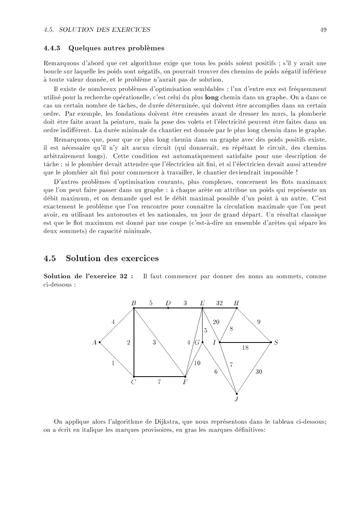

~~~text
4.5. SOLUTION DES EXERCICES                                                                                                                                  49

4.4.3 Quelques autres problemes
Remarquons d'abord que cet algorithme exige que tous les poids soient positifs ; s'il y avait une
boucle sur laquelle les poids sont negatifs, on pourrait trouver des chemins de poids negatif inferieur
a toute valeur donnee, et le probleme n'aurait pas de solution.
     Il existe de nombreux problemes d'optimisation semblables ; l'un d'entre eux est frequemment
 utilise pour la recherche operationelle, c'est celui du plus long chemin dans un graphe. On a dans ce
 cas un certain nombre de t^aches, de duree determinee, qui doivent ^etre accomplies dans un certain
 ordre. Par exemple, les fondations doivent ^etre creusees avant de dresser les murs, la plomberie
 doit ^etre faite avant la peinture, mais la pose des volets et l'electricite peuvent ^etre faites dans un
 ordre indi erent. La duree minimale du chantier est donnee par le plus long chemin dans le graphe.
     Remarquons que, pour que ce plus long chemin dans un graphe avec des poids positifs existe,
 il est necessaire qu'il n'y ait aucun circuit (qui donnerait, en repetant le circuit, des chemins
 arbitrairement longs). Cette condition est automatiquement satisfaite pour une description de
 t^ache : si le plombier devait attendre que l'electricien ait ni, et si l'electricien devait aussi attendre
 que le plombier ait ni pour commencer a travailler, le chantier deviendrait impossible !
     D'autres problemes d'optimisation courants, plus complexes, concernent les ots maximaux
 que l'on peut faire passer dans un graphe : a chaque ar^ete on attribue un poids qui represente un
 debit maximum, et on demande quel est le debit maximal possible d'un point a un autre. C'est
 exactement le probleme que l'on rencontre pour conna^tre la circulation maximale que l'on peut
 avoir, en utilisant les autoroutes et les nationales, un jour de grand depart. Un resultat classique
 est que le ot maximum est donne par une coupe (c'est-a-dire un ensemble d'ar^etes qui separe les
 deux sommets) de capacite minimale.

4.5 Solution des exercices
Solution de l'exercice 32 : Il faut commencer par donner des noms au sommets, comme
ci-dessous :

                                              B            5           D            3           E             32         H
                                        77                                                        //                             ??
                                       77                                                          //                         ???
                                           77                                                         /                               ??
                              4           77                                                // 20                                  ?? 9
                                                 77                                                       //                               ??
                                                 77                                     
                                                                                             5 /                           8                 ??
                                                                                                                                                  ??
                                                  77                                                      // 
                                                                                                                                                    ??
                                                                                                                /  
                  A   ???           2             3  777               4          44
                                                                                       4   G             I      **                                   S
                           ??
                             ??
                                                          77
                                                            77                                        444
                                                                                                                     **
                                                                                                                       *
                                                                                                                                         18
                               ??                             77                                        44 **
                                 ??                                                                           44 **
                              1 ???                             77
                                                                  77   10
                                                                             
                                                                                                                 44 ** 7
                                      ??
                                        ?
                                         
                                                                    77  
                                                                     
                                                                                                               6      44 *
                                                                                                                         44 **
                                                                                                                                              30
                                                                                                                                **
                                              C       7                            F                                         444*
                                                                                                                                  4*4*
                                                                                                                          
                                                                                                                          J

   On applique alors l'algorithme de Dijkstra, que nous representons dans le tableau ci-dessous;
on a ecrit en italique les marques provisoires, en gras les marques de nitives:
~~~

## Page 54

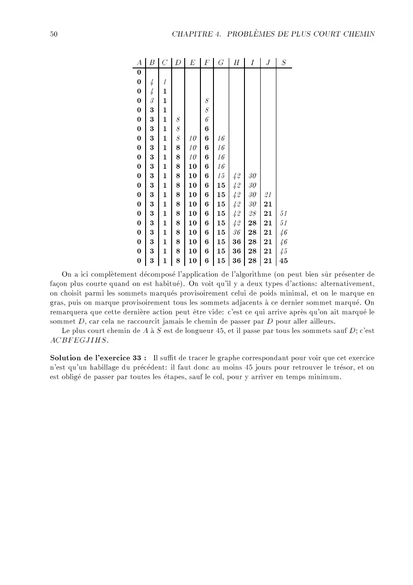

~~~text
50                                    CHAPITRE 4. PROBLEMES DE PLUS COURT CHEMIN

                           A B C D E F G H I                       J    S
                           0
                           0 4 1
                           0 4 1
                           0 3 1      8
                           0 3 1      8
                           0 3 1 8    6
                           0 3 1 8    6
                           0 3 1 8 10 6 16
                           0 3 1 8 10 6 16
                           0 3 1 8 10 6 16
                           0 3 1 8 10 6 16
                           0 3 1 8 10 6 15 42 30
                           0 3 1 8 10 6 15 42 30
                           0 3 1 8 10 6 15 42 30 21
                           0 3 1 8 10 6 15 42 30 21
                           0 3 1 8 10 6 15 42 28 21 51
                           0 3 1 8 10 6 15 42 28 21 51
                           0 3 1 8 10 6 15 36 28 21 46
                           0 3 1 8 10 6 15 36 28 21 46
                           0 3 1 8 10 6 15 36 28 21 45
                           0 3 1 8 10 6 15 36 28 21 45
     On a ici completement decompose l'application de l'algorithme (on peut bien s^ur presenter de
facon plus courte quand on est habitue). On voit qu'il y a deux types d'actions: alternativement,
on choisit parmi les sommets marques provisoirement celui de poids minimal, et on le marque en
gras, puis on marque provisoirement tous les sommets adjacents a ce dernier sommet marque. On
remarquera que cette derniere action peut ^etre vide: c'est ce qui arrive apres qu'on ait marque le
sommet D, car cela ne raccourcit jamais le chemin de passer par D pour aller ailleurs.
     Le plus court chemin de A a S est de longueur 45, et il passe par tous les sommets sauf D; c'est
ACBFEGJIHS .
Solution de l'exercice 33 : Il sut de tracer le graphe correspondant pour voir que cet exercice
n'est qu'un habillage du precedent: il faut donc au moins 45 jours pour retrouver le tresor, et on
est oblige de passer par toutes les etapes, sauf le col, pour y arriver en temps minimum.
~~~

## Page 55

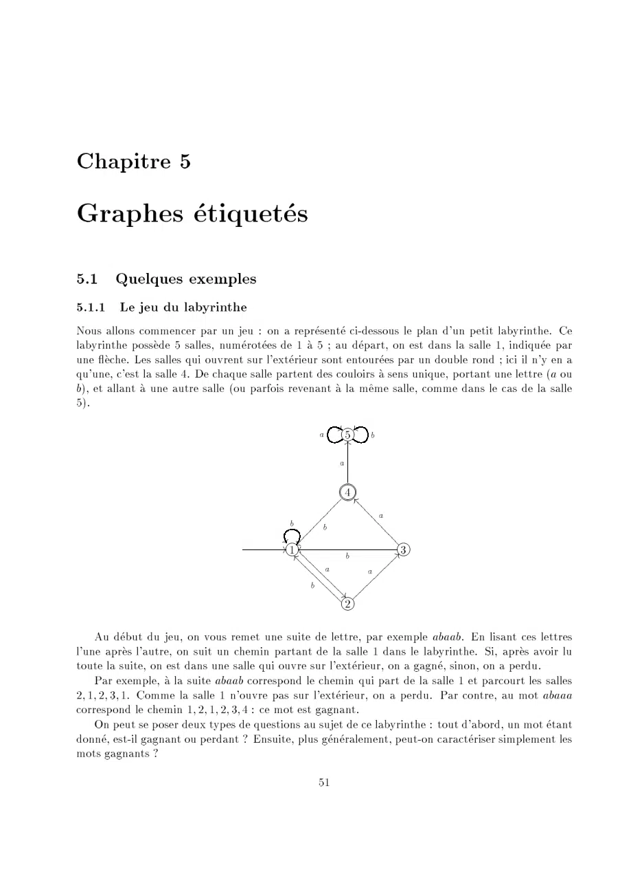

~~~~text
Chapitre 5

Graphes etiquetes
5.1 Quelques exemples
5.1.1 Le jeu du labyrinthe
Nous allons commencer par un jeu : on a represente ci-dessous le plan d'un petit labyrinthe. Ce
labyrinthe possede 5 salles, numerotees de 1 a 5 ; au depart, on est dans la salle 1, indiquee par
une eche. Les salles qui ouvrent sur l'exterieur sont entourees par un double rond ; ici il n'y en a
qu'une, c'est la salle 4. De chaque salle partent des couloirs a sens unique, portant une lettre (a ou
b), et allant a une autre salle (ou parfois revenant a la m^eme salle, comme dans le cas de la salle
5).
                                                               a    ()*+
                                                                    /.-,
                                                                    %

                                                                     5      O
                                                                                y

                                                                                        b

                                                                    a

                                                                    89:;
                                                                    ?>=<
                                                                    0123
                                                                    7654
                                                                     4
                                                           ; >>>
                                                         ;;
                                                                                    _

                                                        ;        >>
                                                       ;           >>a
                                             b ;;;;b                 >>
                                                                       >>
                                                 ;;                      >>
                                                ;
                                           ()*+
                                           /.-,
                                              ;
                                            1@@@@
                                               

                                                @
                                                       

                                                                          ()*+
                                                                          /.-,
                                                                            3
                                                              b          ~~
                                           /               o

                                                @@@@
                                                                                            ?

                                                                        ~
                                                   _

                                                   @@@@a               ~
                                                     @@@@         a ~~~
                                                    b @@@@@@ ~~ ~
                                                       @ @        ~
                                                           @ ~~
                                                            ()*+
                                                            /.-,        2
                                                                        

    Au debut du jeu, on vous remet une suite de lettre, par exemple abaab. En lisant ces lettres
l'une apres l'autre, on suit un chemin partant de la salle 1 dans le labyrinthe. Si, apres avoir lu
toute la suite, on est dans une salle qui ouvre sur l'exterieur, on a gagne, sinon, on a perdu.
    Par exemple, a la suite abaab correspond le chemin qui part de la salle 1 et parcourt les salles
2; 1; 2; 3; 1. Comme la salle 1 n'ouvre pas sur l'exterieur, on a perdu. Par contre, au mot abaaa
correspond le chemin 1; 2; 1; 2; 3; 4 : ce mot est gagnant.
    On peut se poser deux types de questions au sujet de ce labyrinthe : tout d'abord, un mot etant
donne, est-il gagnant ou perdant ? Ensuite, plus generalement, peut-on caracteriser simplement les
mots gagnants ?
                                                               51
~~~~

## Page 56

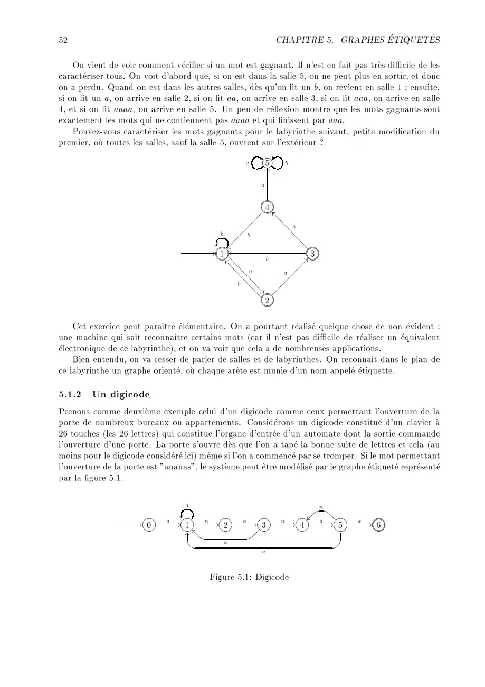

~~~text
52                                                                                                     CHAPITRE 5. GRAPHES ETIQUETES
    On vient de voir comment veri er si un mot est gagnant. Il n'est en fait pas tres dicile de les
caracteriser tous. On voit d'abord que, si on est dans la salle 5, on ne peut plus en sortir, et donc
on a perdu. Quand on est dans les autres salles, des qu'on lit un b, on revient en salle 1 ; ensuite,
si on lit un a, on arrive en salle 2, si on lit aa, on arrive en salle 3, si on lit aaa, on arrive en salle
4, et si on lit aaaa, on arrive en salle 5. Un peu de re exion montre que les mots gagnants sont
exactement les mots qui ne contiennent pas aaaa et qui nissent par aaa.
    Pouvez-vous caracteriser les mots gagnants pour le labyrinthe suivant, petite modi cation du
premier, ou toutes les salles, sauf la salle 5, ouvrent sur l'exterieur ?
                                                                           a       ()*+
                                                                                   /.-,
                                                                                   %

                                                                                    5      O
                                                                                               y

                                                                                                        b

                                                                                   a

                                                                                   89:;
                                                                                   ?>=<
                                                                                   0123
                                                                                   7654
                                                                                    4
                                                                         ; >>>
                                                                       ;;
                                                                                                   _

                                                                      ;       >>
                                                                    ;;          >>a
                                                                                  >>
                                                          b ;;;;b                   >>
                                                              ;;                      >>
                                                            ;
                                                       89:;
                                                       ?>=<
                                                        0123
                                                        7654
                                                         1 >>>                          89:;
                                                                                        ?>=<
                                                                                        0123
                                                                                        7654
                                                                                          3
                                                       

                                                                   

                                                                          b
                                                   /                   o

                                                             >>>>                     ;;                        ?

                                                                                     ;
                                                               _

                                                               >>>>
                                                                 >>>>a         a ;;;;
                                                                   >>>>
                                                                 b >>>>> ;;;;
                                                                       >> ;;
                                                                                   89:;
                                                                                   ?>=<
                                                                                   0123
                                                                                   7654
                                                                                    2
                                                                                       

     Cet exercice peut para^tre elementaire. On a pourtant realise quelque chose de non evident :
 une machine qui sait reconna^tre certains mots (car il n'est pas dicile de realiser un equivalent
electronique de ce labyrinthe), et on va voir que cela a de nombreuses applications.
     Bien entendu, on va cesser de parler de salles et de labyrinthes. On reconna^t dans le plan de
ce labyrinthe un graphe oriente, ou chaque ar^ete est munie d'un nom appele etiquette.
5.1.2 Un digicode
Prenons comme deuxieme exemple celui d'un digicode comme ceux permettant l'ouverture de la
porte de nombreux bureaux ou appartements. Considerons un digicode constitue d'un clavier a
26 touches (les 26 lettres) qui constitue l'organe d'entree d'un automate dont la sortie commande
l'ouverture d'une porte. La porte s'ouvre des que l'on a tape la bonne suite de lettres et cela (au
moins pour le digicode considere ici) m^eme si l'on a commence par se tromper. Si le mot permettant
l'ouverture de la porte est "ananas", le systeme peut ^etre modelise par le graphe etiquete represente
par la gure 5.1.

                                          a                                                                             n ??
                                                                                                                    FaE ?
                            0 a 89:;
                           89:;
                           ?>=<   1 ???An ?>=<
                                ?>=<        2 aB ?>=<
                                          89:;      3 n ?>=<
                                                  89:;  89:;
                                                          4                                                                   5 s ?>=<
                                                                                                                            ?>=<
                                                                                                                            89:;  89:;
                                                                                                                                  0123
                                                                                                                                  7654
                                                                                                                                    6
                                      

                                                                                                                    

                       /          /                        /                   /                            /               /      /

                                                
                                  @A                                                                                        BC
                                              _

                                          O

                                            a
                                                                                   a

                                                  Figure 5.1: Digicode
~~~

## Page 57

~~~text
5.1. QUELQUES EXEMPLES                                                                                        53

     Dans ce chapitre, les sommets du graphe seront appeles, pour suivre la terminologie habituelle
 en la matiere, des etats et les arcs etiquetes des transitions. Pour ne pas alourdir le schema ci-
 dessous nous n'avons pas represente les transitions provoquees par la frappe des autres lettres.
 Chaque etat (y compris l'etat 0) est relie en fait a l'etat 0 par autant d'arcs etiquetes par toutes les
 autres lettres. Par exemple, on n'a pas represente les 25 arcs qui bouclent sur l'etat 0 et qui sont
etiquetes par toutes les lettres di erentes de "a". Il est facile de constater que des que la suite de
 lettres a, n, a, n, a, s est frappee, on atteint l'etat 6 (par convention un etat nal est entoure par
 deux cercles concentriques) qui declenche l'ouverture.

5.1.3 Reconnaissance de modeles
Le probleme de la reconnaissance de modeles (pattern matching) consiste a rechercher les oc-
currences de certaines sequences de caracteres, que l'on appellera mots-cles, dans un texte t.
L'application la plus typique est la recherche documentaire. Etant donne un fond documen-
taire comprenant des references bibliographiques accompagnees de resumes indiquant les themes
de chaque ouvrage, on desire chercher les references dans lesquelles certains mots-cles apparais-
sent. Mais il existe bien d'autres domaines d'applications, comme celle du genome par exemple :
on recherche des sequences d'acides amines dans une tres longue suite. L'algorithme trivial qui
consiste a parcourir tout le texte pour rechercher les occurrences du premier mot-cle, puis a le
parcourir a nouveau pour rechercher le second, etc . . . est inecace, voire impraticable si le texte
comporte plusieurs millions de caracteres et que l'on recherche plusieurs mots. Le graphe etiquete
ci-dessous a ete construit par l'algorithme du a Aho et Corasick(1975), il permet de rechercher
plusieurs mots en ne parcourant le texte qu'une seule fois (donc en n'e ectuant que n comparaisons
si n est la longueur du texte t) et ceci quel que soit le nombre de mots recherches ! Supposons que
les mots cles soient : "ni", "rein", "rene" et "irene". A partir de cet ensemble de mots recherches,
l'algorithme de Aho et Corasick fournit le graphe etiquete de la gure 5.2.
     Pour des raisons de lisibilite nous n'avons pas represente toutes les transitions. L'etat 0 est l'etat
initial et partant de l'etat 0, bouclant sur ce m^eme etat il y a autant de transitions etiquetees par
les caracteres autres que "n", "r", "i". Partant des autres etats, sauf arc explicite, les transitions
etiquetees par "n", "r", "i" sont reliees respectivement aux etats 1, 2 et 3 et les transitions etiquetees
 par les caracteres autres que "n", "r", "i" sont toutes reliees a l'etat 0.
 L'utilisation de ce graphe etiquete pour le probleme de reconnaissance de modeles est tres simple :
 on explore le texte t, en partant de l'etat 0 et en suivant les transitions. A chaque etape, si on
 est dans l'etat i, on examine le caractere c du texte t sur lequel on est. S'il existe une transition
 partant de l'etat i, etiquetee c, conduisant a un etat j , on passe a l'etat j ; dans le cas contraire on
 passe dans l'etat 0. Dans les deux cas on avance d'un caractere dans le texte t. Chaque fois qu'on
 passe par un etat dont l'ensemble des mots cles associes n'est pas vide, on sait que l'on vient de
 deceler tous les mots-cles qui se trouvent dans cet ensemble. Sur le schema, ces ensembles de mots
 sont relies a l'etat correspondant par une eche double.
 Remarque : De tels graphes etiquetes sont utilises de maniere intensive sur tous les traitements
 de texte. Ces programmes possedent tous une fonction \recherche et remplacement" qui construit
 un graphe etiquete pour rechercher un mot (ou un type de mots) dans un texte.
     Ces fonctions de recherche permettent en general de chercher des expressions plus compliquees
 qu'un simple mot. C'est souvent utilise dans la recherche de chiers : si l'on veut chercher tous
 les chiers dont le nom commence par \lettre" et se termine par \.txt", on peut demander les
   chiers dont le nom est du type \lettre*.txt", ou * est un \joker" qui remplace n'importe quel mot.
 Les chiers \letttre1.txt" ou \lettrebis.txt" sont de ce type. On verra dans les complements qu'il
~~~

## Page 58

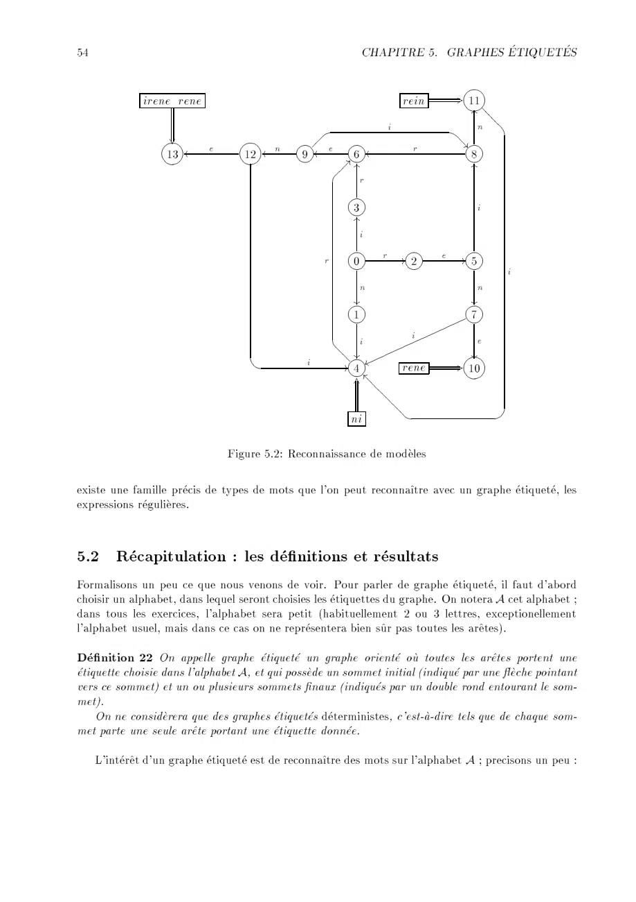

~~~text
54                                                                                     CHAPITRE 5. GRAPHES ETIQUETES

               irene rene                                                                                      rein                     @ABC
                                                                                                                                        GFED
                                                                                                                                         11             ??
                                                                                                                                   +3

                                                                                                                                                O

                                                                                                                                                          ??
                                                                                                                                                            ??
                                                                                                           i                                        n        D
                                                                                                                               ?
                                                      Fe                                                                    E ??
                                                       
                             e
                  @ABC
                  GFED
                   13               12 n
                                   @ABC
                                   GFED        89:;
                                               ?>=<
                                                 9                       89:;
                                                                         ?>=<
                                                                          6                                         r            89:;
                                                                                                                                 ?>=<
                                                                                                                                   8
                     

                                                                                                                                            

                         o                o           o                                            o

                                                                    
                                                                         ?

                                                                  
                                                                                   O                                                            O

                                                              G                        r
                                                                         89:;
                                                                         ?>=<
                                                                          3                                                                         i
                                                                                   O

                                                                                       i
                                                                         89:;
                                                                         ?>=<                          r           89:;
                                                                                                                   ?>=<   e                 89:;
                                                                                                                                            ?>=<
                                                          r               0                                    /

                                                                                                                     2                  /

                                                                                                                                              5
                                                                                                                                                                 i
                                                                                       n                                                            n
                                                                         89:;
                                                                         ?>=<
                                                                          1                                                                 89:;
                                                                                                                                            ?>=<
                                                                                              nn 7
                                                                                                                                               

                                                                                         nnnnn
                                                              @? i                  i nnn
                                                                                  nnn              e
                                                                ??             nn
                                     @A          i
                                                                  ?      nnnn n
                                                                   89:;
                                                                   ?>=<
                                                                    4 ?n?                       @ABC
                                                                                                GFED
                                                                                                 10            rene
                                                                                   
                                                                                                                                                

                                                                                               v

                                                                     /                                                             +3

                                                                         ??
                                                                                           _

                                                                              KS

                                                                           ??
                                                                             ??
                                                                               ?? A                                                                        BC
                                                                                 ?
                                                                             ni

                                 Figure 5.2: Reconnaissance de modeles

existe une famille precis de types de mots que l'on peut reconna^tre avec un graphe etiquete, les
expressions regulieres.

5.2 Recapitulation : les de nitions et resultats
Formalisons un peu ce que nous venons de voir. Pour parler de graphe etiquete, il faut d'abord
choisir un alphabet, dans lequel seront choisies les etiquettes du graphe. On notera A cet alphabet ;
dans tous les exercices, l'alphabet sera petit (habituellement 2 ou 3 lettres, exceptionellement
l'alphabet usuel, mais dans ce cas on ne representera bien s^ur pas toutes les ar^etes).
 De nition 22 On appelle graphe etiquete un graphe oriente ou toutes les ar^etes portent une
etiquette choisie dans l'alphabet A, et qui possede un sommet initial (indique par une eche pointant
 vers ce sommet) et un ou plusieurs sommets naux (indiques par un double rond entourant le som-
 met).
     On ne considerera que des graphes etiquetes deterministes, c'est-a-dire tels que de chaque som-
 met parte une seule ar^ete portant une etiquette donnee.
     L'inter^et d'un graphe etiquete est de reconna^tre des mots sur l'alphabet A ; precisons un peu :
~~~

## Page 59

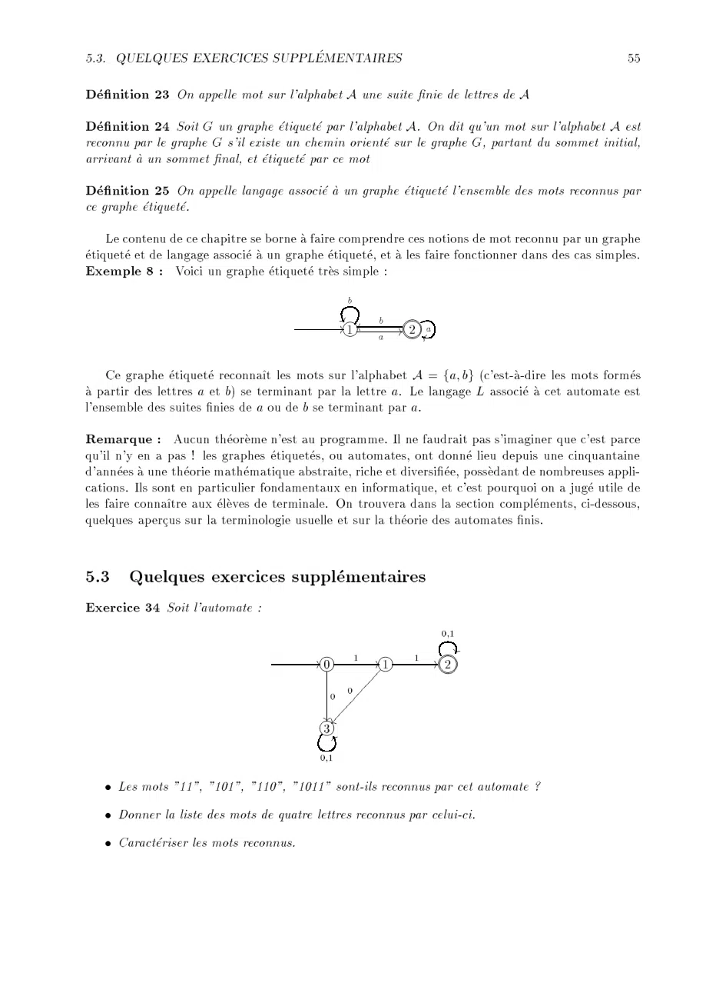

~~~text
5.3. QUELQUES EXERCICES SUPPLEMENTAIRES                                                                     55

De nition 23 On appelle mot sur l'alphabet A une suite nie de lettres de A
De nition 24 Soit G un graphe etiquete par l'alphabet A. On dit qu'un mot sur l'alphabet A est
reconnu par le graphe G s'il existe un chemin oriente sur le graphe G, partant du sommet initial,
arrivant a un sommet nal, et etiquete par ce mot
De nition 25 On appelle langage associe a un graphe etiquete l'ensemble des mots reconnus par
ce graphe etiquete.
     Le contenu de ce chapitre se borne a faire comprendre ces notions de mot reconnu par un graphe
etiquete et de langage associe a un graphe etiquete, et a les faire fonctionner dans des cas simples.
 Exemple 8 : Voici un graphe etiquete tres simple :
                                                                      b
                                                              ()*+
                                                              /.-,            b          89:;
                                                                                         ?>=<
                                                                                         0123
                                                                                         7654
                                                               1                           2 a
                                                                  

                                                                              a
                                                                          o

                                                              /

                                                                                     /

                                                                                              h

     Ce graphe etiquete reconna^t les mots sur l'alphabet A = fa; bg (c'est-a-dire les mots formes
a partir des lettres a et b) se terminant par la lettre a. Le langage L associe a cet automate est
 l'ensemble des suites nies de a ou de b se terminant par a.
Remarque : Aucun theoreme n'est au programme. Il ne faudrait pas s'imaginer que c'est parce
qu'il n'y en a pas ! les graphes etiquetes, ou automates, ont donne lieu depuis une cinquantaine
d'annees a une theorie mathematique abstraite, riche et diversi ee, possedant de nombreuses appli-
cations. Ils sont en particulier fondamentaux en informatique, et c'est pourquoi on a juge utile de
les faire conna^tre aux eleves de terminale. On trouvera dans la section complements, ci-dessous,
quelques apercus sur la terminologie usuelle et sur la theorie des automates nis.

5.3 Quelques exercices supplementaires
Exercice 34 Soit l'automate :
                                                                                                      0;1

                                             ()*+
                                             /.-,
                                              0              1            1   ()*+
                                                                              /.-,        1           89:;
                                                                                                      ?>=<
                                                                                                      0123
                                                                                                      7654
                                                                                                        2
                                                          
                                             /                                /                   /

                                                        
                                                     0 
                                                0 
                                                     
                                                  
                                             ()*+
                                             /.-,3
                                                  

                                                      ;

                                                          Y

                                                 0;1

    Les mots "11", "101", "110", "1011" sont-ils reconnus par cet automate ?
    Donner la liste des mots de quatre lettres reconnus par celui-ci.
    Caracteriser les mots reconnus.
~~~

## Page 60

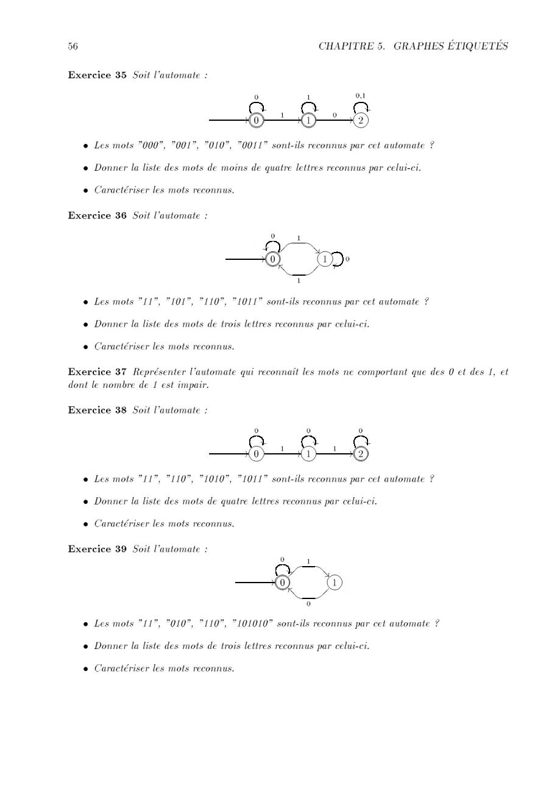

~~~text
56                                                                                            CHAPITRE 5. GRAPHES ETIQUETES
Exercice 35 Soit l'automate :
                                                 0                                    1                           0;1

                                            /   89:;
                                                ?>=<
                                                 0123
                                                 7654
                                                  0                      1       /   89:;
                                                                                     ?>=<
                                                                                     0123
                                                                                     7654
                                                                                      1               0       /   89:;
                                                                                                                  ?>=<
                                                                                                                    2
      Les mots "000", "001", "010", "0011" sont-ils reconnus par cet automate ?
      Donner la liste des mots de moins de quatre lettres reconnus par celui-ci.
      Caracteriser les mots reconnus.
Exercice 36 Soit l'automate :
                                                                0                1
                                                                                          ?
                                                            89:;
                                                            ?>=<
                                                            0123
                                                            7654F                  E ???>=<
                                                                                          89:;
                                                              0 ???A                  B  1
                                                            

                                                                                              

                                                        /

                                                                                                          0
                                                                                          
                                                                     _                                h

                                                                                 1

      Les mots "11", "101", "110", "1011" sont-ils reconnus par cet automate ?
      Donner la liste des mots de trois lettres reconnus par celui-ci.
      Caracteriser les mots reconnus.
Exercice 37 Representer l'automate qui reconna^t les mots ne comportant que des 0 et des 1, et
dont le nombre de 1 est impair.
Exercice 38 Soit l'automate :
                                                 0                                    0                            0

                                        /
                                                89:;
                                                ?>=<
                                                  0                      1       /
                                                                                     89:;
                                                                                     ?>=<
                                                                                      1               1       /
                                                                                                                  89:;
                                                                                                                  ?>=<
                                                                                                                  0123
                                                                                                                  7654
                                                                                                                    2
      Les mots "11", "110", "1010", "1011" sont-ils reconnus par cet automate ?
      Donner la liste des mots de quatre lettres reconnus par celui-ci.
      Caracteriser les mots reconnus.
Exercice 39 Soit l'automate :
                                                                         0            1

                                                                    89:;
                                                                    ?>=<
                                                                    0123
                                                                    7654F              E????>=<
                                                                                              89:;
                                                                      0 ???A              B 1
                                                                                                  

                                                                /

                                                                             _

                                                                                      0

      Les mots "11", "010", "110", "101010" sont-ils reconnus par cet automate ?
      Donner la liste des mots de trois lettres reconnus par celui-ci.
      Caracteriser les mots reconnus.
~~~

## Page 61

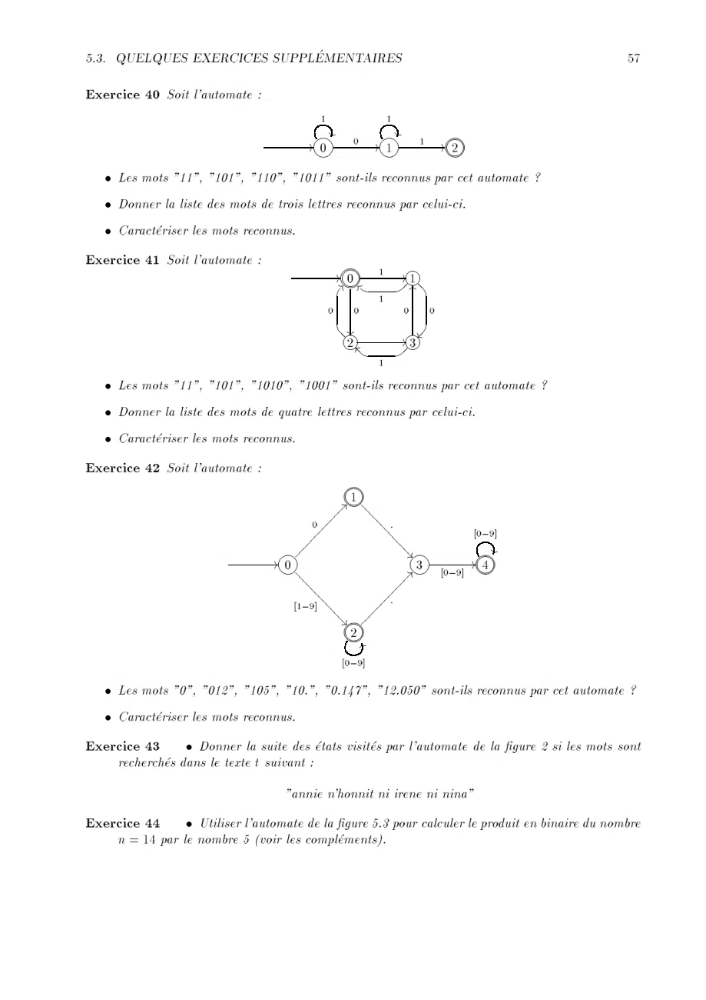

~~~text
5.3. QUELQUES EXERCICES SUPPLEMENTAIRES                                                                                                                57

Exercice 40 Soit l'automate :
                                                    1                                           1

                                               /   89:;
                                                   ?>=<
                                                     0                      0              /   89:;
                                                                                               ?>=<
                                                                                                1                         1       /   89:;
                                                                                                                                      ?>=<
                                                                                                                                      0123
                                                                                                                                      7654
                                                                                                                                        2
   Les mots "11", "101", "110", "1011" sont-ils reconnus par cet automate ?
   Donner la liste des mots de trois lettres reconnus par celui-ci.
   Caracteriser les mots reconnus.
Exercice 41 Soit l'automate :
                                                            /
                                                              89:;
                                                              ?>=<
                                                               0123
                                                               7654
                                                                0 A 1 B/.-,
                                                                        ()*+
                                                                         1?                           /

                                                            G                D
                                                                ?               _
                                                                                                                  O

                                                                    1
                                                        0                   0                         0                       0
                                                            @                                                             C
                                                                ?                                        
                                                                    ()*+
                                                                    /.-,
                                                                     2 ?A
                                                                        

                                                                            _
                                                                                                    B/.-,
                                                                                                      ()*+
                                                                                                       3  /
                                                                                                                      

                                                                                           1

   Les mots "11", "101", "1010", "1001" sont-ils reconnus par cet automate ?
   Donner la liste des mots de quatre lettres reconnus par celui-ci.
   Caracteriser les mots reconnus.
Exercice 42 Soit l'automate :
                                                                    89:;
                                                                    ?>=<
                                                                    0123
                                                                    7654
                                                                      1>
                                                       ;;
                                                                    ?

                                                                                        >>
                                                     ;;                                   >>
                                                0 ; ;                                       >>:
                                                ;;
                                                  ;                                           >>
                                                                                                >>                                           [0;9]
                                              ;;                                                  >>
                                            ;;
                                       89:;
                                       ?>=<
                                         0 >>                                                                 89:;
                                                                                                              ?>=<
                                                                                                              

                                                                                                               3                                 89:;
                                                                                                                                                 ?>=<
                                                                                                                                                 0123
                                                                                                                                                 7654
                                                                                                                                                   4
                                                                                                                                  [0;9]
                                   /                                                                                                         /

                                              >>                                               ;;
                                                                                                              ?

                                                >>                                          ;;;
                                                  >>                                       ;
                                           [1;9] >>>                                    ;;;:
                                                       >>                             ;;
                                                                                    ;;
                                                                    89:;
                                                                    ?>=<
                                                                    0123
                                                                    7654
                                                                    

                                                                      2             T

                                                                [0;9]

   Les mots "0", "012", "105", "10.", "0.147", "12.050" sont-ils reconnus par cet automate ?
   Caracteriser les mots reconnus.
Exercice 43  Donner la suite des etats visites par l'automate de la gure 2 si les mots sont
     recherches dans le texte t suivant :
                                        "annie n'honnit ni irene ni nina"
Exercice 44       Utiliser l'automate de la gure 5.3 pour calculer le produit en binaire du nombre
     n = 14 par le nombre 5 (voir les complements).
~~~

## Page 62

~~~text
58                                                                                 CHAPITRE 5. GRAPHES ETIQUETES
5.4 Complements pour les enseignants
5.4.1 Terminologie
 Les specialistes du sujet ne parlent pas de graphes etiquetes, mais d'automates nis . Les sommets
 sont appeles des etats, et l'on distingue parmi eux un ou plusieurs etats initiaux, et un ou plusieurs
etats naux. On ne parle pas d'ar^etes orientees, mais de transitions, etiquetees par les lettres de
 l'alphabet associe a l'automate ni.
      Ce vocabulaire remonte a l'origine de la theorie : les automates nis sont des modeles de
 machines, les plus simples possibles en un certain sens. La lecture d'un mot est une forme de
 calcul, et on accepte ce mot si et seulement si l'etat auquel on aboutit apres le calcul est un etat
   nal.
      La representation conventionelle d'un automate ni est celle que nous avons vue plus haut : on
 represente un automate ni par un graphe oriente, un etat est represente par un cercle dans lequel
 se trouve le nom de l'etat, les etats naux sont reperes par un double cercle, et les etat initiaux sont
 munis d'une eche rentrante qui n'a pas d'origine ; les transitions sont repesentees par des ar^etes
 orientees, allant d'un etat a un autre (ou a lui-m^eme : les boucles sont autorisees), et portant en
etiquette une lettre de l'alphabet. Pour plus de simplicite, on s'autorise a regrouper les ar^etes qui
 ont m^emes extremites, en ecrivant une seule ar^ete avec plusieurs etiquettes.
      Une distinction importante :
 De nition 26 un automate est dit deterministe si de chaque sommet part une seule ar^ete avec
 une etiquette donnee, et s'il y a un seul etat initial.
      Dans ce cours, nous n'avons considere que des automates nis deterministes, car ils sont plus
 simples a etudier. Le calcul qu'e ectue un automate deterministe a partir d'un mot donne est
 unique, puisqu'on n'a jamais de choix. Mais que faire dans le cas general ? On demandera simple-
 ment qu'il existe un calcul reussi :
 De nition 27 On dit qu'un mot est reconnu par un automate ni quelconque (non forcement
 deterministe) s'il existe un chemin dans le graphe correspondant, debutant en un etat initial, nis-
 sant en un etat nal, et etiquete par ce mot.
 Remarque : Il arrive souvent que certaines lettres ne soient l'etiquette d'aucune ar^ete quittant
 un sommet donne. On considere alors qu'un mot qui amenerait a lire cette lettre a partir de ce
 sommet n'est pas reconnu. On pourrait aussi rajouter un sommet supplementaire, dit \poubelle",
 non terminal, d'ou on ne peut partir, et des ar^etes menant a ce sommet a chaque fois que la lettre
 correspondante est absente.
      Par exemple, voici un automate qui reconnait des mots formes d'un 0 suivi d'un ou plusieurs
 1 ; version courte (il manque des ar^etes) :
                                      ()*+
                                      /.-,
                                       0         0     ()*+
                                                       /.-,
                                                        1  /
                                                                           1   /
                                                                                   89:;
                                                                                   ?>=<
                                                                                   0123
                                                                                   7654
                                                                                     2
                                                                                          v

                                                                                              1

     et version complete (on a rajoute les ar^etes manquantes, elles menent vers un etat poubelle) :
                                      ()*+
                                      /.-,
                                       0<        0     ()*+
                                                       /.-,
                                                        1                  1       89:;
                                                                                   ?>=<
                                                                                   0123
                                                                                   7654
                                                                                     2
                                                                                          v

                                                                                              1
                                             <<
                                                       /                       /

                                                                     ;
                                               <<
                                                                  ;;;
                                                 <<1
                                                   <<           ;;
                                                     <<
                                                          0
                                                             ;;; 0
                                                       << ;;;
                                                       ()*+
                                                       /.-,
                                                        3
                                                          ;    
                                                                   

                                                                       
~~~

## Page 63

~~~text
5.4. COMPLEMENTS POUR LES ENSEIGNANTS                                                                 59

5.4.2 Historique
Les automates nis sont issus, dans les annees 50, de plusieurs theories : debuts de l'informatique,
linguistique, communications, logique, circuits de commandes electriques: : : Toutes ces recherches
tentaient de caracteriser les machines \les plus simples" en un sens a preciser, et elles ont toutes
abouties a des notions equivalentes. Or, quand un m^eme concept est susceptible de de nitions tres
diverses, mais equivalentes, c'est un signe assez s^ur qu'il s'agit d'une notion importante.
     La presentation la plus agreable de cette theorie est \linguistique". Au cours des annees 50,
commencent des etudes fondamentales en linguistique, d'une part pour l'etude des langues na-
turelles, d'autre part pour les langages de programmation. Appara^t alors une question que l'on ne
pouvait se poser dans le contexte de la grammaire traditionnelle. Si l'on a l'ambition de traduire
automatiquement, par exemple, du francais en anglais, il faut bien ^etre capable de repondre a un
probleme bien plus simple :
     Etant donne un texte, ce texte est-il ecrit en francais ?
     A ma connaissance, on ne sait toujours pas le faire par ordinateur, alors que tout locuteur
francophone possede cette connaissance. Devant un mode d'emploi traduit par une machine a
partir d'un original anglais ou japonais, comme cela arrive regulierement, on sent immediatement
que quelque chose ne va pas.
     Plus generalement, on peut se poser la question :
     Etant donne un langage L et un texte M , ce texte est-il ecrit dans ce langage ?
     On commence par formaliser un peu. Suivant une procedure habituelle en mathematiques, on
remplace une de nition \en comprehension" (les regles hypothetiques qui de nissent le francais) par
une de nition \en extension" (le francais, c'est l'ensemble des textes qu'on peut ecrire en francais).
Un langage est donc simplement un ensemble de textes ecrits avec un alphabet donne. L'habitude
a ete prise, en informatique theorique, d'appeler ces textes des \mots", ce qui choque un peu au
debut : de ce point de vue, un roman de Victor Hugo n'est qu'un mot immense sur un alphabet
  ni (un peu plus grand que l'alphabet latin, puisqu'il faut rajouter les signes de ponctuation, les
chi res, et surtout le caractere le plus frequent, l'espace).
     Et nous voila arrives a une question (presque) bien posee :
     Quels sont les langages les plus simples possibles ?
     Une premiere reponse est \mecanique". Essayons de fabriquer une machine la plus simple
possible qui reconnaisse un langage. Une telle machine lit un mot, et repond \oui" ou \non" a la
  n. Comme elle est tres simple, elle commence la lecture a la premiere lettre, et lit le mot dans
l'ordre, sans revenir en arriere ni sauter de lettres. Et de plus, elle a une memoire nie, qui ne peut
prendre qu'un nombre ni de valeurs, appelees etats. Comment fonctionne cette machine ? Elle
demarre dans un certain etat, appele etat initial. Elle lit la premiere lettre, et suivant sa valeur,
change d'etat. Puis elle lit les lettres suivantes, et a chaque lettre, suivant la valeur courante de
la memoire, change d'etat (c'est dans cette transition qu'intervient le programme de la machine).
Quand elle a ni de lire le mot, elle declare, suivant la valeur courante de la memoire (l'etat nal)
si le mot est reconnu ou non. On voit que cette machine n'est rien d'autre qu'un automate ni
deterministe, ou graphe etiquete, tels qu'on les a presentes dans ce cours. On de nit ainsi une
premiere classe de langages simples :
De nition 28 On dit qu'un langage est reconnaissable s'il existe un automate ni deterministe
qui le reconna^t.
~~~

## Page 64

~~~text
60                                                           CHAPITRE 5. GRAPHES ETIQUETES
    Il existe une autre reponse, plus ensembliste. Pour cela, nous allons de nir des operations sur les
langages. Il y a trois operations naturelles qui sont les operations ensemblistes : union, intersection,
complementaire, dont la de nition est evidente.
    Une operation plus subtile est le produit. On peut de nir le produit de deux mots, aussi appele
concatenation, en mettant ces deux mots bout-a-bout (ce produit n'est pas commutatif) ; le produit
des deux mots bonjour et madame, pris dans cet ordre, sera ainsi bonjourmadame. On peut alors
de nir le produit de deux langages comme le produit des mots qui les composent :
                                     L1:L2 = fxy=x 2 L1 et x 2 L2g
   On peut aussi de nir de facon evidente le carre, le cube, et plus generalement une puissance
quelconque Ln d'un langage L.
   Ces operations sont toutes, en un sens, \ nies". Or il est souhaitable d'avoir des operations
non bornees : un texte francais peut ^etre arbitrairement long ! Il est donc souhaitable de disposer
d'une operation permettant de faire un nombre arbitrairement grand de produits. On pose :
                                             [ 1[ 2[                [ n
                                   L = L0     L      L     ::: =         L
                                                                    n0
    Attention, on commence a L0, qui est le mot vide, element neutre de la concatenation !
    Il est naturel de penser que, si L1 et L2 sont des langages \simples", alors leur union, leur
intersection, leur produit, leur complementaire et leur etoile le sont aussi. Comme il est aussi
naturel de penser que les langages nis sont simples, on de nit une classe de langages de la facon
suivante :
De nition 29 On appelle famille des langages rationnels la plus petite famille de langages qui
contient tous les langages nis, et qui est fermee par union, intersection, complementaire, produit
et etoile
Remarque : On retrouve une demarche typique de l'algebre lineaire : on appelle sous-espace
vectoriel engendre par une partie E le plus petit sous-espace tel que. . . ; on sait qu'un tel sous-
espace peut aussi ^etre decrit comme l'ensemble des combinaisons lineaires nies d'elements de E .
Ici aussi, on peut remplacer une de nition \par le haut" par une de nition \par en bas", comme
langage engendre en partant de parties nies et en appliquant un nombre ni de fois les 5 operations.
Nous verrons plus bas, sous le nom d'expression reguliere, comment on donne une telle de nition
d'un langage.
Remarque : Les 5 operations ne sont evidemment pas toutes necessaires : a partir de l'union
et du complementaire, on peut refabriquer l'intersection. On peut montrer, mais c'est plus dif-
 cile, que le complementaire n'est pas non plus necessaire. Les langages rationnels peuvent ^etre
completement de nis en utilisant seulement union, produit et etoile ; en particulier, il est toujours
possible d'exprimer ainsi le complement d'un langage rationnel donne.
    Il se trouve, et c'est ce qui montre l'importance de la notion, que les deux familles de langages
simples que nous avons de nies sont identiques. C'est le theoreme fondamental, demontre par le
logicien Kleene au debut des annees 50 :
Theoreme 12 (Kleene) Un langage est rationnel si et seulement si ce langage est reconnaissable.
     Les trois sections qui suivent sont consacrees a quelques indications sur la preuve de ce theoreme.
~~~

## Page 65

~~~text
5.4. COMPLEMENTS POUR LES ENSEIGNANTS                                                                   61

5.4.3 Expressions regulieres et langages rationnels.
Nous venons de voir que les langages rationnels peuvent ^etre de nis a partir des langages nis en
utilisant un nombre ni de fois les operations union, produit et etoile (les deux autres, complement
et intersection, pouvant ^etre construites a partir des trois premieres).
    En pratique, il est utile de rajouter une autre operation : si L est un langage, on de nit
                                               [ 2[             [ n
                                     L+ = L1      L      :::=         L
                                                                n1
    On veri e facilement que L+ = L:L .
    Les expressions regulieres sont des expressions qui permettent de speci er un langage, en codant
les ensembles nis de depart et les operations qu'on e ectue sur eux. Elles sont constitues de divers
caracteres : lettres de l'alphabet A, " (pour le mot vide), (, ), *, +. Si r est une expression
reguliere, on note L(r) le langage qui lui est associe.
    Ces expressions sont de nies recursivement ; si r et s sont des expressions regulieres representant
les langages L(r) et L(s) alors :
    L'expression reguliere " represente le langage reduit au mot vide, L0 = ".
    L'expression reguliere reduite a une lettre a represente le langage reduit au singleton a.
    r + s est une expression reguliere qui represente le langage L(r) S L(s).
    rs est une expression reguliere qui represente L(r):L(s).
    r est une expression reguliere qui represente (L(r)).
    r+ est une expression reguliere qui represente (L(r))+.
    On voit que, par de nition, tout langage rationnel est represente par une expression reguliere.
Remarquons qu'il n'est pas immediatement evident de voir si deux expressions regulieres de nissent
le m^eme langage rationnel.
    Notations : La notation [c1 ; c2] ou c1 et c2 sont deux caracteres, designe tous les caracteres
dont les codes ASCII sont compris entre ceux des caracteres c1 et c2 . Par exemple [a ; z ] designe
a + b + c + : : : + z.
Quelques exemples d'expressions regulieres :
    0+[1 ; 9][0 ; 9] est une expression reguliere qui represente le langage L, ensemble des entiers
      naturels.
    [a;z]([a;z]+[0;9]) est une expression reguliere qui represente le langage correspondant aux
      identi cateurs des langages de programmation : suite de lettres ou de chi res commencant
      par une lettre.
Remarque : Tous les editeurs de textes evolues possedent des fonctions de recherche permettant
de trouver, non seulement des mots, mais des types de mots dans le texte. Les types de mots
que l'on peut trouver sont exactement les expressions regulieres. On explicite, avec une syntaxe
semblable a celle que l'on vient de voir, une expression particuliere, et le programme construit
l'automate correspondant.
~~~

## Page 66

~~~text
62                                                                        CHAPITRE 5. GRAPHES ETIQUETES
5.4.4 Automates deterministes et non deterministes
Nous allons continuer par un detour. Nous avons vu plus haut qu'il y a une structure un peu plus
generale que les automates nis (deterministes) vus en cours, ce sont les automates quelconques,
non forcement deterministes. Un mot est reconnu par un automate ni general s'il existe un calcul
 reussi pour ce mot. Cette notion semble d'un inter^et douteux. En e et, pour un automate ni qui
 n'est pas deterministe, il existe un nombre de calcul pour un mot donne qui cro^t exponentiellement
 vite avec la longueur du mot, et voir si l'un d'entre eux est reussi semble infaisable !
     Remarquons cependant que tout automate ni deterministe est un cas particulier d'automate
   ni quelconque. Donc les langages reconnaissables par les automates nis deterministes forment
evidemment un sous-ensemble de la famille des langages reconnaissables par un automate ni
 quelconque. La reciproque est beaucoup plus etonnante :
 Theoreme 13 Si un langage est reconnaissable par un automate ni quelconque, alors il est re-
 connaissable par un automate ni deterministe.
 Demonstration : Sans rentrer dans les details techniques, donnons le principe de la preuve, qui
 est une belle idee mathematique. Nous allons tenter de suivre tous les calculs possibles a la fois !
 Pour ce faire, nous partons d'un automate quelconque, et nous allons le remplacer par un nouvel
 automate, dont les sommets sont des sous-ensembles de sommets du precedent.
     Par exemple, supposons que nous sommes en face du fragment d'automate ci-dessous :
                                                              ()*+
                                                              /.-,
                                                              2
                                                           ;;
                                                                  @

                                                          ;
                                                     a ;;;
                                                      ;
                                                   ;;;
                                                  ;
                                             ()*+; a /.-,
                                             /.-,
                                             1              ()*+
                                                              /

                                                                      3
   A partir de l'etat 1, en lisant la lettre a, on peut partir au choix dans l'etat 2 ou 3. Dans le
nouvel automate, on va partir a la fois dans les deux, c'est-a-dire dans l'etat nomme f2; 3g :
                                         f1g
                                        HIJK
                                        ONML         a    /

                                                                  f2; 3g
                                                                  PQRS
                                                                  WVUT

  Ensuite, on regarde quel est le sous-ensemble des sommets ou l'on peut aller en lisant la lettre b et
en partant des etats 2 ou 3, et ainsi de suite. Si l'automate initial avait un ensemble de sommets
Q, on construit de la sorte un automate qui a pour sommet P (Q), et dans lequel, par construction,
de chaque etat part au plus une eche avec une etiquette donnee. Il ne reste plus qu'a prendre,
pour unique etat initial de l'automate ainsi construit, l'ensemble uniquement determine des etats
initiaux de l'automate de depart, et comme etats naux, tous les ensembles d'etats contenant un
etat nal de l'automate de depart.
     La demonstration nous donne un peu plus que le theoreme, puiqu'elle nous donne une facon de
construire cet automate deterministe. Remarquons qu'en partant d'un automate quelconque a n
etats, on peut obtenir un automate determiste a 2n etats, ce qui est vraiment plus gros : l'automate
 deterministe peut ^etre vraiment plus cher. En ranant un peu, on obtient mieux :
 Theoreme 14 Soit L un langage reconnaissable. Il existe un automate deterministe unique, appele
 automate minimal de L, qui possede le plus petit nombre d'etats parmi les automates deterministes
 reconnaissant L, et tel que tout automate deterministe qui reconna^t L se projette sur cet automate
 minimal.
~~~

## Page 67

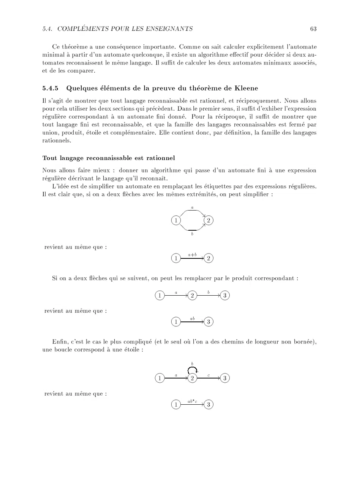

~~~text
5.4. COMPLEMENTS POUR LES ENSEIGNANTS                                                                 63

    Ce theoreme a une consequence importante. Comme on sait calculer explicitement l'automate
minimal a partir d'un automate quelconque, il existe un algorithme e ectif pour decider si deux au-
tomates reconnaissent le m^eme langage. Il sut de calculer les deux automates minimaux associes,
et de les comparer.
5.4.5 Quelques elements de la preuve du theoreme de Kleene
Il s'agit de montrer que tout langage reconnaissable est rationnel, et reciproquement. Nous allons
pour cela utiliser les deux sections qui precedent. Dans le premier sens, il sut d'exhiber l'expression
reguliere correspondant a un automate ni donne. Pour la reciproque, il sut de montrer que
tout langage ni est reconnaissable, et que la famille des langages reconnaissables est ferme par
union, produit, etoile et complementaire. Elle contient donc, par de nition, la famille des langages
rationnels.
Tout langage reconnaissable est rationnel
Nous allons faire mieux : donner un algorithme qui passe d'un automate ni a une expression
reguliere decrivant le langage qu'il reconna^t.
    L'idee est de simpli er un automate en remplacant les etiquettes par des expressions regulieres.
Il est clair que, si on a deux eches avec les m^emes extremites, on peut simpli er :
                                                              a     ?
                                                  89:;
                                                  ?>=<F        E ???>=<
                                                                      89:;
                                                    1 ???A        B  2
                                                                            

                                                                    
                                                                            ?

                                                              b
revient au m^eme que :
                                                    1 a+b ?>=<
                                                  89:;
                                                  ?>=<    89:;
                                                            2           /

   Si on a deux eches qui se suivent, on peut les remplacer par le produit correspondant :
                                           89:;
                                           ?>=<    a         89:;
                                                             ?>=<               b           89:;
                                                                                            ?>=<
                                             1           /

                                                              2                     /

                                                                                              3
revient au m^eme que :
                                                  89:;
                                                  ?>=<       ab             89:;
                                                                            ?>=<
                                                    1                   /

                                                                              3

   En n, c'est le cas le plus complique (et le seul ou l'on a des chemins de longueur non bornee),
une boucle correspond a une etoile :
                                                              b
                                           89:;
                                           ?>=<    a         89:;
                                                             ?>=<               c           89:;
                                                                                            ?>=<
                                             1           /

                                                              2                         /

                                                                                              3
revient au m^eme que :
                                                         89:;
                                                    1 ab c ?>=<
                                                  89:;
                                                  ?>=<       3          /
~~~

## Page 68

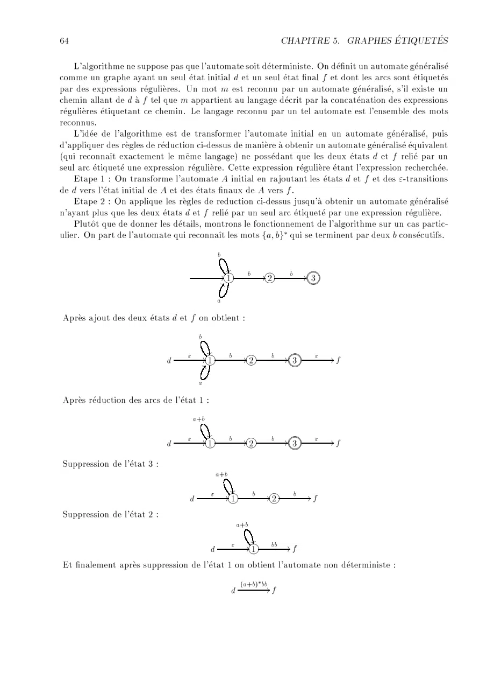

~~~text
64                                                                                                                      CHAPITRE 5. GRAPHES ETIQUETES
    L'algorithme ne suppose pas que l'automate soit deterministe. On de nit un automate generalise
comme un graphe ayant un seul etat initial d et un seul etat nal f et dont les arcs sont etiquetes
par des expressions regulieres. Un mot m est reconnu par un automate generalise, s'il existe un
chemin allant de d a f tel que m appartient au langage decrit par la concatenation des expressions
regulieres etiquetant ce chemin. Le langage reconnu par un tel automate est l'ensemble des mots
reconnus.
    L'idee de l'algorithme est de transformer l'automate initial en un automate generalise, puis
d'appliquer des regles de reduction ci-dessus de maniere a obtenir un automate generalise equivalent
(qui reconna^t exactement le m^eme langage) ne possedant que les deux etats d et f relie par un
seul arc etiquete une expression reguliere. Cette expression reguliere etant l'expression recherchee.
    Etape 1 : On transforme l'automate A initial en rajoutant les etats d et f et des "-transitions
de d vers l'etat initial de A et des etats naux de A vers f .
    Etape 2 : On applique les regles de reduction ci-dessus jusqu'a obtenir un automate generalise
n'ayant plus que les deux etats d et f relie par un seul arc etiquete par une expression reguliere.
    Plut^ot que de donner les details, montrons le fonctionnement de l'algorithme sur un cas partic-
ulier. On part de l'automate qui reconna^t les mots fa; bg qui se terminent par deux b consecutifs.
                                                                 b

                                                                     ()*+
                                                                     /.-,                          b       ()*+
                                                                                                           /.-,              b           89:;
                                                                                                                                         ?>=<
                                                                                                                                         0123
                                                                                                                                         7654
                                                                      1                                     2                              3
                                                                                 

                                                                         /                                 /                         /

                                                                     C

                                                                 a
Apres ajout des deux etats d et f on obtient :
                                        b
                                   "         ()*+
                                             /.-,                                    b         ()*+
                                                                                               /.-,                b         89:;
                                                                                                                             ?>=<
                                                                                                                             0123
                                                                                                                             7654             "
                                              1                                                 2                             3
                                                         

                              d                  /

                                                     C
                                                                                               /                         /                        /

                                                                                                                                                      f

                                        a
Apres reduction des arcs de l'etat 1 :
                                       a+b
                                   "         ()*+
                                             /.-,                                    b         ()*+
                                                                                               /.-,                b         89:;
                                                                                                                             ?>=<
                                                                                                                             0123
                                                                                                                             7654             "
                                              1                                                 2                             3
                                                         

                              d              /                                                 /                         /                        /

                                                                                                                                                      f

Suppression de l'etat 3 :
                                                                 a+b
                                                             "               ()*+
                                                                             /.-,                      b       ()*+
                                                                                                               /.-,              b
                                                                              1                                 2
                                                                                         

                                    d                                        /                                 /                          /

                                                                                                                                              f

Suppression de l'etat 2 :
                                                                                             a+b
                                                                                     "             ()*+
                                                                                                   /.-,            bb
                                                                                                    1
                                                                                                       

                                                             d                                     /                         /

                                                                                                                                 f

Et nalement apres suppression de l'etat 1 on obtient l'automate non deterministe :
                                                                                              (a+b)bb
                                                                                     d                         /

                                                                                                                   f
~~~

## Page 69

~~~text
5.4. COMPLEMENTS POUR LES ENSEIGNANTS                                                                  65

    On voit bien que l'expression reguliere obtenue decrit le langage reconnu par l'automate (il
faudrait ^etre un peu plus formel pour ^etre rigoureux), et donc que tout langage reconnaissable est
rationnel.
Tout langage rationnel est reconnaissable
Commencons par une trivialite :
Lemme 1 Tout langage reduit a un seul mot est reconnaissable.
Demonstration : Il sut de resoudre l'exercice suivant :
Exercice 45 Soit X = x1x2 : : :xn un mot ni. Donner un automate qui reconna^t le mot X , et
aucun autre.

   Passons a un resultat un peu plus dicile :
Proposition 12 La reunion de deux langages reconnaissables est reconnaissable.
Demonstration : On prend deux automates correspondants a ces langages. On peut supposer,
quitte a les renommer, que leurs ensembles d'etats sont disjoints. La reunion de ces deux automates
est encore un automate ! Bien s^ur, il n'est pas deterministe, puisqu'il a au moins deux etats initiaux ;
mais comme on vient de la voir, cela n'a pas de raison de nous gener, et il est clair que cet automate
reunion reconna^t la reunion des deux langages.
   On en deduit immediatement par recurrence :
Proposition 13 La reunion d'un nombre ni de langages reconnaissables est reconnaissable.
   Et donc, en utilisant le lemme du debut :
Corollaire 3 Tout langage ni est reconnaissable.
   Montrons maintenant :
Proposition 14 Le produit de deux langages reconnaissables est reconnaissable.
Demonstration : S'il n'y a qu'un etat nal, d'ou ne part aucune transition, pour le premier
automate, et qu'un etat initial, ou n'arrive aucune transition, pour le second, ce n'est pas complique :
il sut de mettre bout a bout les deux automates, en confondant l'etat nal du premier, et l'etat
initial du second. Le cas general est un peu plus technique ; il faut traiter a part le cas du mot
vide, et montrer que tout langage reconnaissable qui ne contient pas le mot vide peut ^etre reconnu
par un automate normalise du type ci-dessus.
   On prouve de facon analogue :
Proposition 15 L'etoile d'un langage reconnaissable est reconnaissable.
~~~

## Page 70

~~~text
66                                                         CHAPITRE 5. GRAPHES ETIQUETES
Demonstration : Si l'automate est mis sous forme normalisee, comme ci-dessus, il sut de
le boucler, en confondant l'etat initial et l'etat nal. Le cas general s'en deduit en normalisant
l'automate.
     Et pour nir :
Proposition 16 Le complementaire d'un langage reconnaissable est reconnaissable.
Demonstration : Il sut de prendre un automate deterministe qui reconna^t ce langage. On
fabrique un nouvel automate, identique au precedent, sauf que les etats naux du second sont les
etats non naux du premier. Comme l'automate est deterministe, un mot est reconnu par le second
automate si et seulement si il n'est pas reconnu par le premier. On a bien trouve un automate qui
reconna^t le complementaire du langage initial.
    On a donc montre que la famille des langages reconnaissables contient tous les langages nis, et
qu'elle est fermee par union, produit, etoile et complementaire. Elle contient donc tous les langages
rationnels, d'ou le theoreme de Kleene.
    On pourra consulter les references [2] ou [11] pour une preuve detaillee.
    Une autre methode serait de prendre une expression rationelle, et de construire un automate qui
la reconna^t. Cela revient en fait au m^eme : on est amene a construire un automate pour une union,
un produit, etc. . . Cette t^ache est entierement automatisable, et le logiciel LEX sous le systeme
d'exploitation UNIX e ectue exactement les etapes dont on vient de parler. Ce logiciel reco^t en
entree une expression reguliere, et genere automatiquement l'automate deterministe capable de
reconna^tre le langage qui lui est associe.
Remarque : On a signale plus haut que l'on n'a en fait pas besoin, pour les langages rationnels,
du complementaire, qui peut se reecrire dans ce cas en terme d'union, produit et etoile. Une facon
de le prouver, pour eviter tout cercle vicieux, est de de nir les langages rationnels uniquement
en terme d'union, produit et etoile, de montrer comme ci-dessus qu'un langage est rationnel si et
seulement si il est reconnaissable, puis d'utiliser le fait, prouve ci-dessus, que si un langage est
reconnaissable, son complementaire l'est aussi pour en deduire que le complementaire d'un langage
rationnel est rationnel.

5.4.6 Une recreation mathematique : les suites automatiques
Il existe des ensembles de nombres qui sont tres faciles a reconna^tre en base 10. Il en est ainsi
des puissances de 10, des nombres de la forme 10n ; 1 (ils ne contiennent que des 9), des nombres
pairs, et bien s^ur des multiples de 9 (la somme de leurs chi res est divisible par 9). Il en est de
m^eme des multiples de 11 (la somme alternee de leurs chi res est divisible par 11 ; par exemple,
1562 est multiple de 11, puisque 2 ; 6 + 5 ; 1 = 0 est divisible par 11. On peut trouver un critere
semblable de divisibilite par 7 (je vous laisse chercher, il a periode 6. . . ).
     Il y a par contre des ensembles qui sont plus compliques a reconna^tre ; on conna^t en general
bien les puissances de 2, mais ^etes vous capable de reconna^tre les puissances de 3 au-dela de la
sixieme ?
     Il y a un moyen de formaliser cela :
De nition 30 On dit qu'un ensemble de nombre est automatique en base p s'il existe un automate
 ni qui reconna^t l'ecriture en base p des nombres de cet ensemble.
~~~

## Page 71

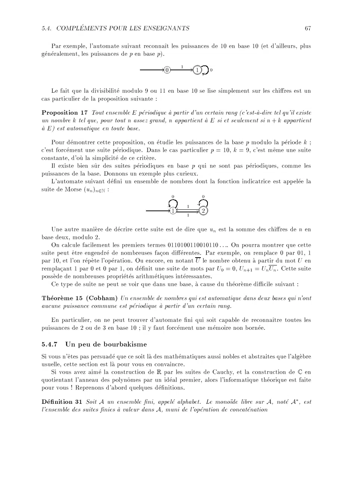

~~~text
5.4. COMPLEMENTS POUR LES ENSEIGNANTS                                                                 67

     Par exemple, l'automate suivant reconna^t les puissances de 10 en base 10 (et d'ailleurs, plus
generalement, les puissances de p en base p).
                                                ()*+
                                                /.-,
                                                /

                                                 0                  1       /   89:;
                                                                                ?>=<
                                                                                0123
                                                                                7654
                                                                                  1       h
                                                                                              0

    Le fait que la divisibilite modulo 9 ou 11 en base 10 se lise simplement sur les chi res est un
cas particulier de la proposition suivante :
Proposition 17 Tout ensemble E periodique a partir d'un certain rang (c'est-a-dire tel qu'il existe
un nombre k tel que, pour tout n assez grand, n appartient a E si et seulement si n + k appartient
a E ) est automatique en toute base.
    Pour demontrer cette proposition, on etudie les puissances de la base p modulo la periode k ;
c'est forcement une suite periodique. Dans le cas particulier p = 10, k = 9, c'est m^eme une suite
constante, d'ou la simplicite de ce critere.
    Il existe bien s^ur des suites periodiques en base p qui ne sont pas periodiques, comme les
puissances de la base. Donnons un exemple plus curieux.
    L'automate suivant de ni un ensemble de nombres dont la fonction indicatrice est appelee la
suite de Morse (un )n2N :
                                                            0                             0

                                                    ()*+
                                                    /.-,
                                                     1
                                                                        1
                                                                                      89:;
                                                                                      ?>=<
                                                                                      0123
                                                                                      7654
                                                                                        2
                                                                                      

                                                        

                                                                o

                                                    /

                                                                                  /

                                                                        1

    Une autre maniere de decrire cette suite est de dire que un est la somme des chi res de n en
base deux, modulo 2.
    On calcule facilement les premiers termes 0110100110010110 : : :. On pourra montrer que cette
suite peut ^etre engendre de nombreuses facon di erentes. Par exemple, on remplace 0 par 01, 1
par 10, et l'on repete l'operation. Ou encore, en notant U le nombre obtenu a partir du mot U en
remplacant 1 par 0 et 0 par 1, on de nit une suite de mots par U0 = 0, Un+1 = Un Un . Cette suite
possede de nombreuses proprietes arithmetiques interessantes.
    Ce type de suite ne peut se voir que dans une base, a cause du theoreme dicile suivant :
Theoreme 15 (Cobham) Un ensemble de nombres qui est automatique dans deux bases qui n'ont
aucune puissance commune est periodique a partir d'un certain rang.
   En particulier, on ne peut trouver d'automate ni qui soit capable de reconna^tre toutes les
puissances de 2 ou de 3 en base 10 ; il y faut forcement une memoire non bornee.
5.4.7 Un peu de bourbakisme
Si vous n'^etes pas persuade que ce soit la des mathematiques aussi nobles et abstraites que l'algebre
usuelle, cette section est la pour vous en convaincre.
    Si vous avez aime la construction de R par les suites de Cauchy, et la construction de C en
quotientant l'anneau des polyn^omes par un ideal premier, alors l'informatique theorique est faite
pour vous ! Reprenons d'abord quelques de nitions.
De nition 31 Soit A un ensemble ni, appele alphabet. Le monode libre sur A, note A, est
l'ensemble des suites nies a valeur dans A, muni de l'operation de concatenation
~~~

## Page 72

~~~text
68                                                          CHAPITRE 5. GRAPHES ETIQUETES
      Rappelons qu'un monode est un ensemble muni d'une loi de composition interne associative et
possedant un element neutre. Par exemple, N est un monode. C'est la structure qui precede les
groupes en algebre : il lui manque les symetriques.
      L'element neutre de A est le mot vide (suite de zero lettre), note ". On peut de nir une
application canonique i : A ! A , en associant a chaque lettre a la suite nie a. Le monode libre
sur A a une propriete caracteristique :
Proposition 18 Pour toute application f : A ! M , ou M est un monode, il existe un unique
morphisme de monode  : A ! M tel que   i = f .
      Un langage est une partie de A . On peut associer a chaque langage une relation d'equivalence
 sur A :
 De nition 32 A tout langage L, on associe une relation sur A, dite congruence syntaxique de L,
par : U  V si et seulement si on a :
                                (8X; Y 2 A )(XUY 2 L) , (XV Y 2 L)
      C'est-a-dire que U et V sont syntaxiquement equivalent si on peut remplacer l'un par l'autre
au milieu d'un mot sans que cela change l'appartenance de ce mot a L.
      On montre immediatement :
Lemme 2 La congruence syntaxique est une relation d'equivalence.
      et un peu plus dicilement :
Proposition 19 La congruence syntaxique est compatible avec le produit de concatenation (c'est-
a-dire que si U  V et U 0  V 0, alors UU 0  V V 0
      Dans ce cas, on sait bien que l'on peut munir de facon canonique l'ensemble quotient d'une
 operation, et on veri e que cette operation en fait un monode.
 De nition 33 On appelle monode syntaxique de P le monode quotient de A par la congruence
 syntaxique de P
      On a alors une belle caracterisation des langages rationnels pour ceux qui aiment ce genre de
 choses :
 Theoreme 16 Un langage est rationnel si et seulement si son monode syntaxique est ni.
      On a dans ce cas une caracterisation assez intuitive des classes d'equivalence : il s'agit de tous
 les mots qui joignent un etat i a un etat j dans l'automate minimal qui reconna^t le langage ; il est
 clair qu'ils sont tous interchangeables. Il existe une autre facon de presenter ce resultat :
 De nition 34 Etant donne un langage L est un mot U , on appelle quotient a gauche de L par U ,
 et on note U ;1 L, l'ensemble U ;1 L = fV jUV 2 Lg
      On a alors une autre caracterisation :
 Theoreme 17 Un langage est rationnel si et seulement si il n'a qu'un nombre ni de quotients a
 gauche.
      Les quotients a gauche sont en fait les etats de l'automate minimal. Ils representent en quelque
 sorte la quantite nie d'information dont la machine \se rappelle" une fois qu'elle a lu le mot X .
 Si deux mots X , X 0 ont m^eme quotient pour L, cela veut dire qu'apres les avoir lu en partant de
 l'etat initial, l'automate minimal qui reconna^t L est dans le m^eme etat.
~~~

## Page 73

~~~text
5.4. COMPLEMENTS POUR LES ENSEIGNANTS                                                                 69

5.4.8 Une hierarchie de langages
Nous avons etudie ici les langages les plus simples. Il est bien evident que les informaticiens ne s'en
sont pas tenus la. Ils ont en fait de ni toute une hierarchie de langages, que l'on appelle, du nom
de l'un de ses inventeurs (un linguiste), la hierarchie de Chomsky.
    Tout en bas, il y a les plus simples, les langages rationnels. Tout en haut, il y a les langages
les plus complexes possibles, les langages recursivement enumerables. Ils ont ete trouves plus t^ot,
dans les annees 30, et correspondent a tout ce qu'on peut e ectivement calculer. Au milieu, nous
citerons en particulier les langages algebriques, tres utiles en informatique.
    A toutes ces classes de langages, on peut faire correspondre des machines et des grammaires.
Une grammaire est un ensemble de regles de transformations permettant de construire les mots
du langage : on part des lettres de l'alphabet, et d'un nombre ni de symboles annexes dits
non terminaux, une regle associe a un mot comprenant au moins un symbole non terminal un
autre mot. L'idee est en quelque sorte de parodier les regles de grammaire du genre fGroupe
Nominalg 7! fArticlegfAdjectifgfNomg
    Par exemple, la grammaire donnee par l'alphabet a deux symboles ( et ), un seul symbole non
terminal X , et les deux regles X ! " et x ! (X )X permet d'engendrer toutes les expressions bien
parenthesees, telles que (())().
    A la classe des langages recursivement enumerables correspond les machines de Turing, qui
      sont des ordinateurs universels, et des grammaires sans aucune restriction.
    Un peu au dessous dans la hierarchie de Chomsky, on a les grammaires contextuelles, qui
     sont de la forme UXV ! UMV , ou X est un symbole non terminal, M un mot non vide, et
      U et V deux mots quelconques. Le sens de cette regle est que l'on peut changer X en le mot
      non vide M s'il est encadre par U et V .
    Toujours en dessous, on a les grammaires independantes du contexte, ou algebriques, dont
     les regles sont de la forme X ! M ou M est un mot quelconque. Les langages correspondant
      sont dits algebriques, et sont reconnus par des automates a piles. Les langages de program-
      mation sont des langages algebriques, dont la grammaire est toujours explicitement donnee.
      Il existe des programmes automatiques qui, a partir d'une grammaire algebrique, construisent
      l'automate a pile correspondant. C'est cet automate a pile qui, lors d'un essai de programma-
      tion, vous repond : \Syntax error in line 101". Il a lu le texte de votre programme, et reconnu
      qu'il n'appartient pas au langage algebrique considere, en general faute d'une parenthese ou
      d'un point-virgule.
    En n, au dernier cran, on a les regles de grammaire du type X ! aY et X ! ", ou a est une
      lettre, et X; Y des symboles non terminaux. Les langages correspondants sont les langages
      rationnels, et les machines correspondantes les automates nis. En fait, les symboles non
      terminaux sont ici simplement les etats, et la regle X ! aY represente une transition de
      l'etat X a l'etat Y etiquetee par a.
5.4.9 Une autre generalisation : les automates avec sortie
Nous etions partis sur l'idee de traduire un texte, et nous nous sommes contentes de reconna^tre si
un mot appartient a un langage. . . Il serait bon d'avoir aussi des automates qui puissent exprimer
quelque chose. De tels automates existent ; plut^ot que d'en faire la theorie, nous donnerons juste
un exemple. On en trouvera un autre, d^u a Pascal, dans le prologue de [11]
~~~

## Page 74

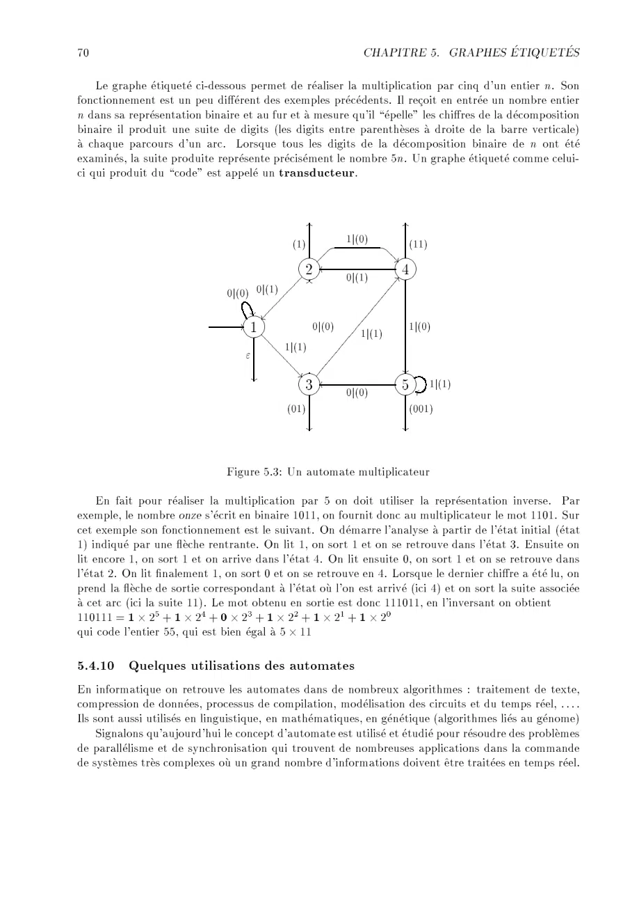

~~~text
70                                                                           CHAPITRE 5. GRAPHES ETIQUETES
     Le graphe etiquete ci-dessous permet de realiser la multiplication par cinq d'un entier n. Son
fonctionnement est un peu di erent des exemples precedents. Il recoit en entree un nombre entier
n dans sa representation binaire et au fur et a mesure qu'il \epelle" les chi res de la decomposition
binaire il produit une suite de digits (les digits entre parentheses a droite de la barre verticale)
a chaque parcours d'un arc. Lorsque tous les digits de la decomposition binaire de n ont ete
 examines, la suite produite represente precisement le nombre 5n. Un graphe etiquete comme celui-
 ci qui produit du \code" est appele un transducteur.

                                                               O                             O

                                                                          1j(0)
                                                     (1)                                         (11)
                                                                    F
                                                                                 E???
                                                      GFED
                                                      @ABC
                                                       2           o
                                                                                     @ABC
                                                                                     GFED
                                                                                     

                                                                                       4
                                                  ;          0j(1)                   
                                                ;;                         
                                                                                         B

                                                                         
                                                           O

                                0j(0) 0j(1) ;;;                         
                                            ;                         
                                         ;;;                        
                                        ;                         
                                    @ABC
                                    GFED                        
                                        

                                      1 >>
                                                ;

                                    /

                                                    0j(0)                                       1j(0)
                                                               1j(1)
                                          >>
                                                           
                                            >>1j(1)
                                     "        >>         
                                                >>    
                                                  > 
                                                      GFED
                                                      @ABC                          GFED
                                                                                    @ABC
                                                                                             

                                                       3                             5
                                                       

                                                                                                        1j(1)
                                            

                                                                   o

                                                                          0j(0)                   i

                                                    (01)                                         (001)

                                                                                            

                                Figure 5.3: Un automate multiplicateur
     En fait pour realiser la multiplication par 5 on doit utiliser la representation inverse. Par
exemple, le nombre onze s'ecrit en binaire 1011, on fournit donc au multiplicateur le mot 1101. Sur
cet exemple son fonctionnement est le suivant. On demarre l'analyse a partir de l'etat initial (etat
1) indique par une eche rentrante. On lit 1, on sort 1 et on se retrouve dans l'etat 3. Ensuite on
lit encore 1, on sort 1 et on arrive dans l'etat 4. On lit ensuite 0, on sort 1 et on se retrouve dans
l'etat 2. On lit nalement 1, on sort 0 et on se retrouve en 4. Lorsque le dernier chi re a ete lu, on
prend la eche de sortie correspondant a l'etat ou l'on est arrive (ici 4) et on sort la suite associee
a cet arc (ici la suite 11). Le mot obtenu en sortie est donc 111011, en l'inversant on obtient
 110111 = 1  25 + 1  24 + 0  23 + 1  22 + 1  21 + 1  20
 qui code l'entier 55, qui est bien egal a 5  11

5.4.10 Quelques utilisations des automates
En informatique on retrouve les automates dans de nombreux algorithmes : traitement de texte,
compression de donnees, processus de compilation, modelisation des circuits et du temps reel, . . . .
Ils sont aussi utilises en linguistique, en mathematiques, en genetique (algorithmes lies au genome)
     Signalons qu'aujourd'hui le concept d'automate est utilise et etudie pour resoudre des problemes
de parallelisme et de synchronisation qui trouvent de nombreuses applications dans la commande
de systemes tres complexes ou un grand nombre d'informations doivent ^etre traitees en temps reel.
~~~

## Page 75

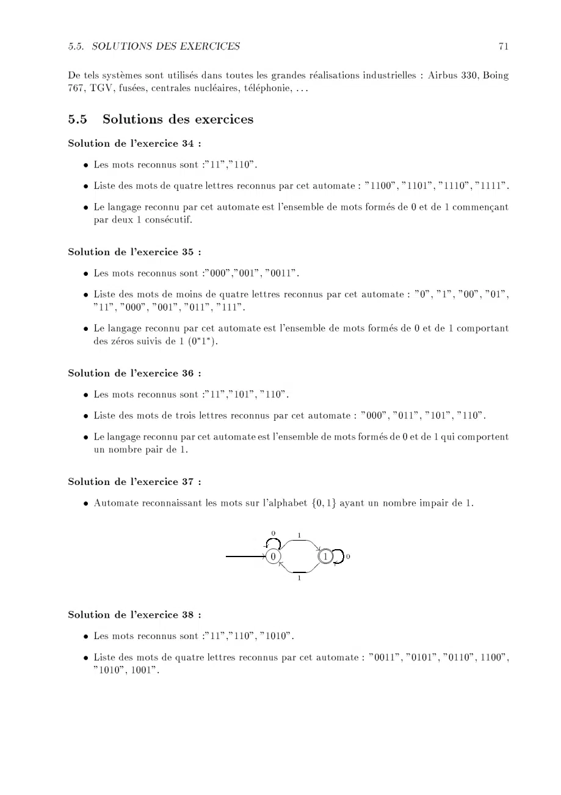

~~~text
5.5. SOLUTIONS DES EXERCICES                                                                         71

De tels systemes sont utilises dans toutes les grandes realisations industrielles : Airbus 330, Boing
767, TGV, fusees, centrales nucleaires, telephonie, . . .

5.5 Solutions des exercices
Solution de l'exercice 34 :
    Les mots reconnus sont :"11","110".
    Liste des mots de quatre lettres reconnus par cet automate : "1100", "1101", "1110", "1111".
    Le langage reconnu par cet automate est l'ensemble de mots formes de 0 et de 1 commencant
      par deux 1 consecutif.

Solution de l'exercice 35 :
    Les mots reconnus sont :"000","001", "0011".
    Liste des mots de moins de quatre lettres reconnus par cet automate : "0", "1", "00", "01",
     "11", "000", "001", "011", "111".
    Le langage reconnu par cet automate est l'ensemble de mots formes de 0 et de 1 comportant
     des zeros suivis de 1 (01 ).

Solution de l'exercice 36 :
    Les mots reconnus sont :"11","101", "110".
    Liste des mots de trois lettres reconnus par cet automate : "000", "011", "101", "110".
    Le langage reconnu par cet automate est l'ensemble de mots formes de 0 et de 1 qui comportent
      un nombre pair de 1.

Solution de l'exercice 37 :
    Automate reconnaissant les mots sur l'alphabet f0; 1g ayant un nombre impair de 1.
                                                      0       1
                                                                    ?
                                                  89:;
                                                  ?>=<F        E ???>=<
                                                                      89:;
                                                                       0123
                                                                       7654
                                                    0 ???A        B  1
                                                  

                                                                        

                                              /

                                                                                  0
                                                                    
                                                          _                   h

                                                              1

Solution de l'exercice 38 :
    Les mots reconnus sont :"11","110", "1010".
    Liste des mots de quatre lettres reconnus par cet automate : "0011", "0101", "0110", 1100",
      "1010", 1001".
~~~

## Page 76

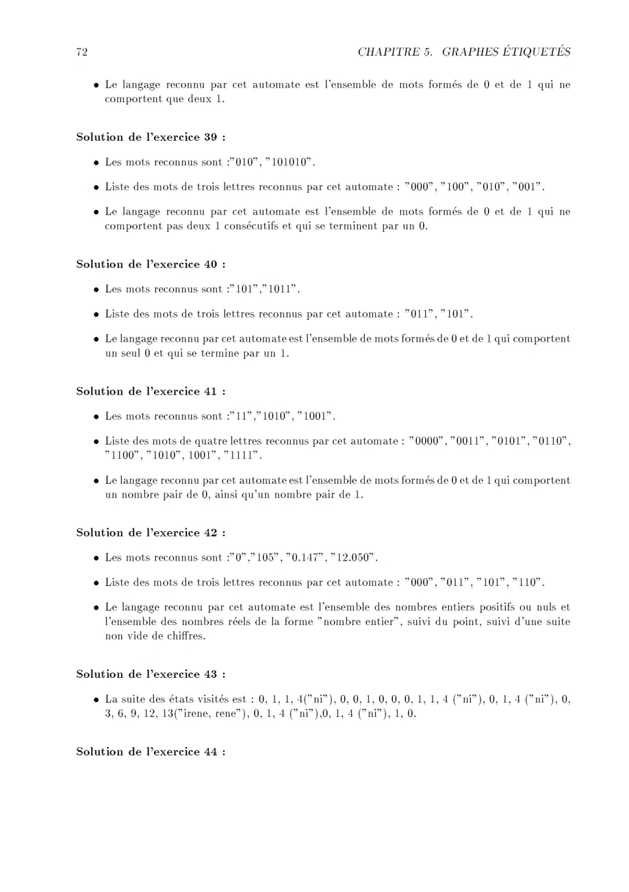

~~~text
72                                                            CHAPITRE 5. GRAPHES ETIQUETES
      Le langage reconnu par cet automate est l'ensemble de mots formes de 0 et de 1 qui ne
       comportent que deux 1.

Solution de l'exercice 39 :
    Les mots reconnus sont :"010", "101010".
    Liste des mots de trois lettres reconnus par cet automate : "000", "100", "010", "001".
    Le langage reconnu par cet automate est l'ensemble de mots formes de 0 et de 1 qui ne
       comportent pas deux 1 consecutifs et qui se terminent par un 0.

Solution de l'exercice 40 :
    Les mots reconnus sont :"101","1011".
    Liste des mots de trois lettres reconnus par cet automate : "011", "101".
    Le langage reconnu par cet automate est l'ensemble de mots formes de 0 et de 1 qui comportent
       un seul 0 et qui se termine par un 1.

Solution de l'exercice 41 :
    Les mots reconnus sont :"11","1010", "1001".
    Liste des mots de quatre lettres reconnus par cet automate : "0000", "0011", "0101", "0110",
       "1100", "1010", 1001", "1111".
      Le langage reconnu par cet automate est l'ensemble de mots formes de 0 et de 1 qui comportent
       un nombre pair de 0, ainsi qu'un nombre pair de 1.

Solution de l'exercice 42 :
    Les mots reconnus sont :"0","105", "0.147", "12.050".
    Liste des mots de trois lettres reconnus par cet automate : "000", "011", "101", "110".
    Le langage reconnu par cet automate est l'ensemble des nombres entiers positifs ou nuls et
       l'ensemble des nombres reels de la forme "nombre entier", suivi du point, suivi d'une suite
       non vide de chi res.

Solution de l'exercice 43 :
    La suite des etats visites est : 0, 1, 1, 4("ni"), 0, 0, 1, 0, 0, 0, 1, 1, 4 ("ni"), 0, 1, 4 ("ni"), 0,
       3, 6, 9, 12, 13("irene, rene"), 0, 1, 4 ("ni"),0, 1, 4 ("ni"), 1, 0.

Solution de l'exercice 44 :
~~~

## Page 77

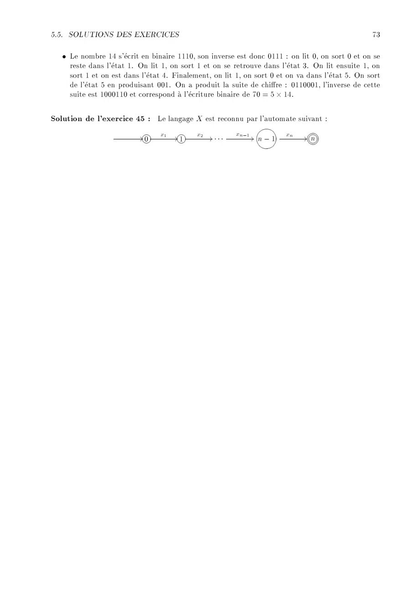

~~~text
5.5. SOLUTIONS DES EXERCICES                                                                       73

    Le nombre 14 s'ecrit en binaire 1110, son inverse est donc 0111 : on lit 0, on sort 0 et on se
     reste dans l'etat 1. On lit 1, on sort 1 et on se retrouve dans l'etat 3. On lit ensuite 1, on
     sort 1 et on est dans l'etat 4. Finalement, on lit 1, on sort 0 et on va dans l'etat 5. On sort
     de l'etat 5 en produisant 001. On a produit la suite de chi re : 0110001, l'inverse de cette
     suite est 1000110 et correspond a l'ecriture binaire de 70 = 5  14.

Solution de l'exercice 45 : Le langage X est reconnu par l'automate suivant :
                                  x1          x2       ...   x ;1 WVUT   x
                           ()*+
                           /.-,
                           /

                            0          ()*+
                                       /.-,
                                       /

                                        1          /
                                                             n
                                                                 /

                                                                  n;1
                                                                  PQRS    n
                                                                              /
                                                                                  89:;
                                                                                  ?>=<
                                                                                   ()*+
                                                                                   /.-,
                                                                                    n
~~~

## Page 78

~~~text
Chapitre 6

Graphes probabilistes
Dans ce chapitre, on etudie des exemples de graphes probabilistes, et on en fait la theorie complete
dans le cas le plus simple, ou il n'y a que deux etats.
    Les graphes probabilistes, aussi appeles cha^nes de Markov, sont l'exemple le plus simple de
dynamique probabiliste : on considere un sujet qui peut ^etre dans un nombre ni d'etats, et qui
peut passer a chaque etape d'un etat a un autre avec une probabilite qui ne depend que de l'etat
dans lequel il est. Par exemple, une endemie peut se decrire par 3 etats : non immunise, immunise
et malade ; on observe l'evolution avec une certaine periodicite, et on suppose que les personnes en
bonne sante non immunisees peuvent, avec une certaine probabilite, rester en bonne sante, ou au
contraire, tomber malade, ou devenir immunisees ; de m^eme, les personnes malades peuvent guerir,
en etant immunisees ou non ; les personnes immunisees peuvent, avec une certaine probabilite,
perdre leur immunite.
    Ce modele est tres rudimentaire : on regarde uniquement le dernier etat du sujet, en oubliant
son histoire precedente (il est probable qu'une personne qui tombe malade pour la cinquieme fois
ne reagit pas de la m^eme facon que celle qui tombe malade pour la premiere fois !) ; neammoins, il
permet deja d'obtenir des resultats interessants, surtout quand on l'applique, non pas a un individu,
mais a une population, donnee par un vecteur de repartition dans les divers etats possibles.
    Le resultat essentiel de ce chapitre est le theoreme de convergence vers un etat stationnaire,
vrai des qu'une puissance de la matrice associee a tous ses termes strictement positifs. Ce theoreme
sera demontre completement pour deux etats dans la deuxieme section du chapitre.
    Il est interessant de remarquer l'analogie avec les problemes de comptage de chemins : comme
le nombre de chemins reliant deux sommets en n coups, la probabilite de passer d'un etat a un
autre en n coups se calcule, pour le m^eme genre de raisons, a l'aide d'une puissance de matrice ;
la matrice consideree n'est plus la matrice d'adjacence, mais la matrice de transition du graphe
probabiliste.

6.1 Quelques exercices
Exercice 46 Une evolution de population (Exercice du document d'accompagnement).
    Deux villes X et Y totalisent une population d'un million d'habitants. La ville X est plus
agreable, mais la ville Y o re de meilleurs salaires. 20% des habitants de Y partent chaque annee
habiter X pour avoir un meilleur cadre de vie, et 5% des habitants de X partent chaque annee
habiter Y pour augmenter leur niveau de vie. Sachant qu'en l'annee 0 , un quart des habitants sont
en X, calculer la population de X et de Y au bout de 1,2,5,10 ans.
                                                   74
~~~

## Page 79

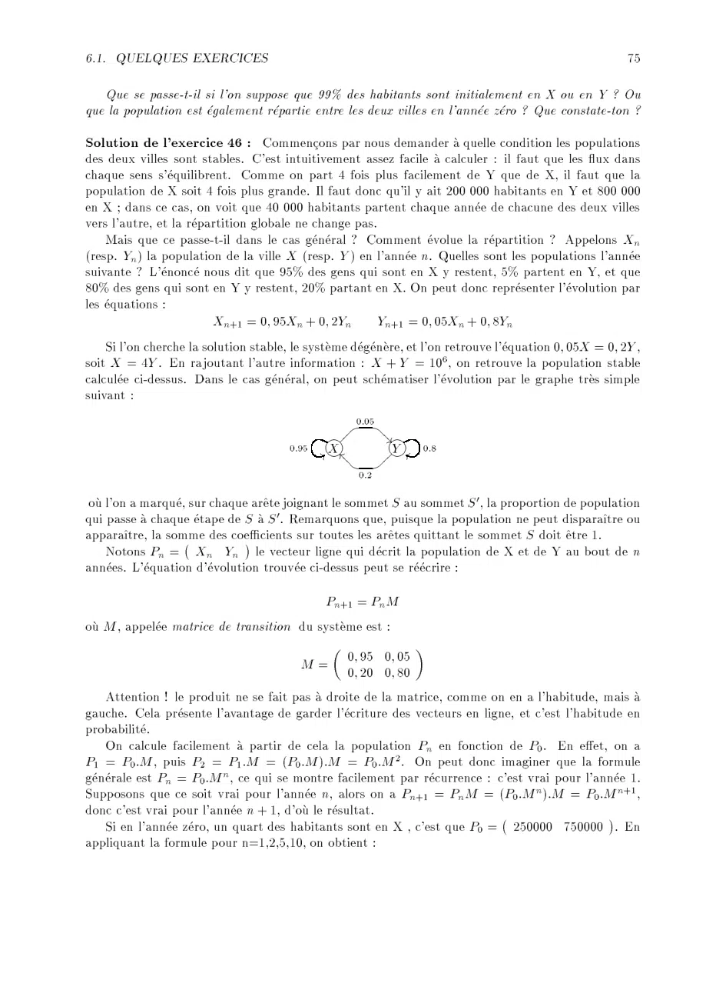

~~~text
6.1. QUELQUES EXERCICES                                                                                     75

   Que se passe-t-il si l'on suppose que 99% des habitants sont initialement en X ou en Y ? Ou
que la population est egalement repartie entre les deux villes en l'annee zero ? Que constate-ton ?
Solution de l'exercice 46 : Commencons par nous demander a quelle condition les populations
des deux villes sont stables. C'est intuitivement assez facile a calculer : il faut que les ux dans
chaque sens s'equilibrent. Comme on part 4 fois plus facilement de Y que de X, il faut que la
population de X soit 4 fois plus grande. Il faut donc qu'il y ait 200 000 habitants en Y et 800 000
en X ; dans ce cas, on voit que 40 000 habitants partent chaque annee de chacune des deux villes
vers l'autre, et la repartition globale ne change pas.
     Mais que ce passe-t-il dans le cas general ? Comment evolue la repartition ? Appelons Xn
(resp. Yn ) la population de la ville X (resp. Y ) en l'annee n. Quelles sont les populations l'annee
suivante ? L'enonce nous dit que 95% des gens qui sont en X y restent, 5% partent en Y, et que
80% des gens qui sont en Y y restent, 20% partant en X. On peut donc representer l'evolution par
les equations :
                          Xn+1 = 0; 95Xn + 0; 2Yn Yn+1 = 0; 05Xn + 0; 8Yn
     Si l'on cherche la solution stable, le systeme degenere, et l'on retrouve l'equation 0; 05X = 0; 2Y ,
soit X = 4Y . En rajoutant l'autre information : X + Y = 106, on retrouve la population stable
calculee ci-dessus. Dans le cas general, on peut schematiser l'evolution par le graphe tres simple
suivant :
                                                           0:05
                                                         F      E???
                                                   0123?
                                                   7654
                                                   X                 0123
                                                                     7654
                                        0:95
                                                         ??A      B Y          0:8
                                                                         

                                                                     
                                                       _

                                                                             f
                                               7

                                                               0:2

ou l'on a marque, sur chaque ar^ete joignant le sommet S au sommet S 0, la proportion de population
qui passe a chaque etape de S a S 0. Remarquons que, puisque la population ne peut dispara^tre ou
appara^tre, la somme
                   ; des coecients
                                        sur toutes les ar^etes quittant le sommet S doit ^etre 1.
    Notons Pn = Xn Yn le vecteur ligne qui decrit la population de X et de Y au bout de n
annees. L'equation d'evolution trouvee ci-dessus peut se reecrire :
                                                   Pn+1 = Pn M
ou M , appelee matrice de transition du systeme est :
                                                     0; 95 0; 05 
                                           M=      0; 20 0; 80
     Attention ! le produit ne se fait pas a droite de la matrice, comme on en a l'habitude, mais a
gauche. Cela presente l'avantage de garder l'ecriture des vecteurs en ligne, et c'est l'habitude en
probabilite.
     On calcule facilement a partir de cela la population Pn en fonction de P0 . En e et, on a
P1 = P0 :M , puis P2 = P1 :M = (P0:M ):M = P0 :M 2. On peut donc imaginer que la formule
generale est Pn = P0:M n , ce qui se montre facilement par recurrence : c'est vrai pour l'annee 1.
Supposons que ce soit vrai pour l'annee n, alors on a Pn+1 = Pn M = (P0 :M n ):M = P0 :M n+1 ,
donc c'est vrai pour l'annee n + 1, d'ou le resultat.                    ;                   
     Si en l'annee zero, un quart des habitants sont en X , c'est que P0 = 250000 750000 . En
appliquant la formule pour n=1,2,5,10, on obtient :
~~~

## Page 80

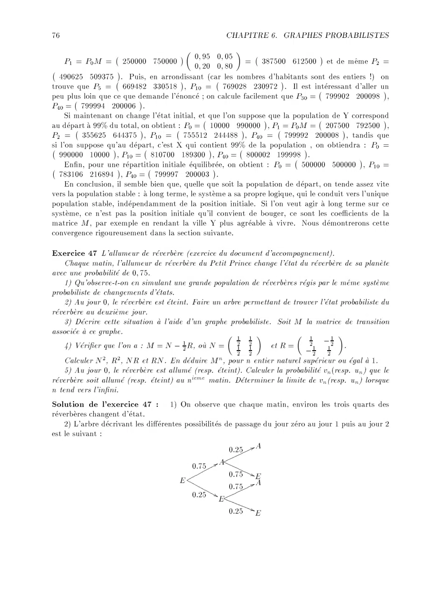

~~~text
76                                                             CHAPITRE 6. GRAPHES PROBABILISTES
                       ;                       0; 95 0; 05  ;                           et de m^eme P =
      P1 = P0M = 250000 750000                    0; 20 0; 80        =  387500     612500                   2
; 490625 509375 . Puis, en arrondissant               (car; les nombres d'habitants    sont des entiers !) on
                       ;                     
trouve que P5 = 669482 330518 , P10 = 769028 230972 . Il est int
                                                                                           eressant d'aller un
peu plus     loin que ce que demande
                                                                                          ;
                                         l'enonce ; on calcule facilement que P30 = 799902 200098 ,
                                                                                                              
         ;
P40 = 799994 200006 .
                              
      Si maintenant on change l'etat initial, et; que l'on suppose que la population    ;   de Y correspond 
au depart
         ;    a 99% du total, on obtient;: P0 = 10000 990000           , P1; = P0 M = 207500     792500 ,
P2 = 355625 644375 , P10 = 755512 244488 , P40 = 799992 200008 , tandis que
si; l'on suppose qu'au depart, ; c'est X qui contient 99%; de la population., on obtiendra : P0 =
    990000 10000 , P10 = 810700 189300 , P40 = 800002 199998
      En   n,  pour une  r
                          e partition initiale  
                                                e quilibr
                                                         e  e, on obtient : P    =
                                                                                   ; 500000 500000 , P =
; 783106 216894 , P = ; 799997 200003 .                                     0                            10
                         40
    En conclusion, il semble bien que, quelle que soit la population de depart, on tende assez vite
vers la population stable : a long terme, le systeme a sa propre logique, qui le conduit vers l'unique
population stable, independamment de la position initiale. Si l'on veut agir a long terme sur ce
systeme, ce n'est pas la position initiale qu'il convient de bouger, ce sont les coecients de la
matrice M , par exemple en rendant la ville Y plus agreable a vivre. Nous demontrerons cette
convergence rigoureusement dans la section suivante.
Exercice 47 L'allumeur de reverbere (exercice du document d'accompagnement).
    Chaque matin, l'allumeur de reverbere du Petit Prince change l'etat du reverbere de sa planete
avec une probabilite de 0; 75.
    1) Qu'observe-t-on en simulant une grande population de reverberes regis par le m^eme systeme
probabiliste de changements d'etats.
    2) Au jour 0, le reverbere est eteint. Faire un arbre permettant de trouver l'etat probabiliste du
reverbere au deuxieme jour.
    3) Decrire cette situation a l'aide d'un graphe probabiliste. Soit M la matrice de transition
associee a ce graphe.                                  1 1                1 ;1 
    4) Veri er que l'on a : M = N ; 2 R, ou N = 1 1
                                           1               2   2     et R = ;21 12 .
                                                           2 2                    2     2
    Calculer N 2, R2, NR et RN . En deduire M n , pour n entier naturel superieur ou egal a 1.
    5) Au jour 0, le reverbere est allume (resp. eteint). Calculer la probabilite vn (resp. un ) que le
reverbere soit allume (resp. eteint) au nieme matin. Determiner la limite de vn (resp. un ) lorsque
n tend vers l'in ni.
Solution de l'exercice 47 : 1) On observe que chaque matin, environ les trois quarts des
reverberes changent d'etat.
    2) L'arbre decrivant les di erentes possibilites de passage du jour zero au jour 1 puis au jour 2
est le suivant :
                                                               0:25 nnn
                                                                        A
                                                                 nnn
                                                                      6

                                                           nn
                                                 :
                                                0 75   p
                                                         nn
                                                         P A
                                                          PPP
                                                    ppp       PPP
                                                       8

                                                                 PPP
                                                 ppp       0  75:
                                          E    pp
                                              pNN
                                              N                           E
                                                                          A
                                                                      (

                                                 NNN
                                                    NNN    0 75 :
                                                              nnn
                                                                 nnn
                                                                      6

                                                 :
                                                0 25   N
                                                       &

                                                         nn
                                                         R n
                                                           E
                                                          RRR
                                                             n
                                                              RRR
                                                                 RRR
                                                               0:25   )

                                                                          E
~~~

## Page 81

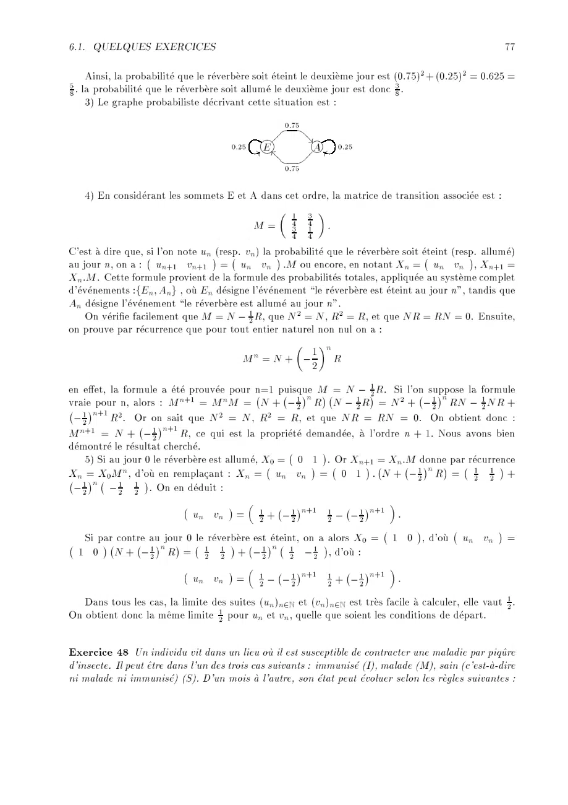

~~~text
6.1. QUELQUES EXERCICES                                                                                     77

     Ainsi, la probabilite que le reverbere soit eteint le deuxieme jour est (0:75)2 +(0:25)2 = 0:625 =
8 : la probabilit
                 e que le reverbere soit allume le deuxieme jour est donc 83 :
5

     3) Le graphe probabiliste decrivant cette situation est :
                                                            0:75
                                                                      ?
                                                    0123? F
                                                    7654
                                                                  E ??/.-,
                                                                        ()*+
                                         0:25       E     ??A       BA              0:25
                                                                           

                                                        _

                                                8                              f

                                                            0:75

    4) En considerant les sommets E et A dans cet ordre, la matrice de transition associee est :
                                                            1 3
                                                M=              4
                                                                3
                                                                       4
                                                                       1           :
                                                                4      4
C'est a dire que, ;si l'on note un (resp.
                                         ; vn) la probabilit
                                                           e que le reverbere soit e;teint (resp.
                                                                                                    allume)
au jour n, on a : un+1 vn+1 = un vn :M ou encore, en notant Xn = un vn , Xn+1 =
Xn :M . Cette formule provient de la formule des probabilites totales, appliquee au systeme complet
d'evenements :fEn ; Ang , ou En designe l'evenement \le reverbere est eteint au jour n", tandis que
An designe l'evenement \le reverbere est allume au jour n".
     On veri e facilement que M = N ; 21 R, que N 2 = N , R2 = R, et que NR = RN = 0. Ensuite,
on prouve par recurrence que pour tout entier naturel non nul on a :
                                                                     1 n
                                            Mn = N +                 ;2 R
en e et, la formule a ete prouvee pour n=1  ;     puisque
                                                      ;      n
                                                                M;= N ; 12 R. Si l'on; suppose
                                                                                             n
                                                                                                    la formule
vraie
;; 1 npour    n, alors : M = M M = N + ; 2 R N ; 2 R = N + ; 2 RN ; 12 NR +
                                n +1      n               1            1         2        1

    2
        +1 2
             R . Or  ;   on sait que N 2 = N , R2 = R, et que NR = RN = 0. On obtient donc :
M n+1 = N + ; 21 n+1 R, ce qui est la propriete demandee, a l'ordre n + 1: Nous avons bien
demontre le resultat cherche.                       ;        
     5) Si au jour 0 le reverbere est allume, X;0 = 0 1 . ;Or Xn+1      = Xn :M
                                                                             ;     ;   donne
                                                                                               par recurrence
                                                                                         n  ; 1 1 
                n
;X;n1=n X; 0;M1 , 1d'o   en remplacant : Xn = un vn = 0 1 : N + ; 2 R = 2 2 +
                       .u On
                                                                                      1

    2          2 2            en deduit :
                         ; u v  =  1 ; 1 n+1 1 ; 1 n+1  :
                             n n             2 + ;2            2 ; ;2

   Si par contre au jour  0 le  r
                                 e verb
                                       e re est 
                                                e teint, on  a alors X   =
                                                                           ; 1 0 , d'ou ; u v  =
; 1 0 ;N + ;; 1 n R = ; 1 1  + ;; 1 n ; 1 ; 1 , d'ou :          0                     n n
                 2             2 2            2       2    2
                         ; u v  =  1 ; 1 n+1 1 ; 1 n+1  :
                                n    n          ; ;
                                                2               2+ ;               2          2

   Dans tous les cas, la limite des suites (un )n2N et (vn )n2N est tres facile a calculer, elle vaut 12 .
On obtient donc la m^eme limite 12 pour un et vn , quelle que soient les conditions de depart.

Exercice 48 Un individu vit dans un lieu ou il est susceptible de contracter une maladie par piq^ure
d'insecte. Il peut ^etre dans l'un des trois cas suivants : immunise (I), malade (M), sain (c'est-a-dire
ni malade ni immunise) (S). D'un mois a l'autre, son etat peut evoluer selon les regles suivantes :
~~~

## Page 82

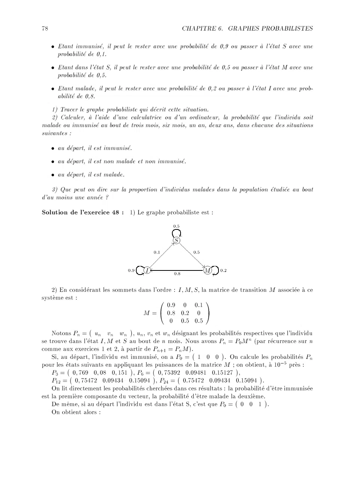

~~~text
78                                                                CHAPITRE 6. GRAPHES PROBABILISTES
      Etant immunise, il peut le rester avec une probabilite de 0,9 ou passer a l'etat S avec une
       probabilite de 0,1.
      Etant dans l'etat S, il peut le rester avec une probabilite de 0,5 ou passer a l'etat M avec une
       probabilite de 0,5.
      Etant malade, il peut le rester avec une probabilite de 0,2 ou passer a l'etat I avec une prob-
       abilite de 0,8.
    1) Tracer le graphe probabiliste qui decrit cette situation.
    2) Calculer, a l'aide d'une calculatrice ou d'un ordinateur, la probabilite que l'individu soit
malade ou immunise au bout de trois mois, six mois, un an, deux ans, dans chacune des situations
suivantes :
      au depart, il est immunise.
      au depart, il est non malade et non immunise.
      au depart, il est malade.
   3) Que peut on dire sur la proportion d'individus malades dans la population etudiee au bout
d'au moins une annee ?
Solution de l'exercice 48 : 1) Le graphe probabiliste est :
                                                        0:5

                                                        ()*+
                                                        /.-,
                                                         S@
                                                              

                                                        ;         @@
                                                      ;;
                                                        ?

                                                     ;              @@
                                               0:1 ;;                 @@0:5
                                                                        @@
                                                  ;
                                               ;;;                        @@
                                                                            @@
                                              ;
                                  0:9    ()*+;
                                         /.-,I                               0123
                                                                             7654
                                                                             M          0:2
                                                            0:8
                                                 o

                                         9

                                                                                    h

    2) En considerant les sommets dans l'ordre : I; M; S; la matrice de transition M associee a ce
systeme est :                               0 0:9 0 0:1 1
                                       M = @ 0:8 0:2 0 A
                                                  0 0:5 0:5
                    ;              
    Notons Pn = un vn wn , un , vn et wn designant les probabilites respectives que l'individu
se trouve dans l'etat I; M et S au bout de n mois. Nous avons Pn = P0 M n (par recurrence sur n
comme aux exercices 1 et 2, a partir de Pn+1 = Pn M ).;               
    Si, au depart, l'individu est immunise, on a P0 = 1 0 0 . On calcule les probabilites Pn
pour les e;tats suivants en appliquant
                                       les;puissances de la matrice M ; on obtient, a 10;5 pres :
    P3 = ; 0; 769 0; 08 0; 151 , P6 =  0; 75392; 0:09481 0:15127 ,                   
    P12 = 0; 75472 0:09434 0:15094 , P24 = 0:75472 0:09434 0:15094 .
    On lit directement les probabilites cherchees dans ces resultats : la probabilite d'^etre immunisee
est la premiere composante du vecteur, la probabilite d'^etre malade la;deuxieme.
    De m^eme, si au depart l'individu est dans l'etat S, c'est que P0 = 0 0 1 .
    On obtient alors :
~~~

## Page 83

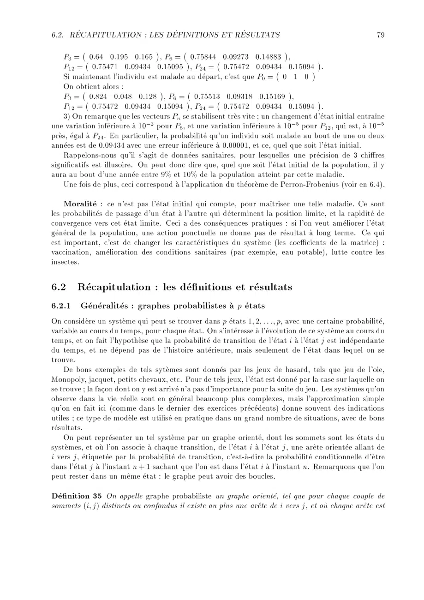

~~~text
6.2. RECAPITULATION : LES DEFINITIONS ET RESULTATS                                                       79
          ;                               ;
    P3 = ; 0:64 0:195 0:165 , P6 =  0:75844; 0:09273 0:14883 ,
                                                                             
    P12 = 0:75471 0:09434 0:15095 , P24 = 0:75472 0:09434
                                                                            
                                                                    0:15094 .
                                                                  ;
    Si maintenant l'individu est malade au depart, c'est que P0 = 0 1 0
    On obtient
           ; alors :                       ;                               
    P3 = ; 0:824 0:048 0:128 , P6 =  0:75513; 0:09318 0:15169 ,                    
    P12 = 0:75472 0:09434 0:15094 , P24 = 0:75472 0:09434 0:15094 .
    3) On remarque que les vecteurs Pn se stabilisent tres vite ; un changement d'etat initial entra^ne
une variation inferieure a 10;2 pour P6, et une variation inferieure a 10;5 pour P12 , qui est, a 10;5
pres, egal a P24. En particulier, la probabilite qu'un individu soit malade au bout de une ou deux
annees est de 0:09434 avec une erreur inferieure a 0:00001, et ce, quel que soit l'etat initial.
    Rappelons-nous qu'il s'agit de donnees sanitaires, pour lesquelles une precision de 3 chi res
signi catifs est illusoire. On peut donc dire que, quel que soit l'etat initial de la population, il y
aura au bout d'une annee entre 9% et 10% de la population atteint par cette maladie.
    Une fois de plus, ceci correspond a l'application du theoreme de Perron-Frobenius (voir en 6.4).
     Moralite : ce n'est pas l'etat initial qui compte, pour ma^triser une telle maladie. Ce sont
les probabilites de passage d'un etat a l'autre qui determinent la position limite, et la rapidite de
convergence vers cet etat limite. Ceci a des consequences pratiques : si l'on veut ameliorer l'etat
general de la population, une action ponctuelle ne donne pas de resultat a long terme. Ce qui
est important, c'est de changer les caracteristiques du systeme (les coecients de la matrice) :
vaccination, amelioration des conditions sanitaires (par exemple, eau potable), lutte contre les
insectes.

6.2 Recapitulation : les de nitions et resultats
6.2.1 Generalites : graphes probabilistes a p etats
On considere un systeme qui peut se trouver dans p etats 1; 2; : : :; p, avec une certaine probabilite,
variable au cours du temps, pour chaque etat. On s'interesse a l'evolution de ce systeme au cours du
temps, et on fait l'hypothese que la probabilite de transition de l'etat i a l'etat j est independante
du temps, et ne depend pas de l'histoire anterieure, mais seulement de l'etat dans lequel on se
trouve.
     De bons exemples de tels sytemes sont donnes par les jeux de hasard, tels que jeu de l'oie,
Monopoly, jacquet, petits chevaux, etc. Pour de tels jeux, l'etat est donne par la case sur laquelle on
se trouve ; la facon dont on y est arrive n'a pas d'importance pour la suite du jeu. Les systemes qu'on
observe dans la vie reelle sont en general beaucoup plus complexes, mais l'approximation simple
qu'on en fait ici (comme dans le dernier des exercices precedents) donne souvent des indications
utiles ; ce type de modele est utilise en pratique dans un grand nombre de situations, avec de bons
resultats.
     On peut representer un tel systeme par un graphe oriente, dont les sommets sont les etats du
systemes, et ou l'on associe a chaque transition, de l'etat i a l'etat j , une ar^ete orientee allant de
i vers j , etiquetee par la probabilite de transition, c'est-a-dire la probabilite conditionnelle d'^etre
dans l'etat j a l'instant n + 1 sachant que l'on est dans l'etat i a l'instant n. Remarquons que l'on
peut rester dans un m^eme etat : le graphe peut avoir des boucles.
De nition 35 On appelle graphe probabiliste un graphe oriente, tel que pour chaque couple de
sommets (i; j ) distincts ou confondus il existe au plus une ar^ete de i vers j , et ou chaque ar^ete est
~~~

## Page 84

~~~text
80                                                         CHAPITRE 6. GRAPHES PROBABILISTES
etiquetee par un reel pi;j compris entre 0 et 1, la somme des poids des ar^etes issues d'un m^eme
 sommet etant egale a 1.
    De m^eme qu'a un graphe (oriente ou non), on associe une matrice d'adjacence A, dont le terme
ai;j compte le nombre d'ar^etes joignant le sommet i au sommet j , on peut associer a un graphe
probabiliste une matrice qui decrit les probabilites de transition :
De nition 36 Etant donne un graphe probabiliste a p sommets, on appelle matrice!de transition
associee la matrice carree M = (mi;j ) a p lignes et p colonnes, dont le coecient mi;j est l'etiquette
de l'ar^ete orientee de i vers j si elle existe (c'est-a-dire la probabilite de transition de i a j ), et 0
sinon.
De nition 37 On appelle matrice!stochastique une matrice carree dont tous les coecients sont
compris entre 0 et 1, et telle que la somme de chaque ligne est egale a 1.
     Les matrices stochastiques jouent un r^ole fondamental en probabilite ; il est facile de voir que
la matrice de transition d'un graphe probabiliste est toujours une matrice stochastique.
     On veut etudier l'evolution d'un tel systeme au cours du temps ; on note Xn le vecteur ligne a
p elements dont l'element d'ordre j est la probabilite que le systeme se trouve a l'instant n dans
l'etat j (Attention aux indices ! on a ici une suite de vecteurs lignes, avec chacun p composantes !).
La propriete fondamentale est la suivante :
Lemme 3 Pour tout entier n, on a Xn+1 = Xn :M
Demonstration : Posons Xn = (a1; : : :; ap), et Xn+1 = (b1; : : :; bp), et notons Aj l'evenement \le
systeme est dans l'etat j a l'instant n", et Bi l'evenement \le systeme est dans l'etat i a l'instant
n + 1".
    En notant P la probabilite, on a parPde nition bi = P (Bi ). Puisque les Aj forment un systeme
complet d'evenements, on a P (Bi ) = pj=1 P (Bi \ Aj ). Mais, par de nition de la probabilite
conditionnelle, on a P (Bi \ Aj ) = P (Aj )P (Bi jAJ ) ; cette derniere probabilite conditionnelle n'est
autre que le terme mj;i de la matrice de transition M .
    On en deduit :
                                                   X  p
                                              bi = aj mj;i
                                                    j =1
qui est exactement l'expression, sur les composantes, de la formule Xn+1 = Xn :M .

     On en deduit immediatement par recurrence :
Proposition 20 Pour tout entier n > 0, on a : Xn = X0:M n
     Cette formule, qui permet de calculer la repartition de probabilites au temps n si on la conna^t
au temps 0, est fondamentale pour tous les exercices. Un cas particulierement interessant est celui
ou la repartition de probabilite est stable au cours du temps.
De nition 38 On appelle
                 Pp etat stable un vecteur ligne X = (x1; : : :; xp) a p composantes xi  0
tel que X = XM et        i=1 xi = 1.
~~~

## Page 85

~~~text
6.2. RECAPITULATION : LES DEFINITIONS ET RESULTATS                                                          81
                              P
     La derniere condition ( pi=1 xi = 1) est d^u au fait que X represente une repartition de proba-
bilite.
Remarque : Attention au vocabulaire ! on emploie le mot \etat" dans deux sens : d'abord
comme l'une des positions possibles du systeme, correspondant a l'un des sommets du graphe,
puis, comme ici, comme une repartition de probabilite entre les di erents sommets du graphe. Si
l'on pense a l'exercice 48, chaque individu peut se trouver dans 3 etats, immunise, malade ou sain,
et une population peut se trouver dans une grande quantite d'etats, correspondant a une certaine
repartition entre les 3 categories ; l'un de ces etats est privilegie, c'est l'etat stable, correspondant a
une repartiton entre gens immunises, malades et sains qui est invariante au cours du temps (m^eme
si les individus, eux, changent d'etat : les changements individuels se compensent au sein de la
population).
     Si, a un instant n, le systeme arrive en un etat stable Xn , alors le systeme reste dans cet etat :
pour tout entier n0  n, on a Xn0 = Xn (par recurrence). Cela explique le nom : si l'on arrive dans
un etat stable, on y reste.
     Remarquons que la recherche d'un etat stable n'est pas dicile P   en pratique : il s'agit de resoudre
l'equation X = X:M , et d'en chercher une solution satisfaisant pi=1 xi = 1, ce qui se fait sans
probleme pour une matrice stochastique M donnee. Nous avons vu, au tout debut du premier
exercice, l'interpretation de cette equation : pour obtenir un etat stable, il faut que toutes les
transitions s'equilibrent ; si l'on considere le probleme comme une evolution de population, il faut
que, pour tout etat i, la quantite de personnes qui quittent l'etat i a chaque etape soit egale a la
quantite de personnes qui y arrivent.
     Ce qui est moins evident, c'est qu'un tel etat existe, et qu'il soit unique. Ce qui se passe quand
on ne part pas d'un etat stable n'est pas evident non plus. Nous allons l'etudier en detail dans le
cas d'un systeme a deux etats, cas qui est accessible au niveau de la terminale.

6.2.2 Un cas particulier : les graphes probabilistes a 2 etats
On suppose qu'il n'y a que deux etats, notes 1 et 2. On note un (resp. vn ) la probabilite qu'a
l'instant n, le systeme se trouve dans l'etat 1 (resp. 2). L'evenement correspondant sera; note : E1;n
(resp. E2;n). Pour tout entier n, on note Xn le vecteur-ligne a deux colonnes, Xn = un vn ;
remarquons que l'on a toujours un + vn = 1.
    On note a la probabilite de transition de l'etat 1 a l'etat 2, a = P (E2;n+1 =E1;n), et b la
probabilite de transition de l'etat 2 a l'etat 1, b = P (E1;n+1=E2;n ). Un raisonnement facile nous
donne les probabilites de demeurer dans l'etat 1 ou dans l'etat 2 : P (E1;n+1=E1;n) = 1 ; a,
P (E2;n+1=E2;n) = 1 ; b.
     Le systeme peut donc ^etre represente par le graphe probabiliste suivant :
                                                           a ?
                                                     F       E ??/.-,
                                                      
                                                 ()*+
                                                 /.-,
                                                  1 ???A           ()*+
                                         1;a
                                                               B 2         1;b
                                                                     

                                                     _

                                                 9                       e

                                                                 
                                                           b

    et la matrice stochastique correspondante est :
                                                  1;a a 
                                          M=        b 1;b :
~~~

## Page 86

~~~text
82                                                      CHAPITRE 6. GRAPHES PROBABILISTES
     Les nombres a et b sont tous deux compris entre 0 et 1 ; il y a quelques cas triviaux que l'on
peut traiter a part. Si a et b sont nuls, M est la matrice identite, et tous les etats sont stables. Ce
n'est pas etonnant, puisqu'il est impossible de changer ! Si l'un des deux seulement est nul, par
exemple a, on voit que l'on nit toujours par arriver dans l'etat 1. C'est le cas d'une population qui
ne se renouvelle pas, et dont les individus peuvent ^etre dans deux etats, vivants (etat 2) ou morts
(etat 1) : a long terme, la population ne sera plus composee que de morts. On parle alors d'etat
absorbant. En n, si les deux coecients sont egaux a 1, le systeme \clignote" : il oscille sans se
stabiliser entre l'etat 1 et l'etat 2, et se retrouve tous les deux coups dans le m^eme etat.
     Ces cas particuliers etant faciles a etudier, et peu interessants, on supposera desormais que a
et b sont strictement positifs, et ne sont pas tous deux egaux a 1.
     Par application du lemme 3, on a : Xn+1 = Xn M: Refaisons le raisonnement dans ce cas simple :
la formule des probabilites totales appliquee au systeme complet d'evenements fE1;n; E2;ng donne :
P(E1;n+1) = P (E1;n+1 =E1;n):P (E1;n) + P (E1;n+1 =E2;n):P (E2;n), soit : un+1 = (1 ; a)un + bvn , et
de m^eme, vn+1 = aun + (1 ; b)vn . En ecriture matricielle, on a bien : Xn+1 = Xn M .
     On en deduit comme ci-dessus Xn = X0M n , pour tout entier naturel n. Il s'agit donc de calculer
la matrice M n . C'est assez facile dans le cas des matrices d'ordre 2, gr^ace au lemme suivant:
                              1;a a 
Lemme 4 Soit M =                   b 1 ; b , avec a; b strictement positifs. Posons c = 1 ; a ; b,
   = a+a b , = a+b b , et de nissons 2 matrices N et R par :
                                                                  ; :
                                   N=                   R=       ;
     Alors, pour tout entier naturel n, on a :M n = N + cn R
     On montrera en annexe comment expliquer l'apparition des matrices N et R.
Demonstration : Par recurrence sur n.
     L'initialisation est immediate : pour n = 1, la relation a prouver est : M = N + cR, que l'on
veri e immediatement par le calcul (exercice a faire faire aux eleves; on pourra leur faire remarquer
que + = 1, et (a + b) = a, (a + b) = b).
     On demontre ensuite facilement que les matrices R et N ont des proprietes bien particulieres :
d'une part, le calcul montre immediatement que NR = RN = 0. D'autre part, ce sont des matrices
de projections ; en e et, en utilisant la relation + = 1, on a :
                                               ( + )            ( + )
                                                                              
                    N =
                      2
                                                    =    ( + )       ( + )        = N;
et de m^eme,
                                 ;         ;  =  ( + ) ; ( + )  = R:
               R =
                2
                          ;                 ;        ;( + ) ( + )
    De N 2 = N et R2 = R, on deduit facilement N k = N et Rk = R pour tout entier k > 0.
On en deduit que, pour tout entier naturel n > 0, on a M n = N + cn R: L'initialisation a ete
faite ci-dessus pour n = 1 ; supposons la formule vraie a l'ordre n, alors on a M n+1 = M:M n =
(N + cR):(N + cn R) = N 2 + cn NR + cRN + cn+1 R2 = N + cn+1 R d'apres les proprietes de R et
N , et la formule est vraie a l'ordre n + 1. Donc elle est vraie pour tout entier n > 0.
     Nous sommes maintenant en mesure de prouver le resultat general suivant :
~~~

## Page 87

~~~text
6.2. RECAPITULATION : LES DEFINITIONS ET RESULTATS                                                       83

Th
 1e;oraeme a18 Considerons un graphe probabiliste a deux etats, de matrice de transition M =
     b 1 ; b telle que 0 < a + b < 2.                                  
    Alors, le systeme se stabilise vers la position d'equilibre a+b b ; a+a b , independamment de l'etat
initial.
                                                                                        1 0
Demonstration : La condition 0 < a + b < 2 elimine les deux cas triviaux 0 1 (identite)
       
       0 1 (clignotant) vus plus haut.
et     1 0
    Nous allons calculer les coecients un et vn du vecteur Xn , en utilisant le lemme precedent, et
le fait que u0 + v0 = 1. Il sut de remplacer, dans la formule Xn = X0M n , M n par N + cn R: On
obtient :

          ; u v  = ; u v            
                                           n
                                         +c ;        ;   
             n n       0 0

                    ;
                  = u0 v0
                             + cn ; cn 
                    ;            ; cn      + cn
                                                                            
                  = (u0 + v0 ) + cn ( u0 ; v0 ) (u0 + v0) + cn (; u0 + v0 )
                  =
                    ; + cn( u ; v ) + cn(; u + v ) 
                                           0      0                 0      0

.
     Puisque, par hypothese, on a 0 < a + b < 2, le reel c est strictement compris entre ;1 et +1.
Donc la valeur absolue de c est strictement inferieure a 1, et la suite geometrique cn converge vers
zero lorsque n tend vers l'in ni. Or la formule ci-dessus se reecrit :
                       ; u v =;                 + cn ; u ; v ; u + v 
                          n n                             0   0   0   0

   Puisque cn tend vers zero quand n tend vers l'in ni, les composantes du deuxieme vecteur
tendent vers zero quand n tend vers l'in ni. La limite de un , lorsque n tend vers +1, est donc
  = a+b b , celle de vn est = a+a b : Ces limites sont independantes des conditions initiales u0 et v0.
   Nous avons bien demontre le theoreme annonce.

     Ce resultat est un cas particulier d'un theoreme plus general : le theoreme de Perron-Frobenius,
voir dans les complements.
Remarque : On peut retrouver l'etat limite stable par; le raisonnement             elementaire fait dans le
premier exercice : pour qu'une repartion de probabilite u v soit stable, il faut que le ux de
l'etat 1 a l'etat 2, ua, soit egal au ux en sens inverse vb ; on a donc une equation ua = vb. Comme
c'est une repartition de probabilite, on doit aussi avoir u + v = 1. En resolvant le systeme
                                                ua = vb
                                                u+v = 1
     on retrouve la solution ci-dessus.
~~~

## Page 88

~~~text
84                                                      CHAPITRE 6. GRAPHES PROBABILISTES
6.2.3 Cas general : evolution vers un etat stable
 Que peut-il se passer quand il y a plus d'etats ? Voici un exemple qui montre le probleme que l'on
 peut rencontrer. On place un cavalier sur un echiquier, puis on joue en tirant au hasard, de facon
equiprobable, l'une de ses possibilites de deplacement (il en a entre 8 s'il est au centre et 2 s'il est
 dans un coin). Si l'on joue un grand nombre de fois, est-ce que sa probabilite de presence sur une
 case donnee nit par se stabiliser ? S^urement pas ! Si le cavalier a commence sur une case blanche,
 il sera sur une case noire apres tous les coups impairs, et sur une case blanche apres tous les coups
 pairs. Donc sa probabilite de passer d'une case blanche a une case blanche en un nombre impair
 de coup est nulle, pour une raison combinatoire. Toutes les puissances de la matrice de transition
 de ce systeme ont la moitie de leurs coecients nuls. On dit qu'on a un cycle (ici de longueur 2)
 entre des familles d'etats.
      Si l'on n'a pas ce probleme, alors la repartition se stabilise exponentiellement vite vers un etat
 stable. On pourra faire constater sur des exemples (comme le dernier exercice ci-dessus) cette
 stabilisation, et enoncer le theoreme suivant, qu'il n'est pas question de prouver :
Theoreme 19 Soit un graphe probabiliste a n etats, de matrice de transition M . S'il existe une
puissance M k de M dont tous les coecients sont strictement positifs, alors il existe un seul etat
stable X , veri ant X = X:M , et quel que soit l'etat initial, le systeme converge exponentiellement
vite vers l'etat stable.
   Nous verrons dans les complements que ce theoreme est une consequence du theoreme de Perron-
Frobenius.

6.3 Quelques exercices additionnels
Les exercices suivants permettent d'exercer les eleves a trouver la modelisation d'une situation
donnee, la matrice associee, et constater la convergence vers un etat stable.
Exercice 49 On s'interesse a la progression d'un jeton sur un plateau de jeu circulaire constitue
par 6 secteurs circulaires numerotes de 1 a 6, dans le sens trigonometrique. Le joueur tire dans
une urne, successivement avec remise une boule parmi trois identiques au toucher, numerotees de 1
a 3. Il repete l'operation deux fois de suite. Il note la somme S des chi res obtenus et avance son
 pion d'autant de cases, en tournant dans le sens trigonometrique, et en entrant dans le plateau de
 jeu par la case numerotee 1. Par exemple, si la somme des numeros tires est 3, il ira se positionner
 en case 3. Si la somme est 6, il ira se positionner en 6. Ensuite, il recommence, en repartant de la
 case d'arrivee au coup precedent, etant bien entendu que la case 1 suit la case 6.
     1) Expliquer comment on pourrait realiser ce tirage au hasard avec des des usuels, au lieu de
 boules numerotees, et etablir la loi de probabilite de S .
     2) Dessiner le graphe probabiliste correspondant, et ecrire la matrice de transition du systeme,
 notee M .
     On notera an ; bn; cn; dn; en ; fn les probabilites respectives
                                                                  ;   que le joueur se trouve en
                                                                                                case 1, 2, 3,
 4, 5, 6 apres le n  i e
                         me coup, et Xn le vecteur ligne Xn = an bn cn dn en fn ; pour n  1:
     3) Calculer X0 , X1, puis quelques puissances de M et quelques termes de la suite Xn . Que
 constatez-vous ?
     Faites une conjecture quant a la limite de Xn , lorsque n tend vers l'in ni.
~~~

## Page 89

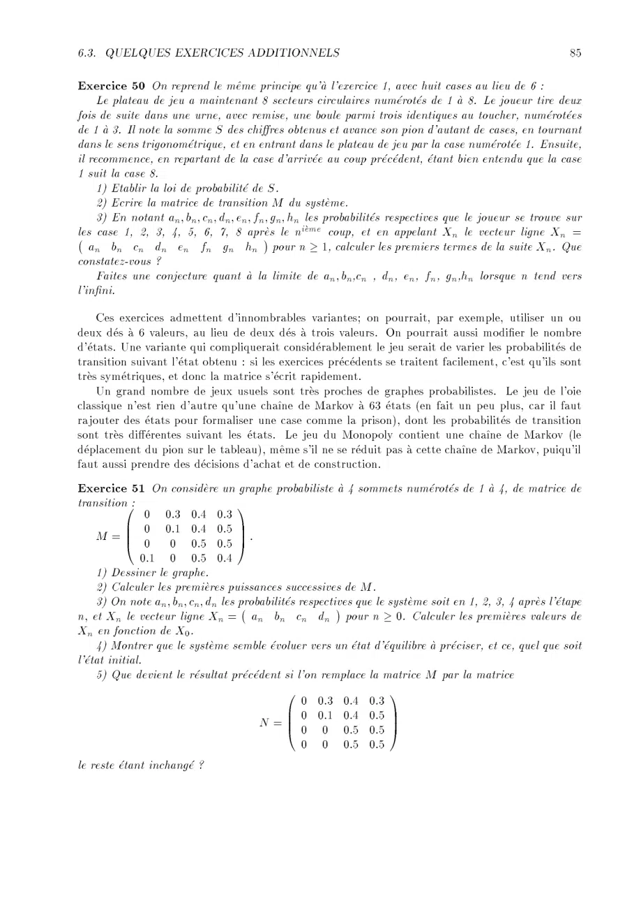

~~~text
6.3. QUELQUES EXERCICES ADDITIONNELS                                                                       85

Exercice 50 On reprend le m^eme principe qu'a l'exercice 1, avec huit cases au lieu de 6 :
     Le plateau de jeu a maintenant 8 secteurs circulaires numerotes de 1 a 8. Le joueur tire deux
fois de suite dans une urne, avec remise, une boule parmi trois identiques au toucher, numerotees
de 1 a 3. Il note la somme S des chi res obtenus et avance son pion d'autant de cases, en tournant
dans le sens trigonometrique, et en entrant dans le plateau de jeu par la case numerotee 1. Ensuite,
il recommence, en repartant de la case d'arrivee au coup precedent, etant bien entendu que la case
1 suit la case 8.
     1) Etablir la loi de probabilite de S .
     2) Ecrire la matrice de transition M du systeme.
     3) En notant an ; bn; cn ; dn; en ; fn ; gn; hn les probabilites respectives que le joueur se trouve sur
les                                             le nieme coup, et en appelant Xn le vecteur ligne Xn =
; a caseb 1,c 2, d3, 4,e 5, f6, 7,g 8 haprespour
    n n n n n n n n                                 n  1, calculer les premiers termes de la suite Xn . Que
constatez-vous ?
     Faites une conjecture quant a la limite de an ; bn,cn , dn , en , fn , gn ,hn lorsque n tend vers
l'in ni.
     Ces exercices admettent d'innombrables variantes; on pourrait, par exemple, utiliser un ou
deux des a 6 valeurs, au lieu de deux des a trois valeurs. On pourrait aussi modi er le nombre
d'etats. Une variante qui compliquerait considerablement le jeu serait de varier les probabilites de
transition suivant l'etat obtenu : si les exercices precedents se traitent facilement, c'est qu'ils sont
tres symetriques, et donc la matrice s'ecrit rapidement.
     Un grand nombre de jeux usuels sont tres proches de graphes probabilistes. Le jeu de l'oie
classique n'est rien d'autre qu'une cha^ne de Markov a 63 etats (en fait un peu plus, car il faut
rajouter des etats pour formaliser une case comme la prison), dont les probabilites de transition
sont tres di erentes suivant les etats. Le jeu du Monopoly contient une cha^ne de Markov (le
deplacement du pion sur le tableau), m^eme s'il ne se reduit pas a cette cha^ne de Markov, puiqu'il
faut aussi prendre des decisions d'achat et de construction.
Exercice 51 On considere un graphe probabiliste a 4 sommets numerotes de 1 a 4, de matrice de
transition0:                        1
                 0 0:3 0:4 0:3
     M =B
            B 0 0:1 0:4 0:5 CC :
            @ 0 0 0:5 0:5 A
                0:1 0 0:5 0:4
     1) Dessiner le graphe.
     2) Calculer les premieres puissances successives de M .
     3) On note an ; bn; cn; dn les probabilit
                                    ;         es respectives
                                                          que le systeme soit en 1, 2, 3, 4 apres l'etape
n; et Xn le vecteur ligne Xn = an bn cn dn pour n  0. Calculer les premieres valeurs de
Xn en fonction de X0 .
     4) Montrer que le systeme semble evoluer vers un etat d'equilibre a preciser, et ce, quel que soit
l'etat initial.
     5) Que devient le resultat precedent si l'on remplace la matrice M par la matrice
                                          0 0 0:3 0:4 0:3 1
                                          B 0 0:1 0:4 0:5 C
                                       N =B               C
                                          @               A
                                                0 0 0:5 0:5
                                                0 0 0:5 0:5
le reste etant inchange ?
~~~

## Page 90

~~~text
86                                                   CHAPITRE 6. GRAPHES PROBABILISTES
     Representer le nouveau graphe.

6.4 Complements pour les enseignants
6.4.1 Terminologie
Comme dans les chapitres precedents, on a parle de graphe probabiliste pour reduire le vocabulaire
au minimum.
    Il faut savoir que les probabilistes ne parlent pas de graphe probabiliste, mais de cha^ne de
Markov. La matrice associee est dite matrice de transition.
    L'habitude a ete prise depuis longtemps de travailler sur des matrices stochastiques, telles que
la somme des coecients de chaque ligne est 1. Cela oblige a utiliser des vecteurs lignes, et a les
multiplier a droite par les matrices de transition, contrairement a l'habitude du secondaire.
    On s'interessera particulierement ici aux cha^nes de Markov primitives, c'est-a-dire telles que
leur matrice de transition possede une puissance dont tous les termes sont strictement positifs.
6.4.2 Retour sur le cas de deux etats: valeurs propres, vecteurs propres
Le calcul qui a ete fait dans le cas d'un graphe probabiliste a deux etats devient tres naturel si
on re echit en termes de valeurs propres et de vecteurs propres. Le probleme se reduit en fait a
calculer une puissance arbitraire de la matrice M . On sait que pour cela, le plus simple est, si
possible, de diagonaliser M par changement de base, puisqu'il est facile de calculer explicitement
une puissance quelconque d'une matrice diagonale.
    Or il est facile de voir que M est diagonalisable. Un petit calcul montre que son determinant
 11; a ; b. D'autre part, le fait que M soit une matrice stochastique implique que le vecteur
est
   1 est vecteur propre a droite, associe a la valeur propre 1. On en deduit que 1 est valeur
propre a gauche aussi, et le determinant etant le produit des deux valeurs propres, l'autre valeur
propre est 1 ; a ; b, qui est, par hypothese, strictement plus petite que 1 en valeur absolue. M a
donc deux valeurs propres distinctes, et est diagonalisable.
    Il n'est pas necessaire de faire le changement de base. Plus simplement, on peut commencer a
calculer un vecteur propre a gauche v1 associe a la valeur propre 1, et un vecteur propre a gauche
v2 associe a la valeur propre 1 ; a ; b.
    Dans
     (1 ;le apremier   cas, on est conduitau systeme :
               )u + bv = u , soit encore ;au + bv = 0
       au + (1 ; b)v = v                      au ; bv = 0
    Autrement dit, v1 est un multiple de (b; a).
    Pour
     (1 ;la avaleur  propre 1 ; a ; b = c, on obtientle systeme :
               )u + bv = (1 ; a ; b)u soit encore : bu + bv = 0
       au + (1 ; b)v = (1 ; a ; b)v                       au + av = 0
    Donc v2 est un multiple de (1; ;1) (rappelons que ces systemes de deux equations a deux
inconnues ont une in nite de solutions car ils sont degeneres, comme il arrive toujours quand on
cherche un vecteur propre: c'est la condition d'annulation du determinant du systeme qui permet
de calculer les valeurs propres).
    Comme (v1 ; v2) est une base du plan, tout vecteur v peut s'ecrire sous la forme v = v1 + v2 ,
et on voit immediatement que:
                                   v:M n = v1 + (1 ; a ; b)nv2
~~~

## Page 91

~~~text
6.4. COMPLEMENTS POUR LES ENSEIGNANTS                                                                87

    Or v1 est la projection de v sur la droite engendree par v1 parallelement a la droite engendree
par v2 . Un petit calcul montre que la matrice de cette projection n'est autre que N ; la propriete
N 2 = N vue ci-dessus est d'ailleurs caracteristique d'une projection. On a donc v1 = v:N . De
m^eme, v2 est la projection de v sur la droite engendree par v2 parallelement a la droite engendree
par v1 , et le calcul montre que v2 est donnee par l'autre projection R.
    On retrouve donc la formule :
                                    v:M n = v:N + (1 ; a ; b)nv:R
   qui donne l'evolution de l'etat en fonction du temps. On a en prime une interpretation des
proprietes N 2 = N , R2 = R, qui veulent dire que ce sont des projections, et NR = RN = 0, qui
veulent dire qu'elles sont complementaires, le noyau de l'une etant l'image de l'autre.
6.4.3 Le theoreme de Perron-Frobenius
On aimerait generaliser les resultats precedents a une matrice stochastique de taille quelconque.
Il faut donc pouvoir decrire les valeurs propres et les vecteurs propre de cette matrice. On a
des informations assez precises si tous les termes de la matrice sont strictement positifs, ou plus
generalement, si la matrice est primitive.
De nition 39 On dit qu'une matrice est primitive si et seulement si elle admet une puissance
dont tous les termes sont strictement positifs.
   On dispose d'un theoreme puissant, valable pour les matrices primitives (il n'est pas necessaire
que la matrice soit stochastique)
Theoreme 20 (Perron-Frobenius) Soit A une matrice primitive a d lignes et d colonnes. Elle
admet une valeur propre reelle  > 0 telle que :
  1. Pour toute autre valeur propre  de A, on a jj < .
  2.  possede des vecteurs propres a droite et a gauche a coordonnees toutes strictement positives.
  3.  est racine simple du polyn^ome caracteristique de A (Donc en particulier l'espace propre
     associe a  est de dimension 1).
   4. Pour tout vecteur v a coecients positifs ou nuls, la suite v:A
                                                                     converge exponentiellement
                                                                        n
                                                                         n

       vite vers un vecteur propre pour la valeur propre .
    La valeur propre  s'appelle la valeur propre de Perron de la matrice A. Un vecteur propre
positif pour la valeur propre  s'appelle un vecteur propre de Perron de A.
    On trouvera une preuve de ce theoreme dans les livres classiques consacres aux matrices pos-
itives, ou dans la plupart des livres parlant de cha^nes de Markov. Nous en donnons une plus
loin.
    On peut donner une interpretation geometrique de ce theoreme qui permet en particulier de
comprendre la propriete de convergence de la suite v:A vers le vecteur propre de Perron. Pour
                                                          n
                                                           n

simpli er, on peut remplacer A par une puissance adequate, et supposer que tous les coecients
de A sont strictement positifs. Soit v un vecteur non nul du c^one positif (c'est-a-dire un vecteur
dont les coordonnees sont positives ou nulles, et non toutes nulles). Alors, v:A est un vecteur dont
toutes les coordonnees sont strictement positives. Autrement dit, le c^one positif C est envoye par
~~~

## Page 92

~~~text
88                                                    CHAPITRE 6. GRAPHES PROBABILISTES
A a l'interieur de lui-m^eme. Mais alors, par recurrence, C:A est envoye par A dans lui-m^eme,
et on a une suite de c^ones embo^tes C  C:A  C:A2 : : :  C:An  : : : (voir la gure 6.1).
L'intersection de tous ces c^ones embo^tes est un c^one non vide; ce qui n'est pas evident, c'est qu'il
soit reduit a une droite. Pour le prouver, on peut etudier la facon dont A agit sur les directions de
droites positives. Remarquons que chaque droite positive (c'est-a-dire dont un vecteur directeur a
toutes ses coordonnees positives ou nulles) coupe en un seul   P  point le simplexe standard des points
                                                                  d
x = (x1; : : :; xd) a coordonnees positives ou nulles tels que i=1 xi = 1 et qu'on peut donc assimiler
l'ensemble des droites positives au simplexe standard.

               Figure 6.1: Une vision geometrique du theoreme de Perron-Frobenius
     On peut montrer que, si l'on prend une bonne distance sur ce simplexe standard, A agit de
facon strictement contractante, et que donc, par un theoreme de point xe classique, il y a une
droite et une seule, correspondant au vecteur propre de Perron, qui est xee par A. Cependant, le
calcul n'est pas facile, et nous proposons ci-dessous une autre preuve.
Remarque : On peut preciser la vitesse de convergence de la suite v:A        vers le vecteur propre
                                                                               n
                                                                               n

de Perron. Si on note 2 la deuxieme valeur propre en; module,
                                                                   pour  toute constante K telle que
 > K > j2j, la suite converge au moins aussi vite que K n . Si 2 est simple, alors la convergence
              n
est en j2 j ; c'est ce qu'on a observe dans le cas d'une cha^ne de Markov a deux etats, ou  = 1
et 2 = 1 ; a ; b est simple.

Demonstration : Nous allons faire la demonstration dans le cas ou tous les termes de A sont
strictement positifs. Le cas general d'une matrice primitive s'en deduit sans peine.
    Pour simpli er l'ecriture, nous introduisons une relation d'ordre partielle sur Rd, de nie par
u  v si, pour i = 1 : : :d, on a ui  vi. En particulier, en notant 0 le vecteur nul, on dira que u
est positif si u  0, c'est-a-dire si toutes les coordonnees de u sont positives ou nulles. On de nit
de m^eme la relation d'ordre strict u > v par ui > vi pour i = 1 : : :d. On dit que u est strictement
positif si u > 0, c'est-a-dire si toutes ses coordonnees sont positives ou nulles.
    Commencons par chercher un vecteur propre positif. Si v est un tel vecteur, associe a une
valeur propre , on doit avoir v:A = v , ce qui, sur chaque coordonnee non nulle, nous donne
~~~

## Page 93

~~~text
6.4. COMPLEMENTS POUR LES ENSEIGNANTS                                                                 89

vi =
        Pd v a , ou encore :
          j =1 j j;i                                   Pd v a
                                                 =      j =1 j j;i
                                                            vi
   On est ainsi amene a de nir, pour tout vecteur positif v non nul :
                                        Pd v a
                              ri(v) =    j =1 j j;i si v 6= 0     ri(v ) = 1 si vi = 0
                                            vi          i

    La fonction ri est continue sur le complementaire de vi = 0.
    Posons maintenant r(v ) = mini ri (v ). La fonction r(v ) est bien de nie, et nie, pour tous les
vecteurs positifs non nuls, et elle est homogene de degre 0 (c'est-a-dire que r( v ) = r(v )). Il sut
donc de la considerer sur le simplexe standard, qui est compact.
    De plus, r est une fonction continue. Ce n'est pas evident ; c'est facile de montrer la continuite
en un point dont toutes les coordonnees sont non nulles, car alors, sur un voisinage de ce point, r
est le minimum d'un nombre ni de fonctions continues. Si par contre vi = 0, la fonction ri n'est
plus continue en ce point. Mais comme elle tend vers l'in ni en s'approchant de ce point, r est
strictement plus petit que ri sur un voisinage du point. Donc r, sur un voisinage du point considere,
est le minimum des rj tels que vj 6= 0, et est continue, comme minimum de fonctions continues.
    Donc r est continue sur un compact ; elle admet un maximum  en un point v , qui veri e donc
par construction v:A  v . Nous allons montrer le lemme suivant :
Lemme 5 Soit  le maximum de r sur le simplexe standard. Alors, tout vecteur v tel que v:A  v
satisfait v:A = v
     Posons w = v:A. Par hypothese, on a w  v . Donc le vecteur u = w ; v veri e u  0. Si u
n'est pas nul, alors u:A > 0, puisque tous les termes de A sont strictement positifs. Mais comme
u:A = w:A  P =1; wv:A
                   a
                       = w:A ; w, cela implique que w veri e w:A > w, c'est-a-dire, pour tout i,
ri (w) = w             > , et donc r(w) > , ce qui est contradictoire. Donc u est nul, et v est un
            d
            j       j   j;i

vecteur propre associe a .
                i

     Nous avons bien montre la propriete (2) : il existe une valeur propre , maximum de r, qui est
associee a un vecteur propre positif.
   P Soit  une autre valeur propre (eventuellement complexe), et u un vecteur propre associe. On
a dj=1 uj aj;i = ui , et donc, en prenant les modules :
                                                       Pn ju ja
                                               jj      j =1 j j;i
                                                            juij
soit, avec des notations evidentes, jj  r(juj)  . On ne peut avoir l'egalite jj = r(juj) =  que
si toutes les coordonnees du vecteur propre u ont m^eme argument ei ; mais dans ce cas, e;i u = juj
est un autre vecteur propre associe a  dont toutes les coordonnees sont positives, ce qui montre
que  est un reel positif, donc  = .
     On a bien montre la propriete (1) : toute valeur propre  di erente de  veri e jj < .
     Il est clair que, puisque tous les termes de A sont strictement positifs, tout vecteur propre positif
et non nul est strictement positif. Or la preuve precedente a montre que tout vecteur propre associe
a  est proportionnel, par une constante complexe, a un vecteur propre a coordonnees positives ou
 nulles. On en deduit que tout vecteur propre non nul associe a  a toutes ses coordonnees non nulles.
 Donc l'espace propre associe a  est de dimension 1 ; sinon, soient u et v deux vecteurs propres
~~~

## Page 94

~~~text
90                                                     CHAPITRE 6. GRAPHES PROBABILISTES
independants associes a , alors u ; uv11 v a sa premiere coordonnee nulle, ce qui est contradictoire.
L'espace propre ker A ; I associe a  est donc de dimension 1.
    Pour montrer que  est une valeur propre simple, il ne sut pas de montrer que l'espace propre
est de dimension 1. Il faut aussi prouver que ker(A ; I )2 = ker(A ; I ). Supposons que u est un
vecteur non nul de ker(A ; I )2 ; ker(A ; I ). On peut alors ecrire u:A = u + v , ou v est un
vecteur propre associe a . Un petit calcul montre que l'on a :
                                       u:An = nu + nn;1 v
ou encore, en posant v = w, u:An = n (u + nw). Pour n assez grand, comme w a toutes ses
composantes non nulles, on a ju + nwj  juj, et donc le vecteur u satisfait juj:An  n juj; d'apres
le lemme ci-dessus, juj est vecteur propre associe a la valeur propre dominante n de An , et par le
m^eme raisonnement que ci-dessus, u aussi est vecteur propre associe a n ; on a donc u:An = n u,
ce qui montre que v = 0 et contredit l'hypothese de depart.
    Pour montrer la derniere assertion, il sut de decomposer un vecteur positif comme somme du
vecteur propre de Perron et d'un vecteur dans le sous espace stable complementaire, et d'etudier
la croissance des iteres de ces deux vecteurs par A.

6.4.4 Application aux matrices stochastiques
Pour une matrice stochastique, on sait que le vecteur diagonal dont toutes les coordonnees valent
1 est vecteur propre a droite.
    On se limitera au cas d'une matrice stochastique primitive M . Dans ce cas, le vecteur diagonal
est un vecteur propre positif. Par le theoreme de Perron-Frobenius, c'est donc le vecteur propre de
Perron, et 1 est la plus grande valeur propre. On en deduit qu'il existe aussi un vecteur propre a
gauche associe a un, positif, et unique a une constante pres. Ce vecteur propre a gauche se calcule
simplement en resolvant le systeme v:M = v , qui est degenere, et admet donc des solutions non
nulles.
    On en deduit la preuve de la convergence que nous avons armee dans le cours :
Theoreme 21 Soit M une matrice stochastique primitive. Alors, il existe un unique etat stable
SP= (s1 ; : : :; sn ) pour la cha^ne de Markov associee a n, completement determine par S:M = S et
   n s = 1.
   i=1 i
    De plus, pour tout etat probabiliste initial X0 , la suite d'etats probabilistes Xn = X0:M n converge
 exponentiellement vite vers l'etat stable X0 .
    Si l'on conna^t la deuxieme plus grande valeur propre 2 de M , on peut de plus donner explicite-
ment la vitesse de convergence. En particulier, si 2 est une valeur propre simple, la convergence
est en j2jn .
6.4.5 Quelques applications des cha^nes de Markov
Commencons par un exercice qui est trop long pour ^etre fait en cours, mais pourrait par contre
faire l'objet d'un TPE interessant.
Exercice 52 On part d'un texte long (il serait bon d'avoir plus de 50 pages). Pour gagner du
temps, il est necessaire que ce texte soit sous forme de chier ASCII, pour pouvoir ^etre manipule
automatiquement.
~~~

## Page 95

~~~text
6.5. SOLUTION DES EXERCICES                                                                            91

     1) Compter la liste de tous les digrammes du texte (c'est-a-dire des suites de deux lettres ap-
paraissant dans le texte; par exemple, les suites de ou le apparaitront s^urement dans un texte en
francais, ainsi que la suite qu, mais pas la suite qq), avec leur nombre d'apparitions. Attention a
ne pas oublier que, parmi les digrammes, il y en a qui contiennent des espaces, ou des symboles de
ponctuation.
     2) Etablir la frequence avec laquelle un digramme donne est suivi par un autre (par exemple, le
digramme iq appara^t en francais, dans musique, et il est toujours suivi en francais par le digramme
qu, sauf dans les translitterations de noms arabes.
     3) Modeliser par une cha^ne de Markov (cela doit ^etre fait a la machine, car le nombre d`etats
est de l'ordre du millier, et le nombre de transitions de plusieurs milliers).
     4) Fabriquer des textes automatiques, en jouant au hasard suivant les probabilites donnees par
la cha^ne de Markov; essayer avec des textes ecrits dans des langues di erentes. On reconna^t en
general tres bien, en lisant ce texte automatique et prive de sens, la langue de depart.
     On peut faire de nombreuses variantes, en prenant des textes plus ou moins long (si le texte
est court, on retrouvera dans les textes produits des mots entiers du texte initial), et en travaillant
sur les trigrammes au lieu des digrammes, ce qui prend plus de place, mais est plus precis. Une
autre variante serait de prendre une longueur variable, lettre, digramme ou trigramme suivant le
cas; par exemple, en francais, q est toujours suivi de u, sans qu'il soit besoin de conna^tre la lettre
precedente.
    Cet exercice peut sembler un pur jeu sans application; il n'en est rien! De nombreux pro-
grammes fonctionnent ainsi. On peut citer les programmes de reconnaissance vocale: la machine
reconstitue le texte donne de proche en proche, en utilisant le texte deja reconnu, le son dicte,
et une table de probabilites. Une autre application est donnee par les programmes d'ecriture de
caracteres chinois ou japonais, en tapant seulement la prononciation du caractere. C'est en general
insusant, car il y a beaucoup de caracteres avec la m^eme prononciation; l'ordinateur utilise en
plus une table de probabilite suivant les caracteres precedents. De tels programmes sont suscepti-
bles \d'apprentissage" : ils peuvent aner leur table de probabilite en fonction de l'utilisateur. En
e et, il est clair qu'un medecin n'utilisera pas les m^emes mots qu'un electricien. La machine peut
s'adapter, si elle maintient une table de frequence des textes ecrits par l'utilisateur.
    Les tables de frequences utilisees pour le modele markovien sont longues et co^uteuses a etablir,
et elles peuvent avoir une grande valeur commerciale !

6.5 Solution des exercices
Solution de l'exercice 49 : 0) On peut commencer par representer le graphe etiquete. Il possede
6 sommets et 30 ar^etes; nous ne representerons que les ar^etes issues de a, il sut de completer par
rotation :
                                                     0123
                                                     7654
                                                      f             89:;
                                                                    ?>=<
                                                                      e
                                                       ;;          oo
                                                                ooo
                                                                    7

                                                      ?

                                                2 ;;;         oo
                                                9 ;; ooooo
                                                 ; oo
                                              ;; oooo 39
                                                ;
                                            ; oo
                              1
                              9       89:;;NoNo
                                      ?>=<
                                       a                                        89:;
                                                                                ?>=<
                                                                                 d
                                               NNN              2
                                                                            /

                                                   NNN          9
                                  6

                                                      NNN
                                                           N
                                                         1 NNNNN
                                                         9      NNN
                                                                   NN
                                                     89:;
                                                     ?>=<
                                                       b            89:;
                                                                    ?>=<
                                                                      c '
~~~

## Page 96

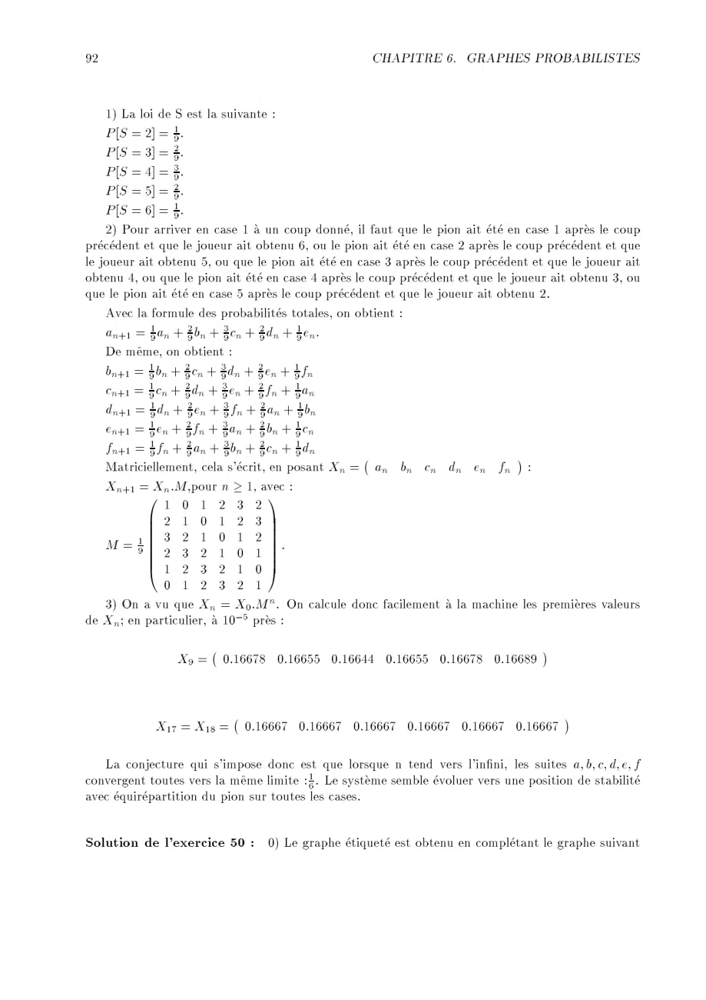

~~~text
92                                                     CHAPITRE 6. GRAPHES PROBABILISTES

    1) La loi de S est la suivante :
    P [S = 2] = 19 :
    P [S = 3] = 29 .
    P [S = 4] = 39 :
    P [S = 5] = 29 :
    P [S = 6] = 19 :
    2) Pour arriver en case 1 a un coup donne, il faut que le pion ait ete en case 1 apres le coup
precedent et que le joueur ait obtenu 6, ou le pion ait ete en case 2 apres le coup precedent et que
le joueur ait obtenu 5, ou que le pion ait ete en case 3 apres le coup precedent et que le joueur ait
obtenu 4, ou que le pion ait ete en case 4 apres le coup precedent et que le joueur ait obtenu 3, ou
que le pion ait ete en case 5 apres le coup precedent et que le joueur ait obtenu 2.
    Avec la formule des probabilites totales, on obtient :
    an+1 = 91 an + 29 bn + 93 cn + 29 dn + 91 en :
    De m^eme, on obtient :
    bn+1 = 19 bn + 29 cn + 39 dn + 29 en + 19 fn
    cn+1 = 19 cn + 92 dn + 39 en + 29 fn + 19 an
    dn+1 = 19 dn + 29 en + 93 fn + 29 an + 19 bn
    en+1 = 19 en + 29 fn + 39 an + 92 bn + 19 cn
    fn+1 = 91 fn + 29 an + 39 bn + 29 cn + 19 dn       ;                            
    Matriciellement, cela s'ecrit, en posant Xn = an bn cn dn en fn :
    Xn+1 =0Xn :M;pour n  1; avec      1  :
                1 0 1 2 3 2
            B
            B   2 1 0 1 2 3C           CC
            B
           1B 3 2 1 0 1 2 C
    M = 9 B 2 3 2 1 0 1 C:
            B
            @ 1 2 3 2 1 0 CA
                0 1 2 3 2 1
    3) On a vu que Xn = X0 :M n . On calcule donc facilement a la machine les premieres valeurs
de Xn ; en particulier, a 10;5 pres :
                        ;
                 X9 = 0:16678 0:16655 0:16644 0:16655 0:16678 0:16689
                                                                                        

                            ;
             X17 = X18 = 0:16667 0:16667 0:16667 0:16667 0:16667 0:16667
                                                                                            

   La conjecture qui s'impose donc est que lorsque n tend vers l'in ni, les suites a; b; c; d; e; f
convergent toutes vers la m^eme limite : 61 . Le systeme semble evoluer vers une position de stabilite
avec equirepartition du pion sur toutes les cases.

Solution de l'exercice 50 : 0) Le graphe etiquete est obtenu en completant le graphe suivant
~~~

## Page 97

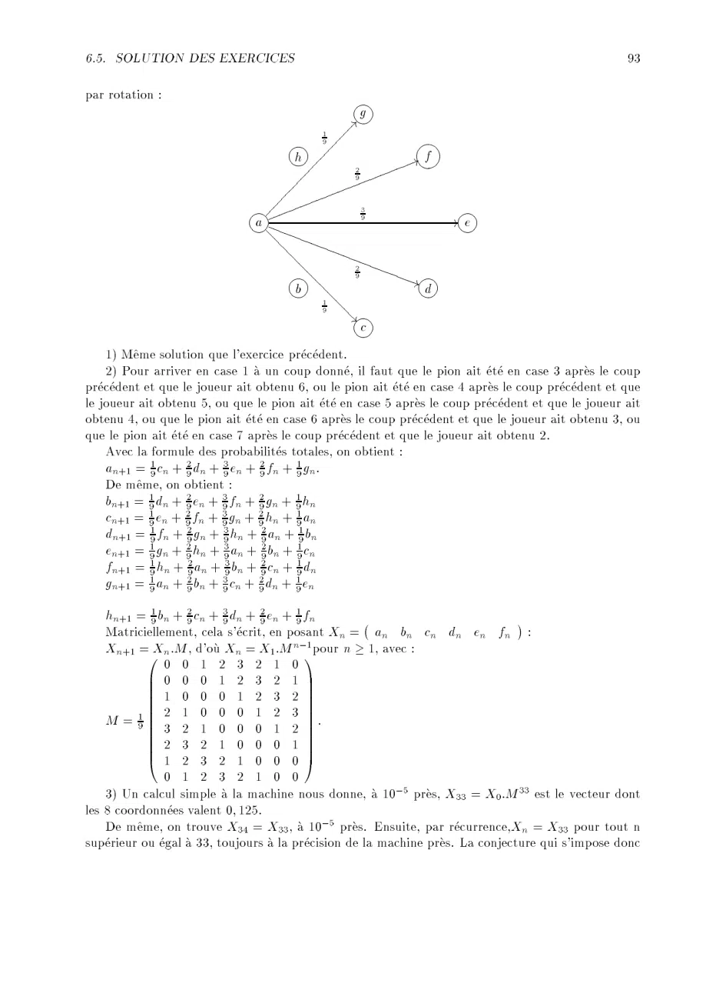

~~~text
6.5. SOLUTION DES EXERCICES                                                                             93

par rotation :
                                                           g
                                                          89:;
                                                          ?>=<
                                                              ;
                                                       1 ;;;
                                                           @

                                                       9 ;;
                                            h 89:; ;;;;
                                              ?>=<                         @ABC
                                                                           GFED   f
                                                    ;                 ll ll
                                                  ;;           2 llll
                                                                          5

                                                ;;            l
                                                               9lll
                                              ;;          l ll
                                            ;;           l
                                                     lll
                                        ;;; llllll               3
                                 89:;;?lSlSl
                                 ?>=<
                                  a                              9                        89:;
                                                                                          ?>=<
                                                                                            e
                                        ??SSSSS
                                                                                      /

                                           ??     SSS
                                             ??       SSS
                                               ??         SSS
                                                              SSS
                                                 ??
                                                   ??          2 SSSSSS
                                                               9        SSS
                                            b 89:; ???
                                              ?>=<    ?                     89:;
                                                                            ?>=<
                                                                              )

                                                                                  d
                                                          ?
                                                       1 ??
                                                       9     ??
                                                          89:;
                                                          ?>=<
                                                            c
                                                               

    1) M^eme solution que l'exercice precedent.
    2) Pour arriver en case 1 a un coup donne, il faut que le pion ait ete en case 3 apres le coup
precedent et que le joueur ait obtenu 6, ou le pion ait ete en case 4 apres le coup precedent et que
le joueur ait obtenu 5, ou que le pion ait ete en case 5 apres le coup precedent et que le joueur ait
obtenu 4, ou que le pion ait ete en case 6 apres le coup precedent et que le joueur ait obtenu 3, ou
que le pion ait ete en case 7 apres le coup precedent et que le joueur ait obtenu 2.
    Avec la formule des probabilites totales, on obtient :
    an+1 = 19 cn + 92 dn + 39 en + 29 fn + 91 gn:
    De m^eme, on obtient :
    bn+1 = 19 dn + 92 en + 39 fn + 29 gn + 19 hn
    cn+1 = 19 en + 92 fn + 39 gn + 29 hn + 91 an
    dn+1 = 19 fn + 92 gn + 39 hn + 29 an + 91 bn
    en+1 = 19 gn + 29 hn + 93 an + 29 bn + 91 cn
    fn+1 = 91 hn + 29 an + 39 bn + 92 cn + 19 dn
    gn+1 = 91 an + 92 bn + 39 cn + 29 dn + 19 en
   hn+1 = 19 bn + 92 cn + 39 dn + 29 en + 19 fn                    ;                             
    Matriciellement, cela s'ecrit, en posant Xn = an bn cn dn en fn :
    Xn+1 =0Xn :M , d'ou Xn = X1:M n;11 pour n  1, avec :
                0 0 1 2 3 2 1 0
            B
            B   0 0 0 1 2 3 2 1C             C
            B
            B   1 0 0 0 1 2 3 2C             C
            B
          1B 2 1 0 0 0 1 2 3 C
    M = 9 B 3 2 1 0 0 0 1 2 C:
                                             C
            B
            B                                C
            B   2 3 2 1 0 0 0 1C
            @1 2 3 2 1 0 0 0C                A
                0 1 2 3 2 1 0 0
    3) Un calcul simple a la machine nous donne, a 10;5 pres, X33 = X0:M 33 est le vecteur dont
les 8 coordonnees valent 0; 125.
    De m^eme, on trouve X34 = X33; a 10;5 pres. Ensuite, par recurrence,Xn = X33 pour tout n
superieur ou egal a 33, toujours a la precision de la machine pres. La conjecture qui s'impose donc
~~~

## Page 98

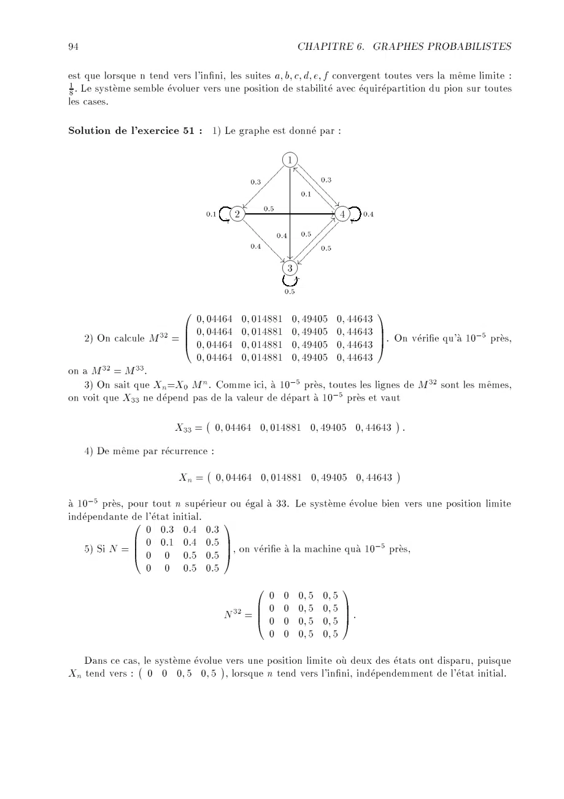

~~~text
94                                                                         CHAPITRE 6. GRAPHES PROBABILISTES
est que lorsque n tend vers l'in ni, les suites a; b; c; d; e; f convergent toutes vers la m^eme limite :
1 : Le syst
           eme semble evoluer vers une position de stabilite avec equirepartition du pion sur toutes
8
les cases.

Solution de l'exercice 51 : 1) Le graphe est donne par :
                                                         89:;
                                                         ?>=<
                                                           1>
                                                       ;; >>>>>
                                                               >> >
                                                     ;;
                                                                   _

                                               0:3 ;;            >>>>0:3
                                                  ;;               >>>>
                                                ;;             0:1 >>>>>>
                                               ;                        >>>
                                             ;; 0:5
                                          89:;
                                          ?>=<
                                           2 >>                           89:;
                                                                          ?>=<
                                                                         ;;4
                                0:1                                                             0:4
                                                                                        

                                              

                                                                                /

                                               >>                       ;
                                                                                    ?

                                                                      ;;;;
                                      6                                                     h

                                                 >>            0:5 ;;;;
                                                   >> 0:4          ; ;
                                               0:4 >>>
                                                                  ;;
                                                                ;; ; 0:5
                                                       >> ;;;;;
                                                            ;;
                                                         89:; ;
                                                         ?>=< 3
                                                               

                                                          

                                                                           

                                                                       T

                                                              0:5

                          0 0; 04464 0; 014881 0; 49405 0; 44643 1
                          B 0; 04464 0; 014881 0; 49405 0; 44643 C
     2) On calcule M 32 = B
                          @ 0; 04464 0; 014881 0; 49405 0; 44643 C
                                                                 A. On veri e qu'a 10;5 pres,
                            0; 04464 0; 014881 0; 49405 0; 44643
on a M 32 = M 33.
   3) On sait que Xn =X0 M n . Comme ici, a 10;5 pres, toutes les lignes de M 32 sont les m^emes,
on voit que X33 ne depend pas de la valeur de depart a 10;5 pres et vaut
                                ;
                         X33 = 0; 04464 0; 014881 0; 49405 0; 44643 :
                                                                                                      
     4) De m^eme par recurrence :
                                ;
                          Xn = 0; 04464 0; 014881 0; 49405 0; 44643
                                                                                                      
a 10;5 pres, pour tout n superieur ou egal a 33. Le systeme evolue bien vers une position limite
 independante de
                0 l'
                    etat initial.   1
                  0 0:3 0:4 0:3
     5) Si N = B
                B 0 0:1 0:4 0:5 CC, on veri e a la machine qua 10;5 pres,
                @ 0 0 0:5 0:5 A
                  0 0 0:5 0:5
                                             0 0 0 0; 5 0; 5 1
                                             B 0 0 0; 5 0; 5 C
                                      N 32 = B
                                             @ 0 0 0; 5 0; 5 C
                                                             A:
                                                     0 0 0; 5 0; 5
   Dans ce cas,; le systeme evolue vers une position limite ou deux des etats ont disparu, puisque
Xn tend vers : 0 0 0; 5 0; 5 , lorsque n tend vers l'in ni, independemment de l'etat initial.
~~~

## Page 99

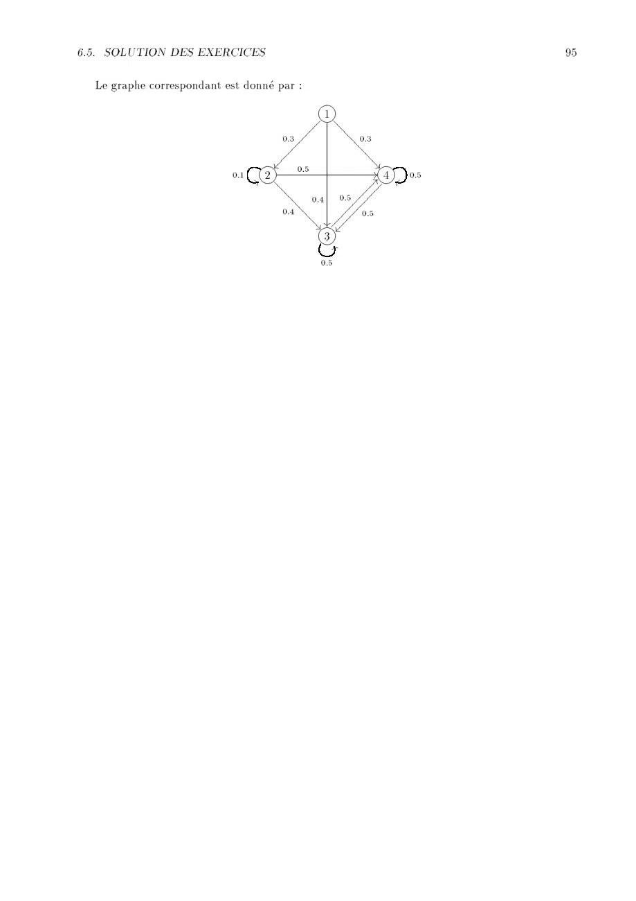

~~~text
6.5. SOLUTION DES EXERCICES                                                                   95

  Le graphe correspondant est donne par :
                                                      89:;
                                                      ?>=<
                                                        1 >>
                                                    ;;;     >>
                                                   ;          >>
                                            0:3 ; ;             >>0:3
                                                ;                 >>
                                             ;;;                    >>
                                           ;;                          >
                                         ;
                            0:1        2 >> 0:5
                                      89:;
                                      ?>=<                             89:;
                                                                       ?>=<
                                                                      ;;4
                                                                                        0:5
                                                                               

                                                                        /

                                            >>                       ;
                                                                            ?

                                                                   ;;;;
                                  6                                                 h

                                              >>            0:5 ;;;;
                                                >> 0:4          ;
                                                               ; ;;
                                            0:4 >>>          ;; ; 0:5
                                                     >> ;;;;;
                                                         ;;
                                                      89:; ;
                                                      ?>=<3
                                                           

                                                      

                                                                    

                                                                T

                                                          0:5
~~~

## Page 100

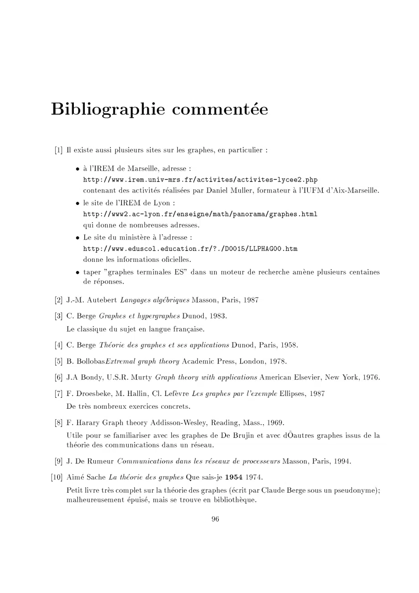

~~~text
Bibliographie commentee
 [1] Il existe aussi plusieurs sites sur les graphes, en particulier :
        a l'IREM de Marseille, adresse :
          http://www.irem.univ-mrs.fr/activites/activites-lycee2.php
         contenant des activites realisees par Daniel Muller, formateur a l'IUFM d'Aix-Marseille.
        le site de l'IREM de Lyon :
          http://www2.ac-lyon.fr/enseigne/math/panorama/graphes.html
         qui donne de nombreuses adresses.
        Le site du ministere a l'adresse :
          http://www.eduscol.education.fr/?./D0015/LLPHAG00.htm
         donne les informations o cielles.
        taper "graphes terminales ES" dans un moteur de recherche amene plusieurs centaines
         de reponses.
 [2] J.-M. Autebert Langages algebriques Masson, Paris, 1987
 [3] C. Berge Graphes et hypergraphes Dunod, 1983.
     Le classique du sujet en langue francaise.
 [4] C. Berge Theorie des graphes et ses applications Dunod, Paris, 1958.
 [5] B. BollobasExtremal graph theory Academic Press, London, 1978.
 [6] J.A Bondy, U.S.R. Murty Graph theory with applications American Elsevier, New York, 1976.
 [7] F. Droesbeke, M. Hallin, Cl. Lefevre Les graphes par l'exemple Ellipses, 1987
     De tres nombreux exercices concrets.
 [8] F. Harary Graph theory Addisson-Wesley, Reading, Mass., 1969.
     Utile pour se familiariser avec les graphes de De Brujin et avec dO~ autres graphes issus de la
     theorie des communications dans un reseau.
 [9] J. De Rumeur Communications dans les reseaux de processeurs Masson, Paris, 1994.
[10] Aime Sache La theorie des graphes Que sais-je 1954 1974.
     Petit livre tres complet sur la theorie des graphes (ecrit par Claude Berge sous un pseudonyme);
     malheureusement epuise, mais se trouve en bibliotheque.
                                                   96
~~~

## Page 101

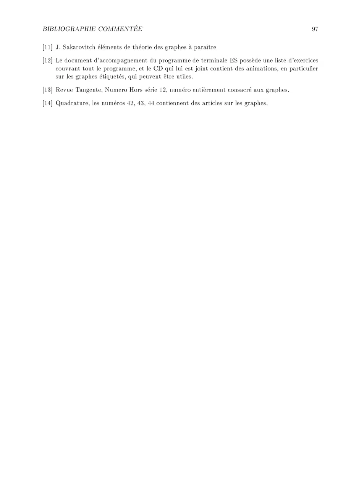

~~~text
BIBLIOGRAPHIE COMMENTEE                                                                        97

[11] J. Sakarovitch elements de theorie des graphes a para^tre
[12] Le document d'accompagnement du programme de terminale ES possede une liste d'exercices
     couvrant tout le programme, et le CD qui lui est joint contient des animations, en particulier
     sur les graphes etiquetes, qui peuvent ^etre utiles.
[13] Revue Tangente, Numero Hors serie 12, numero entierement consacre aux graphes.
[14] Quadrature, les numeros 42, 43, 44 contiennent des articles sur les graphes.
~~~

## Page 102

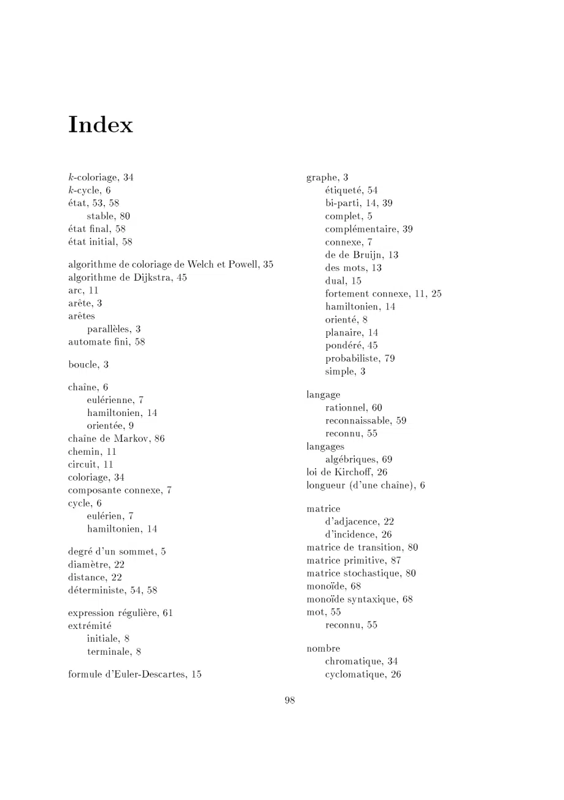

~~~text
Index
k-coloriage, 34                                       graphe, 3
k-cycle, 6                                                etiquete, 54
etat, 53, 58                                              bi-parti, 14, 39
     stable, 80                                            complet, 5
etat nal, 58                                              complementaire, 39
etat initial, 58                                          connexe, 7
                                                           de de Bruijn, 13
algorithme de coloriage de Welch et Powell, 35             des mots, 13
algorithme de Dijkstra, 45                                 dual, 15
arc, 11                                                    fortement connexe, 11, 25
ar^ete, 3                                                  hamiltonien, 14
ar^etes                                                    oriente, 8
     paralleles, 3                                        planaire, 14
automate ni, 58                                            pondere, 45
boucle, 3                                                  probabiliste, 79
                                                           simple, 3
cha^ne, 6
     eulerienne, 7                                   langage
     hamiltonien, 14                                       rationnel, 60
     orientee, 9                                          reconnaissable, 59
cha^ne de Markov, 86                                      reconnu, 55
chemin, 11                                            langages
circuit, 11                                                algebriques, 69
coloriage, 34                                         loi de Kircho , 26
composante connexe, 7                                 longueur (d'une cha^ne), 6
cycle, 6                                              matrice
     eulerien, 7                                        d'adjacence, 22
     hamiltonien, 14                                     d'incidence, 26
degre d'un sommet, 5                                 matrice de transition, 80
diametre, 22                                         matrice primitive, 87
distance, 22                                          matrice stochastique, 80
deterministe, 54, 58                                 monode, 68
                                                      monode syntaxique, 68
expression reguliere, 61                            mot, 55
extremite                                              reconnu, 55
     initiale, 8
     terminale, 8                                     nombre
                                                         chromatique, 34
formule d'Euler-Descartes, 15                            cyclomatique, 26
                                                 98
~~~

## Page 103

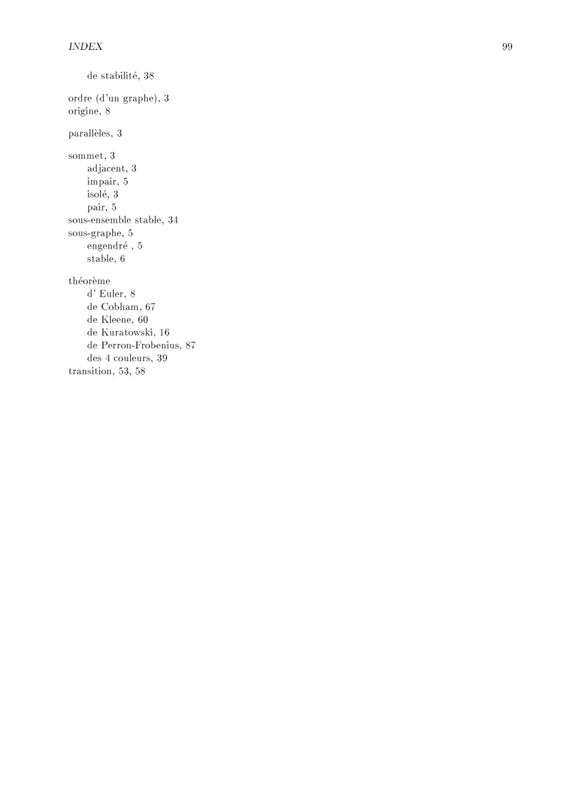

~~~text
INDEX                          99

    de stabilite, 38
ordre (d'un graphe), 3
origine, 8
paralleles, 3
sommet, 3
    adjacent, 3
    impair, 5
    isole, 3
    pair, 5
sous-ensemble stable, 34
sous-graphe, 5
    engendre , 5
    stable, 6
theoreme
     d' Euler, 8
     de Cobham, 67
     de Kleene, 60
     de Kuratowski, 16
     de Perron-Frobenius, 87
     des 4 couleurs, 39
transition, 53, 58
~~~
