# CM1.pdf

[Ouvrir l’original](https://drive.google.com/open?id=11TCleLPruZvcKgvIqS931gZ_fgg6LBfP) · Les deux lectures automatiques du PDF divergent sur les pages indiquées. Leur fac-similé accompagne le texte.

**Pages présentant un écart entre les deux extractions** — 1–23, 25–27.

## Page 1

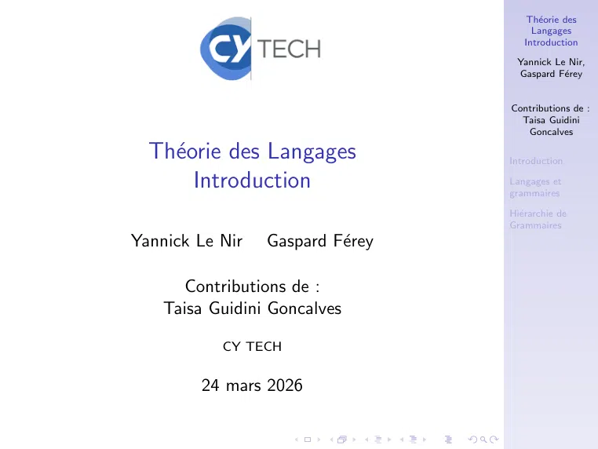

~~~text
                                      Théorie des
                                       Langages
                                     Introduction

                                   Yannick Le Nir,
                                   Gaspard Férey

                                  Contributions de :
                                    Taisa Guidini
                                     Goncalves

  Théorie des Langages           Introduction

       Introduction               Langages et
                                  grammaires

                                  Hiérarchie de
                                  Grammaires
Yannick Le Nir   Gaspard Férey

      Contributions de :
    Taisa Guidini Goncalves

           CY TECH

        24 mars 2026
~~~

## Page 2

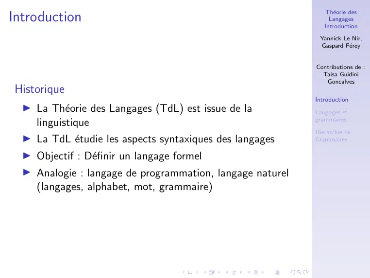

~~~text
                                                               Théorie des
Introduction                                                    Langages
                                                              Introduction

                                                            Yannick Le Nir,
                                                            Gaspard Férey

                                                           Contributions de :
                                                             Taisa Guidini
                                                              Goncalves
Historique
                                                           Introduction
  ▶ La Théorie des Langages (TdL) est issue de la         Langages et
                                                           grammaires
    linguistique
                                                           Hiérarchie de
  ▶ La TdL étudie les aspects syntaxiques des langages    Grammaires

  ▶ Objectif : Définir un langage formel
  ▶ Analogie : langage de programmation, langage naturel
    (langages, alphabet, mot, grammaire)
~~~

## Page 3

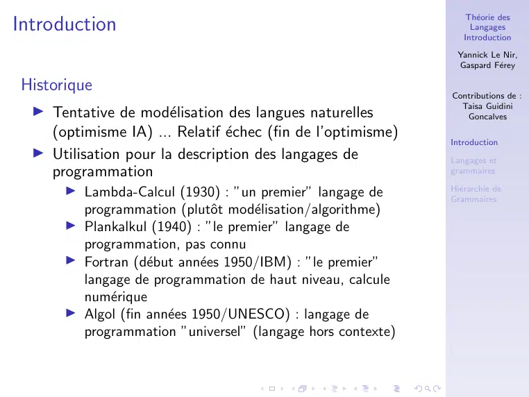

~~~text
                                                                 Théorie des
Introduction                                                      Langages
                                                                Introduction

                                                              Yannick Le Nir,
                                                              Gaspard Férey

Historique
                                                             Contributions de :
                                                               Taisa Guidini
  ▶ Tentative de modélisation des langues naturelles           Goncalves

    (optimisme IA) ... Relatif échec (fin de l’optimisme)   Introduction
  ▶ Utilisation pour la description des langages de          Langages et
    programmation                                            grammaires

       ▶ Lambda-Calcul (1930) : ”un premier” langage de      Hiérarchie de
                                                             Grammaires
         programmation (plutôt modélisation/algorithme)
       ▶ Plankalkul (1940) : ”le premier” langage de
         programmation, pas connu
       ▶ Fortran (début années 1950/IBM) : ”le premier”
         langage de programmation de haut niveau, calcule
         numérique
       ▶ Algol (fin années 1950/UNESCO) : langage de
         programmation ”universel” (langage hors contexte)
~~~

## Page 4

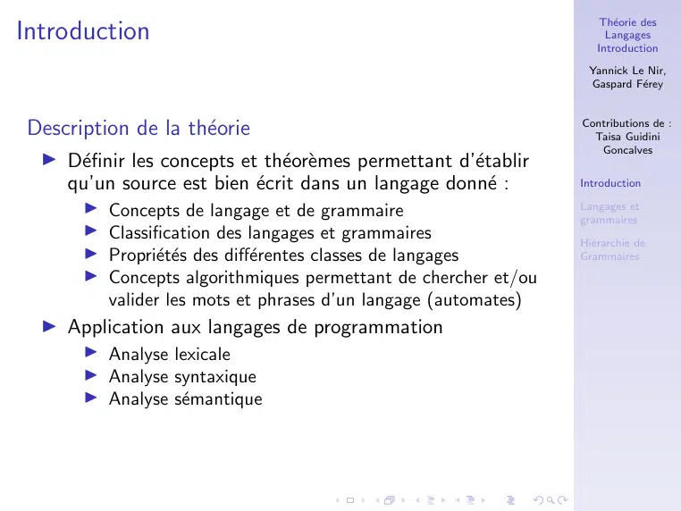

~~~text
                                                                     Théorie des
Introduction                                                          Langages
                                                                    Introduction

                                                                  Yannick Le Nir,
                                                                  Gaspard Férey

                                                                 Contributions de :
Description de la théorie                                         Taisa Guidini
                                                                    Goncalves
  ▶ Définir les concepts et théorèmes permettant d’établir
    qu’un source est bien écrit dans un langage donné :        Introduction

       ▶ Concepts de langage et de grammaire                     Langages et
                                                                 grammaires
       ▶ Classification des langages et grammaires
                                                                 Hiérarchie de
       ▶ Propriétés des différentes classes de langages       Grammaires
       ▶ Concepts algorithmiques permettant de chercher et/ou
         valider les mots et phrases d’un langage (automates)
  ▶ Application aux langages de programmation
       ▶ Analyse lexicale
       ▶ Analyse syntaxique
       ▶ Analyse sémantique
~~~

## Page 5

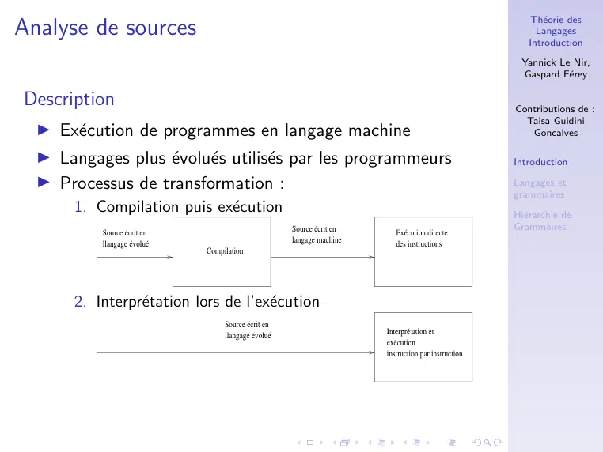

~~~text
                                                                                                        Théorie des
Analyse de sources                                                                                       Langages
                                                                                                       Introduction

                                                                                                     Yannick Le Nir,
                                                                                                     Gaspard Férey

Description                                                                                         Contributions de :
                                                                                                      Taisa Guidini
  ▶ Exécution de programmes en langage machine                                                        Goncalves

  ▶ Langages plus évolués utilisés par les programmeurs                                          Introduction

  ▶ Processus de transformation :                                                                   Langages et
                                                                                                    grammaires
       1. Compilation puis exécution                                                               Hiérarchie de
                                                    Source écrit en                                 Grammaires
           Source écrit en                                               Exécution directe
           llangage évolué                          langage machine      des instructions
                             Compilation

       2. Interprétation lors de l’exécution
                                  Source écrit en
                                  llangage évolué                     Interprétation et
                                                                      exécution
                                                                      instruction par instruction
~~~

## Page 6

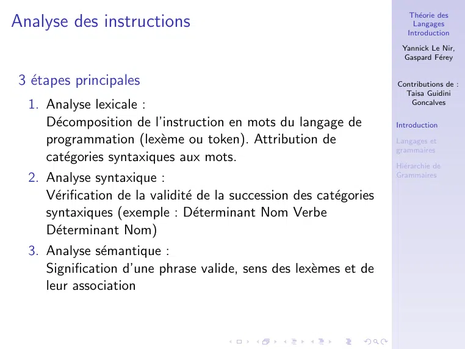

~~~text
                                                                          Théorie des
Analyse des instructions                                                   Langages
                                                                         Introduction

                                                                       Yannick Le Nir,
                                                                       Gaspard Férey

3 étapes principales                                                 Contributions de :
                                                                        Taisa Guidini
  1. Analyse lexicale :                                                  Goncalves

     Décomposition de l’instruction en mots du langage de            Introduction

     programmation (lexème ou token). Attribution de                 Langages et
                                                                      grammaires
     catégories syntaxiques aux mots.
                                                                      Hiérarchie de
                                                                      Grammaires
  2. Analyse syntaxique :
     Vérification de la validité de la succession des catégories
     syntaxiques (exemple : Déterminant Nom Verbe
     Déterminant Nom)
  3. Analyse sémantique :
     Signification d’une phrase valide, sens des lexèmes et de
     leur association
~~~

## Page 7

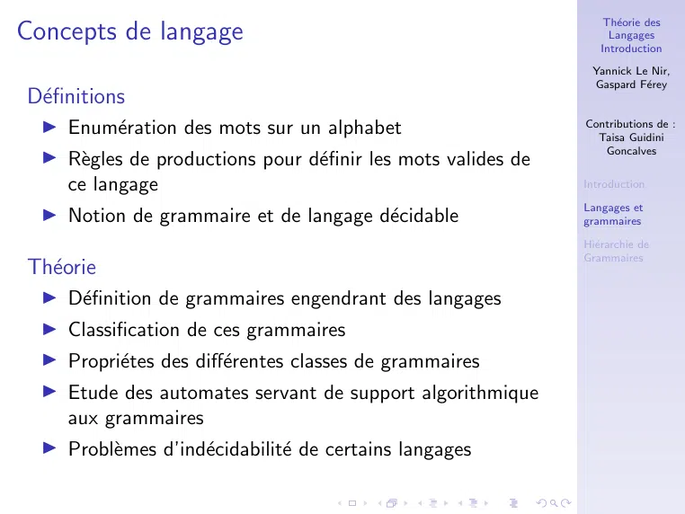

~~~text
                                                                   Théorie des
Concepts de langage                                                 Langages
                                                                  Introduction

                                                                Yannick Le Nir,
                                                                Gaspard Férey
Définitions
  ▶ Enumération des mots sur un alphabet                      Contributions de :
                                                                 Taisa Guidini
                                                                  Goncalves
  ▶ Règles de productions pour définir les mots valides de
    ce langage                                                 Introduction

                                                               Langages et
  ▶ Notion de grammaire et de langage décidable               grammaires

                                                               Hiérarchie de
                                                               Grammaires
Théorie
  ▶ Définition de grammaires engendrant des langages
  ▶ Classification de ces grammaires
  ▶ Propriétes des différentes classes de grammaires
  ▶ Etude des automates servant de support algorithmique
    aux grammaires
  ▶ Problèmes d’indécidabilité de certains langages
~~~

## Page 8

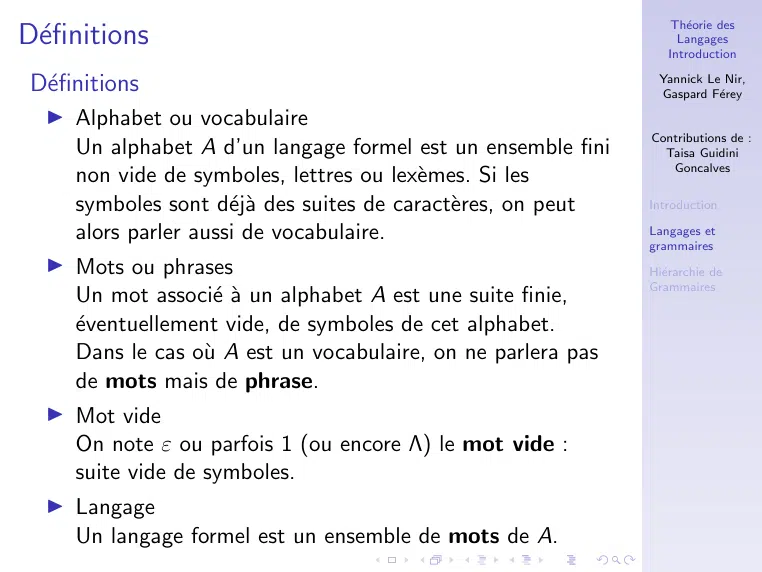

~~~text
                                                                  Théorie des
Définitions                                                       Langages
                                                                 Introduction

 Définitions                                                  Yannick Le Nir,
                                                               Gaspard Férey
  ▶ Alphabet ou vocabulaire
                                                              Contributions de :
    Un alphabet A d’un langage formel est un ensemble fini      Taisa Guidini
                                                                 Goncalves
    non vide de symboles, lettres ou lexèmes. Si les
    symboles sont déjà des suites de caractères, on peut   Introduction

    alors parler aussi de vocabulaire.                        Langages et
                                                              grammaires
  ▶ Mots ou phrases                                           Hiérarchie de
                                                              Grammaires
    Un mot associé à un alphabet A est une suite finie,
    éventuellement vide, de symboles de cet alphabet.
    Dans le cas où A est un vocabulaire, on ne parlera pas
    de mots mais de phrase.
  ▶ Mot vide
    On note ε ou parfois 1 (ou encore Λ) le mot vide :
    suite vide de symboles.
  ▶ Langage
    Un langage formel est un ensemble de mots de A.
~~~

## Page 9

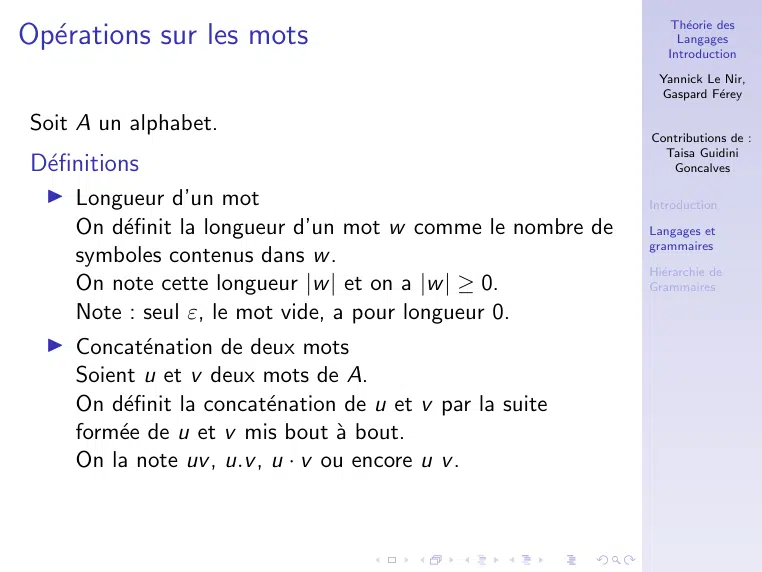

~~~text
                                                                Théorie des
Opérations sur les mots                                         Langages
                                                               Introduction

                                                             Yannick Le Nir,
                                                             Gaspard Férey

Soit A un alphabet.
                                                            Contributions de :
                                                              Taisa Guidini
Définitions                                                   Goncalves

  ▶ Longueur d’un mot                                       Introduction
    On définit la longueur d’un mot w comme le nombre de   Langages et
                                                            grammaires
    symboles contenus dans w .
                                                            Hiérarchie de
    On note cette longueur |w | et on a |w | ≥ 0.           Grammaires

    Note : seul ε, le mot vide, a pour longueur 0.
  ▶ Concaténation de deux mots
    Soient u et v deux mots de A.
    On définit la concaténation de u et v par la suite
    formée de u et v mis bout à bout.
    On la note uv , u.v , u · v ou encore u v .
~~~

## Page 10

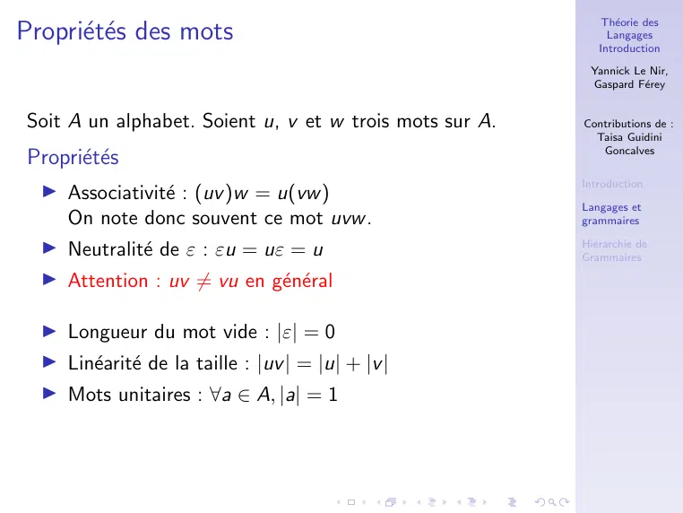

~~~text
                                                              Théorie des
Propriétés des mots                                          Langages
                                                             Introduction

                                                           Yannick Le Nir,
                                                           Gaspard Férey

 Soit A un alphabet. Soient u, v et w trois mots sur A.   Contributions de :
                                                            Taisa Guidini
                                                             Goncalves
 Propriétés
                                                          Introduction
  ▶ Associativité : (uv )w = u(vw )
                                                          Langages et
    On note donc souvent ce mot uvw .                     grammaires

  ▶ Neutralité de ε : εu = uε = u                        Hiérarchie de
                                                          Grammaires

  ▶ Attention : uv ̸= vu en général

  ▶ Longueur du mot vide : |ε| = 0
  ▶ Linéarité de la taille : |uv | = |u| + |v |
  ▶ Mots unitaires : ∀a ∈ A, |a| = 1
~~~

## Page 11

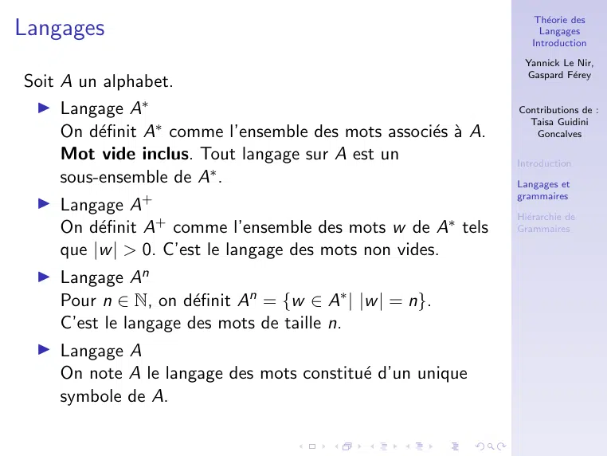

~~~text
                                                                    Théorie des
Langages                                                             Langages
                                                                   Introduction

                                                                 Yannick Le Nir,
                                                                 Gaspard Férey
Soit A un alphabet.
 ▶ Langage A∗                                                   Contributions de :
                                                                  Taisa Guidini
     On définit A∗ comme l’ensemble des mots associés à A.      Goncalves

     Mot vide inclus. Tout langage sur A est un                 Introduction
     sous-ensemble de A∗ .                                      Langages et
                                                                grammaires
 ▶ Langage A+
                                                                Hiérarchie de
     On définit A+ comme l’ensemble des mots w de A∗ tels      Grammaires

     que |w | > 0. C’est le langage des mots non vides.
 ▶ Langage An
     Pour n ∈ N, on définit An = {w ∈ A∗ | |w | = n}.
     C’est le langage des mots de taille n.
 ▶ Langage A
     On note A le langage des mots constitué d’un unique
     symbole de A.
~~~

## Page 12

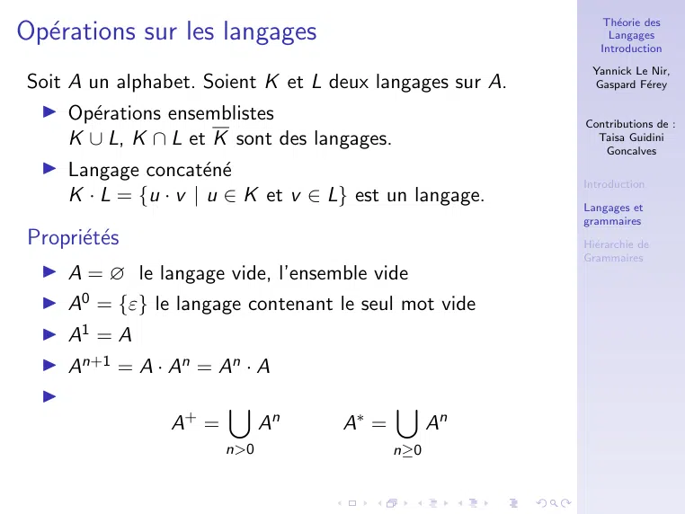

~~~text
                                                             Théorie des
Opérations sur les langages                                  Langages
                                                            Introduction

                                                          Yannick Le Nir,
Soit A un alphabet. Soient K et L deux langages sur A.    Gaspard Férey

 ▶ Opérations ensemblistes
                                                         Contributions de :
     K ∪ L, K ∩ L et K sont des langages.                  Taisa Guidini
                                                            Goncalves
 ▶ Langage concaténé
                                                         Introduction
     K · L = {u · v | u ∈ K et v ∈ L} est un langage.    Langages et
                                                         grammaires
Propriétés                                             Hiérarchie de
                                                         Grammaires
  ▶ A = ∅ le langage vide, l’ensemble vide
  ▶ A0 = {ε} le langage contenant le seul mot vide
  ▶ A1 = A
  ▶ An+1 = A · An = An · A
  ▶                    [                  [
                A+ =         An    A∗ =         An
                       n>0                n≥0
~~~

## Page 13

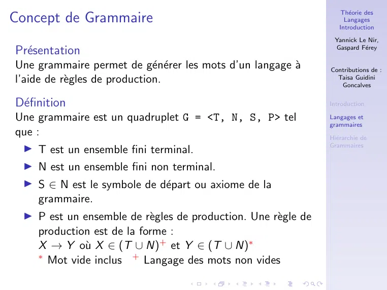

~~~text
                                                                    Théorie des
Concept de Grammaire                                                 Langages
                                                                   Introduction

                                                                 Yannick Le Nir,
Présentation                                                    Gaspard Férey

Une grammaire permet de générer les mots d’un langage à      Contributions de :
l’aide de règles de production.                                  Taisa Guidini
                                                                   Goncalves

Définition                                                     Introduction

Une grammaire est un quadruplet G = <T, N, S, P> tel            Langages et
                                                                grammaires
que :                                                           Hiérarchie de
                                                                Grammaires
 ▶ T est un ensemble fini terminal.
  ▶ N est un ensemble fini non terminal.
  ▶ S ∈ N est le symbole de départ ou axiome de la
    grammaire.
  ▶ P est un ensemble de règles de production. Une règle de
    production est de la forme :
    X → Y où X ∈ (T ∪ N)+ et Y ∈ (T ∪ N)∗
    ∗ Mot vide inclus + Langage des mots non vides
~~~

## Page 14

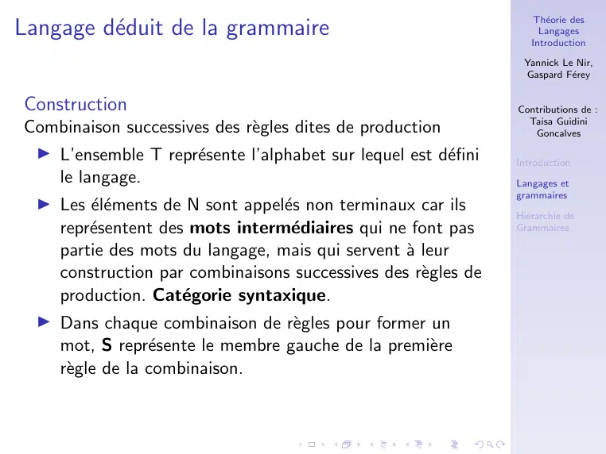

~~~text
                                                                    Théorie des
Langage déduit de la grammaire                                      Langages
                                                                   Introduction

                                                                 Yannick Le Nir,
                                                                 Gaspard Férey

Construction                                                    Contributions de :
                                                                  Taisa Guidini
Combinaison successives des règles dites de production            Goncalves

 ▶ L’ensemble T représente l’alphabet sur lequel est défini   Introduction
   le langage.                                                  Langages et
                                                                grammaires
 ▶ Les éléments de N sont appelés non terminaux car ils
                                                                Hiérarchie de
   représentent des mots intermédiaires qui ne font pas       Grammaires

   partie des mots du langage, mais qui servent à leur
   construction par combinaisons successives des règles de
   production. Catégorie syntaxique.
 ▶ Dans chaque combinaison de règles pour former un
   mot, S représente le membre gauche de la première
   règle de la combinaison.
~~~

## Page 15

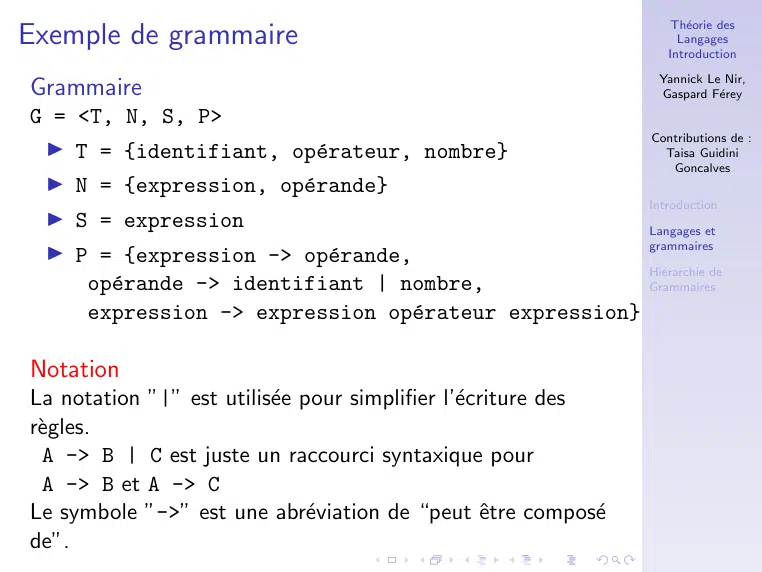

~~~text
                                                                    Théorie des
Exemple de grammaire                                                 Langages
                                                                   Introduction

                                                                 Yannick Le Nir,
Grammaire                                                        Gaspard Férey
G = <T, N, S, P>
                                                                Contributions de :
 ▶ T = {identifiant, opérateur, nombre}                          Taisa Guidini
                                                                   Goncalves
  ▶ N = {expression, opérande}
                                                                Introduction
  ▶ S = expression                                              Langages et
                                                     grammaires
  ▶ P = {expression -> opérande,
                                                     Hiérarchie de
     opérande -> identifiant | nombre,              Grammaires

     expression -> expression opérateur expression}

Notation
La notation ”|” est utilisée pour simplifier l’écriture des
règles.
  A -> B | C est juste un raccourci syntaxique pour
  A -> B et A -> C
Le symbole ”->” est une abréviation de “peut être composé
de”.
~~~

## Page 16

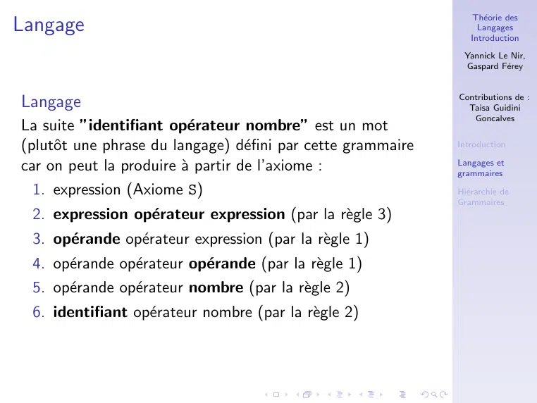

~~~text
                                                                  Théorie des
Langage                                                            Langages
                                                                 Introduction

                                                               Yannick Le Nir,
                                                               Gaspard Férey

                                                              Contributions de :
Langage                                                         Taisa Guidini
                                                                 Goncalves
La suite ”identifiant opérateur nombre” est un mot
(plutôt une phrase du langage) défini par cette grammaire   Introduction

car on peut la produire à partir de l’axiome :               Langages et
                                                              grammaires

 1. expression (Axiome S)                                     Hiérarchie de
                                                              Grammaires
 2. expression opérateur expression (par la règle 3)
 3. opérande opérateur expression (par la règle 1)
 4. opérande opérateur opérande (par la règle 1)
 5. opérande opérateur nombre (par la règle 2)
 6. identifiant opérateur nombre (par la règle 2)
~~~

## Page 17

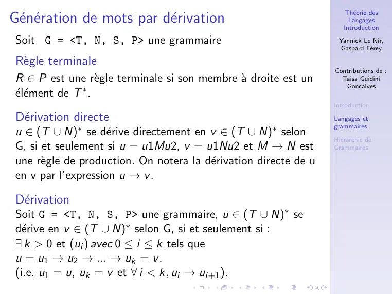

~~~text
                                                                       Théorie des
Génération de mots par dérivation                                    Langages
                                                                      Introduction

 Soit G = <T, N, S, P> une grammaire                                Yannick Le Nir,
                                                                    Gaspard Férey

 Règle terminale
                                                                   Contributions de :
 R ∈ P est une règle terminale si son membre à droite est un       Taisa Guidini
                                                                      Goncalves
 élément de T ∗ .
                                                                   Introduction

 Dérivation directe                                               Langages et
                                                                   grammaires
 u ∈ (T ∪ N)∗ se dérive directement en v ∈ (T ∪ N)∗ selon
                                                                   Hiérarchie de
 G, si et seulement si u = u1Mu2, v = u1Nu2 et M → N est           Grammaires

 une règle de production. On notera la dérivation directe de u
 en v par l’expression u → v .

 Dérivation
 Soit G = <T, N, S, P> une grammaire, u ∈ (T ∪ N)∗ se
 dérive en v ∈ (T ∪ N)∗ selon G, si et seulement si :
 ∃ k > 0 et (ui ) avec 0 ≤ i ≤ k tels que
 u = u1 → u2 → ... → uk = v .
 (i.e. u1 = u, uk = v et ∀ i < k, ui → ui+1 ).
~~~

## Page 18

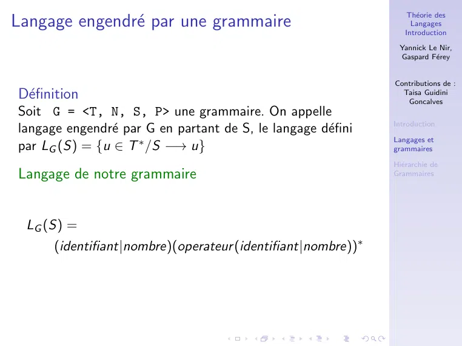

~~~text
                                                                  Théorie des
Langage engendré par une grammaire                                Langages
                                                                 Introduction

                                                               Yannick Le Nir,
                                                               Gaspard Férey

                                                              Contributions de :
Définition                                                     Taisa Guidini
                                                                 Goncalves
Soit G = <T, N, S, P> une grammaire. On appelle
                                                              Introduction
langage engendré par G en partant de S, le langage défini
                                                              Langages et
par LG (S) = {u ∈ T ∗ /S −→ u}                                grammaires

                                                              Hiérarchie de
Langage de notre grammaire                                    Grammaires

 LG (S) =
      (identifiant|nombre)(operateur (identifiant|nombre))∗
~~~

## Page 19

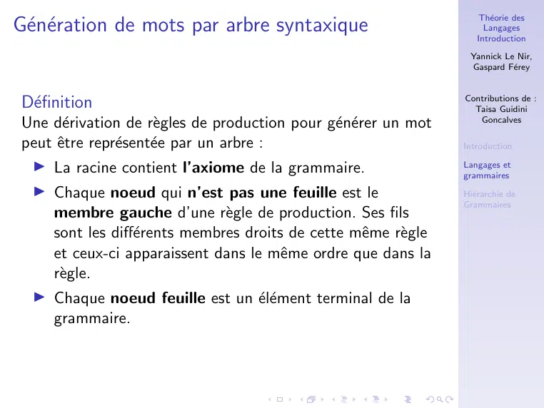

~~~text
                                                                     Théorie des
Génération de mots par arbre syntaxique                             Langages
                                                                    Introduction

                                                                  Yannick Le Nir,
                                                                  Gaspard Férey

Définition                                                      Contributions de :
                                                                   Taisa Guidini
Une dérivation de règles de production pour générer un mot      Goncalves

peut être représentée par un arbre :                          Introduction

 ▶ La racine contient l’axiome de la grammaire.                  Langages et
                                                                 grammaires
  ▶ Chaque noeud qui n’est pas une feuille est le                Hiérarchie de
                                                                 Grammaires
    membre gauche d’une règle de production. Ses fils
    sont les différents membres droits de cette même règle
    et ceux-ci apparaissent dans le même ordre que dans la
    règle.
  ▶ Chaque noeud feuille est un élément terminal de la
    grammaire.
~~~

## Page 20

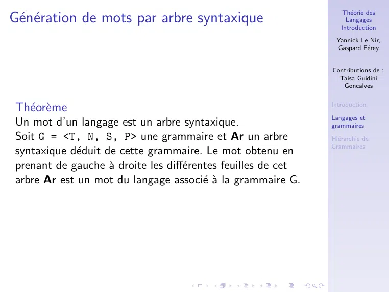

~~~text
                                                                   Théorie des
Génération de mots par arbre syntaxique                           Langages
                                                                  Introduction

                                                                Yannick Le Nir,
                                                                Gaspard Férey

                                                               Contributions de :
                                                                 Taisa Guidini
                                                                  Goncalves

                                                               Introduction
Théorème
                                                               Langages et
Un mot d’un langage est un arbre syntaxique.                   grammaires
Soit G = <T, N, S, P> une grammaire et Ar un arbre             Hiérarchie de
                                                               Grammaires
syntaxique déduit de cette grammaire. Le mot obtenu en
prenant de gauche à droite les différentes feuilles de cet
arbre Ar est un mot du langage associé à la grammaire G.
~~~

## Page 21

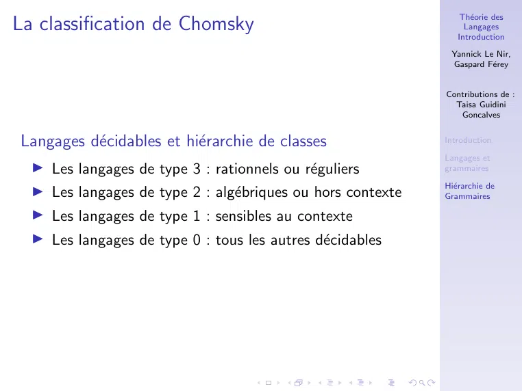

~~~text
                                                                 Théorie des
La classification de Chomsky                                      Langages
                                                                Introduction

                                                              Yannick Le Nir,
                                                              Gaspard Férey

                                                             Contributions de :
                                                               Taisa Guidini
                                                                Goncalves

Langages décidables et hiérarchie de classes               Introduction

                                                             Langages et
  ▶ Les langages de type 3 : rationnels ou réguliers        grammaires

                                                             Hiérarchie de
  ▶ Les langages de type 2 : algébriques ou hors contexte   Grammaires

  ▶ Les langages de type 1 : sensibles au contexte
  ▶ Les langages de type 0 : tous les autres décidables
~~~

## Page 22

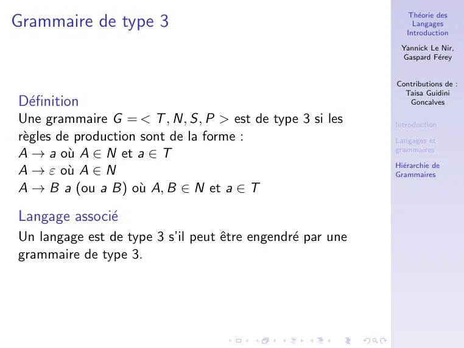

~~~text
                                                                 Théorie des
Grammaire de type 3                                               Langages
                                                                Introduction

                                                              Yannick Le Nir,
                                                              Gaspard Férey

                                                             Contributions de :
                                                               Taisa Guidini
Définition                                                     Goncalves

Une grammaire G = < T , N, S, P > est de type 3 si les       Introduction
règles de production sont de la forme :                     Langages et
                                                             grammaires
A → a où A ∈ N et a ∈ T
                                                             Hiérarchie de
A → ε où A ∈ N                                              Grammaires
A → B a (ou a B) où A, B ∈ N et a ∈ T

Langage associé
Un langage est de type 3 s’il peut être engendré par une
grammaire de type 3.
~~~

## Page 23

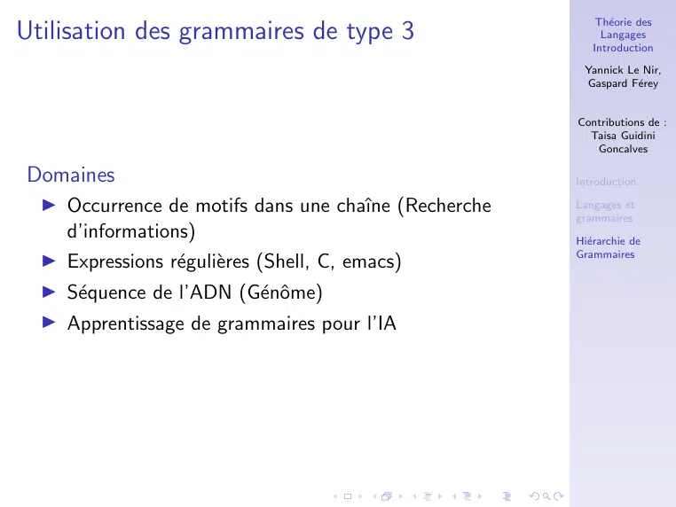

~~~text
                                                           Théorie des
Utilisation des grammaires de type 3                        Langages
                                                          Introduction

                                                        Yannick Le Nir,
                                                        Gaspard Férey

                                                       Contributions de :
                                                         Taisa Guidini
                                                          Goncalves

Domaines                                               Introduction

  ▶ Occurrence de motifs dans une chaı̂ne (Recherche   Langages et
                                                       grammaires
    d’informations)                                    Hiérarchie de
                                                       Grammaires
  ▶ Expressions régulières (Shell, C, emacs)
  ▶ Séquence de l’ADN (Génôme)
  ▶ Apprentissage de grammaires pour l’IA
~~~

## Page 24

~~~text
                                                                   Théorie des
Exemple de grammaire                                                Langages
                                                                  Introduction

                                                                Yannick Le Nir,
                                                                Gaspard Férey

Affectation numérique                                         Contributions de :
                                                                 Taisa Guidini
La grammaire G = <T, N, S, P> pour l’analyse lexicale de          Goncalves

l’affectation numérique est de type 3 :
                                                               Introduction
  ▶ T = lettre ∪ chiffre ∪ {+, −, ∗, /, =, .}                  Langages et
                                                               grammaires
  ▶ N = {mot, suitereel, suitenb, suiteid}
                                                               Hiérarchie de
                                                               Grammaires
  ▶ S = mot
  ▶ P
    =                                                     
    
     mot → +| − | ∗ |/| =,                                
                                                           
     mot → chiffre|lettre|chiffre suitenb|lettre suiteid, 
    
                                                          
                                                           
      suitenb → chiffre|chiffre suitenb|. suitereel,
      suitereel → chiffre|chiffre suitereel,
    
                                                          
                                                           
    
                                                          
                                                           
      suiteid → lettre suiteid|chiffre suiteid
                                                          
~~~

## Page 25

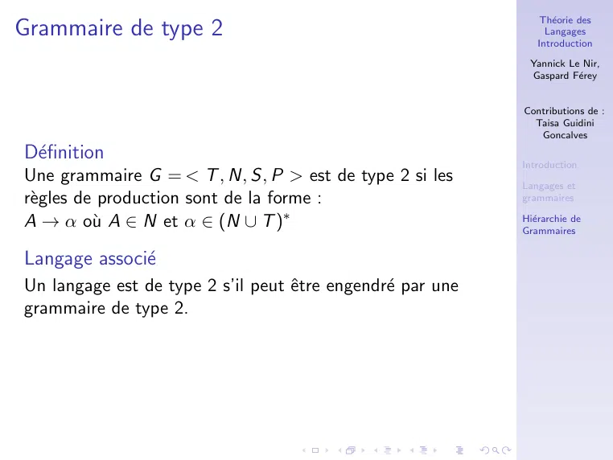

~~~text
                                                                 Théorie des
Grammaire de type 2                                               Langages
                                                                Introduction

                                                              Yannick Le Nir,
                                                              Gaspard Férey

                                                             Contributions de :
                                                               Taisa Guidini
                                                                Goncalves
Définition                                                  Introduction
Une grammaire G = < T , N, S, P > est de type 2 si les       Langages et
règles de production sont de la forme :                     grammaires

A → α où A ∈ N et α ∈ (N ∪ T )∗                             Hiérarchie de
                                                             Grammaires

Langage associé
Un langage est de type 2 s’il peut être engendré par une
grammaire de type 2.
~~~

## Page 26

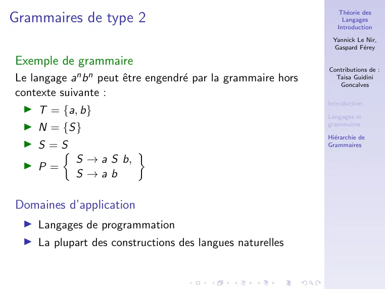

~~~text
                                                                   Théorie des
Grammaires de type 2                                                Langages
                                                                  Introduction

                                                                Yannick Le Nir,
                                                                Gaspard Férey

Exemple de grammaire
                                                               Contributions de :
Le langage an b n peut être engendré par la grammaire hors     Taisa Guidini
                                                                  Goncalves
contexte suivante :
                                                               Introduction
  ▶ T = {a, b}
                                                               Langages et
  ▶ N = {S}                                                    grammaires

                                                               Hiérarchie de
  ▶ S =S                                                       Grammaires
                   
         S → a S b,
  ▶ P=
         S →ab

Domaines d’application
  ▶ Langages de programmation
  ▶ La plupart des constructions des langues naturelles
~~~

## Page 27

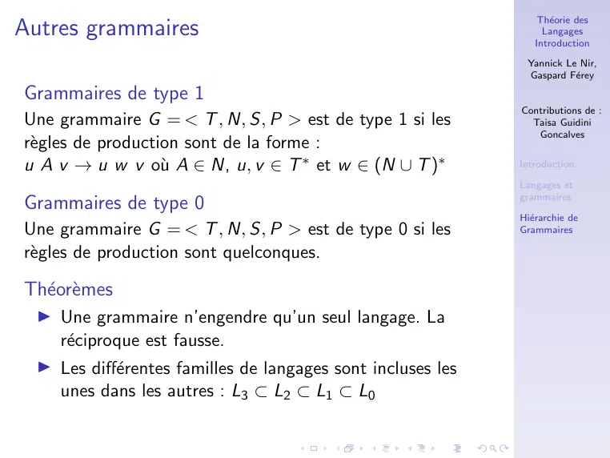

~~~text
                                                                  Théorie des
Autres grammaires                                                  Langages
                                                                 Introduction

                                                               Yannick Le Nir,
                                                               Gaspard Férey

Grammaires de type 1
                                                              Contributions de :
Une grammaire G = < T , N, S, P > est de type 1 si les          Taisa Guidini
                                                                 Goncalves
règles de production sont de la forme :
u A v → u w v où A ∈ N, u, v ∈ T ∗ et w ∈ (N ∪ T )∗          Introduction

                                                              Langages et
                                                              grammaires
Grammaires de type 0
                                                              Hiérarchie de
Une grammaire G = < T , N, S, P > est de type 0 si les        Grammaires

règles de production sont quelconques.

Théorèmes
  ▶ Une grammaire n’engendre qu’un seul langage. La
    réciproque est fausse.
  ▶ Les différentes familles de langages sont incluses les
    unes dans les autres : L3 ⊂ L2 ⊂ L1 ⊂ L0
~~~
