# CM2.pdf

[Ouvrir l’original](https://drive.google.com/open?id=1cE99Qrtdq02G8hWTSPRRD3uyoAbhUHeQ) · Les deux lectures automatiques du PDF divergent sur les pages indiquées. Leur fac-similé accompagne le texte.

**Pages présentant un écart entre les deux extractions** — 1–21.

## Page 1

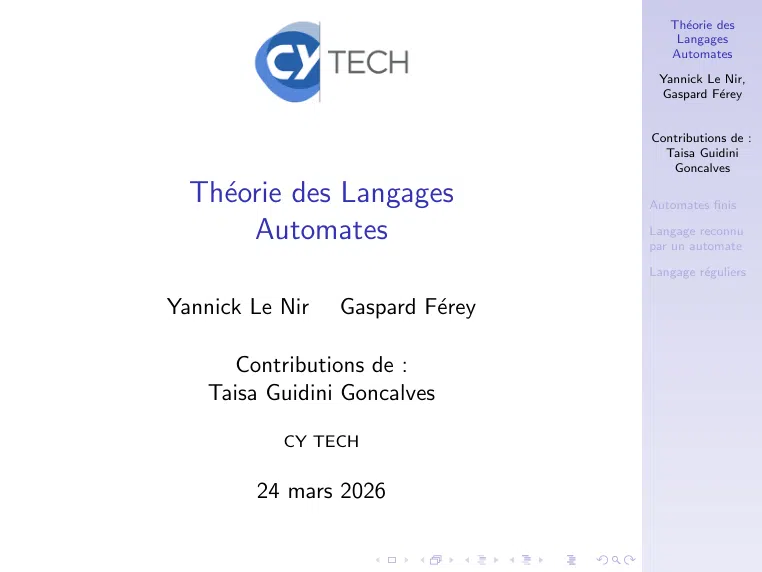

~~~text
                                     Théorie des
                                      Langages
                                     Automates

                                   Yannick Le Nir,
                                   Gaspard Férey

                                  Contributions de :
                                    Taisa Guidini
                                     Goncalves

  Théorie des Langages           Automates finis

       Automates                  Langage reconnu
                                  par un automate

                                  Langage réguliers

Yannick Le Nir   Gaspard Férey

      Contributions de :
    Taisa Guidini Goncalves

           CY TECH

        24 mars 2026
~~~

## Page 2

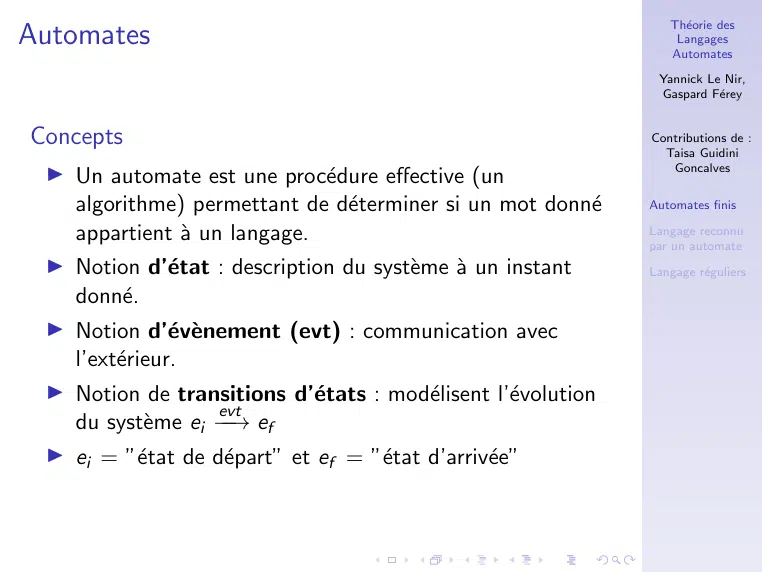

~~~text
                                                                  Théorie des
Automates                                                          Langages
                                                                  Automates

                                                                Yannick Le Nir,
                                                                Gaspard Férey

Concepts                                                       Contributions de :
                                                                 Taisa Guidini
                                                                  Goncalves
 ▶ Un automate est une procédure effective (un
   algorithme) permettant de déterminer si un mot donné      Automates finis

   appartient à un langage.                                   Langage reconnu
                                                               par un automate
 ▶ Notion d’état : description du système à un instant      Langage réguliers

   donné.
 ▶ Notion d’évènement (evt) : communication avec
   l’extérieur.
 ▶ Notion de transitions d’états : modélisent l’évolution
                   evt
   du système ei −−→ ef
 ▶ ei = ”état de départ” et ef = ”état d’arrivée”
~~~

## Page 3

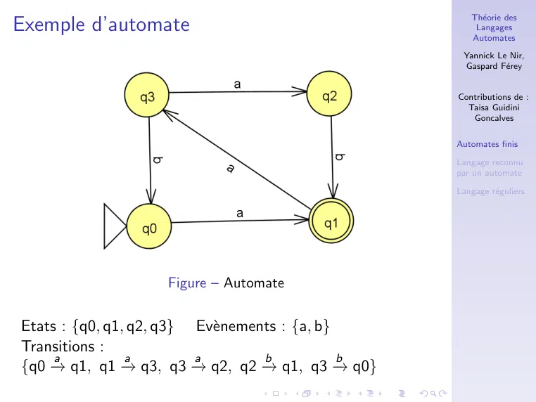

~~~text
                                                         Théorie des
Exemple d’automate                                        Langages
                                                         Automates

                                                       Yannick Le Nir,
                                                       Gaspard Férey

                                                      Contributions de :
                                                        Taisa Guidini
                                                         Goncalves

                                                      Automates finis

                                                      Langage reconnu
                                                      par un automate

                                                      Langage réguliers

                     Figure – Automate

Etats : {q0, q1, q2, q3} Evènements : {a, b}
Transitions :
     a          a        a        b           b
{q0 →
    − q1, q1 → − q3, q3 →− q2, q2 −
                                  → q1, q3 −  → q0}
~~~

## Page 4

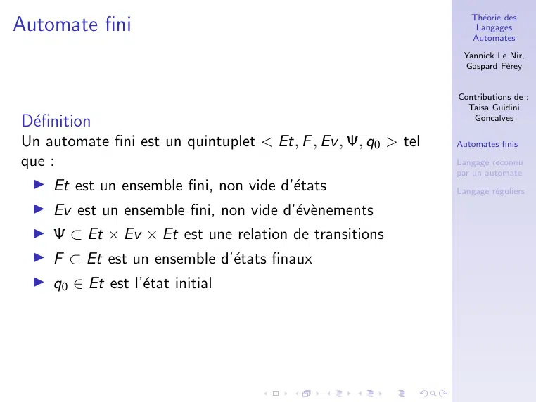

~~~text
                                                                   Théorie des
Automate fini                                                       Langages
                                                                   Automates

                                                                 Yannick Le Nir,
                                                                 Gaspard Férey

                                                                Contributions de :
                                                                  Taisa Guidini
Définition                                                        Goncalves

Un automate fini est un quintuplet < Et, F , Ev , Ψ, q0 > tel   Automates finis

que :                                                           Langage reconnu
                                                                par un automate
 ▶ Et est un ensemble fini, non vide d’états                   Langage réguliers

  ▶ Ev est un ensemble fini, non vide d’évènements
  ▶ Ψ ⊂ Et × Ev × Et est une relation de transitions
  ▶ F ⊂ Et est un ensemble d’états finaux
  ▶ q0 ∈ Et est l’état initial
~~~

## Page 5

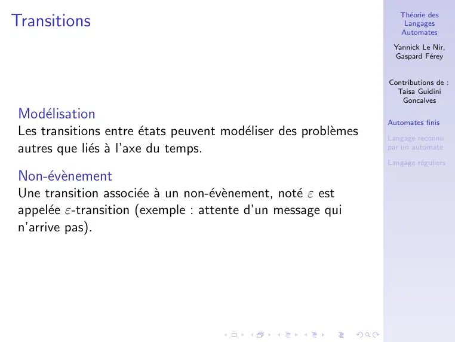

~~~text
                                                                    Théorie des
Transitions                                                          Langages
                                                                    Automates

                                                                  Yannick Le Nir,
                                                                  Gaspard Férey

                                                                 Contributions de :
                                                                   Taisa Guidini
                                                                    Goncalves

Modélisation                                                    Automates finis
Les transitions entre états peuvent modéliser des problèmes   Langage reconnu
autres que liés à l’axe du temps.                              par un automate

                                                                 Langage réguliers

Non-évènement
Une transition associée à un non-évènement, noté ε est
appelée ε-transition (exemple : attente d’un message qui
n’arrive pas).
~~~

## Page 6

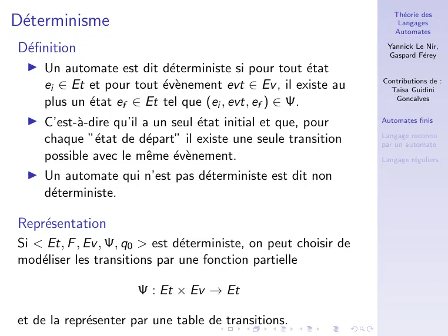

~~~text
                                                                     Théorie des
Déterminisme                                                         Langages
                                                                     Automates

Définition                                                        Yannick Le Nir,
                                                                   Gaspard Férey
  ▶ Un automate est dit déterministe si pour tout état
                                                                  Contributions de :
    ei ∈ Et et pour tout évènement evt ∈ Ev , il existe au        Taisa Guidini
    plus un état ef ∈ Et tel que (ei , evt, ef ) ∈ Ψ.               Goncalves

  ▶ C’est-à-dire qu’il a un seul état initial et que, pour      Automates finis

                                                                  Langage reconnu
    chaque ”état de départ” il existe une seule transition      par un automate
    possible avec le même évènement.                           Langage réguliers

  ▶ Un automate qui n’est pas déterministe est dit non
    déterministe.

Représentation
Si < Et, F , Ev , Ψ, q0 > est déterministe, on peut choisir de
modéliser les transitions par une fonction partielle

                      Ψ : Et × Ev → Et

et de la représenter par une table de transitions.
~~~

## Page 7

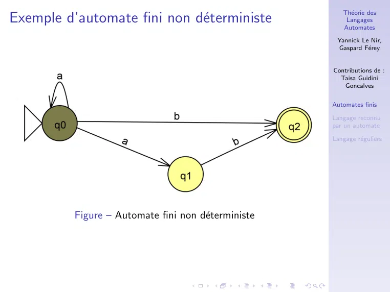

~~~text
                                                        Théorie des
Exemple d’automate fini non déterministe                Langages
                                                        Automates

                                                      Yannick Le Nir,
                                                      Gaspard Férey

                                                     Contributions de :
                                                       Taisa Guidini
                                                        Goncalves

                                                     Automates finis

                                                     Langage reconnu
                                                     par un automate

                                                     Langage réguliers

          Figure – Automate fini non déterministe
~~~

## Page 8

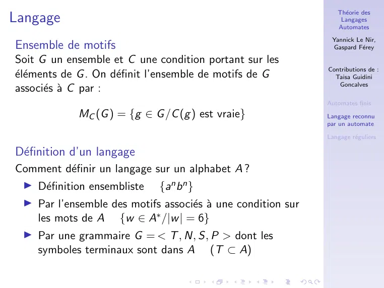

~~~text
                                                                 Théorie des
Langage                                                           Langages
                                                                 Automates

                                                               Yannick Le Nir,
Ensemble de motifs                                             Gaspard Férey

Soit G un ensemble et C une condition portant sur les
                                                              Contributions de :
éléments de G . On définit l’ensemble de motifs de G         Taisa Guidini
                                                                 Goncalves
associés à C par :
                                                              Automates finis
             MC (G ) = {g ∈ G /C (g ) est vraie}              Langage reconnu
                                                              par un automate

                                                              Langage réguliers

Définition d’un langage
Comment définir un langage sur un alphabet A ?
 ▶ Définition ensembliste {an b n }
 ▶ Par l’ensemble des motifs associés à une condition sur
   les mots de A {w ∈ A∗ /|w | = 6}
 ▶ Par une grammaire G = < T , N, S, P > dont les
   symboles terminaux sont dans A (T ⊂ A)
~~~

## Page 9

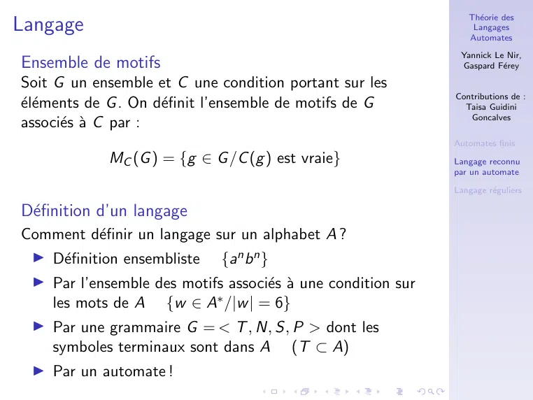

~~~text
                                                                 Théorie des
Langage                                                           Langages
                                                                 Automates

                                                               Yannick Le Nir,
Ensemble de motifs                                             Gaspard Férey

Soit G un ensemble et C une condition portant sur les
                                                              Contributions de :
éléments de G . On définit l’ensemble de motifs de G         Taisa Guidini
                                                                 Goncalves
associés à C par :
                                                              Automates finis
             MC (G ) = {g ∈ G /C (g ) est vraie}              Langage reconnu
                                                              par un automate

                                                              Langage réguliers

Définition d’un langage
Comment définir un langage sur un alphabet A ?
 ▶ Définition ensembliste {an b n }
 ▶ Par l’ensemble des motifs associés à une condition sur
   les mots de A {w ∈ A∗ /|w | = 6}
 ▶ Par une grammaire G = < T , N, S, P > dont les
   symboles terminaux sont dans A (T ⊂ A)
 ▶ Par un automate !
~~~

## Page 10

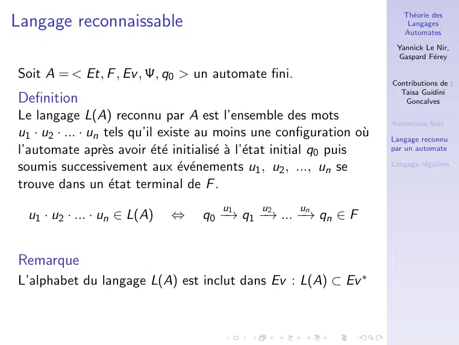

~~~text
                                                                          Théorie des
Langage reconnaissable                                                     Langages
                                                                          Automates

                                                                        Yannick Le Nir,
                                                                        Gaspard Férey

Soit A = < Et, F , Ev , Ψ, q0 > un automate fini.
                                                                       Contributions de :
                                                                         Taisa Guidini
Definition                                                                Goncalves

Le langage L(A) reconnu par A est l’ensemble des mots                  Automates finis
u1 · u2 · ... · un tels qu’il existe au moins une configuration où    Langage reconnu
l’automate après avoir été initialisé à l’état initial q0 puis   par un automate

soumis successivement aux événements u1 , u2 , ..., un se            Langage réguliers

trouve dans un état terminal de F .
                                       u
                                       1     2 u    n u
  u1 · u2 · ... · un ∈ L(A)   ⇔    q0 −→ q1 −→ ... −→ qn ∈ F

Remarque
L’alphabet du langage L(A) est inclut dans Ev : L(A) ⊂ Ev ∗
~~~

## Page 11

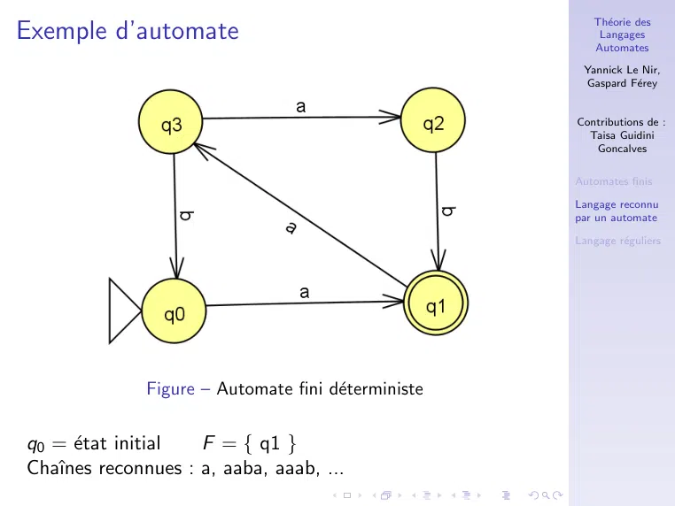

~~~text
                                                        Théorie des
Exemple d’automate                                       Langages
                                                        Automates

                                                      Yannick Le Nir,
                                                      Gaspard Férey

                                                     Contributions de :
                                                       Taisa Guidini
                                                        Goncalves

                                                     Automates finis

                                                     Langage reconnu
                                                     par un automate

                                                     Langage réguliers

              Figure – Automate fini déterministe

q0 = état initial   F = { q1 }
Chaı̂nes reconnues : a, aaba, aaab, ...
~~~

## Page 12

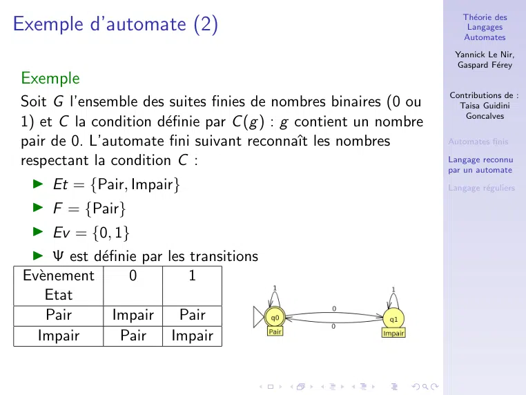

~~~text
                                                                     Théorie des
Exemple d’automate (2)                                                Langages
                                                                     Automates

                                                                   Yannick Le Nir,
                                                                   Gaspard Férey
Exemple
                                                                  Contributions de :
Soit G l’ensemble des suites finies de nombres binaires (0 ou       Taisa Guidini
                                                                     Goncalves
1) et C la condition définie par C (g ) : g contient un nombre
pair de 0. L’automate fini suivant reconnaı̂t les nombres         Automates finis

respectant la condition C :                                       Langage reconnu
                                                                  par un automate
  ▶ Et = {Pair, Impair}                                           Langage réguliers

  ▶ F = {Pair}
  ▶ Ev = {0, 1}
  ▶ Ψ est définie par les transitions
 Evènement      0         1
    Etat
     Pair     Impair     Pair
   Impair      Pair     Impair
~~~

## Page 13

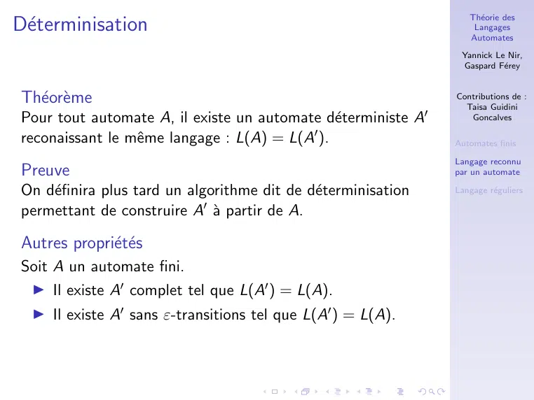

~~~text
                                                                  Théorie des
Déterminisation                                                   Langages
                                                                  Automates

                                                                Yannick Le Nir,
                                                                Gaspard Férey

Théorème                                                     Contributions de :
                                                                 Taisa Guidini
Pour tout automate A, il existe un automate déterministe A′      Goncalves

reconaissant le même langage : L(A) = L(A′ ).                 Automates finis

                                                               Langage reconnu
Preuve                                                         par un automate

On définira plus tard un algorithme dit de déterminisation   Langage réguliers

permettant de construire A′ à partir de A.

Autres propriétés
Soit A un automate fini.
 ▶ Il existe A′ complet tel que L(A′ ) = L(A).
  ▶ Il existe A′ sans ε-transitions tel que L(A′ ) = L(A).
~~~

## Page 14

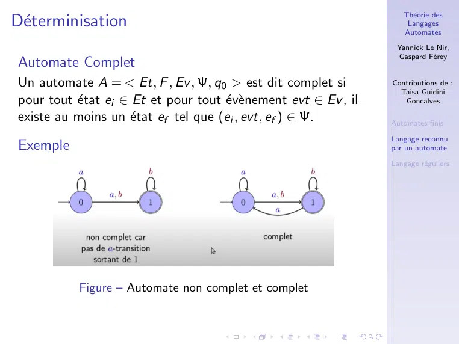

~~~text
                                                                    Théorie des
Déterminisation                                                     Langages
                                                                    Automates

                                                                  Yannick Le Nir,
                                                                  Gaspard Férey
Automate Complet
Un automate A = < Et, F , Ev , Ψ, q0 > est dit complet si        Contributions de :
                                                                   Taisa Guidini
pour tout état ei ∈ Et et pour tout évènement evt ∈ Ev , il      Goncalves

existe au moins un état ef tel que (ei , evt, ef ) ∈ Ψ.         Automates finis

                                                                 Langage reconnu
Exemple                                                          par un automate

                                                                 Langage réguliers

           Figure – Automate non complet et complet
~~~

## Page 15

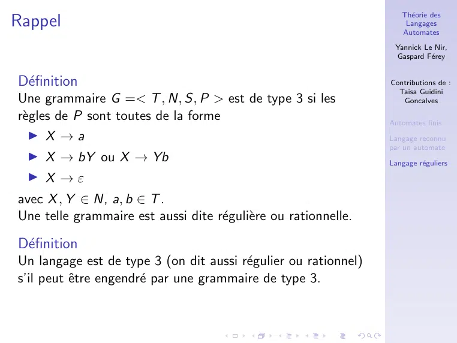

~~~text
                                                                    Théorie des
Rappel                                                               Langages
                                                                    Automates

                                                                  Yannick Le Nir,
                                                                  Gaspard Férey

Définition                                                      Contributions de :
                                                                   Taisa Guidini
Une grammaire G =< T , N, S, P > est de type 3 si les               Goncalves

règles de P sont toutes de la forme                             Automates finis
   ▶ X →a                                                        Langage reconnu
                                                                 par un automate
  ▶ X → bY ou X → Yb                                             Langage réguliers
  ▶ X →ε
avec X , Y ∈ N, a, b ∈ T .
Une telle grammaire est aussi dite régulière ou rationnelle.

Définition
Un langage est de type 3 (on dit aussi régulier ou rationnel)
s’il peut être engendré par une grammaire de type 3.
~~~

## Page 16

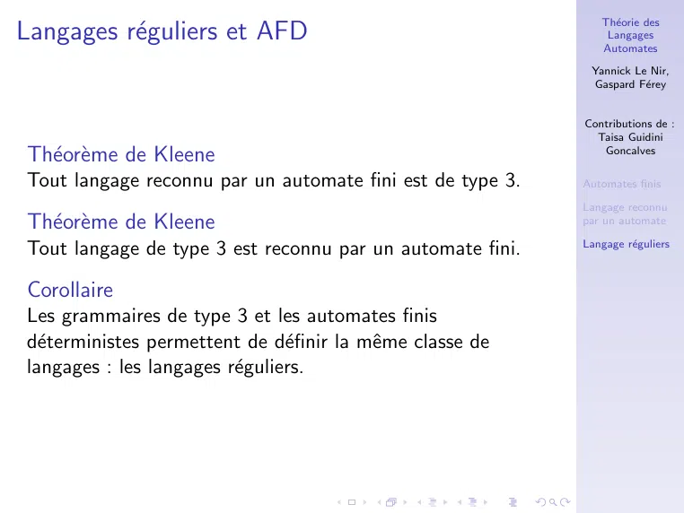

~~~text
                                                              Théorie des
Langages réguliers et AFD                                     Langages
                                                              Automates

                                                            Yannick Le Nir,
                                                            Gaspard Férey

                                                           Contributions de :
                                                             Taisa Guidini
Théorème de Kleene                                          Goncalves

Tout langage reconnu par un automate fini est de type 3.   Automates finis

                                                           Langage reconnu
Théorème de Kleene                                       par un automate

                                                           Langage réguliers
Tout langage de type 3 est reconnu par un automate fini.

Corollaire
Les grammaires de type 3 et les automates finis
déterministes permettent de définir la même classe de
langages : les langages réguliers.
~~~

## Page 17

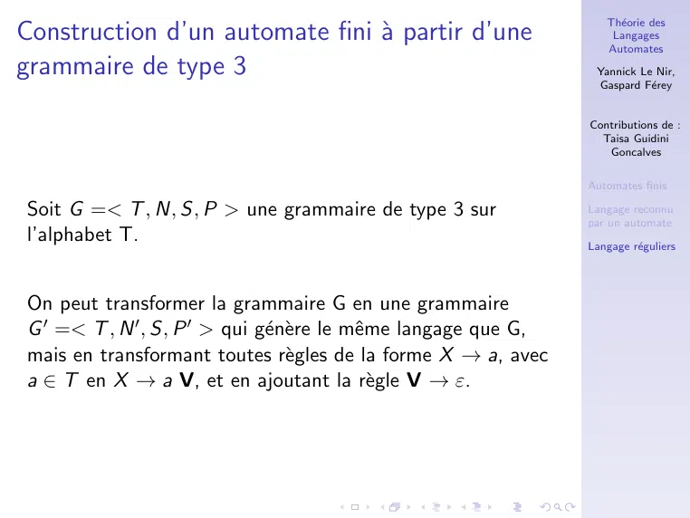

~~~text
                                                                    Théorie des
Construction d’un automate fini à partir d’une                      Langages
                                                                    Automates
grammaire de type 3                                               Yannick Le Nir,
                                                                  Gaspard Férey

                                                                 Contributions de :
                                                                   Taisa Guidini
                                                                    Goncalves

                                                                 Automates finis

Soit G =< T , N, S, P > une grammaire de type 3 sur              Langage reconnu
                                                                 par un automate
l’alphabet T.                                                    Langage réguliers

On peut transformer la grammaire G en une grammaire
G ′ =< T , N ′ , S, P ′ > qui génère le même langage que G,
mais en transformant toutes règles de la forme X → a, avec
a ∈ T en X → a V, et en ajoutant la règle V → ε.
~~~

## Page 18

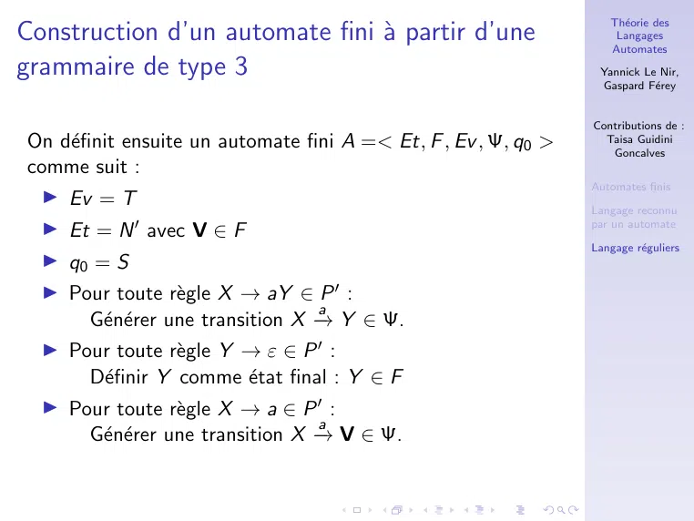

~~~text
                                                                    Théorie des
Construction d’un automate fini à partir d’une                      Langages
                                                                    Automates
grammaire de type 3                                               Yannick Le Nir,
                                                                  Gaspard Férey

                                                                 Contributions de :
On définit ensuite un automate fini A =< Et, F , Ev , Ψ, q0 >     Taisa Guidini
                                                                    Goncalves
comme suit :
                                                                 Automates finis
  ▶ Ev = T
                                                                 Langage reconnu
  ▶ Et = N ′ avec V ∈ F                                          par un automate

                                                                 Langage réguliers
  ▶ q0 = S
  ▶ Pour toute règle X → aY ∈ P ′ :
                                 a
      Générer une transition X →
                                 − Y ∈ Ψ.
  ▶ Pour toute règle Y → ε ∈ P ′ :
      Définir Y comme état final : Y ∈ F
  ▶ Pour toute règle X → a ∈ P ′ :
                                 a
      Générer une transition X →
                                 − V ∈ Ψ.
~~~

## Page 19

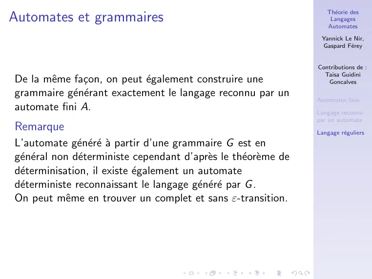

~~~text
                                                                     Théorie des
Automates et grammaires                                               Langages
                                                                     Automates

                                                                   Yannick Le Nir,
                                                                   Gaspard Férey

                                                                  Contributions de :
                                                                    Taisa Guidini
De la même façon, on peut également construire une                Goncalves

grammaire générant exactement le langage reconnu par un         Automates finis
automate fini A.                                                  Langage reconnu
                                                                  par un automate
Remarque                                                          Langage réguliers
L’automate généré à partir d’une grammaire G est en
général non déterministe cependant d’après le théorème de
déterminisation, il existe également un automate
déterministe reconnaissant le langage généré par G .
On peut même en trouver un complet et sans ε-transition.
~~~

## Page 20

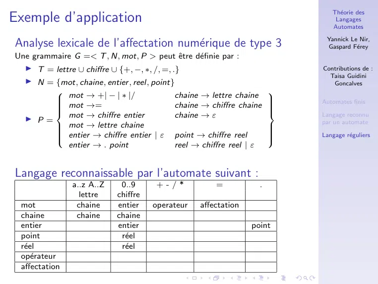

~~~text
                                                                           Théorie des
Exemple d’application                                                       Langages
                                                                           Automates

                                                                         Yannick Le Nir,
Analyse lexicale de l’affectation numérique de type 3                   Gaspard Férey
Une grammaire G =< T , N, mot, P > peut être définie par :
  ▶ T = lettre ∪ chiffre ∪ {+, −, ∗, /, =, .}                           Contributions de :
                                                                          Taisa Guidini
  ▶ N = {mot, chaine, entier , reel, point}                                Goncalves

          mot → +| − | ∗ |/                chaine → lettre chaine 
                                                                   
        
         mot →=                                                        Automates finis
                                           chaine →  chiffre chaine
                                                                   
                                                                    
        
                                                                   
                                                                    
          mot   →  chiffre  entier         chaine →  ε                  Langage reconnu
                                                                   
  ▶ P=                                                                  par un automate
        
         mot   →  lettre  chaine                                   
                                                                    
         entier → chiffre entier | ε point → chiffre reel
        
                                                                   
                                                                       Langage réguliers
                                                                   
                                                                    
          entier → . point                 reel → chiffre reel | ε

Langage reconnaissable par l’automate suivant :
               a..z A..Z    0..9     +-/*            =           .
                 lettre    chiffre
 mot            chaine     entier    operateur   affectation
 chaine         chaine     chaine
 entier                    entier                              point
 point                      réel
 réel                      réel
 opérateur
 affectation
~~~

## Page 21

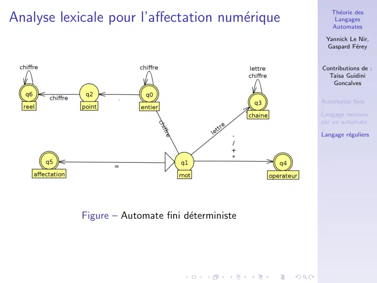

~~~text
                                                      Théorie des
Analyse lexicale pour l’affectation numérique         Langages
                                                      Automates

                                                    Yannick Le Nir,
                                                    Gaspard Férey

                                                   Contributions de :
                                                     Taisa Guidini
                                                      Goncalves

                                                   Automates finis

                                                   Langage reconnu
                                                   par un automate

                                                   Langage réguliers

            Figure – Automate fini déterministe
~~~
