# CM3.pdf

[Ouvrir l’original](https://drive.google.com/open?id=10l0TJGIznAt42ax10smLsmotrclX8Qou) · Les deux lectures automatiques du PDF divergent sur les pages indiquées. Leur fac-similé accompagne le texte.

**Pages présentant un écart entre les deux extractions** — 2–14, 16–31, 36–39.

## Page 1

~~~text
                                                Théorie des
                                                 Langages
                                                Expressions
                                                rationnelles,
                                             Lemme d’Arden et
                                             Quotients gauches
           Théorie des Langages              Yannick Le Nir,
                                              Gaspard Férey
Expressions rationnelles, Lemme d’Arden et
            Quotients gauches                Contributions de :
                                               Taisa Guidini
                                                Goncalves

                                             Introduction
        Yannick Le Nir   Gaspard Férey      Expressions
                                             régulières

                                             Construction de
              Contributions de :             langages rationnels

            Taisa Guidini Goncalves          Construction
                                             d’automates finis
                                             minimaux
                   CY TECH                   Conclusion

                                             Bonus : Preuve du
                31 mars 2026                 lemme d’Arden
~~~

## Page 2

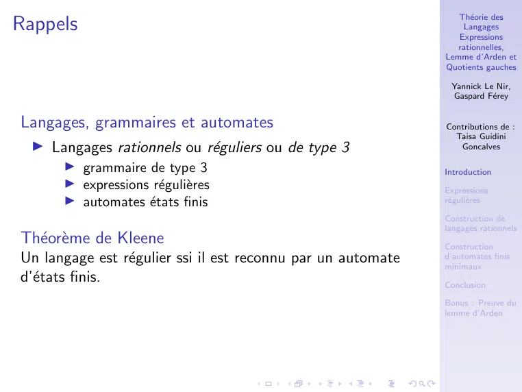

~~~text
                                                                 Théorie des
Rappels                                                           Langages
                                                                 Expressions
                                                                 rationnelles,
                                                              Lemme d’Arden et
                                                              Quotients gauches

                                                               Yannick Le Nir,
                                                               Gaspard Férey

Langages, grammaires et automates                             Contributions de :
                                                                Taisa Guidini
  ▶ Langages rationnels ou réguliers ou de type 3               Goncalves

      ▶ grammaire de type 3                                   Introduction
      ▶ expressions régulières                              Expressions
      ▶ automates états finis                                régulières

                                                              Construction de
                                                              langages rationnels
Théorème de Kleene                                          Construction
Un langage est régulier ssi il est reconnu par un automate   d’automates finis
                                                              minimaux
d’états finis.                                               Conclusion

                                                              Bonus : Preuve du
                                                              lemme d’Arden
~~~

## Page 3

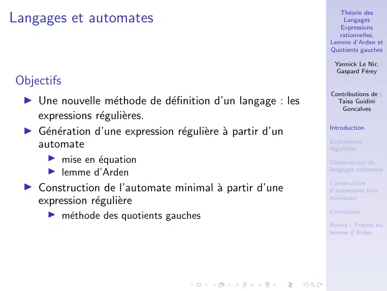

~~~text
                                                                  Théorie des
Langages et automates                                              Langages
                                                                  Expressions
                                                                  rationnelles,
                                                               Lemme d’Arden et
                                                               Quotients gauches

                                                                Yannick Le Nir,
                                                                Gaspard Férey
Objectifs
                                                               Contributions de :
  ▶ Une nouvelle méthode de définition d’un langage : les      Taisa Guidini
                                                                  Goncalves
    expressions régulières.
                                                               Introduction
  ▶ Génération d’une expression régulière à partir d’un
                                                               Expressions
    automate                                                   régulières
       ▶ mise en équation                                     Construction de
       ▶ lemme d’Arden                                         langages rationnels

                                                               Construction
  ▶ Construction de l’automate minimal à partir d’une         d’automates finis
                                                               minimaux
    expression régulière
                                                               Conclusion
       ▶ méthode des quotients gauches
                                                               Bonus : Preuve du
                                                               lemme d’Arden
~~~

## Page 4

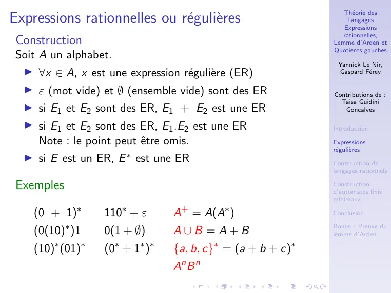

~~~text
                                                               Théorie des
Expressions rationnelles ou régulières                        Langages
                                                               Expressions
                                                               rationnelles,
 Construction                                               Lemme d’Arden et
                                                            Quotients gauches
 Soit A un alphabet.
                                                             Yannick Le Nir,
  ▶ ∀x ∈ A, x est une expression régulière (ER)            Gaspard Férey

  ▶ ε (mot vide) et ∅ (ensemble vide) sont des ER           Contributions de :
                                                              Taisa Guidini
  ▶ si E1 et E2 sont des ER, E1 + E2 est une ER                Goncalves

  ▶ si E1 et E2 sont des ER, E1 .E2 est une ER              Introduction

    Note : le point peut être omis.                        Expressions
                                                            régulières
  ▶ si E est un ER, E ∗ est une ER                          Construction de
                                                            langages rationnels

 Exemples                                                   Construction
                                                            d’automates finis
                                                            minimaux

    (0 + 1)∗      110∗ + ε      A+ = A(A∗ )                 Conclusion

    (0(10)∗ )1    0(1 + ∅)      A∪B =A+B                    Bonus : Preuve du
                                                            lemme d’Arden

    (10)∗ (01)∗   (0∗ + 1∗ )∗   {a, b, c}∗ = (a + b + c)∗
                                An B n
~~~

## Page 5

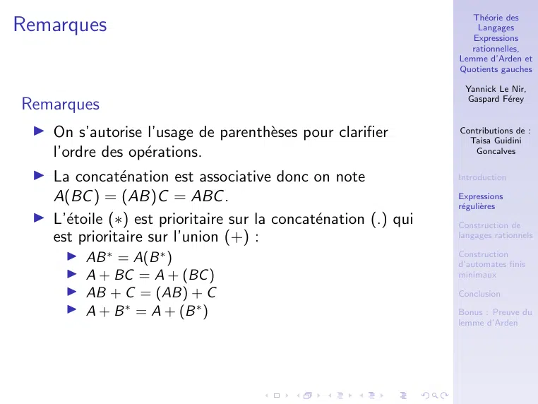

~~~text
                                                                    Théorie des
Remarques                                                            Langages
                                                                    Expressions
                                                                    rationnelles,
                                                                 Lemme d’Arden et
                                                                 Quotients gauches

                                                                  Yannick Le Nir,
                                                                  Gaspard Férey
Remarques
 ▶ On s’autorise l’usage de parenthèses pour clarifier          Contributions de :
                                                                   Taisa Guidini
   l’ordre des opérations.                                         Goncalves

 ▶ La concaténation est associative donc on note                Introduction

   A(BC ) = (AB)C = ABC .                                        Expressions
                                                                 régulières
 ▶ L’étoile (∗) est prioritaire sur la concaténation (.) qui   Construction de
   est prioritaire sur l’union (+) :                             langages rationnels

      ▶ AB ∗ = A(B ∗ )                                           Construction
                                                                 d’automates finis
      ▶ A + BC = A + (BC )                                       minimaux

      ▶ AB + C = (AB) + C                                        Conclusion
      ▶ A + B ∗ = A + (B ∗ )                                     Bonus : Preuve du
                                                                 lemme d’Arden
~~~

## Page 6

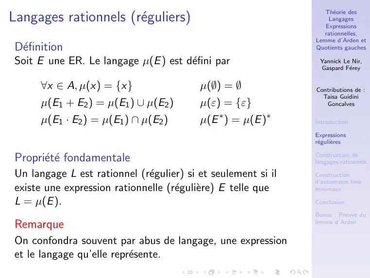

~~~text
                                                                   Théorie des
Langages rationnels (réguliers)                                    Langages
                                                                   Expressions
                                                                   rationnelles,
                                                                Lemme d’Arden et
 Définition                                                    Quotients gauches

 Soit E une ER. Le langage µ(E ) est défini par                 Yannick Le Nir,
                                                                 Gaspard Férey

       ∀x ∈ A, µ(x) = {x}                  µ(∅) = ∅             Contributions de :
                                                                  Taisa Guidini
       µ(E1 + E2 ) = µ(E1 ) ∪ µ(E2 )       µ(ε) = {ε}              Goncalves

       µ(E1 · E2 ) = µ(E1 ) ∩ µ(E2 )       µ(E ∗ ) = µ(E )∗     Introduction

                                                                Expressions
                                                                régulières

                                                                Construction de
 Propriété fondamentale                                       langages rationnels

 Un langage L est rationnel (régulier) si et seulement si il   Construction
                                                                d’automates finis
 existe une expression rationnelle (régulière) E telle que    minimaux

 L = µ(E ).                                                     Conclusion

                                                                Bonus : Preuve du
 Remarque                                                       lemme d’Arden

 On confondra souvent par abus de langage, une expression
 et le langage qu’elle représente.
~~~

## Page 7

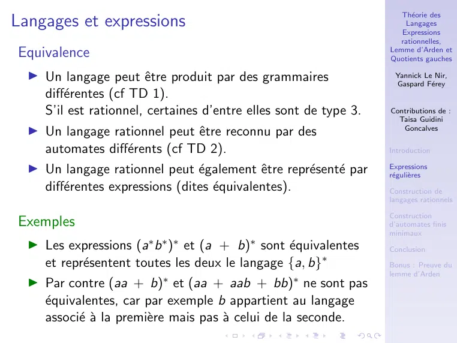

~~~text
                                                                     Théorie des
Langages et expressions                                               Langages
                                                                     Expressions
                                                                     rationnelles,
Equivalence                                                       Lemme d’Arden et
                                                                  Quotients gauches

  ▶ Un langage peut être produit par des grammaires               Yannick Le Nir,
                                                                   Gaspard Férey
    différentes (cf TD 1).
    S’il est rationnel, certaines d’entre elles sont de type 3.   Contributions de :
                                                                    Taisa Guidini
  ▶ Un langage rationnel peut être reconnu par des                  Goncalves

    automates différents (cf TD 2).                              Introduction

  ▶ Un langage rationnel peut également être représenté par   Expressions
                                                                  régulières
    différentes expressions (dites équivalentes).               Construction de
                                                                  langages rationnels

                                                                  Construction
Exemples                                                          d’automates finis
                                                                  minimaux
  ▶ Les expressions (a∗ b ∗ )∗ et (a + b)∗ sont équivalentes     Conclusion
    et représentent toutes les deux le langage {a, b}∗           Bonus : Preuve du
                                                                  lemme d’Arden
  ▶ Par contre (aa + b)∗ et (aa + aab + bb)∗ ne sont pas
    équivalentes, car par exemple b appartient au langage
    associé à la première mais pas à celui de la seconde.
~~~

## Page 8

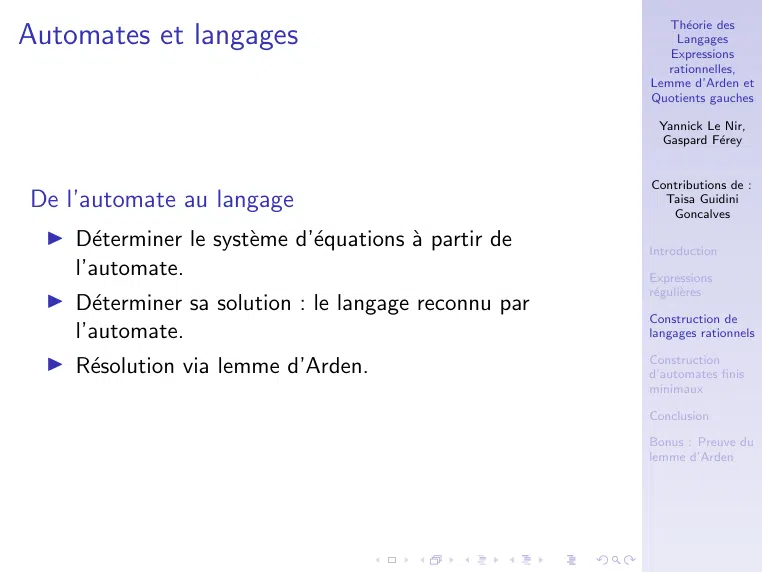

~~~text
                                                           Théorie des
Automates et langages                                       Langages
                                                           Expressions
                                                           rationnelles,
                                                        Lemme d’Arden et
                                                        Quotients gauches

                                                         Yannick Le Nir,
                                                         Gaspard Férey

                                                        Contributions de :
De l’automate au langage                                  Taisa Guidini
                                                           Goncalves

  ▶ Déterminer le système d’équations à partir de   Introduction
    l’automate.                                         Expressions
                                                        régulières
  ▶ Déterminer sa solution : le langage reconnu par
                                                        Construction de
    l’automate.                                         langages rationnels

  ▶ Résolution via lemme d’Arden.                      Construction
                                                        d’automates finis
                                                        minimaux

                                                        Conclusion

                                                        Bonus : Preuve du
                                                        lemme d’Arden
~~~

## Page 9

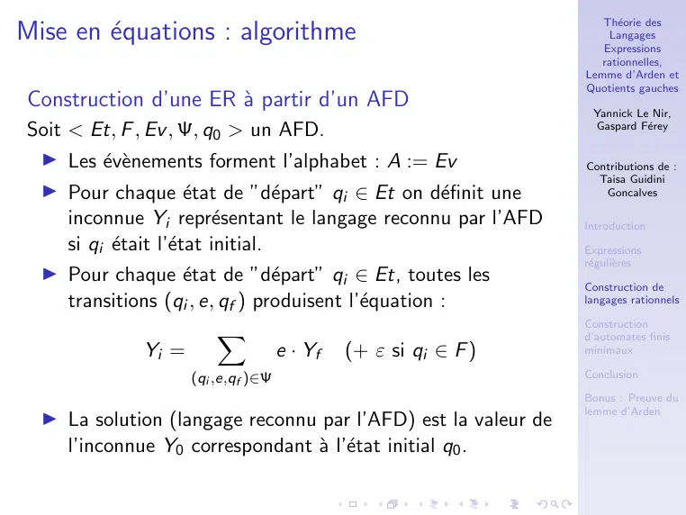

~~~text
                                                                  Théorie des
Mise en équations : algorithme                                    Langages
                                                                  Expressions
                                                                  rationnelles,
                                                               Lemme d’Arden et
                                                               Quotients gauches
Construction d’une ER à partir d’un AFD                        Yannick Le Nir,
Soit < Et, F , Ev , Ψ, q0 > un AFD.                             Gaspard Férey

 ▶ Les évènements forment l’alphabet : A := Ev               Contributions de :
                                                                 Taisa Guidini
  ▶ Pour chaque état de ”départ” qi ∈ Et on définit une        Goncalves

    inconnue Yi représentant le langage reconnu par l’AFD     Introduction
    si qi était l’état initial.                              Expressions
                                                               régulières
  ▶ Pour chaque état de ”départ” qi ∈ Et, toutes les
                                                               Construction de
    transitions (qi , e, qf ) produisent l’équation :         langages rationnels

                                                               Construction
                          X                                    d’automates finis
               Yi =               e · Yf (+ ε si qi ∈ F )      minimaux

                  (qi ,e,qf )∈Ψ                                Conclusion

                                                               Bonus : Preuve du
                                                               lemme d’Arden
  ▶ La solution (langage reconnu par l’AFD) est la valeur de
    l’inconnue Y0 correspondant à l’état initial q0 .
~~~

## Page 10

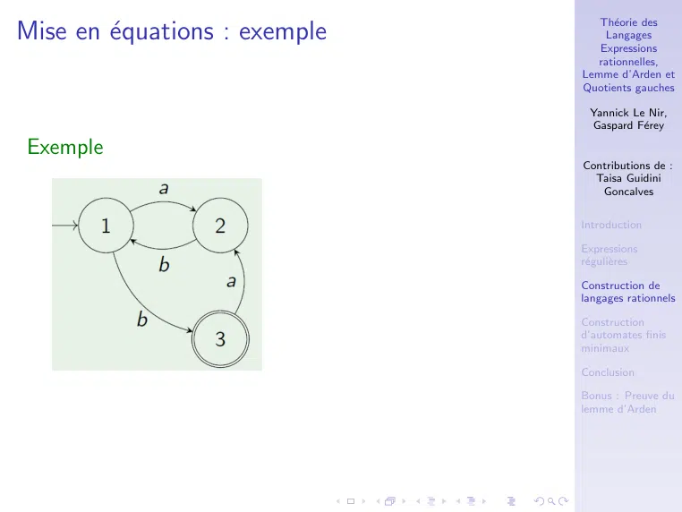

~~~text
                                  Théorie des
Mise en équations : exemple       Langages
                                  Expressions
                                  rationnelles,
                               Lemme d’Arden et
                               Quotients gauches

                                Yannick Le Nir,
                                Gaspard Férey

Exemple
                               Contributions de :
                                 Taisa Guidini
                                  Goncalves

                               Introduction

                               Expressions
                               régulières

                               Construction de
                               langages rationnels

                               Construction
                               d’automates finis
                               minimaux

                               Conclusion

                               Bonus : Preuve du
                               lemme d’Arden
~~~

## Page 11

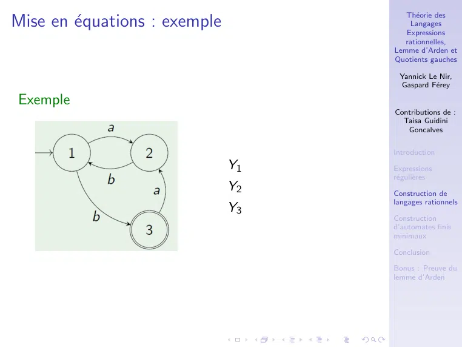

~~~text
                                       Théorie des
Mise en équations : exemple            Langages
                                       Expressions
                                       rationnelles,
                                    Lemme d’Arden et
                                    Quotients gauches

                                     Yannick Le Nir,
                                     Gaspard Férey

Exemple
                                    Contributions de :
                                      Taisa Guidini
                                       Goncalves

                                    Introduction
                               Y1   Expressions
                                    régulières
                               Y2   Construction de
                                    langages rationnels
                               Y3
                                    Construction
                                    d’automates finis
                                    minimaux

                                    Conclusion

                                    Bonus : Preuve du
                                    lemme d’Arden
~~~

## Page 12

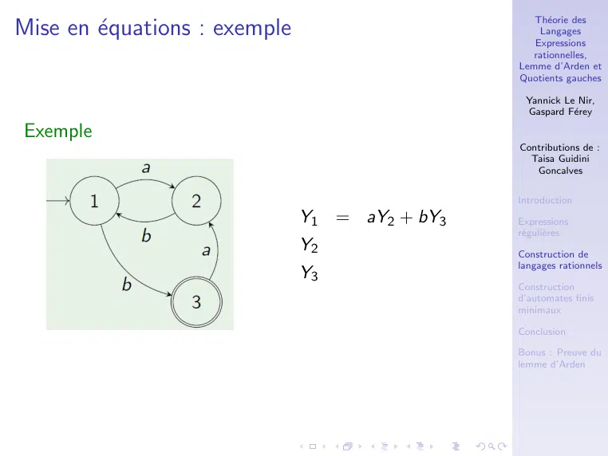

~~~text
                                                   Théorie des
Mise en équations : exemple                        Langages
                                                   Expressions
                                                   rationnelles,
                                                Lemme d’Arden et
                                                Quotients gauches

                                                 Yannick Le Nir,
                                                 Gaspard Férey

Exemple
                                                Contributions de :
                                                  Taisa Guidini
                                                   Goncalves

                                                Introduction
                               Y1 = aY2 + bY3   Expressions
                                                régulières
                               Y2               Construction de
                                                langages rationnels
                               Y3
                                                Construction
                                                d’automates finis
                                                minimaux

                                                Conclusion

                                                Bonus : Preuve du
                                                lemme d’Arden
~~~

## Page 13

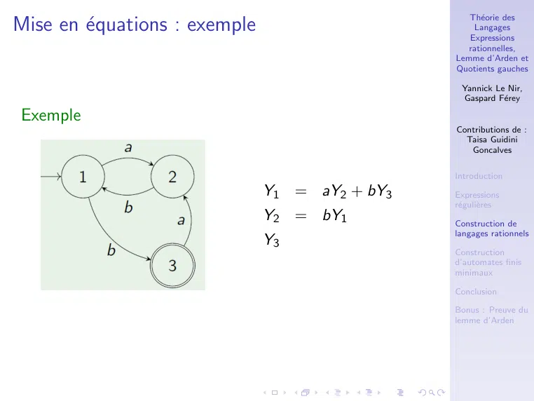

~~~text
                                                   Théorie des
Mise en équations : exemple                        Langages
                                                   Expressions
                                                   rationnelles,
                                                Lemme d’Arden et
                                                Quotients gauches

                                                 Yannick Le Nir,
                                                 Gaspard Férey

Exemple
                                                Contributions de :
                                                  Taisa Guidini
                                                   Goncalves

                                                Introduction
                               Y1 = aY2 + bY3   Expressions
                                                régulières
                               Y2 = bY1         Construction de
                                                langages rationnels
                               Y3
                                                Construction
                                                d’automates finis
                                                minimaux

                                                Conclusion

                                                Bonus : Preuve du
                                                lemme d’Arden
~~~

## Page 14

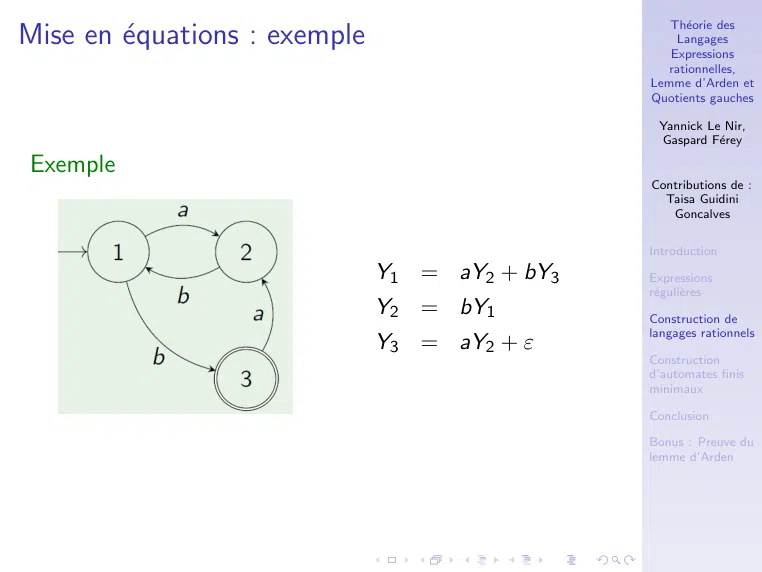

~~~text
                                                   Théorie des
Mise en équations : exemple                        Langages
                                                   Expressions
                                                   rationnelles,
                                                Lemme d’Arden et
                                                Quotients gauches

                                                 Yannick Le Nir,
                                                 Gaspard Férey

Exemple
                                                Contributions de :
                                                  Taisa Guidini
                                                   Goncalves

                                                Introduction
                               Y1 = aY2 + bY3   Expressions
                                                régulières
                               Y2 = bY1         Construction de
                                                langages rationnels
                               Y3 = aY2 + ε
                                                Construction
                                                d’automates finis
                                                minimaux

                                                Conclusion

                                                Bonus : Preuve du
                                                lemme d’Arden
~~~

## Page 15

~~~text
                                                            Théorie des
Lemme d’Arden                                                Langages
                                                            Expressions
                                                            rationnelles,
                                                         Lemme d’Arden et
                                                         Quotients gauches

                                                          Yannick Le Nir,
                                                          Gaspard Férey

Lemme                                                    Contributions de :
                                                           Taisa Guidini
Soient A et D des langages.                                 Goncalves

Soit (E ) une équation de la forme X = A.X + D.         Introduction

 1. Le langage X = A∗ D est une solution de (E )         Expressions
                                                         régulières

 2. Toute solution de (E ) contient A∗ D (solution       Construction de
                                                         langages rationnels
    minimale).
                                                         Construction
         / A alors A∗ D est l’unique solution de (E ).
 3. Si ε ∈                                               d’automates finis
                                                         minimaux

                                                         Conclusion

                                                         Bonus : Preuve du
                                                         lemme d’Arden
~~~

## Page 16

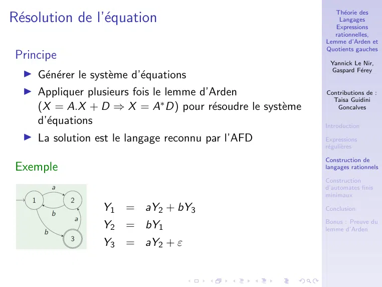

~~~text
                                                             Théorie des
Résolution de l’équation                                    Langages
                                                             Expressions
                                                             rationnelles,
                                                          Lemme d’Arden et
                                                          Quotients gauches
 Principe
                                                           Yannick Le Nir,
                                                           Gaspard Férey
  ▶ Générer le système d’équations
  ▶ Appliquer plusieurs fois le lemme d’Arden             Contributions de :
                                                            Taisa Guidini
    (X = A.X + D ⇒ X = A∗ D) pour résoudre le système      Goncalves

    d’équations                                          Introduction
  ▶ La solution est le langage reconnu par l’AFD          Expressions
                                                          régulières

                                                          Construction de
 Exemple                                                  langages rationnels

                                                          Construction
                                                          d’automates finis
                                                          minimaux

                   Y1 = aY2 + bY3                         Conclusion

                                                          Bonus : Preuve du
                   Y2 = bY1                               lemme d’Arden

                   Y3 = aY2 + ε
~~~

## Page 17

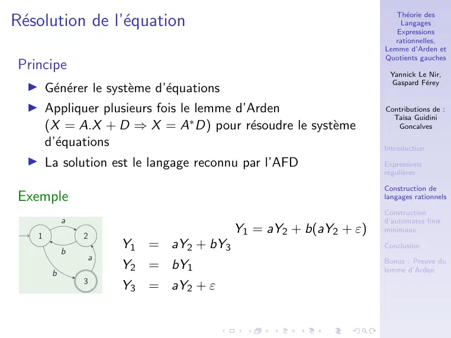

~~~text
                                                                    Théorie des
Résolution de l’équation                                           Langages
                                                                    Expressions
                                                                    rationnelles,
                                                                 Lemme d’Arden et
                                                                 Quotients gauches
 Principe
                                                                  Yannick Le Nir,
                                                                  Gaspard Férey
  ▶ Générer le système d’équations
  ▶ Appliquer plusieurs fois le lemme d’Arden                    Contributions de :
                                                                   Taisa Guidini
    (X = A.X + D ⇒ X = A∗ D) pour résoudre le système             Goncalves

    d’équations                                                 Introduction
  ▶ La solution est le langage reconnu par l’AFD                 Expressions
                                                                 régulières

                                                                 Construction de
 Exemple                                                         langages rationnels

                                                                 Construction
                                                                 d’automates finis
                                         Y1 = aY2 + b(aY2 + ε)   minimaux

                   Y1 = aY2 + bY3                                Conclusion

                                                                 Bonus : Preuve du
                   Y2 = bY1                                      lemme d’Arden

                   Y3 = aY2 + ε
~~~

## Page 18

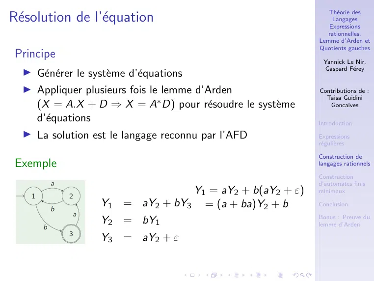

~~~text
                                                              Théorie des
Résolution de l’équation                                     Langages
                                                              Expressions
                                                              rationnelles,
                                                           Lemme d’Arden et
                                                           Quotients gauches
 Principe
                                                            Yannick Le Nir,
                                                            Gaspard Férey
  ▶ Générer le système d’équations
  ▶ Appliquer plusieurs fois le lemme d’Arden              Contributions de :
                                                             Taisa Guidini
    (X = A.X + D ⇒ X = A∗ D) pour résoudre le système       Goncalves

    d’équations                                           Introduction
  ▶ La solution est le langage reconnu par l’AFD           Expressions
                                                           régulières

                                                           Construction de
 Exemple                                                   langages rationnels

                                                           Construction
                                                           d’automates finis
                                   Y1 = aY2 + b(aY2 + ε)   minimaux

                   Y1   = aY2 + bY3 = (a + ba)Y2 + b       Conclusion

                                                           Bonus : Preuve du
                   Y2   = bY1                              lemme d’Arden

                   Y3 = aY2 + ε
~~~

## Page 19

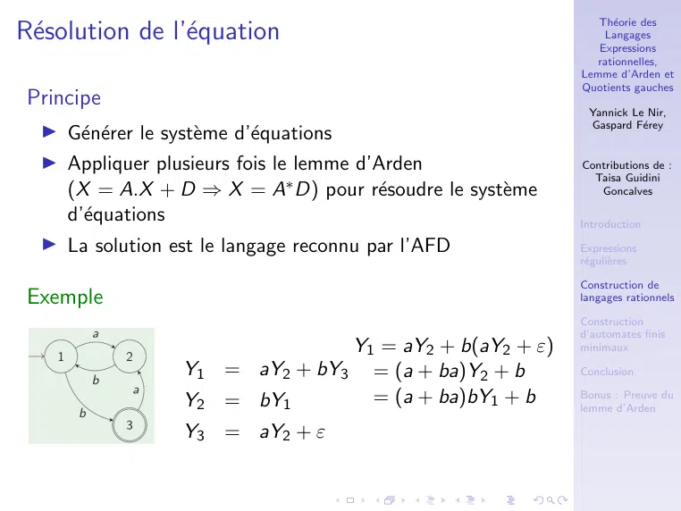

~~~text
                                                              Théorie des
Résolution de l’équation                                     Langages
                                                              Expressions
                                                              rationnelles,
                                                           Lemme d’Arden et
                                                           Quotients gauches
 Principe
                                                            Yannick Le Nir,
                                                            Gaspard Férey
  ▶ Générer le système d’équations
  ▶ Appliquer plusieurs fois le lemme d’Arden              Contributions de :
                                                             Taisa Guidini
    (X = A.X + D ⇒ X = A∗ D) pour résoudre le système       Goncalves

    d’équations                                           Introduction
  ▶ La solution est le langage reconnu par l’AFD           Expressions
                                                           régulières

                                                           Construction de
 Exemple                                                   langages rationnels

                                                           Construction
                                                           d’automates finis
                                   Y1 = aY2 + b(aY2 + ε)   minimaux

                   Y1   = aY2 + bY3 = (a + ba)Y2 + b       Conclusion

                   Y2   = bY1        = (a + ba)bY1 + b     Bonus : Preuve du
                                                           lemme d’Arden

                   Y3 = aY2 + ε
~~~

## Page 20

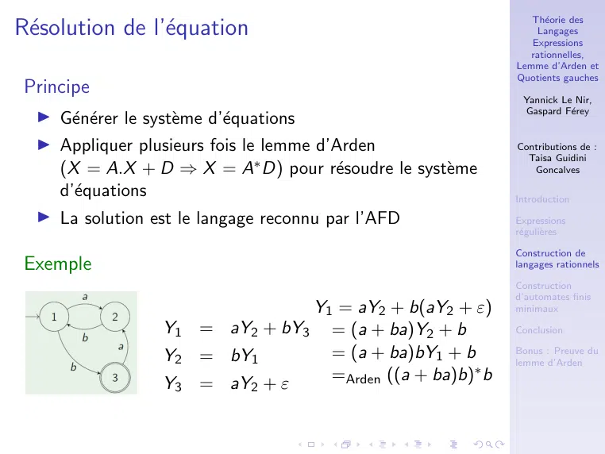

~~~text
                                                                Théorie des
Résolution de l’équation                                       Langages
                                                                Expressions
                                                                rationnelles,
                                                             Lemme d’Arden et
                                                             Quotients gauches
 Principe
                                                              Yannick Le Nir,
                                                              Gaspard Férey
  ▶ Générer le système d’équations
  ▶ Appliquer plusieurs fois le lemme d’Arden                Contributions de :
                                                               Taisa Guidini
    (X = A.X + D ⇒ X = A∗ D) pour résoudre le système         Goncalves

    d’équations                                             Introduction
  ▶ La solution est le langage reconnu par l’AFD             Expressions
                                                             régulières

                                                             Construction de
 Exemple                                                     langages rationnels

                                                             Construction
                                                             d’automates finis
                                   Y1 = aY2 + b(aY2 + ε)     minimaux

                   Y1   = aY2 + bY3 = (a + ba)Y2 + b         Conclusion

                   Y2   = bY1        = (a + ba)bY1 + b       Bonus : Preuve du
                                                             lemme d’Arden

                   Y3   = aY2 + ε    =Arden ((a + ba)b)∗ b
~~~

## Page 21

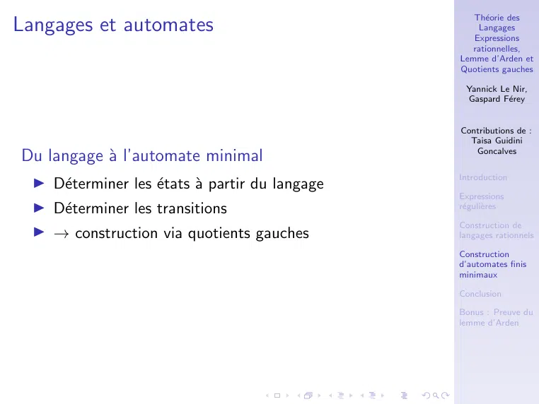

~~~text
                                                     Théorie des
Langages et automates                                 Langages
                                                     Expressions
                                                     rationnelles,
                                                  Lemme d’Arden et
                                                  Quotients gauches

                                                   Yannick Le Nir,
                                                   Gaspard Férey

                                                  Contributions de :
                                                    Taisa Guidini
                                                     Goncalves
Du langage à l’automate minimal
                                                  Introduction
  ▶ Déterminer les états à partir du langage
                                                  Expressions
  ▶ Déterminer les transitions                   régulières

                                                  Construction de
  ▶ → construction via quotients gauches          langages rationnels

                                                  Construction
                                                  d’automates finis
                                                  minimaux

                                                  Conclusion

                                                  Bonus : Preuve du
                                                  lemme d’Arden
~~~

## Page 22

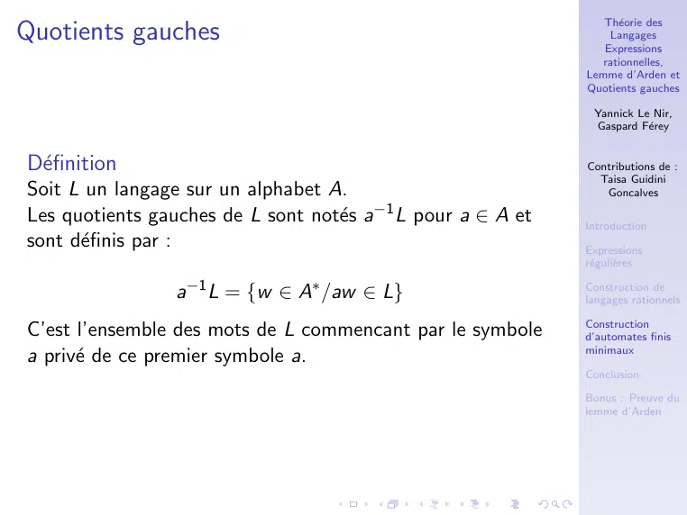

~~~text
                                                                Théorie des
Quotients gauches                                                Langages
                                                                Expressions
                                                                rationnelles,
                                                             Lemme d’Arden et
                                                             Quotients gauches

                                                              Yannick Le Nir,
                                                              Gaspard Férey

Définition                                                  Contributions de :
                                                               Taisa Guidini
Soit L un langage sur un alphabet A.                            Goncalves

Les quotients gauches de L sont notés a−1 L pour a ∈ A et   Introduction
sont définis par :                                          Expressions
                                                             régulières

                 a−1 L = {w ∈ A∗ /aw ∈ L}                    Construction de
                                                             langages rationnels

                                                             Construction
C’est l’ensemble des mots de L commencant par le symbole     d’automates finis
                                                             minimaux
a privé de ce premier symbole a.
                                                             Conclusion

                                                             Bonus : Preuve du
                                                             lemme d’Arden
~~~

## Page 23

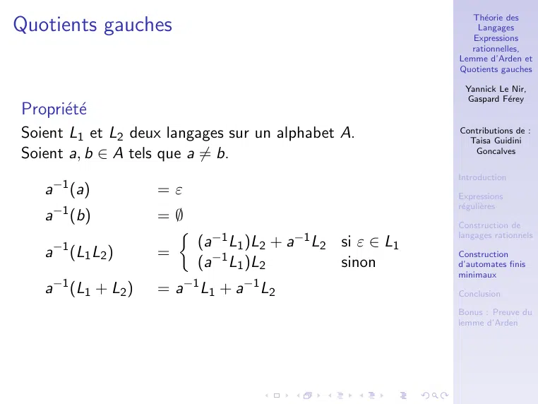

~~~text
                                                         Théorie des
Quotients gauches                                         Langages
                                                         Expressions
                                                         rationnelles,
                                                      Lemme d’Arden et
                                                      Quotients gauches

                                                       Yannick Le Nir,
                                                       Gaspard Férey
Propriété
Soient L1 et L2 deux langages sur un alphabet A.      Contributions de :
                                                        Taisa Guidini
Soient a, b ∈ A tels que a ̸= b.                         Goncalves

                                                      Introduction
   a−1 (a)          =ε                                Expressions
                                                      régulières
       −1
   a        (b)     =∅                                Construction de
                       −1
                       (a L1 )L2 + a−1 L2 si ε ∈ L1
                                                      langages rationnels

   a−1 (L1 L2 )     =                                 Construction
                       (a−1 L1 )L2        sinon       d’automates finis
                                                      minimaux
   a−1 (L1 + L2 )   = a−1 L1 + a−1 L2                 Conclusion

                                                      Bonus : Preuve du
                                                      lemme d’Arden
~~~

## Page 24

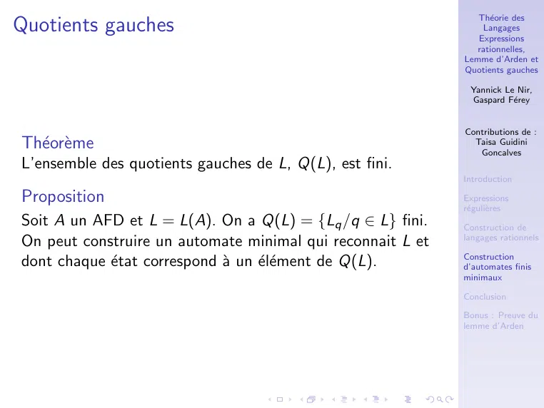

~~~text
                                                               Théorie des
Quotients gauches                                               Langages
                                                               Expressions
                                                               rationnelles,
                                                            Lemme d’Arden et
                                                            Quotients gauches

                                                             Yannick Le Nir,
                                                             Gaspard Férey

                                                            Contributions de :
Théorème                                                    Taisa Guidini
                                                               Goncalves
L’ensemble des quotients gauches de L, Q(L), est fini.
                                                            Introduction

Proposition                                                 Expressions
                                                            régulières
Soit A un AFD et L = L(A). On a Q(L) = {Lq /q ∈ L} fini.    Construction de
                                                            langages rationnels
On peut construire un automate minimal qui reconnait L et
                                                            Construction
dont chaque état correspond à un élément de Q(L).       d’automates finis
                                                            minimaux

                                                            Conclusion

                                                            Bonus : Preuve du
                                                            lemme d’Arden
~~~

## Page 25

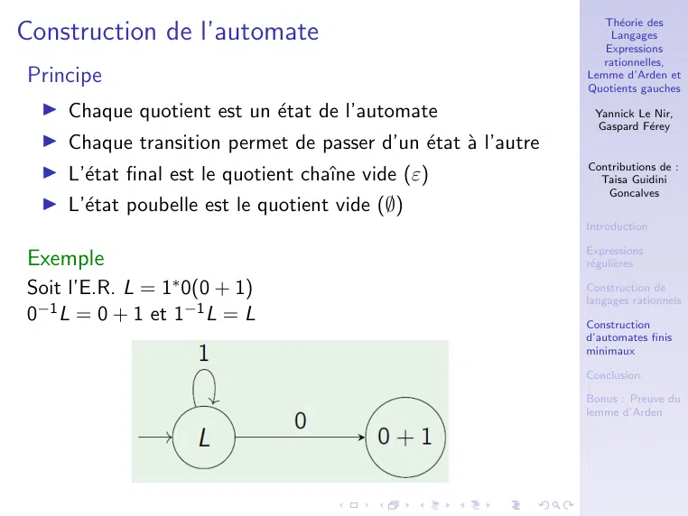

~~~text
                                                                  Théorie des
Construction de l’automate                                         Langages
                                                                  Expressions
                                                                  rationnelles,
Principe                                                       Lemme d’Arden et
                                                               Quotients gauches

  ▶ Chaque quotient est un état de l’automate                  Yannick Le Nir,
                                                                Gaspard Férey
  ▶ Chaque transition permet de passer d’un état à l’autre
                                                               Contributions de :
  ▶ L’état final est le quotient chaı̂ne vide (ε)               Taisa Guidini
                                                                  Goncalves
  ▶ L’état poubelle est le quotient vide (∅)
                                                               Introduction

                                                               Expressions
Exemple                                                        régulières

Soit l’E.R. L = 1∗ 0(0 + 1)                                    Construction de
                                                               langages rationnels
0−1 L = 0 + 1 et 1−1 L = L                                     Construction
                                                               d’automates finis
                                                               minimaux

                                                               Conclusion

                                                               Bonus : Preuve du
                                                               lemme d’Arden
~~~

## Page 26

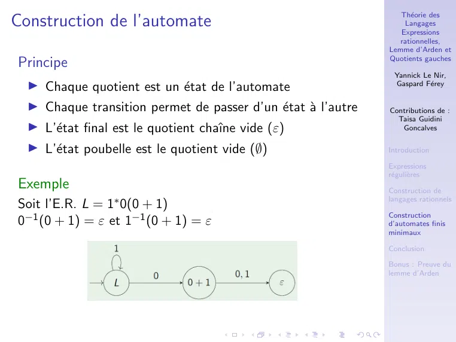

~~~text
                                                                  Théorie des
Construction de l’automate                                         Langages
                                                                  Expressions
                                                                  rationnelles,
                                                               Lemme d’Arden et
                                                               Quotients gauches
Principe
                                                                Yannick Le Nir,
  ▶ Chaque quotient est un état de l’automate                  Gaspard Férey

  ▶ Chaque transition permet de passer d’un état à l’autre   Contributions de :
                                                                 Taisa Guidini
  ▶ L’état final est le quotient chaı̂ne vide (ε)                Goncalves

  ▶ L’état poubelle est le quotient vide (∅)                  Introduction

                                                               Expressions
                                                               régulières
Exemple                                                        Construction de

Soit l’E.R. L = 1∗ 0(0 + 1)                                    langages rationnels

                                                               Construction
0−1 (0 + 1) = ε et 1−1 (0 + 1) = ε                             d’automates finis
                                                               minimaux

                                                               Conclusion

                                                               Bonus : Preuve du
                                                               lemme d’Arden
~~~

## Page 27

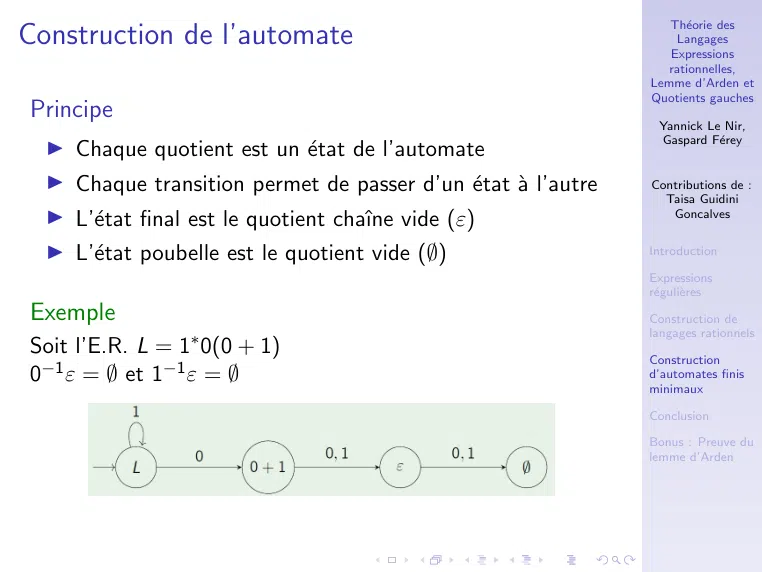

~~~text
                                                                  Théorie des
Construction de l’automate                                         Langages
                                                                  Expressions
                                                                  rationnelles,
                                                               Lemme d’Arden et
                                                               Quotients gauches
Principe
                                                                Yannick Le Nir,
                                                                Gaspard Férey
  ▶ Chaque quotient est un état de l’automate
  ▶ Chaque transition permet de passer d’un état à l’autre   Contributions de :
                                                                 Taisa Guidini
  ▶ L’état final est le quotient chaı̂ne vide (ε)                Goncalves

  ▶ L’état poubelle est le quotient vide (∅)                  Introduction

                                                               Expressions
                                                               régulières
Exemple                                                        Construction de
                                                               langages rationnels
Soit l’E.R. L = 1∗ 0(0 + 1)                                    Construction
0−1 ε = ∅ et 1−1 ε = ∅                                         d’automates finis
                                                               minimaux

                                                               Conclusion

                                                               Bonus : Preuve du
                                                               lemme d’Arden
~~~

## Page 28

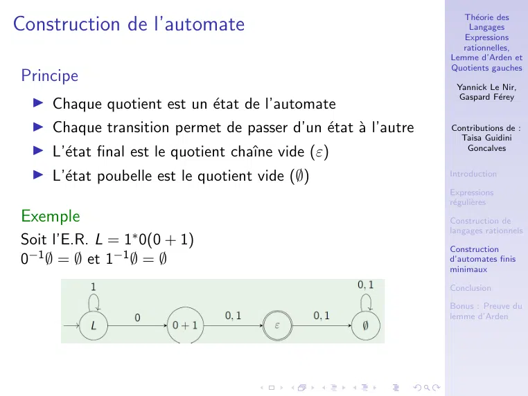

~~~text
                                                                  Théorie des
Construction de l’automate                                         Langages
                                                                  Expressions
                                                                  rationnelles,
                                                               Lemme d’Arden et
                                                               Quotients gauches
Principe                                                        Yannick Le Nir,
                                                                Gaspard Férey
  ▶ Chaque quotient est un état de l’automate
  ▶ Chaque transition permet de passer d’un état à l’autre   Contributions de :
                                                                 Taisa Guidini
  ▶ L’état final est le quotient chaı̂ne vide (ε)                Goncalves

  ▶ L’état poubelle est le quotient vide (∅)                  Introduction

                                                               Expressions
                                                               régulières
Exemple                                                        Construction de
                                                               langages rationnels
Soit l’E.R. L = 1∗ 0(0 + 1)                                    Construction
0−1 ∅ = ∅ et 1−1 ∅ = ∅                                         d’automates finis
                                                               minimaux

                                                               Conclusion

                                                               Bonus : Preuve du
                                                               lemme d’Arden
~~~

## Page 29

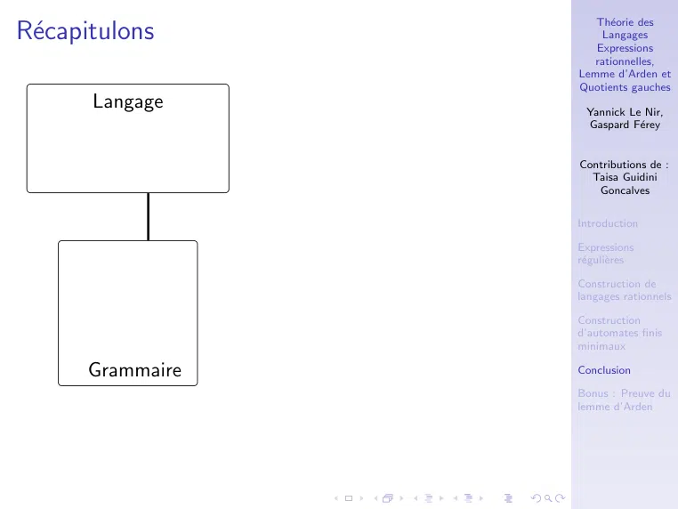

~~~text
                     Théorie des
Récapitulons         Langages
                     Expressions
                     rationnelles,
                  Lemme d’Arden et
                  Quotients gauches
       Langage     Yannick Le Nir,
                   Gaspard Férey

                  Contributions de :
                    Taisa Guidini
                     Goncalves

                  Introduction

                  Expressions
                  régulières

                  Construction de
                  langages rationnels

                  Construction
                  d’automates finis
                  minimaux

      Grammaire   Conclusion

                  Bonus : Preuve du
                  lemme d’Arden
~~~

## Page 30

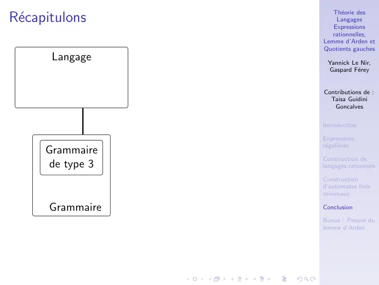

~~~text
                      Théorie des
Récapitulons          Langages
                      Expressions
                      rationnelles,
                   Lemme d’Arden et
                   Quotients gauches
       Langage      Yannick Le Nir,
                    Gaspard Férey

                   Contributions de :
                     Taisa Guidini
                      Goncalves

                   Introduction

                   Expressions
                   régulières
      Grammaire
                   Construction de
       de type 3   langages rationnels

                   Construction
                   d’automates finis
                   minimaux

      Grammaire    Conclusion

                   Bonus : Preuve du
                   lemme d’Arden
~~~

## Page 31

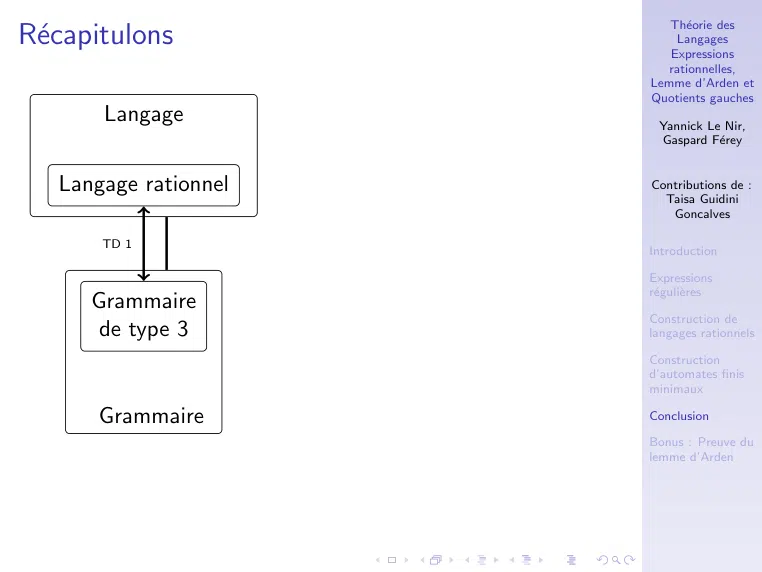

~~~text
                          Théorie des
Récapitulons              Langages
                          Expressions
                          rationnelles,
                       Lemme d’Arden et
                       Quotients gauches
       Langage          Yannick Le Nir,
                        Gaspard Férey

   Langage rationnel   Contributions de :
                         Taisa Guidini
                          Goncalves

       TD 1
                       Introduction

                       Expressions
                       régulières
      Grammaire
                       Construction de
       de type 3       langages rationnels

                       Construction
                       d’automates finis
                       minimaux

       Grammaire       Conclusion

                       Bonus : Preuve du
                       lemme d’Arden
~~~

## Page 32

~~~text
                                          Théorie des
Récapitulons                              Langages
                                          Expressions
                                          rationnelles,
                                       Lemme d’Arden et
                                       Quotients gauches
       Langage                          Yannick Le Nir,
                                        Gaspard Férey

   Langage rationnel                   Contributions de :
                                         Taisa Guidini
                                          Goncalves

       TD 1
                                       Introduction

                                       Expressions
                                       régulières
      Grammaire
                       Automate fini   Construction de
       de type 3                       langages rationnels

                                       Construction
                                       d’automates finis
                                       minimaux

       Grammaire                       Conclusion

                                       Bonus : Preuve du
                                       lemme d’Arden
~~~

## Page 33

~~~text
                                                 Théorie des
Récapitulons                                     Langages
                                                 Expressions
                                                 rationnelles,
                                              Lemme d’Arden et
                                              Quotients gauches
       Langage                                 Yannick Le Nir,
                                               Gaspard Férey

   Langage rationnel                          Contributions de :
                                                Taisa Guidini
                                                 Goncalves
                       TD 2
       TD 1
                                              Introduction

                                              Expressions
                                              régulières
      Grammaire
                              Automate fini   Construction de
       de type 3                              langages rationnels

                                              Construction
                                              d’automates finis
                                              minimaux

       Grammaire                              Conclusion

                                              Bonus : Preuve du
                                              lemme d’Arden
~~~

## Page 34

~~~text
                                                 Théorie des
Récapitulons                                     Langages
                                                 Expressions
                                                 rationnelles,
                                              Lemme d’Arden et
                                              Quotients gauches
       Langage                                 Yannick Le Nir,
                                               Gaspard Férey

   Langage rationnel                          Contributions de :
                                                Taisa Guidini
                                                 Goncalves
                       TD 2
       TD 1
                                              Introduction

                                              Expressions
                                              régulières
      Grammaire    TD 2
                              Automate fini   Construction de
       de type 3                              langages rationnels

                                              Construction
                                              d’automates finis
                                              minimaux

       Grammaire                              Conclusion

                                              Bonus : Preuve du
                                              lemme d’Arden
~~~

## Page 35

~~~text
                                                                          Théorie des
Récapitulons                                                              Langages
                                                                          Expressions
                                                                          rationnelles,
                                                                       Lemme d’Arden et
                                                                       Quotients gauches
       Langage                                                          Yannick Le Nir,
                                                                        Gaspard Férey

   Langage rationnel                                                   Contributions de :
                                                                         Taisa Guidini
                                                                          Goncalves
                       TD 2
       TD 1
                                                                       Introduction

                                                                       Expressions
                                                                       régulières
      Grammaire    TD 2
                              Automate fini                            Construction de
       de type 3                                                       langages rationnels
                                TD 2
                                                                       Construction
                                                                       d’automates finis
                              Automate fini   TD 2
                                                                       minimaux

       Grammaire                complet                                Conclusion
                                                     Automate fini
                                                                   Bonus : Preuve du
                                                     déterministe lemme d’Arden
                                                        complet
~~~

## Page 36

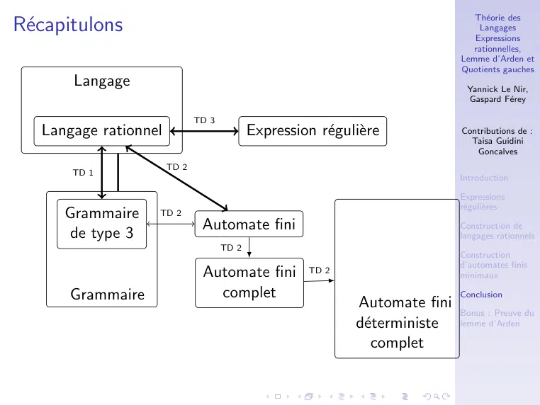

~~~text
                                                                                   Théorie des
Récapitulons                                                                       Langages
                                                                                   Expressions
                                                                                   rationnelles,
                                                                                Lemme d’Arden et
                                                                                Quotients gauches
       Langage                                                                   Yannick Le Nir,
                                                                                 Gaspard Férey

                              TD 3
   Langage rationnel                        Expression régulière              Contributions de :
                                                                                  Taisa Guidini
                                                                                   Goncalves
                       TD 2
       TD 1
                                                                                Introduction

                                                                                Expressions
                                                                                régulières
      Grammaire    TD 2
                               Automate fini                                    Construction de
       de type 3                                                                langages rationnels
                                     TD 2
                                                                                Construction
                                                                                d’automates finis
                               Automate fini          TD 2
                                                                                minimaux

       Grammaire                 complet                                        Conclusion
                                                              Automate fini
                                                                            Bonus : Preuve du
                                                              déterministe lemme d’Arden
                                                                 complet
~~~

## Page 37

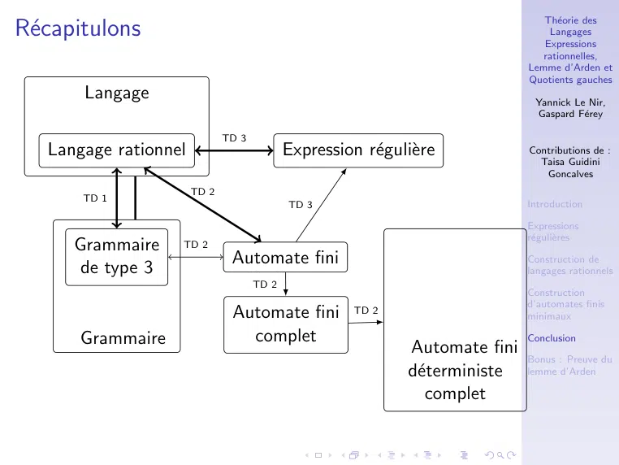

~~~text
                                                                                   Théorie des
Récapitulons                                                                       Langages
                                                                                   Expressions
                                                                                   rationnelles,
                                                                                Lemme d’Arden et
                                                                                Quotients gauches
       Langage                                                                   Yannick Le Nir,
                                                                                 Gaspard Férey

                              TD 3
   Langage rationnel                        Expression régulière              Contributions de :
                                                                                  Taisa Guidini
                                                                                   Goncalves
                       TD 2
       TD 1
                                            TD 3                                Introduction

                                                                                Expressions
                                                                                régulières
      Grammaire    TD 2
                               Automate fini                                    Construction de
       de type 3                                                                langages rationnels
                                     TD 2
                                                                                Construction
                                                                                d’automates finis
                               Automate fini          TD 2
                                                                                minimaux

       Grammaire                 complet                                        Conclusion
                                                              Automate fini
                                                                            Bonus : Preuve du
                                                              déterministe lemme d’Arden
                                                                 complet
~~~

## Page 38

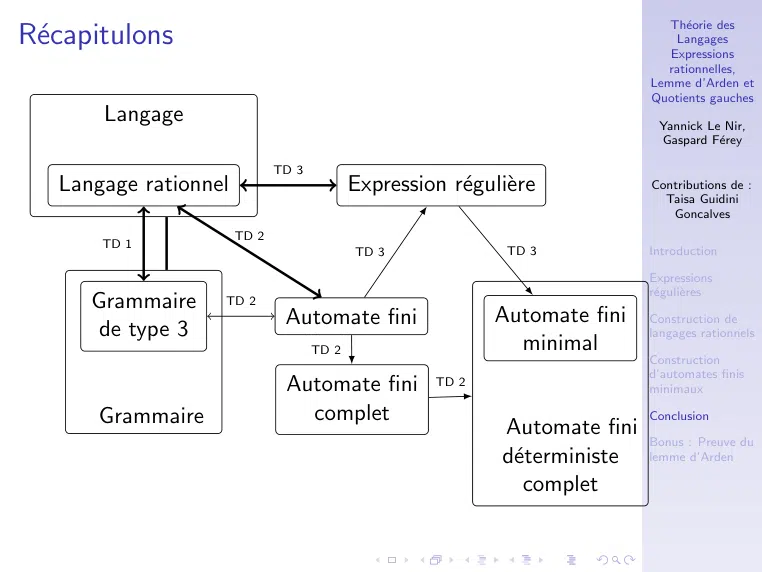

~~~text
                                                                                   Théorie des
Récapitulons                                                                       Langages
                                                                                   Expressions
                                                                                   rationnelles,
                                                                                Lemme d’Arden et
                                                                                Quotients gauches
       Langage                                                                   Yannick Le Nir,
                                                                                 Gaspard Férey

                              TD 3
   Langage rationnel                        Expression régulière              Contributions de :
                                                                                  Taisa Guidini
                                                                                   Goncalves
                       TD 2
       TD 1
                                            TD 3              TD 3              Introduction

                                                                                Expressions
                                                                                régulières
      Grammaire    TD 2
                               Automate fini                 Automate fini      Construction de
       de type 3                                                                langages rationnels
                                     TD 2                      minimal
                                                                                Construction
                                                                                d’automates finis
                               Automate fini          TD 2
                                                                                minimaux

       Grammaire                 complet                                        Conclusion
                                                              Automate fini
                                                                            Bonus : Preuve du
                                                              déterministe lemme d’Arden
                                                                 complet
~~~

## Page 39

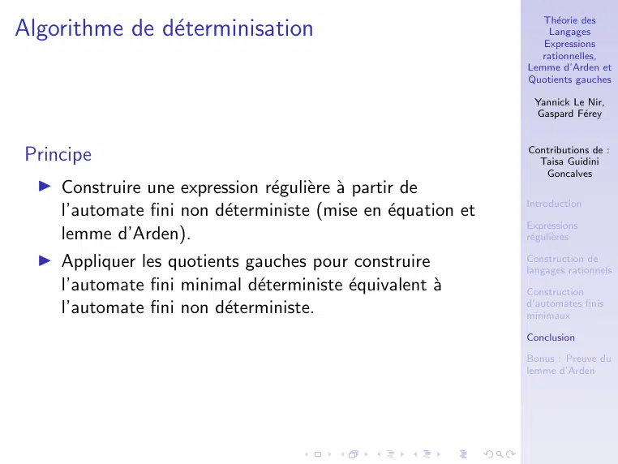

~~~text
                                                                 Théorie des
Algorithme de déterminisation                                    Langages
                                                                 Expressions
                                                                 rationnelles,
                                                              Lemme d’Arden et
                                                              Quotients gauches

                                                               Yannick Le Nir,
                                                               Gaspard Férey

                                                              Contributions de :
Principe                                                        Taisa Guidini
                                                                 Goncalves
  ▶ Construire une expression régulière à partir de
                                                              Introduction
    l’automate fini non déterministe (mise en équation et
                                                              Expressions
    lemme d’Arden).                                           régulières

  ▶ Appliquer les quotients gauches pour construire           Construction de
                                                              langages rationnels
    l’automate fini minimal déterministe équivalent à      Construction
                                                              d’automates finis
    l’automate fini non déterministe.                        minimaux

                                                              Conclusion

                                                              Bonus : Preuve du
                                                              lemme d’Arden
~~~

## Page 40

~~~text
                                                             Théorie des
Preuve du lemme d’Arden                                       Langages
                                                             Expressions
                                                             rationnelles,
                                                          Lemme d’Arden et
Lemme                                                     Quotients gauches

(E )    X = A.X + D                                        Yannick Le Nir,
                                                           Gaspard Férey
  1. X = A∗ D est solution de (E ).
  2. A∗ D est la solution minimale.                       Contributions de :
                                                            Taisa Guidini
                                                             Goncalves
          / A alors A∗ D est l’unique solution de (E ).
  3. Si ε ∈
                                                          Introduction

                                                          Expressions
Preuve de 1.                                              régulières

                                                          Construction de
                                                          langages rationnels

                    A∗ D = (A+ + ε)D                      Construction
                                                          d’automates finis
                                                          minimaux
                         = (AA∗ + ε)D
                                                          Conclusion
                         = (AA∗ )D + εD                   Bonus : Preuve du
                                                          lemme d’Arden
                         = A(A∗ D) + D
~~~

## Page 41

~~~text
                                                             Théorie des
Preuve du lemme d’Arden                                       Langages
                                                             Expressions
                                                             rationnelles,
                                                          Lemme d’Arden et
Lemme                                                     Quotients gauches

(E )    X = A.X + D                                        Yannick Le Nir,
                                                           Gaspard Férey
  1. X = A∗ D est solution de (E ).
  2. A∗ D est la solution minimale.                       Contributions de :
                                                            Taisa Guidini
                                                             Goncalves
          / A alors A∗ D est l’unique solution de (E ).
  3. Si ε ∈
                                                          Introduction

                                                          Expressions
Preuve de 2.                                              régulières
Soit X solution de (E ).                                  Construction de
                                                          langages rationnels
Montrons par récurrence sur n que An D ⊂ X :
                                                          Construction
 ▶ n=0:D⊂X                                                d’automates finis
                                                          minimaux
  ▶ n > 0 : An D = A(An−1 D).                             Conclusion

    Or par hypothèse de recurrence, An−1 D ⊂ X           Bonus : Preuve du
                                                          lemme d’Arden
    Donc An D = A(An−1 D) ⊂ AX ⊂ X .
Donc ∀n, An D ⊂ X et on en conclut A∗ D ⊂ X .
~~~

## Page 42

~~~text
                                                              Théorie des
Preuve du lemme d’Arden                                        Langages
                                                              Expressions
                                                              rationnelles,
                                                           Lemme d’Arden et
Lemme                                                      Quotients gauches

(E )    X = A.X + D                                         Yannick Le Nir,
                                                            Gaspard Férey
  1. X = A∗ D est solution de (E ).
  2. A∗ D est la solution minimale.                        Contributions de :
                                                             Taisa Guidini
                                                              Goncalves
          / A alors A∗ D est l’unique solution de (E ).
  3. Si ε ∈
                                                           Introduction

                                                           Expressions
Preuve de 3.                                               régulières
Supposons ε ∈
            / A. Soit X solution de (E ) et w ∈ X .        Construction de

Montrons w ∈ A∗ D par récurrence forte sur |w |.          langages rationnels

                                                           Construction
 ▶ |w | = 0 : w = ε possible ssi w ∈ D ⊂ A∗ D.             d’automates finis
                                                           minimaux
  ▶ |w | > 0 : si w ∈/ D, alors nécessairement w ∈ AX .   Conclusion

    Donc w = aw avec a ∈ A et w ′ ∈ X .
                   ′                                       Bonus : Preuve du
                                                           lemme d’Arden
    Comme ε ∈   / A, |a| > 0 et |w ′ | < |w |.
    Par hypothèse de récurrence, w ′ ∈ A∗ D et donc
    w ∈ AA∗ D ⊂ A∗ D.
~~~
