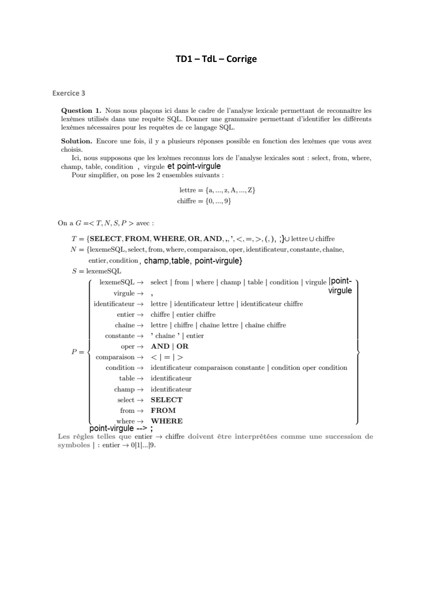

# Corrige TD01-1.pdf

[Ouvrir l’original](https://drive.google.com/open?id=1OVr0Hg1dom-OnuVSpg7l0Lkx1K94MYY1) · Les pages signalées comprennent du texte reconnu automatiquement ou des éléments graphiques. Le fac-similé permet de vérifier chaque lecture.

**Pages avec fac-similé ou lecture OCR** — 1.

## Page 1

~~~text
             TD1 – TdL – Corrige

Exercice 3
~~~

**Lecture OCR à contrôler**

~~~text
TD1-TdL- Corrige

Exercice 3

Question 1. Nous nous plaçons ici dans le cadre de l'analyse lexicale permettant de reconnaître les
lexèmes utilisés dans une requête SQL. Donner une grammaire permettant d'identifier les différents
lexèmes nécessaires pour les requêtes de ce langage SQL.

Solution. Encore une fois, il y a plusieurs réponses possible en fonction des lexèmes que vous avez
choisis.

Ici, nous supposons que les lexèmes reconnus lors de l'analyse lexicales sont
champ, table, condition , virgule et point-virgule

Pour simplifier, on pose les 2 ensembles suivants :

‘lect, from, where,

lettre = {a, ...,2, A, ...,Z}

chiffre = {0,..., 9}

On a G =<T,N,S,P > avec :

T = {SELECT, FROM, WHERE, OR, AND, ,,’,<,=,>,(,), ;}U lettre U chiffre
N = {lexemeSQL, select, from, where, comparaison, oper, identificateur, constante, chaine,
entier, condition, champ,table, point-virgule}
S = lexemeSQL
lexemeSQL — select | from | where | champ | table | condition | virgule |point-
virgule , virgule
identificateur — _ lettre | identificateur lettre | identificateur chiffre
entier + chiffre | entier chiffre
chaîne + lettre | chiffre | chaîne lettre | chaîne chiffre
constante +? chaîne ? | entier
oper + AND | OR
comparaison + <|=|>
condition —+  identificateur comparaison constante | condition oper condition
table  identificateur
champ — identificateur
select + SELECT
from FROM

where WHERE
point-virgule --> ;

Les règles telles que entier — chiffre doivent être interprétées comme une succession de

symboles | : entier + 0[1|...[9.
~~~

## Page 2

~~~text
Exercice 4.

Langages binaires

Soit A = {a, b} un alphabet binaire.

Question 1. Proposer une grammaire formelle définissant chacun des langages suivants :

Solution :
On suppose : T = A, S = S et N contient tous les symboles introduits par les règles de
production.

Les règles de production des grammaires.

1. Le langage des mots de taille 6 : A6

S → LLLLLL
L→ a|b

2. Le langage de tous les mots : A*

S → ε | aS | bS

3. Le langage des mots commencant par le symbole a et finissant par le symbole b : {a·u·b | u
∈ A*}

S → aKb
K → ε | aK | bK

4. Le langage des palindromes : {ε, a, b, aa, bb, aba, bab, …}

S → ε | a | b | aSa | bSb
~~~

## Page 3

~~~text
5. Le langage des mots tels que le symbole a n’est jamais suivi d’un autre symbole a :
{ε, a, ab, ba, bb, aba, abb, bab, bba, bbb, …}

S → ε | a | abS | bS

6. L’intersection des deux langages précédents

S → ε | a | b | aba | abSba | bSb

7. Le langage des mots contenant autant de a que de b

S → ε | SS | aSb | bSa

Il existe toujours plusieurs grammaires pour représenter un langage.

Ici, les propositions ne sont que des exemples de grammaires solutions.

Pour prouver que ces grammaires produisent bien le langage voulu il faut raisonner en deux
temps :
(a) Soit u un mot du langage. Quelle forme peut avoir u ? Comment produire u à partir de la
grammaire ?
(b) Soit u un mot produit par la grammaire. Quelle forme peut avoir u ? Pourquoi u
appartient-il bien au langage ?
~~~
