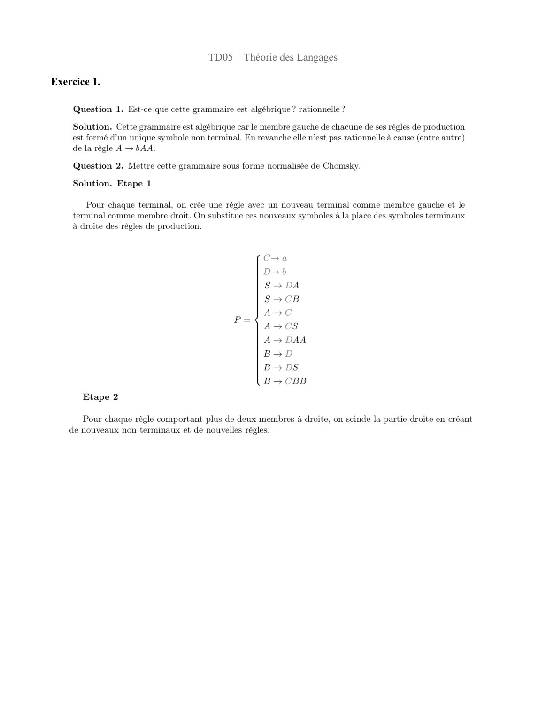
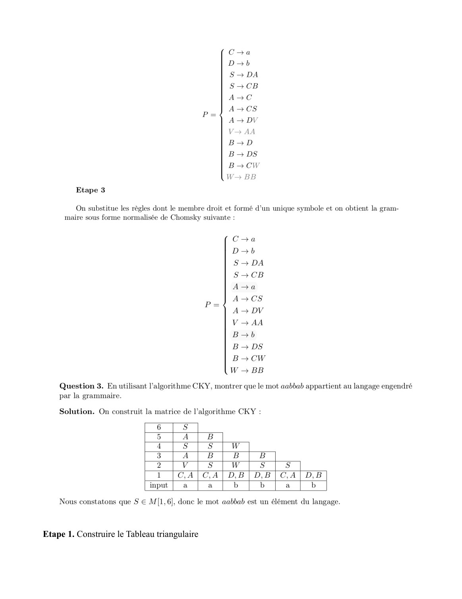
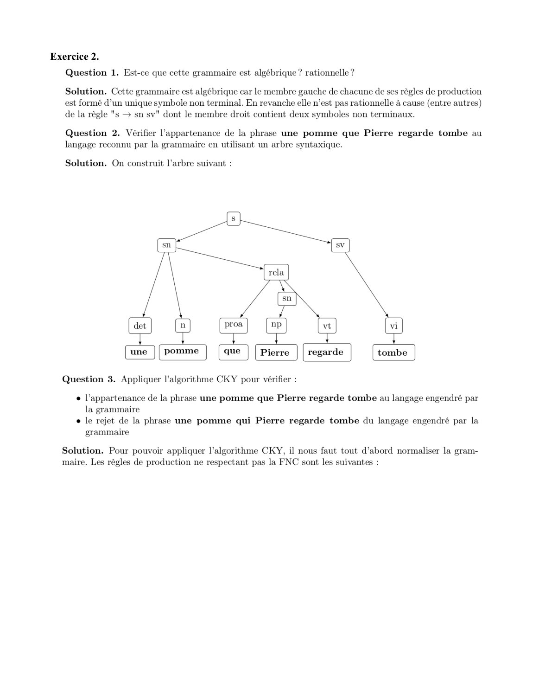

# Corrige TD05-1.pdf

[Ouvrir l’original](https://drive.google.com/open?id=1HA5XJC6VxzL9wzLTqe5MfgK1j20bU5GB) · Les pages signalées comprennent du texte reconnu automatiquement ou des éléments graphiques. Le fac-similé permet de vérifier chaque lecture.

**Pages avec fac-similé ou lecture OCR** — 1–2, 8.

## Page 1

~~~text
              TD05 – Théorie des Langages

Exercice 1.
~~~

**Lecture OCR à contrôler**

~~~text
TD05 — Théorie des Langages
Exercice 1.

Question 1. Est-ce que cette grammaire est algébrique ? rationnelle ?

Solution. Cette grammaire est algébrique car le membre gauche de chacune de ses règles de production
est formé d’un unique symbole non terminal. En revanche elle n’est pas rationnelle à cause (entre autre)
de la règle A> bAA.

Question 2. Mettre cette grammaire sous forme normalisée de Chomsky.

Solution. Etape 1

Pour chaque terminal, on crée une règle avec un nouveau terminal comme membre gauche et le
terminal comme membre droit. On substitue ces nouveaux symboles à la place des symboles terminaux
à droite des règles de production.

Coa
D- b
S— DA
S-—CcB
AC
A-CS
A DAA
BaD
Bo DS
B+ CBB

Etape 2

Pour chaque règle comportant plus de deux membres à droite, on scinde la partie droite en créant
de nouveaux non terminaux et de nouvelles règles.
~~~

## Page 2

~~~text
Etape 1. Construire le Tableau triangulaire
~~~

**Lecture OCR à contrôler**

~~~text
Cra
D-b
S— DA
S— CB
AC
A-CS
A- DV
V- AA
BaD
B- DS
Bocw
W- BB

Etape 3

On substitue les règles dont le membre droit et formé d’un unique symbole et on obtient la gram-
maire sous forme normalisée de Chomsky suivante :

Ca
Db
S— DA
S>CB
Aa
A>CS
ADV
V - AA
Bob
B- DS
BoCW
W - BB

Question 3. En utilisant l'algorithme CKY, montrer que le mot aabbab appartient au langage engendré
par la grammaire.

Solution. On construit la matrice de l'algorithme CKY :

6 S

5 A | B

4 Ss | Ss |W

3 Als | 8 |B

2 vis |wfs|s

1 |C,A[CA|D,B/D,B[CA|D,B
input | a | a b b a b

Nous constatons que S$ € M[1,6], donc le mot aabbab est un élément du langage.

Etape 1. Construire le Tableau triangulaire
~~~

## Page 3

~~~text
        6
        5
        4
        3
        2
        1
        Input

Etape 2. Dans la ligne input vous devez ajouter le mot à être reconnu.

        6
        5
        4
        3
        2
        1
        Input   a             a              b             b             a             b

Etape 3. Dans chaque case à partir de la ligne 1 nous devons ajouter des lettres qui font partie du côté
gauche des règles de la grammaire.

    •    Ligne 1

Dans la ligne 1 on va analyser les symboles 1 par 1 (mots de taille 1). Ça veut dire qu’on va ajouter la
lettre correspondante (côté gauche) des règles définies via la grammaire pour chaque symbole (côté
droite) de la ligne input.

Par exemple, les règles que génèrent le symbole a (côté droite) sont C → a et A → a
Alors dans la case [1,1] nous ajoutons (C, A).
Nous faisons pareil pour toutes les cases avec le symbole a.
Nous faisons pareil pour le symbole b.

6
5
4
3
2
1        C, A          C, A          D, B          D, B          C, A          D, B
Input    a             a             b             b             a             b
~~~

## Page 4

~~~text
    •   Ligne 2

Dans la ligne 2 on va analyser les symboles du mot 2 par 2 (mots de taille 2). Nous allons faire le
produit cartésien pour la lettre correspondante (côté gauche) des règles définies via la grammaire.

6
5
4
3
2       V              S             W             S               S
1       C, A           C, A          D, B          D, B            C, A          D, B
Input   a              a             b             b               a             b

Par exemple, nous allons analyser le mot aa. Pour a qui est dans la case [1,1] nous avons C, A. Pareil
pour a qu’est dans la case [2,2], nous avons (C, A).
(C, A) * (C, A) = CC, CA, AC, AA
Nous allons analyser quelles sont les règles (côté gauche) qui génèrent les symboles CC, CA, AC, AA
(côté droite).
CC pas de règle alors 0
CA pas de règle alors 0
AC pas de règle alors 0
AA est générée par la règle V.
Alors nous ajoutons V dans la case [1, 2].

Nous allons analyser le mot ab. Pour a nous avons (C, A) case [2,2] et pour b nous avons (D, B) case
[3,3]
(C, A) * (D, B) = CD, CB, AD, AB
Nous allons analyser quelles sont les règles (côté gauche) qui génèrent les symboles CD, CB, AD, AB
(côté droite).
CD pas de règle alors 0
CB est générée par la règle S
AD pas de règle alors 0
AB pas de règle alors 0
Alors nous ajoutons S dans la case [2, 3].

Et nous faisons le même processus jusqu’à la fin de cette ligne.

Si jamais pour un produit cartésien vous avez deux règles qui correspondent à un symbole ou un mot,
vous allez avoir deux lettres dans une case. Comme dans la ligne 1. C’est pareil pour toutes les lignes.

    •   Ligne 3

Dans la ligne 3 on va analyser les symboles du mot 3 par 3 (mots de taille 3).
~~~

## Page 5

~~~text
6
5
4
3       A              B             B              B
2       V              S             W              S              S
1       C, A           C, A          D, B           D, B           C, A          D, B
Input   a              a             b              b              a             b

Par exemple, nous allons analyser les trois premiers symboles, le mot a a b

Alors nous avons deux possibilités selon les propriétés : a (a b) et (a a) b

Pour a (a b) nous avons (C, A) (S)
Le symbole a est généré par (C, A) selon la ligne 1, et les symboles (a b) sont générés par (C, A) (D, B)
qu’à la fin donne S selon la ligne 2.

PS : C’est le concept du tableau triangulaire. On regarde toujours le résultat de la diagonale.

Alors nous avons (C, A) * (S) = CS et AS
CS est générée par la règle A
AS pas de règle alors 0

Pour (a a) b nous avons (V) (D, B)
Les symboles (a a) sont générés par (C, A) (C, A) qu’à la fin donne V selon la ligne 2, et le symbole b
est généré par D selon la ligne 1.

Alors nous avons (V) * (D, B) = VD et VB
VD pas de règle alors 0
VB pas de règle alors 0

Alors nous ajoutons A dans la case [1, 3].

Et nous faisons le même processus jusqu’à la fin de cette ligne.

    •   Ligne 4

Dans la ligne 4 on va analyser les symboles du mot 4 par 4 (mots de taille 4).
~~~

## Page 6

~~~text
6
5
4       S               S              W
3       A               B              B              B
2       V               S              W              S             S
1       C, A            C, A           D, B           D, B          C, A           D, B
Input   a               a              b              b             a              b

Par exemple, nous allons analyser les quatre premiers symboles a a b b

Alors nous avons trois possibilités selon les propriétés : a (a b b) , (a a) (b b) , (a a b) b

Pour a (a b b) nous avons (C, A) (B)
Le symbole a est généré par (C, A) selon le ligne 1, et les symboles (a b b) sont générés par (C,A)
(D,B) (D,B)

(C, A) * (D, B) donne S (ligne 2)
(D, B) * (D, B) donne W (ligne 2)
(S) * (W) donne B (ligne 3)

Alors nous avons (C, A) * (B) = CB et AB
CB est générée par la règle S
AB pas de règle alors 0

Vous devez faire pareil pour les autres possibilités (cas) et à la fin vous allez trouver que la lettre S.
Alors nous ajoutons S dans la case [1, 4].
Et nous faisons le même processus jusqu’à la fin de cette ligne.

    •   Ligne 5

Dans la ligne 5 on va analyser les symboles du mot 5 par 5 (mots de taille 5).

6
5       A               B
4       S               S              W
3       A               B              B              B
2       V               S              W              S             S
1       C, A            C, A           D, B           D, B          C, A           D, B
Input   a               a              b              b             a              b

Par exemple, nous allons analyser les cinq premiers symboles a a b b a

Alors nous avons quatre possibilités selon les propriétés : a (a b b a) , (a a) (b b a) , (a a b) (b a) ,
~~~

## Page 7

~~~text
(a a b b) a

Pour a (a b b a) nous avons (C, A) (S)
Le symbole a est généré par (C, A) selon le ligne 1, et les symboles (a b b a) sont générés par (C,A)
(D, B) (D, B) (C, A)

(C, A) (D, B) donne S
(D, B) (D, B) donne W
(D, B) (C, A) donne S

(S) (W) donne B
(W) (S) donne B

(B) (B) donne S

Alors nous avons (C, A) * (S) = CS et AS.
CS est générée par la règle A
AS pas de règle alors 0

Vous devez faire pareil pour les autres possibilités (cas) et à la fin vous allez trouver que la lettre A.

Alors nous ajoutons A dans la case [1, 5].

Et nous faisons le même processus jusqu’à la fin de cette ligne.

    •   Ligne 6

Dans la ligne 6 on va analyser les symboles du mot 6 par 6 (mots de taille 6).

6       S
5       A               B
4       S               S              W
3       A               B              B              B
2       V               S              W              S             S
1       C, A            C, A           D, B           D, B          C, A           D, B
Input   a               a              b              b             a              b

Refaire le processus comme expliqué avant et vous allez trouver que la lettre S.
Alors nous ajoutons S dans la case [1, 6].
Comme l’axiome S est dans la case [1, 6] nous pouvons dire que le mot est reconnu.
Si dans la case [1, 6] nous avions (S, A) (par exemple) le mot est reconnu aussi. L’objectif final est
d’avoir minimum l’axiome S.
~~~

## Page 8

~~~text
Exercice 2.
~~~

**Lecture OCR à contrôler**

~~~text
Exercice 2.

tionnelle ?

Question 1. Est-ce que cette grammaire est algébrique ?

Solution. Cette grammaire est algébrique car le membre gauche de chacune de ses règles de production
est formé d’un unique symbole non terminal. En revanche elle n’est pas rationnelle à cause (entre autres)
de la règle "s — sn sv" dont le membre droit contient deux symboles non terminaux.

Question 2. Vérifier l'appartenance de la phrase une pomme que Pierre regarde tombe au
langage reconnu par la grammaire en utilisant un arbre syntaxique.

Solution. On construit l'arbre suivant :

[at] [n) [mx] [w)] fa] [vi]
i
[une ]{pomme | [aue } [Pierre | [regarde | [tombe |

Question 3. Appliquer l'algorithme CKY pour vérifier :

+ l'appartenance de la phrase une pomme que Pierre regarde tombe au langage engendré par
la grammaire

e le rejet de la phrase une pomme qui Pierre regarde tombe du langage engendré par la
grammaire

Solution. Pour pouvoir appliquer l'algorithme CKY, il nous faut tout d'abord normaliser la gram-
maire. Les règles de production ne respectant pas la FNC sont les suivantes :
~~~
