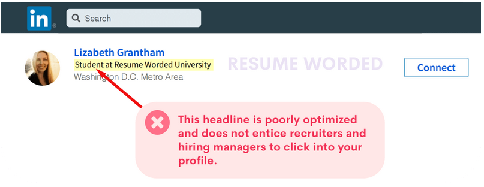
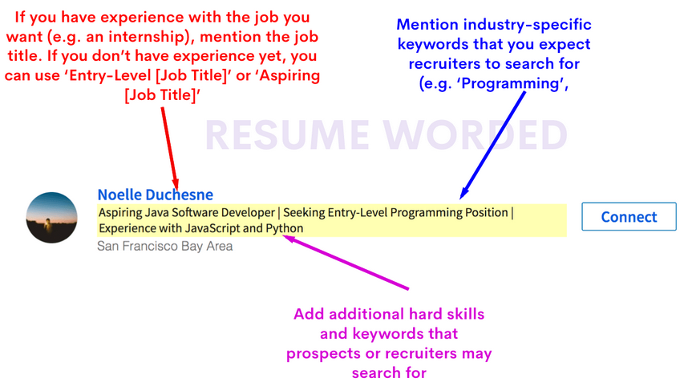
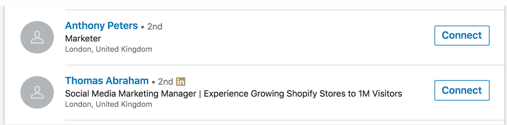

# LInkedIn headline.pptx

[Ouvrir l’original](https://drive.google.com/open?id=1nKnQSGYBRE5DwiyyxqBl-PpcmLJOypmY) · Texte structuré depuis le fichier original. Les mises en page complexes peuvent nécessiter une vérification.

## Diapositive 1

Humanités et Design – septembre 2021

ING2

How to optimize your LinkedIn headline

from resumeworded.com

## Diapositive 2

Humanités et Design – septembre 2021

Why?

An optimized LinkedIn headline can increase the number of views to your profile significantly. More views to your profile by the right people (e.g. hiring managers and recruiters) often means more opportunities, whether those are internships or interviews.

Before we examine a few examples of what a good student LinkedIn headline looks like, let's see what a weak LinkedIn headline might look like. 

## Diapositive 3

## Diapositive 4

Humanités et Design – septembre 2021

What’s wrong with it?

1) It does not contain any keywords that potential recruiters and hiring managers are searching for. This means you'll show up less to hiring managers and recruiters who are looking to hire you. 2) It does not stand out from other profiles in search results. If your profile showed up in a recruiter's search results, there is nothing to differentiate you from the thousands of other 'Students at [University]' profiles! 

NB: ‘Student at ABC university’ is what LinkedIn will set as your default headline if you haven't already changed it!

## Diapositive 5

A great example of student's LinkedIn headline

## Diapositive 6

Imagine that you are one of the millions of recruiters who use LinkedIn to find potential hires. You are looking to hire a marketer with social media experience. 

Which profile would you click into?

## Diapositive 7

If you are like most recruiters, you would reach out to Thomas. 

He seems more relevant (he has the keyword 'social media') 

He has an impressive accomplishment in his headline: He's grown a Shopify store to 1M Visitors.

Not only does the headline improve his first impression, it makes a recruiter already want to learn more and even interview him.

## Diapositive 8

What are keywords and why do they matter?

If you've ever done a search for a job title on LinkedIn (e.g. 'Java Developer'), you'll notice that LinkedIn quickly searches through their database of 500 million (!) users and finds you 500 thousand relevant people that are Java Developers. 

LinkedIn essentially searches these profiles for the search terms, or 'keywords', (i.e. in this case 'Java Developer'). If you didn't have the same keywords in your headline as the recruiter's search query, LinkedIn won't show your profile to the searcher (e.g. recruiter). This is because your profile appears less relevant than someone who does have those keywords in their profile.  

## Diapositive 9

An Example LinkedIn Headline for Students :

Java Software Developer | Recent College Graduate Seeking Entry-Level Programming Position 

If you're a student or you've just graduated, be specific about the roles you want in your headline. 

It's a wasted opportunity to say, "Graduate from XYZ University", since recruiters and hiring managers are NOT searching for those terms. 

Instead, they're searching for terms such as "entry-level software developer". You want to be sure you end up in search results when they search for those terms. 

## Diapositive 10

Finally….

You can try out a free LinkedIn Review tool on the resumeworded.com website. It will use AI to instantly identify any weak areas on your profile and give you actionable steps to improve your profile's success rate.

 https://resumeworded.com/linkedin-review/
