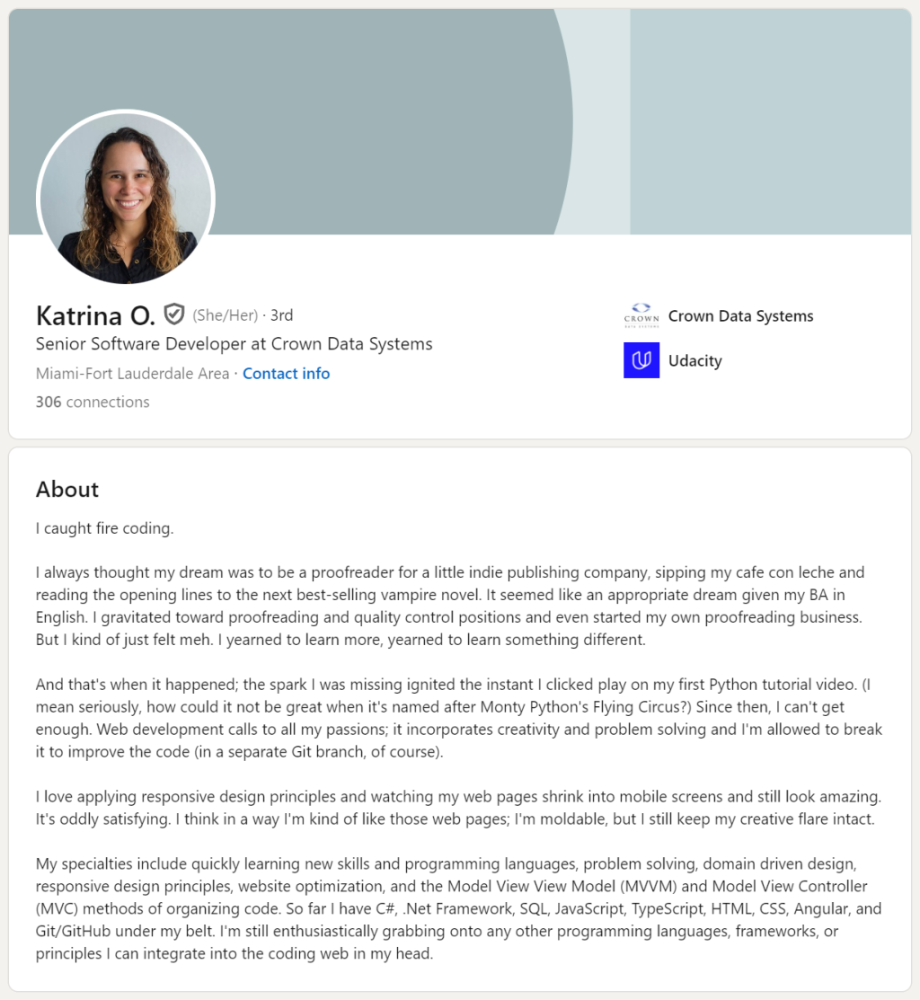

# LinkedIn talent blog2024.docx

[Ouvrir l’original](https://drive.google.com/open?id=1ybsekO2Z2d6-Vc9xHv8sFn5KIqIr1oWh) · Texte structuré depuis le fichier original. Les mises en page complexes peuvent nécessiter une vérification.

**ING2 - APPLYING FOR A JOB**

**10 LinkedIn Profile Summaries That We Love (And How to Boost Your Own)**

Authored by Kate Reilly, Writer, Content Strategist, Marketer**,** July 16, 2019

We get it. Writing your LinkedIn profile summary isn’t at the top of your to-do list. You’re not sure what to write. It’s not worth your time. Your profile is complete enough. \[Insert your own excuse here.\]

Well sometimes you need a great example — or 10 great examples — to see the summary’s magic and know how to write your own. Read on and prepare to be inspired.

**Wait, back up. What’s my LinkedIn profile summary?**

Your summary is the text box at the top of your LinkedIn profile, just below your photo. It’s open-ended space (2,000 characters max) where you give an overview of your professional life. 

**Ok but why have a summary at all?**

Your summary is the one place you define yourself in your own words, free of start dates and titles. Whether you use it to put career choices in context, highlight your biggest achievements, or show off your personality, the summary is your chance to put your best self out there. It strengthens your first impression in a way no other profile section can.

**I need an example. What does an excellent summary look like?**

There are many paths to a great summary, so we rounded up examples from professionals in a variety of industries and roles. Let’s take a look at 10 and explore why they shine.

**<u>Task</u>**

**At the link below, study Example 2 – Katrina, Developer, then answer the questions that follow.**

<https://www.linkedin.com/business/talent/blog/product-tips/linkedin-profile-summaries-that-we-love-and-how-to-boost-your-own>

**<u>Katrina - Developer</u>**

<u>Vocabulary</u>

Match the items from the summary to the definitions.

proofreader gravitate yearn for shrink oddly moldable to have something under your belt grab

1)  to have already achieved or obtained something

2)  to become smaller

3)  ​a person whose job is to read and correct pieces of written or printed work

4)  Able to be changed in order to fit into something

5)  to want something very much, especially when it is very difficult to get

6)  in a strange or unusual way

7)  to move towards somebody/something that you are attracted to

8)  to take advantage of an opportunity to do or have something

<u>Analysis</u>

1.  What is the “short, provocative sentence” Katrina uses to hook her readers? I caught fire coding

2.  In what way is her career path “non-linear”? She had multiples careers

3.  Give examples of “humanizing context” she gives to her career switch. “I kind of felt meh”

4.  How does she demonstrate an “intrinsic motivation to learn”? ඞ

**<u>14 tips for the perfect LinkedIn summary</u>**

The summary you just read has both great substance and great style. Substance is the “what to say” and comes from the topics you cover. Style is the “how to say it” and comes from the tone and format of your words.

**<u>Tips 1-7: What to say</u>**

Below are seven of the most common topics covered in great summaries. <u>You don’t need to cover them all,</u> but address at least a few to ensure enough substance. Match the headings to the descriptions.

1.**Describe what makes you tick**

Passion is the heart of some of the best summaries. Opening up about what you love to do adds context to your career. Think about what excites you most professionally — what drives you besides your paycheck? This is an especially good angle if you’re younger and don’t have much work experience.

2\. **Explain your present role**

Put your job title aside and describe what you do in simplest terms. Sharing the problems you solve, for whom, and how, is a great way to demonstrate your skills, industry knowledge, and/or work style.

3\. **Frame your past**

You have the freedom to call out what’s important in your job history and to gloss over what’s not. If you’ve made career pivots or have held seemingly unrelated roles, connect the dots so they make sense. Better yet, frame the discord as an advantage and explain why it sets you apart.

4\. **Highlight your successes**

Cite the biggest takeaway from your experience section. Look across roles and combine accomplishments if you can. This is especially applicable if you’re in mid- to late-stage career.

5\. **Reveal your character**

Choose stories and words that show who you are as a person, not just a professional. Great summaries hint at traits such as gratitude, humility, and humor. Authenticity is key, so be honest with yourself. Think of the one trait you’re most known for, and weave it in.

6\. **Show life outside of work**

Round out your identity by sharing a hobby, interest, or volunteer role. Relate your outside passions to your work if you can. If you share a personal story, be sure it serves to reinforce your professional strengths.

7\. **Add rich media**

Sometimes it’s easier to explain your impact or achievement using an image, video, or an article — don’t be afraid to add media to your profile, and tee it up in your summary. 

Next, let’s look at “how to say it”, with tips 8-14…..

TIP 8: make your first sentence count.

Make it catchy. Limited characters

TIP 9: Pump the keyword

So, you are more likely to be relevant in searches

TIP 10:

Avoid overused words like “strategic”, “motivated” and “creative”

Thesaurus dictionary for synonyms

TIP 11: Write how you speak

Think about how you would speak to new contact at conference and write that way

TIP 12: Tell stories

It’s catchy and you stand out from others.

TIP 13: Create white space

Break up the text. Avoid long paragraph

TIP 14: Ask for what you want

> Tell people what you want: contact me, network, share,  
> Be specific and you’ll be more likely to get what you want

Headline 20 Words max

Summary 2000 characters

