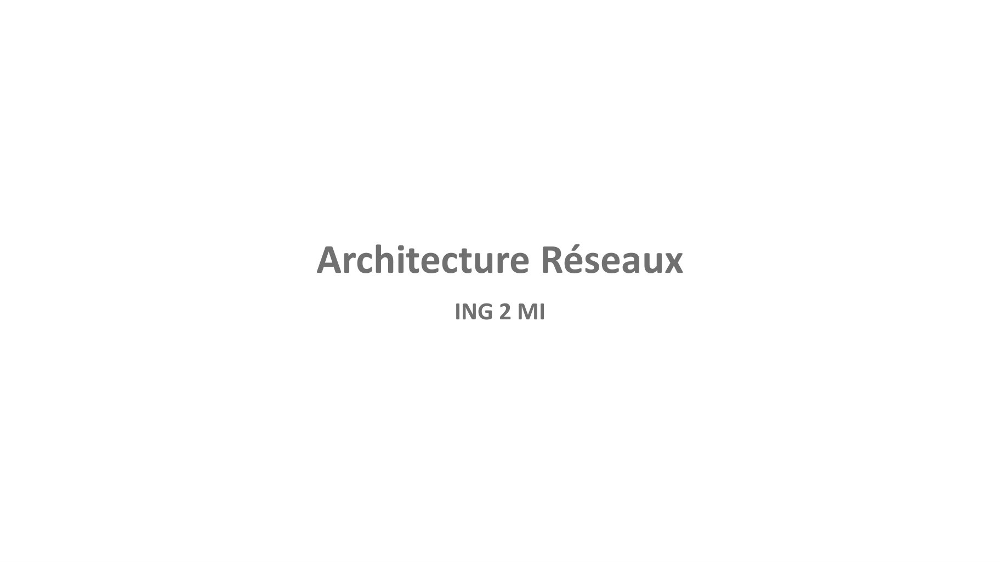
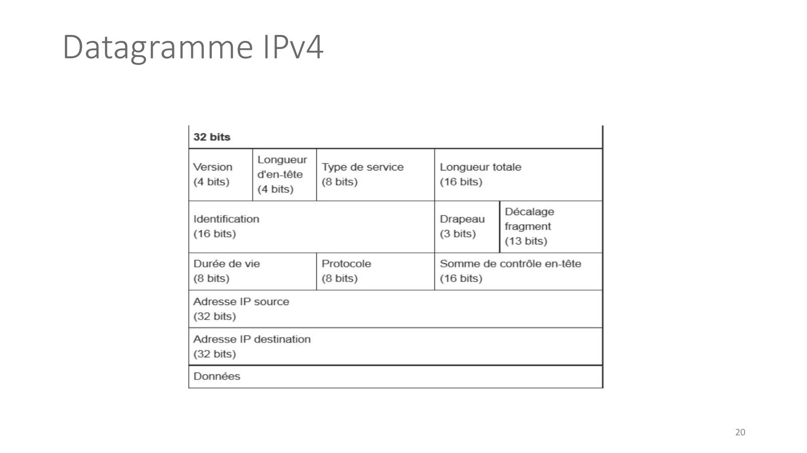
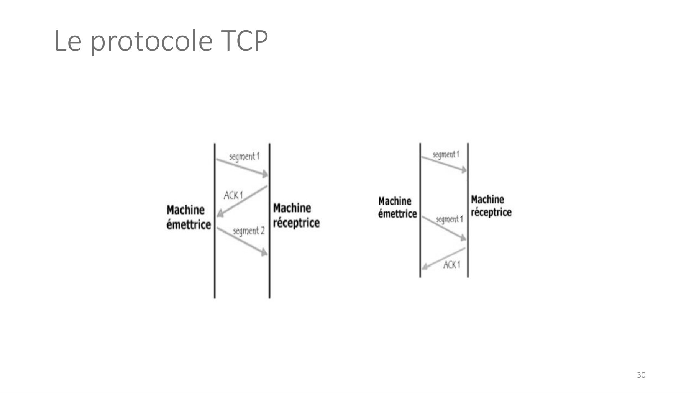
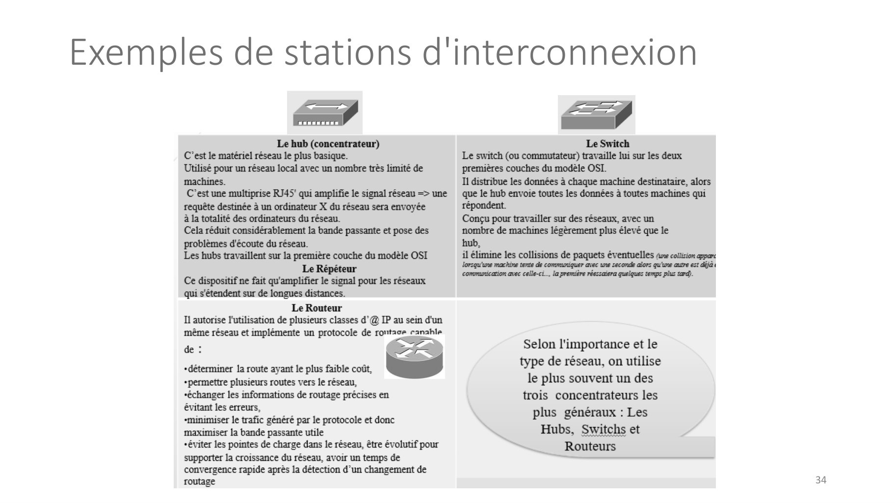
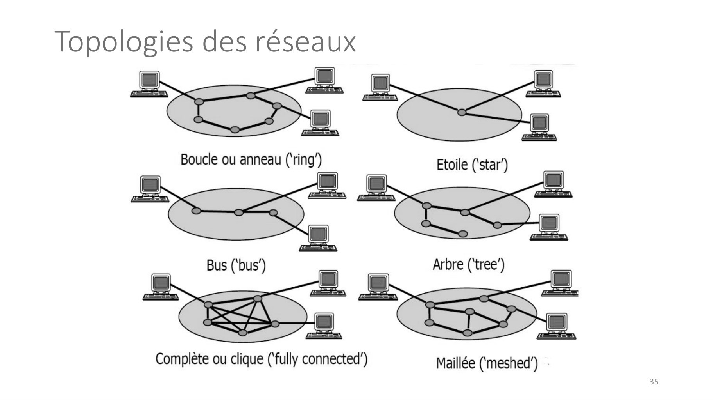

# Arch_Rx_Cours1.pdf

[Ouvrir l’original](https://drive.google.com/open?id=14ctcG5Z55uWfL5paozRUPFZtr_89JwFp) · Les pages signalées comprennent du texte reconnu automatiquement ou des éléments graphiques. Le fac-similé permet de vérifier chaque lecture.

**Pages avec fac-similé ou lecture OCR** — 1, 20, 30, 34–35.

## Page 1

~~~text
Architecture Réseaux
       ING 2 MI
~~~

## Page 2

~~~text
Plan

❑Définition Réseaux, Modèle OSI, principes du modèle TCP/IP,
 Protocoles IP, ICMP, TCP et UDP

❑Topologies, types et tailles de réseaux, Principe des VLANs

❑Adressage IPv4, IPv6

❑Protocole ARP, Routage

❑Protocoles DHCP, DNS, NAT

                                                               2
~~~

## Page 3

~~~text
Définition
❑Un réseau informatique est un ensemble d‘équipements reliés
 entre eux permettant d’échanger des informations numériques
❑On appel nœud un élément physique du réseau soit terminal
 (exemple un PC) soit de transition (exemple commutateur,
 concentrateur ou Routeur)

 •   Système-terminal, hôte ou nœud du réseau
      • Tout simplement l’ordinateur…
 •   Sous-réseau
        •Les hôtes sont connectés par le sous-réseau. Son rôle est le
        transport des messages d’un hôte à l’autre. Il comporte
        généralement les lignes de transmission et les éléments de
        commutation (hub, switch, routeurs).

                                                                        3
~~~

## Page 4

~~~text
Histoire
❑ 1955 : Premier réseau informatique à but commercial : SABRE (Semi Automated Business
  Related Environment) réalisé par IBM. Il relie 1200 téléscripteurs à travers les Etats Unis
  pour la réservation des vols de la compagnie American Airlines.

❑ 1960 La DARPA lance un projet visant à réaliser un réseau de transmission de données à
  grande distance entre différents centres de recherche sous contrat.

❑ 1969 l'ARPANET voie le jour. Le premier nœud de raccordement relie alors l'Université de
  Californie à Los Angeles (UCLA) et l'Institut de recherche de Stanford, suivis de peu par les
  universités de Californie à Santa Barbara et de l'Utah puis s'étend progressivement jusqu'à
  connecter une quarantaine de sites en 1972.

❑ CSNET (entre informaticiens), en 1981 à l’Etats-Unis

                                                                                                  4
~~~

## Page 5

~~~text
Modèle OSI

▪ Pour faire circuler l’information sur un réseau, on peut utiliser principalement 2 stratégies :

    ❖ L’information est envoyée de façon complète (pas utilisée car trop de risques d’erreurs et
      les problèmes sous jacents sont complexes).

    ❖ L’information est fragmentée en petit morceaux (paquets), et chaque paquet est envoyé
      séparément sur le réseau, les paquets son ensuite réassemblés sur la machine
      destinataire. Dans ce cas on parle de réseau à commutations de paquets

                                                                                                    5
~~~

## Page 6

~~~text
Architecture

• Le modèle de référence pour l’échange de données informatiques
  est le modèle OSI pour (Open Systems Interconnect) adopté par
  l’ISO (International Standards Organisation).

• Cette norme de communication repose sur l’empilement de 7
  couches pouvant communiquer verticalement entre elles.

                                                                   6
~~~

## Page 7

~~~text
OSI
• Chacune des couches de ce modèle
  représente une catégorie de problème

• Avantage :
   ▪ Trouver une solution pour chacune des couches

   ▪ Changer de solution technique pour une couche
     sans tout repenser

   ▪ Chaque couche garantit à la couche supérieure
     des données sans erreur

                                                     7
~~~

## Page 8

~~~text
    Couche 1: Physique

•   Elle s’occupe de gérer les caractéristiques du matériel

❖   Le câble :
      ▪    Sujet aux perturbations électromagnétiques et donc risques de coupures Signal électrique (tension, intensité,..)
      ▪    Nature des signaux (carrés, sinusoïdaux,..)

❖   Communication hertzienne
      ▪    Fréquences
      ▪    Type de modulation (AM, FM, PM, FSK, PCM,…)

❖   Fibre optique
      ▪    Couleur de la gaine
      ▪    Nombre de brins

                                                                                                                              8
~~~

## Page 9

~~~text
Couche 2: Liaison

▪   Assure le transfert des données de nœud à nœud (entre deux nœuds
    directement connectés)

▪   Gère la correction des erreurs de la couche physique

▪    Cette couche comprend aussi deux sous-couches : la couche de
    contrôle d'accès au support (MAC) et la couche de contrôle de liaison
    logique (LLC).

▪   La plupart des commutateurs fonctionnent au niveau de la couche 2

▪   Il s’agit de la trame exemple trame Ethernet

                                                                            9
~~~

## Page 10

~~~text
Couche 3 : Réseaux

▪ Cette couche est responsable de la transmission des
  paquets y compris le routage par différents routeurs.

▪ Par exemple un ordinateur de Paris veut se connecter
  à un serveur en Pekin , mais des millions de chemins
  différents sont possibles. Les routeurs de cette
  couche permettent de le faire efficacement.

▪ Il s’agit de l’échange de paquets IP

                                                          10
~~~

## Page 11

~~~text
Couche 4: Transport

▪ Cette couche permet à la machine source de communiquer directement avec la machine
  destinataire. On parle de communication de bout en bout ( end to end). On parle alors de
  protocole TCP ou UDP.

▪ Elle gère la quantité de données à envoyer le rythme, la destination

▪ Le plus connu de la couche transport est celui du protocole de contrôle de transmission
  (TCP), lui-même construit sur le protocole Internet (IP), communément appelé TCP/IP. Les
  numéros de port TCP et UDP fonctionnent au niveau de la couche 4.

▪ Il s’agit de l’envoie d’un segment
                                                                                             11
~~~

## Page 12

~~~text
Couche 5 : Session

• La configuration, la coordination (le temps pendant lequel le
  système doit attendre une réponse, par exemple) et la terminaison
  entre les applications à chaque fin de session. Elle assure la
  synchronisation du dialogue entre hôtes.

                                                                 12
~~~

## Page 13

~~~text
Couche 6 : Présentation

• En général, c'est au niveau de cette couche qu'est effectuée la
  préparation ou la traduction du format d'application au format de
  réseau, ou du format de réseau au format d'application

                                                                 13
~~~

## Page 14

~~~text
Couche 7 : Application

 ▪ La couche « la plus proche de l'utilisateur final

 ▪ Les applications qui fonctionnent au niveau de la couche 7 sont celles avec lesquelles les
   utilisateurs interagissent directement.

 ▪ Elle crée une interface directe via des applications réseau comme un navigateur web
   (Google Chrome, Firefox, Safari, etc.), la messagerie électronique, le protocole FTP, ou
   d'autres applications autonomes comme Skype, Outlook, Office. Toutes sont des exemples
   d'applications de la couche 7.

                                                                                            14
~~~

## Page 15

~~~text
Modèle TCP/IP
 • Architecture utilisant le protocole simplifié à 4 couches
                                                Couche Application: Cette couche contient tous les
                                                protocoles de haut niveau, comme par exemple
                                                Telnet, TFTP (trivial File Transfer Protocol), SMTP
                                                (Simple Mail Transfer Protocol), HTTP (HyperText
                                                Transfer Protocol). Le point important pour cette
                                                couche est le choix du protocole de transport à
                                                utiliser
                                                Couche transport: permettre à des entités paires
                                                de soutenir une conversation.
                                                • Protocole TCP
                                                • Protocole UDP
                                                Couche Internet: Définit les datagrammes et leur
                                                routage. Elle réalise l’interconnexion des réseaux
                                                (hétérogènes) distants sans connexion.

                                                Couche Accès au réseau: regroupe les couches
                                                physique et liaison de données du modèle OSI.
                                                                                                      15
~~~

## Page 16

~~~text
Encapsulation des données
▪ Tout comme dans le modèle OSI, les données sont transférées verticalement
  d’une couche à un autre en y rajoutant une entête (header).

▪ Cette entête permet de rajouter des informations identifiant le type de
  données, le service demandé, le destinataire, l’ adresse source etc...
                                                                                 Données utilisateur

                                                                   En-tête App   Données utilisateur

                                              En-tête TCP ou UDP   En-tête App   Données utilisateur

                                                                   Segment TCP

                                 En-tête IP   En-tête TCP ou UDP   En-tête App   Données utilisateur

              En-tête Ethernet   En-tête IP   En-tête TCP ou UDP   En-tête App   Données utilisateur

                                                                                                       16
~~~

## Page 17

~~~text
Architecture TCP/IP

        Processus utilisateur            Processus utilisateur   Application

           Transmission                     Transmission         Transport
          Control Protocol                 Control Protocol

               ICMP
                                                IP
          Internet Control                                         Réseau
                                         Internet Protocol
         Message Protocol

                         Interface Matérielle                      Liaison

                                                                               17
~~~

## Page 18

~~~text
Couche 1 : Accès Réseaux

▪   Cette couche a pour fonction l’encapsulation des datagrammes provenant de la couche IP et la traduction des adresses en
    adresses physiques utilisées sur le réseau.

▪   Il y a donc autant de versions de la couche physique qu’il y a de types de moyen de transport des données.

▪   La couche 1 est différente suivant que l’on est sur un réseau

     ➢ X25 : protocole de communication normalisé par commutation de paquets en mode point à point offrant de nombreux
       services

     ➢ FDDI: Fiber Distributed Data Interface est un type de réseau informatique LAN ou MAN permettant d'interconnecter
       plusieurs LAN à une vitesse de 100 Mbit/s sur de la fibre optique (ce qui lui permet d'atteindre une distance maximale de
       200 km)

     ➢ TOKEN RING: protocole de réseau local qui fonctionne sur la couche Liaison du modèle OSI. Il utilise une trame spéciale de
       trois octets, appelée jeton, qui circule dans une seule direction autour d'un anneau

                                                                                                                         18
~~~

## Page 19

~~~text
Couche 2 : Internet ou Réseaux

 ▪   La couche Internet IP se situe directement au dessus de la couche physique 1

 ▪   Internet Protocol (IP) est un protocole qui n’est pas connecté, donc il n’y a pas d’établissement de
     connexion et de vérification de la validité des datagrammes.

 ▪   Ses principales fonctions sont:

      ➢ Définir des datagrammes (unité de base de la transmission TCP/IP)

      ➢ Aiguiller les datagrammes (les paquets IP) jusqu’à leur adresse de destination

      ➢ Transférer les données entre la couche physique et la couche transport

      ➢ Fragmenter et réassembler les datagrammes

                                                                                                            19
~~~

## Page 20

~~~text
Datagramme IPv4

                  20
~~~

**Lecture OCR à contrôler**

~~~text
Datagramme IPv4

Longueur

Version Type de service Longueur totale
d'en-tête
4 bit: 8 bits 16 bits
¢ s) (4 bits) (8 bits) ( )
écal:

Identification Drapeau ans

16 i

(16 bits) (3 bits) (13 bits)
Durée de vie Protocole Somme de contrôle en-tête
(8 bits) (8 bits) (16 bits)

Adresse IP source
(32 bits)

Adresse IP destination
(32 bits)

20
~~~

## Page 21

~~~text
Datagramme IPv4

▪ Version (4 bits) : il s'agit de la version du protocole IP que l'on utilise (0100 : IPv4 et
  0110 : IPv6)

▪ Longueur d'en-tête ou IHL pour Internet Header Length (4 bits) : il s'agit du nombre de
  mots de 32 bits constituant l'en-tête (nota : la valeur minimale est 5, on peut en avoir
  6).

▪ Type de service (8 bits) : il indique la façon selon laquelle le datagramme doit être
  traité.

▪ Longueur totale (16 bits): il indique la taille totale du datagramme en octets. Utilisé
  conjointement avec la taille de l'en-tête, ce champ permet de déterminer où sont
  situées les données

                                                                                                21
~~~

## Page 22

~~~text
Datagramme IPv4

▪ Durée de vie appelée aussi TTL, pour Time To Live (8 bits) : ce champ indique le
  nombre maximal de routeurs à travers lesquels le datagramme peut passer. Ainsi ce
  champ est décrémenté à chaque passage dans un routeur, lorsque celui-ci atteint la
  valeur critique de 0, le routeur détruit le datagramme. Cela évite l'encombrement du
  réseau par les datagrammes perdus.

▪ Protocole (8 bits) : ce champ, en notation décimale, permet de savoir de quel
  protocole est issu le datagramme ICMP : 1 , IGMP : 2 , TCP : 6 , UDP : 17

▪ Somme de contrôle de l'en-tête, ou en anglais header checksum (16 bits) : ce champ
  contient une valeur codée sur 16 bits qui permet de contrôler l'intégrité de l'en-tête

▪ Adresse IP source (32 bits) , Adresse IP destination (32 bits)

                                                                                           22
~~~

## Page 23

~~~text
Datagramme IPv4

▪ Identification, drapeaux (flags) et déplacement de fragment sont des champs qui permettent
  la fragmentation des datagrammes.

▪ Lors du passage d’un datagramme IP d’un réseau à un autre ne supportant pas la même taille
  de datagrammes (Taux maximum de transmission). Dans ce cas, c’est le deuxième mot de
  l’entête qui sert à identifier à quel datagramme appartient le segment.

    ➢ Identification : Donne le numéro du datagramme

    ➢ Offset : Donne le numéro du segment dans le datagramme

    ➢ Flags : Indique si il reste des segments à transmettre

                                                                                               23
~~~

## Page 24

~~~text
Datagramme IPv4

▪ Le datagramme est l’unité de base du transfert de données avec un protocole TCP/IP ou UDP/IP

▪ La couche IP fonctionne de telle manière que si l’adresse de destination ne se situe pas sur le même réseau local
  que l’adresse source, le datagramme est passé directement à un routeur (gateway)

                                                                                                            24
~~~

## Page 25

~~~text
ICMP (Internet Control Message Protocol)

▪ L’ I.C.M.P. fait partie intégrante de la couche IP, c’est elle qui se charge d’envoyer des messages
  sous la forme de datagramme qui ont pour fonction :

    ➢ Le contrôle du flux des données

    ➢ Avertir si un destinataire n’est pas atteignable

    ➢ Le réaiguillage d’un paquet sur un autre gateway

    ➢ Interroger l’état de fonctionnement d’une machine éloignée

    ➢ Informer des erreurs aux protocoles supérieurs

                                                                                                    25
~~~

## Page 26

~~~text
ICMP (Internet Control Message Protocol)
Quelques messages ICMP

                                           26
~~~

## Page 27

~~~text
Couche 3: Transport
▪   La couche transport fait le relais entre la couche IP et les applications utilisant les ressources du réseau. On discerne
    deux protocoles différents :

▪ User Datagram Protocol (UDP)

           ✓ UDP fonctionne en mode non connecté

           ✓ Pas de contrôle d’erreur

▪ Transmission Control Protocol (TCP)

           ✓ TCP fonctionne en mode connecté

           ✓ Effectue la détection et le contrôle des erreurs

• Le choix entre ces deux protocoles dépend du type d’application utilisée dans la couche supérieure.

                                                                                                                                27
~~~

## Page 28

~~~text
Le protocole UDP

▪ UDP utilise simplement les champs SOURCE PORT et DESTINATION PORT, de
  l’entête, pour identifier les applications utilisées.
▪ UDP n’utilise pas de moyen de détecter si un datagramme est bien parvenu à
  son destinataire. UDP évite l’ensemble des opérations de connexion, détection
  d’erreur et Déconnexion.
                                                                             28
~~~

## Page 29

~~~text
    Le protocole TCP

▪   Le protocole TCP fonctionne en mode connecté et s’assure que les données ont bien été transmises

▪   Après vérification du Checksum, si il s’avère que le segment est endommagé, le récepteur n’envoie pas
    d’acquittement de bonne réception. Ainsi, après un certain temps, l’émetteur réémet le segment sur le réseau

                                                                                                          29
~~~

## Page 30

~~~text
Le protocole TCP

                   30
~~~

**Lecture OCR à contrôler**

~~~text
Le protocole TCP

segment {

ie"

ACK1
Machine Machine

émettrice réceptrice

io

segment {

Machine Machine

émettrice — réceptrice

ACK1

30
~~~

## Page 31

~~~text
Les associations

• La connexion entre deux processus est parfaitement identifiée par :

    • Protocole transport (TCP ou UDP)

    • Adresse local réseau (IP)

    • Processus local (numéro de port ou de service)

    • Adresse distante réseau (IP)

    • Processus distant (numéro de port ou de service)

                                                                        31
~~~

## Page 32

~~~text
Demi-association

• Un processus peut être identifié de manière unique sur tout l’internet par un triplet qu’on
  appellera demi-association ayant la forme

    • Protocole transport (TCP ou UDP)

    • Adresse local réseau (IP)

    • Processus local (numéro de port ou de service)

                                                                                                32
~~~

## Page 33

~~~text
Couche 4 : Application

• Cette couche rassemble l’ensemble des applications qui utilisent TCP/IP pour échanger des données.
  Les applications les plus courantes sont :
    •   TELNET Network Terminal Protocol
    •   FTP File Transfer Protocol
    •   SMTP Simple Mail Transfer Protocol
    •   DNS Domain Name Service
    •   RIP Routing Information Protocol
    •   NFS Network file system
                                                                                                       33
~~~

## Page 34

~~~text
Exemples de stations d'interconnexion

                                        34
~~~

**Lecture OCR à contrôler**

~~~text
cd

Le hub (concentrateur)

C'est le matériel réseau le plus basique.
Utilisé pour un réseau local avec un nombre très limité de
machines.
C'est une multiprise RJ45' qui amplifie le signal réseau => une

destinée à un ordinateur X du réseau sera envoyée
à la totalité des ordinateurs du réseau.
Cela réduit considérablement la bande passante et pose des
problèmes d'écoute du réseau.
Les hubs travaillent sur la première couche du modèle OSI

Le Répéteur
Ce dispositif ne fait qu'amplifier le signal pour les réseaux
qui s'étendent sur de longues distances.
Le Routeur

Il autorise l'utilisation de plusieurs classes d’@ IP au sein d'un
même réseau et implémente un protocole de rontaor canahle

de : (

“déterminer la route ayant le plus faible coût,
permettre plusieurs routes vers le réseau,
“échanger les informations de routage précises en

évitant les erreurs,

minimiser le trafic généré par le protocole et donc
maximiser la bande passante utile

“éviter les pointes de charge dans le réseau, être évolutif pour
supporter la croissance du réseau, avoir un temps de
convergence rapide après la détection d’un changement de
routage

Exemples de stations d'interconnexion

x,

Le Switch
Le switch (ou commutateur) travaille lui sur les deux
premières couches du modèle OSI.
Il distribue les données à chaque machine destinataire, alors
que le hub envoie toutes les données à toutes machines qui
répondent.
Conçu pour travailler sur des réseaux, avec un
nombre de machines légèrement plus élevé que le
hub,
il élimine les collisions de paquets éventuelles (we collision pare
lorsqu'une machine tente de communiquer avec une seconde alors qu'une autre est déjà t
communication avec celle-ci... la première réessaiera quelques temps plus tard).

Selon l'importance et le
type de réseau, on utilise
le plus souvent un des
trois concentrateurs les
plus généraux : Les
Hubs, Switchs et

_ Routeurs

34
~~~

## Page 35

~~~text
Topologies des réseaux

                         35
~~~

**Lecture OCR à contrôler**

~~~text
Topologies des réseaux

Complète ou clique (‘fully connected’)

Maillée (‘meshed’)

35
~~~

## Page 36

~~~text
Topologie Maillée

❑Avec n machines il faut n(n-1)/2 liaisons

❑N’importe quelle machine peut communiquer avec n’importe quelle
 autre machine en point à point, ou avec toutes les autres machines
 en mode diffusion

                                                                      36
~~~

## Page 37

~~~text
Topologie Bus

❑ On utilise souvent un système CSMA/CD (Carriere Sens Multiple Acces/Collision Detection),
  Accès multiple avec détection de porteuse et détection de collision. Exemple câblage Ethernet

❑ Protocole
    ❑ Une machine avant d’émettre écoute le câble CS

    ❑ Si une porteuse est détectée donc le bus est occupé, la machine attend la fin de la communication avant
      d’émettre ses données sinon elle émet ses données

    ❑ Durant l’émission, la machine reste à l’écoute pour détecter une collision (CD). Si une collision est détectée,
      chaque machine qui émettait suspend immédiatement son émission et attend un délai.

    ❑ Chaque machine reçoit toutes les données qui circulent sur le bus et c’est au niveau de la couche 2 que l’on
      décide de garder ou non les données

                                                                                                                        37
~~~

## Page 38

~~~text
Topologie Anneau

❑ Les informations circulent toujours dans le même sens

❑ Chaque machine qui reçoit un message, le recopie immédiatement sur le second câble, et en
  même temps l’information est remontée en couche 2 pour savoir s’il faut la garder ou pas

❑ L’information finira par revenir à la source, et elle pourra être comparée à l’information envoyée
  pour une éventuelle détection d’erreur

❑ Un système de jeton est utilisé. Le jeton est un message particulier que les machines se font
  passer les unes aux autres. Une machine n’a le droit d’émettre que si elle dispose du jeton. Elle
  garde le jeton jusqu’à la fin de son émission Topologie

                                                                                                      38
~~~

## Page 39

~~~text
Topologie Etoile

❑Toutes les communications passent par une machine qui au centre
 de l’étoile.

• C’est cette dernière qui dirige l’information vers le destinataire

                                                                       39
~~~

## Page 40

~~~text
Types de réseaux
❑Réseaux à Transmission par diffusion
  ❑Un seul canal est partagé par tous, et chaque message envoyé sur le réseau
   est reçu par toutes les stations. Le message possède un champ adresse de
   destination, et la station possédant cette adresse accepte le message.
  ❑Ex. bus, anneau
❑Réseaux à Transmission point à point
  ❑Ce mode de transmission réseau est constitué de lignes de transfert et de
   nœuds. Chaque ligne connecte deux nœuds.
  ❑Dans ce mode de transmission, le support physique ne relie qu'une paire de
   stations seulement. Pour que deux stations communiquent, elles passent
   obligatoirement par un intermédiaire (le nœud).
  ❑Ex. étoile, maillé

                                                                                40
~~~

## Page 41

~~~text
Tailles de réseaux

• Les réseaux peuvent être classés selon leur étendue. Leurs objectifs
  ne sont pas les mêmes.

❑PAN (Personal Area Network) : Réseau pour une seule personne.
❑LAN (Local Area Network) : Réseau d'entreprise dans un bâtiment ou
 un campus.
❑MAN (Metropolitan Area Network) : Couvre une ville.
❑WAN (Wide Area Network) : Couvre un pays, un continent.

                                                                         41
~~~

## Page 42

~~~text
LAN : Local Area Network

❑Les réseaux locaux, appelés LAN (Local Area Network) sont
 constitués des moyens de communication internes à un
 établissement, une entreprise, donc entièrement maîtrisés et privés.
 La zone servie peut être un simple bâtiment, un complexe de
 bâtiments ou un campus.
❑C'est un système de communication de données limité à une zone
 géographique restreinte et utilisant des débits de l'ordre de quelques
 Mbits/s jusqu'au Gigabits/s.
❑Le réseau n'emploie pas les circuits des opérateurs publics, mais peut
 contenir des passerelles ou des ponts vers d'autres réseaux comme
 Internet par exemple.

                                                                      42
~~~

## Page 43

~~~text
VLAN : Virtual Local Area Network
• Dans les réseaux locaux partagés
❑ les sous-réseaux sont liés aux hubs
❑ les utilisateurs sont groupés géographiquement
❑ pas de sécurité sur un segment : n'importe quelle station du segment peut capturer l'ensemble du trafic réseau
❑ la mobilité entraîne un changement d'adresse et/ou un re-câblage

• Principe

   Plusieurs réseaux logiques indépendant sur le même réseau physique

   La communication n’est autorisée qu’entre machines d’un même VLAN

   Les communications inter-VLAN doivent transiter par un routeur
   L’appartenance à un VLAN étant définie logiquement et non géographiquement

   Les VLAN permettent d’assurer la mobilité des postes de travail

                                                                                                                   43
~~~

## Page 44

~~~text
Principe des VLAN
    Il s’agit de diviser le LAN en unité logique appelés LAN virtuels; cela revient à avoir différent LAN à
    l’intérieur d’un même LAN physique
    Chaque LAN est identifié par un numéro unique
    Les appareils d’un même VLAN peuvent tous communiquer entre eux, mais pas                avec ceux-en-
    dehors.(L’appartenance à un VLAN étant définie logiquement et non géographiquement)

                            Une diffusion
                            provenant d'une station
                            du VLA N2 ne sera
                            répercutée que sur les
                            ports D, E, F

                                                                                                               19

                                                                                                                    44
~~~

## Page 45

~~~text
Intérêts des VLANs
   Confidentialité et sécurité
    ◼   le trafic entre les réseaux virtuels est isolé
    ◼   permet de limiter l'accès à certains équipements ou services (VLAN des machines en libre service, VLAN des accès à
        Internet, …)
   Performance
    ◼   limite la portée des broadcast
    ◼   répartition de la charge du réseau
   Facilité de mise en oeuvre et souplesse
    ◼   logiciel d'administration du commutateur
    ◼ on peut retirer ou donner l'accès à un VLAN sans modifier le câblage dans les armoires de brassage, voire sans déplacer
        la station
    ◼    une station peut appartenir à plusieurs VLANs

                                                                                                                                45
~~~

## Page 46

~~~text
Exemple

                         LAN 1

                         LAN 2

                         LAN 3

                                      LAN 1      LAN 2   LAN 3
➔ Classic Segmentation
                                 ➔ Virtual LAN

                                                                 46
~~~

## Page 47

~~~text
MAN : Metropolitan Area Network

❑Les MAN (réseaux métropolitains) interconnectent plusieurs réseaux
 locaux LAN géographiquement proches (au maximum quelques
 dizaines de kilomètres) à des débits importants. Ainsi, un MAN
 permet à deux nœuds distants de communiquer comme si ils
 faisaient partie d'un même réseau local. Ces réseaux MAN peuvent
 être publics ou privés.
❑Un MAN est formé de commutateurs ou de routeurs interconnectés
 par des liens hauts débits (en général en fibre optique).

                                                                  47
~~~

## Page 48

~~~text
WAN : Wide Area Network

❑Les réseaux étendus appelés WAN (Wide Area Network) sont
 destinés, comme le nom l'indique, à transporter des données
 numériques sur des distances à l'échelle d'un pays, d'un continent.
 Ce sont, par exemple, les réseaux des fournisseurs d'accès internet
 (Free, Orange, SFR...), de grandes sociétés...
❑Le réseau WAN est soit terrestre en utilisant des infrastructures au
 niveau du sol, soit par liaison satellite.

                                                                        48
~~~

## Page 49

~~~text
Quelques références
• Cours de C. Pain-Barre
• Cours Initiation à l’architecture réseau de P. Ducrot
• Livre de Guy Pujolle « Cours réseaux et télécom »
• Wikipédia
• Le web
• ...

                                                          49
~~~
