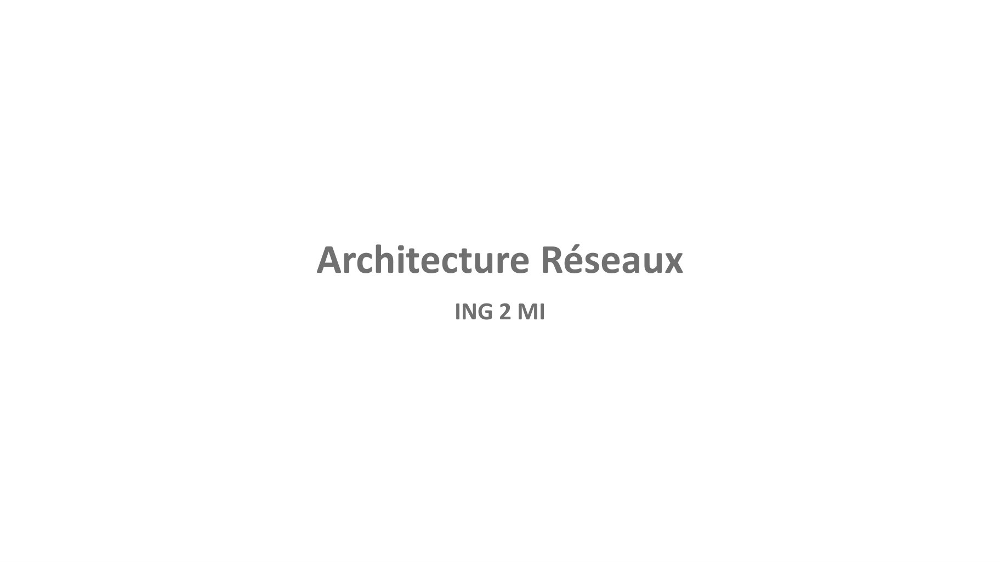
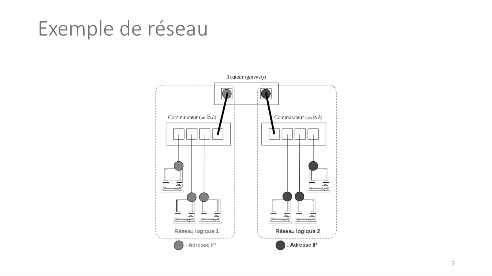

# Arch_Rx_Cours2 .pdf

[Ouvrir l’original](https://drive.google.com/open?id=17f14Dsvb9P_snidQ7U5qQhZPkHemYOiF) · Les pages signalées comprennent du texte reconnu automatiquement ou des éléments graphiques. Le fac-similé permet de vérifier chaque lecture.

**Pages avec fac-similé ou lecture OCR** — 1, 5.

## Page 1

~~~text
Architecture Réseaux
       ING 2 MI
~~~

## Page 2

~~~text
Plan

❑Définition Réseaux, Modèle OSI, principes du modèle TCP/IP,
 Protocoles IP, ICMP, TCP et UDP

❑Topologies, types et tailles de réseaux, Principe des VLANs

❑Adressage IPv4, IPv6

❑Protocole ARP, Routage

❑Protocoles DHCP, DNS, NAT

                                                               2
~~~

## Page 3

~~~text
                          Introduction

Définition
• Rappel : de manière générale, les adresses forment une notion importante
en communication et sont un moyen d’identification.
• Dans un réseau informatique, une adresse IP est un identifiant unique
attribué à chaque interface avec le réseau IP et associé à une machine
(routeur, ordinateur, etc.). C’est une adresse unicast utilisable comme adresse
source ou comme destination.

                       IP signifie Internet Protocol.
                                                                                  3
~~~

## Page 4

~~~text
Principe
Rappel : l’adresse IP est utilisée dans l’entête IP des paquets échangés.

                                                                            4
~~~

## Page 5

~~~text
Exemple de réseau

                    5
~~~

**Lecture OCR à contrôler**

~~~text
Exemple de réseau

Routeur (gateway)

Commutateur (switch)

Réseau logique 1

@ : Adresse IP
~~~

## Page 6

~~~text
Remarque 1 : notion de netid et hostid
• À partir du schéma précédent, on en déduit qu’une adresse IP est
probablement décomposée en deux parties :
   • une partie de l’adresse identifie le réseau (netid ) auquel appartient l’hôte et
   • une partie identifie le numéro de l’hôte (hostid) dans le réseau.

                                                                                        6
~~~

## Page 7

~~~text
Remarque 2 : notion d’échanges directes et indirectes

• À partir du schéma précédent, on distingue deux situations :
   • Les équipements communiquent directement entre eux à condition qu’ils
     soient sur le même réseau IP (même netid). Ils peuvent être
     interconnectés physiquement par des concentrateurs (hub) et/ou des
     commutateurs (switch).
   • Les équipements qui n’appartiennent pas au même réseau IP (netid
     différents) ne peuvent pas communiquer entre eux directement. Ils
     pourront le faire par l’intermédiaire d’un routeur (gateway).

       Le routeur doit posséder une adresse IP dans chaque réseau IP qu’il
                  interconnecte. On dit qu’il est multi-domicilié.

                                                                             7
~~~

## Page 8

~~~text
Différentes versions des adresses IP
Il existe deux versions pour les adresses IP :
      version 4 : les adresses sont codées sur 32 bits
          - Elle est généralement notée avec quatre nombres compris entre 0 et 255, séparés
            par des points.

        version 6 : les adresses sont codées sur 128 bits
            - Elle est généralement notée par groupes de 4 chiffres hexadécimaux séparés par ’:’
              (exemple : FE80:0000:0000:0000:020C:76FF:FE21:1C3B).

          L’adresse de version 4 (IPv4) est encore actuellement la plus utilisée.

                                                                                                   8
~~~

## Page 9

~~~text
Affectation des adresses IP
• On distingue deux situations pour assigner une adresse IP
à un équipement :
  • de manière statique : l’adresse est fixe et configurée le plus
    souvent manuellement puis stockée dans la configuration de
    son système d’exploitation.
  • de manière dynamique : l’adresse est automatiquement
    transmise et assignée grâce au protocole DHCP (Dynamic Host
    Configuration Protocol ).

                                                                     9
~~~

## Page 10

~~~text
Décomposition des adresses IPv4
Rappel :

Pour décomposer une adresse IP (c’est-à-dire séparer le netid du hostid ), il faut utiliser un masque
(netmask). Chaque équipement effectuera une opération ET (bit à bit) entre l’adresse IP complète
et le masque.
Il suffit alors de placer des bits à 1 dans le masque pour conserver le netid et des 0 pour écraser le
hostid. Un masque a donc la même longueur qu’une adresse IP.

    C’est donc la valeur du masque qui définit le netid (et donc le hostid). On parle de masque de réseau.
     La valeur du masque est essentielle dans l’adressage IP.

                                                                                                             10
~~~

## Page 11

~~~text
Décomposition des adresses IPv4
Rappel : la table de vérité du ET

                                    11
~~~

## Page 12

~~~text
Décomposition des adresses IPv4
• Pour déterminer la partie réseau (netid ) auquel appartient un
  équipement, l’opération suivante est réalisée :
         − adresse IP ET bit à bit Masque
  net-id ←
  Exemple : 192.168.52.0 ← − 192.168.52.85 & 255.255.255.0
• Pour déterminer le numéro de l’hôte ( hostid) dans le réseau,
  l’opération suivante est réalisée :
  host-id ←− adresse IP ET bit à bit ~Masque
  Exemple : 0.0.0.85 ← − 192.168.52.85 & 0.0.0.255

L’utilisation du masque 255.255.255.255 donnera l’adresse IP complète assignée à
                        une machine.

                                                                                   12
~~~

## Page 13

~~~text
Remarque : adresses interdites
 • On remarque que l’adresse d’un réseau est composée du netid et d’un hostid
   où tous les bits sont à 0 (Exemple : 192.168.52.0 avec un masque
   255.255.255.0).
 • On en déduit qu’une adresse de réseau ne peut être assignée à une machine
   pour éviter tout risque de confusion. C’est donc une adresse interdite.
 • Lorsque l’on met tous les bits à 1 dans le hostid, on obtient une adresse de
   broadcast : c’est une adresse de diffusion générale à toutes les machines du
   réseau (Exemple : 192.168.52.255 avec un masque 255.255.255.0). C’est aussi
   une adresse interdite.

 Dans les plages d’adresses assignables à des machines d’un réseau, il y aura toujours
     deux adresses interdites : l’adresse du réseau et l’adresse de broadcast.

                                                                                         13
~~~

## Page 14

~~~text
Exercice
Utilisation du masque de réseau
1) Une machine A qui a pour adresse I P 190.24.12.8 et un masque 255.255.0.0 f a i t partie de
   quel réseau ?

2) Une machine B qui a pour adresse I P 10.0.100.1 et un masque 255.0.0.0 f a i t partie de
   quel réseau ?

3) La machine A et B pourront-elles communiquer directement ? S i non, que faut- i l f a i r e ?

4) Donner l’adresse I P d’une machine C qui appartiendrait au même réseau logique         que l a
   machine A. Idem pour une machine D qui s e r a i t reliée au même réseau que B.

                                                                                               14
~~~

## Page 15

~~~text
 Taille d’un réseau IPv4
• C’est le masque qui définit la taille d’une réseau IP : c’est-à-dire la plage d’adresses assignables aux
machines du réseau.
• Exemple
• Soit le réseau 176.16.0.0 avec un masque de 255.255.0.0. Quel est le
nombre d’adresses machines de ce réseau?
Le masque 255.255.0.0 possède 16 bits à 1 et découpe donc une adresse
IP de la manière suivante :
    • le netid fera donc 16 bits (valeur fixée par le masque)
    • nombre de bits restant pour le hostid: 32 - 16 = 16 bits
Le nombre d’adresses machines de ce réseau est donc : 216 − 2 = 65536 − 2 = 65534 adresse machines

 Il existe une autre notation (nommée CIDR: (Classless Inter-Domain Routing )) pour exprimer l’adresse
 d’un réseau. On indique alors le nombre de bits à 1 dans le masque de la manière suivante : 176.16.0.0/16
                                                                                                        15
~~~

## Page 16

~~~text
Exercice
1)   Une machine A a pour adresse I P 192.168.12.1 et un masque 255.255.255.0. Combien r e s t e - t - i l
     d’adresses disponibles dans ce réseau ?

2)   Donner pour ce réseau, l a valeur des deux adresses i n t e r d i t e s en indiquant leur s i g n i f i c a t i o n .

3)   On décide d’interconnecter ce réseau avec un routeur. Affecter l a dernière adresse disponible à
     l ’ i n t e r f a c e du routeur raccordée physiquement à ce réseau.

4) Donner en écriture CIDR l’adresse de ce réseau.

5)   Donner l a valeur en écriture décimale pointée du masque du réseau 192.168.1.0/25.

                                                                                                                             16
~~~

## Page 17

~~~text
Techniques d’adressage d’un réseau IPv4
On distingue deux techniques utilisables pour choisir une adresse réseau IP (version 4) :

 • L’adressage par classes
       L’ensemble des adresses IP ont été réparties dans 5 classes (A à E) Un masque de réseau est
       fixé pour chaque classe
       Seules les classes A, B et C sont utilisables pour un adressage de machines La classe D est réservée
       pour l’adressage multicast (diffusion à un groupe) La classe E est réservée pour un usage futur
       Remarque : l’adressage par classes n’est plus utilisé sur le réseau public Internet. Il est donc réservé à un usage
       privé.

 • L’adressage sans classes nommé CIDR (Classless Inter-Domain Routing) RFC 1519
       Comme son nom l’indique, l’adressage par classes est ici abandonné Il n’y a donc plus de
       masque fixé par référence à une classe
       Remarque : l’adressage sans classes CIDR est notamment utilisé sur le réseau public Internet.

                                                                                                                         17
~~~

## Page 18

~~~text
Différentes classes d’adresses
 Pour voir si l’adresse du réseau d’une machine est codée sur 1,2 ou 3 octets, il
 suffit de regarder la valeur du premier octet. L'adressage IP v4 est définit dans
 le document rfc791

                                                                                18
~~~

## Page 19

~~~text
Différentes classes d’adresses

               Réseau            Machine
    Classe A

    Classe B     Réseau                    Machine

    Classe C            Réseau
                                                     Machine

                                                               19
~~~

## Page 20

~~~text
Classe A
    Id réseau (8bit)
                       Id machine (24 bits)

  La place du premier octets de la classe A est : 1 à 127

  Le premier bit à gauche de la partie réseau est fixé à 0

                                                             20
~~~

## Page 21

~~~text
Classe A
 Avec les adresses de classe A, le bit le plus significatif (MSB: Most Significant
 Bit) (c’est-à-dire le bit le plus à gauche) est réservé et doit être égal à zéro, il en
 résulte dans la plage d'adresses réseau suivante:

     ➢ La plage des adresses réseau: 1 – 126

     ➢ Le réseau 127 est réservé pour le loopbacks (@ de boucle)

     ➢ Il y a 126 réseaux utilisables

     ➢ Chaque réseau peut adresser: 𝟐𝟐𝟒 -2 machines

                                                                                    21
~~~

## Page 22

~~~text
Classe B
           Id réseau (16 bits)                 Id machine (16 bits)

  La place du premier octets de la classe B est : 128 à 191

  Le deux premiers bits à gauche de la partie réseau sont fixés à 1|0

                                                                        22
~~~

## Page 23

~~~text
Classe B
 Avec les adresses de classe B, les deux bits les plus significatifs (MSB: two Most
 Significant Bits) (c’est-à-dire les deux bits les plus à gauche) sont réservés et
 doivent être égal à 10, il en résulte dans la plage d'adresses réseau suivante:

     ➢ La plage des adresses réseau: 128 – 191

     ➢ Il y a 𝟐𝟔 ∗ 𝟐𝟖 réseaux utilisables

     ➢ Chaque réseau peut adresser: 𝟐𝟏𝟔 -2 machines

                                                                                23
~~~

## Page 24

~~~text
Classe C
           Id réseau (24 bits)                            Id machine (8 bits)

  La place du premier octets de la classe B est : 192 à 223

  Le deux premiers bits à gauche de la partie réseau sont fixés à 1|1|0

                                                                                24
~~~

## Page 25

~~~text
Classe C
 Avec les adresses de classe C, les trois bits les plus significatifs (MSB: the three
 Most Significant Bits) (c’est-à-dire les trois bits les plus à gauche) sont réservés
 et doivent être égal à 110, il en résulte dans la plage d'adresses réseau
 suivante:

     ➢ La plage des adresses réseau: 192 – 223

     ➢ Il y a 𝟐𝟓 ∗ 𝟐𝟖 ∗ 𝟐𝟖 réseaux utilisables

     ➢ Chaque réseau peut adresser: 𝟐𝟖 -2 machines

                                                                                 25
~~~

## Page 26

~~~text
   Types de réseaux
On doit maintenant distinguer deux types de réseaux adressables en IP :
    • le réseau public Internet où chaque équipement connecté doit
      posséder une adresse unique et enregistrée au niveau mondial.
    • les réseaux privés, dans ce cas le choix des adresses est libre et ne doivent
      être uniques que dans ce réseau.
Remarques :

     Si un réseau privé doit être interconnecté avec le réseau Internet, il faudra alors utiliser
     des adresses privées qui ne puissent correspondre à des adresses publiques utilisées sur
     Internet. Des plages d’adresses réservées à usage privé existent et elles ne sont donc
     pas acheminées par les routeurs Internet, ce qui supprime tout risque de conflit
     Dans ce cas, pour interconnecter un réseau privé avec Internet, on utilisera un routeur
     NAT (Network Address Translation) qui permet de remplacer l’adresse IP source
     privée par l’adresse publique du routeur.                                            26
~~~

## Page 27

~~~text
Adresses IPv4 interdites
Il y a des adresses interdites que l’on ne peut pas utiliser comme adresse IP pour un
équipement :
    •   les adresses réseaux : c’est-à-dire les adresses dont tous les bits de la partie hosted sont à 0
    •   les adresses de diffusion générale (broadcast) : c’est-à-dire les adresses dont tous les bits de la
        partie hostid sont à 1
    •   l’adresse de boucle locale (loopback) 127.0.0.1 associé au nom localhost. De manière générale,
        toutes les adresses de ce réseau 127.0.0.0 1
    •   l’adresse 0.0.0.0 qui est utilisée par des différents services (DHCP, tables de routage, ...) et qui a
        souvent une signification particulière
    •   Les adresses privées

                                                                                                       27
~~~

## Page 28

~~~text
Exercice
Adressage privé
• L’adresse réseau de l’entreprise est 172.16.0.0.
1) Donner la classe de ce réseau.

2) Donner le masque de ce réseau.

3) Donner le nombre maximum de noeuds que l’on peut connecter.

4) Quelle est l’adresse de diffusion (broadcast) de ce réseau ?

                                                                  28
~~~

## Page 29

~~~text
                                           Sous-réseaux

 Sous-réseaux (subneting )
  En 1984, devant la limitation du modèle de classes, la RFC 917 (Internet subnets)
  crée le concept de sous-réseau.

Ceci permet par exemple :
     • d’utiliser une adresse de Classe B comme 256 sous-réseaux de 254 ordinateurs
       au lieu d’un seul réseau de 65536 ordinateurs, sans toutefois remettre en
       question la notion de classe d’adresse.
     • d’optimiser l’utilisation et la sécurité du réseau en le segmentant
     • de maîtriser l’adressage à l’intérieur du réseau
~~~

## Page 30

~~~text
                                         Sous-réseaux

Adressage IPv4 des sous-réseaux (subneting )
  Pour segmenter un réseau en sous-réseaux, il faut alors décomposer la
  partie hostid de l’adresse IP en deux parties : une adresse de sous-réseau
  (subnetid) et une adresse machine (hostid).

 Par exemple, pour créer 3 sous-réseaux, il faudra prendre 2 bits dans la
 partie hostid et on créera 22 donc 4 sous-réseaux :
      0 0 pour le sous-réseaux n°0   -     1 0 pour le sous-réseaux n°2
      0 1 pour le sous-réseaux n°1   -     1 1 pour le sous-réseaux n°3
~~~

## Page 31

~~~text
                                  Sous-réseaux

Masque de sous-réseaux (subnetmask)
  Évidemment, le masque de départ change et doit maintenant englober la
  partie netid et la partie subnetid. Ce nouveau masque se nomme masque
  de sous-réseaux.

  Exemple : pour le réseau 192.168.1.0/24 découpé en 4 sous-réseaux
      netid = 24 bits
      subnetid = 2 bits
      hostid = 32 - 24 - 2 = 6 bits

  Le masque de sous-réseau sera : 24 + 2 = 26 bits soit 255.255.255.192
~~~

## Page 32

~~~text
                               Sous-réseaux

Plage d’adresses des sous-réseaux
Le nombre de machines adressables dans chaque sous-réseau sera de
2nb bits hostid − 2 adresses interdites.
Exemple : pour le réseau 192.168.1.0/24 découpé en 4 sous-réseaux
       Le nombre de machines adressables dans chaque sous-réseau sera de :
                    26 − 2 adresses interdites = 62 adresses
    sous-réseaux n°0 192.168.1.0/26 : 192.168.1.1 à 192.168.1.62 (broadcast =
    192.168.1.63)
    sous-réseaux n°1 192.168.1.64/26 : 192.168.1.65 à 192.168.1.126 (broadcast =
    192.168.1.127)
    sous-réseaux n°2 192.168.1.128/26 : 192.168.1.129 à 192.168.1.190 (broadcast =
    192.168.1.191)
    sous-réseaux n°3 192.168.1.192/26 : 192.168.1.193 à 192.168.1.254 (broadcast =
    192.168.1.255)
~~~

## Page 33

~~~text
                         Sous-réseaux

Intérêt des sous-réseaux
   On peut distinguer deux démarches pour déterminer un masque de
   sous-réseaux :
       à partir du nombre de machines à adresser et/ou
       à partir du nombre de sous-réseaux à créer
~~~

## Page 34

~~~text
                                    Adressage IPv6

Adresse IPv6
Les adresses IPv6 sur 128 bits sont décomposées en :
      un préfixe de localisation public : 48 bits
      un champ sous-réseau de topologie locale du site (subnet) : 16 bits
      un identifiant de l’interface (basé sur l’adresse MAC ou aléatoirement) qui
      garantie l’unicité de l’adresse (équivalent à hostid) : 64 bits

L’IANA et les RIR gèrent aussi les ressources d’adressage IPv6.
~~~

## Page 35

~~~text
                               Adressage IPv6

Notation des adresses IPv6
La notation décimale pointée employée pour les adresses IPv4 (par exemple
172.31.128.1) est abandonnée au profit d’une écriture hexadécimale, où les 8
groupes de 2 octets (soit 16 bits par groupe) sont séparés par un signe
deux-points ’ :’ :
Exemple : La notation complète comprend exactement 39 caractères
                      2001:0db8:0000:85a3:0000:0000:ac1f:8001

Il est permis d’omettre de 1 à 3 chiffres zéros non significatifs dans chaque groupe
de 4 chiffres hexadécimaux. Ainsi, l’adresse IPv6 ci-dessus est équivalente à :

                            2001:db8:0:85a3:0:0:ac1f:8001

De plus, une unique suite de un ou plusieurs groupes consécutifs de 16 bits tous
nuls peut être omise, en conservant toutefois les signes deux-points de chaque
côté de la suite de chiffres omise, c’est-à-dire une paire de deux-points (::). Ainsi,
l’adresse IPv6 ci-dessus peut être abrégée en :

                              2001:db8:0:85a3::ac1f:8001
~~~

## Page 36

~~~text
                       Adressage IPv6

Remarques IPv6

   En IPv6, les sous-réseaux ont une taille fixe de /64, c’est-à-dire que
   64 des 128 bits de l’adresse IPv6 sont réservés à la numérotation d’un
   hôte dans le sous-réseau.
   En IPv6, les masques de sous-réseaux ont donc une taille fixe de /64.
~~~
