# Arch_Rx_Cours3.pdf

[Ouvrir l’original](https://drive.google.com/open?id=1RYt9BJmYJCEN3xYN9E0PAsJlO1atZDzC) · Les pages signalées comprennent du texte reconnu automatiquement ou des éléments graphiques. Le fac-similé permet de vérifier chaque lecture.

**Pages avec fac-similé ou lecture OCR** — 1, 4, 6–8, 10–12, 14, 17–18, 20, 22, 26–29.

## Page 1

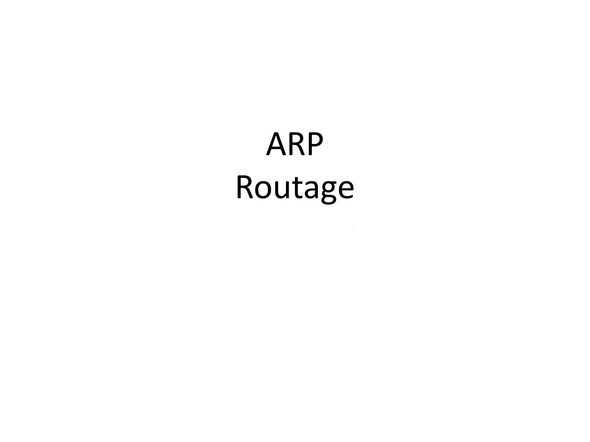

~~~text
   ARP
 Routage
Topologie
~~~

**Lecture OCR à contrôler**

~~~text
ARP
Routage
~~~

## Page 2

~~~text
                     Introduction

• Toute machine reliée sur un réseau se charge d’aiguiller les
  paquets à émettre en fonction de leur destination :
• Si le destinataire est sur le réseau local, le datagramme est
  directement envoyé à la machine cible.
• Si le destinataire est sur un réseau différent, les données sont
  envoyées au routeur du réseau local.
~~~

## Page 3

~~~text
    Nécessité de la résolution d’adresse
• la transmission doit se faire en utilisant le service de
  la couche hôte-réseau (réseau physique)
• la couche hôte-réseau (niveau trame) n'utilise pas
  les adresses IP (niveau réseau) mais des adresses
  physiques (adresses MAC)
• la résolution d'adresse est le mécanisme permettant
  à une station d'obtenir l'adresse physique (de
  l'interface/carte réseau) d'une station possédant
  une certaine adresse IP dans le même réseau
~~~

## Page 4

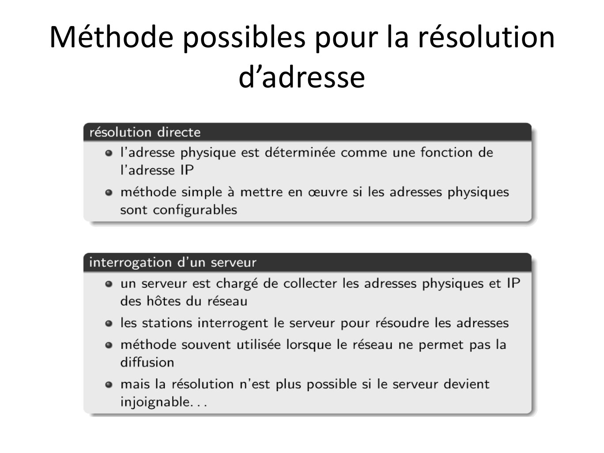

~~~text
Méthode possibles pour la résolution
            d’adresse
~~~

**Lecture OCR à contrôler**

~~~text
Méthode possibles pour la résolution
d'adresse

résolution directe

e l'adresse physique est déterminée comme une fonction de
l'adresse IP

@ méthode simple à mettre en œuvre si les adresses physiques
sont configurables

interrogation d'un serveur

e un serveur est chargé de collecter les adresses physiques et IP
des hôtes du réseau

e les stations interrogent le serveur pour résoudre les adresses

@ méthode souvent utilisée lorsque le réseau ne permet pas la
diffusion

@ mais la résolution n'est plus possible si le serveur devient
injoignable. ..
~~~

## Page 5

~~~text
Résolution dynamique par ARP
(Address Resolution Protocol)
~~~

## Page 6

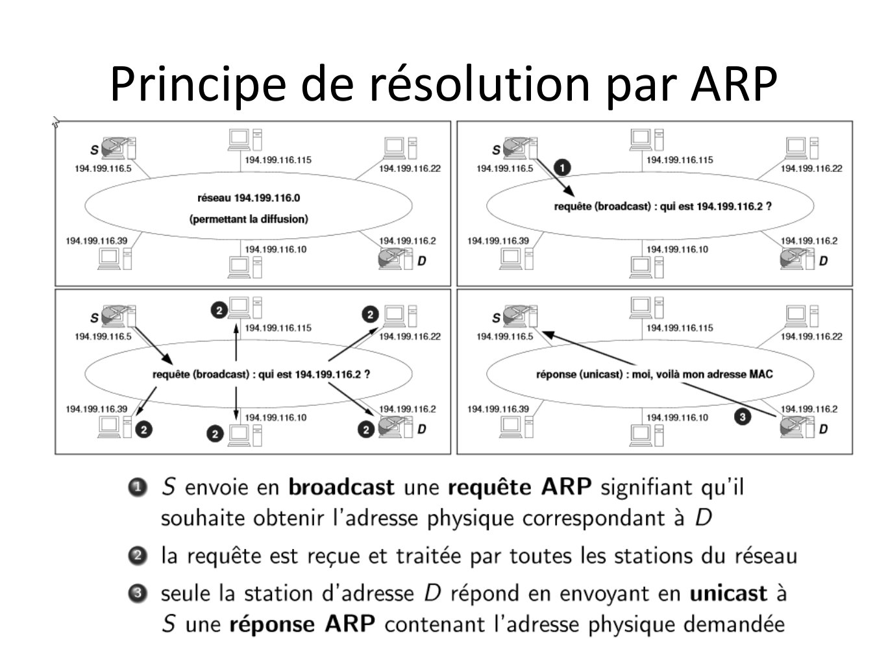

~~~text
Principe de résolution par ARP
~~~

**Lecture OCR à contrôler**

~~~text
Principe de résolution par ARP

ET or
s | == SET
SS 194.199.116.115, = E li 199.116.115 —=
194.199.1165 _ —— 771941991622 194.199.1165 ee 194.199.116.22
réseau 194.199.116.0
requête (broadcast) : qui est 194.199.116.2 ?
(permettant la diffusion)
194.199.11629 / — — Sale ~\194.199.116.2 194.199.11639 / — — eae 194.199.1162
1 — 1
Oo ; ET 0 im OF Eio
| OF
set 0. (Je = O
it 194.199.116.115 =
= LT 194.199.116.22

= 194.199.116.115. =
sn _ | _ > 199,116.22
requéte (broadcast) : qui est 194.199.116.2 ?

Per <
ai)

199.116.2

06 »

=

194.199.116.5

réponse (unicast) : moi, voilà mon adresse MAC

194.199.116.39

| 194.199.116.10

OF

194. 199.116.2
ET

@ S envoie en broadcast une requête ARP signifiant qu'il

souhaite obtenir l'adresse physique correspondant à D

@ la requête est reçue et traitée par toutes les stations du réseau

@ seule la station d'adresse D répond en envoyant en unicast à
S une réponse ARP contenant l'adresse physique demandée
~~~

## Page 7

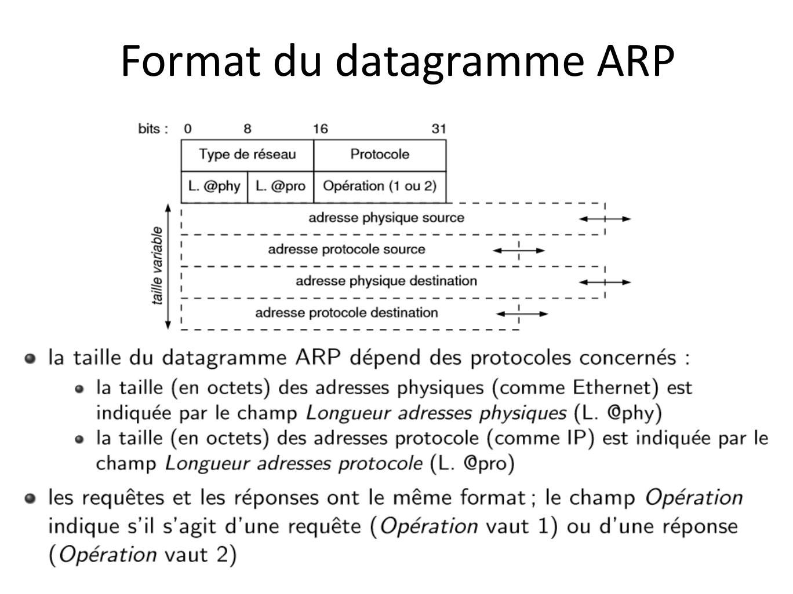

~~~text
Format du datagramme ARP
~~~

**Lecture OCR à contrôler**

~~~text
Format du datagramme ARP

bits: 0 8 16 31

Type de réseau Protocole

L. @phy | L. @pro | Opération (1 ou 2)

taille variable

e la taille du datagramme ARP dépend des protocoles concernés :
e la taille (en octets) des adresses physiques (comme Ethernet) est
indiquée par le champ Longueur adresses physiques (L. @phy)
e la taille (en octets) des adresses protocole (comme IP) est indiquée par le
champ Longueur adresses protocole (L. @pro)

e les requêtes et les réponses ont le même format; le champ Opération

indique s’il s'agit d'une requête (Opération vaut 1) ou d'une réponse
(Opération vaut 2)
~~~

## Page 8

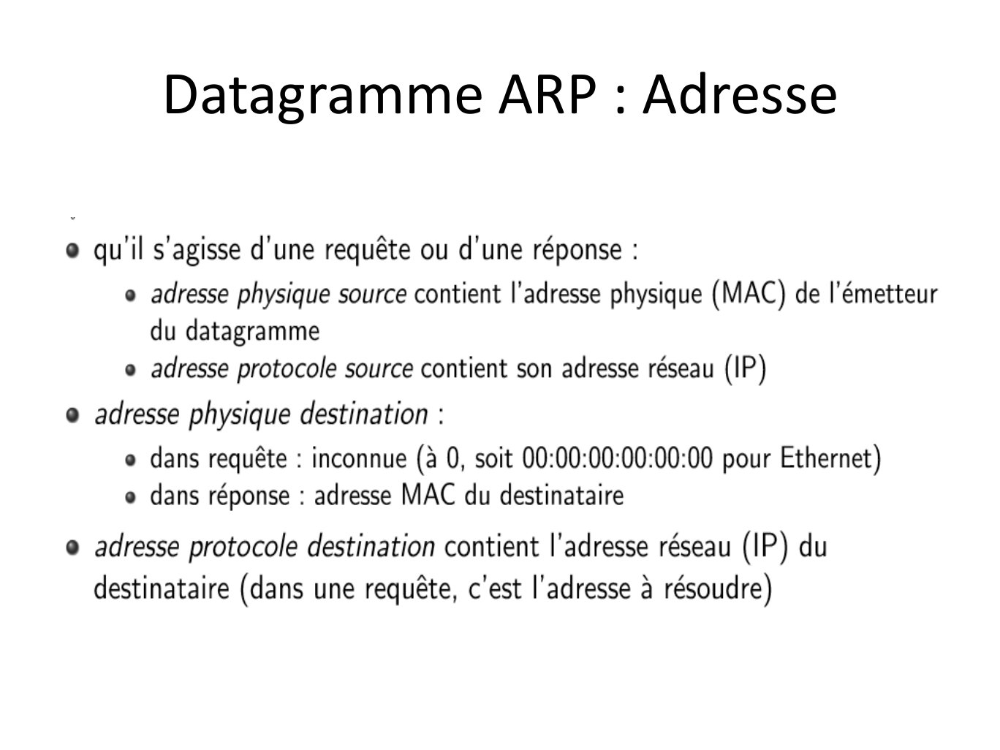

~~~text
Datagramme ARP : Adresse
~~~

**Lecture OCR à contrôler**

~~~text
Datagramme ARP : Adresse

@ qu'il s'agisse d'une requête ou d'une réponse :
e adresse physique source contient l'adresse physique (MAC) de l'émetteur
du datagramme
e adresse protocole source contient son adresse réseau (IP)
@ adresse physique destination :
e dans requête : inconnue (a 0, soit 00:00:00:00:00:00 pour Ethernet)
e dans réponse : adresse MAC du destinataire
@ adresse protocole destination contient l'adresse réseau (IP) du
destinataire (dans une requête, c'est l'adresse à résoudre)
~~~

## Page 9

~~~text
         Format de la trame Ethernet V2

•   Préambule : (8 octets) Annonce le début de la trame et permet la synchronisation.
    Il contient 8 octets dont la valeur est 10101010
•   Adresse Destination : (6 octets) Adresse physique de la carte Ethernet destinataire
    de la trame. Exemple : 08:00:07:5c:10:0a
•   Adresse Source : (6 octets) Adresse physique de la carte Ethernet émettrice de la
    trame
•   EtherType : ou type de trame (2 octets) Indique quel protocole est concerné par le
    message
     –   0x0600 : Xerox Network Systems,
     –   0x0800 : IP (Internet Protocol)
     –   0x8100 : 802.1q (encapsulation vlan)
     –   0x0806 : ARP (Address Resolution Protocol)
     –   0x8035 : RARP (Reverse ARP)
     –   0x8137 et 0x8138 : Novell.

•   Données : (46 à 1500 octets)Les données véhiculées par la trame   .
•   CRC: (Cyclic Redundancy Code) Champ de contrôle de la redondance cyclique
~~~

## Page 10

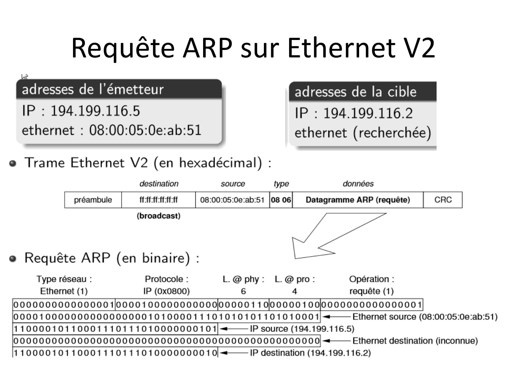

~~~text
Requête ARP sur Ethernet V2
~~~

**Lecture OCR à contrôler**

~~~text
Requête ARP sur Ethernet V2

IP : 194.199.116.2
ethernet (recherchée)

adresses de l'émetteur

IP : 194.199.116.5
ethernet : 08:00:05:0e:ab:51

e Trame Ethernet V2 (en hexadécimal) :

destination source type données
préambule FCCENEFEN 08:00:05:0e:ab:51 Jos ol Datagramme ARP (requête) CRC
(broadcast)

e Requête ARP (en binaire) :

Type réseau : Protocole : L.@phy: L.@ pro: Opération :
Ethernet (1) IP (0x0800) 6 4 requête (1)
00000000000000010001000000000000000110000001000000000000000001
000010000000000000000101000011101010101101010001|~—— Ethernet source (08:00:05:0e:ab:51)

11000010110001110111010000000101|——— IP source (194.199.116.5)
000000000000000000000000000000000000000000000000|——— Ethernet destination (inconnue)
110000101100011101110100000000 1 0|——— IP destination (194.199.116.2)
~~~

## Page 11

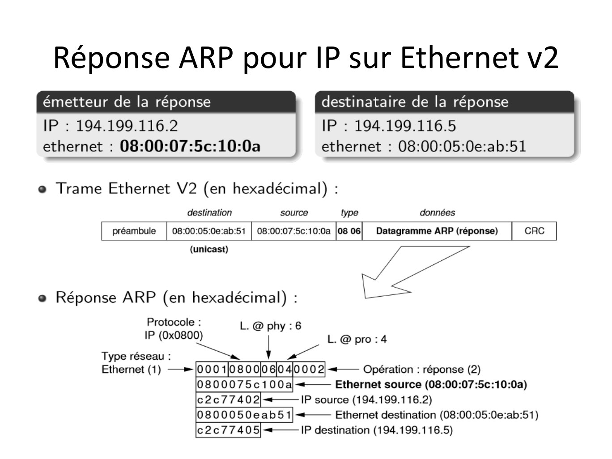

~~~text
Réponse ARP pour IP sur Ethernet v2
~~~

**Lecture OCR à contrôler**

~~~text
Réponse ARP pour IP sur Ethernet v2

émetteur de la réponse

IP : 194.199.116.2
ethernet : 08:00:07:5c:10:0a

destinataire de la réponse

IP : 194.199.116.5
ethernet : 08:00:05:0e:ab:51

e Trame Ethernet V2 (en hexadécimal) :

destination source type données
préambule | 08:00:05:0e:ab:51 | 08:00:07:5c:10:0a les 06 Datagramme ARP (réponse) CRC
(unicast)

e Réponse ARP (en hexadécimal) :

Protocole : L. @ phy :6
IP (0x0800) ied

Type réseau : LT | a
Ethernet (1) —»10 0 0 1/0 8 0 0/0 6/0 4/0 0 0 2|-«— Opération : réponse (2)
0800075c100a\———- Ethernet source (08:00:07:5c:10:0a)
ic2c77402|——— IP source (194.199.116.2)
0800050eab51|—— Ethernet destination (08:00:05:0e:ab:51)
ic2c77405|——— IP destination (194.199.116.5)

L. @ pro :4
~~~

## Page 12

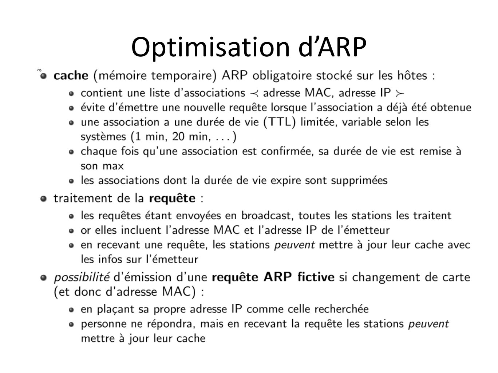

~~~text
Optimisation d’ARP
~~~

**Lecture OCR à contrôler**

~~~text
Optimisation d’ARP

‘e cache (mémoire temporaire) ARP obligatoire stocké sur les hôtes :

contient une liste d'associations < adresse MAC, adresse IP >

évite d'émettre une nouvelle requête lorsque l'association a déjà été obtenue
une association a une durée de vie (TTL) limitée, variable selon les
systèmes (1 min, 20 min, ...)

chaque fois qu'une association est confirmée, sa durée de vie est remise à
son max

les associations dont la durée de vie expire sont supprimées

e traitement de la requête :

les requêtes étant envoyées en broadcast, toutes les stations les traitent

or elles incluent l'adresse MAC et l'adresse IP de l'émetteur

en recevant une requête, les stations peuvent mettre à jour leur cache avec
les infos sur l'émetteur

e possibilité d'émission d'une requête ARP fictive si changement de carte
(et donc d'adresse MAC) :

en plaçant sa propre adresse IP comme celle recherchée
personne ne répondra, mais en recevant la requête les stations peuvent
mettre à jour leur cache
~~~

## Page 13

~~~text
             Quelques commandes
• Linux
   – arp (affichage de la table arp)
   – ping (interroge une carte réseau et exprime le temps aller-retour en mili
     secondes)
        ping localhost
        ping @ip
        ping -v nom-hôte-distant
   – route (programme de gestion de la table de routage IP)
   – ifconfig (programme de configuration des interfaces réseaux, c'est à dire des
     cartes réseaux)
   – netstat (affiche les informations sur les connexions réseaux)
   – nslookup ("name server", programme d'interogation des serveurs de noms de
     domaines)
• Windows
   – ipconfig –all
   – arp –a
   – ping IP
~~~

## Page 14

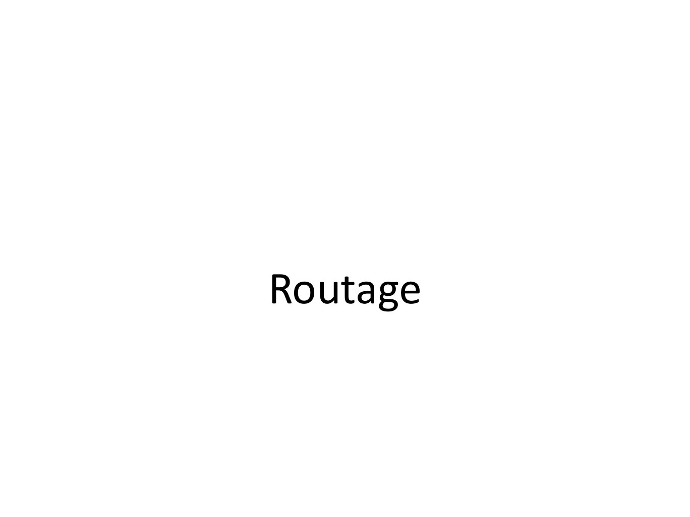

~~~text
Routage
~~~

## Page 15

~~~text
                   Rôles des routeurs
• Les routeurs actuels sont pour la plupart des matériels dédiés à la tâche
  de routage, se présentant généralement sous la forme de serveurs.
• On envoie la requête au routeur le plus proche, c'est-à-dire à la
  passerelle réseau sur lequel il se trouve. Ce routeur va ainsi déterminer
  la prochaine machine à laquelle les données vont être acheminées de
  manière à ce que le chemin choisi soit le meilleur.
• Pour y parvenir, les routeurs tiennent à jour des tables de routage,
  véritable cartographie des itinéraires à suivre en fonction de l'adresse
  visée. Il existe de nombreux protocoles dédiés à cette tâche.
• les routeurs permettent de manipuler les données circulant sous forme
  de datagrammes afin d'assurer le passage d'un type de réseau à un autre
• les routeurs sont chargés de fragmenter les paquets de données pour
  permettre leur libre circulation
~~~

## Page 16

~~~text
                            Routeur
• Un routeur est un élément
  intermédiaire dans un réseau
  informatique assurant le
  routage des paquets. Son
  rôle est de faire transiter des
  paquets d'une interface
  réseau vers une autre, au
  mieux, selon un ensemble de
  règle (Wikipedia)
                                Les premiers routeurs étaient de simples
                                ordinateurs ayant plusieurs cartes réseau, dont
                                chacune était reliée à un réseau différent.
~~~

## Page 17

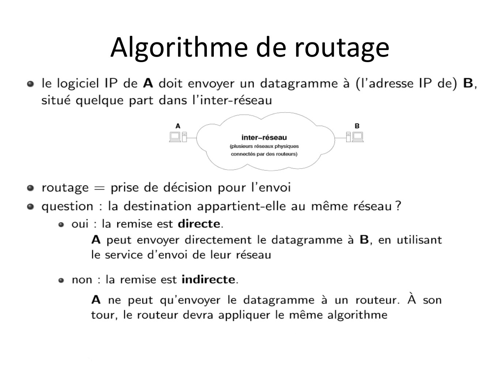

~~~text
Algorithme de routage
~~~

**Lecture OCR à contrôler**

~~~text
Algorithme de routage

e le logiciel IP de A doit envoyer un datagramme à (l'adresse IP de) B,
situé quelque part dans l'inter-réseau

A B

inter-réseau
{plusieurs réseaux physiques
connectés par des routeurs)

e routage = prise de décision pour l'envoi
e question : la destination appartient-elle au même réseau ?
e oui : la remise est directe.

A peut envoyer directement le datagramme à B, en utilisant
le service d'envoi de leur réseau

e non : la remise est indirecte.

A ne peut qu’envoyer le datagramme à un routeur. A son
tour, le routeur devra appliquer le même algorithme
~~~

## Page 18

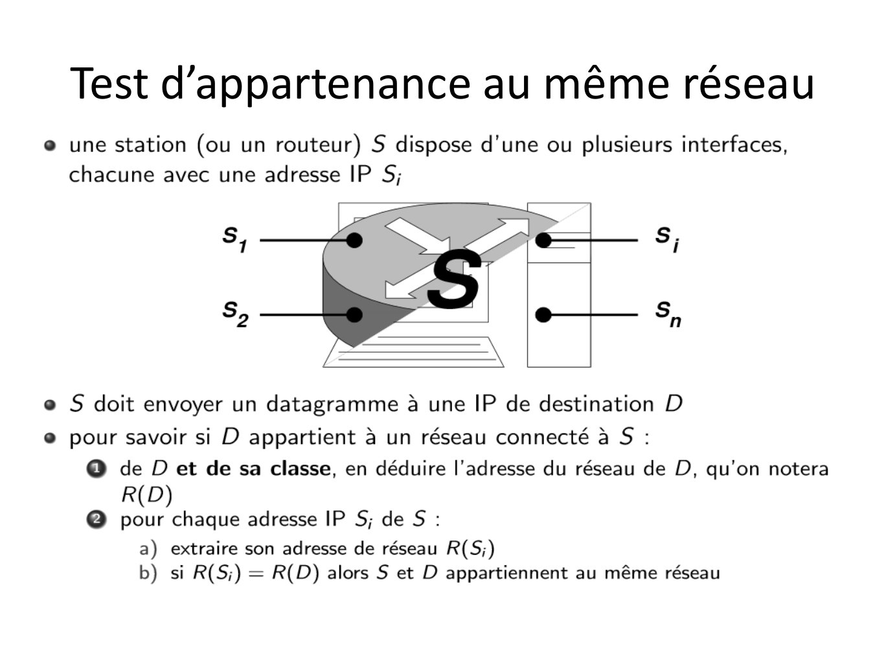

~~~text
Test d’appartenance au même réseau
~~~

**Lecture OCR à contrôler**

~~~text
Test d'appartenance au même réseau

@ une station (ou un routeur) S dispose d'une ou plusieurs interfaces,
chacune avec une adresse IP S;

Ss;

S,

e S doit envoyer un datagramme à une IP de destination D
@ pour savoir si D appartient a un réseau connecté a S :
@ de D et de sa classe, en déduire l'adresse du réseau de D, qu'on notera
R(D)
@ pour chaque adresse IP S; de S :

a) extraire son adresse de réseau R(S;)
b) si R(S;) = R(D) alors S et D appartiennent au même réseau
~~~

## Page 19

~~~text
                                    Exemple
Un routeur possède plusieurs interfaces réseau, chacune connectée sur un réseau différent.
Il possède ainsi autant d'adresses IP que de réseaux différents sur lesquels il est connecté
~~~

## Page 20

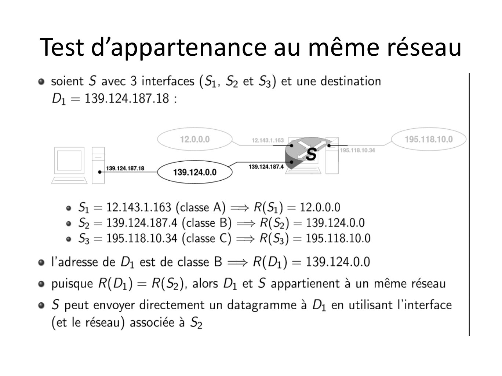

~~~text
Test d’appartenance au même réseau
~~~

**Lecture OCR à contrôler**

~~~text
Test d'appartenance au même réseau

@ soient S avec 3 interfaces (S1, Sp et S3) et une destination
Di = 139.124.187.18 :

— fl ==

139.124.187.18 139.124.0.0 139.124.187.4

e S1 = 12.143.1.163 (classe A) => R(S1) = 12.0.0.0
© Sp = 139.124.187.4 (classe B) —> R(Sp) = 139.124.0.0
e S3 = 195.118.10.34 (classe C) —> R(S3) = 195.118.10.0

e l'adresse de Di est de classe B => R(D1) = 139.124.0.0
e puisque R(D:) = R(S2), alors Di et S appartienent à un même réseau

@ S peut envoyer directement un datagramme à D; en utilisant l'interface
(et le réseau) associée à So
~~~

## Page 21

~~~text
                 Remise indirecte

• Méthode
  1. déterminer l’adresse IP du routeur à solliciter par
     consultation de la table de routage
  2. transmettre le datagramme au routeur
     a.   Déterminer son adresse physique (résolution d’adresse)
     b.   Utiliser le service du réseau pour lui transmettre le datagramme
~~~

## Page 22

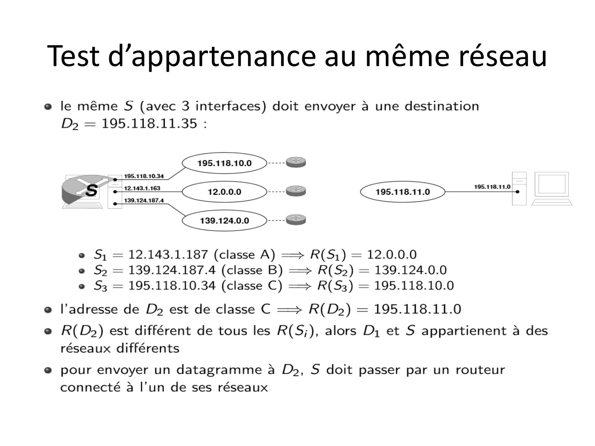

~~~text
Test d’appartenance au même réseau
~~~

**Lecture OCR à contrôler**

~~~text
Test d'appartenance au même réseau

e le même S (avec 3 interfaces) doit envoyer a une destination
Dz = 195.118.11.35 :

195.118.10.0 )----- es]
Le > 195.118.10.34
ST 21818 7 32000 )----- S 1985418110 195.118.11.0
139.124.187.4

13912400 )----- (sr)
e S1 = 12.143.1.187 (classe A) = > R(S1) = 12.0.0.0
e So = 139.124.187.4 (classe B) = > R(S2) = 139.124.0.0

e S3 = 195.118.10.34 (classe C) => R(S3) = 195.118.10.0

e l'adresse de Dz est de classe € ==> R(D2) = 195.118.11.0

e R(D2) est différent de tous les R(S;), alors Di et S appartienent a des
réseaux différents

@ pour envoyer un datagramme à Do, S doit passer par un routeur
connecté à l'un de ses réseaux
~~~

## Page 23

~~~text
  Traitement du datagramme reçu
• Traitement par un routeur
  – Si le datagramme est destiné au routeur, l’accepter
  – Sinon le routeur est utilisé comme nœud de transfert
    et doit relayer le datagramme (si aucun route ,
    message ICMP renvoyé)
• Traitement par une station
   – Si le datagramme est destiné à la station , l’accepter
   – Sinon le datagramme est détruit et un message ICMP
     est envoyé
Remarque : une station, même disposant de plusieurs
interfaces, n’assure pas systématiquement la fonction de
routeur, il faut qu’elle soit configurée
~~~

## Page 24

~~~text
                  Table de routage
• chaque station ou routeur dispose de sa propre table de routage
• une table contient autant d'entrées que de destinations (réseaux)
  connues de l'hôte
• une entrée est un couple (adresse réseau, adresse du saut
  suivant (routeur))
• pour une destination donnée, la table n'indique pas le chemin à
  suivre, seulement le routeur à qui confier le datagramme
               le chemin est une information répartie
• ce routeur doit être directement accessible (situé sur un réseau
  commun) et c'est son adresse dans ce réseau qui est utilisée
• une destination dont l'adresse de réseau ne figure pas dans la
  table est inaccessible
~~~

## Page 25

~~~text
                                    Exemple
Un routeur possède plusieurs interfaces réseau, chacune connectée sur un réseau différent.
Il possède ainsi autant d'adresses IP que de réseaux différents sur lesquels il est connecté
~~~

## Page 26

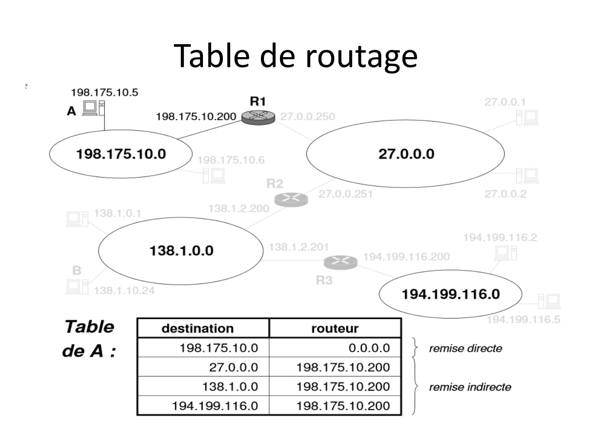

~~~text
Table de routage
~~~

**Lecture OCR à contrôler**

~~~text
Table de routage

198.175.10.5
oR R1
A ait 198.175.10.200 GSD ae
jo — <<. s
(  198.175.10.0 ) ( 27.0.0.0 )
ae — “74 NC

€ 94.199.11 60 )

| 0.0.0.0 \ remise directe
27.0.0.0 | 198.175.10.200
138.1.0.0 | 198.175.10.200 > remise indirecte
194.199.116.0 | 198.175.10.200 |
~~~

## Page 27

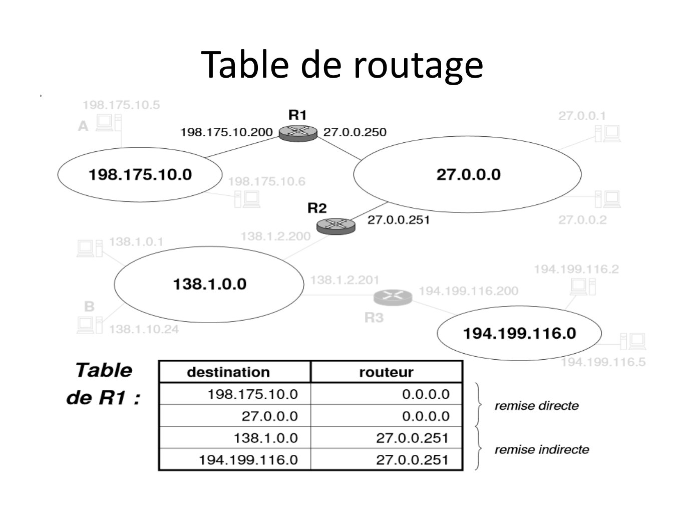

~~~text
Table de routage
~~~

**Lecture OCR à contrôler**

~~~text
Table de routage

R1

198.175.10.200 27.0.0.250 ee

© 190.175.100 )

KT : 27.0.0.0 >

R2 — _—
egy 2700251

CC 138.1.0.0
A C1943 99.11 50 )

Table | destination [routeur |
de R1 : 198.175.10.0 0.0.0.0
27.0.0.0 0.0.0.0

| remise directe

138.1.0.0 27.0.0.251
194.199.116.0 27.0.0.251

| remise indirecte
~~~

## Page 28

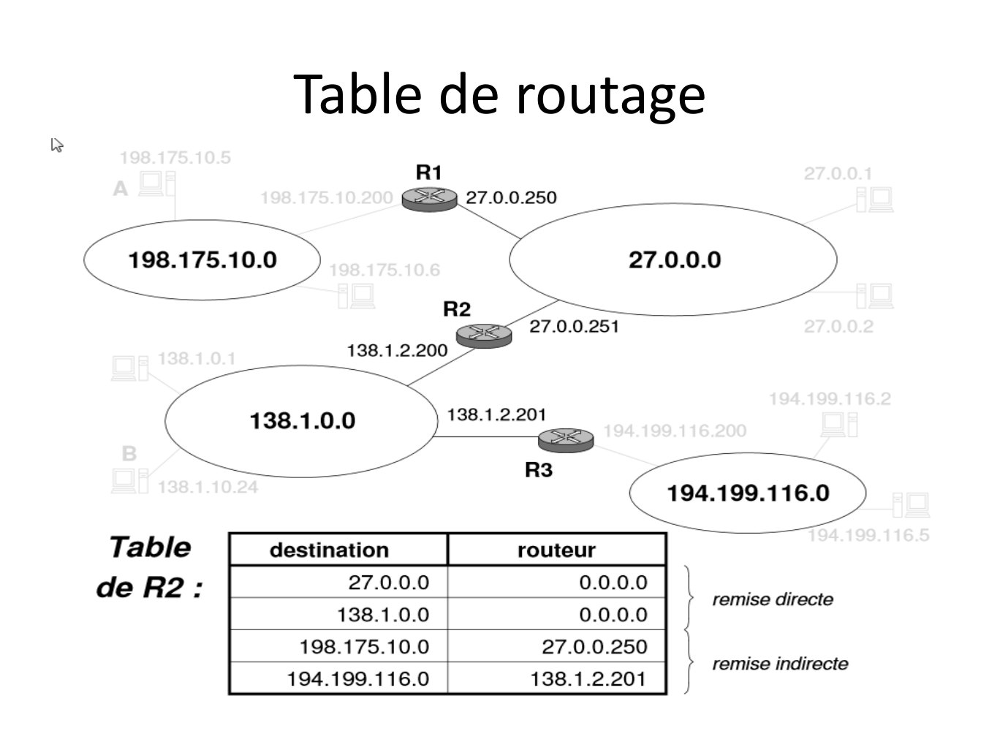

~~~text
Table de routage
~~~

**Lecture OCR à contrôler**

~~~text
Table de routage

a

L198. 175.10. 0)

et

27.0.0.0

138.1.2.201

R3 ~ ~
C 194.199. 160 )

0.0.0.0

138.1.0.0

remise directe
0.0.0.0

198.175.10.0
194.199.116.0

4
27.0.0.250

138.1.2.201

remise indirecte
~~~

## Page 29

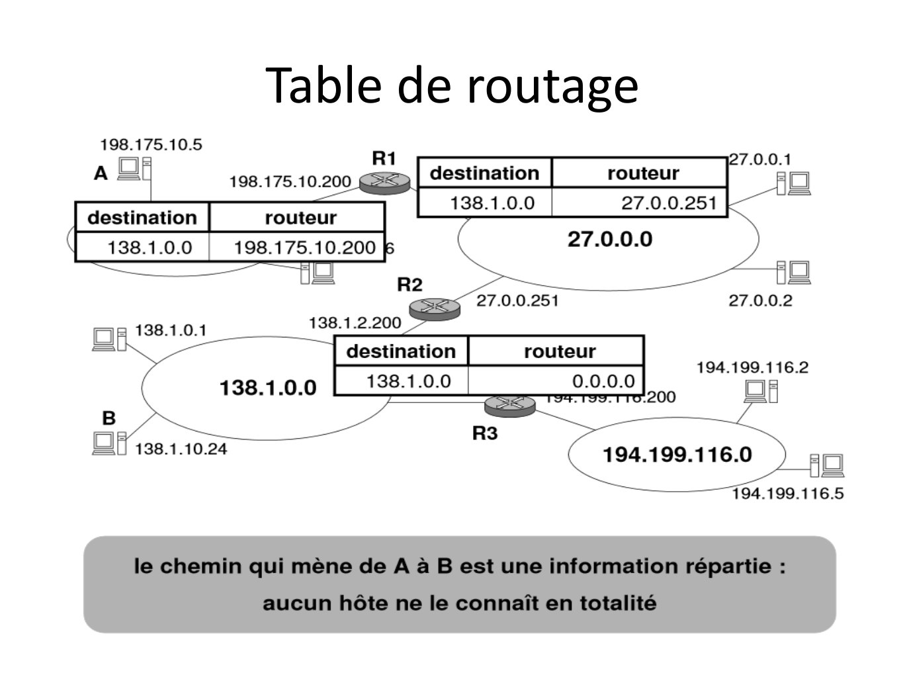

~~~text
Table de routage
~~~

**Lecture OCR à contrôler**

~~~text
Table de routage

198.175.10.5
OF R1 ——— 7.0.0.1
= 198.175.10.200 => destination [__ routeur | Ac
( 27.0.0.0 )
_-— fio

jd

[destination] _ roueur |
/ 138#1:0.0 | 1.0.0 wes 0. 0 0

4 138.1.0.0 2200 rr
B QU y > ER

_— a R3 >)
- C 19es90:160 AG

OF 498.1.10.24

494.199.1165

le chemin qui mène de A à B est une information répartie :
aucun hôte ne le connaît en totalité
~~~

## Page 30

~~~text
            Algorithme de routage
• La couche réseau doit acheminer les paquets de la machine
  source vers la machine destination.
• L’interconnexion des routeurs permet de disposer de
  plusieurs routes possibles.
• En mode datagramme, le choix de la route est effectué
  pour chaque paquet.
• Dans le cas d’un circuit virtuel, la route est déterminée au
  moment de l’établissement de la connexion.
• Quelques algorithmes :
   – Plus court chemin (Djikstra)
   – Routage fondé sur le flux
   – Routage par inondation
   – Routage à vecteur de distance (Ex: RIP)
~~~

## Page 31

~~~text
                    Sources
Slides sont tirés du :
• Cours de C. Pain-Barre
• Cours Initiation à l’architecture réseau de P.
   Ducrot
• Livre de Guy Pujolle « Cours réseaux et
   télécom »
• Wikepedia
~~~
