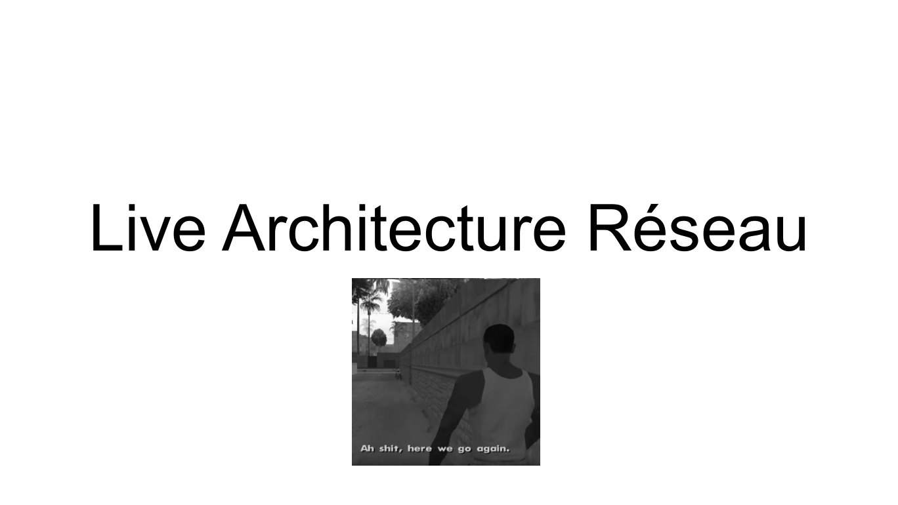
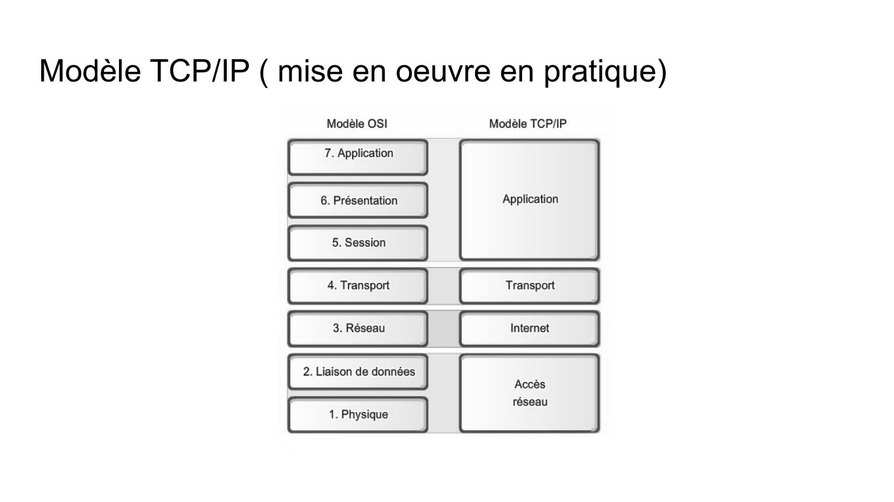
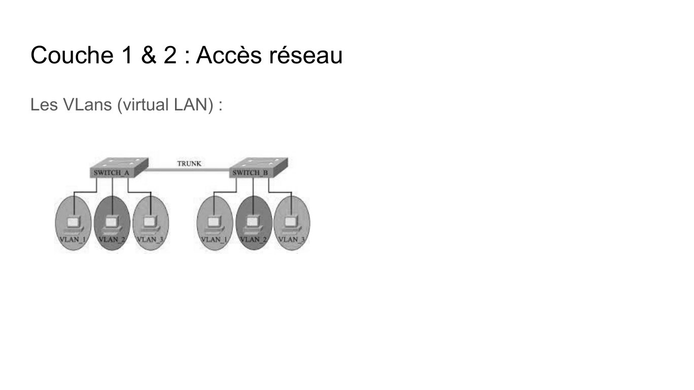
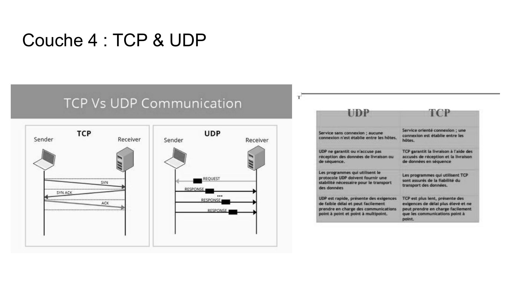
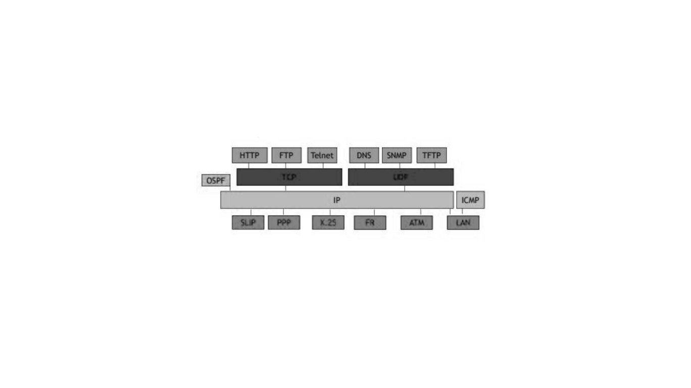

# live_archi Atillive.pdf

[Ouvrir l’original](https://drive.google.com/open?id=1pP506V8IVsbMMYQ9hHgc_qJ5StoMnqL3) · Les pages signalées comprennent du texte reconnu automatiquement ou des éléments graphiques. Le fac-similé permet de vérifier chaque lecture.

**Pages avec fac-similé ou lecture OCR** — 1, 5, 11, 18–19.

## Page 1

~~~text
Live Architecture Réseau
~~~

## Page 2

~~~text
Introduction
   Un réseau c’est quoi ?

   Historique de Mise en place des premiers réseau :
        -   1960- (~10 m)
        -   1970 déploiement de l’internet entre scientifique
        -   1990 apparition du world wide web
~~~

## Page 3

~~~text
Comment des machines peuvent communiquer ?
    Le Concept de modèle :

       Permet d’avoir une “norme” de communication employé par toute les
    machines connectés à un réseau

-   Dès 1970 plusieures architectures de conceptions se concurrence
    (DSA,Decnet,SNA etc)
-   Le modèle OSI ( Open Systems Interconnection) devient la norme en 1984
~~~

## Page 4

~~~text
Le modèle OSI (théorique)
                            -   Les couches sont indépendants

                            -   Couche 1 à 4 sont les couches réseaux

                            -   Une couche ne peut communiquer qu'à la
                                couche adjacente
~~~

## Page 5

~~~text
Modèle TCP/IP ( mise en oeuvre en pratique)
~~~

**Lecture OCR à contrôler**

~~~text
Modèle TCP/IP ( mise en oeuvre en pratique)

Modèle OSI Modèle TCP/IP

7. Application
Application

6. Présentation

5. Session

4. Transport Transport

3. Réseau Internet

2. Liaison de données

Accès
réseau
1. Physique
~~~

## Page 6

~~~text
Modèle TCP/IP ( mise en oeuvre en pratique)
L'Encapsulation/Décapsulation
~~~

## Page 7

~~~text
Couche 1 & 2 : Accès réseau
Les topologies            Le matériel :

                  bus

                 anneau                            commutateur (
                                   Hub
                                                   switch)

                              transmet à              dispose d’un système
                              l’ensemble des          d’adressage (adresse Mac)
                              machines connectés
                 étoile
~~~

## Page 8

~~~text
Couche 1 & 2 : Accès réseau
L’adresse MAC :

 -   l’adresse d’une carte réseau (unique défini par le fabricant)
 -   6 octets de longueur en Hexa

Adresse MAC de broadcast : ff:ff:ff:ff:ff:ff identique pour toutes les cartes réseaux

permet d’envoyer un message a toute les machines d’un réseau
~~~

## Page 9

~~~text
Couche 1 & 2 : Accès réseau
Protocole Ethernet :

 -   le protocole défini le “langage” de communication
 -   Le “message” est appelé trame

                                                  protocole
                                                  qu’utilise la
                                                  couche 3
~~~

## Page 10

~~~text
Couche 1 & 2 : Accès réseau
Le switch comment ça marche ?                   table CAM

 Mise à jour de la table CAM, le switch :
    - reçoit une trame, il connaît :
         -   le port de l'émetteur
         - l’adresse mac du destinataire
    - envoie à tout le monde s’il connaît pas
 l'adresse mac reçu (sans broadcast)
    - TTL (time to live)
~~~

## Page 11

~~~text
Couche 1 & 2 : Accès réseau
Les VLans (virtual LAN) :
~~~

**Lecture OCR à contrôler**

~~~text
Couche 1 & 2 : Accès réseau

Les VLans (virtual LAN) :

TRUNK
~~~

## Page 12

~~~text
La couche 3 : réseau ou internet
son rôle ?

    connecté les différents réseaux locaux

commande “traceroute” sur linux

L’adresse IP (aka l’invention de génie) :

    -contient l’adresse du réseau et l’adresse de la machine
~~~

## Page 13

~~~text
La couche 3 : réseau ou internet
Masque de sous-réseaux :
     -permet le découpage d’une adresse ip en partie réseau et en partie machine

Les différents calculs : cf QCM & début exercice 2 Examen 2019
~~~

## Page 14

~~~text
Couche 3 : Le routage
Routeur :

                    -   machine avec plusieurs interfaces réseaux
                    -   chaque interface connecté à un réseau
                    -   à pour but de relayer les paquets qui ne lui est pas
                        destiné
                    -   utilise une table de routage
~~~

## Page 15

~~~text
Couche 3 : Le routage
Routage statique :

  -   la table de routage est gérée manuellement
  -   Nécessite une mise a jour a chaque ajout/suppression de réseau

Routage dynamique :

      utilise des protocoles/algorithmes pour construire la table de routage :

            ex de protocoles et leurs algos : RIP (Routing Information Protocol) : Algo vecteur de distance

                  OSPF (Open Shortest Path First) : Algo état de liaison

Route par défaut :

     chaque routeur a dans sa table de routage une route par défaut dans lequel il peut envoyer le
paquet si celui-ci n’est pas destiné à son réseau
~~~

## Page 16

~~~text
Couche 3 : Les autres protocoles
protocole ARP (protocole de couche 2 & 3) :

     -permet d’envoyer un message à une machine sur notre réseau sans connaître l’adresse

MAC, on peut ainsi associer une adresse MAC et une adresse IP

     principe :

          -utile l’adresse de broadcast pour envoyer a tous les machines du reseau

          - conserve les liens entre adresse ip et adresse mac dans une table (table ARP)

ICMP: utilisé pour transporter des messages d’informations sur le réseau (ping =requête ICMP)
~~~

## Page 17

~~~text
Couche 4 : Transport
Couche 4 :

 -   Permet de gérer l’envoie aux applications via les ports
 -   Assure l’ordre de livraison, l’intégrité et l’assemblage des paquets
 -   notion de client/serveur avec 2 entités qui dialogue
~~~

## Page 18

~~~text
Couche 4 : TCP & UDP
~~~

**Lecture OCR à contrôler**

~~~text
Couche 4 : TCP & UDP

TCP Vs UDP Communication .

TCP UDP

Sender Receiver Sender Receiver
~~~

## Page 19

**Schéma des protocoles réseau.** HTTP, FTP et Telnet sont regroupés au-dessus du premier bandeau ; DNS, SNMP et TFTP au-dessus du second. Le texte des deux bandeaux noirs est illisible. OSPF est à gauche, IP au centre et ICMP à droite. Sous IP figurent SLIP, PPP, X.25, FR, ATM et LAN.

## Page 20

~~~text
serveur DNS (Domain Name System) :
    serveur qui permet de correspondre les noms de domaines internet et les
adresse IP

DHCP (Dynamic Host Configuration Protocol):
Protocole qui garantit la configuration automatique des paramètre ip d’une
machine ou d’une station (donne une ip et un masque a une machine )
~~~

## Page 21

~~~text
Adresse IPV6
Intérêt :
 -   Plus d’adresse : 2^128 (pour 2^32 en IPV4)
Les types d’adresse Ipv6 :
     unicast : désigne une interface unique
    multicast : désigne un groupe d’interface (pouvant être partout sur internet),
paquet distribué à toute les interfaces du groupe
    anycast : groupe d’interface, paquet distribué à un élément du groupe (le plus
proche)
~~~

## Page 22

~~~text
  Adresse IPV6
Adresse Unicast :
     -    lien local : passe pas le routeur (portée LAN) distinguable par FE80::/10
     -    global : routable distinguable par 2000::/3
     -    site local : pas routable sur internet (portée organisation local) distinguable par
FC::/7
une adresse unicast contient obligatoirement une adresse LLA (lien local) , cette adresse à
un préfixe de 64 bits

Adresses spéciales :
 - loopback ::1 (== 127.0.0.1)
 - any :: (== 0.0.0.0 en ipv4)
~~~

## Page 23

~~~text
Adresse IPV6
Structure :

  -    8 segments de 16 bits (écrit en hexadécimal),128 bits au total
  -    les derniers bits identifie la machine
  -    les premiers forment le préfixe
         -    si machine relié à un routeur, il y a un préfixe “lien local” et préfixe “global”
  -    la division du préfixe respecte la notation CIDR

Règles d’écriture :

  -    les zéros de bits fort peuvent être omis

  -    une ou plusieurs séquences de 16 bits de zéro peuvent être remplacées dans l’adresse mais seulement une fois
~~~
