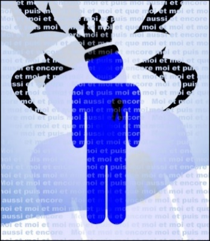
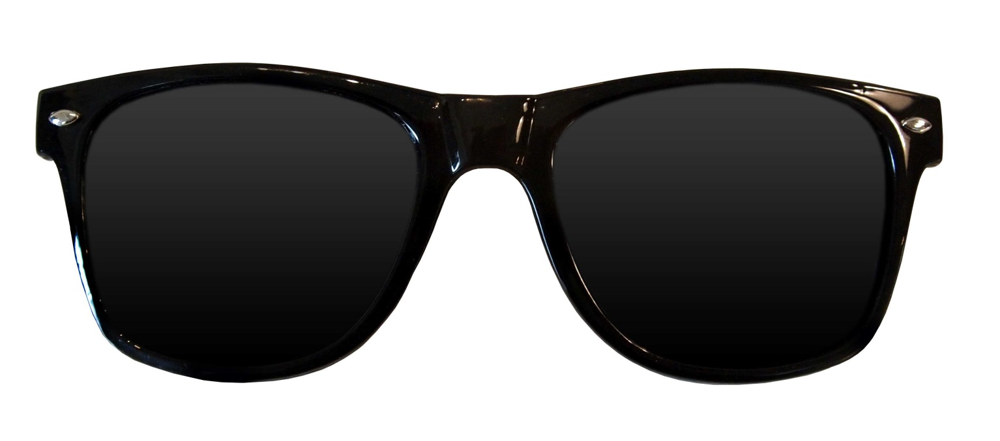
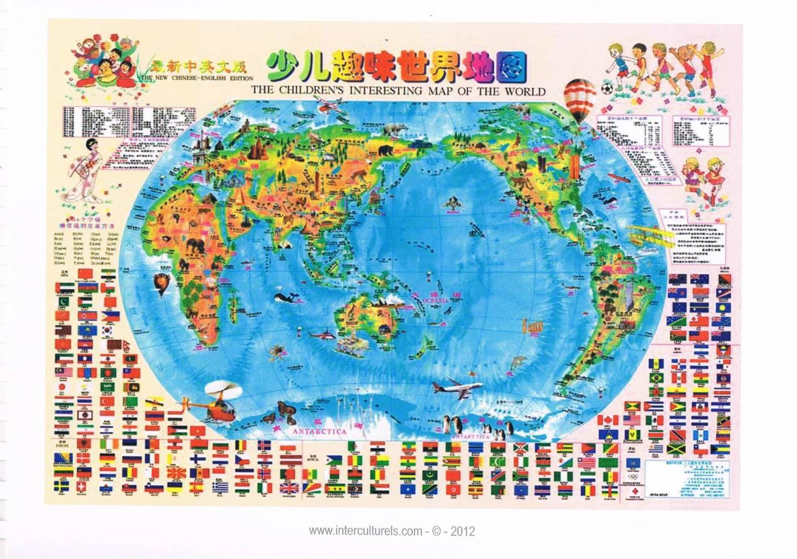
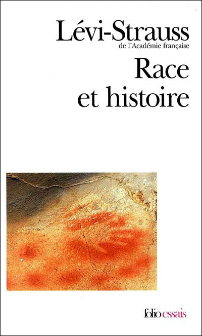
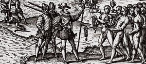
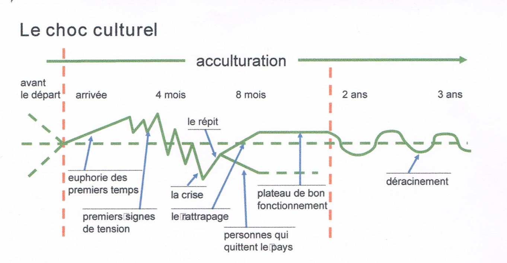
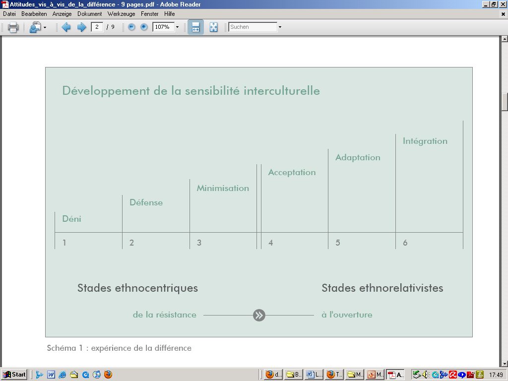

# Communication interculturelle-ING2-Séance 3.pptx

[Ouvrir l’original](https://drive.google.com/open?id=1hVdzt-BwttztUbro-43Qakf8ibfWUlhC) · Texte structuré depuis le fichier original. Les mises en page complexes peuvent nécessiter une vérification.

## Diapositive 1

Communication interculturelle-ING2-Séance 3

05/11/2024

Pôle Humanités Design/ Département Relations Humaines

1

## Diapositive 2

Savoir déjouer les principaux pièges à la rencontre interculturelle?

Pôle Humanité

L’Ethnocentrisme, choc culturel et développement de la sensibilité interculturelle

## Diapositive 3

	L’Ethnocentrisme 

Est intrinsèque à tout être humain 

Pôle Humanité

**Texte du schéma**

- Ethnocentrisme
- Choc culturel
- Sensibilité interculturelle

## Diapositive 4

Talmud: « Nous ne voyons pas le monde tel qu’il est, nous voyons le monde tel que nous sommes »

Pôle Humanité

## Diapositive 5

Mise en réflexion

Le texte sur l’analogie des lunettes: lecture commune et discussion

Pôle Humanité

## Diapositive 6

L’ethnocentrisme: définition et naissance du concept

L’ethnocentrisme est un concept ethnologique ou anthropologique qui a été introduit par W.G. Sumner,  sociologue américain, en 1906. 

Il signifie « voir le monde et sa diversité à travers le prisme privilégié et plus ou moins exclusif des idées, des intérêts et des archétypes de notre communauté d'origine, sans regards critiques sur celle-ci », Folkways

C’est une attitude de mépris/déni de la différence culturelle 

Pôle Humanité

## Diapositive 7

L’exemple des planisphères: notre pays est toujours le centre du monde…

Pôle Humanité

## Diapositive 8

Pôle Humanité

## Diapositive 9

L’ethnocentrisme: un trait propre à toute l’humanité 

Point Littérature et Histoire: Race et Histoire de Claude Lévi-Strauss et la controverse de Valladolid: « Le barbare n’est pas mon semblable »

Pôle Humanité

## Diapositive 10

Au fondement du racisme « Le barbare n’est pas mon semblable »

Rapport à l’UNESCO sur le racisme Race et Histoire, 1952: contrecarrer les thèses racialistes ( Gobineau)

Autrui se signale par son altérité radicale: « l’humanité cesse aux frontières de la tribu, du groupe linguistique, parfois même du village »: nommer homme ceux qui sont suffisamment semblables à moi 

Les exemples historiques tragiques de la découverte de l’Amérique: expériences sur des cadavres de soldats espagnols + controverse de Valladolid

En 1550: Valladolid, Las Casas/Sepulveda: débat intellectuel: Les Indiens sont-ils des hommes comme les autres? Ont-ils une âme? 

Pôle Humanité

## Diapositive 11

Le choc culturel selon R. Dinello

Pôle Humanité

## Diapositive 12

L’exemple du « syndrome de Paris »

Fous de l'Inde : Délires d'Occidentaux et sentiment océanique, Régis Airault

Pôle Humanité

## Diapositive 13

 Le choc culturel: atelier 

Pôle Humanités Design/departement relations humaines

13

Lecture au choix 

1° Le syndrome Japonais: Ces Nippons qui deviennent fous à Paris

2° Le syndrome de l’Inde

3°Etudier à l’étranger : attention au choc culturel

Quel retour de vos lectures ? 

Faites la synthèse pour vos camarades. 

Des expériences personnelles sur le sujet? 

Pourquoi certains «  vivent » mieux le choc culturel que d’autres? 

Où/dans quoi pourrait résider une solution? 

**Notes**

https://www.lemonde.fr/big-browser/article/2011/10/21/syndrome-japonais-ces-nippons-qui-deviennent-fous-a-paris_5988125_4832693.html
https://www.lemonde.fr/societe/article/2019/07/29/syndrome-du-voyageur-voyager-un-peu-beaucoup-a-la-folie_5494692_3224.html
https://www.lemonde.fr/campus/article/2017/03/28/etudier-a-l-etranger-attention-au-choc-culturel_5101856_4401467.html
https://www.psychologies.com/Culture/Spiritualites/Pratiques-spirituelles/Articles-et-Dossiers/Mefiez-vous-du-syndrome-de-l-Inde

## Diapositive 14

14

       Le modèle de M. Bennett 

ethnocentrique

ethnorelativiste

La sensibilité interculturelle

Pôle Humanité

## Diapositive 15

Pôle Humanité

## Diapositive 16

Stratégies d’évolution

| Du déni vers la défense | Une prise de conscience des différences |
| --- | --- |
| De la défense à la minimisation | Dépolariser les jugements négatifs, introduire les aspects positifs communs à toutes les cultures, voir les similitudes |
| De la minimisation à l’acceptation  | Se rendre compte de l’importance des différences culturelles |
| De l’acceptation à l’adaptation  | Encourager l’exploration intensive et la recherche, connaissance de l’autre cadre culturel |
| De l’adaptation à l’intégration  | Tout ce qui permet de développer sa capacité d’empathie avec l’autre culture ainsi que sa capacité de communiquer interculturellement |
| De l’intégration sans désintégration  | Préciser ou définir un cadre d’éthique personnel. Bien gérer le fait de ne s’identifier à aucune culture en particulier |

Pôle Humanité

## Diapositive 17

C’est à vous! Replacez vos expériences sur l’échelle de M. Bennett: exercice soumis à évaluation 

Déni  2.Défense 3.Minimisation 4.Acceptation 5.Adaptation  6. Intégration

Expérience interculturelle et ethnocentrisme : faites la description de la situation interculturelle la plus marquante que vous avez vécue. Décrivez. Commentez les sentiments et réflexions que vous inspire aujourd’hui ce fait. Replacez vos comportements et ceux de vos interlocuteurs sur l’échelle de M. Bennett

A rendre pour le 25/10 !!!

Pôle Humanité

