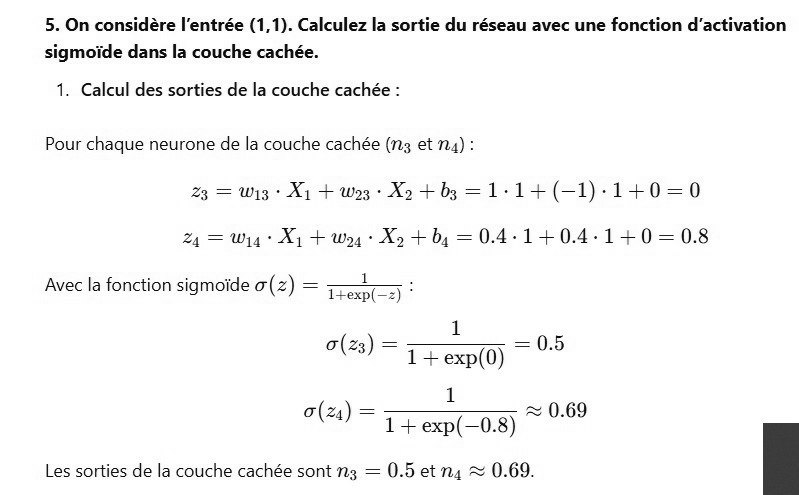

# DS DM 24 (13).jpg

[Ouvrir l’original](https://drive.google.com/open?id=1dRJIhLXjfCH0hMmOO7awsXtpU3bOrWYm) · Les pages signalées comprennent du texte reconnu automatiquement ou des éléments graphiques. Le fac-similé permet de vérifier chaque lecture.

**Pages avec fac-similé ou lecture OCR** — 1.

~~~text
5. On considère l'entrée (1,1). Calculez la sortie du réseau avec une fonction d'activation
sigmoïde dans la couche cachée.

1. Calcul des sorties de la couche cachée :
Pour chaque neurone de la couche cachée (ng et M4) :
23 = wig Xi + wg + Xo +b3 =1-1+(-1)-1+0=0
2 = Wy Xi + Woy Xo + by = 0.4-14+04-14+0=0.8

Avec la fonction sigmoide o(z) = -—

Trexp(-2) ‘
1
o(z3) = T+epO) = 0.5
1
(24) = © —© + 0.69

~ 1+exp(—0.8)

Les sorties de la couche cachée sont ng = 0.5 et ny & 0.69. E
~~~
