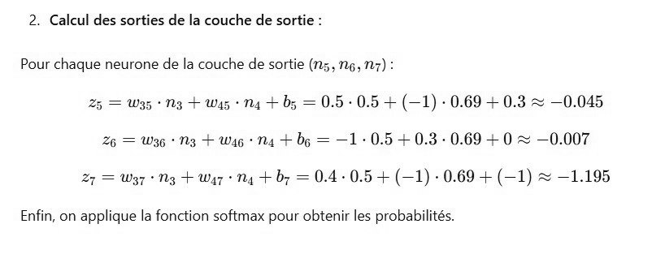

# DS DM 24 (14).jpg

[Ouvrir l’original](https://drive.google.com/open?id=1di2XQJbr20OfcGi5Q-LZ539qY3K7Z89T) · Les pages signalées comprennent du texte reconnu automatiquement ou des éléments graphiques. Le fac-similé permet de vérifier chaque lecture.

**Pages avec fac-similé ou lecture OCR** — 1.

~~~text
2. Calcul des sorties de la couche de sortie :

Pour chaque neurone de la couche de sortie (n5, 6, 27) :
25 = W35 ° 3 + Was + Ng + bs = 0.5 : 0.5 + (—1) - 0.69 + 0.3 & —0.045
26 = W36 * 23 + Wag + Na + bg = —1 + 0.5 + 0.3 - 0.69 + 0 & —0.007
27 = W373 + War + Na +b; = 0.4- 0.5 + (—1) - 0.69 + (—1) & —1.195

Enfin, on applique la fonction softmax pour obtenir les probabilités.
~~~
