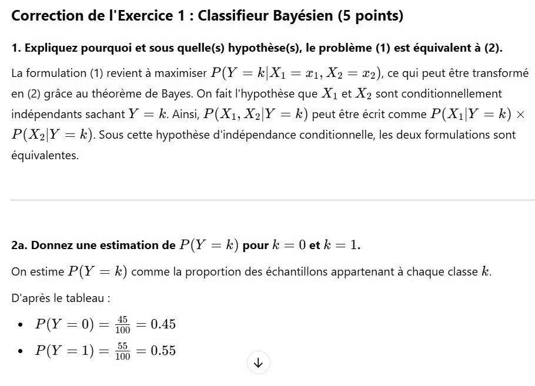

# DS DM 24 Exo 1_1 .jpg

[Ouvrir l’original](https://drive.google.com/open?id=14RjT015IB4FTu0Whb8G5fRxAsXiWGLVh) · Les pages signalées comprennent du texte reconnu automatiquement ou des éléments graphiques. Le fac-similé permet de vérifier chaque lecture.

**Pages avec fac-similé ou lecture OCR** — 1.

~~~text
Correction de l'Exercice 1 : Classifieur Bayésien (5 points)

1. Expliquez pourquoi et sous quelle(s) hypothése(s), le problème (1) est équivalent à (2).

La formulation (1) revient à maximiser P(Y = k\Xy = gi, X= £2), ce qui peut étre transformé
en (2) grâce au théorème de Bayes. On fait l'hypothèse que X1 et X2 sont conditionnellement
indépendants sachant Y = k. Ainsi, P(X1, X2|Y = k) peut être écrit comme P(Xi|Y = k) x
P(X2|Y = k). Sous cette hypothèse d'indépendance conditionnelle, les deux formulations sont

équivalentes.

2a. Donnez une estimation de P(Y = k) pour k = Oetk = 1.
On estime P(Y = k) comme la proportion des échantillons appartenant à chaque classe k.
D'après le tableau :

+ P(Y =0) = 8 = 0.45

© P(Y =1)= À = 0.55
~~~
