# DS DM 24 Exo 1_1 .pdf

[Ouvrir l’original](https://drive.google.com/open?id=1AR4ne5oQmvtzfXikLzNtZ3ybUcvLmXSf) · Les pages signalées comprennent du texte reconnu automatiquement ou des éléments graphiques. Le fac-similé permet de vérifier chaque lecture.

**Pages avec fac-similé ou lecture OCR** — 1–21.

## Page 1

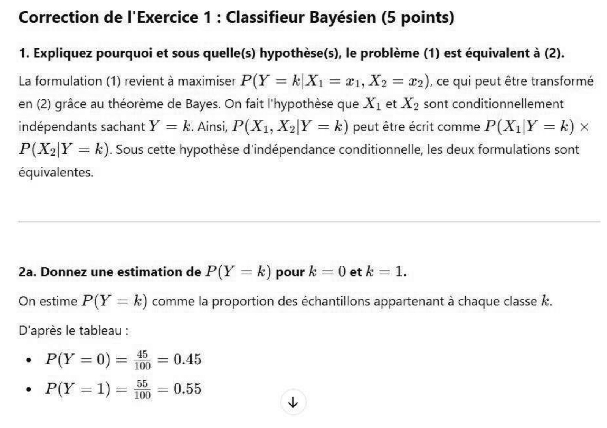

**Lecture OCR à contrôler**

~~~text
Correction de l'Exercice 1 : Classifieur Bayésien (5 points)

1. Expliquez pourquoi et sous quelle(s) hypothèse(s), le problème (1) est équivalent à (2).

La formulation (1) revient à maximiser P(Y = k|X1 = 21, X2 = 22), ce qui peut être transformé
en (2) grâce au théorème de Bayes. On fait l'hypothèse que X1 et X2 sont conditionnellement
indépendants sachant Y = k. Ainsi, P(X, X2|Y = k) peut être écrit comme P(X1|Y = k) x
P(X2|Y = k). Sous cette hypothèse d'indépendance conditionnelle, les deux formulations sont

équivalentes.

2a. Donnez une estimation de P(Y = k) pour k = 0 et k = 1.
On estime P(Y = k) comme la proportion des échantillons appartenant à chaque classe k.
D'après le tableau :

¢ P(Y =0) = 3 = 0.45

© P(Y =1) = 3 =0.55
~~~

## Page 2

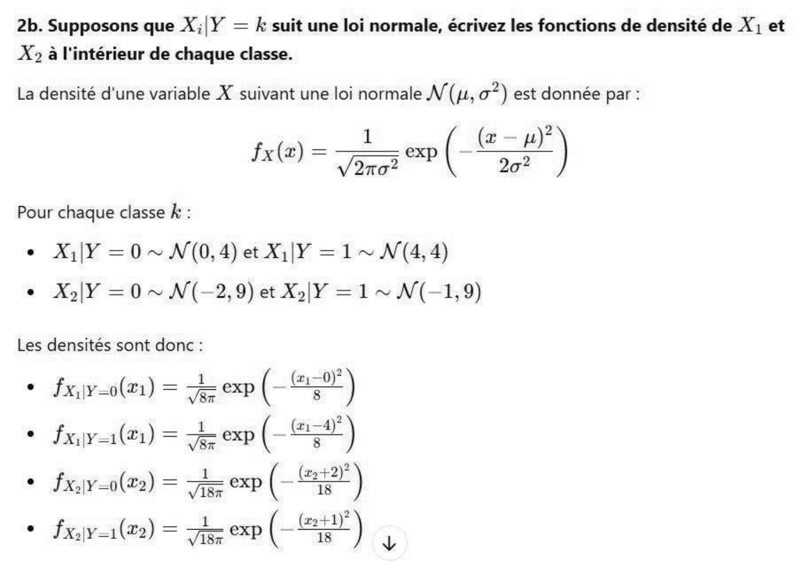

**Lecture OCR à contrôler**

~~~text
2b. Supposons que X;|Y = k suit une loi normale, écrivez les fonctions de densité de X1 et
X° à l'intérieur de chaque classe.

La densité d'une variable X suivant une loi normale NV (1, 07) est donnée par :

tte) = in exp (E20)

Pour chaque classe k :
© X1]Y =0~N(0,4) et X1[Y =1~ N(4,4)
« X|¥Y =0~ N(-2,9) et X.Y =1~ N(-1,9)

Les densités sont donc :

nu NE
© fx =0(r1) = ep ( (21-0) )
1

© fx) = 7 exp ( T5 -)

e fx -0(æ0 = sie exp (- a =

° fxsjy—1 (#2
~~~

## Page 3

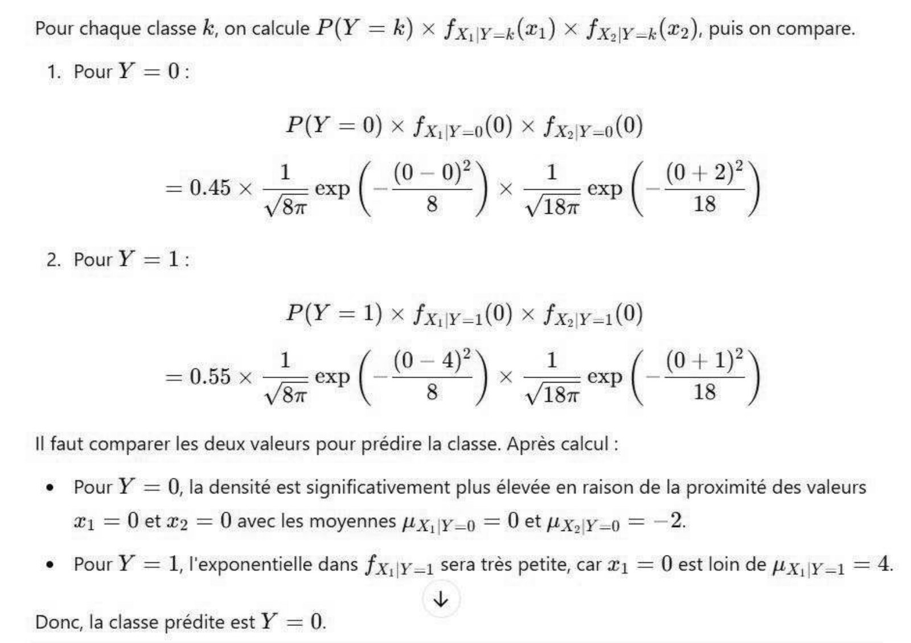

**Lecture OCR à contrôler**

~~~text
Pour chaque classe k, on calcule P(Y = k) x fx,1y_K(æ1) X fx,1y-x (2), puis on compare.

1. Pour Y — 0:

P(Y = 0) x fx,y-0(0) X fx; 0 (0)

5) «ae

= 0.45 x te, exp
T

V&r

2. Pour = 1:

P(Y = 1) x fxyy-1(0) X fx,1y-1(0)

Il faut comparer les deux valeurs pour prédire la classe. Après calcul :

e Pour Y = 0, la densité est significativement plus élevée en raison de la proximité des valeurs

æ1 = Oet £2 = 0 avec les moyennes ux,|y-0 = 0 et ux,\y 0 = —2.

+ Pour Y = 1, l'exponentielle dans fx,|y_1 sera très petite, car 1 = 0 est loin de pry, \y_1 = 4.
v

Donc, la classe prédite est Y = 0.
~~~

## Page 4

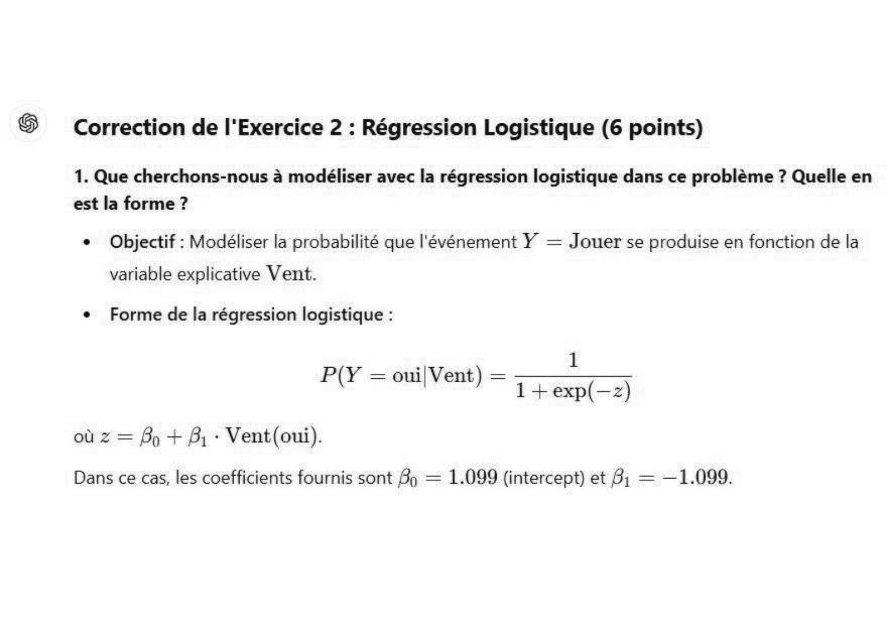

**Lecture OCR à contrôler**

~~~text
G Correction de l'Exercice 2 : Régression Logistique (6 points)

1. Que cherchons-nous à modéliser avec la régression logistique dans ce problème ? Quelle en
est la forme ?

¢ Objectif : Modéliser la probabilité que l'événement Y = Jouer se produise en fonction de la

variable explicative Vent.

+ Forme de la régression logistique :

1

P(Y = oui|Vent) = 1+ exp(—z)

où z = By + Bi - Vent(oui).

Dans ce cas, les coefficients fournis sont Ba = 1.099 (intercept) et 8; = —1.099.
~~~

## Page 5

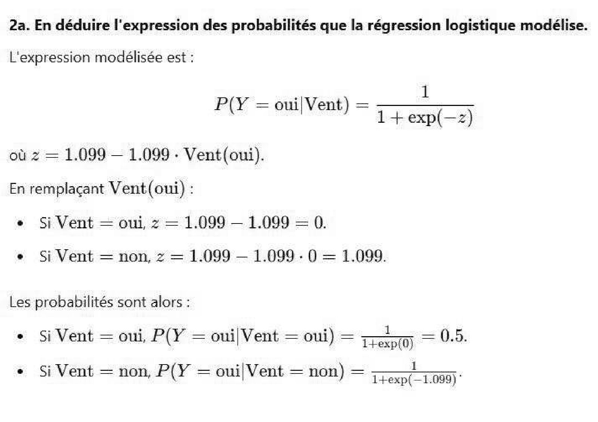

**Lecture OCR à contrôler**

~~~text
2a. En déduire l'expression des probabilités que la régression logistique modélise.

L'expression modélisée est :

P(Y = oui|Vent) = =e

où z = 1.099 — 1.099 - Vent(oui).
En remplaçant Vent(oui) :

« Si Vent = oui, z = 1.099 — 1.099 = 0.

+ Si Vent = non, z = 1.099 — 1.099 - 0 = 1.099.
Les probabilités’sont alors :

* Si Vent = oui, P(Y = oui| Vent = oui) = en =

+ Si Vent = non, P(Y = oui| Vent = non) = t

1+exp(—1.099) °
~~~

## Page 6

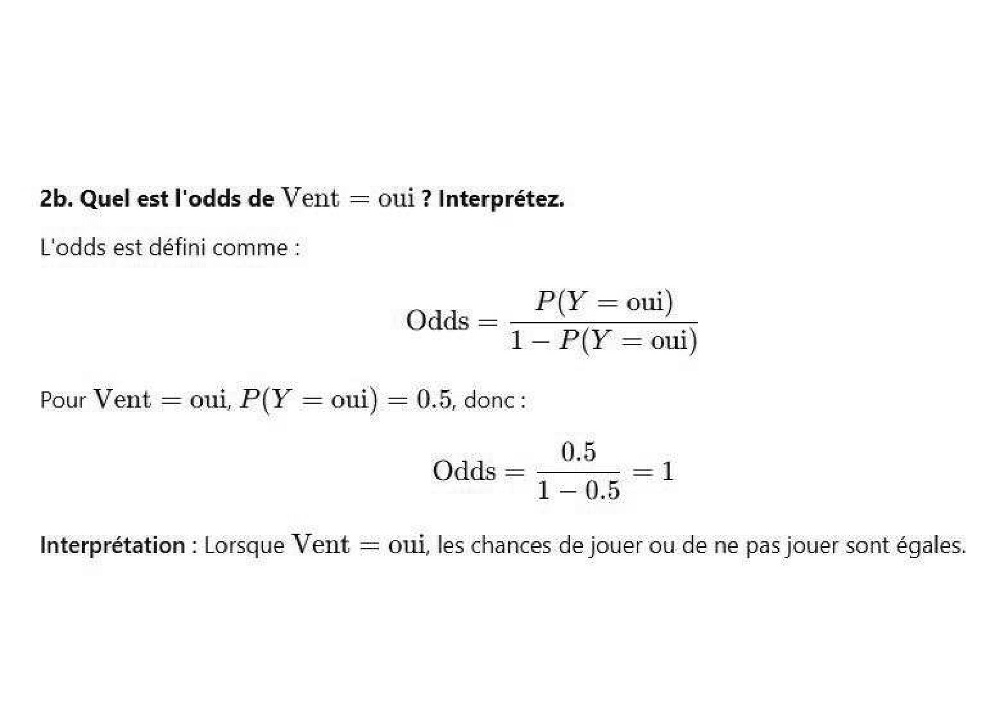

**Lecture OCR à contrôler**

~~~text
2b. Quel est l'odds de Vent = oui ? Interprétez.

L'odds est défini comme :

P(Y = oui)
Odds —
1— P(Y = oui)
Pour Vent = oui, P(Y = oui) = 0.5, donc:
0.5
Odds = =
1—0.5

Interprétation : Lorsque Vent = oui, les chances de jouer ou de ne pas jouer sont égales.
~~~

## Page 7

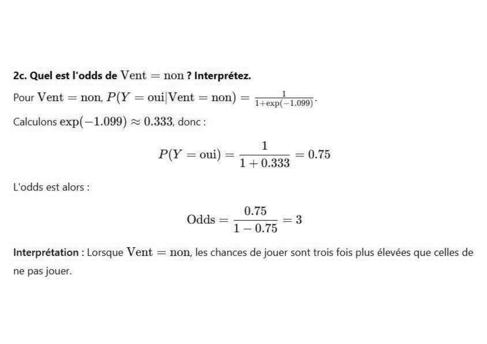

**Lecture OCR à contrôler**

~~~text
2c. Quel est l'odds de Vent — non ? Interprétez.

Pour Vent = non, P(Y = oui| Vent = non) = jC

Calculons exp(—1.099) & 0.333, donc:

ÿ 1
L'odds est alors :
0.75
mii i-o7 °°

Interprétation : Lorsque Vent = non, les chances de jouer sont trois fois plus élevées que celles de

ne pas jouer.
~~~

## Page 8

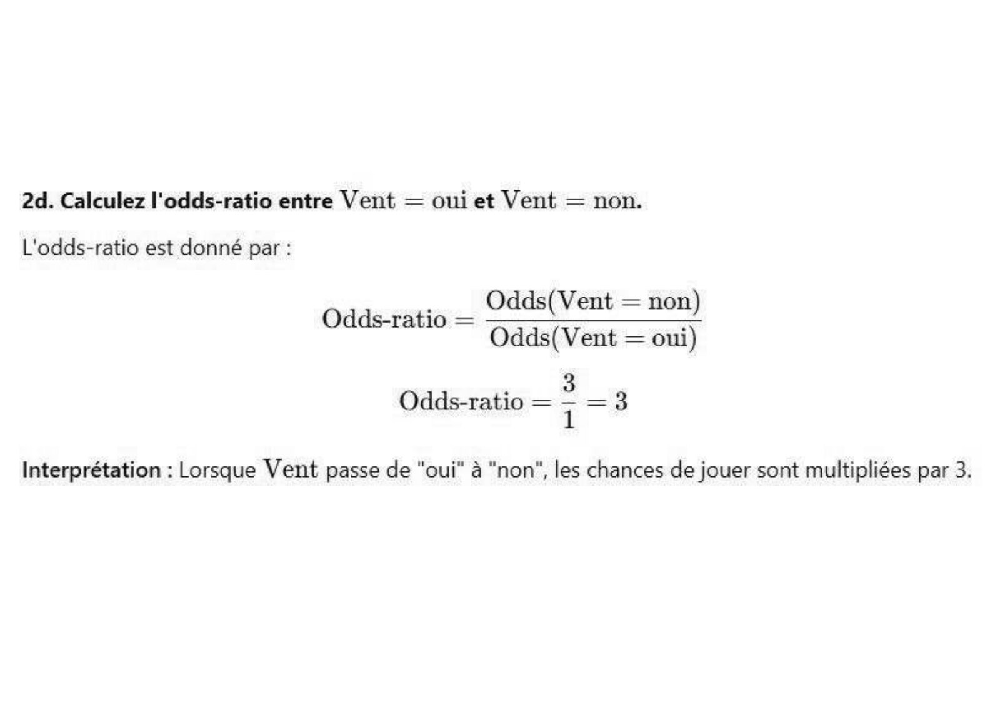

**Lecture OCR à contrôler**

~~~text
2d. Calculez l'odds-ratio entre Vent — oui et Vent — non.

L'odds-ratio est donné par :

Odds(Vent — non)
Odds(Vent — oui)

Odds-ratio —

me | co

Odds-ratio = — = 3

Interprétation : Lorsque Vent passe de "oui" à "non", les chances de jouer sont multipliées par 3.
~~~

## Page 9

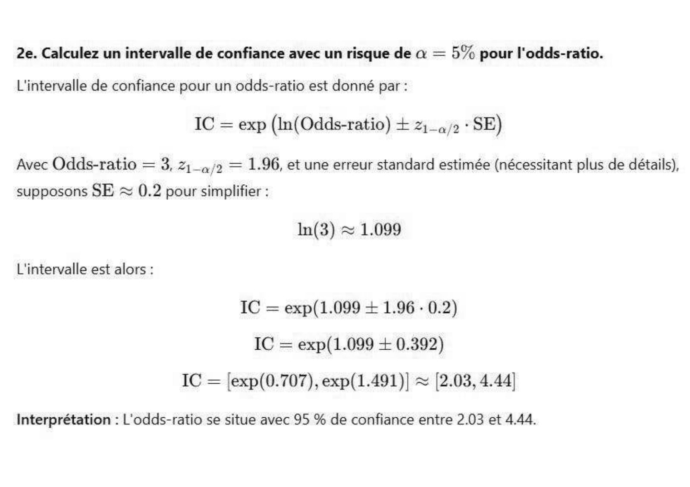

**Lecture OCR à contrôler**

~~~text
2e. Calculez un intervalle de confiance avec un risque de à = 5% pour l'odds-ratio.

L'intervalle de confiance pour un odds-ratio est donné par :
IC = exp (In(Odds-ratio) + 2i-aj2 * SE)

Avec Odds-ratio = 3, 2;_./2 = 1.96, et une erreur standard estimée (nécessitant plus de détails),

supposons SE ~ 0.2 pour simplifier :
In(3) + 1.099
L'intervalle est alors :
IC = exp(1.099 + 1.96 - 0.2)
IC = exp(1.099 + 0.392)
IC = {exp(0.707), exp(1.491)] + [2.03, 4.44]

Interprétation : L'odds-ratio se situe avec 95 % de confiance entre 2.03 et 4.44.
~~~

## Page 10

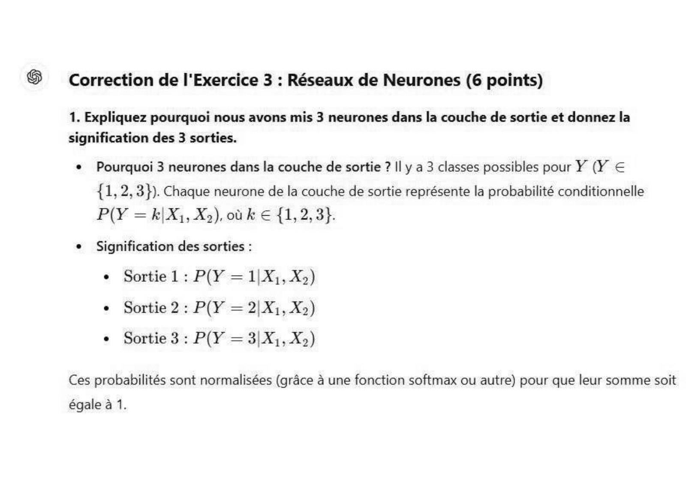

**Lecture OCR à contrôler**

~~~text
G Correction de l'Exercice 3 : Réseaux de Neurones (6 points)

1. Expliquez pourquoi nous avons mis 3 neurones dans la couche de sortie et donnez la
signification des 3 sorties.

¢ Pourquoi 3 neurones dans la couche de sortie ? || y a 3 classes possibles pour Y (Y €
{1,2,3}). Chaque neurone de la couche de sortie représente la probabilité conditionnelle

P(Y = k|X1, Xo), où k € {1, 2, 3}.
+ Signification des sorties :
+ Sortie 1: P(Y = 1|X,,X.)
e Sortie 2: P(Y = 2|X,,X2)
+ Sortie 3: P(Y = 3|X,,X2)

Ces probabilités sont normalisées (grace à une fonction softmax ou autre) pour que leur somme soit

égale a 1.
~~~

## Page 11

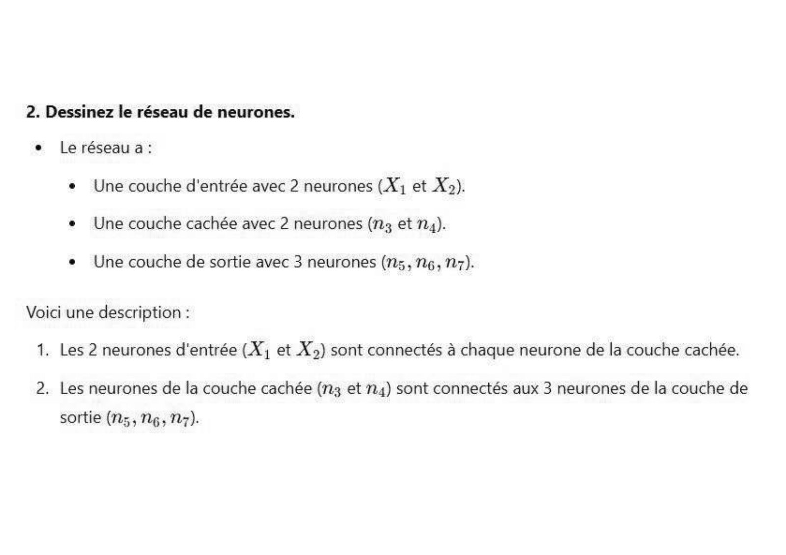

**Lecture OCR à contrôler**

~~~text
2. Dessinez le réseau de neurones.
e Leréseau a:
e Une couche d'entrée avec 2 neurones (X1 et XQ).
e Une couche cachée avec 2 neurones (n3 et 2,4).

e Une couche de sortie avec 3 neurones (n5, 2g, 7).

Voici une description :
1. Les 2 neurones d'entrée (X, et X>) sont connectés à chaque neurone de la couche cachée.

2. Les neurones de la couche cachée (n3 et 24) sont connectés aux 3 neurones de la couche de

sortie (ns, Ng, Nz).
~~~

## Page 12

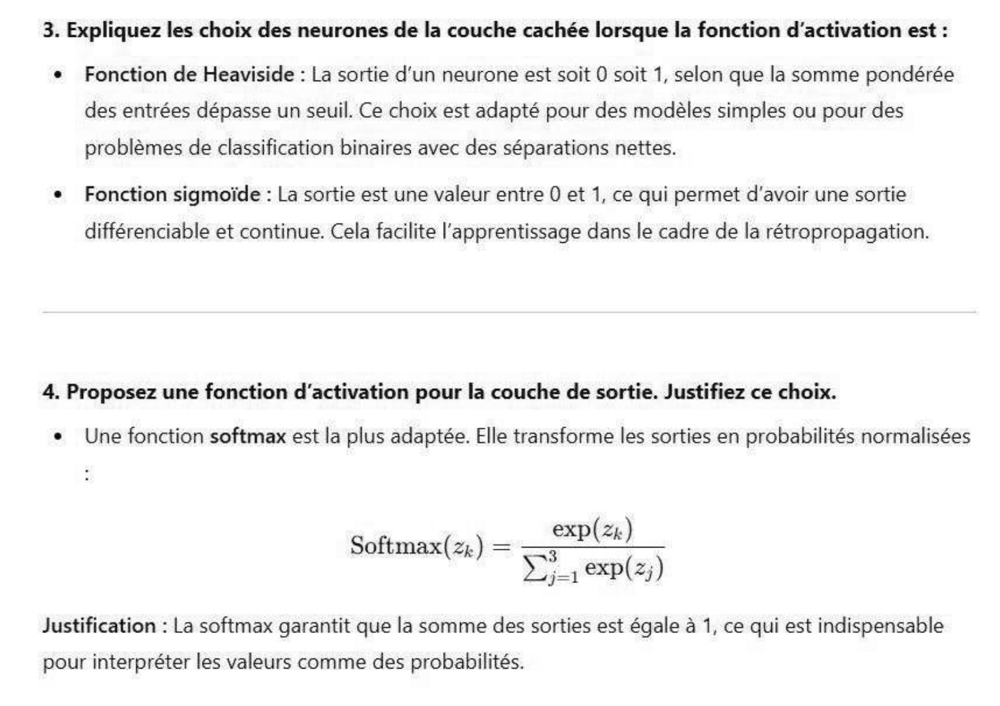

**Lecture OCR à contrôler**

~~~text
3. Expliquez les choix des neurones de la couche cachée lorsque la fonction d'activation est :

¢ Fonction de Heaviside : La sortie d'un neurone est soit 0 soit 1, selon que la somme pondérée
des entrées dépasse un seuil. Ce choix est adapté pour des modèles simples ou pour des

problèmes de classification binaires avec des séparations nettes.

¢ Fonction sigmoide : La sortie est une valeur entre 0 et 1, ce qui permet d'avoir une sortie

différenciable et continue. Cela facilite l'apprentissage dans le cadre de la rétropropagation.

4. Proposez une fonction d'activation pour la couche de sortie. Justifiez ce choix.

+ Une fonction softmax est la plus adaptée. Elle transforme les sorties en probabilités normalisées

Softmax(2;) = = exp)

2j: &xP(2;)

Justification : La softmax garantit que la somme des sorties est égale 4 1, ce qui est indispensable

pour interpréter les valeurs comme des probabilités.
~~~

## Page 13

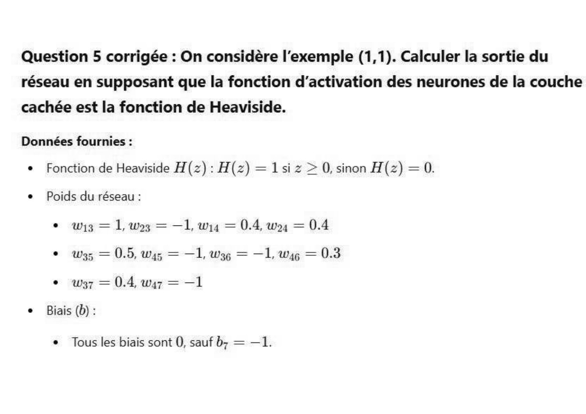

**Lecture OCR à contrôler**

~~~text
Question 5 corrigée : On considère l'exemple (1,1). Calculer la sortie du
réseau en supposant que la fonction d'activation des neurones de la couche
cachée est la fonction de Heaviside.
Données fournies :

°_ Fonction de Heaviside H(z): H(z) = 1 si z > 0, sinon H(z) = 0.

e Poids du réseau :

© wy = 1, wo3 = —1, wy = 0.4, woy = 0.4
© ws = 0.5, was = —1, weg = —1, wag = 0.3
© w37 = 0.4, wa7 = —1

+ Biais (b):

e Tous les biais sont 0, sauf by = —1.
~~~

## Page 14

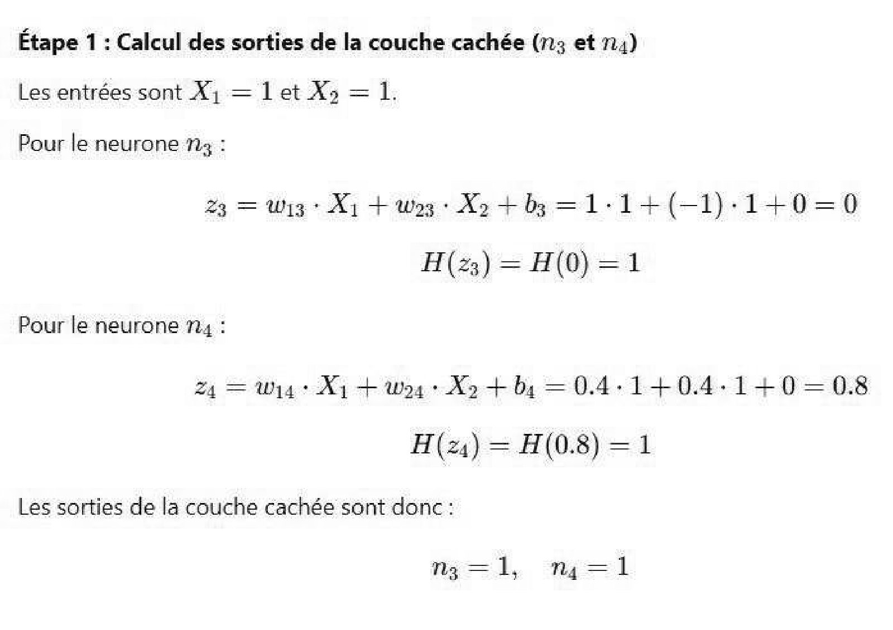

**Lecture OCR à contrôler**

~~~text
Étape 1 : Calcul des sorties de la couche cachée (n3 et n1)
Les entrées sont À = 1 et Xo = 1.

Pour le neurone n3 :
23 = Wa Xy + Weg» Xp +63 = 1-14 (-1)-14+0=0
H (23) = H(0)=1
Pour le neurone n4 :
Za = Wa Xy + Woy Xo + ba = 0.4.1+0.4.1+0—0.8
A(z) =.A(0.8) =1
Les sorties de la couche cachée sont donc:

nz = 1, yl
~~~

## Page 15

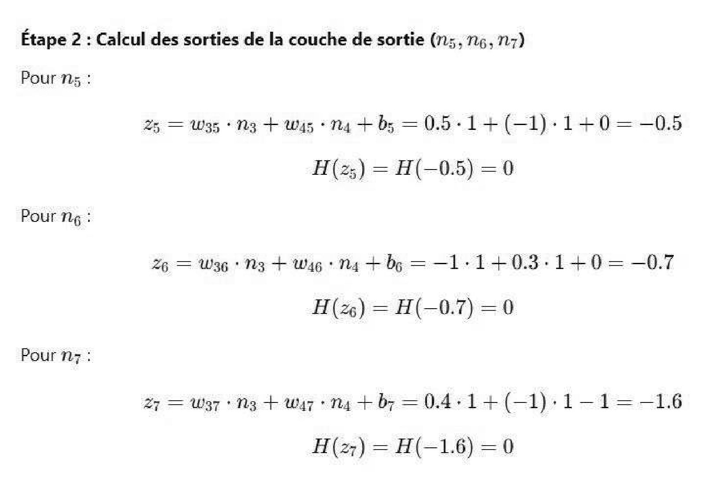

**Lecture OCR à contrôler**

~~~text
Étape 2 : Calcul des sorties de la couche de sortie (5,5, 77)

Pour ths :

Pour Tg :

Pour 13 :

23 = Was + Na + Was mg +bs —=0.5-1+(—-1):1+0——-0.5

H(zs) = H(-0.5) = 0

26 = Wag 3 + wig + Ny + bg = —1-1+0.3-14+0= —-0.7

H(z) = H(-0.7) =0

27 = War Na + Way Ta +67 = 0.4-14( 1)-1 1 = —-1.6

H(z) = H(—1.6) =0
~~~

## Page 16

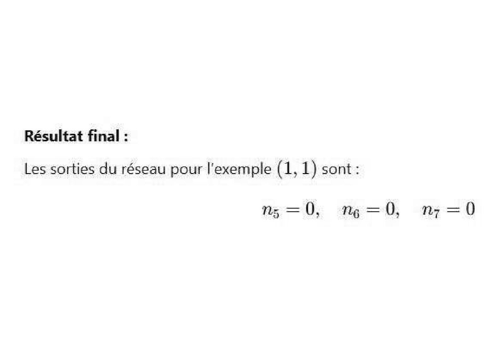

**Lecture OCR à contrôler**

~~~text
Résultat final :

Les sorties du réseau pour l'exemple (1, 1) sont :

ns =0, "= 0,
~~~

## Page 17

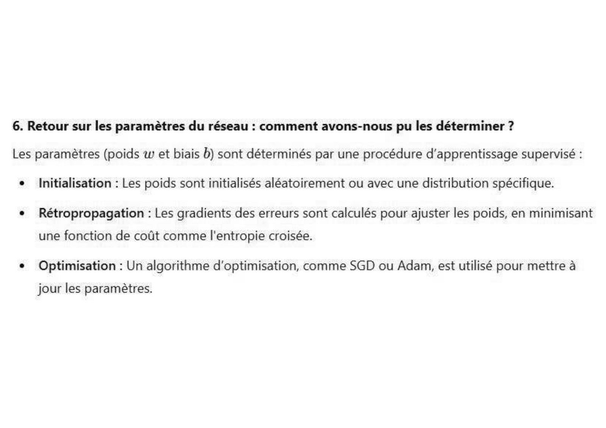

**Lecture OCR à contrôler**

~~~text
6. Retour sur les paramètres du réseau : comment avons-nous pu les déterminer ?
Les paramètres (poids w et biais b) sont déterminés par une procédure d'apprentissage supervisé :
¢ Initialisation : Les poids sont initialisés aléatoirement ou avec une distribution spécifique.

e Rétropropagation : Les gradients des erreurs sont calculés pour ajuster les poids, en minimisant

une fonction de coût comme l'entropie croisée.

¢ Optimisation : Un algorithme d'optimisation, comme SGD ou Adam, est utilisé pour mettre à

jour les paramètres.
~~~

## Page 18

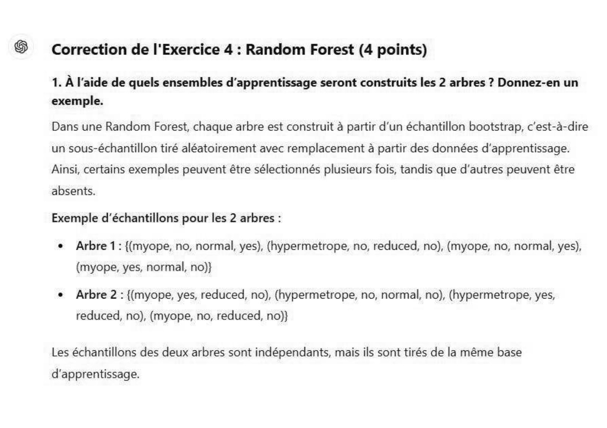

**Lecture OCR à contrôler**

~~~text
Correction de l'Exercice 4 : Random Forest (4 points)
1. À l'aide de quels ensembles d'apprentissage seront construits les 2 arbres ? Donnez-en un
exemple.

Dans une Random Forest, chaque arbre est construit à partir d'un échantillon bootstrap, c'est-à-dire
un sous-échantillon tiré aléatoirement avec remplacement à partir des données d'apprentissage.
Ainsi, certains exemples peuvent être sélectionnés plusieurs fois, tandis que d'autres peuvent être

absents.
Exemple d'échantillons pour les 2 arbres :

¢ Arbre 1 : {(myope, no, normal, yes), (hypermetrope, no, reduced, no), (myope, no, normal, yes),

(myope, yes, normal, no)}

+ Arbre 2 : {(myope, yes, reduced, no), (hypermetrope, no, normal, no), (hypermetrope, yes,

reduced, no), (myope, no, reduced, no)}

Les échantillons des deux arbres sont indépendants, mais ils sont tirés de la méme base

d'apprentissage.
~~~

## Page 19

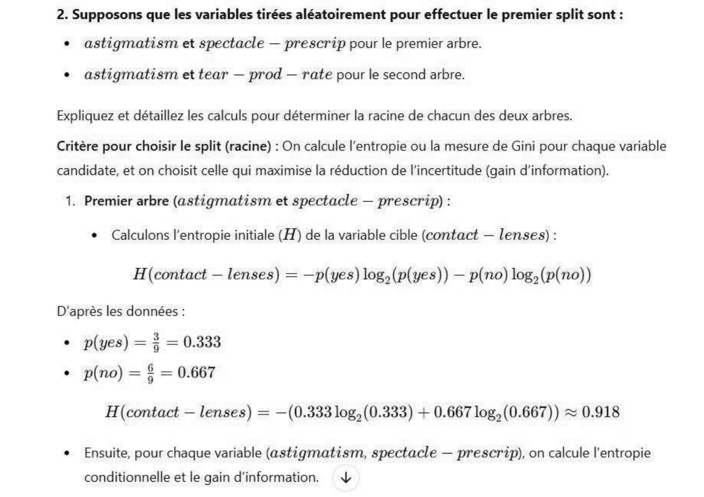

**Lecture OCR à contrôler**

~~~text
2. Supposons que les variables tirées aléatoirement pour effectuer le premier split sont :
¢ astigmatism et spectacle — prescrip pour le premier arbre.

+ astigmatism et tear — prod — rate pour le second arbre.

Expliquez et détaillez les calculs pour déterminer la racine de chacun des deux arbres.

Critère pour choisir le split (racine) : On calcule l'entropie ou la mesure de Gini pour chaque variable

candidate, et on choisit celle qui maximise la réduction de l'incertitude (gain d'information).

1. Premier arbre (astigmatism et spectacle — prescrip) :

¢ Calculons l'entropie initiale (H) de la variable cible (contact — lenses) :

H(contact — lenses) = —p(yes) log, (p(yes)) — p(no) log, (p(no))
D'après les données :
+ p(yes) = 3 = 0.333
* p(no) = § = 0.667

H (contact — lenses) = —(0.333 log, (0.333) + 0.667 log, (0.667)) & 0.918

+ Ensuite, pour chaque variable (astigmatism, spectacle — prescrip), on calcule l'entropie

conditionnelle et le gain d'information. J
~~~

## Page 20

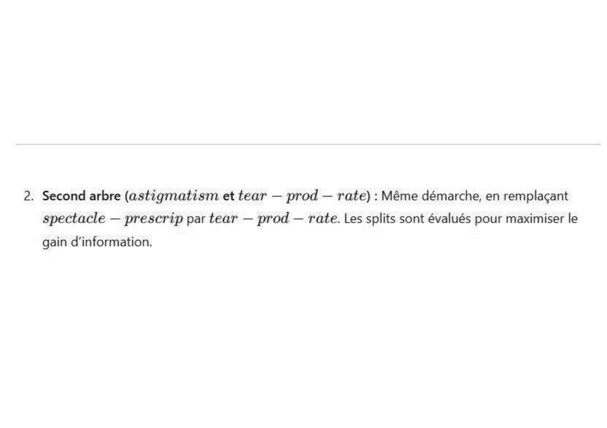

**Lecture OCR à contrôler**

~~~text
2. Second arbre (astigmatism et tear — prod — rate) : Même démarche, en remplaçant
spectacle — prescrip par tear — prod — rate. Les splits sont évalués pour maximiser le

gain d'information.
~~~

## Page 21

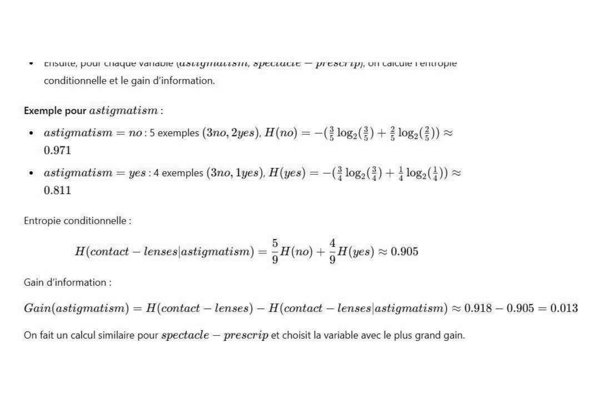

**Lecture OCR à contrôler**

~~~text
© CHSUILE, PUUI CHAQUE VaridUIE (USLEYTULLS TIL, SPECLUCLE — prescr tp), UN CaiCUIE | ÉTUDIE

conditionnelle et le gain d'information.

Exemple pour astigmatism :

+ astigmatism = no: 5 exemples (3no, 2yes), H(no) = —(? log; (?) + ? log,(2)) &
0.971

* astigmatism = yes : 4 exemples (3no, 1yes), H(yes) = —(4 log, (À) + 4 log: (+)) &
0.811

Entropie conditionnelle :

5 4
H (contact — lenses|astigmatism) = gH (no) + gH (ves) = 0.905

Gain d'information :

Gain(astigmatism) = H(contact — lenses) — H(contact — lenses|astigmatism) ~ 0.918 — 0.905 = 0.013

On fait un calcul similaire pour spectacle — prescrip et choisit la variable avec le plus grand gain.
~~~
