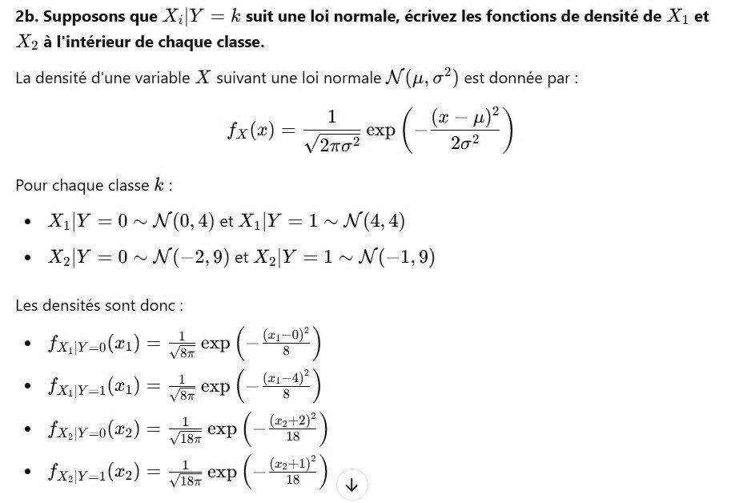

# DS DM 24 Exo 1_2.jpg

[Ouvrir l’original](https://drive.google.com/open?id=1nBDd2CCLr-fTvd75lSYVIVJ_XJ0tIzWG) · Les pages signalées comprennent du texte reconnu automatiquement ou des éléments graphiques. Le fac-similé permet de vérifier chaque lecture.

**Pages avec fac-similé ou lecture OCR** — 1.

~~~text
2b. Supposons que X;|Y = k suit une loi normale, écrivez les fonctions de densité de X1 et
X> à l'intérieur de chaque classe.

La densité d'une variable X suivant une loi normale W'(1, 0”) est donnée par :

file) = Ting emp (-E 2h)

Pour chaque classe k :
© X1]Y =0~N(0,4) et X1[Y =1~ N(4,4)
+ X|¥Y =0~ N(-2,9) et X2]Y =1~ W(-1,9)

Les densités sont donc :

° fx,\y=0(21) = oe exp ( a)
)

s fx) = er D ( 3
* fxjy-o(e2) = Te
1

TE
° fauve) = zz exp ( eu) +
~~~
