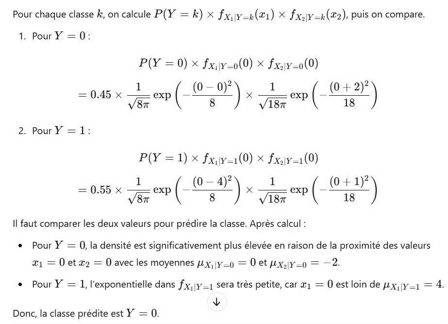

# DS DM 24 Exo 1_3.jpg

[Ouvrir l’original](https://drive.google.com/open?id=150lOxg6MHxei118VVyJ7WFAmsTQDMeYZ) · Les pages signalées comprennent du texte reconnu automatiquement ou des éléments graphiques. Le fac-similé permet de vérifier chaque lecture.

**Pages avec fac-similé ou lecture OCR** — 1.

~~~text
Pour chaque classe k, on calcule P(Y = k) x fx\y_x(21) X fxuy-(æ2), puis on compare.

1 Pour Y = 0:

P(Y = 0) x fxv_0(0) X fxsv0(0)

= 0.45 x Gee ( fi 7) x ew ( our)

2. PourrY = 1:

P(Y =1) x fxv-1(0) X fxsv1(0)

= 0.55 x Feo ( (0 re se

Il faut comparer les deux valeurs pour prédire la classe. Après calcul :

+ Pour Y = 0, la densité est significativement plus élevée en raison de la proximité des valeurs

æ1 = 0 etx2 = 0 avec les moyennes ux,17_0 = 0 et Ux,1y=0 = —2.

+ Pour Y = 1, l'exponentielle dans fx;|y_1 sera très petite, car æ1 = 0 est loin de ux,|y_1 = 4.
Ÿ

Donc, la classe prédite est Y = 0.
~~~
