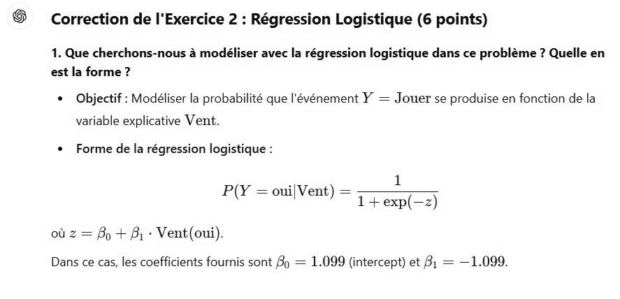

# DS DM 24 Exo 2_1 .jpg

[Ouvrir l’original](https://drive.google.com/open?id=1tAB4XIhj80vSvGVQpUEdzn2O1bb-TuFL) · Les pages signalées comprennent du texte reconnu automatiquement ou des éléments graphiques. Le fac-similé permet de vérifier chaque lecture.

**Pages avec fac-similé ou lecture OCR** — 1.

~~~text
6

Correction de l'Exercice 2 : Régression Logistique (6 points)

1. Que cherchons-nous à modéliser avec la régression logistique dans ce problème ? Quelle en
est la forme ?

* Objectif : Modéliser la probabilité que l'événement Y = Jouer se produise en fonction de la

variable explicative Vent.

* Forme de la régression logistique :

ji

P(Y = oui[Vent) = FT)

où z = Bo + Bi - Vent(oui)

Dans ce cas, les coefficients fournis sont By = 1.099 (intercept) et 8: = —1.099.
~~~
