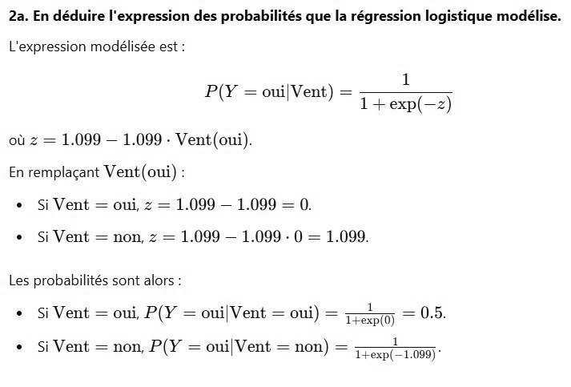

# DS DM 24 Exo 2_2.jpg

[Ouvrir l’original](https://drive.google.com/open?id=1tOA3eF6YpxHopYtU6-jdUBlVg_r96jXX) · Les pages signalées comprennent du texte reconnu automatiquement ou des éléments graphiques. Le fac-similé permet de vérifier chaque lecture.

**Pages avec fac-similé ou lecture OCR** — 1.

~~~text
2a. En déduire l'expression des probabilités que la régression logistique modélise.

L'expression modélisée est :

P(Y = oui[Vent) = es
où z = 1.099 — 1.099 - Vent(oui).
En remplaçant Vent (oui)
+ Si Vent = oui, z = 1.099 — 1.099 = 0.
+ si Vent = non, z = 1.099 — 1.099 : 0 = 1.099.
Les probabilités sont alors
+ si Vent = oui, P(Y = oui|Vent = oui) = T0 = 0.5:

+ Si Vent = non, P(Y = oui|Vent = non) = ee Se 195)"
~~~
