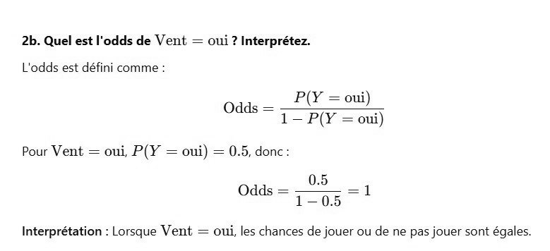

# DS DM 24 Exo 2_3.jpg

[Ouvrir l’original](https://drive.google.com/open?id=13HkeJm05JvuHYqDouLIq9nfnBbHGJ-JW) · Les pages signalées comprennent du texte reconnu automatiquement ou des éléments graphiques. Le fac-similé permet de vérifier chaque lecture.

**Pages avec fac-similé ou lecture OCR** — 1.

~~~text
2b. Quel est l'odds de Vent = oui? Interprétez.

L'odds est défini comme

P(Y = oui)

Odds = 7 {y = oni)

Pour Vent = oui, P(Y = oui) = 0.5, donc

Odds =

Interprétation : Lorsque Vent = oui, les chances de jouer ou de ne pas jouer sont égales.
~~~
