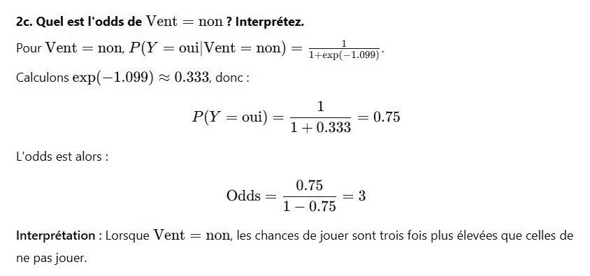

# DS DM 24 Exo 2_4.jpg

[Ouvrir l’original](https://drive.google.com/open?id=10sk5UOPIXxVZM_YlnCnlT-71ll65aEEC) · Les pages signalées comprennent du texte reconnu automatiquement ou des éléments graphiques. Le fac-similé permet de vérifier chaque lecture.

**Pages avec fac-similé ou lecture OCR** — 1.

~~~text
2c. Quel est l'odds de Vent = non? Interprétez.

Pour Vent = non, P(Y = oui| Vent = non) = en)

Calculons exp(—1.099) ~ 0.333, donc

P(Y = oui) = 17038 — 0.75
L'odds est alors :
0.75
Odds = 1-08 — 3:

Interprétation : Lorsque Vent = non, les chances de jouer sont trois fois plus élevées que celles de

ne pas jouer.
~~~
