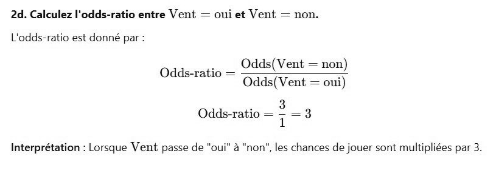

# DS DM 24 Exo 2_5.jpg

[Ouvrir l’original](https://drive.google.com/open?id=1UAUeotG9jup0KNlqMeVcqtOY1V0XrM4g) · Les pages signalées comprennent du texte reconnu automatiquement ou des éléments graphiques. Le fac-similé permet de vérifier chaque lecture.

**Pages avec fac-similé ou lecture OCR** — 1.

~~~text
2d. Calculez l'odds-ratio entre Vent = oui et Vent = non.

L'odds-ratio est donné par

Odds(Vent = non)

Odds-ratio = ———____—__
Sratio Odds(Vent = oui)

Odds-ratio = : =

Interprétation : Lorsque Vent passe de "oui" à "non", les chances de jouer sont multipliées par 3.
~~~
