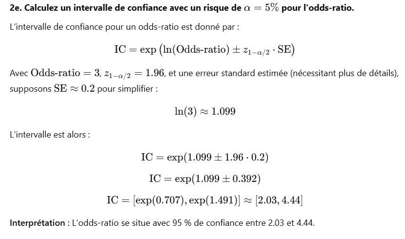

# DS DM 24 Exo 2_6.jpg

[Ouvrir l’original](https://drive.google.com/open?id=1g45LS1nEgwwJtHLM2r3adSO-CY6FdVFg) · Les pages signalées comprennent du texte reconnu automatiquement ou des éléments graphiques. Le fac-similé permet de vérifier chaque lecture.

**Pages avec fac-similé ou lecture OCR** — 1.

~~~text
2e. Calculez un intervalle de confiance avec un risque de & = 5% pour l'odds-ratio.

L'intervalle de confiance pour un odds-ratio est donné par:
IC = exp (In(Odds-ratio) +2 _a/2° SE)

Avec Odds-ratio = 3, 21_,,2 = 1.96, et une erreur standard estimée (nécessitant plus de détails),

supposons SE ~ 0.2 pour simplifier :
In(3) ~ 1.099
L'intervalle est alors
IC = exp(1.099 + 1.96 - 0.2)
IC = exp(1.099 + 0.392)
IC = [exp(0.707), exp(1.491)] ~ [2.03, 4.44]

Interprétation : L'odds-ratio se situe avec 95 % de confiance entre 2.03 et 4.44.
~~~
