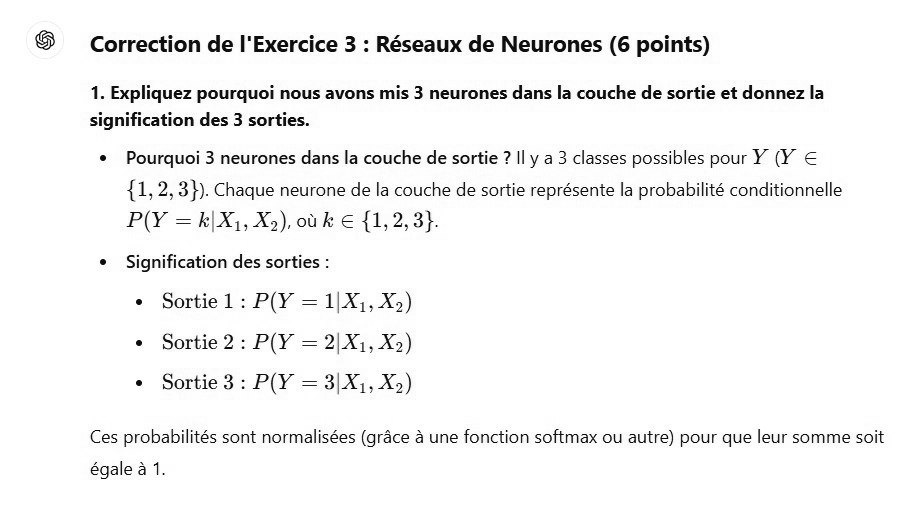

# DS DM 24 Exo 3_1.jpg

[Ouvrir l’original](https://drive.google.com/open?id=1GTn3L_zXdCiGhOAHeWYdNdlRgjI1MDSj) · Les pages signalées comprennent du texte reconnu automatiquement ou des éléments graphiques. Le fac-similé permet de vérifier chaque lecture.

**Pages avec fac-similé ou lecture OCR** — 1.

~~~text
6

Correction de l'Exercice 3 : Réseaux de Neurones (6 points)

1. Expliquez pourquoi nous avons mis 3 neurones dans la couche de sortie et donnez la
signification des 3 sorties.

+ Pourquoi 3 neurones dans la couche de sortie ? Il y a 3 classes possibles pour ¥ (Y €
{1, 2, 3}). Chaque neurone de la couche de sortie représente la probabilité conditionnelle
P(Y = k|X1, Xo), où k € {1, 2, 3}

+ Signification des sorties :
+ Sortiel:P(Y = 1|X,,X»)
+ Sortie 2: P(Y = 2|X1, X2)
+ Sortie 3: P(Y = 3|X1, X2)

Ces probabilités sont normalisées (grâce à une fonction softmax ou autre) pour que leur somme soit

égale à 1
~~~
