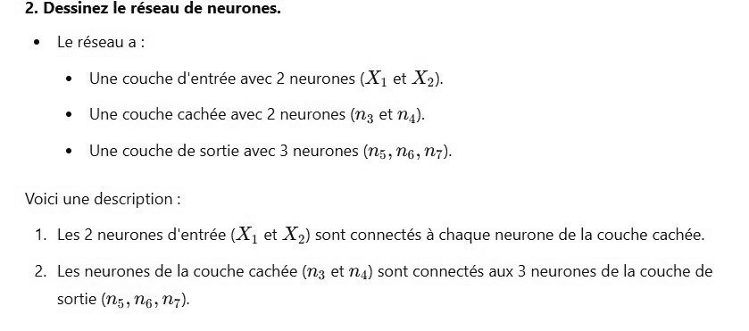

# DS DM 24 Exo 3_2.jpg

[Ouvrir l’original](https://drive.google.com/open?id=144oQqFCk3-F0NgE8YOwowea12yr3Gjpl) · Les pages signalées comprennent du texte reconnu automatiquement ou des éléments graphiques. Le fac-similé permet de vérifier chaque lecture.

**Pages avec fac-similé ou lecture OCR** — 1.

~~~text
2. Dessinez le réseau de neurones.
+ Leréseaua:
+ Une couche d'entrée avec 2 neurones (X1 et X2).
+ Une couche cachée avec 2 neurones (n3 et n4).

+ Une couche de sortie avec 3 neurones (n5, 2g, 27).

Voici une description :
1. Les 2 neurones d'entrée (X, et X2) sont connectés à chaque neurone de la couche cachée

2. Les neurones de la couche cachée (n3 et n4) sont connectés aux 3 neurones de la couche de

sortie (Ns, Ng, Nr).
~~~
