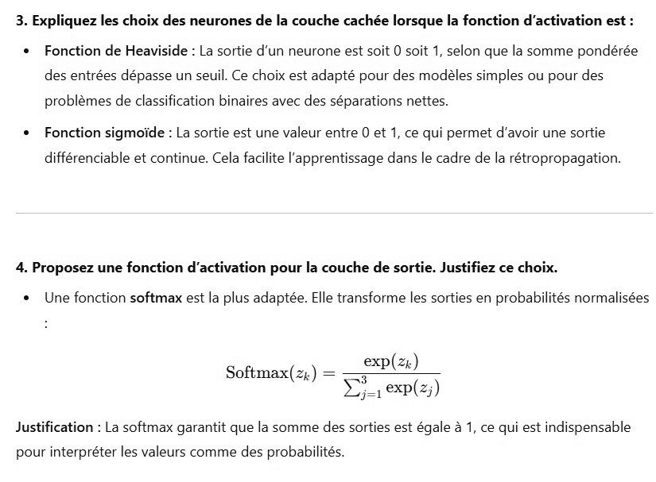

# DS DM 24 Exo 3_3.jpg

[Ouvrir l’original](https://drive.google.com/open?id=1FIkmJwSHklDK4IyMjRGUWevcUWHYACCp) · Les pages signalées comprennent du texte reconnu automatiquement ou des éléments graphiques. Le fac-similé permet de vérifier chaque lecture.

**Pages avec fac-similé ou lecture OCR** — 1.

~~~text
3. Expliquez les choix des neurones de la couche cachée lorsque la fonction d'activation est :

* Fonction de Heaviside : La sortie d'un neurone est soit 0 soit 1, selon que la somme pondérée
des entrées dépasse un seuil. Ce choix est adapté pour des modèles simples ou pour des

problèmes de classification binaires avec des séparations nettes.

* Fonction sigmoide : La sortie est une valeur entre 0 et 1, ce qui permet d'avoir une sortie

différenciable et continue. Cela facilite l'apprentissage dans le cadre de la rétropropagation.

4. Proposez une fonction d'activation pour la couche de sortie. Justifiez ce choix.

* Une fonction softmax est la plus adaptée. Elle transforme les sorties en probabilités normalisées

exp()

Softmax(z,) = = —
Zi exp(z;)

Justification : La softmax garantit que la somme des sorties est égale à 1, ce qui est indispensable

pour interpréter les valeurs comme des probabilités
~~~
