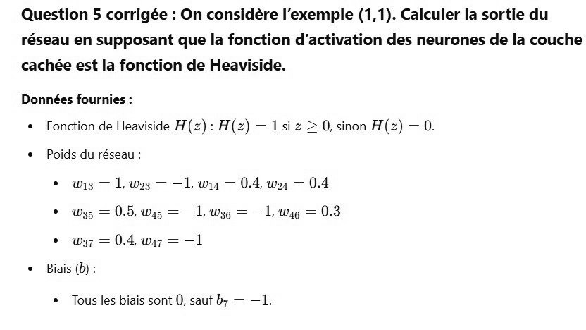

# DS DM 24 Exo 3_4.jpg

[Ouvrir l’original](https://drive.google.com/open?id=1LjghW2wMMYNih4Vu_vhh10Rfv2YroH8g) · Les pages signalées comprennent du texte reconnu automatiquement ou des éléments graphiques. Le fac-similé permet de vérifier chaque lecture.

**Pages avec fac-similé ou lecture OCR** — 1.

~~~text
Question 5 corrigée : On considère l'exemple (1,1). Calculer la sortie du
réseau en supposant que la fonction d'activation des neurones de la couche
cachée est la fonction de Heaviside.
Données fournies :

¢ Fonction de Heaviside H(z): H(z) = 1 si z > 0, sinon H(z) = 0.

© Poids du réseau :

© wi3 = 1, wo = —1, wy = 0.4, wy = 0.4
© wW35 = 0.5, was = —1, Wag = —1, wag = 0.3
© w37 = 0.4, waz = —1

© Biais (b):

* Tous les biais sont 0, sauf by = —1.
~~~
