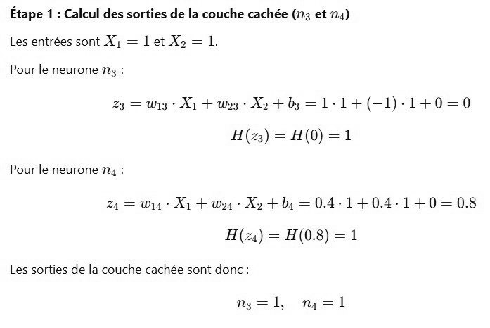

# DS DM 24 Exo 3_5.jpg

[Ouvrir l’original](https://drive.google.com/open?id=11tm48rXKfgMsOqgYOd6FJH5JbKmIst1n) · Les pages signalées comprennent du texte reconnu automatiquement ou des éléments graphiques. Le fac-similé permet de vérifier chaque lecture.

**Pages avec fac-similé ou lecture OCR** — 1.

~~~text
Étape 1 : Calcul des sorties de la couche cachée (n3 et 24)
Les entrées sont X1 = let X2 = 1.

Pour le neurone n3 :
23 = wig + X1 + ws Xp +b3 =1-1+(-1)-1+0=0
H(z) = H(0) =1
Pour le neurone n4 :
24 = Wig Xy + Woy Xo + bg = 04-1+0.4:1+0— 0.8
H(2:) = H(0.8) =1
Les sorties de la couche cachée sont donc:

n=l, m=l
~~~
